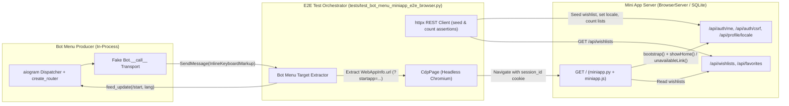

# WISHENKA-177: End-to-End Verification of Telegram Bot Menu Transitions to Mini App

## Research

Research of the existing codebase (`wishenka/bot/entry.py`, `wishenka/web/routes/miniapp.py`,
`wishenka/web/static/miniapp.js`, `wishenka/i18n/catalog.py`, `wishenka/web/routes/profile.py`,
`tests/test_bot_start_repro.py`, `tests/test_bot_entry_repro.py`, `tests/conftest.py`, and
`Makefile`) established the exact boundary and contracts between the Telegram bot menu and the
Mini App:

1. **Bot menu generation (`wishenka/bot/entry.py`):**
   - `create_router(dependencies)` registers `LocaleMiddleware` and handles `/start` in private
     chats, replying with `InlineKeyboardMarkup` from `_keyboard(base, lang, target)`.
   - `_url(base, intent)` validates that `base` is an `https://` URL without credentials or
     fragment, strips any existing `startapp` query parameter, and appends `startapp=<intent>`.
   - The three standard Mini App menu buttons are:
     - `create` (`bot.entry.btn_create`: `"Create wishlist"` / `"Создать вишлист"`) ->
       `WebAppInfo(url=_url(base, "create"))`
     - `collection` (`bot.entry.btn_collection`: `"My wishlists"` / `"Мои вишлисты"`) ->
       `WebAppInfo(url=_url(base, "collection"))`
     - `home` (`bot.entry.btn_home`: `"Open Mini App"` / `"Открыть Mini App"`) ->
       `WebAppInfo(url=_url(base, "home"))`

2. **Mini App shell and entry routing (`wishenka/web/routes/miniapp.py`, `wishenka/web/static/miniapp.js`):**
   - `GET /` renders the HTML shell with `#app`, `#status`, and embedded `#miniapp-i18n` JSON
     catalog (`miniapp_catalog()`), plus `lang` and `data-locale` resolved by `LocaleDep`.
   - `miniapp.js` `start()` reads `startParam` from
     `bridge?.initDataUnsafe?.start_param || new URLSearchParams(location.search).get('startapp')`.
   - If `startParam` matches `/^[pi]_[A-Za-z0-9_-]{1,128}$/`, it dispatches to `publicView(token)`
     or `invitationView(token)`.
   - If `startParam` is truthy and not in `['home', 'create', 'collection']`, `start()` calls
     `unavailableLink()`, which renders `miniapp.unavailable.title`, `miniapp.unavailable.description`,
     and a recovery button `miniapp.unavailable.home_menu` that invokes `bootstrap()` + `showHome()`.
   - For `home`, `create`, and `collection` (or empty `startParam`), `start()` calls `await bootstrap()`
     (which authenticates via `/api/auth/me` or `/api/auth/telegram`, updates `profileLocale`, and
     fetches `/api/auth/csrf`) and `await showHome()`.
   - When `startParam === 'create'`, `start()` additionally focuses `root.querySelector('button')`
     (the `"Create wishlist"` / `"Создать вишлист"` button in `.top-nav`).
   - Navigating to `home`, `create`, or `collection` performs only read requests (`GET /api/auth/me`,
     `GET /api/auth/csrf`, `GET /api/wishlists`, `GET /api/favorites`, `GET /api/wishlists/deleted`);
     `POST /api/wishlists` is only triggered on explicit click of the create button.

3. **User session & localization (`wishenka/web/routes/profile.py`, `tests/conftest.py`):**
   - `wishlist_server` (`BrowserServer` in `tests/conftest.py`) starts an isolated FastAPI/uvicorn
     instance on `127.0.0.1:<port>` using a per-test copy of `migrated_db_template`, and issues
     signed `SessionTokenService` tokens (`owner_token`, `viewer_token`).
   - `PATCH /api/profile/locale` (authenticated with `session_id` cookie + `X-CSRF-Token` or
     `Authorization: Bearer ...`) persists `users.locale` (`"ru"` or `"en"`), which `/api/auth/me`
     returns during `bootstrap()` in `miniapp.js`.

4. **Test infrastructure (`tests/browser_cdp.py`, `tests/conftest.py`, `Makefile`):**
   - Browser tests use `CdpBrowser` / `CdpPage` (CDP over headless Chromium), decorated with
     `pytestmark = [pytest.mark.timeout(45), pytest.mark.browser]`.
   - Bot dispatch tests use `aiogram.Dispatcher.feed_update` with a monkeypatched `Bot.__call__`
     in-process transport (no live Telegram API calls).

## Implementation Plan

1. **Test module placement:** Add a dedicated browser E2E test module
   `tests/test_bot_menu_miniapp_e2e_browser.py` with `pytestmark = [pytest.mark.timeout(45), pytest.mark.browser]`,
   reusing `chromium_browser`, `_browser_pages`, `wishlist_server`, and `seed_wishlist` from
   `tests/conftest.py` / `tests/test_giver_csrf_repro_browser.py`.
2. **Bot Menu Target Extraction Helper:** Implement a local async helper in the test module that
   runs `wishenka.bot.entry.create_router` through `aiogram.Dispatcher.feed_update` with an
   in-process `Bot.__call__` transport for `/start` in a given language (`"en"` or `"ru"`), extracts
   the `WebAppInfo.url` for each of the three menu buttons (`create`, `collection`, `home`), asserts
   the `https://` URL and `startapp` query parameter, and maps the extracted query string onto
   `wishlist_server.base_url`.
3. **Seeded Session & Locale Setup:** Seed a wishlist via `seed_wishlist` (so private wishlist data
   exists to verify both collection rendering and non-leakage on invalid recovery) and set the
   owner's locale to `"en"` or `"ru"` via `PATCH /api/profile/locale` before opening the browser page.
4. **Transition & Invariant Assertions:**
   - For `create`, `collection`, and `home` in both `en` and `ru`:
     - Open the bot-generated target in `CdpPage` with `session_id` cookie set.
     - Assert the expected localized screen renders (`miniapp.home.title`, `miniapp.home.my_wishlists`,
       seeded wishlist visible in collection, create button focused for `create`).
     - Assert via `GET /api/wishlists` (before and after) that the wishlist count is unchanged
       (no implicit write-on-entry).
   - For invalid launch parameters (e.g. `unknown_action`, `bad!param`, `x_not_a_token`) in both
     `en` and `ru`:
     - Open `/?startapp=<invalid>` in `CdpPage` with `session_id` cookie set.
     - Assert the localized unavailable-link recovery screen renders (`miniapp.unavailable.title`,
       `miniapp.unavailable.description`, and `miniapp.unavailable.home_menu` button).
     - Assert private wishlist titles are not present in the rendered DOM.
     - Assert clicking the recovery button navigates safely to the home screen.
     - Assert via `GET /api/wishlists` that no wishlist was created.
5. **Verification:** Run `make analyze` and `make test` (or targeted `pytest` + full suite) to verify
   all checks pass without warnings, timeouts, or flaky behavior.

**Mandatory — Failing Repro (next Step 3):** `N/A — no behavioral change`. This task closes a
verification gap identified in `WISHENKA-27` by adding automated end-to-end tests for the already
implemented bot-menu-to-Mini-App contract (`create`, `collection`, `home`, RU/EN localization,
no implicit wishlist creation, and safe recovery on invalid `startapp` parameters). No production
code changes are planned unless test execution uncovers a discrepancy.

## Architecture

### System Module Diagram

### Modules and Responsibilities

1. **Bot Menu Producer (`wishenka.bot.entry.create_router` + in-process transport):**
   - **Responsibility:** Generates authentic `InlineKeyboardMarkup` with localized labels and
     `WebAppInfo(url=_url(mini_app_url, intent))` for `/start` updates in `en` and `ru`, without
     network calls to Telegram.
2. **Test Orchestrator (`tests/test_bot_menu_miniapp_e2e_browser.py`):**
   - **Responsibility:** Bridges the bot menu output and the browser session. Extracts actual
     button launch URLs from `SendMessage.reply_markup`, translates the `https://` origin to the
     ephemeral `BrowserServer` origin while preserving the exact `startapp` query parameter, drives
     `CdpPage` assertions, and verifies database side-effect invariants via `httpx`.
3. **Browser Runtime (`tests/browser_cdp.py`, `tests/conftest.py`):**
   - **Responsibility:** Hosts an isolated per-test FastAPI/uvicorn instance (`BrowserServer`) backed
     by a copied SQLite WAL database and drives real Chromium JS execution of `wishenka/web/static/miniapp.js`.
4. **Mini App Entry & API (`wishenka/web/routes/miniapp.py`, `wishenka/web/static/miniapp.js`, `wishenka/web/routes/profile.py`):**
   - **Responsibility:** Serves the localized Mini App shell, executes `start()` routing for
     `create`, `collection`, `home`, and invalid `startapp` values, and enforces read-only entry
     and safe recovery.

### Module Interaction Scheme

1. **Setup phase:** `seed_wishlist` creates a baseline wishlist for the owner (`OWNER_TELEGRAM_ID`)
   on an isolated `BrowserServer`. `httpx.Client` sets the owner's locale (`en` or `ru`) via
   `PATCH /api/profile/locale` and records `len(GET /api/wishlists)` as `before_count`.
2. **Bot menu phase:** The test calls `Dispatcher.feed_update` with a synthetic `/start` `Update`
   carrying `from.language_code = lang`. The fake `Bot.__call__` captures `SendMessage` and returns
   the button `WebAppInfo.url` values for the localized `create`, `collection`, and `home` labels.
3. **Mini App navigation phase:** `CdpPage` sets the `session_id` cookie for `BrowserServer.base_url`
   and navigates to `f"{base_url}/?{parsed.query}"` (or `/?startapp=<invalid>` for recovery tests).
4. **Verification phase:** `CdpPage` waits for `miniapp.js` `start()` to settle, verifies localized
   DOM headings, sections, focus state (`create`), absence of private wishlist titles (`invalid`),
   and recovery button functionality (`invalid` -> home). `httpx.Client` then re-queries
   `GET /api/wishlists` and asserts `len(after) == before_count`.

### Architectural Patterns and Justification

- **Boundary Bridging Pattern (In-Process Bot + Real Browser):** Instead of mocking `miniapp.js` in
  Node or hardcoding `?startapp=...` strings in browser tests, the test feeds real `aiogram` router
  output directly into a real Chromium `CdpPage`. This guarantees any drift between `wishenka/bot/entry.py`
  and `wishenka/web/static/miniapp.js` causes an immediate test failure.
- **Per-Test Database Isolation (`migrated_db_template` copy):** Reuses the existing `BrowserServer`
  fixture pattern so parallel `pytest-xdist` workers never share state or mutate `data/wishenka.db`.
- **API-Backed Side-Effect Verification:** Checking `GET /api/wishlists` before and after browser
  navigation provides an authoritative server-side proof that no wishlist was created on entry.

### Main Interfaces Between Modules

- **Bot -> Test Orchestrator:** `SendMessage.reply_markup: InlineKeyboardMarkup` containing
  `InlineKeyboardButton(text=..., web_app=WebAppInfo(url="https://...?startapp=<intent>"))`.
- **Test Orchestrator -> BrowserServer (Setup/Assertion):**
  - `POST /api/auth/csrf` / `GET /api/auth/csrf` -> `{ "csrf_token": str }`
  - `PATCH /api/profile/locale` (`{"locale": "en" | "ru"}`, `X-CSRF-Token`) -> `200 OK`
  - `GET /api/wishlists` -> `list[dict]` (used for `before_count == after_count`)
- **Test Orchestrator -> CdpPage:**
  - `Network.setCookie` (`name="session_id"`, `value=seeded.owner_token`, `url=server.base_url`)
  - `page.navigate(f"{server.base_url}/?{query}")`
  - DOM assertions on `#app h1`, `#app button`, `.wishlist-section`, and `document.activeElement`.

## Q&A

- **Why map the bot's `https://` URL origin to `BrowserServer.base_url`?**
  `wishenka.bot.entry._url()` strictly requires an `https://` scheme, whereas `BrowserServer`
  listens on `http://127.0.0.1:<port>`. Validating the `https://` URL and `startapp` parameter from
  the bot output and forwarding its exact query string to `BrowserServer` tests the real bot URL
  builder and real Mini App parser without requiring local TLS termination.
- **Does `collection` currently render a distinct route from `home`?**
  In `wishenka/web/static/miniapp.js`, both `home` and `collection` call `bootstrap()` +
  `showHome()` (which displays the user's wishlists, collaborating lists, and favorites), while
  `create` additionally focuses the `"Create wishlist"` button. The E2E tests verify the exact
  current contract for each of the three intents.
