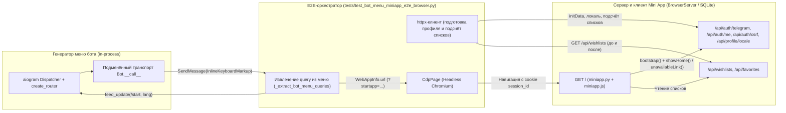

# Спецификация: WISHENKA-177 — Сквозная верификация переходов из меню Telegram-бота в Mini App

**Задача:** WISHENKA-177  
**Статус:** верифицированная спецификация по итогам реализации тестового покрытия  
**Характер изменений:** автоматизированная E2E-верификация существующего контракта (без изменения продакшен-логики)  
**Язык реализации:** Python 3.12+  
**Языки интерфейса (объект проверки):** русский (`ru`), английский (`en`)

## 1. Назначение и бизнес-цель

### 1.1. Постановка проблемы

В сервисе **Telegram Wishlist Service** генерация меню входа в Telegram-боте (`wishenka/bot/entry.py`) и стартовая маршрутизация клиента Telegram Mini App (`wishenka/web/routes/miniapp.py`, `wishenka/web/static/miniapp.js`) ранее проверялись только изолированно. Из-за отсутствия сквозной (end-to-end) проверки на границе «меню бота → Mini App» сохранялись следующие риски (зафиксированные как пробел верификации в техдолге `WISHENKA-27`):

- Незаметное расхождение (дрейф) между параметрами запуска `WebAppInfo.url`, формируемыми ботом, и экранами, которые фактически открывает Mini App.
- Риск появления побочной записи при переходе (например, неявного создания пустого вишлиста при открытии экрана создания или коллекции).
- Отсутствие браузерного подтверждения того, что невалидные или повреждённые параметры запуска приводят к безопасному восстановлению без сбоев и без раскрытия приватных данных пользователя.

### 1.2. Цели задачи

- Замкнуть границу верификации между главным меню Telegram-бота (`/start`) и реальным клиентским JavaScript-приложением Mini App, исполняемым в headless Chromium.
- Подтвердить корректность всех трёх штатных переходов из меню бота (`create`, `collection`, `home`) в авторизованной пользовательской сессии на русском и английском языках.
- Подтвердить инвариант отсутствия неявного создания вишлистов при навигации по любому пункту меню или при обработке ошибочного параметра запуска.
- Подтвердить безопасное восстановление Mini App при невалидном параметре `startapp` без утечки приватных названий вишлистов и подарков.

### 1.3. Ценность для пользователей и системы

- **Для пользователя:** гарантируется, что выбор любого действия в меню бота открывает обещанный локализованный экран Mini App без создания нежелательных пустых списков, а переход по битой или некорректной ссылке безопасно возвращает на рабочий домашний экран.
- **Для системы и команды разработки:** сквозная проверка связывает реальный `aiogram`-роутер бота и реальный браузерный цикл Mini App, позволяя мгновенно выявлять рассинхронизацию ключей локализации, билдера ссылок и клиентского роутера в автономном прогоне без внешней инфраструктуры Telegram.

## 2. Функциональные требования и пользовательские сценарии

### 2.1. Границы функциональной области

Задача охватывает автоматизированную приёмочную E2E-верификацию контракта переходов из меню бота, установленного в `WISHENKA-27` (`specs/00-high.md`, `in-docs/bot-scenarios.md`), и не добавляет новую пользовательскую функциональность в продакшен-код (`wishenka/`).

В границы верификации **не входят**:

- Просмотр публичных вишлистов по ссылкам `p_<token>` и подтверждение приглашений `i_<token>`.
- Механика бронирования подарков, отметок покупки и получения (покрыты отдельными тестами).

### 2.2. Бизнес-сущности

| Сущность | Описание в рамках верификации |
| --- | --- |
| Пользователь | Участник Telegram с установленной сессией (`OWNER_TELEGRAM_ID`) и выбранной локалью (`ru` или `en`) |
| Меню бота | Набор кнопок `InlineKeyboardMarkup`, возвращаемый ботом в ответ на приватную команду `/start`: создание списка (`create`), личная коллекция (`collection`), стандартный вход (`home`) |
| Экран Mini App | Целевое DOM-представление в `#app` после завершения `start()` в Mini App, соответствующее действию меню или состоянию безопасного восстановления |
| Вишлист | Список желаний пользователя, который должен создаваться только явным действием пользователя, но никогда — самим переходом из меню |

### 2.3. Функциональные требования (входы, выходы, поведение)

1. **Получение целей запуска из меню бота:**
   - **Вход:** приватное сообщение `/start` от пользователя с `language_code` равным `"ru"` или `"en"`.
   - **Выход:** ответ `SendMessage` с `InlineKeyboardMarkup`, содержащим локализованные кнопки `bot.entry.btn_create` («Создать вишлист» / «Create wishlist»), `bot.entry.btn_collection` («Мои вишлисты» / «My wishlists») и `bot.entry.btn_home` («Открыть Mini App» / «Open Mini App»).
   - **Контракт URL:** каждая кнопка содержит `WebAppInfo` со схемой `https://` и query-параметром `startapp`, равным `create`, `collection` или `home`. Обработка `/start` не должна вызывать создание вишлиста.
2. **Переход `create`:**
   - **Вход:** открытие в авторизованной сессии Mini App целевой ссылки с `startapp=create` (в локали `ru` или `en`).
   - **Выход:** отображение локализованного домашнего экрана (`miniapp.home.title`, `miniapp.home.my_wishlists`, существующий вишлист пользователя), пустой статус ошибки (`#status`), автоматический фокус ввода (`document.activeElement`) на кнопке создания вишлиста (`miniapp.home.create_wishlist`).
3. **Переход `collection`:**
   - **Вход:** открытие в авторизованной сессии Mini App целевой ссылки с `startapp=collection` (в локали `ru` или `en`).
   - **Выход:** отображение локализованного экрана с секцией списков пользователя (`miniapp.home.title`, `miniapp.home.my_wishlists`) и ранее созданным вишлистом.
4. **Переход `home`:**
   - **Вход:** открытие в авторизованной сессии Mini App целевой ссылки с `startapp=home` (в локали `ru` или `en`).
   - **Выход:** отображение стандартного локализованного домашнего экрана Mini App (`miniapp.home.title`, `miniapp.home.my_wishlists`) и ранее созданного вишлиста пользователя.
5. **Восстановление при невалидном параметре запуска:**
   - **Вход:** запуск Mini App с невалидным или неизвестным значением `startapp`, не входящим в `['home', 'create', 'collection']` и не соответствующим формату токенов `p_<token>` / `i_<token>` (проверяются значения `unknown_action`, `bad!param`, `x_not_a_token` в обеих локалях).
   - **Выход:** отображение локализованного экрана недоступности (`miniapp.unavailable.title`, `miniapp.unavailable.description`) с кнопкой возврата (`miniapp.unavailable.home_menu`). После нажатия на кнопку возврата приложение переходит на стандартный домашний экран с отображением коллекции пользователя.

### 2.4. Ключевые функциональные инварианты

- **Отсутствие неявного создания данных (`No write-on-entry`):** навигация по кнопкам `create`, `collection`, `home`, а также открытие невалидного `startapp` и последующий возврат домой выполняют только операции чтения (`GET /api/auth/me`, `GET /api/auth/csrf`, `GET /api/wishlists`, `GET /api/favorites`, `GET /api/wishlists/deleted`). Запрос `POST /api/wishlists` не выполняется, а количество вишлистов пользователя до и после сценария остаётся неизменным.
- **Нераскрытие приватных данных при восстановлении:** экран недоступности не отображает названия приватных вишлистов и желаний пользователя (в том числе в контексте авторизованной сессии) и не раскрывает, существуют ли скрытые целевые объекты.
- **Согласованность локализации (`RU` / `EN`):** текст кнопок меню бота, заголовки домашнего экрана, названия кнопок и сообщения экрана восстановления отображаются на языке пользователя.

### 2.5. Пользовательские сценарии

| Сценарий | Предусловие | Действие | Ожидаемый результат |
| --- | --- | --- | --- |
| **UC-177-01.** Переход `create` | У пользователя есть сессия, локаль `ru` или `en` и 1 вишлист | Вызов `/start` -> переход по URL кнопки создания (`startapp=create`) | Открыт локализованный домашний экран с вишлистом, фокус установлен на кнопке создания, число списков не изменилось |
| **UC-177-02.** Переход `collection` | У пользователя есть сессия, локаль `ru` или `en` и 1 вишлист | Вызов `/start` -> переход по URL «Мои вишлисты» (`startapp=collection`) | Открыт локализованный экран коллекции с вишлистом пользователя, число списков не изменилось |
| **UC-177-03.** Переход `home` | У пользователя есть сессия, локаль `ru` или `en` и 1 вишлист | Вызов `/start` -> переход по URL «Открыть Mini App» (`startapp=home`) | Открыт стандартный локализованный домашний экран с вишлистом пользователя, число списков не изменилось |
| **UC-177-04.** Восстановление при невалидном `startapp` | У пользователя есть сессия, локаль `ru` или `en`, приватный вишлист и желание | Открытие `/?startapp=<invalid>` -> нажатие кнопки возврата | Сначала показан экран недоступности без названий списка и желания; после нажатия кнопки открыт домашний экран со списком; число списков не изменилось |

## 3. Архитектура, компоненты и интерфейсы

### 3.1. Схема взаимодействия компонентов

E2E-стенд построен по паттерну **связывания границы (Boundary Bridging)**: вместо подстановки жёстко заданных URL в браузерный тест тестовый оркестратор получает реальный вывод `aiogram`-роутера бота и передаёт извлечённый query-параметр `startapp` в реальный Chromium-браузер, работающий с локальным сервером FastAPI и `miniapp.js`.

### 3.2. Модули, классы и функции

#### Продакшен-компоненты (объект верификации)

- **`wishenka/bot/entry.py`:**
  - `create_router(dependencies)` — регистрирует `LocaleMiddleware` и обработчик приватной команды `/start`, возвращающий клавиатуру из `_keyboard(base, lang, target)`.
  - `_url(base, intent)` — проверяет, что базовый адрес использует схему `https://` без учётных данных и фрагмента, удаляет существующий параметр `startapp` и добавляет `startapp=<intent>`.
- **`wishenka/web/routes/miniapp.py`:**
  - Маршрут `GET /` — рендерит HTML-оболочку с контейнерами `#app`, `#status`, встроенным JSON-каталогом переводов `#miniapp-i18n` (`miniapp_catalog()`) и атрибутами `lang` / `data-locale` через `LocaleDep`.
- **`wishenka/web/static/miniapp.js`:**
  - `start()` — вычисляет `startParam` из `bridge?.initDataUnsafe?.start_param || new URLSearchParams(location.search).get('startapp')` и выполняет диспетчеризацию экранов; при `startParam === 'create'` переводит фокус на `root.querySelector('button')`.
  - `bootstrap()` — аутентифицирует сессию через `/api/auth/me` или `/api/auth/telegram`, обновляет `profileLocale` и запрашивает `/api/auth/csrf`.
  - `showHome()` — загружает списки пользователя и избранное (`GET /api/wishlists`, `GET /api/favorites`, `GET /api/wishlists/deleted`) и рендерит домашний экран.
  - `unavailableLink()` — рендерит экран ошибки ссылки (`miniapp.unavailable.*`) с кнопкой возврата, вызывающей `bootstrap()` + `showHome()`.
- **`wishenka/web/routes/profile.py`:**
  - `PATCH /api/profile/locale` — сохраняет `users.locale` (`"ru"` или `"en"`), возвращаемый затем в `/api/auth/me`.

#### Компоненты тестового оркестратора и инфраструктуры

- **`tests/test_bot_menu_miniapp_e2e_browser.py`:**
  - `_extract_bot_menu_queries(monkeypatch, language)` — перехватывает `Bot.__call__`, диспетчеризует `/start` через `Dispatcher.feed_update`, проверяет `service.create_wishlist.assert_not_awaited()`, валидирует схему `https` и `startapp` для всех трёх кнопок и возвращает словарь `{intent: parts.query}`.
  - `_build_telegram_init_data(telegram_id, first_name, language)` — формирует подписанную HMAC-SHA256 (`WebAppData`) строку `initData` ключом `Settings().bot_token`.
  - `_set_owner_locale_and_count(server, owner_token, language)` — инициализирует профиль владельца через `POST /api/auth/telegram`, задаёт локаль через `PATCH /api/profile/locale` и возвращает исходное количество вишлистов (`before_count`).
  - `_get_owner_wishlist_count(server, owner_token)` — возвращает текущее количество вишлистов через `GET /api/wishlists`.
  - `_open_session_page(browser, pages, server, token, query)` — создаёт страницу `CdpPage` с viewport `(412, 800)`, выставляет cookie `session_id` и переходит на `f"{server.base_url}/?{query}"`.
  - `test_bot_menu_transition_opens_expected_miniapp_screen_without_creating_wishlist` — параметризованный тест переходов (`language` × `intent`).
  - `test_invalid_startapp_recovers_safely_without_leaking_data_or_creating_wishlist` — параметризованный тест восстановления (`language` × `invalid_param`).
- **`tests/browser_cdp.py`, `tests/conftest.py`, `tests/browser_helpers.py`:**
  - `CdpBrowser`, `CdpPage` — собственный CDP-драйвер поверх headless Chromium (`set_cookie` через `Network.setCookie`, `navigate`, `wait_for`, `evaluate`).
  - Фикстуры `chromium_browser`, `_browser_pages`, `wishlist_server` (`BrowserServer`), `seed_wishlist` (`Seeded`), константа `OWNER_TELEGRAM_ID`.

### 3.3. Контракты данных и интерфейсы

| Граница взаимодействия | Интерфейс / контракт | Детали и ограничения |
| --- | --- | --- |
| Бот → оркестратор | `SendMessage.reply_markup: InlineKeyboardMarkup` | Кнопки содержат `WebAppInfo(url="https://example.test/miniapp?startapp=<intent>")`; `parts.scheme == "https"`, `parse_qs(parts.query).get("startapp") == [intent]` |
| Оркестратор → сервер (подготовка) | `POST /api/auth/telegram` | Тело `{"init_data": str}`, заголовки `Authorization: Bearer <owner_token>` и `Origin: <base_url>` |
| Оркестратор → сервер (локаль) | `PATCH /api/profile/locale` | Тело `{"locale": "en" \| "ru"}`, заголовок `Authorization: Bearer <owner_token>` (или cookie + `X-CSRF-Token`) |
| Оркестратор → сервер (инвариант) | `GET /api/wishlists` | Возвращает `list[dict]`; длина списка сверяется до и после браузерного сценария |
| Оркестратор → браузер | `CdpPage.set_cookie("session_id", token, server.base_url)` | Устанавливает сессионную cookie перед переходом на `f"{server.base_url}/?{query}"` |

**Трансляция origin и пути:** `wishenka.bot.entry._url()` требует `https://`, тогда как тестовый `BrowserServer` слушает `http://127.0.0.1:<port>`. Тест задаёт боту `mini_app_url="https://example.test/miniapp"`, проверяет валидность сгенерированного `https://`-URL и `startapp`-параметра, после чего передаёт извлечённую строку `parts.query` на `f"{server.base_url}/?{query}"`.

### 3.4. Переходы состояний в стартовом роутинге Mini App (`start()`)

1. **`startParam` пустой или равен `'home'` / `'collection'`:**
   - `start()` → `bootstrap()` → `showHome()` → отображение домашнего экрана и списка вишлистов пользователя (только операции чтения).
2. **`startParam === 'create'`:**
   - `start()` → `bootstrap()` → `showHome()` → установка фокуса на первую кнопку в `#app` (`root.querySelector('button')`, соответствующую `miniapp.home.create_wishlist`, без вызова `POST /api/wishlists`).
3. **`startParam` соответствует `/^[pi]_[A-Za-z0-9_-]{1,128}$/`:**
   - `start()` → `publicView(token)` или `invitationView(token)` (маршруты публичных ссылок и приглашений, не входящие в предмет проверки `WISHENKA-177`).
4. **Любой другой непустой `startParam` (`unknown_action`, `bad!param`, `x_not_a_token`):**
   - `start()` → `unavailableLink()` (рендер `miniapp.unavailable.*`, без показа приватных списков) → клик пользователя по кнопке `miniapp.unavailable.home_menu` → `bootstrap()` + `showHome()`.

## 4. Нефункциональные требования, безопасность и наблюдаемость

### 4.1. Производительность, лимиты и изоляция

- **Таймауты и маркеры тестов:** модуль `tests/test_bot_menu_miniapp_e2e_browser.py` помечен `pytestmark = [pytest.mark.timeout(45), pytest.mark.browser]`; браузерные страницы открываются с мобильным viewport `(412, 800)`.
- **Автономность и детерминизм:** тесты не обращаются к живому Telegram API — транспорт бота подменён в памяти (`Bot.__call__`), а локальный сервер и headless Chromium работают в замкнутом окружении.
- **Изоляция данных:** каждый тест получает собственный экземпляр `BrowserServer` на `127.0.0.1:<port>` с отдельной копией предмигрированной базы `migrated_db_template` (SQLite WAL), что исключает взаимное влияние при параллельном прогоне и не затрагивает `data/wishenka.db`.
- **Время выполнения и задержка внешнего скрипта:** полный прогон 12 тестов модуля занимает `17.49 с`. Заметную долю этого времени создаёт логика `start()` в `wishenka/web/static/miniapp.js` (строки 556–564), которая пытается подключить `https://telegram.org/js/telegram-web-app.js` и ожидает таймаут до `3000 мс` (`setTimeout(resolve, 3000)`) при недоступности ресурса в офлайн-среде Chromium.

### 4.2. Безопасность и приватность

- **Защита приватных данных при невалидных параметрах:** при открытии Mini App с некорректным `startapp` экран восстановления не рендерит названия вишлистов и подарков пользователя, даже при наличии активной аутентифицированной cookie-сессии `session_id`, и не служит оракулом наличия скрытых списков.
- **Идемпотентность и отсутствие побочных эффектов при входе:** переход по любой из трёх кнопок меню или восстановление после невалидного параметра не изменяют состояние БД и не создают списков без явного подтверждённого действия.
- **Изоляция секретов стенда:** в in-process транспорте бота используется синтетический токен (`"123456:ABCDEFGHIJKLMNOPQRSTUVWXYZabcdefghi"`), а `initData` подписывается локальным тестовым токеном из `Settings().bot_token`.

### 4.3. Наблюдаемость (логирование, метрики и диагностика)

- **Продакшен-наблюдаемость (`N/A`):** согласно `50-observability.md`, задача `WISHENKA-177` является исключительно тестовой (ни один файл под `wishenka/` не добавлен и не изменён), поэтому новые структурированные логи (уровней `EMERG`–`DEBUG`), метрики производительности/бизнеса/состояния системы, дашборды Grafana, алерты и интеграции с Prometheus/ELK/Loki не требуются и не добавлялись.
- **Существующая наблюдаемость контракта:** продакшен-маршруты сохраняют существующие события (`bot_start_handled`, `bot_start_failed`, `public_entry_viewed`, `public_entry_unavailable`), не включающие токены ссылок, идентификаторы пользователей и тексты исключений (`doc/dev/bot-scenarios.md`).
- **Диагностика при падении тестов:** при сбое браузерного теста фикстура `_browser_pages` и `CdpPage.snapshot()` формируют диагностический снимок состояния страницы и скриншот (`diagnostics-N.txt`, `failure-N.png`) в соответствии с `doc/dev/testing.md`.

## 5. Верификация и критерии приёмки

### 5.1. Автоматизированные тестовые сценарии

В модуле `tests/test_bot_menu_miniapp_e2e_browser.py` реализованы **12 параметризованных браузерных E2E-тестов**:

1. **`test_bot_menu_transition_opens_expected_miniapp_screen_without_creating_wishlist` (6 кейсов: `language` ∈ `{"en", "ru"}` × `intent` ∈ `{"create", "collection", "home"}`):**
   - Подготавливает вишлист `"Browser wishlist"` с элементом `["Birthday camera"]`, задаёт локаль владельца и фиксирует `before_count` через `GET /api/wishlists`.
   - Диспетчеризует `/start` через `wishenka.bot.entry.create_router`, проверяет отсутствие вызовов `create_wishlist`, локализованные подписи кнопок, схему `https` и `startapp=<intent>`.
   - Открывает `f"{server.base_url}/?{queries[intent]}"` в `CdpPage` с cookie `session_id`.
   - Проверяет, что `#app h1` равен `t("miniapp.home.title", language)`, `#status` пуст, на странице отображаются `t("miniapp.home.my_wishlists", language)` и `"Browser wishlist"`.
   - Для `intent == "create"` дополнительно проверяет, что `document.activeElement.tagName === 'BUTTON'` и его текст равен `t("miniapp.home.create_wishlist", language)`.
   - Проверяет `after_count == before_count` через `GET /api/wishlists`.
2. **`test_invalid_startapp_recovers_safely_without_leaking_data_or_creating_wishlist` (6 кейсов: `language` ∈ `{"en", "ru"}` × `invalid_param` ∈ `{"unknown_action", "bad!param", "x_not_a_token"}`):**
   - Подготавливает вишлист `"Browser wishlist"` с элементом `["Secret surprise gift"]`, задаёт локаль владельца и фиксирует `before_count`.
   - Открывает `/?startapp=<invalid_param>` в `CdpPage` с cookie `session_id`.
   - Проверяет рендер экрана недоступности (`#app h1` равен `t("miniapp.unavailable.title", language)`, присутствуют `t("miniapp.unavailable.description", language)` и кнопка `t("miniapp.unavailable.home_menu", language)`).
   - Проверяет отсутствие утечки приватных данных: ни `"Browser wishlist"`, ни `"Secret surprise gift"` не присутствуют в `document.body.innerText`.
   - Нажимает кнопку `t("miniapp.unavailable.home_menu", language)` и ожидает перехода на домашний экран (`#app h1` равен `t("miniapp.home.title", language)`, `#status` пуст, отображается `"Browser wishlist"`).
   - Проверяет `after_count == before_count` через `GET /api/wishlists`.

### 5.2. Критерии приёмки и зафиксированные результаты проверок

#### Критерии приёмки

1. Проверка использует реальные цели запуска `create`, `collection` и `home`, сформированные меню бота, в подготовленной пользовательской сессии.
2. Переход `create` открывает целевой экран с фокусом на кнопке создания и не создаёт новый вишлист при навигации.
3. Переход `collection` открывает экран коллекции вишлистов пользователя без создания нового списка.
4. Переход `home` открывает стандартный домашний экран Mini App без создания нового списка.
5. Поведение переходов и восстановления верифицировано для обеих поддерживаемых локалей: `ru` и `en`.
6. Запуск с невалидным `startapp` приводит к безопасному восстановлению без сбоев, раскрытия приватных данных и неявного создания вишлиста.
7. Продакшен-код (`wishenka/`) не изменён, статический анализ и целевой набор тестов проходят без ошибок.

#### Результаты проверок (по данным `00-roadmap.md`, `40-code-cleanup.md` и `50-observability.md`)

- **E2E-тесты модуля (`tests/test_bot_menu_miniapp_e2e_browser.py`):** `12 passed in 17.49s` (команда запуска: `make test-serial PYTEST_ARGS="tests/test_bot_menu_miniapp_e2e_browser.py"`).
- **Статический анализ (`make analyze`):** `ruff check wishenka tests`, `ruff format --check wishenka tests` и `mypy wishenka tests` — `0` ошибок и `0` предупреждений по всем 220 исходным файлам; все строки в новом модуле укладываются в лимит 100 символов.
- **Объём изменений (`00-roadmap.md`, `50-observability.md`):** добавлен только тестовый модуль `tests/test_bot_menu_miniapp_e2e_browser.py`, обновлена документация (`doc/dev/bot-scenarios.md`, `doc/dev/testing.md`) и созданы артефакты `ai-tasks/WISHENKA-177/`; файлы продакшена (`wishenka/`) не затронуты.

### 5.3. Известные ограничения и последующие задачи (из `60-tech-debt.md`)

#### Известные ограничения и компромиссы

1. **Подмена origin и пути в тестовой обвязке (`tests/test_bot_menu_miniapp_e2e_browser.py:42, 90-93, 153`):** `_extract_bot_menu_queries` настраивает `mini_app_url="https://example.test/miniapp"` (из-за требования `https://` в `_url()`), но перенаправляет только `parts.query` на `http://127.0.0.1:<port>/?{query}`, опуская TLS и сегмент пути `/miniapp`.
2. **Внутрипроцессная заглушка транспорта бота (`tests/test_bot_menu_miniapp_e2e_browser.py:35-39, 65`):** подмена `Bot.__call__`, фиктивный токен и `SimpleNamespace` не проверяют сохранение `user_store` и `wishlist_store` при `/start` (эти аспекты покрыты отдельными unit/repro-тестами).
3. **Единый экран для `home` и `collection` (`wishenka/web/static/miniapp.js:581-586`):** в текущей реализации оба значения вызывают `bootstrap()` + `showHome()`. При последующем выделении отдельного представления или якоря прокрутки для `collection` утверждения E2E-тестов потребуется уточнить.
4. **Задержка ожидания внешнего скрипта (`wishenka/web/static/miniapp.js:556-564`):** `start()` вставляет `https://telegram.org/js/telegram-web-app.js` с фолбэком `setTimeout(resolve, 3000)`, что увеличивает время выполнения 12 браузерных тестов в изолированном окружении (~17.49 с).

#### Заведённые follow-up задачи (Jira)

- **[WISHENKA-239](https://pypost.atlassian.net/browse/WISHENKA-239) (`Debt`, `Low`):** вынести `_build_telegram_init_data`, `_set_owner_locale_and_count` и `_get_owner_wishlist_count` из `tests/test_bot_menu_miniapp_e2e_browser.py` (строки 97–139) в `tests/browser_helpers.py` при добавлении новых браузерных E2E-тестов Mini App.
- **[WISHENKA-240](https://pypost.atlassian.net/browse/WISHENKA-240) (`Debt`, `Low`):** добавить браузерный тестовый кейс, проверяющий приоритет пути запуска через `window.Telegram.WebApp.initDataUnsafe.start_param` в `wishenka/web/static/miniapp.js` (строки 569–571), так как текущий набор покрывает только query-параметр URL (`?startapp=...`).
