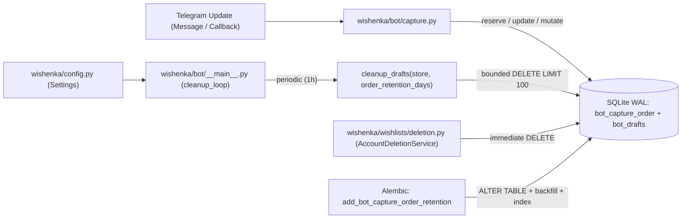

# WISHENKA-178: Bounded Retention for Bot Capture Message Ordering

## Research

### Existing Implementation & Context

1. **Ordering Table (`bot_capture_order`):**
   - Created in `wishenka/wishlists/alembic/versions/add_bot_capture_order.py` (`revision = "add_bot_capture_order"`, `down_revision = "add_bot_drafts"`).
   - Current schema: `(owner INTEGER NOT NULL, chat INTEGER NOT NULL, message_id INTEGER NOT NULL, PRIMARY KEY (owner, chat))`.
   - Has no timestamp/expiry column and no secondary index.

2. **Capture Flow (`wishenka/bot/capture.py`):**
   - `_now(deps)` returns the current UTC `datetime` (injectable via `deps.now` in tests).
   - `reserve()` (lines 377–433) atomically upserts `(owner, chat, message_id)` into `bot_capture_order` with `ON CONFLICT(owner,chat) DO UPDATE SET message_id=excluded.message_id WHERE excluded.message_id > bot_capture_order.message_id`. It relies on `result.rowcount == 0` to detect older or redelivered messages.
   - `pending()` (lines 293–305) joins `bot_drafts` with `bot_capture_order` to reject older messages (`message.message_id <= editing["capture_message_id"]`) during field editing.
   - `update()` (lines 326–340) and callback mutations in `mutate()` (lines 552–649) extend `bot_drafts.expires` by 24 hours on active edits, or 7 days on `save` receipt.
   - `finish()` (lines 485–503) guards draft completion with `EXISTS (SELECT 1 FROM bot_capture_order WHERE owner=:owner AND chat=:chat AND message_id=:message_id)`.

3. **Periodic Cleanup (`wishenka/bot/capture.py`, `wishenka/bot/__main__.py`):**
   - `cleanup_drafts(store: WishlistStore) -> int` (lines 716–757) runs inside `store.transaction(remove)` and deletes bounded batches (`LIMIT 100`) from `bot_drafts` (`expires <= now_dt.isoformat()`), `birthday_input`, `support_input`, and `support_tickets` (`created_at <= now_ts - 30 * 86400`).
   - `cleanup_loop` in `wishenka/bot/__main__.py` (lines 36–47) invokes `cleanup_drafts(store)` hourly (`interval=3600`, `retry_interval=60`).
   - Existing test `tests/test_bot_capture_repro.py` (line 986) monkeypatches `bot_main.cleanup_drafts` with `async def cleanup(store: WishlistStore) -> int:`.

4. **Retention & Migration Conventions (`wishenka/config.py`, `wishenka/wishlists/alembic/versions/`):**
   - `Settings` in `wishenka/config.py` standardizes retention settings in days with `default=30` (`receipt_notice_retention_days`, `birthday_retention_days`, `bot_destination_retention_days`, `reminder_retention_days`, `receipt_dedup_retention_days`).
   - `add_notice_retention_columns.py` demonstrates the repository pattern for adding `INTEGER` Unix-epoch timestamp columns (`updated_at INTEGER`) idempotently via `_columns(...)`, creating supporting indexes, and backfilling existing rows with `CAST(strftime('%s', 'now') AS INTEGER)`.
   - Current Alembic head is `add_user_fk_cascades` (`wishenka/wishlists/alembic/versions/add_user_fk_cascades.py`).

5. **Account Deletion (`wishenka/wishlists/deletion.py`):**
   - `AccountDeletionService` (lines 475–480) already deletes from `bot_capture_order` where `owner = :uid OR chat = :uid` inside its `BEGIN IMMEDIATE` deletion transaction.

## Implementation Plan

1. **Configuration (`wishenka/config.py`, `wishenka/bot/__main__.py`):**
   - Add `bot_capture_order_retention_days: int = Field(default=30, ge=2)` to `Settings` (strictly greater than the 24-hour draft lifetime and 7-day receipt lifetime).
   - Pass `order_retention_days` from `wishenka/bot/__main__.py` into `cleanup_loop` only when non-default or via `Optional[int] = None` so `cleanup_drafts(store)` remains compatible with single-argument monkeypatches in tests.
2. **Database Migration (`wishenka/wishlists/alembic/versions/add_bot_capture_order_retention.py`):**
   - Create reversible Alembic revision `add_bot_capture_order_retention` depending on `add_user_fk_cascades`.
   - Add `updated_at INTEGER` to `bot_capture_order` (idempotent check), create index `idx_bot_capture_order_updated_at ON bot_capture_order(updated_at)`, and backfill existing rows with `CAST(strftime('%s', 'now') AS INTEGER)`.
3. **Watermark Timestamp Maintenance (`wishenka/bot/capture.py`):**
   - Update `reserve()` to set and refresh `updated_at` (Unix epoch seconds from `_now(deps)`) whenever a new watermark is inserted or updated (`WHERE excluded.message_id > bot_capture_order.message_id`).
   - Refresh `bot_capture_order.updated_at` on active draft field updates (`update()`) and callback mutations (`mutate()` for active edits/saves/cancels) so ongoing conversations stay fresh.
4. **Bounded Retention Cleanup (`wishenka/bot/capture.py`):**
   - Extend `cleanup_drafts(store: WishlistStore, *, order_retention_days: int = 30) -> int` to delete up to `LIMIT 100` rows per pass from `bot_capture_order` where `updated_at <= cutoff` (`now_ts - order_retention_days * 86400`) AND no active non-expired `bot_drafts` row exists for `(owner, chat)`.
5. **Tests & Verification:**
   - Add migration upgrade/downgrade/backfill checks, retention/late-delivery tests, active-conversation preservation tests, bounded-batch cleanup tests, and account-deletion compatibility tests.

**Mandatory — Failing Repro (next Step 3):**
- **Where it lives:** `tests/test_bot_capture_order_retention_repro.py` (with `@pytest.mark.timeout(...)` per `do-testing`).
- **What it asserts (desired behavior):**
  1. **Schema & Backfill:** After migrating to `head`, `bot_capture_order` has an `updated_at` column and an index on `updated_at`; legacy rows without `updated_at` are backfilled with a non-null integer timestamp.
  2. **Stale Ordering Cleanup:** When a `bot_capture_order` row's `updated_at` is older than the retention window (e.g. >30 days) and no active draft exists, calling `cleanup_drafts(store)` removes the row (in batches of at most 100) and includes it in the returned count.
  3. **Late-Delivery Protection After Draft Expiry:** After a 24-hour draft expires and is cleaned up, within the 30-day retention window the `bot_capture_order` watermark remains intact and a delayed/replayed older `message_id` is still ignored.
  4. **Active Conversation Protection:** Even if `bot_capture_order.updated_at` is artificially aged past the cutoff, if an active non-expired draft exists for `(owner, chat)`, `cleanup_drafts(store)` preserves the watermark.
  5. **Fresh Baseline After Expiry:** After an expired watermark is cleaned up, a subsequent new message in the same `(owner, chat)` succeeds and establishes a fresh watermark.
- **How to force failure without live external deps:** Use an in-memory/temp-file SQLite `WishlistStore` and `UserStore` with the existing `aiogram` test harness (same pattern as `tests/test_bot_capture_repro.py`) and injected `deps.now` / direct SQL timestamp setup. Currently, `cleanup_drafts` never touches `bot_capture_order` and the `updated_at` column does not exist, so the repro will fail cleanly before production changes.
- **Sequencing:** Write red tests in Step 3 → verify failure → implement migration, config, `capture.py`, and `__main__.py` changes in Step 4 until green.

## Architecture

### Module & Component Diagram

### Module Responsibilities

- **`wishenka/config.py` (`Settings`):**
  - Owns `bot_capture_order_retention_days` (default `30`, `ge=2`). Guarantees retention is configurable and strictly longer than the 24-hour active draft TTL.
- **`wishenka/wishlists/alembic/versions/add_bot_capture_order_retention.py`:**
  - Evolves `bot_capture_order` with `updated_at INTEGER` and `idx_bot_capture_order_updated_at`, backfilling existing rows to current epoch seconds so legacy rows age out predictably.
- **`wishenka/bot/capture.py`:**
  - Maintains `updated_at` on `bot_capture_order` during `reserve()`, `update()`, and `mutate()`.
  - Enforces bounded retention in `cleanup_drafts()` with a two-part predicate: `updated_at <= cutoff` AND `NOT EXISTS` active non-expired `bot_drafts` for `(owner, chat)`, capped at `LIMIT 100` per pass.
- **`wishenka/bot/__main__.py` (`cleanup_loop`):**
  - Schedules periodic execution of `cleanup_drafts`, forwarding `settings.bot_capture_order_retention_days` when configured.
- **`wishenka/wishlists/deletion.py` (`AccountDeletionService`):**
  - Continues immediate deletion of `bot_capture_order` rows on account deletion (`WISHENKA-35`), independent of `updated_at`.

### Architectural Patterns & Justification

1. **Activity-Timestamp (`updated_at`) vs. Precomputed `expires_at`:**
   - *Choice:* Store `updated_at INTEGER` (Unix epoch seconds) rather than `expires_at`.
   - *Justification:* Matches `bot_destinations` in `add_notice_retention_columns.py` and `support_tickets` in `cleanup_drafts()`. Evaluating `updated_at <= now_ts - retention_days * 86400` at cleanup time lets operators adjust `bot_capture_order_retention_days` without migrating or rewriting existing rows.
2. **Active-Draft Guard in Cleanup SQL:**
   - *Choice:* Include `NOT EXISTS (SELECT 1 FROM bot_drafts d WHERE d.owner = o.owner AND d.chat = o.chat AND d.state = 'active' AND d.expires > :now)` in the `DELETE` query.
   - *Justification:* Provides defense-in-depth so an active conversation's ordering watermark can never be deleted by cleanup even under clock skew or custom retention settings.
3. **Bounded Batching (`LIMIT 100` via `rowid`):**
   - *Choice:* Use `DELETE FROM bot_capture_order WHERE rowid IN (SELECT o.rowid FROM bot_capture_order o WHERE ... LIMIT 100)`.
   - *Justification:* Consistent with `birthday_input`, `support_input`, and `bot_drafts` in `cleanup_drafts()`, bounding SQLite write lock duration in WAL mode.
4. **Preserving `WHERE excluded.message_id > bot_capture_order.message_id`:**
   - *Choice:* Keep strict `>` in `reserve()`'s `ON CONFLICT` clause.
   - *Justification:* `reserve()` uses `result.rowcount == 0` to distinguish redeliveries and out-of-order messages from new messages. Updating `updated_at` only on `>` preserves exact idempotency/redelivery semantics.

### Interfaces & Schema Changes

- **DDL (`add_bot_capture_order_retention`):**
  - `ALTER TABLE bot_capture_order ADD COLUMN updated_at INTEGER`
  - `CREATE INDEX IF NOT EXISTS idx_bot_capture_order_updated_at ON bot_capture_order(updated_at)`
- **Function signature (`wishenka/bot/capture.py`):**
  - `async def cleanup_drafts(store: WishlistStore, *, order_retention_days: int = 30) -> int`
- **Configuration (`wishenka/config.py`):**
  - `bot_capture_order_retention_days: int = Field(default=30, ge=2)`

## Q&A

- **Why 30 days default retention?**
  - Matches all other retention settings in `wishenka/config.py` (`receipt_notice_retention_days`, `birthday_retention_days`, `bot_destination_retention_days`, `reminder_retention_days`, `receipt_dedup_retention_days`, `support_tickets`), and is well above both the 24-hour draft lifetime and 7-day saved receipt lifetime.
- **Why not clean up `bot_capture_order` inline inside `reserve()`?**
  - `reserve()` runs on the hot user-message path; periodic bounded cleanup in `cleanup_drafts()` keeps message handling fast and predictable.
- **Does `AccountDeletionService` (`WISHENKA-35`) need changes?**
  - No; `wishenka/wishlists/deletion.py` already deletes `bot_capture_order` rows by `owner = :uid OR chat = :uid` regardless of `updated_at`.
