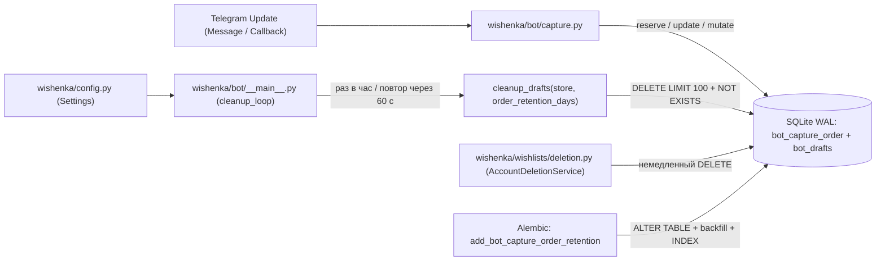

# Спецификация: WISHENKA-178 — Ограниченное время хранения порядка сообщений при захвате желаний в боте

**Задача:** WISHENKA-178  
**Статус:** реализованная спецификация  
**Связанные задачи:** WISHENKA-28 (захват желаний в боте), WISHENKA-35 (удаление аккаунта), WISHENKA-241, WISHENKA-242  
**Стек реализации:** Python 3.12+, SQLite WAL, Alembic, Pydantic Settings, aiogram, SQLAlchemy Core

## 1. Назначение и бизнес-цель

### 1.1. Постановка проблемы

В сценарии захвата желаний через Telegram-бота (`WISHENKA-28`) система ведёт таблицу `bot_capture_order`, фиксируя последний обработанный `message_id` для каждой пары `(owner, chat)`. Этот водяной знак порядка сообщений защищает диалог от запоздалых, переупорядоченных и повторно доставленных обновлений Telegram.

До реализации данной задачи таблица `bot_capture_order` не имела метки времени последнего обновления, индекса для выборки по давности и политики истечения срока хранения. В результате персональные метаданные диалогов (`owner`, `chat`, `message_id`) сохранялись в базе данных бессрочно до тех пор, пока пользователь явно не удалял свой аккаунт (`WISHENKA-35`).

### 1.2. Цели и ценность для пользователей и системы

- **Минимизация персональных данных:** ограничить срок хранения метаданных порядка сообщений в приватных диалогах настраиваемым конечным окном (по умолчанию `30` дней с последнего действия).
- **Сохранение надёжности захвата желаний:** удерживать водяной знак дольше времени жизни черновика (`24` часа) и квитанции сохранения (`7` дней), чтобы истечение черновика не открывало окно для возврата устаревших или повторно доставленных сообщений.
- **Безопасность активных диалогов:** обновлять метку активности при каждом действии пользователя с черновиком и гарантировать, что периодическая очистка никогда не удалит водяной знак при наличии активного черновика.
- **Контролируемая эксплуатация:** удалять устаревшие записи автоматически в фоне ограниченными пакетами (`LIMIT 100`), не замедляя обработку входящих сообщений и не блокируя SQLite WAL надолго.
- **Согласованность с удалением аккаунта:** сохранить немедленную очистку всех записей `bot_capture_order` при удалении аккаунта (`WISHENKA-35`) без ожидания окончания срока хранения.

### 1.3. Границы задачи

В рамки задачи **не входят**: изменение времени жизни самого черновика (`24` часа) и квитанции (`7` дней), изменение транспортной семантики webhook/polling Telegram, а также изменение пользовательских текстов и подсказок бота (`ru` / `en`) в штатных сценариях захвата желаний.

## 2. Функциональные требования и пользовательские сценарии

### 2.1. Доменные сущности

| Сущность | Описание |
| --- | --- |
| Пользователь бота | Пользователь Telegram (`owner`), взаимодействующий с ботом в приватном чате |
| Приватный диалог | Диалог один на один между пользователем и ботом, идентифицируемый парой `(owner, chat)` |
| Черновик желания (`bot_drafts`) | Несохранённый или сохранённый в виде квитанции объект захвата с конечным сроком жизни (`24` часа / `7` дней) |
| Водяной знак порядка (`bot_capture_order`) | Запись последнего обработанного `message_id` для `(owner, chat)` с временной меткой активности `updated_at` |
| Окно хранения (`order_retention_days`) | Настраиваемый период после последней активности захвата (по умолчанию `30` дней, минимум `2` дня), по истечении которого неактивный водяной знак подлежит удалению |

### 2.2. Функциональные требования и инварианты

1. **Инициализация и строго монотонное обновление при входящих сообщениях (`reserve()`):**
   - При поступлении нового текстового сообщения вне активного редактирования поля выполняется атомарный upsert в `bot_capture_order` с установкой `updated_at = int(now.timestamp())`.
   - Обновление существующей строки выполняется только при условии `excluded.message_id > bot_capture_order.message_id`.
   - Если `message_id` меньше или равен текущему водяному знаку (`rowcount == 0`), ни `message_id`, ни `updated_at` не перезаписываются. При совпадении `message_id` с текущим активным неистёкшим черновиком пользователю повторно показывается этот черновик; более старые сообщения игнорируются.

2. **Продление окна хранения при активном взаимодействии:**
   - При текстовом обновлении редактируемого поля черновика (`update()`, когда `message.message_id > capture_message_id`) поле `updated_at` обновляется текущим временем, а срок жизни черновика сдвигается на `now + 24` часа.
   - При изменении состояния черновика через callback-кнопки в `mutate()` (`cancel`, `save`, очистка поля `c_<field>`, выбор поля для редактирования `e_<field>`, выбор списка `l_<list_id>`) вызывается `_touch_capture_order()`, обновляющий `bot_capture_order.updated_at`.
   - Навигационные callback-операции только для чтения (`p_<page>`, `edit`, `view`) и идемпотентный повтор `save` по уже сохранённому черновику не обновляют `updated_at`.

3. **Защита от запоздалых и повторных доставок после истечения черновика:**
   - Активный черновик истекает через `24` часа и удаляется периодической задачей `cleanup_drafts()` при `expires <= now`.
   - Водяной знак `bot_capture_order` сохраняется в течение всего окна `order_retention_days` (минимум `2` дня, по умолчанию `30` дней) после последнего обновления `updated_at`.
   - Пока водяной знак не удалён, любое запоздалое или повторно доставленное сообщение с `message_id <= bot_capture_order.message_id` отвергается и не может создать новый черновик из устаревшего сообщения.

4. **Безусловная защита активных диалогов при очистке:**
   - Фоновая очистка не удаляет запись `bot_capture_order`, если для соответствующей пары `(owner, chat)` существует запись в `bot_drafts` со статусом `state = 'active'` и `expires > now`, даже если `updated_at` оказался меньше или равен пороговому значению `cutoff`.

5. **Порционная очистка и сброс базового уровня после истечения срока хранения:**
   - Строка `bot_capture_order` подлежит удалению, когда одновременно выполняются два условия: `(o.updated_at IS NULL OR o.updated_at <= now_ts - order_retention_days * 86400)` и отсутствует активный неистёкший черновик для `(owner, chat)`.
   - За один вызов `cleanup_drafts()` удаляется не более `100` строк из `bot_capture_order` (`LIMIT 100`).
   - После удаления устаревшего водяного знака следующее текстовое сообщение пользователя в этом приватном чате (независимо от значения нового `message_id`, даже меньшего прежнего) создаёт свежую запись `bot_capture_order` и новый активный черновик.

6. **Немедленное удаление при удалении аккаунта (`WISHENKA-35`):**
   - При удалении аккаунта пользователя его записи в `bot_capture_order` (`owner = :uid OR chat = :uid`) удаляются немедленно в транзакции удаления вне зависимости от значения `updated_at` и наличия черновиков.

### 2.3. Пользовательские и эксплуатационные сценарии

- **UC-01. Запоздалая доставка после истечения черновика:** пользователь отправил сообщение и не сохранил черновик в течение `24` часов. Очередная очистка удаляет просроченный черновик из `bot_drafts`, но оставляет водяной знак в `bot_capture_order` (до истечения `30` дней). Повторно доставленное позже старое сообщение с меньшим `message_id` игнорируется.
- **UC-02. Защита активного диалога во время очистки:** пользователь редактирует поля черновика или открыл черновик со сроком `expires > now`. Каждое изменение обновляет `updated_at`, а предикат `NOT EXISTS` дополнительно защищает водяной знак при запуске `cleanup_drafts()`.
- **UC-03. Очистка неактивного диалога и новая сессия:** пользователь прекращает использовать захват желаний, и после `order_retention_days` дней неактивности `cleanup_drafts()` удаляет запись из `bot_capture_order`. При возвращении пользователя позже новое сообщение в том же чате формирует новый базовый `message_id`.
- **UC-04. Удаление аккаунта до истечения срока хранения:** пользователь со свежим водяным знаком удаляет аккаунт через Mini App (`AccountDeletionService.delete_account()`); запись `bot_capture_order` удаляется немедленно вместе с остальными данными пользователя.
- **UC-05. Миграция и обновление существующих записей:** при применении Alembic-миграции к работающей базе уже существующие строки `bot_capture_order` получают заполненное значение `updated_at` (текущее время в секундах Unix epoch), после чего устаревают и очищаются в общем порядке.

## 3. Архитектура, компоненты и интерфейсы

### 3.1. Схема взаимодействия компонентов



### 3.2. Модули и ответственности

| Компонент | Ответственность |
| --- | --- |
| `wishenka/config.py` (`Settings`) | Определяет `bot_capture_order_retention_days: int = Field(default=30, ge=2)` (переменная окружения `WISHENKA_BOT_CAPTURE_ORDER_RETENTION_DAYS`) |
| `wishenka/wishlists/alembic/versions/add_bot_capture_order_retention.py` | Обратимая миграция от `add_user_fk_cascades`: добавляет `updated_at INTEGER`, индекс `idx_bot_capture_order_updated_at` и заполняет `NULL`-строки текущим Unix epoch |
| `wishenka/bot/capture.py` | Поддерживает `updated_at` в `reserve()`, `update()`, `mutate()` через `_touch_capture_order()`, а также выполняет ограниченную очистку в `cleanup_drafts()` |
| `wishenka/bot/__main__.py` | Запускает фоновый цикл `cleanup_loop()` немедленно при старте бота и далее с интервалом `3600` секунд, передавая настроенное окно хранения |
| `wishenka/wishlists/deletion.py` (`AccountDeletionService`) | Обеспечивает немедленное удаление строк `bot_capture_order` при удалении аккаунта в транзакции `BEGIN IMMEDIATE` |

### 3.3. Контракты данных и миграция схемы

Ревизия `add_bot_capture_order_retention` (`down_revision = "add_user_fk_cascades"`, `ROLLBACK_POLICY = "reversible"`) модифицирует таблицу `bot_capture_order`:

```sql
ALTER TABLE bot_capture_order ADD COLUMN updated_at INTEGER;
CREATE INDEX IF NOT EXISTS idx_bot_capture_order_updated_at
    ON bot_capture_order(updated_at);
UPDATE bot_capture_order
SET updated_at = CAST(strftime('%s', 'now') AS INTEGER)
WHERE updated_at IS NULL;
```

Проверка существования колонки выполняется через вспомогательную функцию `_columns("bot_capture_order")` (`PRAGMA table_info`) с безопасным ветвлением для offline-режима Alembic (`context.is_offline_mode()`). Откат (`downgrade()`) удаляет индекс `idx_bot_capture_order_updated_at` и колонку `updated_at`.

Актуальная структура таблицы `bot_capture_order`:

| Поле | Тип | Ограничения / назначение |
| --- | --- | --- |
| `owner` | `INTEGER` | `NOT NULL`, часть `PRIMARY KEY (owner, chat)` — Telegram ID владельца |
| `chat` | `INTEGER` | `NOT NULL`, часть `PRIMARY KEY (owner, chat)` — Telegram ID приватного чата |
| `message_id` | `INTEGER` | `NOT NULL` — наибольший обработанный ID сообщения захвата |
| `updated_at` | `INTEGER` | Unix-время (секунды UTC) последнего подтверждённого действия захвата; индексируется `idx_bot_capture_order_updated_at` |

### 3.4. Программные интерфейсы

- **Конфигурация (`wishenka/config.py`):**
  - `Settings.bot_capture_order_retention_days: int = Field(default=30, ge=2)` — загружается из `WISHENKA_BOT_CAPTURE_ORDER_RETENTION_DAYS`.
- **Обновление отметки времени (`wishenka/bot/capture.py`):**
  - `async def _touch_capture_order(conn: AsyncConnection, owner: int, chat: int, now: datetime) -> None` — обновляет `updated_at = int(now.timestamp())` для заданной пары `(owner, chat)`.
- **Периодическая очистка (`wishenka/bot/capture.py`):**
  - `async def cleanup_drafts(store: WishlistStore, *, order_retention_days: int = 30) -> int` — в одной транзакции удаляет до `100` записей из каждой из таблиц `bot_drafts`, `birthday_input`, `support_input`, `support_tickets` (`30` дней) и `bot_capture_order`.
- **Фоновый планировщик (`wishenka/bot/__main__.py`):**
  - `async def cleanup_loop(store: WishlistStore, *, interval: float = 3600, retry_interval: float = 60, order_retention_days: int | None = None) -> None` — при `order_retention_days is None` вызывает `cleanup_drafts(store)`, иначе `cleanup_drafts(store, order_retention_days=order_retention_days)`. В `run()` при дефолтном значении `30` передаётся `None` для сохранения совместимости с одноаргументными тестовыми заглушками `cleanup_drafts`.

Запрос очистки `bot_capture_order` в `cleanup_drafts()`:

```sql
DELETE FROM bot_capture_order
WHERE rowid IN (
    SELECT o.rowid
    FROM bot_capture_order o
    WHERE (o.updated_at IS NULL OR o.updated_at <= :cutoff)
      AND NOT EXISTS (
          SELECT 1
          FROM bot_drafts d
          WHERE d.owner = o.owner
            AND d.chat = o.chat
            AND d.state = 'active'
            AND d.expires > :now
      )
    LIMIT 100
)
```

Здесь `cutoff = int(time.time()) - order_retention_days * 86400`, а `:now` — текущее UTC-время в формате ISO 8601 (`datetime.now(UTC).isoformat()`).

### 3.5. Жизненный цикл и переходы состояния водяного знака

| Событие | Состояние `bot_capture_order` | Поведение системы |
| --- | --- | --- |
| Первое сообщение захвата | Создаётся запись `(owner, chat, message_id, updated_at)` | Создаётся активный черновик (`expires = now + 24h`) |
| Новое сообщение (`message_id > current`) | Обновляются `message_id` и `updated_at` | Прежний активный черновик переводится в `replaced`, создаётся новый |
| Повтор / старое сообщение (`message_id <= current`) | Без изменений (`rowcount == 0`) | Повтор текущего активного черновика или игнорирование |
| Редактирование поля / выбор списка (`update`, `mutate`) | Обновляется `updated_at` | Срок активного черновика продлевается на `24` часа |
| Сохранение (`save`) / отмена (`cancel`) | Обновляется `updated_at` | Черновик переходит в `saved` (`7` дней) или `cancelled` |
| Истечение `bot_drafts` при свежем `updated_at` | Запись сохраняется | Просроченный черновик удаляется, защита от запоздалых сообщений действует |
| Истечение `updated_at` при наличии активного черновика | Запись сохраняется (защита `NOT EXISTS`) | Активный диалог не теряет защиту упорядочивания |
| Истечение `updated_at` без активного черновика | Запись удаляется пакетом `LIMIT 100` | Следующее сообщение установит новый базовый `message_id` |
| Удаление аккаунта (`WISHENKA-35`) | Немедленный `DELETE` по `owner` или `chat` | Удаляется в транзакции независимо от `updated_at` |

## 4. Нефункциональные требования, безопасность и наблюдаемость

### 4.1. Производительность и эксплуатационные пределы

- **Изоляция горячего пути:** очистка `bot_capture_order` вынесена из обработчика сообщений `reserve()` в фоновую задачу `cleanup_drafts()`, чтобы обработка входящих сообщений выполняла только одиночный upsert.
- **Ограничение блокировок SQLite WAL:** выборка кандидатов на удаление ограничена `LIMIT 100` по `rowid` с опорой на индекс `idx_bot_capture_order_updated_at`.
- **Запас относительно TTL черновика:** минимально допустимое значение `bot_capture_order_retention_days >= 2` гарантирует минимум `48` часов жизни водяного знака при `24`-часовом времени жизни активного черновика.
- **Отказоустойчивость фона:** при сбое `cleanup_drafts()` цикл `cleanup_loop()` повторяет попытку через `60` секунд, в штатном режиме запускается каждые `3600` секунд.

### 4.2. Безопасность и защита персональных данных

- **Минимизация хранения данных:** идентификаторы пользователей и чатов в `bot_capture_order` не хранятся бесконечно для неактивных пользователей.
- **Стойкость к конкурентному доступу и повторной доставке:** все операции записи и очистки выполняются внутри транзакций SQLite (`WishlistStore.transaction` / `BEGIN IMMEDIATE`), а условие `WHERE excluded.message_id > bot_capture_order.message_id` сохраняет строгую идемпотентность.
- **Защита логов от утечки PII и исключений:** события очистки содержат только числовые агрегаты, активное окно хранения и длительность выполнения. Идентификаторы `owner`, `chat`, `message_id`, содержимое черновиков, URL и тексты исключений в лог не пишутся.

### 4.3. Наблюдаемость: структурированное логирование и метрики

В проекте не используется отдельный бэкенд метрик (Prometheus/StatsD); операционные показатели передаются через структурированные поля JSON-логов (`wishenka.logging.JsonFormatter` при `LOG_JSON=true`).

| Событие (`extra["event"]`) | Уровень | Источник | Поля `extra` и назначение |
| --- | --- | --- | --- |
| `bot_draft_cleanup_completed` | `INFO` (при `total_removed > 0`) / `DEBUG` (при `total_removed == 0`) | `wishenka/bot/capture.py` (`cleanup_drafts`) | `total_removed`, `bot_drafts_removed`, `birthday_input_removed`, `support_input_removed`, `support_tickets_removed`, `bot_capture_order_removed`, `order_retention_days`, `duration_ms` |
| `bot_draft_cleanup_failed` | `ERROR` | `wishenka/bot/__main__.py` (`cleanup_loop`) | `order_retention_days` (без текста исключения и PII) |

Использование `DEBUG` при `total_removed == 0` предотвращает зашумление `INFO`-логов при регулярных холостых запусках раз в час.

## 5. Верификация и критерии приёмки

### 5.1. Автоматизированные сценарии тестирования

Верификация реализована в модулях `tests/test_bot_capture_order_retention_repro.py` (`5` тестов) и `tests/test_bot_capture_order_retention.py` (`6` тестов), с явным ограничением времени выполнения `pytestmark = pytest.mark.timeout(30)`:

1. **Миграция, backfill и индекс (`test_alembic_bot_capture_order_retention_upgrade_backfill_and_index`):** обновление с `add_user_fk_cascades` до `head` добавляет колонку `updated_at`, создаёт индекс `idx_bot_capture_order_updated_at` и заполняет существующие строки непустым целочисленным timestamp.
2. **Обратимый откат миграции (`test_alembic_bot_capture_order_retention_downgrade`):** откат до `add_user_fk_cascades` удаляет индекс `idx_bot_capture_order_updated_at` и колонку `updated_at`.
3. **Пакетная очистка устаревших записей (`test_cleanup_drafts_removes_stale_bot_capture_order_in_bounded_batches`):** `105` устаревших записей удаляются двумя последовательными вызовами `cleanup_drafts()` (`100`, затем `5`, остаток `0`).
4. **Защита от запоздалых сообщений после истечения черновика (`test_late_delivery_ignored_after_draft_expiry_within_retention_window`):** после удаления истёкшего черновика водяной знак сохраняется в течение окна хранения, а запоздалое сообщение с меньшим `message_id` игнорируется.
5. **Сохранение активного диалога (`test_cleanup_drafts_preserves_watermark_for_active_conversation`):** при наличии активного неистёкшего черновика водяной знак не удаляется даже при устаревшем `updated_at`.
6. **Новый базовый уровень после очистки (`test_new_message_establishes_fresh_baseline_after_retention_cleanup`):** после удаления просроченного черновика и устаревшего водяного знака новое сообщение даже с меньшим `message_id` принимается и создаёт новую запись `bot_capture_order`.
7. **Продление `updated_at` при активности (`test_watermark_updated_at_refreshed_on_edit_and_save`):** `updated_at` обновляется при первичном захвате, входе в редактирование поля (`e_title`), вводе нового значения и сохранении (`save`).
8. **Валидация конфигурации (`test_settings_bot_capture_order_retention_days_validation`):** проверка дефолта `30`, допустимости минимального значения `2` и отклонения значения `1` (`ValidationError`).
9. **Передача параметра планировщиком (`test_cleanup_loop_forwards_custom_order_retention_days`):** `cleanup_loop()` передаёт пользовательское значение `order_retention_days=14` в `cleanup_drafts()`.
10. **Немедленное удаление при удалении аккаунта (`test_account_deletion_removes_fresh_bot_capture_order_immediately`):** `AccountDeletionService.delete_account()` немедленно удаляет свежую запись `bot_capture_order`.
11. **Структурированное логирование (`test_cleanup_drafts_logs_structured_completion`):** проверка уровня `INFO` при удалении и `DEBUG` при простое, всех метрик в `extra` и отсутствия `owner`/`chat` в тексте лога.

### 5.2. Наблюдаемые результаты проверок

- Статический анализ `make analyze` (`ruff check wishenka tests`, `ruff format --check wishenka tests`, `mypy wishenka tests`) на этапе очистки кода прошёл без ошибок и предупреждений по всем `223` файлам.
- На этапе наблюдаемости целевой прогон из трёх модулей (`tests/test_bot_capture_order_retention.py`, `tests/test_bot_capture_order_retention_repro.py`, `tests/test_bot_capture_repro.py`) завершился со статусом `47 passed`.

### 5.3. Критерии приёмки

1. Для записей `bot_capture_order` настроена и применяется конечная политика хранения (`Settings.bot_capture_order_retention_days`, по умолчанию `30`, минимум `2` дня), строго превышающая время жизни черновика (`24` часа).
2. В пределах окна хранения запоздалые и повторно доставленные сообщения со старым `message_id` продолжают игнорироваться даже после истечения черновика.
3. Водяные знаки активных диалогов обновляются при действиях с черновиком и защищены предикатом `NOT EXISTS` от преждевременного удаления при очистке.
4. Устаревшие водяные знаки неактивных диалогов автоматически удаляются фоновой задачей `cleanup_drafts()` пакетами не более `100` строк за проход, после чего новое сообщение устанавливает свежий базовый `message_id`.
5. Удаление аккаунта (`WISHENKA-35`) немедленно удаляет все записи `bot_capture_order` пользователя независимо от срока хранения.
6. Миграция Alembic обратима и корректно заполняет `updated_at` для ранее существовавших строк, а структурированное логирование не содержит PII.

### 5.4. Известные ограничения и технический долг (по результатам анализа `60-tech-debt.md`)

| Область | Описание ограничения / долга | Статус / задача |
| --- | --- | --- |
| Условная передача `order_retention_days` и дублирование констант | В `wishenka/bot/__main__.py` при значении по умолчанию `30` в `cleanup_loop` передаётся `None` ради совместимости со старым monkeypatch в `tests/test_bot_capture_repro.py`, из-за чего `bot_draft_cleanup_failed` при дефолтной конфигурации логирует `"order_retention_days": None`; константа `30` продублирована в `config.py`, `capture.py` и `__main__.py`, а `LIMIT 100` и `86400` зашиты в запросах | Вынесено в [WISHENKA-242](https://pypost.atlassian.net/browse/WISHENKA-242) (неблокирующий техдолг) |
| Прямые вызовы часов в `cleanup_drafts()` | `cleanup_drafts()` использует `datetime.now(UTC)` и `int(time.time())` напрямую без инъекции времени (в отличие от `deps.now`/`deps.clock` в роутере), поэтому тесты откатывают метки времени в БД вручную | Зафиксировано в `60-tech-debt.md` |
| Пропускная способность очистки при крупном бэклоге | Ограничение `LIMIT 100` при запуске раз в час удаляет до `2 400` строк `bot_capture_order` в сутки; накопленный больший объём устаревших записей будет очищаться за несколько дней | Ограничение дизайна (защита времени блокировки WAL) |
| Непокрытые тестами ветки и дублирование harness | Нет отдельных тестов на неизменность `updated_at` при `excluded.message_id <= bot_capture_order.message_id`, на ветку `o.updated_at IS NULL` при очистке и на сквозную передачу настройки из `run()` в `cleanup_loop()`; шаблон `_Harness`/`_BotHarness` дублируется между двумя тестовыми файлами | Тестовые доработки вынесены в [WISHENKA-241](https://pypost.atlassian.net/browse/WISHENKA-241) (неблокирующий техдолг) |
