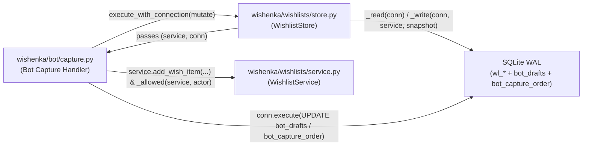
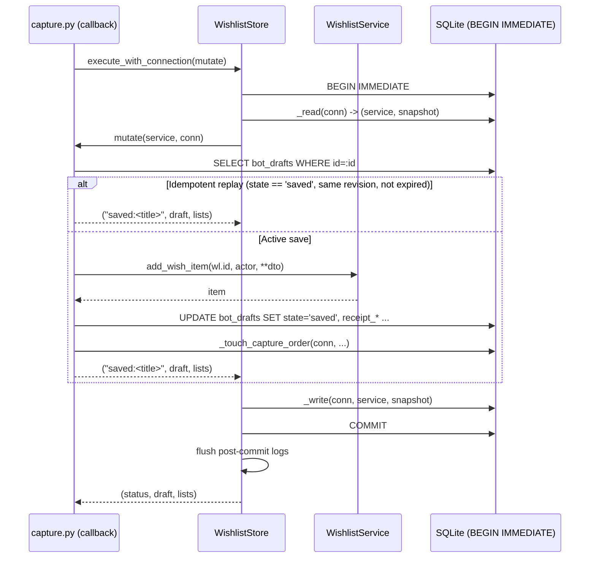

# WISHENKA-179: Supported Atomic Storage Operation for Saving Bot Drafts

## Research

Inspection of the current codebase (`wishenka/wishlists/store.py`, `wishenka/bot/capture.py`, `tests/test_bot_capture_repro.py`, and `doc/dev/architecture.md`) establishes the following facts:

1. **Current `WishlistStore` public transactional seams** (`wishenka/wishlists/store.py`):
   - `WishlistStore.execute(operation: Callable[[WishlistService], Awaitable[T]]) -> T`:
     Runs `_execute_once(operation)` with up to 5 retries on `TokenCollision` / token-table `IntegrityError`, maps `SQLAlchemyError` via `_raise_for_storage_error`, and flushes post-commit effects (`_log_flushed_notices`, `_log_flushed_shared_events`, `flush_pending_commit_logs`) after `_immediate(work)` commits.
     Inside `work(conn)`: calls `service, snapshot = await self._read(conn)`, syncs `wl_invite_tokens`, awaits `operation(service)`, validates token uniqueness, and persists via `flushed = await self._write(conn, service, snapshot)`.
   - `WishlistStore.transaction(work: Callable[[AsyncConnection], Awaitable[T]]) -> T`:
     Runs `work(conn)` inside `self._immediate(work)` (`BEGIN IMMEDIATE`, commit on success, rollback on `BaseException`) without loading or writing `WishlistService`. Used by `notices`, `bot/birthdays.py`, `bot/support.py`, `wishlists/deletion.py`, and draft-only handlers in `bot/capture.py`.

2. **Current coupling in `wishenka/bot/capture.py`**:
   - In the callback handler (`mutate(conn: AsyncConnection)`, lines 550–673), `capture.py` passes `mutate` to `store.transaction(mutate)` and directly calls private methods:
     - `service, snapshot = await store._read(conn)` (line 554) to resolve eligible wishlists (`_allowed(service, actor)`) and to call `await service.add_wish_item(wl.id, actor, **dto.model_dump())` on `command == "save"`.
     - `await store._write(conn, service, snapshot)` (line 597) before updating `bot_drafts` with `state='saved'` and `receipt_list_id` / `receipt_item_id`, and calling `_touch_capture_order(conn, ...)`.
   - Because `mutate` bypasses `_execute_once`, it also bypasses `WishlistStore`'s standard post-commit log flushing (`_log_flushed_notices`, `_log_flushed_shared_events`, `flush_pending_commit_logs`), `TokenCollision` retry loop, and `_raise_for_storage_error` mapping.

3. **Schema and ordering constraints** (`wishenka/wishlists/alembic/versions/add_bot_drafts.py`, `add_bot_capture_order.py`):
   - `bot_drafts` and `bot_capture_order` live in the same SQLite database as `wl_*` tables, with no foreign key from `bot_drafts.receipt_item_id` to `wl_items.id`.
   - Therefore, within a single `BEGIN IMMEDIATE` transaction (`_immediate`), `operation(service, conn)` can mutate `service` (allocating `item.id` in memory) and update `bot_drafts` / `bot_capture_order` on `conn` before `self._write(conn, service, snapshot)` flushes `wl_*` changes; if either `operation` or `_write` fails, `_immediate` rolls back the entire transaction atomically.

4. **Existing test expectations** (`tests/test_bot_capture_repro.py`):
   - `test_save_callback_retry_and_concurrency_create_only_one_wish` (lines 280–307) verifies concurrent `save` callbacks and idempotent replay at the same revision.
   - `test_failed_atomic_save_can_be_retried` (lines 1005–1029) monkeypatches `store._write` to raise `RuntimeError("database failure")` after writing, asserting that the wish count remains `0` and a subsequent `save` succeeds. Routing `capture.py` through a public `WishlistStore` method that still delegates persistence to `self._write` preserves this failure-injection seam without modification.

## Implementation Plan

1. **Extend `WishlistStore` (`wishenka/wishlists/store.py`)**:
   - Add a public method `execute_with_connection(self, operation: Callable[[WishlistService, AsyncConnection], Awaitable[T]]) -> T`.
   - Extract/generalize `_execute_once` to accept `Callable[[WishlistService, AsyncConnection], Awaitable[T]]`, passing `(service, conn)` to `operation`.
   - Have `execute(self, operation: Callable[[WishlistService], Awaitable[T]]) -> T` delegate to `execute_with_connection` via a thin adapter so retry logic, token-collision checks, `_read`/`_write`, post-commit log flushing, and `_raise_for_storage_error` are shared with zero duplication.

2. **Migrate `wishenka/bot/capture.py`**:
   - Update `mutate` in the callback handler from `mutate(conn: AsyncConnection)` with `store.transaction(mutate)` to `mutate(service: WishlistService, conn: AsyncConnection)` with `store.execute_with_connection(mutate)`.
   - Remove both `await store._read(conn)` and `await store._write(conn, service, snapshot)` from `wishenka/bot/capture.py`.
   - Keep all existing draft validation, authorization/eligibility checks, idempotent replay handling, `bot_drafts` / `bot_capture_order` updates, and non-save callback branches unchanged.

3. **Verify existing and new tests**:
   - Run the red repro test (`tests/test_bot_capture_atomic_store_repro.py`) until green.
   - Run `tests/test_bot_capture_repro.py` and the full repository quality gate (`make check` / `pytest`) to confirm no regressions in rollback, concurrency, idempotency, or other `WishlistStore` callers.

**Mandatory — Failing Repro (next Step 3):**
- **Where it lives**: `tests/test_bot_capture_atomic_store_repro.py` (with module-level `pytestmark = pytest.mark.timeout(15)` per `do-testing`).
- **What it asserts (desired behavior)**:
  1. `WishlistStore.execute_with_connection(operation)` atomically commits a `WishlistService` mutation (`add_wish_item`) together with a caller-scoped SQL update on `conn` (`bot_drafts`), and rolls back both `wl_items` and `bot_drafts` when an exception is raised after both in-transaction operations.
  2. The bot capture save flow (`harness.text("Lamp")` followed by `harness.callback(save)`) executes through `store.execute_with_connection` (verified by spying on `store.execute_with_connection` and asserting it is called) rather than calling private `store._read` / `store._write` from `capture.py`, while preserving idempotent replay and rollback on failure.
- **How to force failure without live external deps**: Uses `WishlistStore("sqlite+aiosqlite:///:memory:")` and the existing fake Telegram transport / `_setup` helper from `tests/test_bot_capture_repro.py`. Before Step 4 production changes, calling `store.execute_with_connection` raises `AttributeError` (red), and spying on `store.execute_with_connection` fails because the method does not exist on `WishlistStore`.
- **Sequencing**: Step 2 (this architecture) → Step 3 (write and review red repro in `tests/test_bot_capture_atomic_store_repro.py`) → Step 4 (implement `execute_with_connection` in `store.py` and migrate `capture.py` until green).

## Architecture

### System Module Diagram



### Modules and Responsibilities

1. **`wishenka/wishlists/store.py` (`WishlistStore`)**:
   - Owns the SQLite WAL engine, `BEGIN IMMEDIATE` transaction lifecycle (`_immediate`), domain hydration (`_read`), granular domain persistence (`_write`), capability-token uniqueness checks/retries, SQLAlchemy error mapping (`_raise_for_storage_error`), and post-commit observability flushing.
   - Exposes three complementary public execution seams:
     - `execute(operation)`: domain-only `WishlistService` operations.
     - `execute_with_connection(operation)`: combined `WishlistService` + caller-scoped `AsyncConnection` operations within one atomic `BEGIN IMMEDIATE` transaction.
     - `transaction(work)`: raw `AsyncConnection` operations for components that do not touch `WishlistService`.

2. **`wishenka/bot/capture.py` (Bot Capture Handler)**:
   - Owns Telegram bot capture UX, draft lifecycle (`bot_drafts`), ordering watermark (`bot_capture_order`), URL safety checks, and save-receipt idempotency.
   - Uses `store.transaction(...)` for draft-only steps (`pending`, `update`, `reserve`, `finish`, `remove`) and `store.execute_with_connection(...)` for callback actions that inspect eligible wishlists and atomically persist a wish + save receipt.
   - Has zero knowledge of `WishlistStore._read`, `WishlistStore._write`, or `_StorageSnapshot`.

3. **`wishenka/wishlists/service.py` (`WishlistService`)**:
   - Unchanged; executes in-memory domain logic (`add_wish_item`, access/eligibility checks) on the hydrated domain graph inside the transaction.

### Module Interaction Scheme (Save Flow)



### Selected Architectural Patterns and Justification

- **Unit of Work / Callback-Injected Transaction Boundary**:
  Passing `(service, conn)` into `operation` inside `WishlistStore.execute_with_connection` keeps transaction lifecycle, `BEGIN IMMEDIATE` locking, snapshot hydration/diffing, token-collision retries, and error mapping encapsulated inside `WishlistStore` while allowing `capture.py` to co-locate its `bot_drafts` / `bot_capture_order` SQL updates in the exact same SQLite transaction.
- **Adapter Reuse (`execute` → `execute_with_connection`)**:
  Implementing `execute` as a thin wrapper over `execute_with_connection` avoids duplicating the 5-attempt retry loop, token checks, and post-commit log flushing.
- **Explicit Alternative Rejected**:
  Adding bot-draft-specific tables or methods directly into `WishlistStore` was rejected because `bot_drafts` and `bot_capture_order` belong to the bot capture module (`wishenka/bot/capture.py`), not the wishlist domain store. A generic `execute_with_connection` seam preserves module boundaries while eliminating private-method coupling.

### Main Interfaces / APIs

```python
class WishlistStore:
    async def execute(
        self,
        operation: Callable[[WishlistService], Awaitable[T]],
    ) -> T: ...

    async def execute_with_connection(
        self,
        operation: Callable[[WishlistService, AsyncConnection], Awaitable[T]],
    ) -> T: ...

    async def transaction(
        self,
        work: Callable[[AsyncConnection], Awaitable[T]],
    ) -> T: ...
```

- **Contract of `execute_with_connection`**:
  - Runs `operation(service, conn)` inside a single `BEGIN IMMEDIATE` transaction.
  - `service` is hydrated at transaction start via `_read(conn)` and persisted before commit via `_write(conn, service, snapshot)`.
  - If `operation` or `_write` raises any exception, the entire transaction (both `wl_*` and caller SQL writes on `conn`) rolls back.
  - Retries up to 5 times on `TokenCollision` / token-table `IntegrityError` (callers must keep `operation` safe to retry under token-allocation races or only perform SQL writes after domain checks).
  - Flushes post-commit notices, shared events, and commit logs only after `COMMIT` succeeds.

## Q&A

- **Q: Is `execute_with_connection` safe if `operation` does not mutate `service` (for example, on an idempotent replay or `cancel` callback)?**
  - **A**: Yes. `WishlistStore.execute` already runs `_read` and `_write` for read-only operations (such as `capture.py` line 274). Inside `BEGIN IMMEDIATE`, `_write` persists the unchanged state cleanly without side effects, and no notices or events are emitted when nothing in `service` changed.
- **Q: Does running `conn.execute(UPDATE bot_drafts ...)` before `self._write(conn, service, snapshot)` introduce any foreign-key ordering issue?**
  - **A**: No. `bot_drafts` has no foreign-key constraint referencing `wl_items` or `wl_lists` (`wishenka/wishlists/alembic/versions/add_bot_drafts.py`). Both writes execute within the same `BEGIN IMMEDIATE` transaction and commit or roll back together.
