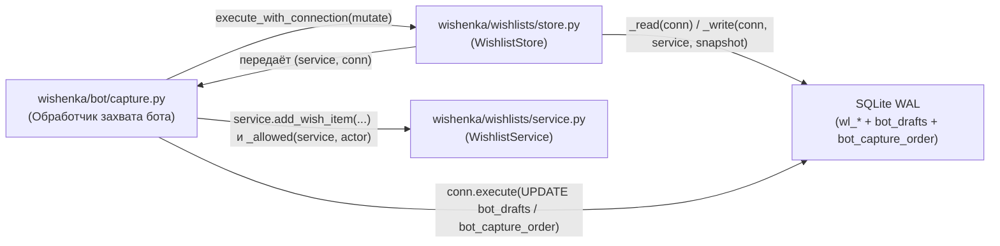
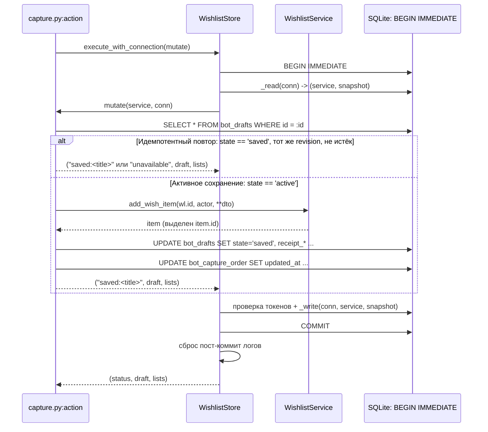

# Спецификация: WISHENKA-179 — Поддерживаемая атомарная операция хранилища для сохранения черновиков бота

**Задача:** WISHENKA-179  
**Статус:** реализованная спецификация  
**Связанные задачи:** WISHENKA-28 (захват желаний в боте), WISHENKA-249, WISHENKA-250  
**Стек реализации:** Python 3.12+, SQLite WAL, SQLAlchemy Core (`AsyncConnection`), Pydantic v2, aiogram

## 1. Назначение и бизнес-цель

### 1.1. Постановка проблемы

В сценарии захвата желаний через Telegram-бота (`WISHENKA-28`) при подтверждении сохранения черновика (`save`) система должна в одной неделимой транзакции выполнить две разнородные операции:

- создать доменное желание в выбранном вишлисте через `WishlistService.add_wish_item` (таблицы домена `wl_*`);
- перевести черновик в состояние квитанции (`saved`) с фиксацией `receipt_list_id` и `receipt_item_id` в `bot_drafts` и обновлением временной отметки `bot_capture_order`.

До реализации `WISHENKA-179` обработчик callback-действий в `wishenka/bot/capture.py` (`mutate`) объединял эти шаги внутри `store.transaction(mutate)` за счёт прямых обращений к внутренним приватным методам `store._read(conn)` и `store._write(conn, service, snapshot)`. Хотя такой подход обеспечивал атомарность записи, он жёстко связывал модуль захвата бота с недокументированными деталями персистентности `WishlistStore` (внутренним снимком `_StorageSnapshot`) и обходил стандартный транзакционный конвейер `WishlistStore._execute_once` — повторные попытки при коллизии токенов, маппинг ошибок хранилища и отложенную публикацию пост-коммит логов.

### 1.2. Цели и ценность для пользователей и системы

**Бизнес-цель** — устранить зависимость потока захвата желаний в боте от приватных механизмов `WishlistStore`, предоставив поддерживаемый публичный контракт для атомарного совместного выполнения доменных операций вишлистов и SQL-обновлений вызывающей стороны.

Ключевая ценность решения:

- **Независимая эволюция хранилища (ценность для сопровождения):** внутренняя реализация чтения, кэширования и дифференциального сохранения `WishlistStore` может безопасно развиваться без риска скрытой поломки или вынужденного переписывания модуля `wishenka/bot/capture.py`.
- **Нерушимая согласованность данных (ценность для пользователя):** сохранение желания в вишлист и фиксация квитанции остаются неделимой операцией «всё или ничего» — пользователь никогда не окажется в ситуации, когда желание создано без квитанции или квитанция записана без сохранённого желания.
- **Сохранение надёжности и идемпотентности:** все гарантии отката при сбое, сериализации конкурентных запросов и идемпотентного повторного подтверждения на одной ревизии сохраняются в полном объёме, а модуль захвата автоматически получает стандартный механизм ретраев токенов и пост-коммит логирования.

### 1.3. Границы задачи

В рамки `WISHENKA-179` входят:

- проектирование и публикация метода `WishlistStore.execute_with_connection` в `wishenka/wishlists/store.py` с переиспользованием общего пути `_execute_once`;
- перевод обработчика callback-действий `wishenka/bot/capture.py:mutate` на `store.execute_with_connection` с полным удалением вызовов `store._read` и `store._write`;
- сохранение и расширение автоматизированного тестового покрытия для атомарности, отката, конкурентности и идемпотентности.

В рамки задачи **не входят**:

- изменение сроков хранения черновиков (`24` часа), квитанций (`7` дней) или водяных знаков `bot_capture_order`;
- каскадное удаление и обезличивание данных захвата при удалении аккаунта (`WISHENKA-35`);
- изменение пользовательских сценариев, текстов интерфейса бота (`ru` / `en`), клавиатур или жизненного цикла черновика.

## 2. Функциональные требования и пользовательские сценарии

### 2.1. Доменные сущности и роли

| Сущность | Описание |
| --- | --- |
| Вишлист (`Wishlist`) | Целевой список желаний пользователя, право записи в который определяется политикой `WishlistAccessPolicy` |
| Желание (`WishItem`) | Доменный элемент, создаваемый в `WishlistService` и сохраняемый в `wl_items` при подтверждении черновика |
| Черновик бота (`bot_drafts`) | Отслеживаемый по `revision` черновик желания с привязкой к `(owner, chat)`, переходящий из `active` в `saved`, `cancelled` или `replaced` |
| Квитанция сохранения (`receipt_list_id`, `receipt_item_id`) | Зафиксированная в `bot_drafts` ссылка на целевой вишлист и созданное желание, обеспечивающая идемпотентный повтор подтверждения и отображение результата |
| Граница хранилища (`WishlistStore`) | Компонент, управляющий жизненным циклом транзакции `BEGIN IMMEDIATE`, гидратацией/персистенцией `WishlistService`, ретраями и пост-коммит эффектами |

### 2.2. Функциональные требования и инварианты

1. **Публичная атомарная операция хранилища (`WishlistStore.execute_with_connection`):**
   - `WishlistStore` предоставляет публичный асинхронный метод `execute_with_connection(operation)`, принимающий колбэк `Callable[[WishlistService, AsyncConnection], Awaitable[T]]`.
   - Внутри единой транзакции SQLite `BEGIN IMMEDIATE` хранилище гидратирует `WishlistService`, передаёт `(service, conn)` в `operation`, проверяет уникальность токенов и сохраняет изменения доменного графа через `_write(conn, service, snapshot)`.
   - Вход: асинхронная операция `operation(service, conn)`. Выход: значение типа `T`, возвращённое `operation` после успешного `COMMIT`.
2. **Единая реализация с `WishlistStore.execute`:**
   - Метод `WishlistStore.execute(operation)` делегирует выполнение в `execute_with_connection` через тонкий адаптер, обеспечивая единую логику повторов при коллизии токенов, отображения ошибок БД и пост-коммит логирования.
3. **Использование поддерживаемой границы в захвате бота:**
   - Обработчик callback-кнопок `wishenka/bot/capture.py` (`mutate`) обязан вызывать `store.execute_with_connection(mutate)` и не должен напрямую обращаться к приватным методам `store._read` и `store._write`.
   - Чисто черновиковые и служебные операции (`pending`, `update`, `reserve`, `finish`, `cleanup_drafts`) сохраняют использование `store.transaction`, а чтение списка доступных вишлистов в `lists_for` — `store.execute`.
4. **Сохранение проверок доступа, безопасности и валидации:**
   - Внутри транзакции `mutate` до записи желания выполняются все проверки: принадлежность черновика (`draft["owner"] == actor.telegram_id` и `draft["chat"] == chat`), статус `state == 'active'`, неистёкший срок (`expires > now`), совпадение `revision == rev`, право добавления/редактирования в целевом списке (`WishlistAccessPolicy.can_add_or_edit_item`), безопасность ссылок `link` и `image_url` (`_safe_web_url`) и валидация `CreateItemDTO`.
   - Если доступ к выбранному вишлисту был отозван или список удалён, `list_id` сбрасывается в `NULL`, `revision` увеличивается на `1`, желание не создаётся и возвращается статус `"unavailable"`.
5. **Идемпотентный повтор подтверждения:**
   - При повторном получении `command == "save"` для черновика в состоянии `state == 'saved'` с тем же `revision` и неистёкшим `expires > now` повторное желание не создаётся и запись в БД не выполняется.
   - При сохранении доступа к `receipt_list_id` возвращается `"saved:" + wl.title`; при отзыве доступа возвращается нейтральный статус `"unavailable"` без раскрытия названия списка.
6. **Атомарность, откат и эквивалентность поведения:**
   - Любое исключение в доменной операции, SQL-командах вызывающей стороны на `conn` или в `_write` откатывает всю транзакцию целиком — ни желание в `wl_items`, ни изменения `bot_drafts` и `bot_capture_order` не фиксируются.
   - Пользовательские потоки, тексты ответов, клавиатуры, коды статусов (`saved:...`, `unavailable`, `unsafe_url`, `invalid`, `expired`, `cancelled`, `review`, `fields`, `view`, `page:...`, `editing:...`) и жизненный цикл черновика остаются полностью эквивалентными прежнему поведению.

### 2.3. Пользовательские и эксплуатационные сценарии

| Сценарий | Входные условия | Ожидаемое поведение |
| --- | --- | --- |
| UC-01: Атомарное сохранение черновика | Пользователь подтверждает сохранение (`save`) активного черновика в доступный вишлист | В одной транзакции `execute_with_connection` вызывается `service.add_wish_item`, `bot_drafts` переводится в `saved` с квитанцией (`receipt_list_id`, `receipt_item_id`, `expires = now + 7d`), обновляется `bot_capture_order.updated_at`, а `_write` фиксирует доменные изменения |
| UC-02: Откат при частичном сбое | Ошибка валидации, исключение в SQL вызывающей стороны на `conn` или сбой записи в `_write` | Транзакция `BEGIN IMMEDIATE` откатывается полностью: количество желаний не увеличивается, черновик остаётся в состоянии `active`, а повторная попытка `save` завершается успешно |
| UC-03: Повторное или конкурентное подтверждение | Двойное нажатие «Сохранить» или повтор при сетевом сбое на том же `revision` | Первый запрос создаёт ровно одно желание и квитанцию; повторный запрос распознаёт `state == 'saved'` и возвращает прежний результат без дублирования желания |
| UC-04: Безопасный рефакторинг хранилища | Изменение внутренней структуры чтения/записи или снимка в `WishlistStore` | Код `wishenka/bot/capture.py` не зависит от `_read` / `_write` и `_StorageSnapshot`; отсутствие обращений контролируется AST-тестом |

## 3. Архитектура, компоненты и интерфейсы

### 3.1. Схема взаимодействия модулей



### 3.2. Модули и ответственности

| Модуль / компонент | Ответственность |
| --- | --- |
| `wishenka/wishlists/store.py` (`WishlistStore`) | Владеет подключением SQLite WAL, транзакциями `BEGIN IMMEDIATE` (`_immediate`), гидратацией (`_read`) и дифференциальной записью (`_write`), проверкой уникальности и ретраями токенов, маппингом `SQLAlchemyError` (`_raise_for_storage_error`) и пост-коммит сбросом логов; экспонирует три публичных шва записи: `execute`, `execute_with_connection`, `transaction` (и `execute_read` для отложенных чтений) |
| `wishenka/bot/capture.py` (`create_capture_router`) | Управляет сценарием захвата в Telegram, таблицами `bot_drafts` и `bot_capture_order`, проверкой безопасности URL и идемпотентностью; использует `store.execute_with_connection(mutate)` в обработчике callback-действий `action` и не зависит от `_read`, `_write` или `_StorageSnapshot` |
| `wishenka/wishlists/service.py` (`WishlistService`) | Без изменений; выполняет доменную логику (`add_wish_item`, выделение идентификаторов и формирование отложенных уведомлений/событий) в памяти транзакции |

### 3.3. Программные интерфейсы и контракты данных

```python
class WishlistStore:
    async def execute(
        self,
        operation: Callable[[WishlistService], Awaitable[T]],
    ) -> T: ...

    async def execute_with_connection(
        self,
        operation: Callable[[WishlistService, AsyncConnection], Awaitable[T]],
    ) -> T: ...

    async def transaction(
        self,
        work: Callable[[AsyncConnection], Awaitable[T]],
    ) -> T: ...
```

Контракт `WishlistStore.execute_with_connection(operation)`:

1. **Повторные попытки и отображение ошибок:** запускает `_execute_once(operation)` до `5` раз:
   - при `TokenCollision` или `IntegrityError` по таблицам `wl_tokens.token` либо `wl_invite_tokens.token` на попытках `0..3` логируется предупреждение и выполняется повторная попытка после отката транзакции; после `5` неудачных попыток поднимается `RuntimeError`;
   - при прочих `IntegrityError` логируется ошибка целостности и поднимается `RuntimeError("Wishlist storage operation failed")`;
   - при прочих `SQLAlchemyError` вызывается `_raise_for_storage_error(exc)` (ошибки `SQLITE_BUSY` преобразуются в `InventoryBusyError`, остальные — в `RuntimeError("Wishlist storage operation failed")`).
2. **Внутренний цикл `_execute_once(operation)`:**
   - внутри `self._immediate(work)` (`BEGIN IMMEDIATE`):
     1. гидратирует `service, snapshot = await self._read(conn)`, запоминает текущие `public_token` и `invite_token` списков и синхронизирует `wl_invite_tokens`;
     2. вызывает `result = await operation(service, conn)`;
     3. проверяет новые или изменённые `invite_token` и `public_token` на взаимные коллизии между `wl_tokens` и `wl_invite_tokens` (поднимая `TokenCollision` при совпадении) и обновляет таблицы токенов;
     4. сохраняет доменный дифф и эффекты уведомлений через `flushed = await self._write(conn, service, snapshot)`, копирует `service._flushed_shared_events` и `service._pending_commit_logs`;
     5. фиксирует транзакцию (`await conn.commit()`) либо откатывает её при любом `BaseException` (`await conn.rollback()`).
   - строго после успешного коммита вызывает `_log_flushed_notices(flushed)`, `_log_flushed_shared_events(flushed_shared)` и `flush_pending_commit_logs(pending_commit_logs)`.
3. **Согласованность схемы без конфликтов внешних ключей:** таблицы `bot_drafts` и `bot_capture_order` находятся в той же БД SQLite, что и `wl_*`, но `bot_drafts.receipt_item_id` не связан ограничением внешнего ключа с `wl_items.id`. Поэтому запись выделенного в памяти `item.id` в `bot_drafts` внутри `mutate(service, conn)` до вызова `self._write(conn, service, snapshot)` не вызывает ошибок FK, а обе части изменений коммитятся или откатываются вместе.
4. **Безопасность к повторам:** при `TokenCollision` транзакция полностью откатывается и `operation` вызывается повторно, поэтому колбэк должен корректно переносить повторное выполнение до коммита.

Делегирование `WishlistStore.execute`:

- `execute(operation)` создаёт адаптер `adapter(service, _conn)` и передаёт его в `execute_with_connection(adapter)`, полностью разделяя реализацию с минимальными накладными расходами.

### 3.4. Последовательность взаимодействия и переходы состояний



Переходы и ветви обработки внутри `mutate(service, conn)` (`wishenka/bot/capture.py`):

| Команда / условие | Изменение `WishlistService` | SQL на `conn` | Возвращаемый статус |
| --- | --- | --- | --- |
| Отсутствующий/чужой черновик, истёкший `expires`, чужой `revision` или неактивный `state` (кроме повтора `save`) | Нет | Нет | `"expired"` |
| `save` при `state == 'saved'`, совпадении `revision` и `expires > now` | Нет | Нет | `"saved:<title>"` или `"unavailable"` |
| `save`, целевой список недоступен (`not wl`) | Нет | `UPDATE bot_drafts SET list_id=NULL, revision=revision+1` | `"unavailable"` |
| `save`, небезопасная ссылка или ошибка `CreateItemDTO` / `ValueError` | Нет | Нет | `"unsafe_url"` или `"invalid"` |
| `save`, все проверки пройдены | `add_wish_item` (создание желания) | `bot_drafts` -> `saved` (`expires = now + 7d`), `_touch_capture_order` | `"saved:<title>"` |
| `cancel` | Нет | `bot_drafts` -> `cancelled`, `data='{}'`, `_touch_capture_order` | `"cancelled"` |
| `c_<field>` / `e_<field>` / `l_<list_id>` (при `list_id in eligible`) | Нет | Обновление `data` / `edit_field` / `list_id`, `revision+1`, `expires = now + 24h`, `_touch_capture_order` | `"review"` / `"editing:<field>"` |
| `p_<page>` / `edit` / `view` | Нет | Нет | `"page:<page>"` / `"fields"` / `"view"` |

## 4. Нефункциональные требования, безопасность и наблюдаемость

### 4.1. Производительность и эксплуатационные пределы

- **Предсказуемая блокировка SQLite WAL:** транзакции `execute_with_connection` стартуют с `BEGIN IMMEDIATE`, предотвращая взаимоблокировки при повышении уровня блокировки (`SQLITE_BUSY`); таймаут ожидания ограничен `PRAGMA busy_timeout = 5000` (`5000` мс).
- **Ограничение числа повторов:** цикл обработки коллизий токенов в `execute_with_connection` ограничен максимум `5` попытками.
- **Сохранение облегчённых швов:** пути без доменной мутации (`pending`, `update`, `reserve`, `finish`, `cleanup_drafts`) продолжают работать через `WishlistStore.transaction`, а отложенные чтения — через `WishlistStore.execute_read`. *(Ограничение текущей реализации callback-замыкания `mutate`, вызывающего гидратацию и на не-`save` действиях, зафиксировано в разделе 5.4.)*

### 4.2. Безопасность, приватность и инварианты

- **Целостность транзакции:** любое исключение до или во время коммита вызывает `conn.rollback()` в `_immediate`, не оставляя рассогласованных записей между `wl_items` и `bot_drafts` и не сбрасывая пост-коммит логи.
- **Строгая проверка субъекта и прав:** актор определяется только по `callback.from_user.id` в приватном чате (`callback.message.chat.id`), сверяется с `draft["owner"]` и `draft["chat"]`, а права записи в список повторно валидируются через `WishlistAccessPolicy.can_add_or_edit_item`.
- **Защита от небезопасных ссылок и минимизация данных:** `_safe_web_url` проверяет `link` и `image_url` (только абсолютный `http` / `https` с `hostname`, без управляющих символов и `\`), при переходах в `saved`, `cancelled` и `replaced` поле `bot_drafts.data` очищается в `'{}'`, а тайна сюрприза соблюдается на всём протяжении сценария.
- **Подавление чувствительных логов в потоке захвата:** вызов `store.execute_with_connection(mutate)` обёрнут в `ContextVar` `_preview_active`, благодаря чему фильтр `_PrivatePreviewFilter` подавляет записи логгеров `wishenka.items`, `httpx`, `httpcore*`, `wishenka.users`, `wishenka.wishlists`, `wishenka.wishlists.store` и `wishenka.wishlists.notices` только в текущей корутине, исключая попадание пользовательских данных в логи.

### 4.3. Наблюдаемость: структурированное логирование и метрики

Специализированные метрики (Prometheus / OpenTelemetry) для `wishenka/wishlists/store.py` и `wishenka/bot/capture.py` не применяются; контроль работы обеспечивается существующими структурированными событиями (`extra={"event": ...}`) без логирования PII, JSON черновика, URL, токенов и полных payload желаний:

| Уровень | Событие (`extra["event"]`) | Источник | Контекст и условие |
| --- | --- | --- | --- |
| `ERROR` | `wishlist_store_integrity_error` | `WishlistStore.execute_with_connection` (`wishenka/wishlists/store.py`) | Нетокенное нарушение `IntegrityError` |
| `ERROR` / `WARNING` | `wishlist_store_error` / `wishlist_inventory_busy` | `_raise_for_storage_error` (`wishenka/wishlists/store.py`) | Прочие `SQLAlchemyError` и блокировки `SQLITE_BUSY` |
| `ERROR` | `receipt_notice_enqueue_failed` | `WishlistStore._flush_receipt_effects` (`wishenka/wishlists/store.py`) | `error_class`; ошибка постановки уведомления в outbox внутри `_write` |
| `WARNING` | `wishlist_token_collision_retry` | `WishlistStore.execute_with_connection` (`wishenka/wishlists/store.py`) | `attempt`; коллизия токена перед повторной попыткой |
| `ERROR` | `bot_capture_action_error` | `action` (`wishenka/bot/capture.py`) | Исключение при выполнении `store.execute_with_connection(mutate)` |
| `INFO` | `bot_capture_save` | `action` (`wishenka/bot/capture.py`) | `outcome` (`"saved"`, `"unavailable"`, `"unsafe_url"`, `"invalid"`, `"expired"`) после `command == "save"` |
| `DEBUG` | `receipt_notice_skipped` / `receipt_notice_created` | `_log_flushed_notices` (`WishlistStore._execute_once`) | `outbox_id`, `gate`; строго после успешного `commit` |
| `DEBUG` | `shared_notice_events_queued` | `_log_flushed_shared_events` (`WishlistStore._execute_once`) | `kind`, `queued_count`; строго после успешного `commit` |
| `DEBUG` | Доменные commit-логи | `flush_pending_commit_logs` (`WishlistStore._execute_once`) | Сброс `service._pending_commit_logs` строго после успешного `commit` |

## 5. Верификация и критерии приёмки

### 5.1. Автоматизированные сценарии тестирования

В модуле `tests/test_bot_capture_atomic_store_repro.py` (`pytestmark = pytest.mark.timeout(15)`) реализованы следующие проверки:

1. **`test_execute_with_connection_commits_service_and_sql_atomically`:** проверяет на `WishlistStore("sqlite+aiosqlite:///:memory:")` совместный коммит доменного вызова `service.add_wish_item` (таблица `wl_items`) и обновления `bot_drafts` (`state = 'saved'`, `receipt_list_id`, `receipt_item_id`) в одной транзакции `execute_with_connection`.
2. **`test_execute_with_connection_rolls_back_service_and_sql_on_error`:** проверяет, что исключение `RuntimeError("boom")` после `service.add_wish_item` и `UPDATE bot_drafts` откатывает оба изменения (`0` желаний в списке, строка `bot_drafts` остаётся `('active', None, None)`).
3. **`test_bot_capture_save_uses_execute_with_connection_and_preserves_replay`:** с помощью spy-обёртки над `store.execute_with_connection` и тестового транспорта Telegram (`_setup` из `tests/test_bot_capture_repro.py`) подтверждает, что сценарий сохранения черновика (`"Lamp"` -> `save`) вызывает `store.execute_with_connection`, создаёт ровно `1` желание, а повторный callback `save` идемпотентно сохраняет `1` желание.
4. **`test_bot_capture_does_not_access_private_store_read_write`:** выполняет AST-анализ `wishenka/bot/capture.py` и гарантирует отсутствие обращений к атрибутам `_read` и `_write`.

Кроме того, сохранена регрессионная проверка конкурентности, идемпотентности и отката при сбое БД в `tests/test_bot_capture_repro.py`, включая `test_save_callback_retry_and_concurrency_create_only_one_wish` и `test_failed_atomic_save_can_be_retried`.

### 5.2. Наблюдаемые результаты проверок

Зафиксированные результаты проверок после завершения изменений (`00-roadmap.md`, `40-code-cleanup.md`):

- **Статический анализ (`make analyze`):** `ruff check wishenka tests`, `ruff format --check wishenka tests` и `mypy wishenka tests` (strict mode) — `0` ошибок и предупреждений по всем `226` исходным файлам.
- **Целевой запуск `pytest`:** `55 passed` по пяти модулям:
  - `tests/test_bot_capture_atomic_store_repro.py`
  - `tests/test_bot_capture_repro.py`
  - `tests/test_bot_capture_order_retention.py`
  - `tests/test_bot_capture_order_retention_repro.py`
  - `tests/test_receipt_concurrency.py`
- **Документация разработчика:** обновлены `doc/dev/bot-scenarios.md`, `doc/dev/wishlists.md` и `doc/dev/testing.md`.

### 5.3. Критерии приёмки

1. `WishlistStore` предоставляет публичный метод `execute_with_connection`, атомарно объединяющий операции `WishlistService` и SQL-операции на том же `AsyncConnection` в одной транзакции `BEGIN IMMEDIATE`.
2. `WishlistStore.execute` делегирует выполнение в `execute_with_connection`, разделяя ретраи коллизий токенов, маппинг ошибок и пост-коммит сброс логов без дублирования кода.
3. Модуль `wishenka/bot/capture.py` выполняет сохранение черновика и квитанции через `store.execute_with_connection` и не обращается к приватным методам `_read` и `_write`.
4. При отказе любой части операции откатываются как доменные изменения вишлиста, так и состояние черновика и квитанции.
5. Идемпотентный повтор подтверждения, защита от конкурентных запросов и пользовательское поведение бота работают без регрессий; статический анализ и целевые тесты (`55 passed`) пройдены.

### 5.4. Известные ограничения и технический долг (по результатам `60-tech-debt.md`)

| Область | Описание ограничения / долга | Статус / задача |
| --- | --- | --- |
| Гидратация `WishlistService` на не-`save` командах и размер `mutate` | Замыкание `mutate` в `wishenka/bot/capture.py` (около `124` строк, `8+` веток команд и повторяющиеся `UPDATE bot_drafts ... revision=revision+1`) пропускает через `store.execute_with_connection` все callback-команды (`cancel`, `p_`, `edit`, `view`, `c_`, `e_`, `l_`, `save`). Это упрощает получение `lists = _allowed(service, actor)`, но запускает `_read` / `_write` и полную гидратацию доменного графа при пагинации и правке полей | Неблокирующий техдолг: [WISHENKA-250](https://pypost.atlassian.net/browse/WISHENKA-250) (выделение хелперов команд и перевод чисто черновиковых действий на `store.transaction` с облегчённым запросом доступных списков) |
| Отсутствие прямых тестов на ретрай `TokenCollision` для SQL вызывающей стороны и подавление логов при откате | В `tests/test_bot_capture_atomic_store_repro.py` не проверяется напрямую откат и повторный запуск caller SQL при `TokenCollision` / токенном `IntegrityError`, а также непоявление `pending_commit_logs` и `flushed` уведомлений при исключении в caller SQL после `service.add_wish_item` | Неблокирующий техдолг: [WISHENKA-249](https://pypost.atlassian.net/browse/WISHENKA-249) |
| Использование `store._write` в тесте инъекции сбоя | `tests/test_bot_capture_repro.py::test_failed_atomic_save_can_be_retried` намеренно сохраняет monkeypatch `store._write` для симуляции ошибки БД в середине коммита | Осознанный компромисс для сохранения регрессионного теста |
| Охват AST-проверки | Тест `test_bot_capture_does_not_access_private_store_read_write` проверяет отсутствие обращений к `_read` и `_write` только в `wishenka/bot/capture.py`, не охватывая остальные модули пакета `wishenka/bot/` | Зафиксировано в `60-tech-debt.md` |
