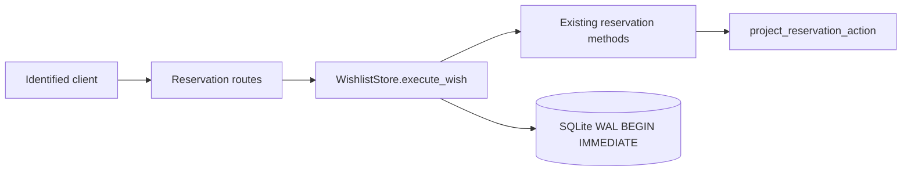

# WISHENKA-18: Gifter promise actions and recipient silence

## Research

### What the code does today

Promise rules already live on `WishlistService` in
`wishenka/wishlists/service.py`:

- `create_reservation(item_id, user, quantity=1)` returns a `Reservation`
- `update_reservation_quantity(reservation_id, user, new_quantity)`
- `cancel_reservation(reservation_id, user)`
- `mark_reservation_purchased(reservation_id, user)`
- `revert_reservation_to_active(reservation_id, user)`, also bound as
  `mark_reservation_unpurchased`

`_transactional` sends `create_reservation` through
`WishlistStore.execute_wish` with `item_id`. The other four go through
`execute_wish` with `reservation_id`. That entry calls `Connection.begin()`.
The wishlist engine's `begin` listener emits `BEGIN IMMEDIATE`, resolves a
reservation id with `SELECT wish_item_id`, loads that wish, runs the method,
and persists the changed rows. This is the lock from
`ai-tasks/WISHENKA-57/20-architecture.md`. `doc/dev/architecture.md` records
the same transaction. There is no Redis lock and no `SELECT FOR UPDATE`.

No reservation HTTP router exists. `wishenka/web/app.py` includes items,
items UI, wishlists, sharing, auth, and the mini app. Item routes in
`wishenka/web/routes/items.py` never call the five methods above.

Wish reads already censor. `project_wish_item` uses
`WishlistAccessPolicy.is_recipient`. The recipient receives
`WishItemRecipientViewDTO`, which has no `available_quantity`,
`is_fully_reserved`, `is_reserved_by_me`, `my_reserved_quantity`,
`my_reservation_status`, or `my_reservation_id`. A non-recipient receives
`WishItemGifterViewDTO`. `my_reserved_quantity` is the sum of that caller's
active and purchased promises. `my_reservation_status` and
`my_reservation_id` come from the last of those promises.
`GET /api/wishlists/{wishlist_id}/items` and
`GET /api/wishlists/{wishlist_id}/items/{item_id}` return that projection.
Wishlist collection DTOs do not carry a reservation list.

Three gaps block a client from using those methods safely:

- `create_reservation` does not refuse `quantity < 1`. A resize already
  raises `ValueError("Reservation quantity must be at least 1")`.
- `user is None` stores `user_id` 0. The row has no identified gifter.
- The methods return a `Reservation`, including `user_id`. A missing id
  raises `ReservationNotFoundError` whose text contains the id. A different
  holder raises `PermissionDeniedError("Actor is not reservation owner")`.
  A wrong status raises `ReservationError` naming that status. Those three
  answers tell a recipient whether a promise exists. Nothing in the web
  layer turns them into one censored HTTP body, because the routes are
  absent. `items.py` does not catch `SelfReservationError`,
  `InsufficientQuantityError`, `ReservationError`, or
  `ReservationNotFoundError`.

Archive and delete already match the accepted requirements, and this task
does not replace them. Create refuses an archived or deleted list and an
archived wish. `_ensure_reservation_writable` refuses the four mutations on
an archived or deleted list and does not refuse them on an archived wish
whose list is still active. Deleting a list still cancels occupying
promises on the existing delete path.

`get_current_user` already returns HTTP 401 `Authentication required`.
`BrowserSecurityMiddleware` already checks CSRF for cookie mutations that
are not bearer requests. These routes use that dependency and that
middleware. They do not add a second session mechanism.

FastAPI's `response_model` filters a successful body to the declared model.
A union selects a member, and the more specific member keeps its fields
([Extra models](https://fastapi.tiangolo.com/tutorial/extra-models/),
[Response model](https://fastapi.tiangolo.com/tutorial/response-model/)).
Returning a `Reservation` or a dict and expecting a union to drop booking
fields is not a censorship boundary. `JSONResponse` skips the filter.
`HTTPException` returns only `{"detail": ...}`.

### Ticket wording

The Jira text asks for create, quantity change, cancel, and mark-purchased
endpoints, a sum-of-reservations check under `SELECT FOR UPDATE`, and
censorship of booking fields for the recipient. The accepted requirements
keep the WISHENKA-57 free remainder and its `BEGIN IMMEDIATE` transaction,
add undo of a purchase mark, and require the action answer itself to stay
silent for the recipient of that wish. SQLite's one writer is already taken
by `execute_wish`. A second row lock is not available as a separate
mechanism and is not added here.

## Implementation Plan

Step 4, after the red test. This step does not change product code.

1. Add `ReservationQuantityDTO` and `PromiseActionDTO` in
   `wishenka/wishlists/schemas.py`.
2. Add the three guards under Service changes to the existing methods.
   Do not add a lock, a repository, or a quantity formula.
3. Add `project_reservation_action` beside `project_wish_item`.
4. Add `wishenka/web/routes/reservations.py` and include its router from
   `wishenka/web/app.py`.
5. Leave wish reads, collection responses, archive and delete, receipt,
   requested-quantity reduction, screens, and `get_user_reservations`
   unchanged.

**Mandatory — Failing Repro (next Step 3):** Add
`tests/test_reservation_actions_api.py` with
`pytestmark = pytest.mark.timeout(30)`. Follow
`tests/test_wish_items_crud_api.py`: `create_app` on a temporary SQLite
file, bearer tokens from `SessionTokenService`, and `TestClient`. No
network, no Redis, no second process, and no new lock.

The assertions that fail today are the five routes. Those paths currently
answer Starlette 404 with detail `Not Found`. The file expects the contract
in Architecture.

- An identified gifter who is not the recipient promises a positive quantity
  on an active wish. Create returns 201. The body is that new promise: its
  id, its quantity, status `active`, and `available_quantity`. The body has
  no `user_id`. A second create is a second row, not an update of the first.
- Quantity change, cancel, mark purchased, and undo return 200. Top-level
  `quantity` and `status` are the promise that call changed. With two
  promises, lowering the older one returns that older id and its new
  quantity, not the sum. `GET` of the wish still shows the caller's combined
  `my_reserved_quantity` and the latest promise status. That `GET` already
  passes and stays as a guard.
- Create with quantity `0` or a negative quantity returns 400, detail
  `Reservation quantity must be at least 1`, and leaves no row. A resize
  uses that same detail.
- A request with no `Authorization` header returns 401, detail
  `Authentication required`, and leaves no row.
- The recipient of that wish gets create HTTP 403, body exactly
  `{"detail":"Cannot promise this wish"}`, and no other key. The body is the
  same when the free remainder is `0` and when it equals the requested
  quantity.
- For one real promise id, the holder receives 200 and the recipient
  receives 404 `{"detail":"Resource not found"}` with only that key. An
  unknown id returns that same 404. The recipient body has no status,
  quantity, owner, or gifter id. The pair is red today because the holder
  does not receive 200.
- A different gifter who does not hold the promise receives 403, detail
  `Forbidden`, with no holder name. A shortage is 409. Its detail states the
  free remainder and names no holder.
- On an archived or deleted list, all five actions are refused (409 for
  archived, 404 for deleted), matching `items.py`. On an archived wish whose
  list is active, create is refused and the other four succeed. Those cases
  guard the current service rules. They fail today because the routes are
  missing.
- `GET` of the wish as its recipient still lacks booking keys. A wishlist
  collection body still lacks a reservation list. Those guards already pass.

Sequence: this design, then the red file, then the routes and the service
guards until that file is green. Do not drop a guard to turn the new
assertions green.

## Architecture

**Decision:** five authenticated JSON routes call the existing reservation
methods inside the existing `execute_wish` transaction. Recipient censorship
of an action is which object the route returns. A recipient never receives
`PromiseActionDTO`.

No `SELECT FOR UPDATE`, no Redis, no new `asyncio.Lock`, and no change to
`WishlistStore.execute_wish`.

The projector runs on the graph `execute_wish` already loaded. It does not
open a transaction.

### Modules

- **Reservation routes.** New `wishenka/web/routes/reservations.py`, included
  from `wishenka/web/app.py`. A handler parses the body, requires
  `get_current_user`, calls one existing method through `execute_wish`, and
  returns either `PromiseActionDTO` or one fixed refusal. It does not
  compute a free remainder and it does not write SQL.
- **`WishlistService`.** Still decides create, resize, cancel, purchased,
  and undo, including the archive and quantity rules already in those
  methods. This task adds the guards below and the action projector. It does
  not change `get_user_reservations`.
- **`project_wish_item`.** Unchanged. Wish reads keep using it. A wish
  embedded in a gifter's action success uses it too. The recipient branch
  remains `WishItemRecipientViewDTO` with no booking fields.
- **`WishlistStore.execute_wish`.** Unchanged. It is the only write boundary
  for these actions. `BEGIN IMMEDIATE` remains the lock.
- **`ItemConcurrencyCoordinator`.** Unchanged. It is not on this HTTP path.
- **Screens and the My promises cabinet.** Out of this task. No `items_ui`
  route and no route that calls `get_user_reservations`.

### Routes

Prefix: `/api/wishlists/{wishlist_id}/items/{item_id}/reservations`.

Each handler depends on `get_current_user`. A missing session is HTTP 401
`{"detail":"Authentication required"}`. The service method is not called.

`execute` in the new module follows `items.py`. If
`app.state.wishlist_service` is injected, the action runs on it. Otherwise
the action is passed to `wishlist_store.execute_wish`. Create passes
`item_id` and not `reservation_id`. The other four pass `reservation_id`
and not `item_id`. The store rejects a call that passes both or neither.
The loaded service inside `execute_wish` has no store, so the wrapped
method does not open a second transaction. Item routes are left as they
are. This module does not call `WishlistStore.execute`.

- **Create.** `POST` on the prefix. Calls
  `create_reservation(item_id, user, quantity, wishlist_id=wishlist_id)`.
  Success is HTTP 201.
- **Change quantity.** `PATCH /{reservation_id}`. Calls
  `update_reservation_quantity(reservation_id, user, new_quantity,
  wishlist_id=wishlist_id, item_id=item_id)`. Success is HTTP 200.
- **Cancel.** `POST /{reservation_id}/cancel`. Calls
  `cancel_reservation(reservation_id, user, wishlist_id=wishlist_id,
  item_id=item_id)`. Success is HTTP 200.
- **Mark purchased.** `POST /{reservation_id}/purchase`. Calls
  `mark_reservation_purchased(reservation_id, user, wishlist_id=wishlist_id,
  item_id=item_id)`. Success is HTTP 200.
- **Undo a purchase mark.** `POST /{reservation_id}/undo-purchase`. Calls
  `revert_reservation_to_active(reservation_id, user, wishlist_id=wishlist_id,
  item_id=item_id)`. Success is HTTP 200.

Create and quantity change read `ReservationQuantityDTO`: one required
field, `quantity: int`, with `extra="forbid"`. The model does not set
`ge=1`. The service refuses a non-positive value, so create and resize
share one refusal. A missing or non-integer field, or an extra key, is
FastAPI's 422. That body is a parse error and has no booking facts.

`wishlist_id` and `item_id` on the four mutation methods are keyword
arguments defaulting to `None`. Callers that omit them keep today's
behavior. The route always passes them. Before any status or quantity
write, a provided id that does not match the loaded promise raises
`ReservationNotFoundError`. `_immediate` rolls the transaction back.

On the wire, intended stays `ReservationStatus.ACTIVE` (`active`).
Purchased stays `purchased`. Cancelled stays `cancelled`.

### Service changes

These are the only behavior changes inside the existing methods.

**Create, before an id is allocated.**

1. If `quantity < 1`, raise
   `ValueError("Reservation quantity must be at least 1")`. This is the
   string resize already uses. Do this before the recipient check, so a
   non-positive size is a validation refusal for every caller and does not
   report a remainder.
2. If `user is None`, raise `PermissionDeniedError` and do not increment
   `_next_reservation_id`. Do not store `user_id` 0. The HTTP dependency
   already returned 401, so a normal client does not hit this branch. The
   branch is what stops any other caller from persisting an ownerless row.
   `user_id` on a row that is stored is `user.telegram_id`.
3. If `wishlist_id` was passed and it is not `item.wishlist_id`, raise
   `ItemNotFoundError` before insert.
4. Keep the current order after that: missing item, archived or deleted
   list, archived wish, then `SelfReservationError`, then the free-remainder
   check, then insert. The recipient still hits `SelfReservationError`
   before `InsufficientQuantityError`.

**Each mutation, after the row is found and before the ownership test.**

1. If `wishlist_id` or `item_id` was passed and either does not match the
   loaded promise's wish and list, raise `ReservationNotFoundError`. Do not
   write.
2. If `WishlistAccessPolicy.is_recipient(user, item)` is true, raise
   `ReservationNotFoundError`. Do this even when `reservation.user_id` is
   the caller. Do not compare status and do not write. The exception text
   may contain the id, as the missing-id error already does. The HTTP layer
   replaces that text.
3. Then keep the current checks: another holder raises
   `PermissionDeniedError`; a cancelled promise is not resized; cancel of a
   cancelled promise, purchase of a promise that is not intended, and undo
   of a promise that is not purchased raise `ReservationError`;
   `_ensure_reservation_writable` still applies; a larger quantity still
   uses `available_quantity`; lowering a purchased promise still changes
   quantity only and leaves status `purchased`.

No new quantity formula. Occupied units stay active plus purchased.
Cancelled units stay free. The free remainder stays
`max(0, requested - received - occupied)`.

### Success body

`PromiseActionDTO` is frozen and has only:

- `reservation_id`, `wish_item_id`, `quantity`, and `status`, copied from
  the `Reservation` the method just returned
- `available_quantity`, from `item.available_quantity` after that change
- `item`, from `project_wish_item(item, user)`

It has no `user_id` and no list of other people's promises. The top-level
quantity and status are that one row, including when the caller holds a
newer promise on the same wish. The embedded `item` is the existing wish
view: combined `my_reserved_quantity` and the latest promise's status and
id. The route must not copy those combined fields onto the top-level
promise, and it must not delete or merge the other row.

`project_reservation_action(reservation, user)` builds the DTO. If
`is_recipient` is true it raises `ReservationNotFoundError` and builds
nothing. The success `response_model` is `PromiseActionDTO` alone. It is
not a union with `WishItemRecipientViewDTO`. The handler does not return
`JSONResponse` and does not return the `Reservation` dataclass. FastAPI
would keep booking fields if a union matched the gifter model. That path
is rejected.

The domain guard refuses the recipient before the write, so a recipient
success is not committed. The projector is the second check on the object
that would have been serialized.

### Recipient censorship on the action response

`GET` censorship stays in `project_wish_item`. An action does not become
safe because a later wish read is safe. The route censors the action body
itself.

**Create, and the caller is the recipient of that wish.** The method raises
`SelfReservationError` before the shortage check. Keep that order. The
route catches `SelfReservationError` and returns HTTP 403 with body exactly
`{"detail":"Cannot promise this wish"}`. It does not send `str(exc)`. It
does not attach a wish, a remainder, a reservation id, or a gifter. The
body is the same when the wish has no promises and when nothing is free.
A 404 is not used here: the wish id is already in the URL, and a not-found
status would deny the wish rather than the promise.

**Mutation, and the caller is the recipient of that wish.** The method
raises `ReservationNotFoundError` before ownership, status, and the write.
The route maps every `ReservationNotFoundError` to HTTP 404
`{"detail":"Resource not found"}`. A missing id, a path mismatch, a missing
item, and a deleted list use that same body. The handler does not send
`str(exc)`, so the id in the exception is not in the JSON. There is no
status, quantity, owner, or gifter key. `PermissionDeniedError` and
`ReservationError` are not raised for this caller, so "not yours", "no such
promise", and "already cancelled" are not separate answers. The success DTO
is not returned with booking fields omitted: a wish inside a 200 would show
that the id was found.

**A caller who is not the holder and not the recipient.** The method still
raises `PermissionDeniedError`. The route returns HTTP 403
`{"detail":"Forbidden"}`. It does not send "Actor is not reservation
owner". The holder is not named. This 403 tells a non-recipient that the
id exists. A recipient mutation never uses this status.

**Shortage.** Catch `InsufficientQuantityError` before `ReservationError`.
Return HTTP 409 with `str(exc)`. The current texts state the requested
amount and the free remainder and contain no user id. Step 4 keeps holder
ids out of those messages. A recipient does not receive this status on
create, because self-reservation is raised first, and does not receive it
on a mutation, because the recipient refusal is `ReservationNotFoundError`.

### Other HTTP results

The new `execute` matches exceptions in this order. The first match wins.

- `InventoryBusyError`: HTTP 503, `str(exc)`. The wish was busy and the
  attempt changed nothing. No gifter id.
- `SelfReservationError`: HTTP 403, detail `Cannot promise this wish`.
- `ReservationNotFoundError`, `ItemNotFoundError`, `WishlistNotFoundError`,
  and `WishlistDeletedError`: HTTP 404, detail `Resource not found`.
- `PermissionDeniedError`: HTTP 403, detail `Forbidden`.
- `InsufficientQuantityError`: HTTP 409, `str(exc)`.
- `ReservationError`: HTTP 409, `str(exc)`. This is the holder's own
  promise in the wrong status. Current texts name that status and do not
  name a person.
- `WishlistArchivedError`: HTTP 409, `str(exc)`. Current archive text does
  not name a holder.
- `ValueError`: HTTP 400, `str(exc)`.

A refusal raises inside `execute_wish`, and `_immediate` rolls back. The
last commit stays. These routes do not add a second commit.

Archive and delete stay on the methods above. These routes do not call
list delete and do not freeze promises that already exist. Receipt and
lowering the requested quantity stay on `record_item_fulfillment` and
`update_wish_item`. No new route calls them.

Server logs may keep the gifter id they already record. That text is not
copied into `detail`. New log fields belong to Step 6.

### Patterns

- The unit of work stays `execute_wish` and `BEGIN IMMEDIATE`. A route-level
  lock, `SELECT FOR UPDATE`, and `WishlistStore.execute` for these writes
  are rejected. The full snapshot is a different boundary, and a second
  lock would duplicate WISHENKA-57.
- Controllers stay thin. The free remainder stays in `WishlistService`.
- Censorship is the object the route builds. A recipient action is an
  `HTTPException` with a fixed detail. A gifter action is `PromiseActionDTO`
  built without `user_id`. A union `response_model` and a `JSONResponse` of
  the domain object are rejected because both can still carry booking
  fields.
- The actor is the existing `AuthenticatedUser` from `get_current_user`.
  The stored gifter is `telegram_id`.

## Q&A

- **Why is there no `SELECT FOR UPDATE`?** The ticket names it as one way
  to stop two copies from taking the same units. WISHENKA-57 already does
  that with `execute_wish` and `BEGIN IMMEDIATE`. These routes call the
  methods that already enter that transaction. SQLite serializes writers
  on the file. This task does not add a second lock.
- **Why is a recipient mutation 404 while create is 403?** Create names a
  wish the caller can already open. A fixed 403 does not say whether a
  promise exists. A mutation names a promise id. The same 404 as a missing
  id is what keeps "not yours" and "no such promise" from being different
  answers. A 200 with a stripped wish would still show that the id was
  found, so the refusal body is only `detail`.
- **Why does success also contain the wish view?** The top-level fields are
  the promise just changed. The embedded `item` is the wish view `GET`
  already returns to that gifter, including the combined quantity and the
  latest status. The rows are not merged. A recipient is not given this
  body.
- **Why can another gifter receive 403 while the recipient receives 404?**
  The requirements forbid that split for the recipient of the wish. For
  anyone else they require the refusal to omit the holder's name.
  `Forbidden` does that.
- **What stays where it is?** Wish `GET` and list projections, collection
  bodies, archive and delete, receipt, requested-quantity checks,
  `execute_wish`, and the in-process coordinator. Screens and My promises
  stay on WISHENKA-19 and WISHENKA-20. Further lock stress stays on
  WISHENKA-49 and WISHENKA-39.
