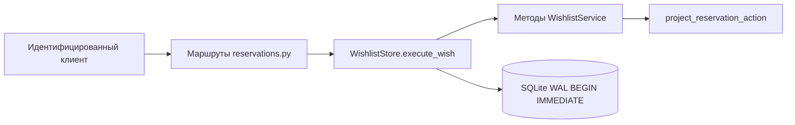
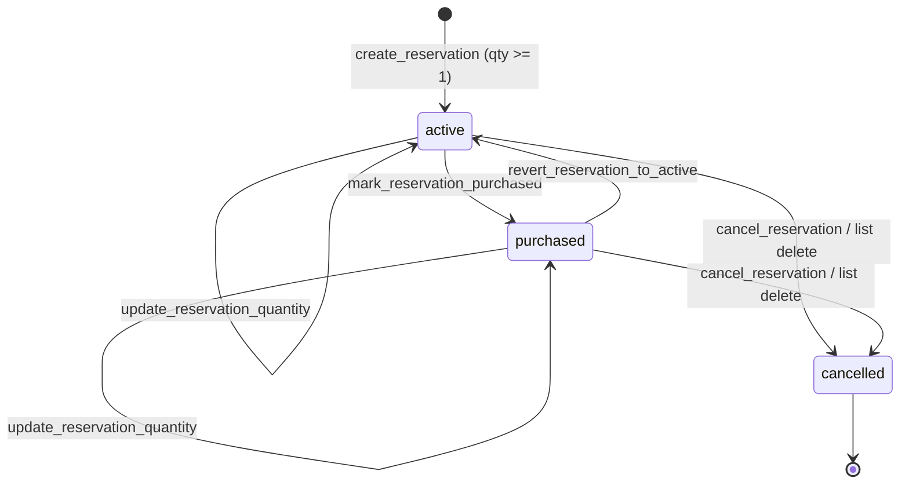

# Спецификация: WISHENKA-18 — Действия дарителя с бронированием и сохранение тайны сюрприза для получателя

**Задача:** WISHENKA-18  
**Язык реализации:** Python 3.12+  
**Статус:** реализовано и верифицировано

## 1. Назначение и бизнес-цель

### 1.1. Проблема и контекст

В сервисе вишлистов (`WishlistService`) уже были реализованы доменные правила бронирования подарков, проекция желаний с учётом роли вызывающего (`project_wish_item`), а также модель поэкземплярного учёта свободного остатка и транзакционная защита общей базы (`WISHENKA-57`). Однако клиентский HTTP-слой для операций с бронями отсутствовал: ни один маршрут в приложении не вызывал методы создания, изменения, отмены и управления отметкой о покупке брони.

Кроме отсутствия клиентских маршрутов, прямой вызов доменных методов нёс три риска нарушения контракта и тайны сюрприза:

1. Метод создания брони `create_reservation` не отклонял неположительное количество (`quantity < 1`), тогда как изменение количества уже требовало минимум 1 экземпляр.
2. При передаче `user is None` доменный слой мог сохранить запись брони с `user_id = 0` без идентифицированного дарителя.
3. Доменные методы возвращали объект `Reservation` (содержащий `user_id`) и выбрасывали различающиеся исключения (`ReservationNotFoundError` с идентификатором в тексте, `PermissionDeniedError` с указанием владельца, `ReservationError` с указанием статуса), что при прямой трансляции в HTTP раскрывало бы получателю сам факт существования брони и её состояние.

Без защищённого клиентского API пользовательский интерфейс Telegram Mini App (экраны карточек желаний в `WISHENKA-19` и раздел «Мои бронирования» в `WISHENKA-20`) не может выполнять бронирование и управлять бронями.

### 1.2. Цели и ценность для пользователей и системы

- **Координация дарителей без повторных покупок:** предоставить идентифицированным дарителям клиентский HTTP-интерфейс для пяти действий с бронью — создания, изменения количества, отмены, отметки о покупке и возврата купленной брони в активное (задуманное) состояние.
- **Гарантия тайны сюрприза на стороне сервера:** исключить любые сведения о бронированиях, дарителях, статусе покупки и свободном остатке из всех ответов, которые получает адресат конкретного желания — как при чтении желаний, так и при отказе на попытку действия с бронью.
- **Нулевой порог входа для дарителя:** бронирование выполняется мгновенно по сессии Telegram без отдельной формы регистрации и без подтверждения автором списка.
- **Единая модель учёта и конкурентного доступа:** переиспользовать правила остатков и транзакцию `BEGIN IMMEDIATE` из `WISHENKA-57` без добавления дублирующей блокировки или параллельной формулы подсчёта.
- **Готовый контракт для интерфейса:** отделить серверное поведение действий с бронью от экранов отображения (`WISHENKA-19`, `WISHENKA-20`).

### 1.3. Границы задачи

**Входит в область задачи:**

- Пять аутентифицированных HTTP-маршрутов для создания брони, изменения количества, отмены, отметки о покупке и возврата отметки о покупке.
- Защитные проверки в `WishlistService` (минимальное количество при создании, запрет анонимной записи, проверка соответствия маршрута и изоляция получателя до проверок владения и статуса).
- Проектор ответа действия `project_reservation_action` и DTO `PromiseActionDTO`, `ReservationQuantityDTO`.
- Цензура ответов об ошибках для получателя и других участников на HTTP-слое.
- Сохранение поэкземплярной тишины на существующем чтении желаний и отсутствия сведений о бронях в коллекциях вишлистов.
- Структурированное логирование HTTP-действий с бронями без утечки идентификаторов дарителя.

**Выходит за рамки задачи:**

- Пользовательские экраны, карточки и кабинет «Мои бронирования» с домашним счётчиком (`WISHENKA-19`, `WISHENKA-20`).
- Механизм распределённой/межпроцессной блокировки и формула свободного остатка (`WISHENKA-57`), а также расширенные нагрузочные проверки гонок (`WISHENKA-49`, `WISHENKA-39`).
- Отметка получения подарка (`record_item_fulfillment`) и уменьшение запрошенного количества (`update_wish_item`) — сохраняются на правилах `WISHENKA-57`.
- Тексты уведомлений, платежи, совместная оплата, добавление секретных подарков дарителями и идемпотентный повтор при повторном нажатии.
- Идентификация получателя без аккаунта Telegram и влияние удаления профиля на существующие брони (открытые продуктовые вопросы).

## 2. Функциональные требования и пользовательские сценарии

### 2.1. Роли и определение получателя

Взаимодействие строится вокруг продуктовых ролей: **владелец**, **соавтор (участник / администратор)**, **даритель** и **получатель**.

- **Поэкземплярное определение получателя:** роль получателя определяется индивидуально для каждого желания, а не одним флагом на весь вишлист (`WishlistAccessPolicy.is_recipient`).
  - В **личном вишлисте** получателем каждого желания считается владелец списка — в том числе если на желании указано только отображаемое имя адресата без пользователя Telegram.
  - В **совместном вишлисте** получателем считается пользователь Telegram, явно указанный на конкретном желании. Желание, адресованное только по отображаемому имени без привязанного пользователя Telegram, не делает вызывающего пользователя получателем.
  - **Соавтор** совместного вишлиста видит данные дарителя и может бронировать желания, предназначенные другим людям, но на желаниях, где получателем указан он сам, к нему применяются все ограничения и тишина получателя.
- **Идентификация дарителя:** действующим дарителем считается аутентифицированный пользователь Telegram (`AuthenticatedUser`, `telegram_id`), открывший список. Дополнительная анкета или онбординг не требуются; неидентифицированный вызывающий не может получить бронь без владельца.

### 2.2. Функциональные правила операций с бронью

| Операция | Кто может выполнить | Предусловия и ограничения | Результат и влияние на остаток |
| --- | --- | --- | --- |
| Создание брони | Идентифицированный даритель, не получатель желания | Список и желание активны (не в архиве и не удалены); `quantity` — целое `>= 1`; `quantity <= available_quantity` | Мгновенно создаётся новая запись в статусе `active` (без одобрения автором); при наличии другой брони того же дарителя создаётся вторая строка без слияния |
| Изменение количества | Только даритель — владелец этой брони | Список не архивирован и не удалён; бронь в статусе `active` или `purchased`; `new_quantity >= 1`; при увеличении рост не превышает `available_quantity` | Обновляет `quantity` выбранной брони; уменьшение освобождает разницу в остаток и **сохраняет** статус `purchased`, если бронь была куплена; отменённую бронь изменить нельзя |
| Отмена брони | Только даритель — владелец этой брони | Список не архивирован и не удалён; бронь в статусе `active` или `purchased` (допустимо и для архивного желания на активном списке) | Переводит бронь в статус `cancelled`; занимаемые единицы немедленно возвращаются в свободный остаток; повторная отмена запрещена |
| Отметка о покупке | Только даритель — владелец этой брони | Список не архивирован и не удалён; бронь в статусе `active` (допустимо и для архивного желания на активном списке) | Переводит бронь в статус `purchased`; единицы **не освобождаются** и продолжают занимать остаток |
| Возврат отметки о покупке | Только даритель — владелец этой брони | Список не архивирован и не удалён; бронь в статусе `purchased` (допустимо и для архивного желания на активном списке) | Возвращает бронь в статус `active`; единицы не освобождаются и не изменяются |

### 2.3. Инварианты учёта единиц, множественных броней и архивации

- **Единый расчёт свободного остатка (`WISHENKA-57`):**
  - Занятые единицы равны сумме `quantity` всех броней в статусах `active` и `purchased`; брони в статусе `cancelled` единицы не занимают.
  - Свободный остаток вычисляется как `max(0, requested - received - occupied)`.
  - После фиксации получения автором (`received`) сумма `occupied + received` может превысить `requested`; при этом свободный остаток остаётся равным `0` (новые брони и увеличение существующих невозможны), а уменьшение, отмена, отметка о покупке и возврат в `active` продолжают работать.
- **Несколько броней одного дарителя на одно желание:**
  - Один даритель может иметь более одной брони на одно желание. Действия изменения количества, отмены, отметки о покупке и возврата адресуются к одной конкретной брони по её идентификатору.
  - Ответ успешного действия (`PromiseActionDTO`) на верхнем уровне описывает **именно ту бронь, которую изменил запрос** (её `reservation_id`, `quantity` и `status`), а не суммарный итог по всем броням дарителя.
  - При чтении желания и во вложенном представлении `item` ответа действия для дарителя по-прежнему показывается суммарное количество его занимающих броней (`my_reserved_quantity`) и статус/идентификатор последней из этих броней без слияния строк в хранилище.
- **Архивация и удаление:**
  - На **архивированном или удалённом вишлисте** отклоняются все пять действий (создание, изменение количества, отмена, отметка о покупке, возврат отметки).
  - На **архивированном желании при активном вишлисте** запрещено только создание новой брони; изменение количества, отмена, отметка о покупке и возврат отметки о покупке для существующей брони остаются разрешёнными.
  - Удаление вишлиста по-прежнему отменяет занимающие брони в рамках самого удаления (эта задача не изменяет логику архивации/удаления и не отменяет такую отмену).
- **Атомарность и тишина при отказах:**
  - Каждое действие завершается одним определённым результатом; при отказе изменения откатываются, сохраняются прежняя бронь и прежний баланс.
  - При нехватке остатка отказ сообщает запрошенное количество и текущий свободный остаток, не раскрывая личности других дарителей.
  - Отказ чужому дарителю (не владельцу брони и не получателю) не называет настоящего владельца.
  - Получатель желания никогда не получает данные о бронях: ни при действиях с бронями, ни при чтении желания (`GET`), ни в коллекциях вишлистов. При этом запрошенное и полученное количество (`quantity`, `received_quantity`) остаются видимыми получателю как собственные данные автора.

### 2.4. Пользовательские сценарии

- **UC-18.1. Создание брони дарителем:** даритель открывает чужой вишлист, отправляет запрос на бронирование положительного числа единиц активного желания и мгновенно получает подтверждение с новой бронью и обновлённым остатком. Повторный запрос создаёт вторую бронь.
- **UC-18.2. Изменение размера брони:** владелец активной или купленной брони увеличивает её в пределах доступного остатка либо уменьшает, освобождая единицы для других дарителей; при уменьшении купленной брони отметка о покупке сохраняется.
- **UC-18.3. Отмена и управление статусом покупки:** владелец отмечает активную бронь как купленную (единицы остаются занятыми), при ошибке возвращает её в активное состояние или отменяет, полностью освобождая единицы.
- **UC-18.4. Управление существующей бронью после архивации желания:** пока вишлист активен, даритель может отменить, изменить размер или переключить статус покупки своей брони на архивированном желании, но не может создать новую.
- **UC-18.5. Защита тайны сюрприза для получателя:** получатель при попытке создать бронь получает фиксированный отказ без остатка и факта наличия чужих броней; при попытке изменить, отменить, отметить покупкой или вернуть любую бронь — получает ответ, неотличимый от запроса к несуществующей брони.
- **UC-18.6. Поэкземплярное разграничение в совместном списке:** соавтор успешно бронирует желание, созданное для другого участника, и одновременно остаётся полностью изолированным от данных о бронях на желании, где получателем указан он сам.

## 3. Архитектура, компоненты и интерфейсы

### 3.1. Архитектурное решение и схема потока

Пять аутентифицированных JSON-маршрутов вызывают существующие методы `WishlistService` внутри существующей транзакционной границы `WishlistStore.execute_wish` (`BEGIN IMMEDIATE` в SQLite WAL). Дополнительные блокировки (`SELECT FOR UPDATE`, Redis или новый `asyncio.Lock`) не вводятся, `ItemConcurrencyCoordinator` на этом HTTP-пути не используется, а снимок всего хранилища через `WishlistStore.execute` не вызывается.

Цензура для получателя обеспечивается на уровне типа ответа маршрута: успешный запрос всегда возвращает строго типизированную модель `PromiseActionDTO` (без `user_id`), а отказ получателю преобразуется в фиксированное исключение `HTTPException` с полем `detail` до сериализации тела. Использование объединения (`Union`) моделей ответа с `WishItemRecipientViewDTO` или прямой возврат `Reservation` / `JSONResponse` в обход фильтрации FastAPI исключены.

### 3.2. Модули, компоненты и доменные изменения

- **`wishenka/web/routes/reservations.py` (подключается в `wishenka/web/app.py`):**
  - Реализует пять обработчиков и единый адаптер `execute` (по аналогии с `wishenka/web/routes/items.py`).
  - Если в `app.state.wishlist_service` передан экземпляр сервиса (в тестах), вызов выполняется на нём; в рабочем режиме действие передаётся в `wishlist_store.execute_wish`.
  - Для создания брони в `execute_wish` передаётся `item_id` (без `reservation_id`), для четырёх операций изменения — `reservation_id` (без `item_id`). Сервис, загруженный внутри `execute_wish`, не имеет ссылки на store и не открывает вложенную транзакцию.
  - Каждый маршрут зависит от `get_current_user` и защищён существующим `BrowserSecurityMiddleware` (проверка CSRF для cookie-мутаций без bearer-заголовка).
- **`wishenka/wishlists/schemas.py`:**
  - `ReservationQuantityDTO` — входная схема с единственным обязательным полем `quantity: int` и `extra="forbid"`. Ограничение `ge=1` на схеме не задаётся, чтобы создание и изменение количества использовали единую валидацию и текст отказа из сервиса; отсутствие поля, нецелое значение или лишний ключ отклоняются FastAPI со статусом `422`.
  - `PromiseActionDTO` (frozen) — выходная схема успешного действия:
    - `reservation_id`, `wish_item_id`, `quantity`, `status` — из возвращённой сущности `Reservation`;
    - `available_quantity` — значение `item.available_quantity` после изменения;
    - `item` — результат `project_wish_item(item, user)` (`WishItemGifterViewDTO`).
    - Не содержит `user_id` и сведений о других дарителях.
  - Существующие проекции `WishItemRecipientViewDTO` (без `available_quantity`, `is_fully_reserved`, `is_reserved_by_me`, `my_reserved_quantity`, `my_reservation_status`, `my_reservation_id`) и `WishItemGifterViewDTO` (с суммой `my_reserved_quantity` и статусом/идентификатором последней из активных/купленных броней) не изменяются.
- **`wishenka/wishlists/service.py` (`WishlistService` и проекторы):**
  - Используются существующие методы: `create_reservation`, `update_reservation_quantity`, `cancel_reservation`, `mark_reservation_purchased`, `revert_reservation_to_active` (также связан под именем `mark_reservation_unpurchased`). Четыре метода мутации принимают опциональные именованные аргументы `wishlist_id=None` и `item_id=None`, которые всегда передаются веб-слоем.
  - **Защитные проверки при создании (до выделения ID):**
    1. При `quantity < 1` выбрасывается `ValueError("Reservation quantity must be at least 1")` до проверки получателя, чтобы не раскрывать остаток.
    2. При `user is None` выбрасывается `PermissionDeniedError` без увеличения `_next_reservation_id` и без сохранения `user_id = 0`.
    3. При несовпадении переданного `wishlist_id` с `item.wishlist_id` до вставки выбрасывается `ItemNotFoundError`.
    4. Далее сохраняется исходный порядок проверок: отсутствие желания, архивный/удалённый список, архивное желание, `SelfReservationError`, проверка свободного остатка (`InsufficientQuantityError`), вставка.
  - **Защитные проверки при мутации (`_guard_reservation_mutation`, до проверки владения):**
    1. При несовпадении переданных `wishlist_id` или `item_id` с загруженной бронью выбрасывается `ReservationNotFoundError` без записи.
    2. Если `WishlistAccessPolicy.is_recipient(user, item)` истинно, выбрасывается `ReservationNotFoundError` до проверки владельца, доступности списка и статуса брони (даже если `reservation.user_id == user.telegram_id`).
    3. Далее сохраняется существующий порядок: `_ensure_reservation_writable` (отказ на архивном/удалённом списке), проверка совпадения `user_id` (`PermissionDeniedError`), проверка статуса и остатка (`ReservationError` / `InsufficientQuantityError`).
  - **Проектор `project_reservation_action(reservation, user)`:** работает в графе объектов, уже загруженном внутри `execute_wish` (без новой транзакции), повторно проверяет `WishlistAccessPolicy.is_recipient` (при истинности выбрасывает `ReservationNotFoundError` и ничего не строит) и формирует `PromiseActionDTO`.
  - Методы `project_wish_item` и `get_user_reservations` остаются без изменений.
- **`wishenka/wishlists/store.py` (`WishlistStore.execute_wish`):** остаётся без изменений; открывает `Connection.begin()` (`BEGIN IMMEDIATE`), загружает желание через `_load_wish`, коммитит успех или откатывает транзакцию в `_immediate` при любом исключении.

### 3.3. Контракт HTTP-интерфейса

Базовый префикс маршрутов: `/api/wishlists/{wishlist_id}/items/{item_id}/reservations`.

| Действие | Метод и путь | Тело запроса | Метод сервиса | Успех и модель ответа |
| --- | --- | --- | --- | --- |
| Создание брони | `POST ""` | `ReservationQuantityDTO` | `create_reservation` | `201`, `PromiseActionDTO` |
| Изменение количества | `PATCH "/{reservation_id}"` | `ReservationQuantityDTO` | `update_reservation_quantity` | `200`, `PromiseActionDTO` |
| Отмена брони | `POST "/{reservation_id}/cancel"` | — | `cancel_reservation` | `200`, `PromiseActionDTO` |
| Отметка о покупке | `POST "/{reservation_id}/purchase"` | — | `mark_reservation_purchased` | `200`, `PromiseActionDTO` |
| Возврат в активное | `POST "/{reservation_id}/undo-purchase"` | — | `revert_reservation_to_active` | `200`, `PromiseActionDTO` |

**Матрица преобразования ошибок в `execute` (порядок проверки сверху вниз, побеждает первое совпадение):**

| Исключение / условие | HTTP-код | Поле `detail` в JSON | Особенности цензуры и побочные эффекты |
| --- | :---: | --- | --- |
| Отсутствует сессия (`get_current_user`) | `401` | `"Authentication required"` | Сервис и `execute_wish` не вызываются |
| Ошибка разбора `ReservationQuantityDTO` | `422` | Стандартный ответ FastAPI | Только ошибка схемы запроса; сведений о бронях нет |
| `InventoryBusyError` | `503` | `str(exc)` | Желание занято, откат, без `user_id` дарителя |
| `SelfReservationError` | `403` | `"Cannot promise this wish"` | Фиксированное тело при любом остатке (включая `0`), без `str(exc)` |
| `ReservationNotFoundError`, `ItemNotFoundError`, `WishlistNotFoundError`, `WishlistDeletedError` | `404` | `"Resource not found"` | Единое тело для мутации получателя, отсутствующего ID, несовпадения пути и удалённого списка |
| `PermissionDeniedError` | `403` | `"Forbidden"` | Не передаёт `"Actor is not reservation owner"`, не называет владельца |
| `InsufficientQuantityError` | `409` | `str(exc)` | Содержит запрошенное количество и остаток, без `user_id` |
| `ReservationError` | `409` | `str(exc)` | Ошибка статуса собственной брони, без имён других дарителей |
| `WishlistArchivedError` | `409` | `str(exc)` | Ошибка архивного списка или архивного желания при создании |
| `ValueError` | `400` | `str(exc)` | В частности `"Reservation quantity must be at least 1"` |

### 3.4. Переходы состояний брони

В модели `ReservationStatus` и на уровне API используются три статуса: `active` (`ReservationStatus.ACTIVE`), `purchased` (`ReservationStatus.PURCHASED`) и `cancelled` (`ReservationStatus.CANCELLED`). Статус `cancelled` является терминальным: отменённой брони нельзя изменить количество, нельзя отметить её покупку, вернуть в `active` или отменить повторно.

## 4. Нефункциональные требования, безопасность и наблюдаемость

### 4.1. Производительность, конкурентность и ограничения

- Новые целевые показатели задержек и дополнительные запросы к БД не вводятся; неконкурентное бронирование сохраняет прежнюю отзывчивость сервиса.
- Сериализация конкурентных записей по-прежнему выполняется на границе `WishlistStore.execute_wish` в SQLite WAL через `BEGIN IMMEDIATE`.
- При таймауте ожидания блокировки записи клиент получает детерминированный отказ `503` без списания единиц и может безопасно повторить запрос.
- Количества экземпляров принимаются и хранятся только как целые положительные числа (`int >= 1`).

### 4.2. Безопасность и защита приватности

- **Аутентификация и CSRF:** все пять маршрутов требуют валидной сессии Telegram через `get_current_user` (cookie или bearer-токен); для небезопасных cookie-запросов без bearer-токена действует проверка CSRF в `BrowserSecurityMiddleware`.
- **Защита от бесхозных записей:** даже при вызове доменного метода в обход HTTP с `user is None` бронь не создаётся и счётчик идентификаторов не инкрементируется.
- **Серверная гарантия тайны сюрприза:**
  - Цензура не полагается на скрытие полей клиентом: сервер физически не возвращает `PromiseActionDTO` и поля бронирования получателю желания.
  - Двухступенчатый барьер: доменный guard отклоняет получателя до записи и до проверки статуса/владения, а `project_reservation_action` повторно блокирует построение DTO перед сериализацией.
  - Сообщения об ошибках HTTP не заимствуют `user_id` и имена дарителей из доменных логов или исключений владения (`PermissionDeniedError`, `ReservationNotFoundError`, `SelfReservationError`).
  - Для получателя на мутации `404` по структуре, тексту ответа и набору полей лога неотличим от запроса несуществующего `reservation_id`.

### 4.3. Наблюдаемость: структурированное логирование и метрики

HTTP-действия с бронями логируются через стандартный логгер `wishenka.web.reservations` (настраивается через `wishenka.logging.configure_logging` с поддержкой `extra={"event": ...}` и JSON-вывода при `json_logs`). Транзакционные события хранилища (`wishlist_inventory_committed`, `wishlist_inventory_busy`, `wishlist_inventory_rolled_back` на `wishenka.wishlists.store`) и существующие доменные события `wishenka.wishlists` сохраняются без изменений; данные об идентификаторе дарителя из доменного слоя не копируются в HTTP-логи и в HTTP-ответы.

Поле `operation` в логах маршрута соответствует имени функции-обработчика: `create_reservation`, `update_reservation_quantity`, `cancel_reservation`, `purchase_reservation` или `undo_reservation_purchase`.

| Событие (`event`) | Уровень | Условие генерации | Поля контекста | Исключаемые данные (приватность) |
| --- | --- | --- | --- | --- |
| `reservation_action_completed` | `INFO` | Успешный возврат `PromiseActionDTO` (`200` / `201`) | `operation`, `item_id`, `reservation_id`, `status` (статус брони) | ID, имя и токен дарителя, `quantity`, тело запроса, граф `item` |
| `reservation_action_refused` | `WARNING` | Фиксированный отказ получателю (`403` на create) или `404 Resource not found` (мутация получателя, отсутствующий ID, нет желания, удалённый список) | `http_status`, `operation`, `item_id` или `reservation_id` из URL (для `403` create без `reservation_id`) | Класс и текст исключения, флаг существования строки, ID и имя дарителя |
| `reservation_inventory_busy` | `WARNING` | `InventoryBusyError` (`HTTP 503`) | `operation`, `item_id` или `reservation_id` из URL | ID, имя и токен дарителя |
| `reservation_permission_denied` | `WARNING` | `PermissionDeniedError` (`HTTP 403 Forbidden`) | `operation`, ID из URL | `str(exc)`, тело запроса, граф желания, ID и имя дарителя |
| `reservation_conflict` | `WARNING` | Конфликт `409` (`InsufficientQuantityError`, `ReservationError`, `WishlistArchivedError`) | `operation`, ID из URL | `str(exc)`, тело запроса, граф желания, ID и имя дарителя |
| `reservation_validation_error` | `WARNING` | Ошибка валидации `ValueError` (`HTTP 400`) | `operation`, ID из URL | `str(exc)`, тело запроса, граф желания, ID и имя дарителя |

Уровни `DEBUG` и `CRITICAL` на этих маршрутах не используются (`EMERG`, `ALERT`, `NOTICE` в `wishenka.logging.configure_logging` отсутствуют). Отдельный экспортер метрик (Prometheus/Grafana/OpenTelemetry) в сервисе отсутствует и в рамках этой задачи не добавлялся; подсчёт частоты успешных действий, отказов и конкурентной занятости SQLite опирается на структурированные лог-события выше.

## 5. Верификация и критерии приёмки

### 5.1. Тестовые сценарии и результаты проверки

Интеграционная и контрактная проверка реализована в `tests/test_reservation_actions_api.py` (с `pytestmark = pytest.mark.timeout(30)`, `TestClient`, временным файлом SQLite и токенами `SessionTokenService`):

- **Создание и множественные брони:** `test_gifter_create_returns_the_new_promise` и проверки второго бронирования подтверждают возврат `201`, статус `active`, корректный `available_quantity`, отсутствие `user_id` и создание второй независимой строки при повторном вызове.
- **Управление бронью владельцем (`200`):** изменение количества в большую и меньшую сторону (для активной и купленной брони с сохранением статуса `purchased`), отмена (`cancelled` с возвратом единиц), отметка покупки (`purchased` без освобождения единиц), возврат покупки в активное состояние, запрет изменения отменённой брони (`409`), а также изоляция ответа при двух бронях одного дарителя (верхний уровень `PromiseActionDTO` отражает изменённую бронь, а `GET` желания — объединённое количество и статус последней).
- **Валидация и аутентификация:** `test_unauthenticated_create_is_rejected` (`401 Authentication required` без записи) и `test_non_positive_quantity_is_rejected` (`400 Reservation quantity must be at least 1` при `0` и отрицательном количестве для загруженного желания и существующей брони).
- **Тайна сюрприза и разграничение доступа:**
  - `test_recipient_cancel_does_not_reveal_the_promise` и проверки создания получателем (`403 Cannot promise this wish` одинаково при свободном остатке и при `0`; `404 Resource not found` при мутации, идентичный несуществующему ID).
  - Отказ чужому дарителю (`403 Forbidden` без имени владельца) и нехватка остатка (`409` с остатком без имени владельца).
  - Совместный вишлист (тишина поэкземплярно только для желания, где соавтор — получатель), сохранение тишины на `GET` желания и отсутствие броней в коллекциях списков.
- **Архивация и удаление:** `test_archived_list_refuses_every_action` (`409`), `test_deleted_list_refuses_every_action_and_keeps_the_cancellation` (`404` и отмена занимающих броней при удалении), разрешение четырёх мутаций и запрет создания на архивном желании при активном списке.
- **Наблюдаемость и занятость SQLite:** `test_busy_promise_logs_warning_without_gifter` (`503` и `reservation_inventory_busy` при `InventoryBusyError` без ID дарителя), а также проверка логов `reservation_action_completed` и `reservation_action_refused` без ID, имён, токенов и названия желания.

**Зафиксированные прогоны после завершения реализации (Шаг 6):**

- `.venv/bin/pytest tests/test_reservation_actions_api.py` — **19 passed, 1 warning in 6.85s** (предупреждение `StarletteDeprecationWarning` исходит из установленного пакета FastAPI).
- `make analyze` — проверка Ruff пройдена, 79 файлов отформатированы, Mypy strict выполнен без ошибок на 79 исходных файлах.

### 5.2. Критерии приёмки

1. Идентифицированный даритель (не получатель) может мгновенно без одобрения автора и без дополнительной регистрации забронировать целое положительное число единиц активного желания в активном списке.
2. Даритель может увеличивать или уменьшать свою бронь в статусе `active` или `purchased` (снижение купленной брони освобождает единицы и сохраняет статус `purchased`); отменённую бронь нельзя изменить или повторно занять ею единицы; превышение свободного остатка отклоняется с сохранением прежней брони.
3. Даритель может отменить свою бронь в статусе `active` или `purchased` с немедленным освобождением единиц; повторная отмена отклоняется; отмена после архивации желания при активном списке остаётся доступной.
4. Даритель может отметить свою бронь в статусе `active` как купленную и вернуть купленную бронь в `active` без освобождения единиц; переходы из неподходящих статусов отклоняются.
5. Изменять, отменять, отмечать покупкой и возвращать бронь может только её владелец; иной даритель получает отказ без указания владельца.
6. Получатель желания не может создать бронь; отказ одинаков независимо от остатка и не раскрывает наличие броней, их количество, статус покупки или дарителей.
7. Получатель при чтении желания или при попытке любой мутации брони не получает фактов о бронированиях, остатке, своём или чужом участии и статусе покупки; при этом `quantity` и `received_quantity` автора остаются видимыми.
8. Не-получатель видит свободный остаток и только свои брони; при наличии нескольких броней одного дарителя на желание чтение желания показывает суммарное количество и последнюю бронь без слияния записей, а ответ успешного действия — только изменённую бронь.
9. В совместном списке тишина применяется строго к конкретным желаниям получателя; на остальных желаниях того же списка соавтор видит данные дарителя.
10. Поведение архивации и удаления вишлистов, отмена броней при удалении списка и правила учёта остатков из `WISHENKA-57` (включая многопроцессную запись через `BEGIN IMMEDIATE`) полностью сохраняются.
11. Существующие чтения желаний сохраняют прежнюю цензуру, а коллекционные ответы вишлистов не содержат сведений о бронях ни для одного пользователя.
12. Реализация выполнена на Python 3.12+ и проходит статический анализ и автотесты.

### 5.3. Известные ограничения и последующие задачи

- **Низкий приоритет / неблокер — [WISHENKA-122](https://pypost.atlassian.net/browse/WISHENKA-122):** создание брони с неположительным количеством (`quantity < 1`) для несуществующего или недоступного для загрузки желания возвращает `HTTP 404 Resource not found` вместо `HTTP 400 Reservation quantity must be at least 1`, так как `WishlistStore.execute_wish` загружает желание через `_load_wish` до вызова `create_reservation`. Для загружаемого желания возвращается `400`. В качестве доработки запланирована ранняя проверка неположительного `quantity` на маршруте `POST .../reservations` до вызова `execute_wish` с логированием `reservation_validation_error` без ID дарителя и сохранением проверки в сервисе.
- **Принятый порядок проверок (не является долгом):** в `_guard_reservation_mutation` состояние закрытого списка (`WishlistArchivedError` → `409`, `WishlistDeletedError` → `404`) проверяется до сравнения владельца `user_id` (но после проверки получателя и соответствия пути), поэтому не-владелец на закрытом списке получает ошибку списка вместо `403 Forbidden`.
- **Смежные и открытые вопросы вне задачи:** экраны интерфейса и кабинет «Мои бронирования» отнесены к `WISHENKA-19` и `WISHENKA-20`; расширенные стресс-тесты гонок — к `WISHENKA-49` и `WISHENKA-39`; идентификация получателя без аккаунта Telegram и судьба броней при удалении профиля остаются открытыми продуктовыми вопросами.
