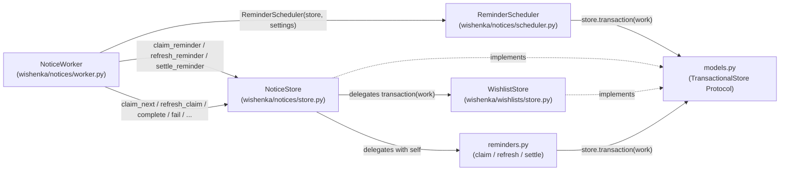

# WISHENKA-180: Supported Transactional Interface for NoticeStore

## Research

### Current State & Coupling Analysis

Inspection of `wishenka/notices/` and `tests/` confirms the exact scope of the private `_store` coupling:

1. **`wishenka/notices/store.py` (`NoticeStore`)**:
   - Holds `self._store: WishlistStore`, `self._lease`, `self._max_attempts`, `self._backoff_base`, `self._backoff_max`, `self.global_limit`, and `self.chat_interval`.
   - Exposes public receipt-queue lifecycle methods (`claim_next`, `refresh_claim`, `skip_claim`, `complete`, `uncertain`, `fail`, `reschedule`) and retention methods (`purge_finished`, `purge_retention_records`).
   - Does **not** expose a public `transaction(...)` method or public reminder lifecycle methods (`claim_reminder`, `refresh_reminder`, `settle_reminder`).

2. **`wishenka/notices/worker.py` (`NoticeWorker`)**:
   - Line 52: `ReminderScheduler(store._store, settings) if isinstance(store, NoticeStore) else None` — reaches into `NoticeStore._store` to construct `ReminderScheduler`.
   - Lines 185–240 (`run_once`): calls `claim_reminder(self._store._store, ...)`, `refresh_reminder(self._store._store, ...)`, and `settle_reminder(self._store._store, ...)` directly on `self._store._store` (`WishlistStore`).
   - No other production module or test accesses `NoticeStore._store` (all other `._store` matches in `tests/test_notice_operator.py` are `worker._store`, which is `NoticeStore` itself).

3. **`wishenka/notices/reminders.py` and `wishenka/notices/scheduler.py`**:
   - `ReminderScheduler.__init__(self, store: WishlistStore, settings: Settings)` only uses `self._store.transaction(work)` inside `run_once(now)`.
   - `claim_reminder`, `refresh_reminder`, and `settle_reminder` only use `store.transaction(work)` to execute their `BEGIN IMMEDIATE` work functions.
   - `WishlistStore.transaction(self, work: Callable[[AsyncConnection], Awaitable[T]]) -> T` is already documented as the public `BEGIN IMMEDIATE` transaction seam for components outside the domain service.

4. **Import Graph**:
   - `wishenka/notices/models.py` has no runtime imports from `store.py`, `reminders.py`, or `scheduler.py`.
   - `wishenka/notices/reminders.py` imports `utc_event_date` from `wishenka/notices/scheduler.py`, and does not import `store.py`.
   - Placing a `TransactionalStore` protocol in `wishenka/notices/models.py` avoids any circular imports when `store.py` delegates reminder lifecycle methods to `reminders.py`.

## Implementation Plan

1. **Define `TransactionalStore` Protocol (`wishenka/notices/models.py`)**:
   - Add a `TransactionalStore(Protocol)` specifying `async def transaction(self, work: Callable[[AsyncConnection], Awaitable[T]]) -> T`.
2. **Expose Public Transactional & Reminder Lifecycle Interface on `NoticeStore` (`wishenka/notices/store.py`)**:
   - Add `async def transaction(self, work: Callable[[AsyncConnection], Awaitable[T]]) -> T` delegating to `self._store.transaction(work)`.
   - Add public reminder lifecycle methods on `NoticeStore` (`claim_reminder`, `refresh_reminder`, `settle_reminder`) delegating to `wishenka.notices.reminders` with `self` as the `TransactionalStore` and `NoticeStore`'s configured `_lease`, `global_limit`, and `chat_interval`.
3. **Generalize `ReminderScheduler` and `reminders.py` to `TransactionalStore`**:
   - Update type annotations in `wishenka/notices/scheduler.py` and `wishenka/notices/reminders.py` from `WishlistStore` to `TransactionalStore` so both `WishlistStore` (existing callers/tests) and `NoticeStore` are supported.
4. **Decouple `NoticeWorker` (`wishenka/notices/worker.py`)**:
   - Construct `ReminderScheduler(store, settings)` using `store` (`NoticeStore`) directly instead of `store._store`.
   - Replace `claim_reminder(self._store._store, ...)`, `refresh_reminder(self._store._store, ...)`, and `settle_reminder(self._store._store, ...)` calls in `NoticeWorker.run_once` with `self._store.claim_reminder(...)`, `self._store.refresh_reminder(...)`, and `self._store.settle_reminder(...)`.
5. **Verify Full Suite & Typing**:
   - Run static analysis (`make analyze` / `mypy` / `ruff`) and the full pytest suite (`make test` / `make check`).

**Mandatory — Failing Repro (next Step 3):**
- **File**: `tests/test_wishenka_180_repro.py` (with explicit module `pytestmark = pytest.mark.timeout(...)`).
- **What it asserts (desired behavior)**:
  1. `NoticeStore.transaction(work)` executes an async callback inside a SQLite `BEGIN IMMEDIATE` transaction and commits/rolls back atomically, enabling `ReminderScheduler(notice_store, settings).run_once(now)` to schedule reminders without accessing `notice_store._store`.
  2. `NoticeStore.claim_reminder(now)`, `NoticeStore.refresh_reminder(claim, now)`, and `NoticeStore.settle_reminder(claim, status, next_attempt, ...)` execute the full reminder delivery lifecycle through `NoticeStore`'s public API.
  3. `NoticeWorker` runs `ReminderScheduler` and reminder delivery end-to-end without accessing `NoticeStore._store` (verified both behaviorally and by inspecting `wishenka.notices.worker` for absence of `_store` attribute access on `NoticeStore`).
- **How to force failure without live external deps**: Uses an isolated temporary SQLite database via `tests.receipt_support.open_store` and `FakeNoticeSender` — no Telegram network calls or external services. Before Step 4 production edits, calling `NoticeStore.transaction`, `NoticeStore.claim_reminder`, etc. fails with `AttributeError`.
- **Sequencing**: Step 3 writes and reviews the red test (`tests/test_wishenka_180_repro.py`) → Step 4 implements the production changes until the red test and full test suite are green.

## Architecture

### System Module Diagram



### Module Responsibilities

| Module | Responsibility |
| --- | --- |
| `wishenka/notices/models.py` | Defines `TransactionalStore` (`Protocol`) alongside notice value objects (`NoticeDraft`, `NoticeSettings`, `FlushedNotice`). |
| `wishenka/notices/store.py` | Public persistence boundary (`NoticeStore`) for both receipt notices and service reminders; exposes `transaction(work)` and reminder lifecycle methods (`claim_reminder`, `refresh_reminder`, `settle_reminder`) backed by `WishlistStore.transaction`. |
| `wishenka/notices/reminders.py` | Reminder SQL/business logic (`claim_reminder`, `refresh_reminder`, `settle_reminder`) operating against any `TransactionalStore`. |
| `wishenka/notices/scheduler.py` | Bounded UTC occasion scanner (`ReminderScheduler`) operating against any `TransactionalStore`. |
| `wishenka/notices/worker.py` | Coordinates `ReminderScheduler` and delivery queues using only `NoticeStore`'s public interface, with zero access to `NoticeStore._store`. |

### Module Interaction Scheme

1. **Scheduling**: `NoticeWorker.__init__` creates `ReminderScheduler(store, settings)` when `isinstance(store, NoticeStore)`. During `NoticeWorker.run`, `ReminderScheduler.run_once(now)` calls `self._store.transaction(work)` (which resolves to `NoticeStore.transaction(work)` → `WishlistStore.transaction(work)` → `BEGIN IMMEDIATE`).
2. **Reminder Claim / Refresh / Settle**: During `NoticeWorker.run_once`, `NoticeWorker` calls `self._store.claim_reminder(now)`, `self._store.refresh_reminder(reminder, now)`, and `self._store.settle_reminder(reminder, status, next_attempt, ...)`. `NoticeStore` delegates to `wishenka.notices.reminders` passing `self` as the `TransactionalStore` and its own `_lease`, `global_limit`, and `chat_interval`.
3. **Backward Compatibility**: Direct callers and existing tests that pass `WishlistStore` to `ReminderScheduler(wishlist_store, settings)` or `claim_reminder(wishlist_store, ...)` continue to work unchanged because `WishlistStore` also satisfies `TransactionalStore`.

### Architectural Patterns & Justification

- **Facade / Encapsulation Boundary (`NoticeStore`)**: `NoticeStore` already acts as the domain store facade for `notification_outbox`. Exposing `transaction(work)` and the reminder lifecycle methods on `NoticeStore` completes the facade so `NoticeWorker` has a single, uniform public dependency.
- **Dependency Inversion via Structural Typing (`TransactionalStore` `Protocol`)**: Typing `ReminderScheduler` and `reminders.py` against `TransactionalStore` instead of concrete `WishlistStore` decouples the reminder subsystem from `WishlistStore` internals without runtime overhead or breaking existing `WishlistStore` callers.
- **Preserved `BEGIN IMMEDIATE` Atomicity**: All transactional work still funnels through `WishlistStore.transaction(work)` (`_immediate`), preserving SQLite write serialization and rollback guarantees.

### Main Interfaces / APIs

```python
# wishenka/notices/models.py
class TransactionalStore(Protocol):
    """Store providing an atomic BEGIN IMMEDIATE transaction boundary."""

    async def transaction(self, work: Callable[[AsyncConnection], Awaitable[T]]) -> T: ...
```

```python
# wishenka/notices/store.py (additions to NoticeStore)
async def transaction(self, work: Callable[[AsyncConnection], Awaitable[T]]) -> T:
    """Run ``work`` in one ``BEGIN IMMEDIATE`` transaction via the underlying store."""

async def claim_reminder(self, now: int) -> Reminder | None:
    """Claim a due reminder row using this store's lease and rate-limit settings."""

async def refresh_reminder(self, claim: Reminder, now: int) -> Reminder | None:
    """Recheck consent and refresh authorized reminder text before sending."""

async def settle_reminder(
    self,
    claim: Reminder,
    status: str,
    next_attempt: int,
    error_class: str | None = None,
    throttle_until: int | None = None,
) -> bool:
    """Settle a fenced reminder claim inside one ``BEGIN IMMEDIATE`` transaction."""
```

## Q&A

- **Why keep `claim_reminder`, `refresh_reminder`, and `settle_reminder` in `wishenka/notices/reminders.py` as well as on `NoticeStore`?**
  - Existing unit and integration tests (`tests/test_wishenka_34_preferences.py`, `tests/test_wishenka_34_repro.py`, `tests/test_i18n_unit.py`) import and call the module-level functions directly with `WishlistStore`. Keeping them in `reminders.py` parameterized by `TransactionalStore` and delegating from `NoticeStore` avoids unnecessary churn while giving `NoticeWorker` a clean public `NoticeStore` boundary.
- **Why expose both `NoticeStore.transaction` and reminder lifecycle methods on `NoticeStore`?**
  - `NoticeStore.transaction` allows `ReminderScheduler(notice_store, settings)` (and future collaborators) to share the `BEGIN IMMEDIATE` boundary without touching `_store`, while `claim_reminder` / `refresh_reminder` / `settle_reminder` on `NoticeStore` keep `NoticeWorker` symmetric with the receipt-notice methods (`claim_next`, `refresh_claim`, `complete`, `fail`, `reschedule`) and encapsulate `NoticeStore`'s lease and rate-limit configuration.
