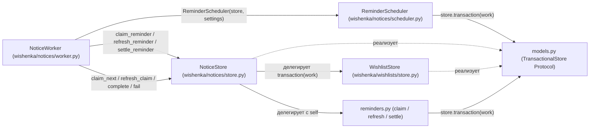

# Спецификация: WISHENKA-180 — Поддерживаемый транзакционный интерфейс NoticeStore

**Задача в Jira:** WISHENKA-180  
**Статус:** реализовано и верифицировано  
**Язык реализации:** Python  
**Затрагиваемые модули:** `wishenka/notices/` (`models.py`, `store.py`, `reminders.py`, `scheduler.py`, `worker.py`), `tests/test_notice_store_transaction_repro.py`

---

## 1. Назначение и бизнес-цель

### 1.1. Постановка проблемы

В контуре доставки уведомлений и напоминаний компоненты `NoticeWorker` (`wishenka/notices/worker.py`) и обработка напоминаний обращались за пределы публичного интерфейса `NoticeStore` (`wishenka/notices/store.py`) напрямую к его приватному атрибуту `_store` (`WishlistStore`):

- в `NoticeWorker.__init__` планировщик `ReminderScheduler` конструировался через `ReminderScheduler(store._store, settings)`;
- в `NoticeWorker.run_once` функции жизненного цикла напоминаний (`claim_reminder`, `refresh_reminder`, `settle_reminder`) вызывались с передачей `self._store._store`;
- класс `ReminderScheduler` и функции в `wishenka/notices/reminders.py` были жёстко типизированы под конкретный класс `WishlistStore`, а `NoticeStore` не предоставлял публичного метода `transaction(...)` и публичных методов жизненного цикла напоминаний.

Такая скрытая связанность с внутренними деталями хранилища (зафиксирована как Follow-up 3 в `WISHENKA-29`) нарушала инкапсуляцию `NoticeStore` и создавала риск тихих регрессий, потери атомарности транзакций и поломки доставки при эволюции слоя хранения.

### 1.2. Цели

- Устранить обращения к приватному атрибуту `NoticeStore._store` из `NoticeWorker` и остальных модулей пакета `wishenka/notices/`.
- Определить поддерживаемый публичный контракт транзакционной границы (`TransactionalStore`) и расширить публичный API `NoticeStore` методами `transaction`, `claim_reminder`, `refresh_reminder` и `settle_reminder`.
- Сохранить без изменений существующую бизнес-логику планирования и доставки напоминаний, транзакционные гарантии `BEGIN IMMEDIATE` и обратную совместимость с прямыми вызовами на базе `WishlistStore`.

### 1.3. Ценность для пользователей и системы

- **Для сопровождающих разработчиков:** планировщик и обработчик доставки работают с `NoticeStore` исключительно через документированный публичный контракт, что позволяет безопасно развивать внутреннее устройство слоя хранения без риска скрытых поломок.
- **Для операторов и пользователей сервиса:** сохраняются прежние атомарные переходы состояний, защита от повторной или преждевременной отправки, повторная проверка согласия перед доставкой, лимиты частоты и правила повторных попыток (`backoff`/`retry`).

### 1.4. Границы области изменений

- **Входит в объём:** контракт между `NoticeStore`, `NoticeWorker`, `ReminderScheduler` и `wishenka/notices/reminders.py`, протокол `TransactionalStore`, регрессионные/контрактные тесты и документация разработчика.
- **Не входит в объём:** изменение бизнес-правил напоминаний, шаблонов текстов уведомлений, политик rate-limit и retention/purge, а также изменение схемы базы данных.

---

## 2. Функциональные требования и пользовательские сценарии

### 2.1. Функциональные требования

1. **Публичная транзакционная граница `NoticeStore`:**
   - `NoticeStore` должен предоставлять публичный асинхронный метод `transaction(work)`, выполняющий переданный обратный вызов `work(conn)` внутри одной транзакции `BEGIN IMMEDIATE` базового хранилища.
   - `NoticeStore` должен предоставлять свойство `transactional_store` для передачи общего транзакционного объекта в координацию межворкерной блокировки доставки (`fence.py`).

2. **Публичный интерфейс жизненного цикла напоминаний на `NoticeStore`:**
   - `NoticeStore` должен предоставлять публичные методы `claim_reminder(now)`, `refresh_reminder(claim, now)` и `settle_reminder(claim, status, next_attempt, error_class=None, throttle_until=None, updated_at=None)`.
   - Метод `NoticeStore.claim_reminder(now)` должен использовать собственные настройки экземпляра `NoticeStore`: длительность аренды (`_lease`), глобальный лимит (`global_limit`) и интервал между отправками в один чат (`chat_interval`).

3. **Абстракция `TransactionalStore` для планировщика и напоминаний:**
   - `ReminderScheduler` и функции `claim_reminder`, `refresh_reminder`, `settle_reminder` в `wishenka/notices/reminders.py` должны принимать любой объект, реализующий протокол `TransactionalStore` (как `NoticeStore`, так и `WishlistStore`).

4. **Исключение приватного доступа к `_store`:**
   - `NoticeWorker` должен передавать в `ReminderScheduler(store, settings)` сам объект `NoticeStore` (при `isinstance(store, NoticeStore)`) и выполнять жизненный цикл напоминаний через методы `self._store.claim_reminder`, `self._store.refresh_reminder` и `self._store.settle_reminder`.
   - Ни один модуль в `wishenka/notices/`, кроме самого `wishenka/notices/store.py`, не должен обращаться к приватному атрибуту `_store`.

5. **Поведенческая эквивалентность и обратная совместимость:**
   - Планирование напоминаний, проверки прав доступа и согласия, разрешение локали, rate-limit, расчёт экспоненциальной задержки повтора (`backoff_seconds`), обработка исходов отправки и очистка записей должны работать идентично исходной реализации.
   - Существующие вызывающие стороны и тесты, передающие `WishlistStore` напрямую в `ReminderScheduler` или функции `wishenka.notices.reminders`, должны продолжать работать без изменений.

### 2.2. Входы, выходы и инварианты

| Операция | Входные параметры | Возвращаемое значение | Ключевые инварианты |
| --- | --- | --- | --- |
| `NoticeStore.transaction(work)` | `work: Callable[[AsyncConnection], Awaitable[T]]` | Результат типа `T` | Выполняется в одной транзакции `BEGIN IMMEDIATE`; при исключении изменения полностью откатываются |
| `NoticeStore.claim_reminder(now)` | `now: int` (epoch seconds) | `Reminder \| None` | Использует `_lease`, `global_limit`, `chat_interval` из `NoticeStore`; переводит зависшие `sending` в `uncertain`; выдаёт `claim_token` |
| `NoticeStore.refresh_reminder(claim, now)` | `claim: Reminder`, `now: int` | `Reminder \| None` | Повторно проверяет `status='sending'`, `claim_token`, `chat_id`, права, настройки уведомлений, дату события и перерендеривает текст в актуальной локали |
| `NoticeStore.settle_reminder(...)` | `claim`, `status`, `next_attempt`, `error_class`, `throttle_until`, `updated_at` | `bool` (`True`, если строка обновлена) | Обновление выполняется только при совпадении `id`, `status='sending'` и `claim_token` (fenced settlement) |
| `ReminderScheduler.run_once(now)` | `now: int` (epoch seconds) | `bool` (`True`, если остались страницы) | Сканирует до `PAGE_SIZE = 1000` вишлистов и дней рождения в одной транзакции `store.transaction(work)` |

### 2.3. Сценарии использования и работы системы

- **UC-01. Планирование напоминаний через публичный `NoticeStore`:** при инициализации `NoticeWorker` создаётся `ReminderScheduler(store, settings)`, принимающий `NoticeStore` как `TransactionalStore`. На очередном тике `NoticeWorker.run` вызывает `scheduler.run_once(now)`, который через `NoticeStore.transaction(work)` читает курсоры `notice_scheduler_cursors`, сканирует активные вишлисты с `event_date` и записи `birthday_entries`, идемпотентно добавляет строки в `reminder_outbox` (`INSERT OR IGNORE`) и сохраняет обновлённые курсоры.
- **UC-02. Полный цикл доставки напоминания через `NoticeStore`:** в `NoticeWorker.run_once` воркер вызывает `self._store.claim_reminder(now)` -> получает межворкерную блокировку `delivery_lock` через `self._store.transactional_store` -> вызывает `self._store.refresh_reminder(reminder, now)` -> при потере права или согласия закрывает строку через `self._store.settle_reminder(reminder, "skipped", now)` -> при валидности фиксирует начало попытки (`begin_attempt`), отправляет текст через `NoticeSender`, определяет итоговый статус (`sent`, `uncertain`, `failed`, `pending`) и задержку, а затем фиксирует результат через `self._store.settle_reminder(...)` и снимает fence (`finish_attempt`).
- **UC-03. Атомарный откат при сбое транзакции:** при возникновении исключения внутри `work(conn)`, переданного в `NoticeStore.transaction(work)`, все выполненные в рамках транзакции записи в БД откатываются и не попадают в постоянное состояние.
- **UC-04. Прямое использование `WishlistStore`:** модульные и интеграционные тесты, передающие `WishlistStore` напрямую в `ReminderScheduler(wishlist_store, settings)` или в функции `wishenka.notices.reminders`, продолжают выполняться без изменений, поскольку `WishlistStore` удовлетворяет протоколу `TransactionalStore`.

---

## 3. Архитектура, компоненты и интерфейсы

### 3.1. Схема взаимодействия компонентов



### 3.2. Модули и ответственность

| Модуль | Ответственность |
| --- | --- |
| `wishenka/notices/models.py` | Определяет протокол `TransactionalStore` и объекты значений уведомлений (`NoticeDraft`, `NoticeSettings`, `FlushedNotice`). Размещение протокола в `models.py` предотвращает циклические импорты между `store.py`, `reminders.py` и `scheduler.py`. |
| `wishenka/notices/store.py` | Фасад `NoticeStore` — публичная граница персистентности для `notification_outbox` и `reminder_outbox`. Предоставляет `transaction(work)`, свойство `transactional_store`, методы жизненного цикла напоминаний (`claim_reminder`, `refresh_reminder`, `settle_reminder`), методы очереди получений и пакетной очистки. |
| `wishenka/notices/reminders.py` | Реализация бизнес-логики и SQL-операций `reminder_outbox` (`claim_reminder`, `refresh_reminder`, `settle_reminder`) и датакласс `Reminder`, работающие с любым `TransactionalStore`. |
| `wishenka/notices/scheduler.py` | Ограниченный постраничный UTC-сканер (`ReminderScheduler`, `utc_event_date`), работающий через `TransactionalStore.transaction(work)`. |
| `wishenka/notices/worker.py` | Оркестратор `NoticeWorker`, координирующий `ReminderScheduler` и обе очереди доставки исключительно через публичный API `NoticeStore`. |

### 3.3. Контракты данных и интерфейсы

#### Протокол `TransactionalStore` (`wishenka/notices/models.py`)

```python
class TransactionalStore(Protocol):
    """Store providing an atomic BEGIN IMMEDIATE transaction boundary."""

    async def transaction(self, work: Callable[[AsyncConnection], Awaitable[T]]) -> T:
        """Run ``work`` inside one ``BEGIN IMMEDIATE`` transaction."""
        ...
```

#### Публичные дополнения в `NoticeStore` (`wishenka/notices/store.py`)

```python
@property
def transactional_store(self) -> WishlistStore:
    """Expose the shared transaction boundary for delivery coordination."""

async def transaction(self, work: Callable[[AsyncConnection], Awaitable[T]]) -> T:
    """Run ``work`` in one ``BEGIN IMMEDIATE`` transaction via the underlying store."""

async def claim_reminder(self, now: int) -> reminders.Reminder | None:
    """Claim a due reminder row using this store's lease and rate-limit settings."""

async def refresh_reminder(
    self, claim: reminders.Reminder, now: int
) -> reminders.Reminder | None:
    """Recheck consent and refresh authorized reminder text before sending."""

async def settle_reminder(
    self,
    claim: reminders.Reminder,
    status: str,
    next_attempt: int,
    error_class: str | None = None,
    throttle_until: int | None = None,
    updated_at: int | None = None,
) -> bool:
    """Settle a fenced reminder claim inside one ``BEGIN IMMEDIATE`` transaction."""
```

#### Обобщённые контракты в `scheduler.py` и `reminders.py`

```python
# wishenka/notices/scheduler.py
class ReminderScheduler:
    def __init__(self, store: TransactionalStore, settings: Settings) -> None: ...

# wishenka/notices/reminders.py
@dataclass(frozen=True)
class Reminder:
    ident: int
    claimed_at: int
    chat_id: int
    body: str
    attempt: int
    claim_token: str

async def claim_reminder(
    store: TransactionalStore, now: int, lease: int, global_limit: int, chat_interval: int
) -> Reminder | None: ...

async def refresh_reminder(
    store: TransactionalStore, claim: Reminder, now: int
) -> Reminder | None: ...

async def settle_reminder(
    store: TransactionalStore,
    claim: Reminder,
    status: str,
    next_attempt: int,
    error_class: str | None = None,
    throttle_until: int | None = None,
    updated_at: int | None = None,
) -> bool: ...
```

### 3.4. Переходы состояний напоминаний (`reminder_outbox`)

1. **Постановка в очередь (`ReminderScheduler.run_once`):** намерение создаётся со статусом `pending` и `next_attempt_at = now` с защитой от дублирования по `occurrence_key` (`INSERT OR IGNORE`).
2. **Восстановление просроченных захватов (`claim_reminder`):** строки в `status = 'sending'` с `claimed_at <= now - lease` переводятся в `status = 'uncertain'` со сбросом `claimed_at` и `claim_token`.
3. **Захват или отсев (`claim_reminder`):**
   - неавторизованные или несоответствующие настройкам/данным строки (`unauthorized`, `ineligible`) переводятся в `status = 'skipped'`;
   - при срабатывании rate-limit (`reserve_permit` вернул `False`) строка остаётся в `status = 'pending'`, а `next_attempt_at` сдвигается на `now + 1`;
   - при успешном захвате строка переходит из `pending` в `sending`, получает `claimed_at = now`, уникальный `claim_token` и `attempts = attempts + 1`.
4. **Повторная проверка перед отправкой (`refresh_reminder`):** при потере права, деактивации назначения бота, отключении настройки или устаревании даты события метод возвращает `None`, после чего `NoticeWorker` вызывает `settle_reminder(reminder, "skipped", now)`.
5. **Фиксация исхода доставки (`NoticeWorker.run_once` -> `settle_reminder`):**
   - `SendOutcome.DELIVERED` -> `sent`, запись fence удаляется;
   - `SendOutcome.AMBIGUOUS` (или исключение/таймаут при отправке) -> `uncertain`, запись в `receipt_delivery_fence` переводится в `state = 'uncertain'` (повторная автоматическая отправка не выполняется);
   - `SendOutcome.REJECTED` или `attempt >= _max_attempts` -> `failed`, запись fence удаляется; при `error_class` из `("TelegramForbiddenError", "TelegramNotFound")` также деактивируется `bot_destinations`;
   - прочие временные сбои при `attempt < _max_attempts` -> `pending` с `next_attempt_at = settled_at + max(backoff_seconds(attempt), ceil(retry_after or 0))`; при наличии `retry_after` выставляется глобальный троттлинг `block_until(conn, throttle_until)`.

---

## 4. Нефункциональные требования, безопасность и наблюдаемость

### 4.1. Производительность и ограничения

- **Нулевые дополнительные накладные расходы:** `NoticeStore.transaction(work)` выполняет одноуровневое асинхронное делегирование в `WishlistStore.transaction(work)`, а методы `claim_reminder`, `refresh_reminder` и `settle_reminder` передают `self` в `wishenka.notices.reminders` без дополнительных SQL-запросов, вложенных транзакций или копирования структур данных.
- **Ограничения выборок и интервалов:**
  - `ReminderScheduler.run_once` сканирует не более `PAGE_SIZE = 1000` вишлистов и `1000` записей дней рождения за один вызов; при исчерпании страниц следующий запуск откладывается на `3600` секунд;
  - `claim_reminder` просматривает не более `100` строк со статусом `pending` за транзакцию;
  - таймаут одного вызова отправки в `NoticeWorker` составляет `receipt_notice_request_timeout_seconds + 5`;
  - задержка между ошибочными тиками `NoticeWorker.run` ограничена `MAX_ERROR_BACKOFF_SECONDS = 60.0`.
- **Конкурентность записи:** все мутации очереди и курсоров выполняются внутри `BEGIN IMMEDIATE`, гарантируя сериализацию записи SQLite и согласованность при параллельной работе воркеров.

### 4.2. Инварианты безопасности и приватности

- **Соблюдение модульной границы:** доступ к приватному `NoticeStore._store` запрещён во всех модулях `wishenka/notices/`, кроме `store.py`, что контролируется статической AST-проверкой.
- **Защита тайны сюрприза и live-авторизация:** перед отправкой каждого напоминания `claim_reminder` и `refresh_reminder` внутри `BEGIN IMMEDIATE` заново проверяют принадлежность и права получателя (включая блокировку устаревших `reservation_changed`), активность `bot_destinations`, глобальные и списочные настройки уведомлений и актуальную локаль (`u.locale` с fallback на `'en'`).
- **Защита персональных данных в журналах:** в структурированные логи записываются только скалярные идентификаторы (`outbox_id`), типы и причины (`kind`, `reason`), классы ошибок (`error_class`), коды локалей (`locale`, `fallback_used`) и агрегированные счётчики; тексты уведомлений, содержимое строк БД и данные пользователей не логируются.

### 4.3. Структурированное логирование и метрики

Поскольку `WISHENKA-180` является чистым рефакторингом интерфейса, новые логи и метрики не добавлялись — сохранена вся существующая наблюдаемость (`logging.Logger` с `extra={...}` и оконными счётчиками):

- **`ERROR` (`wishenka/notices/worker.py`):** события `reminder_scheduler_error` и `receipt_notice_worker_error` (с полем `error_class`, логируются только при первом сбое в серии во избежание спама).
- **`INFO` (`wishenka/notices/worker.py`, `wishenka/notices/store.py`):**
  - `receipt_notice_window_summary` и `service_delivery_window_summary` в `NoticeWorker.flush_if_due` — сводка за окно `window_seconds` со счётчиками `sent`, `retried`, `failed_terminal`, `uncertain` (и `skipped` для сервисных уведомлений);
  - `notice_outbox_purged` и `notice_retention_records_purged` при очистке устаревших записей.
- **`DEBUG`:**
  - `reminder_scan_completed` (`lists_scanned`, `birthdays_scanned`, `intents_created`) в `ReminderScheduler.run_once`;
  - `service_notice_skipped` (`outbox_id`, `kind` / `reason`) и `notice_locale_resolved` (`channel`, `locale`, `fallback_used`) в `reminders.py`, `store.py` и `worker.py`;
  - `receipt_notice_batch_processed` (`rows`) и `service_notice_deferred` (`outbox_id`, `reason`) в `NoticeWorker.run_once`.
- **Метрики:** внутрипроцессные оконные счётчики `NoticeWorker._counts` и `NoticeWorker._reminder_counts` сохраняются без изменений и сбрасываются через `flush_if_due` в виде структурированных `INFO`-логов. Отдельный Prometheus-экспортер не используется.

---

## 5. Верификация и критерии приёмки

### 5.1. Тестовые сценарии и проверки

1. **Контрактные и регрессионные тесты (`tests/test_notice_store_transaction_repro.py`, `pytestmark = pytest.mark.timeout(30)`):**
   - `test_notice_store_exposes_public_transaction` — проверяет выполнение `NoticeStore.transaction(work)` на изолированной SQLite БД и возврат результата;
   - `test_notice_store_transaction_rolls_back_on_error` — проверяет полный откат незафиксированных изменений (`INSERT INTO users ...`) при исключении внутри `NoticeStore.transaction`;
   - `test_notices_package_has_no_private_store_access` — статическая AST-проверка всех файлов `wishenka/notices/*.py` (кроме `store.py`), подтверждающая отсутствие обращений к атрибуту `._store` на не-`self` идентификаторах.
2. **Целевой набор тестов уведомлений и напоминаний (`70 passed`):**
   - `tests/test_notice_store_transaction_repro.py`;
   - `tests/test_notice_delivery_repro.py`;
   - `tests/test_receipt_notices.py`;
   - `tests/test_notice_operator.py`;
   - `tests/test_reminder_scan_paging.py`;
   - `tests/test_notice_worker_concurrency.py`.
3. **Статический анализ (`make analyze`):**
   - `ruff check wishenka tests` — 0 ошибок и предупреждений;
   - `ruff format --check wishenka tests` — 227 файлов соответствуют форматированию (длина строки до 100 символов);
   - `mypy wishenka tests` — 0 ошибок типизации в 227 файлах.

### 5.2. Критерии приёмки

1. `NoticeWorker` и остальные модули `wishenka/notices/` (кроме `store.py`) не обращаются к приватному атрибуту `NoticeStore._store`.
2. `NoticeStore` предоставляет публичный метод `transaction(work)` (совместимый с протоколом `TransactionalStore`), свойство `transactional_store`, а также публичные методы `claim_reminder`, `refresh_reminder` и `settle_reminder`.
3. Все операции жизненного цикла напоминаний и планировщика сохраняют атомарность `BEGIN IMMEDIATE`, откат при ошибках и fencing по `claim_token`.
4. Поведение доставки уведомлений, планирования, проверки согласия/авторизации, локализации и структурированного логирования не изменилось; прямые вызовы с `WishlistStore` продолжают работать.
5. Статический анализ (`ruff check`, `ruff format --check`, `mypy`) и целевые тесты (`70 passed`) выполнены успешно, документация в `doc/dev/notifications.md` и `doc/dev/testing.md` актуализирована.

### 5.3. Известные ограничения и задачи технического долга

По результатам анализа `ai-tasks/WISHENKA-180/60-tech-debt.md` зафиксированы следующие неблокирующие особенности и последующие задачи:

- **Двойные точки входа для напоминаний (осознанный компромисс):** `claim_reminder`, `refresh_reminder` и `settle_reminder` доступны как на `NoticeStore`, так и как функции уровня модуля в `wishenka/notices/reminders.py`, чтобы сохранить совместимость существующих тестов (`test_wishenka_34_repro.py`, `test_wishenka_34_preferences.py`, `test_i18n_unit.py`), передающих `WishlistStore` напрямую.
- **`NoticeStore.__init__` типизирован конкретным `WishlistStore`:** в `wishenka/notices/store.py` конструктор принимает `store: WishlistStore`, хотя внутри `NoticeStore` на `self._store` вызывается только `transaction(work)`.
  - Follow-up (**Optional / Low**): обобщить параметр `store` в `NoticeStore.__init__` до `TransactionalStore` — Jira: [WISHENKA-251](https://pypost.atlassian.net/browse/WISHENKA-251).
- **Проверка `isinstance(store, NoticeStore)` в `NoticeWorker.__init__`:** сохранена проверка конкретного класса `NoticeStore` вместо `@runtime_checkable` протокола `TransactionalStore` для совместимости с тестовыми заглушками.
- **Косвенное покрытие методов делегации `NoticeStore`:** `tests/test_notice_store_transaction_repro.py` напрямую тестирует `NoticeStore.transaction` и отсутствие `._store`, тогда как `NoticeStore.claim_reminder`, `NoticeStore.refresh_reminder`, `NoticeStore.settle_reminder` и `ReminderScheduler(notice_store, settings).run_once(now)` проверяются косвенно через интеграционные тесты `NoticeWorker`.
  - Follow-up (**Optional / Low**): добавить прямые юнит-тесты в `tests/test_notice_store_transaction_repro.py` — Jira: [WISHENKA-252](https://pypost.atlassian.net/browse/WISHENKA-252).
- **Границы статической AST-проверки:** тест `test_notices_package_has_no_private_store_access` отлавливает обращения вида `._store` у не-`self` идентификаторов, но не проверяет динамический доступ через `getattr(..., "_store")` или промежуточные псевдонимы.
