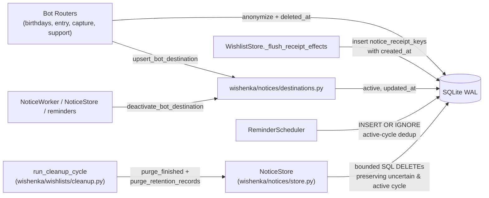

# WISHENKA-181: Retention and Physical Deletion of Private Birthday Data, Inactive Bot Destinations, and Delivery Records

## Research

Inspected the relevant codebase, database migrations, and documentation:

- **Schema & Migrations (`wishenka/wishlists/alembic/versions/`)**:
  - Current Alembic head is `add_deleted_session_revocations` (down_revision `add_user_locale`).
  - `add_birthday_reminders.py` defines:
    - `bot_destinations(user_id INTEGER PRIMARY KEY, chat_id INTEGER NOT NULL, active INTEGER NOT NULL DEFAULT 1)` — lacks an `updated_at` timestamp column.
    - `birthday_entries(id INTEGER PRIMARY KEY AUTOINCREMENT, owner_id INTEGER NOT NULL, label TEXT NOT NULL, month INTEGER NOT NULL, day INTEGER NOT NULL, revision INTEGER NOT NULL DEFAULT 1, deleted INTEGER NOT NULL DEFAULT 0)` — lacks a `deleted_at` timestamp column.
    - `reminder_outbox(id, occurrence_key UNIQUE, kind, user_id, list_id, item_id, birthday_id, revision, event_date, status, claimed_at, claim_token, attempts, next_attempt_at, requires_membership)`.
  - `add_notice_uncertain.py` defines:
    - `notice_receipt_keys(event_type, receipt_id REFERENCES wl_receipts(id) ON DELETE CASCADE, giver_user_id, PRIMARY KEY(event_type, receipt_id, giver_user_id))` — lacks a `created_at` timestamp column.
- **Birthday Deletion (`wishenka/bot/birthdays.py`)**:
  - Deleting a birthday entry (`birthday:d:<id>:<rev>`) currently executes `UPDATE birthday_entries SET deleted=1, revision=revision+1 WHERE id=:id`, leaving `label`, `month`, `day`, and `owner_id` intact indefinitely.
- **Bot Destinations (`wishenka/bot/{entry,birthdays,capture,support}.py`, `wishenka/notices/{store,reminders}.py`)**:
  - Activation (`active=1`) is duplicated in four bot modules via `INSERT INTO bot_destinations ... ON CONFLICT(user_id) DO UPDATE`.
  - Deactivation (`active=0`) occurs in `NoticeStore.settle` and `settle_reminder` on `TelegramForbiddenError` / `TelegramNotFound`. No retention cleanup exists for inactive rows.
- **Reminder Outbox & Scheduler (`wishenka/notices/scheduler.py`, `wishenka/notices/store.py`)**:
  - `ReminderScheduler.run_once` checks `0 <= (event - today).days <= lead` on every hourly run and relies on `INSERT OR IGNORE INTO reminder_outbox` (`occurrence_key UNIQUE`) to prevent duplicate reminders throughout the active window up to `event_date`.
  - `NoticeStore.purge_finished(threshold)` already deletes `reminder_outbox` rows where `next_attempt_at <= :threshold_epoch AND status IN ('sent', 'skipped', 'failed')`, which protects `pending`, `sending`, and `uncertain`, but does **not** check `event_date < :today_utc` for occasion reminders (`kind IN ('list', 'birthday')`). If retention is shorter than a lead window, purging a terminal occasion row while `event_date >= today_utc` allows `ReminderScheduler` to re-insert and duplicate-send it.
- **Receipt Deduplication (`wishenka/wishlists/store.py`)**:
  - `WishlistStore._flush_receipt_effects` inserts into `notice_receipt_keys` via `INSERT OR IGNORE` before inserting into `notification_outbox`. There is no timestamp or purge mechanism for `notice_receipt_keys`.
- **Background Cleanup & Config (`wishenka/wishlists/cleanup.py`, `wishenka/config.py`, `wishenka/web/app.py`)**:
  - `run_cleanup_cycle(store, settings, now=..., notice_store=...)` is invoked by `background_cleanup_worker` (wired in `wishenka/web/app.py` with `app.state.notice_store`) and calls `notice_store.purge_finished(threshold)`.
- **Account Deletion Compatibility (`wishenka/wishlists/deletion.py`)**:
  - `AccountDeletionService` already cleans `notice_receipt_keys`, `reminder_outbox`, `birthday_entries`, and `bot_destinations` via `_delete_if_table_exists`.
- **Prior Tech Debt (`ai-tasks/WISHENKA-29/60-tech-debt.md`)**:
  - Identified the missing retention/purge policies for `birthday_entries`, `bot_destinations`, `reminder_outbox`, and `notice_receipt_keys` as `WISHENKA-181`.

## Implementation Plan

1. **Alembic Migration (`add_notice_retention_columns`, down_revision `add_deleted_session_revocations`)**:
   - Add `deleted_at INTEGER` to `birthday_entries` (+ index `idx_birthday_entries_deleted_at(deleted, deleted_at)`), and anonymize/backfill any existing `deleted = 1` rows (`label = ''`, `month = 0`, `day = 0`, `deleted_at = COALESCE(deleted_at, <now>)`).
   - Add `updated_at INTEGER` to `bot_destinations` (+ index `idx_bot_destinations_active_updated(active, updated_at)`), backfilling `updated_at = <now>` for existing rows.
   - Add `created_at INTEGER NOT NULL DEFAULT 0` to `notice_receipt_keys` (+ index `idx_notice_receipt_keys_created(created_at)`), backfilling from `notification_outbox.created_at` or `<now>`.
2. **Configuration (`wishenka/config.py`)**:
   - Add bounded retention settings (all `int = Field(default=30, ge=1)`):
     - `birthday_retention_days`
     - `bot_destination_retention_days`
     - `reminder_retention_days`
     - `receipt_dedup_retention_days`
3. **Shared Destination Helper (`wishenka/notices/destinations.py`)**:
   - Extract `upsert_bot_destination(conn, user_id, chat_id, now)` and `deactivate_bot_destination(conn, chat_id, now)` so all bot routers (`entry.py`, `birthdays.py`, `capture.py`, `support.py`) and notice settlers (`store.py`, `reminders.py`) update `updated_at` uniformly without duplicating SQL.
4. **Immediate Birthday Anonymization (`wishenka/bot/birthdays.py`)**:
   - On `birthday:d:<id>:<rev>`, update `deleted = 1, revision = revision + 1, label = '', month = 0, day = 0, deleted_at = :now` so personal data is erased immediately while preserving the tombstone briefly for in-flight/`uncertain` safety.
5. **Receipt Key Timestamping (`wishenka/wishlists/store.py`)**:
   - Populate `created_at` (`int(now.timestamp())`) when inserting into `notice_receipt_keys` in `_flush_receipt_effects`.
6. **Retention Purge Methods (`wishenka/notices/store.py` & `wishenka/wishlists/cleanup.py`)**:
   - Update `NoticeStore.purge_finished(threshold, *, now=None, reminder_threshold=None)` to:
     - Purge `notification_outbox` terminal rows (`status IN ('sent', 'skipped', 'failed')`, `updated_at <= threshold`).
     - Purge `reminder_outbox` terminal rows (`status IN ('sent', 'skipped', 'failed')`, `next_attempt_at <= reminder_threshold_epoch`) **only when** `(kind NOT IN ('list', 'birthday') OR event_date < :today_utc)`.
   - Add `NoticeStore.purge_retention_records(now, *, birthday_threshold, destination_threshold, receipt_key_threshold)` (or dedicated methods) to physically delete:
     - `birthday_entries` where `deleted = 1 AND (deleted_at IS NULL OR deleted_at <= :birthday_threshold)` and no `pending`/`sending`/`uncertain` `reminder_outbox` row references `birthday_id`.
     - `bot_destinations` where `active = 0 AND (updated_at IS NULL OR updated_at <= :dest_threshold)`.
     - `notice_receipt_keys` where `created_at <= :key_threshold` and no matching row exists in `notification_outbox` (`pending`, `sending`, `uncertain`, or any unpurged row).
   - Wire these into `run_cleanup_cycle` in `wishenka/wishlists/cleanup.py` and extend `CleanupStats` with default-zero counters.
7. **Verification**:
   - Write failing repro tests first (Step 3), then implement (Step 4) until all new and existing tests pass.

**Mandatory — Failing Repro (next Step 3):**
- **File**: `tests/test_wishenka_181_repro.py` (with `pytestmark = pytest.mark.timeout(30)` per `do-testing`).
- **How to force failure without external deps**: Use local temporary SQLite DBs via `open_store(db)`, `FakeNoticeSender`, deterministic `now` timestamps passed to `ReminderScheduler.run_once(now)`, `NoticeWorker.run_once(now)`, and `run_cleanup_cycle(store, settings, now=..., notice_store=...)`, and direct router/handler invocation for `/birthdays` deletion.
- **Assertions (desired behavior that currently fails)**:
  1. `test_deleted_birthday_anonymized_and_purged_after_retention`: Deleting a birthday entry immediately clears `label`, `month`, `day` (no longer retained in plaintext); after `birthday_retention_days`, `run_cleanup_cycle` physically deletes the `birthday_entries` row, while preserving a deleted entry if an `uncertain` `reminder_outbox` row still references it.
  2. `test_inactive_bot_destination_purged_and_reestablished`: A `bot_destinations` row marked `active = 0` is physically deleted by `run_cleanup_cycle` once past `bot_destination_retention_days`, while `active = 1` rows are untouched, and a subsequent `/start` / destination registration re-creates the row cleanly.
  3. `test_terminal_reminder_purge_preserves_active_cycle_and_uncertain`: With `reminder_retention_days` shorter than `notice_reminder_lead_days`, a `sent` occasion reminder (`kind='birthday'` or `'list'`) whose `event_date >= today_utc` is **not** purged and `ReminderScheduler.run_once` does **not** re-insert/re-send it; once `event_date < today_utc` and past retention, it **is** purged; `uncertain` rows are always preserved.
  4. `test_receipt_dedup_keys_retained_within_window_and_purged_after`: `notice_receipt_keys` blocks duplicate receipt notices within `receipt_dedup_retention_days`, is physically purged by `run_cleanup_cycle` once past retention and its `notification_outbox` row is gone, and is preserved if its `notification_outbox` row is still `uncertain`.
- **Sequencing**: Research (done) → Red test in Step 3 (`tests/test_wishenka_181_repro.py`) → Implement schema, helpers, and cleanup in Step 4 until green.

## Architecture

### System Module Diagram

### Module Responsibilities & Interfaces

| Module | Responsibility | Key Interfaces / Changes |
| ------ | -------------- | ------------------------ |
| `wishenka/wishlists/alembic/versions/add_notice_retention_columns.py` | Schema evolution for retention timestamps and indexes | `upgrade()`, `downgrade()` adding `birthday_entries.deleted_at`, `bot_destinations.updated_at`, `notice_receipt_keys.created_at` |
| `wishenka/config.py` | Retention policy configuration | `birthday_retention_days`, `bot_destination_retention_days`, `reminder_retention_days`, `receipt_dedup_retention_days` (all `>= 1`, default `30`) |
| `wishenka/notices/destinations.py` | Single shared helper for `bot_destinations` lifecycle | `upsert_bot_destination(conn, user_id, chat_id, now)`, `deactivate_bot_destination(conn, chat_id, now)` |
| `wishenka/bot/birthdays.py` | Immediate PII erasure on user delete | Anonymizes `label=''`, `month=0`, `day=0`, sets `deleted=1`, `deleted_at=:now`, `revision=revision+1` |
| `wishenka/wishlists/store.py` | Receipt deduplication key timestamping | Passes `created_at=int(now.timestamp())` on `INSERT OR IGNORE INTO notice_receipt_keys` |
| `wishenka/notices/store.py` | Safe retention purges in `BEGIN IMMEDIATE` transactions | `purge_finished(threshold, *, now=None, reminder_threshold=None)` (active-cycle guard for `list`/`birthday`); `purge_retention_records(now, *, birthday_threshold, destination_threshold, receipt_key_threshold)` |
| `wishenka/wishlists/cleanup.py` | Scheduled & deterministic retention orchestration | Calls `purge_finished` and `purge_retention_records` with `effective_now`; updates `CleanupStats` |

### Architectural Patterns & Justification

- **Two-stage privacy erasure for birthdays (immediate anonymization + delayed tombstone purge)**: Clears `label`, `month`, `day` immediately upon user deletion so personal data is never retained, while keeping the `(id, deleted=1, revision)` tombstone until `birthday_retention_days` (and until no `pending`/`sending`/`uncertain` `reminder_outbox` row references it) so in-flight/recovery checks remain deterministic.
- **Active-cycle & unresolved-state guards in SQL**: Retention `DELETE` statements enforce `status IN ('sent', 'skipped', 'failed')`, `event_date < :today_utc` for `kind IN ('list', 'birthday')`, and `NOT EXISTS` subqueries against `notification_outbox` / non-terminal `reminder_outbox` rows. This guarantees idempotence across repeated cleanup runs and prevents duplicate reminders or silent loss of `uncertain` rows.
- **Shared destination helper**: Centralizes `bot_destinations` activation/deactivation in `wishenka/notices/destinations.py` to avoid duplicating `updated_at` maintenance across 6 call sites.

## Q&A

- **Q: Why anonymize `birthday_entries` immediately on delete instead of waiting for the retention window?**
  - **A**: Waiting leaves personal labels and dates in SQLite until the next cleanup cycle. Immediate anonymization (`label=''`, `month=0`, `day=0`) satisfies data minimization right away while keeping the `deleted=1` tombstone for in-flight/`uncertain` reminder checks until physical deletion.
- **Q: How is `reminder_outbox` prevented from re-sending an occasion reminder after purge?**
  - **A**: `ReminderScheduler` scans `0 <= (event - today).days <= lead`. By excluding `kind IN ('list', 'birthday')` rows with `event_date >= today_utc` from `purge_finished`, the `occurrence_key` remains in `reminder_outbox` for the entire active cycle, so `INSERT OR IGNORE` continues to deduplicate hourly scheduler passes.
- **Q: What happens if a `notification_outbox` row is `uncertain` when `receipt_dedup_retention_days` expires?**
  - **A**: `purge_retention_records` only deletes `notice_receipt_keys` rows when `NOT EXISTS` a matching row in `notification_outbox`, so deduplication remains intact until the `uncertain` row is resolved by an operator and purged.
