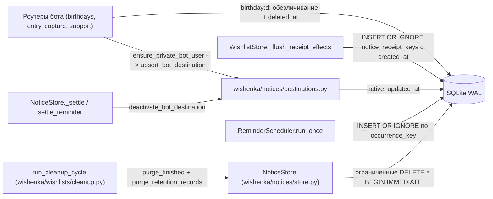
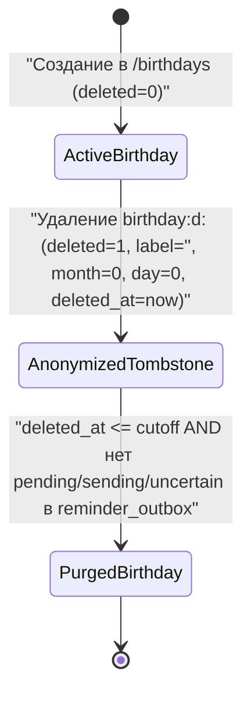

# Спецификация: WISHENKA-181 — Сроки хранения и физическое удаление приватных данных о днях рождения, неактивных каналов доставки и записей доставки уведомлений

**Задача в Jira:** WISHENKA-181  
**Язык реализации:** Python  
**Статус:** реализовано и верифицировано  
**Связанные артефакты:** `ai-tasks/WISHENKA-181/10-requirements.md`, `ai-tasks/WISHENKA-181/20-architecture.md`, `ai-tasks/WISHENKA-181/40-code-cleanup.md`, `ai-tasks/WISHENKA-181/50-observability.md`, `ai-tasks/WISHENKA-181/60-tech-debt.md`

## 1. Назначение и бизнес-цель

### 1.1. Постановка проблемы

До внедрения политик хранения (retention) и физической очистки в подсистеме уведомлений и напоминаний наблюдались следующие проблемы:

- При удалении пользователем приватной записи о дне рождения в Telegram-боте (`birthday_entries`) выставлялся только флаг `deleted = 1` и увеличивался `revision`. Приватные поля (`label`, `month`, `day`) и привязка к владельцу (`owner_id`) оставались в базе данных SQLite бессрочно.
- Неактивные каналы доставки Telegram-бота (`bot_destinations` с `active = 0`), терминальные записи очереди напоминаний (`reminder_outbox` в статусах `sent`, `skipped`, `failed`) и ключи дедупликации уведомлений о получении подарков (`notice_receipt_keys`) накапливались неограниченно и не имели временных меток для расчёта срока хранения (`deleted_at`, `updated_at`, `created_at`).
- Прямое немедленное удаление терминальных записей или маркеров удаления без учёта активного цикла напоминаний и неоднозначных (`uncertain`) состояний создавало риск повторной отправки уже обработанных уведомлений и потери операционной видимости при восстановлении сбоев.

### 1.2. Цели

1. **Минимизация персональных данных:** обеспечить немедленное обезличивание приватных полей (`label`, `month`, `day`) при удалении пользователем записи о дне рождения и физическое удаление маркера удаления (tombstone) по истечении настраиваемого срока хранения.
2. **Ограничение роста операционного хранилища:** ввести детерминированные, настраиваемые сроки хранения и периодическую физическую очистку неактивных каналов доставки `bot_destinations`, терминальных записей `reminder_outbox` и устаревших ключей дедупликации `notice_receipt_keys`.
3. **Сохранение надёжности и идемпотентности доставки:** исключить повторную отправку уведомлений при запоздалых, повторных (replayed) событиях или регулярных запусках планировщика в рамках активного цикла события, а также не допускать преждевременного удаления незавершённых (`pending`, `sending`) и неоднозначных (`uncertain`) записей.

### 1.3. Ценность для пользователей и системы

- **Для пользователя:** удалённые личные заметки о днях рождения не хранятся в открытом виде и не сохраняются бессрочно; при этом активные записи, активный канал доставки в боте и защита от дублирующихся уведомлений полностью сохраняются.
- **Для оператора и эксплуатации:** размер базы данных SQLite WAL остаётся ограниченным за счёт автоматической фоновой очистки, а все неоднозначные (`uncertain`) доставки остаются видимыми и защищёнными до их явного разрешения или восстановления.

### 1.4. Границы решения (Out of Scope)

- Полное удаление аккаунта пользователя во всех доменах сервиса (вынесено в `WISHENKA-35`; политики `WISHENKA-181` совместимы с `AccountDeletionService`).
- Изменения пользовательского интерфейса Telegram Mini App и добавление новых категорий уведомлений.
- Интеграционные smoke-тесты против реального внешнего API Telegram (`WISHENKA-156`).

## 2. Функциональные требования и пользовательские сценарии

### 2.1. Управляемые бизнес-сущности и политики хранения

| Сущность / таблица | Назначение | Механизм удержания и очистки | Настройка срока хранения |
| --- | --- | --- | --- |
| Приватный день рождения (`birthday_entries`) | Пользовательская заметка (`owner_id`, `label`, `month`, `day`, `revision`, `deleted`, `deleted_at`) | Немедленное обезличивание при удалении; физическое удаление после срока хранения при отсутствии открытых или `uncertain` напоминаний | `birthday_retention_days` (по умолчанию `30`) |
| Канал доставки бота (`bot_destinations`) | Точка доставки в Telegram (`user_id`, `chat_id`, `active`, `updated_at`) | Физическое удаление при `active = 0` после истечения срока хранения; активные записи (`active = 1`) не удаляются | `bot_destination_retention_days` (по умолчанию `30`) |
| Запись очереди напоминаний (`reminder_outbox`) | Запланированное или обработанное напоминание (`occurrence_key`, `kind`, `birthday_id`, `event_date`, `status`, `next_attempt_at`, `updated_at`) | Физическое удаление только терминальных записей (`sent`, `skipped`, `failed`) после срока хранения и при `event_date < today_utc` для `list`/`birthday` | `reminder_retention_days` (по умолчанию `30`) |
| Ключ дедупликации уведомлений (`notice_receipt_keys`) | Признак обработанного уведомления о получении подарка (`event_type`, `receipt_id`, `giver_user_id`, `created_at`) | Физическое удаление после срока хранения только при отсутствии связанной строки в `notification_outbox` | `receipt_dedup_retention_days` (по умолчанию `30`) |
| Очередь уведомлений о получении (`notification_outbox`) | Доставка уведомлений дарителям (`status`, `updated_at`) | Физическое удаление терминальных записей (`sent`, `skipped`, `failed`) после срока хранения без преждевременного удаления `notice_receipt_keys` | `receipt_notice_retention_days` (по умолчанию `30`) |

### 2.2. Функциональные требования

1. **Немедленное обезличивание и отложенное удаление `birthday_entries`:**
   - **Вход:** нажатие пользователем кнопки удаления в боте (callback `birthday:d:<id>:<rev>`) в приватном чате.
   - **Действие:** после проверки соответствия `id`, `owner_id`, `revision` и `deleted = 0` система в одной транзакции выставляет `deleted = 1`, `revision = revision + 1`, затирает персональные данные (`label = ''`, `month = 0`, `day = 0`), фиксирует `deleted_at = <now_epoch>` и очищает черновик ввода `birthday_input` для данной записи.
   - **Выход:** новые напоминания для удалённой записи больше не планируются; пользователь получает обновлённый список дней рождения.
   - **Физическая очистка:** при последующем запуске очистки после истечения `birthday_retention_days` строка `birthday_entries` физически удаляется (`DELETE`), только если в `reminder_outbox` не существует ни одной записи с `birthday_id = birthday_entries.id` в статусах `pending`, `sending` или `uncertain`.
   - **Миграция исторических данных:** ранее удалённые строки (`deleted = 1`) без метки `deleted_at` при применении миграции автоматически обезличиваются (`label = ''`, `month = 0`, `day = 0`) и получают `deleted_at`.

2. **Жизненный цикл и очистка `bot_destinations`:**
   - **Активация / реактивация:** при любом взаимодействии пользователя с приватным ботом через `ensure_private_bot_user` (роутеры `entry`, `birthdays`, `capture`, `support`) вызывается `upsert_bot_destination`, устанавливающий `active = 1` и обновляющий `updated_at = :now`.
   - **Деактивация:** при отклонении доставки со стороны Telegram (`TelegramForbiddenError` или `TelegramNotFound`) в `NoticeStore._settle` или `settle_reminder` вызывается `deactivate_bot_destination`, устанавливающий `active = 0` и обновляющий `updated_at = :now`.
   - **Физическая очистка:** записи с `active = 0` и `updated_at IS NULL OR updated_at <= destination_cutoff` физически удаляются. Записи с `active = 1` сохраняются.
   - **Повторное подключение:** последующий вход пользователя в бота (например, команда `/start`) повторно создаёт или реактивирует строку `bot_destinations` с `active = 1` без конфликтов.

3. **Очистка терминальных записей `reminder_outbox` с защитой активного цикла:**
   - Физическому удалению подлежат только строки в терминальных статусах `('sent', 'skipped', 'failed')`, для которых `COALESCE(updated_at, next_attempt_at) <= reminder_cutoff`.
   - **Защита активного цикла (active-cycle guard):** для событийных напоминаний (`kind IN ('list', 'birthday')`) обязательным условием удаления является `event_date < today_utc`. Если `reminder_retention_days` меньше окна заблаговременности (`notice_reminder_lead_days`, по умолчанию `(7,)`), доставленное напоминание остаётся в `reminder_outbox` вплоть до завершения даты события, поэтому ежечасные проходы `ReminderScheduler.run_once` с `INSERT OR IGNORE` по уникальному `occurrence_key` не создают дубликат.

4. **Срок хранения `notice_receipt_keys` и защита от повторных событий (replay safety):**
   - При формировании уведомлений о получении подарка (`WishlistStore._flush_receipt_effects`) в `notice_receipt_keys` записывается метка `created_at = int(now.timestamp())`.
   - Если срок хранения очереди `receipt_notice_retention_days` меньше срока дедупликации `receipt_dedup_retention_days`, удаление терминальной строки из `notification_outbox` не удаляет соответствующий ключ из `notice_receipt_keys`; повторные или запоздалые попытки вставки `INSERT OR IGNORE` по ключу `(event_type, receipt_id, giver_user_id)` продолжают блокироваться до истечения `receipt_dedup_retention_days`.
   - Физическое удаление из `notice_receipt_keys` выполняется только при одновременном соблюдении двух условий: `created_at <= receipt_key_cutoff` и `NOT EXISTS` строки с тем же `(event_type, receipt_id, giver_user_id)` в `notification_outbox` любого статуса.

5. **Защита активных и неоднозначных (`uncertain`) записей:**
   - Строки в статусах `pending`, `sending` и `uncertain` в таблицах `notification_outbox` и `reminder_outbox` никогда не удаляются фоновой очисткой.
   - Связанные с ними обезличенные строки `birthday_entries` и ключи `notice_receipt_keys` сохраняются до разрешения состояния оператором или подсистемой восстановления и последующей очистки терминальной записи очереди.

### 2.3. Пользовательские и эксплуатационные сценарии

- **UC-181-01. Удаление приватного дня рождения:** пользователь удаляет запись в команде `/birthdays`; персональные поля немедленно очищаются в базе данных, а сам маркер удаления физически удаляется по истечении `birthday_retention_days` при условии завершения всех связанных напоминаний.
- **UC-181-02. Блокировка бота и повторное возвращение:** доставка дарителю завершается ошибкой `TelegramForbiddenError`; запись `bot_destinations` переводится в `active = 0` и удаляется после `bot_destination_retention_days`; при повторном вызове `/start` пользователь снова получает активный канал доставки (`active = 1`).
- **UC-181-03. Защита напоминания в пределах окна события:** при `reminder_retention_days = 2` и `notice_reminder_lead_days = (7,)` отправленное напоминание не удаляется до наступления `event_date < today_utc`, что предотвращает повторную постановку в очередь при следующем запуске `ReminderScheduler`; после прохождения даты события и истечения срока хранения запись удаляется.
- **UC-181-04. Сохранение защиты от дублей при раздельном ретеншене:** при `receipt_notice_retention_days = 1` и `receipt_dedup_retention_days = 30` доставленная запись `notification_outbox` удаляется через сутки, а `notice_receipt_keys` продолжает блокировать повторные события в течение 30 дней и удаляется после истечения окна.
- **UC-181-05. Удержание при `uncertain` и последующая очистка:** при наличии `uncertain`-строки в `reminder_outbox` или `notification_outbox` связанные записи `birthday_entries` и `notice_receipt_keys` сохраняются сверх срока ретеншена; после перевода очереди в терминальный статус `sent` (и её очистки) следующий цикл `run_cleanup_cycle` удаляет связанные записи.

### 2.4. Продуктовые и системные инварианты

1. **Необратимость удаления ПДн:** после удаления пользователем записи в `birthday_entries` исходные `label`, `month` и `day` немедленно затираются в БД и не восстанавливаются из логов.
2. **Идемпотентность очистки и миграций:** повторные вызовы `run_cleanup_cycle`, `purge_finished` и `purge_retention_records` на одних и тех же данных и времени `now` не вызывают ошибок и не дают побочных эффектов.
3. **Неприкосновенность `uncertain`:** никакая фоновая очистка не имеет права удалять `uncertain`-записи очередей или связанные с ними ограничительные записи (`birthday_entries`, `notice_receipt_keys`).
4. **Совместимость с полным удалением аккаунта:** логика каскадной очистки в `AccountDeletionService` (`wishenka/wishlists/deletion.py`) продолжает штатно очищать `notice_receipt_keys`, `reminder_outbox`, `birthday_entries` и `bot_destinations`.

## 3. Архитектура, компоненты и интерфейсы

### 3.1. Диаграмма взаимодействия компонентов



### 3.2. Модули, классы и программные интерфейсы

| Модуль | Ответственность | Ключевые классы и функции |
| --- | --- | --- |
| `wishenka/wishlists/alembic/versions/add_notice_retention_columns.py` | Эволюция схемы БД и обратная совместимость при миграции | `revision = "add_notice_retention_columns"`, `down_revision = "add_deleted_session_revocations"`, `ROLLBACK_POLICY = "reversible"`; `upgrade()`, `downgrade()`, `_columns(table: str)` |
| `wishenka/config.py` | Конфигурация политик хранения | `Settings`: `receipt_notice_retention_days`, `birthday_retention_days`, `bot_destination_retention_days`, `reminder_retention_days`, `receipt_dedup_retention_days` (`int = Field(default=30, ge=1)`) |
| `wishenka/notices/destinations.py` | Единый жизненный цикл `bot_destinations` | `upsert_bot_destination(conn, user_id, chat_id, now=None)`, `deactivate_bot_destination(conn, chat_id, now=None)` (опциональный `now: int`, иначе `int(time.time())`) |
| `wishenka/bot/principal.py` | Регистрация и обновление времени активности приватного пользователя бота | `ensure_private_bot_user(dependencies, user, chat_id, *, user_record=None, now=None)` (возвращает `UserRecord` или `None`) |
| `wishenka/bot/birthdays.py` | Немедленное обезличивание при удалении дня рождения | `_now_epoch(deps: Any) -> int`, `create_birthday_router(dependencies: Any) -> Router` |
| `wishenka/wishlists/store.py` | Простановка времени создания ключа дедупликации | `WishlistStore._flush_receipt_effects(conn: AsyncConnection, service: WishlistService) -> list[FlushedNotice]` |
| `wishenka/notices/store.py` | Очистка терминальных очередей и просроченных записей ретеншена | `DEFAULT_PURGE_BATCH_SIZE = 500`; `NoticeStore.purge_finished(threshold, *, now=None, reminder_threshold=None, batch_size=DEFAULT_PURGE_BATCH_SIZE) -> int`; `NoticeStore._purge_batch(...) -> tuple[int, int]`; `NoticeStore.purge_retention_records(*, birthday_threshold, destination_threshold, receipt_key_threshold) -> tuple[int, int, int]` |
| `wishenka/notices/reminders.py` | Деактивация канала доставки при ошибках доставки напоминаний | `settle_reminder(...)` (вызывает `deactivate_bot_destination` при `TelegramForbiddenError` / `TelegramNotFound`) |
| `wishenka/wishlists/cleanup.py` | Оркестрация фонового цикла очистки и сбор статистики | `CleanupStats`, `_purge_notices(notice_store, settings, now) -> tuple[int, int, int]`, `run_cleanup_cycle(store, settings, now=None, notice_store=None) -> CleanupStats` |

### 3.3. Контракты данных и схема SQLite

#### Миграция `add_notice_retention_columns`

1. **`birthday_entries`:**
   - Добавляется колонка `deleted_at INTEGER` (если отсутствует) и индекс `idx_birthday_entries_deleted_at(deleted, deleted_at)`.
   - Для всех существующих строк с `deleted = 1` выполняется обезличивание: `label = ''`, `month = 0`, `day = 0`, `deleted_at = COALESCE(deleted_at, CAST(strftime('%s', 'now') AS INTEGER))`.
2. **`bot_destinations`:**
   - Добавляется колонка `updated_at INTEGER` (если отсутствует) и индекс `idx_bot_destinations_active_updated(active, updated_at)`.
   - Для существующих строк с `updated_at IS NULL` выставляется `CAST(strftime('%s', 'now') AS INTEGER)`.
3. **`notice_receipt_keys`:**
   - Добавляется колонка `created_at INTEGER NOT NULL DEFAULT 0` (если отсутствует) и индекс `idx_notice_receipt_keys_created(created_at)`.
   - Для строк с `created_at = 0` значение заполняется из `notification_outbox.created_at` по ключу `(event_type, receipt_id, giver_user_id)`, а при отсутствии строки в `notification_outbox` — текущей epoch-меткой миграции.
4. **Откат (`downgrade`):** удаляет созданные индексы и колонки (`created_at`, `updated_at`, `deleted_at`) при их наличии. Вспомогательная функция `_columns(table)` в offline-режиме Alembic возвращает пустое множество.

#### SQL-контракты физической очистки (`NoticeStore`)

В `NoticeStore._purge_batch` (вызываемом циклически из `purge_finished` пакетами по `batch_size`, в каждой транзакции `BEGIN IMMEDIATE`):

- Очередь уведомлений о получении:

```sql
DELETE FROM notification_outbox
WHERE id IN (
    SELECT id FROM notification_outbox
    WHERE updated_at <= :threshold
      AND status IN ('sent', 'skipped', 'failed')
    ORDER BY id LIMIT :batch_size
)
```

- Очередь напоминаний с защитой активного цикла:

```sql
DELETE FROM reminder_outbox
WHERE id IN (
    SELECT id FROM reminder_outbox
    WHERE COALESCE(updated_at, next_attempt_at) <= :threshold_epoch
      AND status IN ('sent', 'skipped', 'failed')
      AND (kind NOT IN ('list', 'birthday') OR event_date < :today_utc)
    ORDER BY id LIMIT :batch_size
)
```

В `NoticeStore.purge_retention_records` (одна транзакция `BEGIN IMMEDIATE`, возвращает `(birthdays_purged, destinations_purged, receipt_keys_purged)`):

- Удалённые дни рождения:

```sql
DELETE FROM birthday_entries
WHERE deleted = 1
  AND (deleted_at IS NULL OR deleted_at <= :birthday_cutoff)
  AND NOT EXISTS (
      SELECT 1 FROM reminder_outbox r
      WHERE r.birthday_id = birthday_entries.id
        AND r.status IN ('pending', 'sending', 'uncertain')
  )
```

- Неактивные каналы доставки:

```sql
DELETE FROM bot_destinations
WHERE active = 0
  AND (updated_at IS NULL OR updated_at <= :destination_cutoff)
```

- Ключи дедупликации:

```sql
DELETE FROM notice_receipt_keys
WHERE created_at <= :receipt_key_cutoff
  AND NOT EXISTS (
      SELECT 1 FROM notification_outbox o
      WHERE o.event_type = notice_receipt_keys.event_type
        AND o.receipt_id = notice_receipt_keys.receipt_id
        AND o.giver_user_id = notice_receipt_keys.giver_user_id
  )
```

### 3.4. Переходы состояний



- **`bot_destinations`:** `active = 1` <-> `active = 0` (при `TelegramForbiddenError`/`TelegramNotFound` через `deactivate_bot_destination`, при повторном входе в бота через `upsert_bot_destination`) -> физическое удаление при `active = 0` и `updated_at <= destination_cutoff`.
- **`reminder_outbox`:** `pending` / `sending` / `uncertain` (защищены от очистки) -> терминальные статусы `sent` / `skipped` / `failed` -> физическое удаление после `reminder_retention_days` и выполнения условия `event_date < today_utc` для `kind IN ('list', 'birthday')`.
- **`notice_receipt_keys`:** запись с `created_at` при постановке уведомления -> удержание на время существования строки в `notification_outbox` и в пределах `receipt_dedup_retention_days` -> физическое удаление после истечения обоих условий.

## 4. Нефункциональные требования, безопасность и наблюдаемость

### 4.1. Конфигурация, детерминизм и производительность

Параметры в `wishenka.config.Settings` (префикс переменных окружения `WISHENKA_`):

| Параметр | Переменная окружения | Значение по умолчанию | Ограничения и смысл |
| --- | --- | --- | --- |
| `receipt_notice_retention_days` | `WISHENKA_RECEIPT_NOTICE_RETENTION_DAYS` | `30` | `>= 1`; срок хранения терминальных строк `notification_outbox` |
| `birthday_retention_days` | `WISHENKA_BIRTHDAY_RETENTION_DAYS` | `30` | `>= 1`; срок хранения обезличенных маркеров `birthday_entries` (`deleted = 1`) |
| `bot_destination_retention_days` | `WISHENKA_BOT_DESTINATION_RETENTION_DAYS` | `30` | `>= 1`; срок хранения неактивных строк `bot_destinations` (`active = 0`) |
| `reminder_retention_days` | `WISHENKA_REMINDER_RETENTION_DAYS` | `30` | `>= 1`; срок хранения терминальных строк `reminder_outbox` (с защитой активного цикла) |
| `receipt_dedup_retention_days` | `WISHENKA_RECEIPT_DEDUP_RETENTION_DAYS` | `30` | `>= 1`; срок хранения ключей дедупликации `notice_receipt_keys` |

Операционные гарантии:

- **Детерминизм:** все временные границы вычисляются относительно явно передаваемого параметра `now` (в `run_cleanup_cycle`, `purge_finished`, `upsert_bot_destination`, `deactivate_bot_destination`) или инжектированных часов (`dependencies.clock` через `_now_epoch` и `_resolve_effective_now`), что обеспечивает воспроизводимое тестирование без ожидания реального времени.
- **Пакетная очистка очередей:** `NoticeStore.purge_finished` удаляет терминальные записи из `notification_outbox` и `reminder_outbox` пакетами размером `batch_size` (по умолчанию `DEFAULT_PURGE_BATCH_SIZE = 500`, при `batch_size < 1` выбрасывается `ValueError`) в отдельных транзакциях `BEGIN IMMEDIATE`, ограничивая длительность блокировки записи в SQLite.
- **Изоляция сбоев очистки:** исключения внутри `_purge_notices` перехватываются, логируются на уровне `WARNING` (`receipt_notice_purge_failed`) и возвращают `(0, 0, 0)`, не срывая выполнение остальных этапов `run_cleanup_cycle`.

### 4.2. Безопасность и приватность

- **Немедленное уничтожение ПДн при удалении:** обнуление `label = ''`, `month = 0`, `day = 0` выполняется синхронно в транзакции удаления дня рождения, не дожидаясь планового запуска фонового очистителя.
- **Запрет утечки ПДн в логи:** события аудита и фоновой очистки не содержат `label`, даты (`month`/`day`), `chat_id`, токенов и сырых текстов исключений (при ошибках `_purge_notices` логируется только `error_class = type(err).__name__`).
- **Интеграционная целостность доставки:** разделение сроков хранения `notification_outbox` и `notice_receipt_keys`, а также удержание `birthday_entries` и `notice_receipt_keys` при наличии открытых или `uncertain` записей в очередях исключают дублирование уведомлений и потерю состояния.

### 4.3. Наблюдаемость: структурированные логи и метрики

#### Структурированные события логирования

Все события используют стандартный `logging` с `extra={"event": ...}` и сериализуются в формат JSON lines через `wishenka.logging.JsonFormatter` при включённом `log_json=True`:

| Событие (`event`) | Уровень | Логгер / модуль | Поля контекста | Условие и правила приватности |
| --- | --- | --- | --- | --- |
| `birthday_deleted_anonymized` | `INFO` | `wishenka.bot.birthdays` | `owner_id`, `birthday_id` | После успешного обезличивания и мягкого удаления; без `label`, даты и `chat_id` |
| `notice_outbox_purged` | `INFO` | `wishenka.wishlists.notices` (`NoticeStore.purge_finished`) | `receipt_purged`, `reminder_purged`, `total_purged`, `batches`, `batch_size` | Эмитится при `total_purged > 0` |
| `notice_retention_records_purged` | `INFO` | `wishenka.wishlists.notices` (`NoticeStore.purge_retention_records`) | `birthdays_purged`, `destinations_purged`, `receipt_keys_purged` | Эмитится при ненулевом количестве удалённых записей |
| `receipt_notice_rows_purged` | `INFO` | `wishenka.wishlists.cleanup` (`_purge_notices`) | `rows` | Эмитится при `rows > 0` |
| `receipt_notice_purge_failed` | `WARNING` | `wishenka.wishlists.cleanup` (`_purge_notices`) | `error_class` | При исключении в `purge_finished` / `purge_retention_records`; без сырого сообщения исключения и ПДн |
| `background_cleanup_completed` | `INFO` | `wishenka.wishlists.cleanup` (`run_cleanup_cycle`) | `expired_tokens_cleaned`, `wishlists_purged`, `idempotency_records_cleaned`, `session_revocations_cleaned`, `birthdays_purged`, `bot_destinations_purged`, `receipt_keys_purged`, `duration_ms` | По завершении цикла очистки |

#### Метрики и телеметрия

Отдельный экспортер Prometheus/OpenTelemetry в приложении не используется; операционная телеметрия обеспечивается структурированными JSON-логами и объектом `CleanupStats` (`wishenka/wishlists/cleanup.py`):

- `CleanupStats.birthdays_purged` — количество физически удалённых обезличенных записей `birthday_entries`.
- `CleanupStats.bot_destinations_purged` — количество физически удалённых неактивных записей `bot_destinations`.
- `CleanupStats.receipt_keys_purged` — количество физически удалённых истекших ключей `notice_receipt_keys`.
- `CleanupStats.duration_ms` — длительность цикла фоновой очистки в миллисекундах.

## 5. Верификация и критерии приёмки

### 5.1. Сценарии автоматизированного тестирования

Реализация покрыта тремя специализированными наборами тестов с явными таймаут-маркерами:

1. **`tests/test_wishenka_181_repro.py`** (`pytestmark = pytest.mark.timeout(30)`):
   - `test_deleted_birthday_anonymized_and_purged_after_retention` — проверка немедленного обезличивания (`label=''`, `month=0`, `day=0`, `deleted=1`) при удалении через `/birthdays`, удержания в пределах срока хранения, физического удаления после срока при `sent`-напоминании и сохранения записи при наличии `uncertain`-строки в `reminder_outbox`.
   - `test_inactive_bot_destination_purged_and_reestablished` — проверка деактивации канала при `TelegramForbiddenError`, удержания до срока хранения, физического удаления неактивного канала по истечении `bot_destination_retention_days`, сохранности активных каналов и чистого пересоздания при повторном `/start`.
   - `test_terminal_reminder_purge_preserves_active_cycle_and_uncertain` — проверка защиты активного цикла при `reminder_retention_days = 2` и `notice_reminder_lead_days = (7,)`: доставленное напоминание не удаляется до `event_date < today_utc`, `ReminderScheduler.run_once` не создаёт повторное отправление, после прохождения даты события терминальная строка удаляется, а `uncertain` всегда остаётся.
   - `test_receipt_dedup_keys_retained_within_window_and_purged_after` — проверка удержания `notice_receipt_keys` в пределах окна хранения и после его истечения: ключ со статусом `sent` в `notification_outbox` удаляется вместе с outbox-строкой, а ключ со статусом `uncertain` сохраняется вместе со строкой очереди.

2. **`tests/test_notice_retention.py`** (`pytestmark = pytest.mark.timeout(60)`):
   - `test_retention_migration_upgrade_backfills_and_downgrade_reverts` — проверка `upgrade` до `head` (обезличивание унаследованных `deleted=1` записей в `birthday_entries`, заполнение `deleted_at`, `bot_destinations.updated_at`, `notice_receipt_keys.created_at` из `notification_outbox.created_at`), `downgrade` до `add_deleted_session_revocations` и повторного `upgrade`.
   - `test_retention_settings_reject_non_positive_days` — проверка валидации `ValidationError` при передаче `0` для всех четырёх новых настроек ретеншена.
   - `test_deleted_birthday_purged_after_uncertain_reminder_resolved` — проверка сохранения удалённой записи дня рождения при `uncertain`-напоминании, последующего удаления после перевода напоминания в `sent` и идемпотентности повторного запуска `run_cleanup_cycle`.
   - `test_receipt_dedup_survives_early_outbox_purge_and_blocks_replay` — проверка независимости срока хранения ключа дедупликации (`30` дней) от более короткого срока очереди (`1` день): повторный `INSERT OR IGNORE` отклоняется после удаления строки из `notification_outbox`, а после `35` дней ключ физически удаляется.

3. **`tests/test_wishenka_181_observability.py`** (`pytestmark = pytest.mark.timeout(30)`):
   - `test_birthday_delete_logs_structured_event_without_pii` — проверка формата JSON-лога `birthday_deleted_anonymized` и отсутствия в нём секретного `label`, даты и `chat_id`.
   - `test_retention_purge_and_cleanup_cycle_structured_logging` — проверка событий `notice_outbox_purged`, `notice_retention_records_purged`, `background_cleanup_completed`, счётчиков `CleanupStats` и отсутствия утечки `chat_id`.
   - `test_retention_purge_failure_logs_warning_without_raising` — проверка логирования `receipt_notice_purge_failed` (`WARNING`, `error_class="RuntimeError"`) при сбое `purge_retention_records` без падения цикла очистки.

Зафиксированные результаты проверок качества по артефактам `40-code-cleanup.md` и `50-observability.md`: `make analyze` (`ruff check`, `ruff format --check`, `mypy` по 209 файлам — 0 ошибок), а также прогоны целевых наборов `tests/test_wishenka_181_repro.py` и `tests/test_notice_retention.py` (8 passed) и проверки наблюдаемости в `tests/test_wishenka_181_observability.py` (3 теста).

### 5.2. Критерии приёмки

1. При удалении приватной записи о дне рождения новые напоминания не создаются, а `label`, `month` и `day` немедленно очищаются с последующим физическим удалением записи по истечении `birthday_retention_days` (если нет активных или `uncertain` напоминаний).
2. Неактивные записи `bot_destinations` (`active = 0`) физически удаляются после `bot_destination_retention_days` без затрагивания активных каналов и без препятствий для повторного подключения пользователя.
3. Терминальные записи `reminder_outbox` физически удаляются после `reminder_retention_days` только при завершении активного цикла события (`event_date < today_utc` для `list`/`birthday`), что исключает повторные отправки.
4. Записи `notice_receipt_keys` удерживаются на протяжении `receipt_dedup_retention_days` (и пока существует строка в `notification_outbox`), блокируют повторные события и удаляются по завершении этого окна.
5. Записи очередей со статусами `pending`, `sending` и `uncertain`, а также связанные с ними записи `birthday_entries` и `notice_receipt_keys` не удаляются фоновой очисткой до своего разрешения.
6. Повторные прогоны очистки, сбои шага `_purge_notices` и повторная обработка событий в пределах окна хранения выполняются идемпотентно, без дублирования уведомлений и без исключений верхнего уровня.
7. Автоматизированные тесты, статический анализ и структурированное логирование без утечки ПДн полностью подтверждены.

### 5.3. Известные ограничения и задачи развития (по `60-tech-debt.md`)

1. **Фоллбэк бэкфилла для осиротевших `notice_receipt_keys`:** при миграции `add_notice_retention_columns` ключи, чья строка `notification_outbox` уже была удалена ранее, получают timestamp момента миграции вместо `wl_receipts.created_at`, что отсчитывает их окно хранения заново от даты миграции.
2. **Небатчированное удаление в `purge_retention_records`:** в `wishenka/notices/store.py` метод `purge_finished` выполняет пакетные удаления (`DEFAULT_PURGE_BATCH_SIZE = 500`), однако `purge_retention_records` удаляет все истекшие записи одной транзакцией `BEGIN IMMEDIATE`, что при накоплении большого числа устаревших строк может временно удерживать блокировку записи в SQLite.
3. **Допущение `chat_id == user_id` в `NoticeStore._settle`:** вызов `deactivate_bot_destination(conn, claim.giver_user_id, now)` опирается на текущую модель приватных чатов 1:1 и потребует явного хранения/передачи `chat_id`, если появятся неприватные каналы доставки.
4. **Недостающие индексы для подзапросов `NOT EXISTS`:** в `reminder_outbox` отсутствует индекс по `(birthday_id, status)`, а в `notification_outbox` — индекс по `(event_type, receipt_id, giver_user_id)`, что при росте объёма очередей приводит к лишнему сканированию при каждом запуске `purge_retention_records` (зафиксировано в [WISHENKA-223](https://pypost.atlassian.net/browse/WISHENKA-223), `NON-BLOCKER`).
5. **Объединённый блок `try/except` в `_purge_notices`:** в `wishenka/wishlists/cleanup.py` вызовы `purge_finished` и `purge_retention_records` обёрнуты в общий `try/except`; если `purge_finished` успешно закоммитит удаления, а `purge_retention_records` завершится с ошибкой, событие `receipt_notice_rows_purged` не будет записано в лог (зафиксировано в [WISHENKA-224](https://pypost.atlassian.net/browse/WISHENKA-224), `NON-BLOCKER`).
6. **Точечные пробелы в коде и тестах:** в `wishenka/bot/birthdays.py` время жизни диалога `birthday_input` по-прежнему использует `time.time()` вместо `_now_epoch(dependencies)`; также отсутствуют прямые unit-тесты на ветку `deleted_at IS NULL` в `purge_retention_records` (проверено косвенно через бэкфилл миграции) и на частичный сбой между `purge_finished` и `purge_retention_records` (включено в [WISHENKA-224](https://pypost.atlassian.net/browse/WISHENKA-224)).
