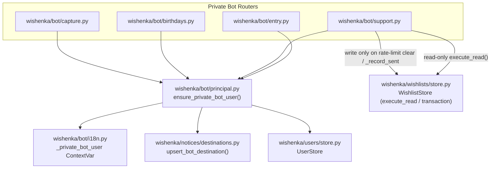

# WISHENKA-182: Support Diagnostic Context Scalability and Consistent Bot User Initialization

## Research

Inspection of the current codebase reveals two concrete architectural gaps originating from `WISHENKA-30` (`ai-tasks/WISHENKA-30/60-tech-debt.md`):

1. **Unbounded token table scans inside SQLite write transactions (`wishenka/bot/support.py`):**
   - `_submit_support_message` (`wishenka/bot/support.py:240-312`) invokes `store.transaction(_prepare)`, which acquires an exclusive SQLite write transaction (`BEGIN IMMEDIATE` via `WishlistStore.transaction`).
   - Inside `_prepare`, after checking the `support_tickets` rate-limit count, it calls `collect_diagnostic_context(conn, ...)` (`wishenka/bot/support.py:117-182`).
   - `collect_diagnostic_context` executes three unfiltered full-table scans:
     - `SELECT public_token, invite_token FROM wl_lists`
     - `SELECT token FROM wl_tokens`
     - `SELECT token FROM wl_invite_tokens`
   - Meanwhile, `redact_capabilities` (`wishenka/bot/support.py:70-79`) already masks standard capability formats via compiled regular expressions:
     - `_STARTAPP_TOKEN_RE` (`startapp=[pi]_[A-Za-z0-9_-]+`)
     - `_CAPABILITY_PATH_RE` (`/(share|invite|api/public/wishlists)/[A-Za-z0-9_-]+`)
     - `_CAPABILITY_TOKEN_RE` (`\b[pi]_[A-Za-z0-9_-]{3,}\b`)
   - In `wishenka/wishlists/db_models.py`, `wl_lists.owner_id` is indexed, `wl_members.wishlist_id` is indexed (with `UniqueConstraint("wishlist_id", "user_id")`), and `wl_tokens.wishlist_id` is indexed. `wl_invite_tokens` has only `token` (no `wishlist_id` foreign key).
   - Scoping token lookups to the submitting user's owned and collaborative wishlists (`wl_lists` + `wl_members` + `wl_tokens` joined by `owner_id`/`user_id`) and moving read-only diagnostic collection out of `store.transaction` eliminates both $O(N)$ platform-wide scans and write-lock contention.

2. **Duplicated private-bot user initialization & destination activation across routers:**
   - `wishenka/bot/entry.py` (`_ensure_private_destination`), `wishenka/bot/support.py` (`principal`), `wishenka/bot/birthdays.py` (`principal`), and `wishenka/bot/capture.py` (`capture` handler) each implement separate private-chat user resolution + `upsert_bot_destination` logic.
   - `entry.py`, `support.py`, and `birthdays.py` wrap `users.upsert_from_bot(...)` in `_private_bot_user` (`wishenka/bot/i18n.py`) when `user_record is None`, whereas `capture.py` queries `users.get_by_telegram_id(...)` first and wraps `upsert_from_bot` in its own `_preview_active` `ContextVar` filter.
   - When `user_record` is `None` (e.g., standalone sub-router invocations without `LocaleMiddleware`), calling `upsert_from_bot` unconditionally can overwrite stored `users.language_code` if the incoming Telegram `User` omits `language_code`, whereas checking `get_by_telegram_id` first (or preserving stored `language_code`) keeps language preferences consistent across all four routers.
   - Flow-specific side effects remain distinct: `entry.py` clears active `support_input` sessions on `/start` and `/help`, `birthdays.py` returns `int(record.id)`, and `support.py` / `entry.py` return `UserRecord | None`.

## Implementation Plan

1. **Create shared private-bot principal helper (`wishenka/bot/principal.py`):**
   - Implement `ensure_private_bot_user(dependencies, user, chat_id, *, user_record=None, now=None) -> UserRecord | None`.
   - Enforce private-chat guard (`user is None or users is None or chat_id != user.id`), reuse `user_record` when supplied, otherwise look up `users.get_by_telegram_id(user.id)` first to preserve stored `language_code`/`locale` and only call `users.upsert_from_bot(user)` under `_private_bot_user` log suppression when no record exists.
   - Normalize `effective_now`: when `now is None`, read `dependencies.clock()` if callable and normalize `datetime` to `int(value.timestamp())` (or `int(value)` for numeric values), matching `birthdays._now_epoch`; otherwise pass `None` so `upsert_bot_destination` defaults to `int(time.time())`.
   - Activate `bot_destinations` via `upsert_bot_destination(conn, int(record.id), chat_id, effective_now)` inside `users.engine.begin()`.
2. **Adopt `ensure_private_bot_user` across all four private bot routers:**
   - Refactor `wishenka/bot/entry.py` (`_ensure_private_destination` delegates user/destination initialization to `ensure_private_bot_user`, keeping `clear_support_session`).
   - Refactor `wishenka/bot/support.py` (`principal` delegates to `ensure_private_bot_user`).
   - Refactor `wishenka/bot/birthdays.py` (`principal` delegates to `ensure_private_bot_user` and returns `int(record.id)` if non-`None`).
   - Refactor `wishenka/bot/capture.py` (`capture` handler delegates user/destination initialization to `ensure_private_bot_user`, removing the inline `_preview_active`-wrapped `upsert_from_bot` and `upsert_bot_destination` block).
3. **Eliminate full-table scans and write-lock contention in `wishenka/wishlists/store.py` & `wishenka/bot/support.py`:**
   - Add `WishlistStore.execute_read(work)` in `wishenka/wishlists/store.py` using a read-only execution option (`execution_options(read_only=True)`) respected by `_configure_immediate_transactions` (`_sqlite_begin_immediate` issues a deferred `BEGIN` instead of `BEGIN IMMEDIATE` when `read_only` is set, and `execute_read` rolls back/closes on exit without committing writes).
   - Update `collect_diagnostic_context` in `wishenka/bot/support.py` to query only tokens scoped to the submitting user (`wl_lists` where `owner_id = :tg`, `wl_lists` joined with `wl_members` where `m.user_id = :tg`, and `wl_tokens` joined to those owned/member wishlists), removing the unfiltered `wl_lists`, `wl_tokens`, and `wl_invite_tokens` full-table scans.
   - Refactor `_submit_support_message` to perform the rate-limit check and `collect_diagnostic_context` inside `store.execute_read(...)` outside `store.transaction(...)`, opening a write transaction only when deleting an expired/rate-limited `support_input` row or recording a sent ticket (`_record_sent`).
4. **Verify with automated tests:**
   - Run existing bot, support, entry, birthdays, capture, and i18n test suites plus new Step 3/4 tests under `make check` / `pytest`.

**Mandatory — Failing Repro (next Step 3):**
- **Where it lives:** `tests/test_wishenka_182_repro.py` (with module-level `pytestmark = pytest.mark.timeout(30)` per `do-testing`).
- **What it asserts:**
  1. *Scalability / No full-table scans or write-tx reads:* Seed multiple unrelated users' wishlists, `wl_tokens`, and `wl_invite_tokens` in SQLite; intercept/inspect SQL statements executed during `_submit_support_message` / `collect_diagnostic_context` (via SQLAlchemy `before_cursor_execute` event listener) and assert that:
     - No `SELECT` against `wl_lists`, `wl_tokens`, or `wl_invite_tokens` runs without a user-scoped `WHERE` filter (no `SELECT public_token, invite_token FROM wl_lists`, no `SELECT token FROM wl_tokens`, no `SELECT token FROM wl_invite_tokens`),
     - `collect_diagnostic_context` does not execute inside a `BEGIN IMMEDIATE` write transaction, and
     - Capability redaction still redacts both standard-format tokens (including other users' `p_*`/`i_*`/URL tokens) and the submitting user's own wishlist tokens.
  2. *Consistent language preservation & destination activation across all four routers:* Seed an existing user with stored `language_code="ru"` and `locale="ru"`, then invoke handlers in `entry`, `support`, `birthdays`, and `capture` with an incoming Telegram `User` having `language_code=None` (without `LocaleMiddleware` pre-injecting `user_record`). Assert all four routers preserve `language_code == "ru"` / `locale == "ru"`, activate `bot_destinations` (`active = 1`), and suppress `wishenka.users` identifier logs.
- **How to force failure without live external deps:** Uses in-process SQLite `WishlistStore`/`UserStore`, fake `Bot` transport (matching `tests/test_bot_support_repro.py`), and SQLAlchemy engine `before_cursor_execute` listener.
- **Sequencing:** Write red test in Step 3 (verify failure on current `main` code) → implement `wishenka/bot/principal.py`, router refactors, and `support.py` scoped/read-only diagnostic collection in Step 4 → verify green.

## Architecture

### System Module Diagram



### Module Responsibilities

| Module | Responsibility |
| --- | --- |
| `wishenka/bot/principal.py` *(new)* | Single shared helper `ensure_private_bot_user` for private-chat validation (`chat_id == user.id`), `UserRecord` resolution/creation with stored `language_code` preservation and `_private_bot_user` log suppression, `dependencies.clock()` `datetime`/`int` normalization, and `bot_destinations` activation. |
| `wishenka/wishlists/store.py` | Adds `WishlistStore.execute_read(work)` using `execution_options(read_only=True)` so `_configure_immediate_transactions` emits a deferred `BEGIN` instead of `BEGIN IMMEDIATE` for read-only callers. |
| `wishenka/bot/support.py` | Support flow & diagnostic context collection. Uses `ensure_private_bot_user`, runs rate-limit check and `collect_diagnostic_context` via `store.execute_read(...)`, and scopes token lookups to the submitting user's owned and collaborative wishlists. |
| `wishenka/bot/entry.py` | Private bot entry (`/start`, `/help`, etc.). Delegates user resolution and `bot_destinations` activation to `ensure_private_bot_user` while retaining `clear_support_session`. |
| `wishenka/bot/birthdays.py` | Birthday reminder management. Delegates user resolution and `bot_destinations` activation to `ensure_private_bot_user`. |
| `wishenka/bot/capture.py` | Wish capture flow. Delegates private-chat user resolution and `bot_destinations` activation to `ensure_private_bot_user`. |
| `wishenka/bot/i18n.py` | Retains `LocaleMiddleware`, `_private_bot_user` `ContextVar`, and `_PrivateUserLogFilter` (unchanged contract). |

### Module Interaction & Data Flow

1. **Private-bot user initialization (`ensure_private_bot_user`):**
   - Caller passes `(dependencies, user, chat_id, user_record=user_record)`.
   - If `user is None`, `user_store is None`, or `chat_id != user.id`, returns `None` immediately (no DB access, no destination activation in group chats).
   - If `user_record` is provided (from `LocaleMiddleware`), reuses it without querying `users`.
   - Otherwise, queries `await user_store.get_by_telegram_id(user.id)` first. Only when `None` is returned does it set `_private_bot_user.set(True)` and call `await user_store.upsert_from_bot(user)`.
   - Normalizes `effective_now`: if `now is not None`, uses `int(now)`; else if `dependencies.clock` is callable, calls it and normalizes `datetime` -> `int(value.timestamp())` (or `int(value)` for numeric values); else `None` (so `upsert_bot_destination` defaults to `int(time.time())`).
   - Opens `async with user_store.engine.begin() as conn:` and calls `await upsert_bot_destination(conn, int(record.id), chat_id, effective_now)`.
   - Returns `record`.

2. **Support ticket preparation (`_submit_support_message` & `collect_diagnostic_context`):**
   - **Step A (Read-only check & diagnostics):** Runs inside `await store.execute_read(...)`, which opens a connection with `execution_options(read_only=True)` so `_configure_immediate_transactions` emits a deferred `BEGIN` (not `BEGIN IMMEDIATE`) and rolls back on exit (no write lock).
     - Queries `support_tickets` for `owner_id = :owner AND created_at > :cutoff`.
     - If `len(rows) >= max_tickets`: exits `execute_read`, opens a brief `store.transaction` to delete `support_input` for `(owner_id, chat_id)`, and returns the rate-limit response.
     - Otherwise, calls `collect_diagnostic_context(conn, ...)` on the read-only connection:
       - Reads `bot_destinations`, `wl_lists` counts, `wl_members` count, and `bot_drafts` existence for the user.
       - Reads scoped capability tokens only for the user's own and collaborative wishlists:
         - `SELECT public_token, invite_token FROM wl_lists WHERE owner_id = :tg`
         - `SELECT l.public_token, l.invite_token FROM wl_lists l JOIN wl_members m ON m.wishlist_id = l.id WHERE m.user_id = :tg`
         - `SELECT t.token FROM wl_tokens t JOIN wl_lists l ON l.id = t.wishlist_id WHERE l.owner_id = :tg`
         - `SELECT t.token FROM wl_tokens t JOIN wl_members m ON m.wishlist_id = t.wishlist_id WHERE m.user_id = :tg`
       - No query touches `wl_invite_tokens` or unscoped `wl_lists`/`wl_tokens` rows.
   - **Step B (Redaction):** Calls `redact_capabilities(stripped, known_tokens)`, which masks all `p_*`, `i_*`, `/share/*`, `/invite/*`, `/api/public/wishlists/*`, and `startapp=*` patterns across all platform tokens via regex, plus any user-scoped tokens in `known_tokens`.
   - **Step C (Delivery & Write):** Sends ticket to Telegram destinations; on at least one successful delivery, executes `store.transaction(_record_sent)` to insert into `support_tickets` and delete `support_input`.

### Architectural Patterns & Justification

- **Shared Helper Extraction (`wishenka/bot/principal.py`):** Eliminates 4-way duplication of user upsert + log suppression + `bot_destinations` activation without introducing a heavyweight service class or circular dependencies between routers.
- **Read/Write Separation (CQRS-lite on SQLite WAL):** Running diagnostic reads inside `store.execute_read(...)` (with `execution_options(read_only=True)` bypassing `BEGIN IMMEDIATE` in `_configure_immediate_transactions` in favor of a deferred `BEGIN`) instead of `store.transaction()` allows concurrent SQLite writers (web requests, other bot users) to proceed unimpeded under WAL mode.
- **Defense-in-Depth Redaction:** Regex-based capability redaction handles all standard tokens platform-wide in $O(\text{message length})$, while user-scoped SQL queries cover any non-standard/bare tokens belonging to the user's own or shared wishlists in $O(\text{user wishlists})$.

### Public Interfaces

```python
# wishenka/bot/principal.py
async def ensure_private_bot_user(
    dependencies: Any,
    user: Any,
    chat_id: int,
    *,
    user_record: UserRecord | None = None,
    now: int | None = None,
) -> UserRecord | None:
    """Resolve or create a private-chat bot user and activate their bot destination."""
# wishenka/wishlists/store.py
async def execute_read(
    self,
    work: Callable[[AsyncConnection], Awaitable[T]],
) -> T:
    """Run ``work`` in a read-only deferred transaction without ``BEGIN IMMEDIATE``."""
```

- `collect_diagnostic_context(...) -> tuple[DiagnosticContext, set[str]]` in `wishenka/bot/support.py` retains its existing signature and return type for backward compatibility with unit tests.
- `redact_capabilities(text_value: str, known_tokens: Iterable[str] = ()) -> str` in `wishenka/bot/support.py` retains its existing signature.

### Error Handling

- **Missing dependencies or non-private chat:** `ensure_private_bot_user` returns `None` cleanly when `user is None`, `dependencies.user_store` is missing, or `chat_id != user.id`.
- **Database errors during initialization or diagnostic reads:** Propagate to the router's `@router.errors()` handler (e.g., `entry_error` in `wishenka/bot/entry.py`), which logs sanitized error types without exposing capability tokens or user PII.
- **Empty/missing `now` clock:** When `now is None`, falls back to `dependencies.clock()` if callable and normalizes `datetime` -> `int(value.timestamp())` (or `int(value)` for numeric values) to match `birthdays._now_epoch`; otherwise passes `None` (handled by `upsert_bot_destination` via `int(time.time())`).

### Testing Strategy

1. **Step 3 Failing Repro (`tests/test_wishenka_182_repro.py`):**
   - Verifies via SQLAlchemy `before_cursor_execute` instrumentation that no full-table scans of `wl_lists`, `wl_tokens`, or `wl_invite_tokens` occur and diagnostic context collection does not hold a write transaction.
   - Verifies that `entry`, `support`, `birthdays`, and `capture` all preserve stored `language_code`, activate `bot_destinations`, and suppress `wishenka.users` identifier logs.
2. **Regression Suites:**
   - Run `tests/test_bot_support.py`, `tests/test_bot_support_repro.py`, `tests/test_bot_entry_repro.py`, `tests/test_bot_start_repro.py`, `tests/test_bot_capture_repro.py`, `tests/test_i18n_unit.py`, and `tests/test_i18n_sync.py`.
   - Run repository quality gate (`make check`) in Step 4/5.

## Q&A

- **Q:** Is it safe to drop the `wl_invite_tokens` scan in `collect_diagnostic_context`?
  **A:** Yes. `wl_invite_tokens` has no `wishlist_id` or `owner_id` column, so it cannot be scoped to a user. Active invite tokens for the user's owned and collaborative wishlists are already stored in `wl_lists.invite_token` (which is queried scoped by `owner_id` / `wl_members.user_id`), and any `i_*` or `/invite/*` capability token from any user is already masked by `_CAPABILITY_TOKEN_RE`, `_CAPABILITY_PATH_RE`, and `_STARTAPP_TOKEN_RE` in `redact_capabilities`.
- **Q:** Why keep `collect_diagnostic_context(conn: AsyncConnection, ...)` taking a `conn` parameter instead of `store`?
  **A:** Preserving the `conn: AsyncConnection` signature maintains 100% compatibility with existing callers/tests while allowing `_submit_support_message` to pass a read-only connection from `store.execute_read(...)` instead of a `store.transaction` write connection.
