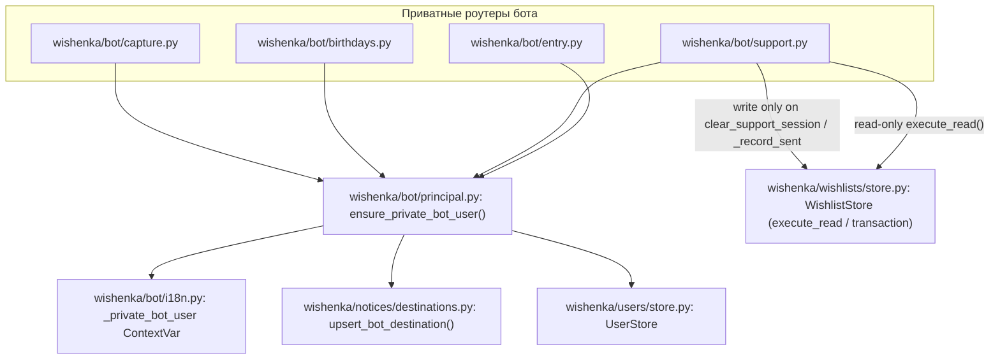

# Спецификация: WISHENKA-182 — Масштабируемость диагностического контекста поддержки и единая инициализация пользователя бота

**Задача:** WISHENKA-182 (follow-up 2 из технического долга [WISHENKA-30](https://pypost.atlassian.net/browse/WISHENKA-30))  
**Статус:** реализовано  
**Язык реализации:** Python  
**Связанные компоненты:** Telegram-бот (`entry`, `support`, `birthdays`, `capture`, `principal`, `i18n`), хранилище вишлистов (`WishlistStore`), хранилище пользователей (`UserStore`)

## 1. Назначение и бизнес-цель

### 1.1. Постановка проблемы

После внедрения канала поддержки пользователей в Telegram-боте (`WISHENKA-30`) в системе были выявлены два архитектурных и эксплуатационных недостатка, влияющих на масштабируемость и предсказуемость работы сервиса:

1. **Линейная деградация и блокировка записи SQLite при отправке обращений в поддержку.** Обработчик `_submit_support_message` в `wishenka/bot/support.py` выполнял проверку лимита обращений и сбор диагностического контекста (`collect_diagnostic_context`) внутри эксклюзивной write-транзакции `WishlistStore.transaction` (`BEGIN IMMEDIATE`). При этом `collect_diagnostic_context` выполняла три полных нефильтрованных сканирования платформенных таблиц (`wl_lists`, `wl_tokens`, `wl_invite_tokens`) для формирования списка токенов редактирования. По мере роста количества вишлистов и ссылок на платформе длительность удержания эксклюзивной блокировки записи росла пропорционально общему объёму данных ($O(N)$), задерживая параллельные запросы веб-интерфейса и других пользователей бота.
2. **Дублирование и расхождение логики инициализации пользователя в приватных роутерах бота.** Четыре приватных роутера (`wishenka/bot/entry.py`, `wishenka/bot/support.py`, `wishenka/bot/birthdays.py`, `wishenka/bot/capture.py`) содержали отдельные реализации проверки приватного чата, разрешения или создания записи пользователя, подавления идентификаторных логов и активации точки доставки уведомлений (`bot_destinations`). При отсутствии предварительно внедрённой middleware записи `user_record` (например, при изолированном вызове саб-роутеров без `LocaleMiddleware`) повторный вызов `upsert_from_bot` мог перезаписывать сохранённое языковое предпочтение `users.language_code`, если входящий объект Telegram `User` не содержал поля `language_code` (`None`).

### 1.2. Цели

- Обеспечить предсказуемое время подготовки обращений в поддержку ($O(1)$ по удержанию write-блокировок и $O(K)$ по выборке токенов конкретного пользователя) без деградации конкурентных операций в SQLite WAL.
- Сохранить надёжную маскировку всех секретных ссылок и capability-токенов в тексте обращений перед передачей операторам поддержки.
- Унифицировать распознавание пользователя приватного чата, сохранение его языковых предпочтений и активацию `bot_destinations` во всех приватных роутерах бота через единый общий механизм.

### 1.3. Ценность для пользователей и системы

- **Владельцы вишлистов и пользователи бота:** получают быструю отправку обращений без задержек от чужих данных, гарантированное сокрытие приватных ссылок и токенов доступа в тикетах и стабильное сохранение выбранного языка интерфейса при входе через любую команду или сценарий бота.
- **Операторы и сопровождение платформы:** исключается рост конкуренции за блокировку записи SQLite при масштабировании базы вишлистов, а правила приватности логирования и регистрации точек доставки сопровождаются в одной точке кода.

### 1.4. Границы решения

В рамках `WISHENKA-182` **не изменяются**:

- Внешний формат сообщений тикетов поддержки (`Support Ticket: SUP-...`), правила и параметры rate limiting, а также конфигурация получателей (`support_chat_id`, `support_admin_ids`).
- Логика и объём каскадного удаления аккаунта (`WISHENKA-35`).
- Правила переключения локали и перечень поддерживаемых языков (`ru`, `en`).
- Поведение захвата желаний в групповых чатах, где активация приватной точки доставки уведомлений `bot_destinations` не применяется.

## 2. Функциональные требования и пользовательские сценарии

### 2.1. Функциональные требования

- **FR-1. Точечный поиск токенов и сохранение редактирования секретов.**
  - Перед отправкой тикета операторам функция `redact_capabilities` обязана заменять на `[REDACTED]` все capability-токены и ссылки на вишлисты.
  - Запросы к БД при сборе `DiagnosticContext` обязаны ограничиваться только вишлистами, принадлежащими отправителю (`wl_lists.owner_id = :tg`), и совместными вишлистами, в которых отправитель участвует (`wl_members.user_id = :tg`), а также строками `wl_tokens`, связанными с этими вишлистами.
  - Таблица `wl_invite_tokens` (не имеющая привязки к `wishlist_id` или `owner_id`) и записи сторонних пользователей в `wl_lists` и `wl_tokens` не сканируются.
  - Все стандартные форматы capability-токенов (включая токены чужих вишлистов) маскируются регулярными выражениями `redact_capabilities`, а пользовательские и совместные токены длиной от 4 символов дополнительно маскируются по точному совпадению.

- **FR-2. Точность диагностического контекста и разделение чтения и записи.**
  - Заголовок тикета поддержки продолжает включать метаданные учётной записи (`DiagnosticContext`): активность `bot_destinations`, количество активных и архивных собственных вишлистов, число активных совместных участий и наличие активного черновика желания.
  - Проверка лимита обращений по `support_tickets` и вызов `collect_diagnostic_context` выполняются в режиме только чтения (`WishlistStore.execute_read`) до отправки сообщения в Telegram.
  - Write-транзакция (`WishlistStore.transaction`) открывается только при необходимости зафиксировать результат: удалить устаревшую или заблокированную сессию `support_input` (`clear_support_session`) либо записать отправленный тикет в `support_tickets` и очистить `support_input` (`_record_sent`) после успешной доставки хотя бы одному получателю.

- **FR-3. Единая инициализация приватного пользователя бота и точки доставки.**
  - Все четыре приватных роутера (`entry`, `support`, `birthdays`, `capture`) используют единую функцию `ensure_private_bot_user` из модуля `wishenka/bot/principal.py`.
  - При получении `user is None`, отсутствии `user_store` или несовпадении `chat_id != user.id` функция немедленно возвращает `None` без обращений к БД и без регистрации `bot_destinations`.
  - Если `user_record` уже передан (например, через `LocaleMiddleware`), повторное чтение или перезапись пользователя в `UserStore` не выполняется.
  - Если `user_record` равен `None`, сначала выполняется поиск `users.get_by_telegram_id(user.id)` для сохранения существующего профиля и поля `language_code`/`locale`. Только при отсутствии записи в БД вызывается `users.upsert_from_bot(user)` под защитой `ContextVar` `_private_bot_user`.
  - После получения или создания `UserRecord` в транзакции `users.engine.begin()` вызывается `upsert_bot_destination` с `active = 1`.

- **FR-4. Сохранение специфических контрактов роутеров.**
  - `wishenka/bot/entry.py` (`_ensure_private_destination`) после `ensure_private_bot_user` продолжает очищать вытесненную сессию ввода поддержки (`clear_support_session`).
  - `wishenka/bot/birthdays.py` (`principal`) продолжает возвращать внутренний идентификатор пользователя `int(record.id)` (либо `None`).
  - `wishenka/bot/support.py` (`principal`) и `wishenka/bot/capture.py` (`capture`) сохраняют прежние пользовательские ответы, команды, callback-кнопки и приоритеты маршрутизации.

### 2.2. Пользовательские и системные сценарии

**UC-01. Отправка обращения в поддержку со ссылками и токенами:** пользователь отправляет сообщение в активной сессии `/support` или командой `/support <текст>`, вставив ссылки на собственные, совместные или чужие вишлисты. Система в read-only транзакции проверяет лимит и собирает токены только по спискам отправителя, маскирует все capability-токены (включая нестандартные токены `wl_tokens` пользователя и стандартные токены чужих списков) строкой `[REDACTED]`, отправляет тикет в Telegram и после подтверждения доставки сохраняет метаданные в `support_tickets`.

**UC-02. Параллельная работа поддержки и операций записи вишлистов:** пользователь отправляет обращение в поддержку одновременно с активными операциями создания или изменения вишлистов другими пользователями. Проверка rate limit и сбор `DiagnosticContext` выполняются в отложенной read-only транзакции и не конкурируют с `BEGIN IMMEDIATE`, а сетевая доставка в Telegram выполняется вне любых транзакций БД.

**UC-03. Взаимодействие возвращающегося пользователя с любым приватным роутером без `language_code`:** пользователь с ранее сохранённой локалью `ru` вызывает сценарии `entry`, `support`, `birthdays` или `capture` (в том числе при запуске отдельного саб-роутера без `LocaleMiddleware`), когда Telegram-событие содержит `language_code=None`. Система находит запись по `telegram_id`, сохраняет `language_code="ru"` / `locale="ru"` и активирует `bot_destinations`.

**UC-04. Первичный вход нового пользователя или вызов из группового чата:** при первом обращении нового пользователя в приватном чате `ensure_private_bot_user` создаёт запись через `upsert_from_bot` с подавлением идентификаторных логов `wishenka.users` и активирует `bot_destinations`; если событие пришло не из личного чата (`chat_id != user.id`), запись в `users` и `bot_destinations` не создаётся и не изменяется.

### 2.3. Инварианты и контракты входов/выходов

| Операция | Входы | Выходы | Ключевой инвариант |
| -------- | ----- | ------ | ------------------ |
| `ensure_private_bot_user` | `dependencies`, `user`, `chat_id`, `user_record`, `now` | `UserRecord \| None` | При `chat_id != user.id` возвращает `None`; при наличии записи в БД сохраняет `language_code` и `locale`; при создании подавляет логи `wishenka.users` |
| `WishlistStore.execute_read` | `work(AsyncConnection)` | Результат `work` | Открывает транзакцию с `read_only=True` (отложенный `BEGIN`, без `BEGIN IMMEDIATE`) и всегда откатывает её в `finally` |
| `collect_diagnostic_context` | `conn`, метаданные тикета и пользователя | `(DiagnosticContext, set[str])` | Выполняет только индексированные user-scoped `SELECT`; не читает `wl_items`, `wl_reservations`, `wl_receipts` и `wl_invite_tokens` |
| `redact_capabilities` | `text_value`, `known_tokens` | Санитизированная строка | Маскирует regex-шаблоны и пользовательские токены длиной `>= 4` строкой `[REDACTED]` |

## 3. Архитектура, компоненты и интерфейсы

### 3.1. Схема взаимодействия модулей



### 3.2. Модули и ответственность

| Модуль | Ответственность |
| ------ | --------------- |
| `wishenka/bot/principal.py` *(новый)* | Единый помощник `ensure_private_bot_user` и нормализатор времени `_resolve_effective_now` для проверки приватного чата (`chat_id == user.id`), сохранения существующих предпочтений `UserRecord`, подавления логов через `_private_bot_user` и активации `bot_destinations`. |
| `wishenka/wishlists/store.py` | Добавляет метод `WishlistStore.execute_read(work)` с `execution_options(read_only=True)` и ветку в `_configure_immediate_transactions` (`_sqlite_begin_immediate`), использующую отложенный `BEGIN` вместо `BEGIN IMMEDIATE` для read-only соединений. |
| `wishenka/bot/support.py` | Делегирует инициализацию пользователя в `ensure_private_bot_user`; выполняет rate-limit проверку и `collect_diagnostic_context` внутри `store.execute_read(...)`; ограничивает выборки токенов собственными и совместными вишлистами отправителя. |
| `wishenka/bot/entry.py` | В `_ensure_private_destination` делегирует разрешение пользователя и активацию `bot_destinations` в `ensure_private_bot_user`, сохраняя вызов `clear_support_session`. |
| `wishenka/bot/birthdays.py` | В `principal` делегирует инициализацию в `ensure_private_bot_user` и возвращает `int(record.id)` при наличии записи. |
| `wishenka/bot/capture.py` | В обработчике `capture` делегирует инициализацию приватного пользователя и активацию `bot_destinations` в `ensure_private_bot_user` вместо встроенного блока `upsert_from_bot` / `upsert_bot_destination`. |
| `wishenka/bot/i18n.py` | Сохраняет без изменений `LocaleMiddleware`, `ContextVar` `_private_bot_user` и фильтр `_PrivateUserLogFilter` на логгере `wishenka.users`. |
| `wishenka/notices/destinations.py` | Сохраняет без изменений `upsert_bot_destination(conn, user_id, chat_id, now)` для регистрации и реактивации записей `bot_destinations`. |

### 3.3. Программные интерфейсы и контракты данных

```python
# wishenka/bot/principal.py
async def ensure_private_bot_user(
    dependencies: Any,
    user: Any,
    chat_id: int,
    *,
    user_record: UserRecord | None = None,
    now: int | None = None,
) -> UserRecord | None:
    """Resolve or create a private-chat bot user and activate their bot destination."""


# wishenka/wishlists/store.py
async def execute_read(
    self,
    work: Callable[[AsyncConnection], Awaitable[T]],
) -> T:
    """Run ``work`` in a read-only deferred transaction without ``BEGIN IMMEDIATE``."""


# wishenka/bot/support.py
async def collect_diagnostic_context(
    conn: AsyncConnection,
    *,
    ticket_ref: str,
    now: datetime,
    internal_user_id: int,
    telegram_user_id: int,
    username: str | None,
    display_name: str,
    effective_language: str,
    telegram_language_code: str | None,
) -> tuple[DiagnosticContext, set[str]]:
    """Query metadata-only user and wishlist summary counts and known tokens for redaction."""
```

Структура данных `DiagnosticContext` (`@dataclass(frozen=True)` в `wishenka/bot/support.py`):

- `ticket_ref: str`, `submitted_at_iso: str` (формат `%d.%m.%y %H:%M:%S UTC`)
- `internal_user_id: int`, `telegram_user_id: int`, `username: str`, `display_name: str`
- `effective_language: str`, `telegram_language_code: str`
- `bot_destination_active: bool`, `active_wishlist_count: int`, `archived_wishlist_count: int`, `collaborative_membership_count: int`, `active_draft_present: bool`

Запросы `collect_diagnostic_context` к таблицам БД:

1. **Метаданные и счётчики:** `bot_destinations` (`active` по `user_id = :uid`), `wl_lists` (`COUNT(*)` по `owner_id = :tg` для `status = 'active'` и `status = 'archived'`), `wl_members JOIN wl_lists` (`COUNT(*)` по `m.user_id = :tg AND l.status != 'deleted'`), `bot_drafts` (`SELECT 1 ... LIMIT 1` по `owner = :tg AND state = 'active' AND expires > :now`).
2. **Токены, ограниченные областью видимости пользователя (4 user-scoped запроса):**

```sql
SELECT public_token, invite_token FROM wl_lists WHERE owner_id = :tg;

SELECT l.public_token, l.invite_token
FROM wl_lists l
JOIN wl_members m ON m.wishlist_id = l.id
WHERE m.user_id = :tg;

SELECT t.token
FROM wl_tokens t
JOIN wl_lists l ON l.id = t.wishlist_id
WHERE l.owner_id = :tg;

SELECT t.token
FROM wl_tokens t
JOIN wl_members m ON m.wishlist_id = t.wishlist_id
WHERE m.user_id = :tg;
```

Отказ от сканирования `wl_invite_tokens` безопасен, поскольку таблица содержит только столбец `token` без внешнего ключа вишлиста или владельца, активные invite-токены собственных и совместных списков пользователя присутствуют в `wl_lists.invite_token`, а любые токены стандартного формата (`i_*`, `/invite/*`, `startapp=i_*`) маскируются регулярными выражениями в `redact_capabilities`.

### 3.4. Переходы состояний и потоки управления

**Поток инициализации пользователя (`ensure_private_bot_user`):**

1. Проверка `user is None or users is None or chat_id != user.id` → немедленный возврат `None`.
2. Определение `record`: если передан `user_record`, используется он; иначе выполняется `await users.get_by_telegram_id(user.id)`; если и он вернул `None`, устанавливается `_private_bot_user.set(True)`, вызывается `await users.upsert_from_bot(user)` и в блоке `finally` контекстная переменная сбрасывается.
3. Вычисление `effective_now`: если `now is not None` — `int(now)`; иначе при вызываемом `dependencies.clock` значение `datetime` переводится в `int(value.timestamp())`, а число — в `int(value)`; иначе `None` (внутри `upsert_bot_destination` подставляется `int(time.time())`).
4. Выполнение `async with users.engine.begin() as conn:` → `await upsert_bot_destination(conn, int(record.id), chat_id, effective_now)` с установкой `active = 1` и возврат `record`.

**Поток обработки обращения в поддержку (`_submit_support_message`):**

1. Валидация непустого текста и максимальной длины (`support_max_message_length`, по умолчанию `2000`) → при нарушении ответ пользователю без обращения к БД.
2. Чтение в `await store.execute_read(_prepare_read)`:
   - На соединении устанавливается `execution_options(read_only=True)`.
   - Слушатель `_sqlite_begin_immediate` применяет `PRAGMA busy_timeout=5000` и открывает отложенную транзакцию `BEGIN` вместо `BEGIN IMMEDIATE`.
   - Проверяется количество строк в `support_tickets` за окно `support_rate_limit_window_seconds`; при превышении `support_rate_limit_max_tickets` вычисляется `wait_min` и возвращается статус `"rate_limited"`.
   - Иначе вызывается `collect_diagnostic_context`, текст очищается через `redact_capabilities(stripped, known_tokens)` и форматируется в `format_support_ticket`, после чего `finally` выполняет `await conn.rollback()`.
3. При статусе `"rate_limited"` или отсутствии доступных адресатов (`_destinations(deps)` пуст либо `message.bot is None`) вызывается `clear_support_session` (`store.transaction`), удаляющая `support_input`.
4. Отправка в Telegram выполняется вне транзакций БД с `LinkPreviewOptions(is_disabled=True)`.
5. Если ни одна отправка не удалась (`delivered == 0`), `support_input` очищается через `clear_support_session`. Если доставлено хотя бы одному адресату (`delivered >= 1`), в `store.transaction(_record_sent)` (`BEGIN IMMEDIATE`) добавляется строка в `support_tickets` и удаляется запись `support_input`, после чего пользователю отправляется `ticket_ref`.

## 4. Нефункциональные требования, безопасность и наблюдаемость

### 4.1. Производительность, масштабируемость и лимиты

- **Сложность и конкурентность:** сбор диагностических токенов выполняется за время $O(K)$ по индексированным столбцам (`wl_lists.owner_id`, `wl_members.wishlist_id`, `wl_tokens.wishlist_id`), где $K$ — число собственных и совместных вишлистов конкретного отправителя. Длительность блокировки `BEGIN IMMEDIATE` при подготовке тикета снижена до $O(1)$ за счёт вынесения чтения в `WishlistStore.execute_read`.
- **Действующие лимиты канала поддержки:**
  - `support_max_message_length`: по умолчанию `2000` символов (допустимая конфигурация `100..3500`).
  - Итоговая длина тикета: ограничена лимитом Telegram `4096` символов (`budget = max(100, 4096 - len(header))`).
  - `support_rate_limit_window_seconds`: по умолчанию `3600` секунд (`>= 60`); `support_rate_limit_max_tickets`: по умолчанию `3` (`1..50`).
  - `support_session_ttl_seconds`: по умолчанию `3600` секунд (`60..86400`).

### 4.2. Инварианты безопасности и приватности

- **Эшелонированная маскировка capability-токенов (`redact_capabilities`):**
  - `_STARTAPP_TOKEN_RE` (`(startapp=)[pi]_[A-Za-z0-9_-]+`) → `\1[REDACTED]`.
  - `_CAPABILITY_PATH_RE` (`(/(?:share|invite|api/public/wishlists)/)[A-Za-z0-9_-]+`) → `\1[REDACTED]`.
  - `_CAPABILITY_TOKEN_RE` (`\b[pi]_[A-Za-z0-9_-]{3,}\b`) → `[REDACTED]`.
  - Точная замена известных токенов пользователя (`len >= 4`, по убыванию длины) → `[REDACTED]`.
- **Тайна сюрприза:** `collect_diagnostic_context` не запрашивает названия или ссылки желаний (`wl_items`), бронирования (`wl_reservations`) и отметки получения (`wl_receipts`).
- **Подавление предпросмотра и секретов в SQL-логах:** при отправке в Telegram задаётся `LinkPreviewOptions(is_disabled=True)`; `WishlistStore.execute_read` наследует настройки движка `hide_parameters=True` и уровень логгера `aiosqlite` `WARNING`, предотвращая попадание SQL-параметров (включая токены) в журналы.
- **Подавление PII-логов в приватных сценариях:** `ensure_private_bot_user` устанавливает `ContextVar` `_private_bot_user` вокруг `users.upsert_from_bot(user)`, благодаря чему фильтр `_PrivateUserLogFilter` скрывает события логгера `wishenka.users` с идентификаторами пользователя.
- **Изоляция групповых чатов:** условие `chat_id != user.id` исключает запись идентификаторов групповых чатов в `bot_destinations`.

### 4.3. Наблюдаемость (структурированные логи и метрики)

- **Формат логов:** структурированный JSON через `wishenka.logging.JsonFormatter` с полем `extra={"event": ...}`, без пользовательских идентификаторов, текстов обращений, URL и capability-токенов.
- **Политика логирования новых компонентов:** в `WishlistStore.execute_read` и `ensure_private_bot_user` намеренно не добавлялись новые `INFO`/`DEBUG`-события, чтобы не создавать высокочастотный шум и не нарушать запрет на логирование идентификаторов пользователей в приватном боте.
- **Существующие структурированные события (`wishenka.bot.support` и граница ошибок `wishenka.bot.entry`):**

| Событие | Уровень | Поля `extra` | Назначение |
| ------- | ------- | ------------ | ---------- |
| `bot_support_prompted` | `INFO` | `event` | Открытие интерактивной сессии поддержки |
| `bot_support_cancelled` | `INFO` | `event` | Отмена сессии поддержки пользователем |
| `bot_support_rejected` | `INFO` | `event`, `reason` (`empty`, `too_long`, `non_text`, `rate_limited`) | Отклонение входного сообщения |
| `bot_support_unavailable` | `WARNING` / `ERROR` | `event`, `reason` (`unconfigured`, `partial_send_failed`, `send_failed`) | Отсутствие конфигурации или сбой доставки |
| `bot_support_submitted` | `INFO` | `event`, `outcome` (`delivered`, `partial`) | Доставка тикета хотя бы одному адресату |
| `bot_start_failed` | `ERROR` | `event`, тип исключения | Необработанное исключение в роутерах (`entry_error`) |

- **Метрики:** отдельный коллектор метрик (Prometheus/Grafana) в репозитории не используется; учётные показатели состояния пользователя формируются в полях `DiagnosticContext` (`active_wishlist_count`, `archived_wishlist_count`, `collaborative_membership_count`, `bot_destination_active`, `active_draft_present`).

## 5. Верификация и критерии приёмки

### 5.1. Автоматизированные тестовые сценарии

В модуле `tests/test_wishenka_182_repro.py` (с модульным ограничением `pytestmark = pytest.mark.timeout(30)`) реализованы следующие сценарии:

1. `test_support_diagnostic_context_avoids_full_table_scans_and_write_tx` — с помощью SQLAlchemy-слушателя `before_cursor_execute` на базе с собственным вишлистом, совместным вишлистом и вишлистом постороннего пользователя проверяет:
   - отсутствие `SELECT`-запросов к `wl_lists`, `wl_tokens` и `wl_invite_tokens` без фильтра `WHERE`;
   - отсутствие выполнения запроса лимита (`support_tickets`) и диагностических `SELECT`-запросов внутри `BEGIN IMMEDIATE`;
   - полную маскировку (`[REDACTED]`) как user-scoped токенов (`tok_owner_extra_111`, `owner_wl.public_token`, `collab_wl.invite_token`), так и стандартных токенов других пользователей (`p_other_secret_789`, `other_path_tok`, `p_other_startapp`).
2. `test_principal_helper_exists_and_routers_delegate_without_duplication` — проверяет наличие `wishenka.bot.principal.ensure_private_bot_user`, его вызов во всех четырёх модулях (`entry`, `support`, `birthdays`, `capture`) и отсутствие в них прямых вызовов `upsert_from_bot`.
3. `test_all_private_routers_preserve_stored_language_and_activate_destination` — проверяет, что при последовательном вызове `entry._ensure_private_destination`, `create_support_router`, `create_birthday_router` и `create_capture_router` без `LocaleMiddleware` и с `language_code=None` в апдейте сохранённые `language_code == "ru"` и `locale == "ru"` не перезаписываются, а `bot_destinations.active` устанавливается в `1`.
4. `test_ensure_private_bot_user_suppresses_user_identifier_logs` — проверяет через `caplog`, что при создании нового пользователя через `ensure_private_bot_user` логгер `wishenka.users` не порождает записей с идентификаторами.

Зафиксированные результаты проверок качества из артефактов задачи (`ai-tasks/WISHENKA-182/00-roadmap.md` и `ai-tasks/WISHENKA-182/40-code-cleanup.md`):

- `.venv/bin/pytest tests/test_wishenka_182_repro.py -v`: `4 passed in 15.17s`.
- Набор `tests/test_bot_*.py`: `97 passed total`.
- `make analyze`: `ruff check` (`All checks passed!`), `ruff format --check` (`229 files already formatted`), `mypy` (`Success: no issues found in 229 source files`); отдельно `.venv/bin/mypy wishenka` — `Success: no issues found in 100 source files`. *(Примечание из `40-code-cleanup.md`: `.venv/bin/ruff format --check .` отмечал 12 Markdown-файлов из-за форматирования встроенных Python-блоков; весь Python-код в `wishenka/` и `tests/` отформатирован.)*

### 5.2. Критерии приёмки

1. Подготовка тикета поддержки не выполняет нефильтрованных сканирований `wl_lists`, `wl_tokens` и `wl_invite_tokens`, а проверка лимитов и сбор `DiagnosticContext` выполняются вне `BEGIN IMMEDIATE`.
2. Маскировка capability-токенов (`redact_capabilities`) продолжает заменять на `[REDACTED]` стандартные шаблоны (`p_*`, `i_*`, `/share/*`, `/invite/*`, `/api/public/wishlists/*`, `startapp=*`) и токены собственных/совместных вишлистов пользователя.
3. Все четыре приватных роутера (`entry`, `support`, `birthdays`, `capture`) используют `wishenka.bot.principal.ensure_private_bot_user` для разрешения пользователя и активации `bot_destinations`.
4. Сохранённое языковое предпочтение (`language_code`, `locale`) сохраняется во всех четырёх роутерах при входящем `language_code=None`, а идентификаторные логи `wishenka.users` подавляются при создании нового пользователя.
5. Автоматические тесты воспроизведения, регрессионные наборы и проверки статического анализа (`ruff`, `mypy`) проходят без ошибок.

### 5.3. Известные ограничения и последующие задачи

По итогам анализа технического долга (`ai-tasks/WISHENKA-182/60-tech-debt.md`) критических (**Blocker**) и высокоприоритетных (**High**) проблем не обнаружено. Зафиксированы следующие архитектурные компромиссы и последующие задачи:

- **Ограничения текущей реализации:**
  - `WishlistStore.execute_read` полагается на `execution_options(read_only=True)` (отложенный `BEGIN` и обязательный `rollback()` в `finally`), не выставляя `PRAGMA query_only = ON` на уровне соединения и не оборачивая вызов в `self._retry(...)` при `SQLITE_BUSY`.
  - `ensure_private_bot_user` выполняет 2–3 последовательных обращения к БД (`get_by_telegram_id` / `upsert_from_bot` и отдельная транзакция `users.engine.begin()` для `upsert_bot_destination`).
  - В `_submit_support_message` проверка лимита (`execute_read`) и запись отправленного тикета (`transaction`) разделены, сохраняя существующее неатомарное окно при параллельных быстрых отправках одним пользователем из-за недопустимости сетевых вызовов Telegram внутри `BEGIN IMMEDIATE`.
  - Вспомогательные функции нормализации времени (`_resolve_effective_now` в `principal.py`, `_now_epoch` в `birthdays.py`, `_now` в `support.py` и `capture.py`) остаются дублированными; аргументы `dependencies` и `user` в `ensure_private_bot_user` имеют тип `Any`.
  - `collect_diagnostic_context` выполняет 9 последовательных индексированных user-scoped `SELECT`-запросов.
- **Запланированные задачи (follow-ups в Jira):**
  1. **[Medium]** [WISHENKA-253](https://pypost.atlassian.net/browse/WISHENKA-253) — добавить отдельные модульные тесты для `WishlistStore.execute_read` (откат при нормальном завершении и исключении, неблокирующая конкуренция в WAL с `BEGIN IMMEDIATE`) и граничных случаев `ensure_private_bot_user` (`user=None`, `user_store=None`, `chat_id != user.id`, предзагруженный `user_record`, нормализация `now` и `dependencies.clock()`).
  2. **[Low]** [WISHENKA-254](https://pypost.atlassian.net/browse/WISHENKA-254) — оценить усиление `WishlistStore.execute_read` через `PRAGMA query_only = ON` (со сбросом при возврате соединения) и/или обработку повторов при `SQLITE_BUSY`.
  3. **[Low]** [WISHENKA-255](https://pypost.atlassian.net/browse/WISHENKA-255) — объединить дублирующиеся функции нормализации часов (`_now_epoch`, `_resolve_effective_now`, `_now`) и заменить `Any` на `Protocol` для зависимостей `ensure_private_bot_user`.
  4. **[Low]** [WISHENKA-256](https://pypost.atlassian.net/browse/WISHENKA-256) — при необходимости объединить user-scoped запросы в `collect_diagnostic_context` (`GROUP BY status` для подсчёта списков и `UNION` для выборки токенов).
