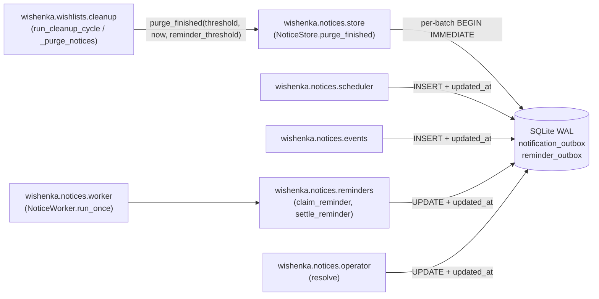

# WISHENKA-183: Bounded Batched Cleanup of Finished Notices and Retention Timestamp Evaluation

## Research

### Current State of `NoticeStore.purge_finished` and Callers

- **Store method (`wishenka/notices/store.py:312-356`):**
  `NoticeStore.purge_finished(threshold, *, now=None, reminder_threshold=None) -> int` executes a single `self._store.transaction(work)` (`BEGIN IMMEDIATE` on SQLite WAL) containing two unbounded `DELETE` statements:
  1. `DELETE FROM notification_outbox WHERE updated_at <= :threshold AND status IN ('sent', 'skipped', 'failed')`
  2. `DELETE FROM reminder_outbox WHERE next_attempt_at <= :threshold_epoch AND status IN ('sent', 'skipped', 'failed') AND (kind NOT IN ('list', 'birthday') OR event_date < :today_utc)`
  It then emits `notice_outbox_purged` (`INFO`) when `total > 0` and returns `receipt_purged + reminder_purged`.
- **Periodic caller (`wishenka/wishlists/cleanup.py:34-62`):**
  `_purge_notices(notice_store, settings, now)` (invoked by `run_cleanup_cycle`) calls `notice_store.purge_finished(threshold, now=now, reminder_threshold=reminder_threshold)` and logs `receipt_notice_rows_purged` when `rows > 0`.
- **SQLite bounded deletion pattern in codebase (`wishenka/bot/capture.py:741-784`):**
  SQLite is used without relying on `SQLITE_ENABLE_UPDATE_DELETE_LIMIT`; bounded deletes use the subquery pattern:
  `DELETE FROM <table> WHERE id IN (SELECT id FROM <table> WHERE ... LIMIT <N>)`.

### Evaluation of `reminder_outbox.updated_at` vs. `next_attempt_at`

Inspected all schema definitions and write paths for `reminder_outbox`:

1. **Schema (`wishenka/wishlists/alembic/versions/add_birthday_reminders.py:34-55`, `add_notice_uncertain.py:16`):**
   `reminder_outbox` currently has `id`, `occurrence_key`, `kind`, `user_id`, `list_id`, `item_id`, `birthday_id`, `revision`, `event_date`, `status`, `claimed_at`, `claim_token`, `attempts`, `next_attempt_at`, and `requires_membership`, with index `idx_reminders_due ON reminder_outbox(status, next_attempt_at)`. Unlike `notification_outbox`, `bot_destinations`, and `bot_capture_order`, `reminder_outbox` has no `updated_at` column.
2. **All `reminder_outbox` write paths:**
   - `wishenka/notices/scheduler.py:88,144`: `INSERT OR IGNORE` sets `status='pending'` (default) and `next_attempt_at=:now`.
   - `wishenka/notices/events.py:78`: `INSERT OR IGNORE` sets `status='pending'` (default) and `next_attempt_at=:now`.
   - `wishenka/notices/reminders.py:182` (`claim_reminder` stale recovery): sets `status='uncertain'`, does **not** update `next_attempt_at`.
   - `wishenka/notices/reminders.py:212,334` (`claim_reminder` unauthorized/ineligible): sets `status='skipped', next_attempt_at=:now`.
   - `wishenka/notices/reminders.py:346` (`claim_reminder` rate-limited): sets `next_attempt_at=:next` (`now + 1`) while keeping `status='pending'`.
   - `wishenka/notices/reminders.py:355` (`claim_reminder` claim): sets `status='sending', claimed_at=:now, claim_token=:token, attempts=attempts+1`, does **not** update `next_attempt_at`.
   - `wishenka/notices/reminders.py:509` (`settle_reminder`): sets `status=:status, next_attempt_at=:next, claimed_at=NULL, claim_token=NULL`. In `NoticeWorker.run_once` (`wishenka/notices/worker.py:185,220-226`), `next` is `now` for terminal outcomes (`sent`, `skipped`, `failed`) and `uncertain`, and `now + delay` for `pending` retries.
   - `wishenka/notices/operator.py:72` (`resolve`): sets `status=:status, next_attempt_at=:now` for `uncertain` -> `pending` (`retry`) or `failed` (`fail`).
3. **Decision — Add dedicated `updated_at INTEGER` column to `reminder_outbox`:**
   - **Rationale:** Although current production terminal paths happen to overwrite `next_attempt_at = now`, overloading `next_attempt_at` (a retry/delivery scheduling timestamp) to represent terminal settlement age is semantically fragile:
     1. Any future transition or operator/maintenance query that updates `status` to `sent`/`skipped`/`failed` without resetting `next_attempt_at` would silently miscompute retention age (e.g., an `uncertain` row settled days later, or a row with a future `retry_after`).
     2. `notification_outbox`, `bot_destinations`, and `bot_capture_order` already use a dedicated `updated_at` column for lifecycle/retention age.
   - **Schema & compatibility design:**
     - Add nullable `updated_at INTEGER` to `reminder_outbox` via a new reversible Alembic migration (`down_revision = "add_bot_capture_order_retention"`), plus index `idx_reminder_outbox_status_updated ON reminder_outbox(status, updated_at)`.
     - Backfill existing rows in the migration with `UPDATE reminder_outbox SET updated_at = COALESCE(claimed_at, next_attempt_at) WHERE updated_at IS NULL`.
     - Stamp `updated_at = :now` on all `INSERT` and `UPDATE` state transitions in `scheduler.py`, `events.py`, `reminders.py`, and `operator.py`.
     - Keep `updated_at` nullable and filter retention in `purge_finished` using `COALESCE(updated_at, next_attempt_at) <= :threshold_epoch` so that legacy/test SQL inserts omitting `updated_at` continue to respect `next_attempt_at` without premature deletion.

## Implementation Plan

1. **Alembic migration (`wishenka/wishlists/alembic/versions/add_reminder_outbox_updated_at.py`):**
   - `down_revision = "add_bot_capture_order_retention"`, `ROLLBACK_POLICY = "reversible"`.
   - `upgrade()`: add `updated_at INTEGER` to `reminder_outbox` (idempotent `_columns("reminder_outbox")` check), create `idx_reminder_outbox_status_updated ON reminder_outbox(status, updated_at)`, backfill `updated_at = COALESCE(claimed_at, next_attempt_at) WHERE updated_at IS NULL`.
   - `downgrade()`: drop index and drop column `updated_at`.
2. **Stamp `updated_at` across all `reminder_outbox` writers:**
   - `wishenka/notices/scheduler.py`: include `updated_at` (`:now`) in both `INSERT OR IGNORE` statements.
   - `wishenka/notices/events.py`: include `updated_at` (`:now`) in `INSERT OR IGNORE`.
   - `wishenka/notices/reminders.py`: set `updated_at = :now` in all `claim_reminder` updates (stale->`uncertain`, `skipped`, rate-limit backoff, `sending`) and in `settle_reminder` (taking `now: int` or deriving settlement timestamp; note `settle_reminder` currently receives `next_attempt` — adding `updated_at: int | None = None` defaulting to `next_attempt` or passing `now` explicitly keeps existing callers/tests working while ensuring `updated_at = now` even on `pending` retries with `delay > 0`).
   - `wishenka/notices/operator.py`: set `updated_at = :now` when `queue == "reminder"` in `resolve`.
3. **Bounded batched deletion in `NoticeStore.purge_finished` (`wishenka/notices/store.py`):**
   - Add `DEFAULT_PURGE_BATCH_SIZE = 500` and optional `batch_size: int = DEFAULT_PURGE_BATCH_SIZE` keyword parameter to `purge_finished` (validated `batch_size >= 1`).
   - Loop in separate `self._store.transaction(work)` calls per batch until both queues delete fewer than `batch_size` rows.
   - Each batch executes subquery-bounded `DELETE ... WHERE id IN (SELECT id FROM ... ORDER BY id LIMIT :batch_size)`.
   - Aggregate `total_receipt_purged` and `total_reminder_purged` across all batches; emit `notice_outbox_purged` once with aggregate counts when `total > 0`, and return `total`.
4. **Tests:**
   - Verify multi-batch draining with small `batch_size`, separate transactions per batch, accurate aggregate return value and `notice_outbox_purged` log counts, preservation of non-terminal/fresh/active-cycle rows, and `reminder_outbox.updated_at` stamping & retention filtering (including `COALESCE` fallback when `updated_at IS NULL` and divergence from `next_attempt_at`).

**Mandatory — Failing Repro (next Step 3):**
Write an automated red test in `tests/test_wishenka_183_repro.py` before any production changes:
- **What it asserts:**
  1. Calling `NoticeStore.purge_finished(..., batch_size=2)` (currently raises `TypeError` because `batch_size` is not accepted, and/or deletes all 5+ expired rows in a single unbounded transaction instead of bounded batches of 2 across multiple transactions) drains all expired terminal rows across both `notification_outbox` and `reminder_outbox` in bounded per-transaction batches, returns the exact aggregate count, and preserves non-terminal, fresh, and active-cycle rows.
  2. When a terminal `reminder_outbox` row has `updated_at` (or diverges from `next_attempt_at`, e.g. `next_attempt_at` is in the past while settlement happened recently, or `settle_reminder` stamps `updated_at` separately from `next_attempt_at`), retention eligibility follows `updated_at` rather than `next_attempt_at`.
- **How to force failure without live external deps:** Use an in-process temporary SQLite database via `open_store(tmp_path / ...)` and `NoticeStore`, seeding >`batch_size` expired terminal rows in both tables and spying/counting `store.transaction` calls (e.g., wrapping `store.transaction` to assert multiple bounded transactions occur).
- **Sequencing:** Research (done) -> Red test in Step 3 (`tests/test_wishenka_183_repro.py`) -> Migration + store/writer updates in Step 4 until green.

## Architecture

### Module Diagram



### Component Responsibilities & Interfaces

1. **`NoticeStore.purge_finished` (`wishenka/notices/store.py`):**
   - Signature:
     ```python
     DEFAULT_PURGE_BATCH_SIZE = 500

     async def purge_finished(
         self,
         threshold: datetime,
         *,
         now: datetime | None = None,
         reminder_threshold: datetime | None = None,
         batch_size: int = DEFAULT_PURGE_BATCH_SIZE,
     ) -> int:
     ```
   - **Transaction boundary & concurrency pattern:** Executes a `while` loop where **each iteration** opens its own `await self._store.transaction(work)` (`BEGIN IMMEDIATE`). Between iterations, the SQLite WAL write lock is released so concurrent wishlist mutations and `NoticeWorker` claims/settlements are not starved.
   - **Per-batch SQL:**
     - `notification_outbox` (while not drained):
       ```sql
       DELETE FROM notification_outbox
       WHERE id IN (
           SELECT id FROM notification_outbox
           WHERE updated_at <= :threshold
             AND status IN ('sent', 'skipped', 'failed')
           ORDER BY id
           LIMIT :batch_size
       )
       ```
     - `reminder_outbox` (while not drained):
       ```sql
       DELETE FROM reminder_outbox
       WHERE id IN (
           SELECT id FROM reminder_outbox
           WHERE COALESCE(updated_at, next_attempt_at) <= :threshold_epoch
             AND status IN ('sent', 'skipped', 'failed')
             AND (kind NOT IN ('list', 'birthday') OR event_date < :today_utc)
           ORDER BY id
           LIMIT :batch_size
       )
       ```
   - **Termination & observability:** A queue is marked drained as soon as its batch deletes `< batch_size` rows. After both queues are drained, `purge_finished` emits `notice_outbox_purged` once if `total > 0` (with aggregate `receipt_purged`, `reminder_purged`, `total_purged`) and returns `total`.

2. **Retention Timestamp Maintenance on `reminder_outbox`:**
   - **Migration (`add_reminder_outbox_updated_at.py`):** Adds `updated_at INTEGER` and `idx_reminder_outbox_status_updated ON reminder_outbox(status, updated_at)`, backfilling existing rows from `COALESCE(claimed_at, next_attempt_at)`.
   - **Writers:** `scheduler.py`, `events.py`, `reminders.py` (`claim_reminder`, `settle_reminder`), and `operator.py` (`resolve`) stamp `updated_at = :now` on every insert and status/attempt transition.
   - **`settle_reminder` interface:** Add optional `updated_at: int | None = None` parameter (`effective_updated = next_attempt if updated_at is None else updated_at`), and pass `now` from `NoticeWorker.run_once` so `updated_at` always reflects settlement time even when `next_attempt = now + delay` for retries.

### Selected Architectural Patterns & Justification

- **Per-batch transaction boundary (`BEGIN IMMEDIATE` per batch):** Prevents unbounded write-lock hold times on SQLite WAL while draining large backlogs. Partial progress from earlier batches is durably committed, making interrupted runs safe and idempotent.
- **Subquery `WHERE id IN (SELECT id ... ORDER BY id LIMIT :batch_size)`:** Matches the codebase's existing `bot_capture_order` / `bot_drafts` cleanup pattern (`wishenka/bot/capture.py`) and works on all SQLite builds without `SQLITE_ENABLE_UPDATE_DELETE_LIMIT`.
- **Dedicated `updated_at` with `COALESCE(updated_at, next_attempt_at)` fallback:** Decouples retention age from retry scheduling (`next_attempt_at`), aligns `reminder_outbox` with `notification_outbox` and `bot_capture_order`, and preserves backward compatibility for rows inserted without `updated_at`.

## Q&A

- **Q1: Why run each batch in its own `transaction()` instead of looping batches inside one transaction?**
  - **A1:** In SQLite WAL mode, `WishlistStore.transaction` acquires `BEGIN IMMEDIATE`, which blocks all other writers for the duration of the transaction. Looping inside a single transaction would still hold the write lock for the entire backlog. Separate transactions release the lock between batches so foreground requests and `NoticeWorker` can interleave.
- **Q2: Why keep `reminder_outbox.updated_at` nullable with a `COALESCE` fallback?**
  - **A2:** Production writers will always populate `updated_at`, and the Alembic migration backfills all existing rows. Keeping the column nullable with `COALESCE(updated_at, next_attempt_at)` avoids breaking existing test helpers that insert directly into `reminder_outbox` without specifying `updated_at`.
- **Q3: Does `NoticeWorker` or `run_cleanup_cycle` need signature changes?**
  - **A3:** No. `batch_size` on `NoticeStore.purge_finished` defaults to `DEFAULT_PURGE_BATCH_SIZE` (`500`), so existing callers continue to work unchanged.
