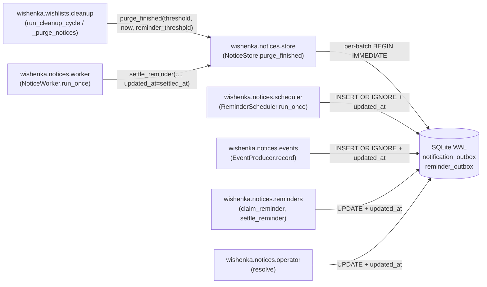

# Спецификация: WISHENKA-183 — Ограниченная пакетная очистка завершённых уведомлений и оценка временной метки хранения

**Задача в Jira:** WISHENKA-183  
**Статус:** реализовано  
**Язык реализации:** Python  
**Связанные документы:** `ai-tasks/WISHENKA-183/10-requirements.md`, `ai-tasks/WISHENKA-183/20-architecture.md`, `ai-tasks/WISHENKA-183/50-observability.md`, `ai-tasks/WISHENKA-183/60-tech-debt.md`, `doc/dev/notifications.md`, `doc/dev/migrations.md`, `doc/dev/gift-receipt.md`

## 1. Назначение и бизнес-цель

### 1.1. Постановка проблемы

По результатам аудита технического долга задачи `WISHENKA-60` (`ai-tasks/WISHENKA-60/60-tech-debt.md`, Follow-up 2) были выявлены два операционных и архитектурных риска в механизме регламентной очистки завершённых уведомлений (`NoticeStore.purge_finished` в `wishenka/notices/store.py`):

1. **Неограниченное удержание блокировки записи SQLite WAL:** ранее `NoticeStore.purge_finished` удалял все просроченные терминальные строки из таблиц `notification_outbox` и `reminder_outbox` двумя неограниченными операторами `DELETE` в одной общей транзакции `BEGIN IMMEDIATE`. При накоплении крупного исторического хвоста (например, после длительной остановки фонового воркера или уменьшения параметров хранения `receipt_notice_retention_days` / `reminder_retention_days`) единичная транзакция удерживала монопольную блокировку записи на неопределённое время, вызывая задержки и таймауты в пользовательских операциях и доставке актуальных уведомлений.
2. **Семантическая неоднозначность возраста хранения в `reminder_outbox`:** в отличие от `notification_outbox`, `bot_destinations` и `bot_capture_order`, таблица `reminder_outbox` не имела выделенной колонки `updated_at` и рассчитывала возраст хранения по колонке планирования следующей попытки `next_attempt_at`. Совмещение расписания повторных попыток и момента завершения/последнего изменения состояния создавало риск некорректного расчёта срока хранения при расхождении этих моментов (например, при переходе строки в `uncertain` без обновления `next_attempt_at` или при отсрочке по `retry_after`).

### 1.2. Цели

- Сделать длительность каждой транзакции очистки завершённых уведомлений ограниченной и предсказуемой за счёт пакетного удаления (`batch_size`) с пошаговым освобождением блокировки записи SQLite WAL между батчами и полным дренированием накопленного хвоста.
- Провести оценку семантики возраста хранения в `reminder_outbox` и отделить метку последнего изменения состояния (`updated_at`) от метки планирования следующей попытки (`next_attempt_at`), обеспечив единообразную и однозначную модель хранения записей для обеих очередей уведомлений.
- Сохранить полную обратную совместимость с существующими вызывающими модулями (`run_cleanup_cycle` / `_purge_notices`), тестами и инвариантами защиты от дублей и тайны сюрприза.

### 1.3. Ценность для пользователей и системы

- **Для пользователей сервиса (владельцев вишлистов, соавторов и дарителей):** фоновая очистка старых уведомлений не приводит к подвисаниям и отказам при работе с вишлистами, бронировании подарков и фиксации их получения даже при большом объёме накопившейся истории.
- **Для операторов и платформы:** предсказуемая нагрузка на SQLite WAL за счёт коротких батч-транзакций, прозрачная наблюдаемость числа удалённых строк и количества выполненных батчей, а также точный отсчёт срока хранения сервисных уведомлений и напоминаний от момента их фактического завершения или последнего обновления.

## 2. Функциональные требования и пользовательские сценарии

### 2.1. Функциональные требования

1. **Пакетное удаление завершённых уведомлений о получении (`notification_outbox`):**
   - Очистка удаляет строки со статусами `sent`, `skipped` и `failed`, у которых `updated_at <= :threshold` (`threshold` в ISO-формате UTC), партиями размером не более `batch_size` строк за одну транзакцию (`ORDER BY id LIMIT :batch_size`).
   - Записи дедупликации `notice_receipt_keys` при этом не удаляются (их регламентная очистка остаётся в `NoticeStore.purge_retention_records`).
2. **Пакетное удаление завершённых сервисных уведомлений и напоминаний (`reminder_outbox`):**
   - Очистка удаляет строки со статусами `sent`, `skipped` и `failed`, у которых `COALESCE(updated_at, next_attempt_at) <= :threshold_epoch` (Unix epoch в секундах UTC, по умолчанию от `reminder_threshold or threshold`) и выполняется условие активного цикла событий `(kind NOT IN ('list', 'birthday') OR event_date < :today_utc)`, партиями не более `batch_size` строк за одну транзакцию (`ORDER BY id LIMIT :batch_size`).
3. **Валидация размера батча, полное дренирование и агрегированный отчёт:**
   - Параметр `batch_size` имеет значение по умолчанию `DEFAULT_PURGE_BATCH_SIZE = 500`.
   - При `batch_size < 1` метод `NoticeStore.purge_finished` немедленно выбрасывает `ValueError("batch_size must be at least 1")` без открытия транзакций.
   - Очистка циклически выполняет батч-транзакции до полного дренирования обеих очередей: конкретная очередь считается дренированной, как только очередной батч удалил из неё строго меньше `batch_size` строк.
   - Возвращаемое значение `purge_finished` равно точному суммарному числу строк, удалённых из обеих таблиц за все батчи одного вызова (`receipt_purged + reminder_purged`).
4. **Выделенная временная метка `reminder_outbox.updated_at`:**
   - В таблицу `reminder_outbox` добавляется nullable-колонка `updated_at INTEGER` и индекс `idx_reminder_outbox_status_updated(status, updated_at)`; существующие строки заполняются значением `COALESCE(claimed_at, next_attempt_at)`.
   - Все производственные пути создания и модификации строк в `reminder_outbox` (`scheduler.py`, `events.py`, `reminders.py`, `store.py`, `worker.py`, `operator.py`) проставляют `updated_at = now` при вставке (`INSERT OR IGNORE`) и на каждом переходе состояния или перепланировании.
   - При переводе строки на повторную попытку (`status = 'pending'`, `next_attempt = settled_at + delay`) `NoticeWorker.run_once` передаёт `updated_at=settled_at`, сохраняя в `updated_at` время завершения попытки, а не будущее время следующей попытки.
   - Использование `COALESCE(updated_at, next_attempt_at)` в запросе очистки сохраняет совместимость со строками, вставленными напрямую без указания `updated_at` (например, в унаследованных тестах).

### 2.2. Пользовательские и эксплуатационные сценарии

- **Сценарий 1. Регламентная очистка крупного накопленного хвоста:** периодический цикл `run_cleanup_cycle` через `_purge_notices` вызывает `NoticeStore.purge_finished(threshold, now=now, reminder_threshold=reminder_threshold)` со значением `batch_size=500`. При наличии тысяч устаревших терминальных строк удаление выполняется серией независимых транзакций по `<= 500` строк на каждую очередь; между транзакциями блокировка записи SQLite WAL освобождается для обслуживания активных запросов Mini App, бота и воркера `NoticeWorker`.
- **Сценарий 2. Независимое раннее завершение одной из очередей:** если в `notification_outbox` удалено `< batch_size` строк (очередь дренирована), а в `reminder_outbox` остаётся более `batch_size` строк, последующие итерации `_purge_batch` пропускают SQL-удаление для уже пустой очереди и продолжают дренировать только оставшуюся очередь.
- **Сценарий 3. Расхождение `next_attempt_at` и `updated_at` при хранении `reminder_outbox`:**
  - Если терминальная строка имела старый `next_attempt_at` (старше порога хранения), но была обновлена позже (например, находилась в `uncertain` и недавно переведена оператором в `failed`, поэтому её `updated_at` новее порога), она **сохраняется**.
  - Если `updated_at` старше порога хранения, строка **удаляется**, даже если её `next_attempt_at` новее порога.
  - Если `updated_at IS NULL`, возраст оценивается по `next_attempt_at`.
- **Сценарий 4. Отказ при некорректном `batch_size`:** передача `batch_size <= 0` отклоняется до обращения к базе данных.

### 2.3. Границы применимости и инварианты

- **Вне рамок задачи:** удаление и анонимизация персональных данных аккаунта в таблицах уведомлений (`WISHENKA-35`), ограниченное хранение ключей `notice_receipt_keys` (`WISHENKA-181`), устранение дублирования SQL в `claim_reminder` / `refresh_reminder` (`WISHENKA-184`) и рефакторинг связности хранилища в `NoticeWorker` (`WISHENKA-180`).
- **Инвариант сохранения активных и карантинных записей:** строки со статусами `pending`, `sending` и `uncertain` в `notification_outbox` и `reminder_outbox` никогда не удаляются методом `purge_finished`.
- **Инвариант свежести терминальных записей:** терминальные записи, чей возраст не превысил порог хранения (`updated_at > threshold` для `notification_outbox` и `COALESCE(updated_at, next_attempt_at) > reminder_cutoff` для `reminder_outbox`), сохраняются.
- **Инвариант активного цикла напоминаний:** терминальные строки `reminder_outbox` с `kind IN ('list', 'birthday')` и `event_date >= today_utc` (текущая или будущая дата в UTC) сохраняются, чтобы `ReminderScheduler` (`INSERT OR IGNORE` по `occurrence_key`) не ставил повторные напоминания в рамках того же события.
- **Инвариант дедупликации квитанций:** очистка `notification_outbox` не удаляет записи `notice_receipt_keys`.
- **Инвариант идемпотентности:** прерывание между батчами оставляет уже удалённые батчи зафиксированными, а оставшиеся строки — в согласованном состоянии для следующего запуска.

## 3. Архитектура, компоненты и интерфейсы

### 3.1. Схема взаимодействия модулей



### 3.2. Модули, классы и функции

| Компонент | Расположение | Роль в рамках WISHENKA-183 |
| --- | --- | --- |
| Миграция `add_reminder_outbox_updated_at` | `wishenka/wishlists/alembic/versions/add_reminder_outbox_updated_at.py` | Обратимая Alembic-миграция (`down_revision = "add_bot_capture_order_retention"`, `ROLLBACK_POLICY = "reversible"`): добавляет `reminder_outbox.updated_at INTEGER`, индекс `idx_reminder_outbox_status_updated` и заполняет существующие строки из `COALESCE(claimed_at, next_attempt_at)` |
| `NoticeStore.purge_finished` / `_purge_batch` | `wishenka/notices/store.py` | Валидирует `batch_size >= 1` (по умолчанию `DEFAULT_PURGE_BATCH_SIZE = 500`), дренирует обе очереди через цикл отдельных транзакций `_purge_batch`, агрегирует счётчики и логирует `notice_outbox_purged` |
| `NoticeStore.settle_reminder` | `wishenka/notices/store.py` | Принимает необязательный параметр `updated_at: int | None = None` и передаёт его в `wishenka.notices.reminders.settle_reminder` |
| `claim_reminder` / `settle_reminder` | `wishenka/notices/reminders.py` | `claim_reminder` проставляет `updated_at = :now` на всех переходах (`uncertain`, `skipped`, rate-limit отсрочка, `sending`); `settle_reminder` принимает `updated_at: int | None = None` (`next_attempt if updated_at is None else updated_at`) |
| `NoticeWorker.run_once` | `wishenka/notices/worker.py` | Фиксирует `settled_at = self._time(now)` и передаёт `updated_at=settled_at` в `self._store.settle_reminder(...)` |
| `ReminderScheduler.run_once` | `wishenka/notices/scheduler.py` | Проставляет `updated_at = :now` в обоих `INSERT OR IGNORE INTO reminder_outbox` (`list` и `birthday`) |
| `EventProducer.record` | `wishenka/notices/events.py` | Проставляет `updated_at = :now` при вставке общих событий в `reminder_outbox` |
| `resolve` | `wishenka/notices/operator.py` | При `queue == "reminder"` добавляет `updated_at = :now` при ручном переводе строки из `uncertain` в `pending` (`retry`) или `failed` (`fail`) |
| `_purge_notices` | `wishenka/wishlists/cleanup.py` | Вызывает `notice_store.purge_finished(threshold, now=now, reminder_threshold=reminder_threshold)` с параметром `batch_size` по умолчанию |

### 3.3. Контракты интерфейсов и схема данных

#### Публичные сигнатуры

```python
DEFAULT_PURGE_BATCH_SIZE = 500

async def purge_finished(
    self,
    threshold: datetime,
    *,
    now: datetime | None = None,
    reminder_threshold: datetime | None = None,
    batch_size: int = DEFAULT_PURGE_BATCH_SIZE,
) -> int: ...
```

```python
async def settle_reminder(
    store: TransactionalStore,
    claim: Reminder,
    status: str,
    next_attempt: int,
    error_class: str | None = None,
    throttle_until: int | None = None,
    updated_at: int | None = None,
) -> bool: ...
```

#### Изменение схемы `reminder_outbox`

- **Колонка:** `updated_at INTEGER` (nullable; целочисленный Unix timestamp в секундах UTC).
- **Индекс:** `idx_reminder_outbox_status_updated ON reminder_outbox(status, updated_at)`.
- **Обратное заполнение при миграции:** `UPDATE reminder_outbox SET updated_at = COALESCE(claimed_at, next_attempt_at) WHERE updated_at IS NULL`.
- **Откат миграции (`downgrade`):** удаление индекса `idx_reminder_outbox_status_updated` и колонки `updated_at` (с проверкой `_columns("reminder_outbox")` и поддержкой offline-режима через `context.is_offline_mode()`).

#### SQL-контракт одного батча (`_purge_batch`)

Каждая итерация `_purge_batch` выполняется внутри отдельной транзакции `self._store.transaction(work)` (`BEGIN IMMEDIATE`):

```sql
-- При purge_receipts = True
DELETE FROM notification_outbox
WHERE id IN (
    SELECT id FROM notification_outbox
    WHERE updated_at <= :threshold
      AND status IN ('sent', 'skipped', 'failed')
    ORDER BY id LIMIT :batch_size
)
```

```sql
-- При purge_reminders = True
DELETE FROM reminder_outbox
WHERE id IN (
    SELECT id FROM reminder_outbox
    WHERE COALESCE(updated_at, next_attempt_at) <= :threshold_epoch
      AND status IN ('sent', 'skipped', 'failed')
      AND (kind NOT IN ('list', 'birthday') OR event_date < :today_utc)
    ORDER BY id LIMIT :batch_size
)
```

Использование подзапроса `WHERE id IN (SELECT id ... ORDER BY id LIMIT :batch_size)` соответствует существующему паттерну пакетной очистки в репозитории (`wishenka/bot/capture.py`) и работает в сборках SQLite без опции компиляции `SQLITE_ENABLE_UPDATE_DELETE_LIMIT`.

### 3.4. Переходы состояний `reminder_outbox` и актуализация `updated_at`

| Источник перехода | Условие / действие | Изменение `status` и `next_attempt_at` | Значение `updated_at` |
| --- | --- | --- | --- |
| `ReminderScheduler.run_once` | Планирование напоминания (`list`, `birthday`) | `INSERT OR IGNORE` -> `pending`, `next_attempt_at = :now` | `:now` |
| `EventProducer.record` | Фиксация безопасного общего события | `INSERT OR IGNORE` -> `pending`, `next_attempt_at = :now` | `:now` |
| `claim_reminder` | Истёк lease у `sending` (`claimed_at <= now - lease`) | `uncertain`, `claimed_at = NULL`, `claim_token = NULL` (`next_attempt_at` не меняется) | `:now` |
| `claim_reminder` | Не пройдена авторизация, отсутствуют настройки или цель невалидна | `skipped`, `next_attempt_at = :now` | `:now` |
| `claim_reminder` | Отказ rate limiter (`reserve_permit` вернул `False`) | Остаётся `pending`, `next_attempt_at = now + 1` | `:now` |
| `claim_reminder` | Успешный захват на отправку | `sending`, `claimed_at = :now`, `claim_token = :token`, `attempts + 1` | `:now` |
| `NoticeWorker.run_once` -> `settle_reminder` | `DELIVERED`, `REJECTED`, исчерпание попыток, `AMBIGUOUS` или `RETRYABLE` | `sent` / `failed` / `uncertain` (`next_attempt_at = settled_at`) или `pending` (`next_attempt_at = settled_at + delay`) | `settled_at` |
| `settle_reminder` (прямой вызов без `updated_at`) | Совместимость со старыми вызывающими сторонами | Как задано параметрами `status`, `next_attempt` | `next_attempt` |
| `operator.resolve` (`queue='reminder'`) | Операторский `retry` или `fail` из `uncertain` | `pending` или `failed`, `next_attempt_at = :now` | `:now` |
| `NoticeStore.purge_finished` | `sent` / `skipped` / `failed`, срок хранения истёк, и `kind NOT IN ('list', 'birthday')` либо `event_date < today_utc` | Физическое удаление строки батчем `<= batch_size` | Удаляется вместе со строкой |

## 4. Нефункциональные требования, безопасность и наблюдаемость

### 4.1. Производительность, конкурентность и ограничения

- **Ограничение блокировки записи:** каждая итерация `_purge_batch` удаляет не более `batch_size` строк в каждой таблице (до `500` из `notification_outbox` и до `500` из `reminder_outbox` по умолчанию), после чего завершает транзакцию `BEGIN IMMEDIATE`. Это позволяет фоновым задачам `NoticeWorker` и пользовательским запросам записи получать доступ к базе между батчами.
- **Устойчивость к сбоям и прерываниям:** досрочный обрыв процесса или ошибка во время одного из батчей сохраняет результаты ранее зафиксированных транзакций; на уровне `run_cleanup_cycle` метод `_purge_notices` перехватывает исключения с логированием `WARNING` (`receipt_notice_purge_failed`), не срывая общий цикл очистки.
- **Ограничение по индексам и числу батчей:**
  - Выражение `COALESCE(updated_at, next_attempt_at)` в `WHERE` препятствует диапазонному поиску по индексу `idx_reminder_outbox_status_updated(status, updated_at)` на этапе выборки батча.
  - В таблице `notification_outbox` отсутствует составной индекс `(status, updated_at)` (существует индекс `idx_notice_outbox_due(status, next_attempt_at)`).
  - При большом объёме сохранённых (непросроченных) терминальных строк каждый батч сканирует оставшиеся терминальные строки в рамках `ORDER BY id LIMIT :batch_size`, а один вызов `purge_finished` выполняет цикл до полного дренирования очередей без ограничения максимального числа батчей за цикл (зафиксировано в техническом долге, см. раздел 5.3).

### 4.2. Безопасность и приватность

- **Отсутствие PII и защита тайны сюрприза:** очистка очередей и структурированные логи оперируют только агрегированными счётчиками строк и параметрами батча и не содержат `user_id`, `chat_id`, имён получателей, названий вишлистов/желаний или сведений о бронированиях.
- **Конфигурация сроков хранения:** пороговые значения рассчитываются по настройкам `Settings` (`receipt_notice_retention_days = 30`, `reminder_retention_days = 30`, минимум 1 день).
- **Безопасность миграции:** `add_reminder_outbox_updated_at` использует идемпотентную проверку колонок с учётом `context.is_offline_mode()` и корректно генерирует SQL в offline-режиме (`alembic upgrade head --sql`).

### 4.3. Наблюдаемость (логирование и метрики)

Событие `notice_outbox_purged` (`INFO`, логгер `wishenka.wishlists.notices`) эмитируется **однократно** после завершения всех батчей в `NoticeStore.purge_finished` и **только при `total > 0`** (при удалении `0` строк лог не формируется, что сохраняет контракт подавления шума).

| Поле `extra` | Тип | Описание |
| --- | --- | --- |
| `event` | `str` | Фиксированное значение `"notice_outbox_purged"` |
| `receipt_purged` | `int` | Суммарное количество удалённых строк из `notification_outbox` за все батчи |
| `reminder_purged` | `int` | Суммарное количество удалённых строк из `reminder_outbox` за все батчи |
| `total_purged` | `int` | Общее количество удалённых строк (`receipt_purged + reminder_purged`) |
| `batches` | `int` | Число выполненных транзакций `_purge_batch` за вызов `purge_finished` |
| `batch_size` | `int` | Переданный или принятый по умолчанию размер батча |

- **Сопутствующие логи цикла очистки (`wishenka.wishlists.cleanup`):** `_purge_notices` продолжает логировать `receipt_notice_rows_purged` (`INFO`, поле `rows`) при `rows > 0` и `receipt_notice_purge_failed` (`WARNING`, поле `error_class`) при исключении.
- **Логирование при записи `updated_at`:** в модулях `scheduler.py`, `events.py`, `reminders.py`, `worker.py` и `operator.py` дополнительные построчные логи для `updated_at` не добавлялись во избежание зашумления; диагностика доставки и отложенных попыток по-прежнему покрывается агрегированными сводками `receipt_notice_window_summary` и `service_delivery_window_summary`.
- **Метрики:** отдельный экспортер метрик (Prometheus/OpenTelemetry) в репозитории отсутствует; временные и количественные показатели очистки наблюдаются через структурированные логи (включая `duration_ms` в `background_cleanup_completed`).

## 5. Верификация и критерии приёмки

### 5.1. Тестовые сценарии и подтверждённые проверки

Все тесты по задаче `WISHENKA-183` изолированы на временных SQLite-базах (`tmp_path`) с явным ограничением времени выполнения `pytestmark = pytest.mark.timeout(30)`:

1. **`tests/test_wishenka_183_repro.py`:**
   - `test_purge_finished_validates_non_positive_batch_size` — проверяет, что `batch_size = 0` и `batch_size = -1` вызывают `ValueError` с упоминанием `batch_size`.
   - `test_purge_finished_drains_both_outboxes_and_preserves_protected_rows` — размещает по 5 просроченных терминальных строк (`sent`, `skipped`, `failed`) в обеих очередях при `batch_size=2` и через перехват `store.transaction` проверяет выполнение `>= 3` отдельных транзакций, удаление не более `2` строк за первый батч из каждой таблицы, точный суммарный возврат (`10`) и сохранение защищённых строк (`pending` в `notification_outbox`, `uncertain`, свежих `sent` и просроченного `sent` с `kind='list'` на будущую дату `event_date`).
   - `test_reminder_outbox_has_updated_at_column_index_and_coalesce_retention` — проверяет наличие колонки `updated_at` и индекса `idx_reminder_outbox_status_updated` в `reminder_outbox`, а также 4 комбинации расчёта срока хранения: свежий `updated_at` + старый `next_attempt_at` (сохраняется), старый `updated_at` + свежий `next_attempt_at` (удаляется), `updated_at IS NULL` + старый `next_attempt_at` (удаляется по `COALESCE`), `updated_at IS NULL` + свежий `next_attempt_at` (сохраняется по `COALESCE`).
2. **`tests/test_wishenka_183_updated_at.py`:**
   - `test_alembic_reminder_outbox_updated_at_upgrade_backfill_and_downgrade` — проверяет Alembic `upgrade` с `add_bot_capture_order_retention` до `add_reminder_outbox_updated_at` с обратным заполнением `COALESCE(claimed_at, next_attempt_at)` (и с `claimed_at`, и с `claimed_at IS NULL`), создание индекса и колонки, а также обратимый `downgrade` назад до `add_bot_capture_order_retention`.
   - `test_reminder_outbox_writers_stamp_updated_at` — сквозная проверка простановки `updated_at` при вставках `ReminderScheduler.run_once` и `EventProducer.record`, повторной попытке в `NoticeWorker.run_once` (`RETRYABLE` -> `pending`, `updated_at == settle_now < next_attempt_at`), восстановлении зависшей строки `sending` -> `uncertain` в `claim_reminder` и операторском решении `operator.resolve(..., "fail", resolve_now)`.
   - `test_purge_finished_logs_batch_count_and_batch_size` — проверяет через `caplog` (`wishenka.wishlists.notices`, уровень `INFO`), что удаление 5 строк при `batch_size=2` порождает ровно одну запись `notice_outbox_purged` (`receipt_purged=0`, `reminder_purged=5`, `total_purged=5`, `batches=3`, `batch_size=2`), а вызов при пустом хвосте не создаёт события `notice_outbox_purged`.

**Зафиксированные результаты верификации (из `40-code-cleanup.md` и `50-observability.md`):**

- `make analyze` (`ruff check`, `ruff format --check`, `mypy`): без ошибок на 232 исходных файлах.
- `git diff --check`: чисто (код выхода `0`).
- `.venv/bin/pytest tests/test_wishenka_183_repro.py tests/test_wishenka_183_updated_at.py -v`: `5 passed` в Шаге 5, а также подтверждение `test_purge_finished_logs_batch_count_and_batch_size` в Шаге 6 и регрессионная проверка отсутствия лога при нулевом удалении в `tests/test_wishenka_181_observability.py` и `tests/test_wishenka_60_observability.py`.

### 5.2. Критерии приёмки

1. `NoticeStore.purge_finished` удаляет просроченные терминальные записи (`sent`, `skipped`, `failed`) из `notification_outbox` и `reminder_outbox` батчами не более `batch_size` строк в каждой отдельной транзакции (`DEFAULT_PURGE_BATCH_SIZE = 500`, `batch_size >= 1`), дренируя обе очереди и возвращая точное суммарное число удалённых строк.
2. Незавершённые (`pending`, `sending`) и карантинные (`uncertain`) строки, свежие терминальные строки, активные напоминания о событиях (`kind IN ('list', 'birthday')` при `event_date >= today_utc`) и записи `notice_receipt_keys` не удаляются.
3. В `reminder_outbox` добавлена колонка `updated_at` и индекс `idx_reminder_outbox_status_updated` обратимой миграцией `add_reminder_outbox_updated_at` с заполнением `COALESCE(claimed_at, next_attempt_at)`.
4. Все производственные пути записи и переходов состояния `reminder_outbox` (`scheduler.py`, `events.py`, `reminders.py`, `store.py`, `worker.py`, `operator.py`) актуализируют `updated_at`, а очистка определяет срок хранения по `COALESCE(updated_at, next_attempt_at)`.
5. Структурированное событие `notice_outbox_purged` (`INFO`) логируется однократно при `total > 0` с полями `batches` и `batch_size` и не содержит персональных данных.
6. Статический анализ (`ruff check`, `ruff format --check`, `mypy`) и автоматизированные тесты для батчинга, миграции, простановки `updated_at` и логирования выполняются успешно.

### 5.3. Известные ограничения и задачи развития (из `60-tech-debt.md`)

Блокирующего (`Blocker`) или высокого (`High`) технического долга в рамках задачи не внесено. Выявленные компромиссы среднего и низкого приоритета заведены как последующие задачи:

1. **[Medium] Оптимизация индексов для пакетной очистки очередей — [WISHENKA-257](https://pypost.atlassian.net/browse/WISHENKA-257):**
   - Выражение `COALESCE(updated_at, next_attempt_at)` в `reminder_outbox` не позволяет использовать `idx_reminder_outbox_status_updated(status, updated_at)` для диапазонного поиска, а на `notification_outbox` отсутствует индекс по `(status, updated_at)`. При большом числе непросроченных терминальных строк батч-запросы сканируют остаток.
2. **[Low] Конфигурируемый `purge_batch_size` и опциональное ограничение числа батчей за цикл — [WISHENKA-258](https://pypost.atlassian.net/browse/WISHENKA-258):**
   - `DEFAULT_PURGE_BATCH_SIZE = 500` задан константой в `wishenka/notices/store.py`, а не полем `wishenka.config.Settings`; кроме того, цикл в `purge_finished` не ограничивает суммарное число последовательных батчей за один вызов `run_cleanup_cycle`.
3. **[Low] Расширение матрицы модульных тестов `WISHENKA-183` — [WISHENKA-259](https://pypost.atlassian.net/browse/WISHENKA-259):**
   - Добавить явные тесты на асимметричное дренирование очередей (одна очередь `> batch_size`, другая `0` или `1` строка) и покрытие оставшихся переходов `reminder_outbox` (`claim_reminder` `skipped` / rate-limit backoff / `sending`, терминальные исходы `sent`/`failed`/`uncertain` в `NoticeWorker.run_once`, `operator.resolve(..., "retry", ...)` и откат `settle_reminder(..., updated_at=None)`).
4. **Дополнительные локальные компромиссы (`Low`, без отдельного тикета):**
   - Необязательный параметр `updated_at: int | None = None` в `settle_reminder` (по умолчанию принимает `next_attempt`) требует от будущих вызывающих сторон явно передавать `updated_at=now` при переводе строки в `pending` с отложенным `next_attempt`.
   - Повторение шаблона подзапроса `DELETE ... WHERE id IN (SELECT id ... ORDER BY id LIMIT :batch_size)` для `notification_outbox` и `reminder_outbox` оставлено явным из-за различия форматов хранения времени (ISO-строка и Unix epoch).
