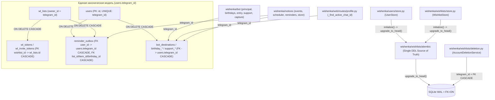

# WISHENKA-188: Унификация ключей пользователя, FK-каскады и консолидация DDL `users` в Alembic

## Research

### 1. Текущее расщепление пользовательских ключей (`users.telegram_id` vs `users.id`)

Анализ кодовой базы и миграций (`wishenka/wishlists/alembic/versions/`) подтверждает следующее распределение ключей:

1. **Таблицы, использующие канонический внешний идентификатор `users.telegram_id`:**
   - `wl_lists.owner_id`, `wl_items.recipient_user_id`, `wl_reservations.user_id`, `wl_idempotency_records.actor_id` (без `FOREIGN KEY` на `users`; ряд unit-тестов создаёт вишлисты/бронирования без записи в `users`).
   - `wl_members.user_id`, `wl_favorites.user_id`, `wl_view_history.user_id` (уже имеют `REFERENCES users(telegram_id) ON DELETE CASCADE` из ревизии `add_user_fk_cascades`).
   - `notification_outbox.giver_user_id`, `notice_receipt_keys.giver_user_id`, `user_notification_settings.user_id`, `wl_list_notification_settings.user_id`.
   - `reminder_outbox.user_id` (использует `telegram_id`, но без `FOREIGN KEY`).
   - `bot_drafts.owner`, `bot_capture_order.owner` (Telegram user ID).

2. **Таблицы, использующие внутренний автоинкрементный PK `users.id`:**
   - `bot_destinations.user_id` (`wishenka/bot/principal.py:52`, `wishenka/notices/destinations.py`).
   - `birthday_entries.owner_id` (`wishenka/bot/birthdays.py:51`, `wishenka/notices/scheduler.py:120`).
   - `birthday_input.owner_id` (`wishenka/bot/birthdays.py:51`).
   - `support_input.owner_id` (`wishenka/bot/support.py`).
   - `support_tickets`: хранит **оба** столбца `owner_id` (`users.id`) и `telegram_id` (`users.telegram_id`), причём индекс `idx_support_tickets_owner_time` построен по `(owner_id, created_at)` (`add_support_channel.py`).

Из-за этого расщепления:
- `EventProducer` (`wishenka/notices/events.py:70`), `NoticeStore` (`wishenka/notices/store.py:568-569`), `NoticeScheduler` (`wishenka/notices/scheduler.py:120`) и `refresh_reminder` (`wishenka/notices/reminders.py:241, 411-412, 445`) вынуждены делать `JOIN users u ON ...` только для трансляции между `u.id` и `u.telegram_id`.
- `AccountDeletionService` (`wishenka/wishlists/deletion.py:176-186, 433-467`) вынужден резолвить `internal_user_id` и ветвить запросы удаления по `owner_id` / `user_id` vs `telegram_id`.

### 2. Отсутствующие `FOREIGN KEY ... ON DELETE CASCADE`

- **`wl_tokens`** (`base_normalized.py:63`): `wishlist_id INTEGER NOT NULL` не имеет `REFERENCES wl_lists(id) ON DELETE CASCADE`.
- **`wl_invite_tokens`** (`base_normalized.py:66`): содержит только `token TEXT PRIMARY KEY` без столбца `wishlist_id` и без `FOREIGN KEY` на `wl_lists(id)`. При создании/ротации приглашений (`wishenka/wishlists/repository.py:214, 272`, `wishenka/wishlists/store.py:1686, 1699`) вставляется только `token`.
- **`reminder_outbox`** (`add_birthday_reminders.py:34`, `add_notice_uncertain.py:16`, `add_reminder_outbox_updated_at.py`): `user_id`, `list_id`, `item_id`, `birthday_id` не имеют `FOREIGN KEY ... ON DELETE CASCADE`.

При этом `PRAGMA foreign_keys=ON` уже включён на каждом соединении в `wishenka/sqlite.py:24`, `wishenka/wishlists/repository.py:1226` и `wishenka/wishlists/store.py:1732-1776`.

### 3. Дублирование DDL таблицы `users`

- `wishenka/users/store.py` (`_USERS_TABLE_DDL`, `_BACKFILL_ALL_SQL`, `_REPAIR_INVALID_SQL`, `UserStore.initialize()`) самостоятельно создаёт `users` и добавляет колонки через `PRAGMA table_info(users)` + `ALTER TABLE users ADD COLUMN ...`.
- В `wishenka/wishlists/alembic/versions/` таблица `users` также создаётся в `add_user_locale.py` и `add_user_fk_cascades.py`, **но** колонки `birth_day`, `birth_month`, `birth_year`, `birthdate_source` присутствуют только в `UserStore.initialize()` и отсутствуют в Alembic-миграциях!
- Все вызовы `UserStore(...)` в production и тестах передают `database_url` (ни один вызов не передаёт внешний `engine`). В `wishenka/wishlists/migrations.py` функция `_adopt_known_schema` пропускает БД без `wl_*` таблиц (например, изолированные unit-тесты `UserStore` с legacy-таблицей `users`), позволяя Alembic накатить миграции с `base_normalized` до `head`.

---

## Implementation Plan

1. **Единая миграция Alembic (`unify_user_keys_and_cascades`, `down_revision = "add_receipt_delivery_fence"`):**
   - **Консолидация `users`:** добавить в `users` отсутствующие в Alembic колонки `birth_day INTEGER`, `birth_month INTEGER`, `birth_year INTEGER`, `birthdate_source TEXT NOT NULL DEFAULT 'auto' CHECK (birthdate_source IN ('auto', 'explicit'))` (идемпотентно через `PRAGMA table_info(users)`), а также индексы `idx_users_telegram_id` и `idx_users_username`.
   - **Унификация ключей (`users.id` → `users.telegram_id`) с FK-каскадами:**
     - Пересобрать `bot_destinations`: преобразовать `user_id` из `users.id` в `users.telegram_id` (через `JOIN users`), удалить осиротевшие строки, добавить `REFERENCES users(telegram_id) ON DELETE CASCADE`.
     - Пересобрать `birthday_entries`: преобразовать `owner_id` из `users.id` в `users.telegram_id`, удалить осиротевшие строки, добавить `REFERENCES users(telegram_id) ON DELETE CASCADE`.
     - Пересобрать `birthday_input`: преобразовать `owner_id` из `users.id` в `users.telegram_id`, удалить осиротевшие строки, добавить `REFERENCES users(telegram_id) ON DELETE CASCADE`.
     - Пересобрать `support_input`: преобразовать `owner_id` из `users.id` в `users.telegram_id`, удалить осиротевшие строки, добавить `REFERENCES users(telegram_id) ON DELETE CASCADE`.
     - Пересобрать `support_tickets`: устранить дублирующий столбец `owner_id`, оставив `telegram_id INTEGER NOT NULL REFERENCES users(telegram_id) ON DELETE CASCADE`, удалить осиротевшие строки, пересоздать индекс `idx_support_tickets_owner_time` на `(telegram_id, created_at)`.
   - **Недостающие `FOREIGN KEY ... ON DELETE CASCADE`:**
     - Пересобрать `wl_tokens`: добавить `REFERENCES wl_lists(id) ON DELETE CASCADE` на `wishlist_id` (отфильтровав осиротевшие строки).
     - Пересобрать `wl_invite_tokens`: добавить `wishlist_id INTEGER NOT NULL REFERENCES wl_lists(id) ON DELETE CASCADE` и индекс `idx_wl_invite_tokens_wishlist(wishlist_id)`; выполнить backfill `wishlist_id` из `wl_lists` по `wl_lists.invite_token = wl_invite_tokens.token`, удалив несвязанные устаревшие токены.
     - Пересобрать `reminder_outbox`: добавить `user_id INTEGER NOT NULL REFERENCES users(telegram_id) ON DELETE CASCADE`, `list_id INTEGER REFERENCES wl_lists(id) ON DELETE CASCADE`, `item_id INTEGER REFERENCES wl_items(id) ON DELETE CASCADE`, `birthday_id INTEGER REFERENCES birthday_entries(id) ON DELETE CASCADE` (предварительно очистив осиротевшие строки с несуществующими родителями).
   - Для `down_revision` / `downgrade()`: поддержать обратимый откат структуры таблиц (согласно `ROLLBACK_POLICY = "reversible"`).

2. **Консолидация DDL `users` исключительно в Alembic (`wishenka/users/store.py`):**
   - Удалить `_USERS_TABLE_DDL`, `_BACKFILL_ALL_SQL`, `_REPAIR_INVALID_SQL` и любую логику `CREATE TABLE` / `ALTER TABLE` из `UserStore.initialize()`.
   - Сохранить `self.database_url = database_url` в `UserStore.__init__()`.
   - В `UserStore.initialize()` делегировать инициализацию/миграцию схемы в `await upgrade_to_head(self.database_url)` (исключая настройку WAL-режима при переданном внешнем `engine`, если такой появится) и выставлять `self._initialized = True`.

3. **Обновление доменного слоя, бота, нотификаций, веб-роутов, ORM-моделей и удаления аккаунта на канонический `telegram_id`:**
   - `wishenka/bot/principal.py`: передавать `int(record.telegram_id)` в `upsert_bot_destination`.
   - `wishenka/bot/birthdays.py`: возвращать `int(record.telegram_id)` из `principal()`, а также заменить все 6 прямых использований `record.id` (строки 253, 269, 283, 292, 303, 315) в запросах к `birthday_input` и `birthday_entries` на `int(record.telegram_id)`.
   - `wishenka/bot/entry.py`: в вызовах `clear_support_session(store, int(record.id), ...)` (строки 136, 218, 251) передавать `int(record.telegram_id)` вместо `int(record.id)` для соответствия `support_input.owner_id`.
   - `wishenka/bot/support.py`: использовать `int(record.telegram_id)` для `support_input.owner_id`, `bot_destinations.user_id` и `support_tickets(ticket_ref, telegram_id, created_at)` (убрав `owner_id`).
   - `wishenka/web/routes/profile.py`: в вызове `_find_active_chat_id(request, user_store, updated.id)` (строка 248) передавать `updated.telegram_id` (и соответствующим образом обновить параметр/докстринг `_find_active_chat_id`, строки 37–53), чтобы запрос к `bot_destinations WHERE user_id = :uid AND active = 1` использовал `telegram_id`.
   - `wishenka/notices/events.py`, `wishenka/notices/scheduler.py`, `wishenka/notices/reminders.py`, `wishenka/notices/store.py`: заменить `d.user_id = u.id` и `b.owner_id = u.id` на `d.user_id = u.telegram_id` и `b.owner_id = u.telegram_id` (и прямые сравнения с `telegram_id` без лишнего маппинга).
   - `wishenka/wishlists/db_models.py`: синхронизировать SQLAlchemy-модели с миграцией Alembic — добавить `ForeignKey("wl_lists.id", ondelete="CASCADE")` на `WishlistTokenRow.wishlist_id` и добавить столбец `wishlist_id: Mapped[int]` с `ForeignKey("wl_lists.id", ondelete="CASCADE")` (и индексом `index=True`) в `InviteTokenRow`.
   - `wishenka/wishlists/repository.py` и `wishenka/wishlists/store.py`: передавать `wishlist_id` при вставке в `wl_invite_tokens (token, wishlist_id)`.
   - `wishenka/wishlists/deletion.py`: упростить `AccountDeletionService.delete_account()` — убрать резолв `internal_user_id` и условные ветки; использовать единый `telegram_id` для всех пользовательских таблиц и положиться на каскадное удаление `wl_tokens`, `wl_invite_tokens`, `reminder_outbox` при `DELETE FROM wl_lists` / `DELETE FROM users`.

**Mandatory — Failing Repro (next Step 3):**
- **Файл:** `tests/test_wishenka_188_user_key_unification_repro.py` (с обязательным `pytestmark = pytest.mark.timeout(30)` и без сетевых вызовов Telegram).
- **Что проверяет (должно падать до Step 4 и стать зелёным после Step 4):**
  1. `UserStore.initialize()` не содержит DDL/ALTER-логики для `users` и делегирует создание/эволюцию схемы в Alembic (`upgrade_to_head`), при этом свежая БД после `upgrade_to_head` содержит колонки `birth_day`, `birth_month`, `birth_year`, `birthdate_source` в `users`.
  2. Миграция legacy-БД, где `users.id != users.telegram_id`, переносит записи в `bot_destinations`, `birthday_entries`, `birthday_input`, `support_input` и `support_tickets` на `users.telegram_id` без потери данных и добавляет `FOREIGN KEY ... REFERENCES users(telegram_id) ON DELETE CASCADE` (вставка записи с несуществующим `telegram_id` при `PRAGMA foreign_keys = ON` падает с `IntegrityError`).
  3. Удаление строки из `wl_lists` (`DELETE FROM wl_lists WHERE id = :id`) при `PRAGMA foreign_keys = ON` автоматически каскадно удаляет связанные записи из `wl_tokens`, `wl_invite_tokens` и `reminder_outbox` без ручных `DELETE` по этим таблицам.
  4. Сквозные сценарии (`ensure_private_bot_user`, `EventProducer.record`, `NoticeScheduler`, `refresh_reminder`, `AccountDeletionService.delete_account`) работают с единым `telegram_id` без расхождений.
- **Последовательность:** Step 2 (архитектура) → Step 3 (красные тесты в `tests/test_wishenka_188_user_key_unification_repro.py`) → Step 4 (миграция, `UserStore`, репозитории/сервисы, доведение всех тестов до зелёного состояния).

---

## Architecture

### Схема модулей и связей БД

### Описание компонентов и ответственности

1. **Слой миграций (`wishenka/wishlists/alembic/` и `wishenka/wishlists/migrations.py`):**
   - Единственный владелец DDL таблицы `users` и всех доменных таблиц.
   - Обеспечивает атомарный перенос существующих данных (`users.id` → `users.telegram_id`) при обновлении и установку каскадных внешних ключей с очисткой осиротевших записей.
2. **Хранилище пользователей (`wishenka/users/store.py`):**
   - Управляет CRUD-операциями над `users` в транзакциях `BEGIN IMMEDIATE` / read-only.
   - При `initialize()` вызывает `upgrade_to_head(self.database_url)` вместо собственного DDL.
3. **Репозиторий, хранилище и ORM-модели вишлистов (`wishenka/wishlists/repository.py`, `wishenka/wishlists/store.py`, `wishenka/wishlists/db_models.py`):**
   - Поддерживают `wishlist_id` в `wl_invite_tokens` при создании вишлиста и ротации invite-токена.
   - `WishlistTokenRow` и `InviteTokenRow` в `db_models.py` синхронизированы с Alembic-схемой (`wishlist_id` с `ForeignKey("wl_lists.id", ondelete="CASCADE")`).
4. **Бот-модули и веб-роуты (`wishenka/bot/principal.py`, `birthdays.py`, `entry.py`, `support.py`, `wishenka/web/routes/profile.py`):**
   - Используют исключительно `record.telegram_id` (и `updated.telegram_id` в `_find_active_chat_id`) как идентификатор владельца/пользователя во всех таблицах состояния и доставки (`bot_destinations`, `birthday_input`, `birthday_entries`, `support_input`, `support_tickets`), включая `clear_support_session` в `entry.py` и все запросы в `birthdays.py`.
5. **Подсистема уведомлений и напоминаний (`wishenka/notices/`):**
   - Выполняет выборки и постановку задач в `reminder_outbox` / `notification_outbox` по `telegram_id` без промежуточной трансляции через `users.id`.
6. **Сервис удаления аккаунта (`wishenka/wishlists/deletion.py`):**
   - Работает исключительно с `telegram_id`; каскадные FK автоматически очищают `wl_tokens`, `wl_invite_tokens`, `reminder_outbox` и пользовательские таблицы бота/дней рождения/поддержки при удалении вишлиста или записи `users` (с сохранением явной логики передачи совместных списков и обезличивания `wl_items` до удаления `users`).

### Архитектурные решения и обоснование

- **Выбор `users.telegram_id` в качестве канонического ключа:**
  Весь домен вишлистов (`wl_*`), сессии (`SessionClaims`), API Mini App и большинство таблиц уведомлений уже используют `telegram_id`, а миграция `add_user_fk_cascades` (`WISHENKA-75`) уже установила `REFERENCES users(telegram_id) ON DELETE CASCADE` для `wl_members`, `wl_favorites`, `wl_view_history`. Миграция 5 таблиц (`bot_destinations`, `birthday_entries`, `birthday_input`, `support_input`, `support_tickets`) с `users.id` на `users.telegram_id` минимизирует объём изменений и устраняет все `JOIN users` для трансляции ключей.
- **Граница жёстких FK на `users` для legacy `wl_*` таблиц:**
  `wl_lists.owner_id`, `wl_reservations.user_id`, `wl_items.recipient_user_id` и прочие `wl_*`/`notice_*` таблицы уже используют `telegram_id`. Добавление жёсткого `FOREIGN KEY` на `users(telegram_id)` для `wl_lists.owner_id` / `wl_reservations.user_id` не включается в эту задачу, так как существующие изолированные тесты вишлистов создают `wl_lists` и `wl_reservations` без предварительной записи в `users`, а `AccountDeletionService` уже атомарно обрабатывает передачу владения и удаление этих таблиц.
- **Делегирование `UserStore.initialize()` в `upgrade_to_head`:**
  Исключает дублирование DDL `users` без поломки изолированных unit-тестов (`tests/test_auth_user_store.py`, `tests/test_i18n_unit.py` и др.), которые создают только `UserStore(db_url)` без `WishlistStore`.

### Основные интерфейсы

- `UserStore.__init__(self, database_url: str, *, engine: AsyncEngine | None = None)` — сохраняет `self.database_url`.
- `UserStore.initialize(self) -> None` — вызывает `await upgrade_to_head(self.database_url)` и фиксирует `self._initialized = True`.
- `ensure_private_bot_user(...) -> UserRecord | None` — сохраняет `bot_destinations.user_id = int(record.telegram_id)`.
- `WishlistRepository.create_wishlist(...)` / `rotate_invite_token(...)` — записывают `(token, wishlist_id)` в `wl_invite_tokens`.

---

## Q&A

- **Q1: Почему `UserStore.initialize()` делегирует в `upgrade_to_head()`, а не становится пустым методом?**
  **A:** В тестовом наборе (например, `tests/test_auth_user_store.py`, `tests/test_i18n_unit.py`, `tests/test_wishenka_34_preferences.py`) `UserStore` используется изолированно без `WishlistStore.initialize()`. Делегирование в `upgrade_to_head()` сохраняет единый источник правды в Alembic и полную работоспособность изолированных тестов.
- **Q2: Что происходит при миграции с уже существующими в `wl_invite_tokens` токенами без `wishlist_id`?**
  **A:** При миграции выполняется backfill `wishlist_id` из `wl_lists` по совпадению `wl_lists.invite_token = wl_invite_tokens.token`. Осиротевшие исторические токены, не соответствующие ни одному активному/существующему списку в `wl_lists`, удаляются, что позволяет задать `wishlist_id INTEGER NOT NULL REFERENCES wl_lists(id) ON DELETE CASCADE`.
