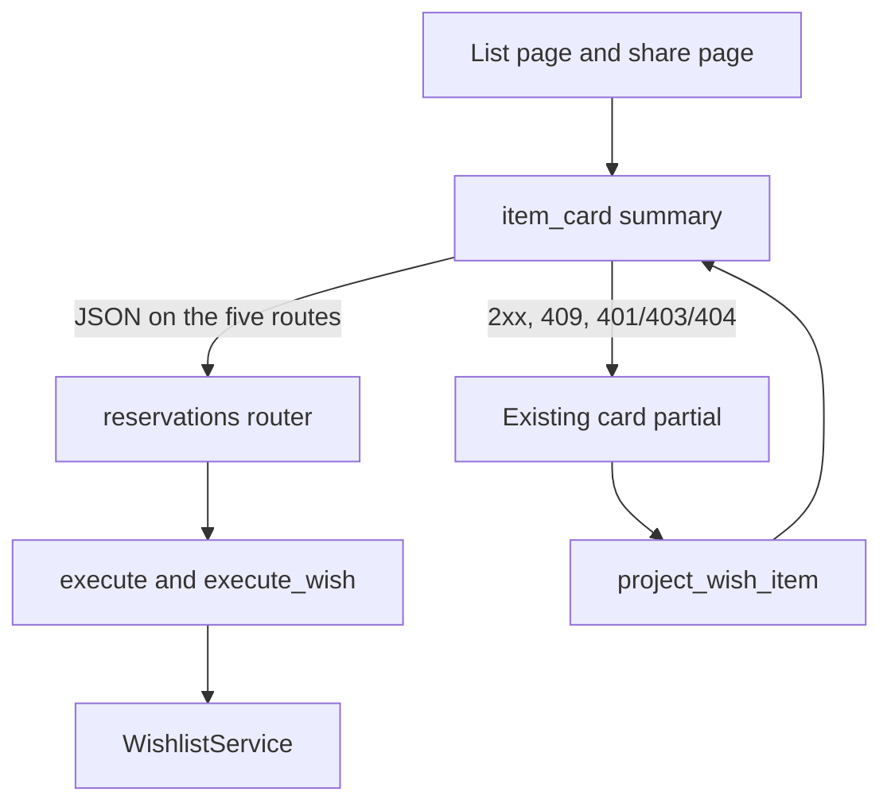

# WISHENKA-19: Giver controls on the existing wish card

## Research

### Card the gifter already sees

The wish card is `wishenka/web/templates/partials/item_card.html`. The list
page `GET /web/wishlists/{wishlist_id}` (`wishlist_detail.html`) and the
shared-link page `GET /share/{public_token}` (`share_wishlist.html`) both
include `partials/items_list.html`, which includes that card. The same
partial is also rendered by quick-add, edit, move, reorder, and restore in
`wishenka/web/routes/items_ui.py`, and by
`GET /wishlists/{wishlist_id}/items/{item_id}/card` in
`wishenka/web/routes/sharing.py`.

The compact summary stays on screen when the details open.
`item_card.html` always renders `.item-card-details` with `hidden` and
the summary with `aria-expanded="false"`. `toggleWishCard` in
`wishenka/web/templates/base.html` shows the details by clearing `hidden`
(`details.hidden = false`) and setting `aria-expanded="true"`. It ignores
clicks on `a`, `button`, `input`, `select`, `textarea`, and
`[data-no-toggle]`, so a control in the summary does not expand or
collapse the card. An `outerHTML` swap drops that runtime state. Copying
`aria-expanded` onto the new summary does not clear `hidden` on the new
details.

Today the summary has photo or placeholder, title, price, and badges. It
has no availability line and no booking action. The details, and only the
details, show one reservation badge when `item.is_recipient` is false:

- free remainder 0: «Забронировано»
- caller holds units and some remain free: «Забронировано вами (N)»
- otherwise: «Доступно: X из Y»

Those three branches are exclusive. A holder who took the last units loses
the own line. A holder who left units free loses the availability line.
Neither state has «Забронировать», a quantity select, «Изменить»,
«Отменить бронь», «Куплено», or «Вернуть в бронь».

Editor controls (edit, move, archive) stay in the details and depend on
`can_edit_wishlist`. They are not in the summary, so they leave the screen
when a refresh leaves the new details `hidden`. `can_edit_wishlist` is
`WishlistAccessPolicy.can_add_or_edit_item`,
not the settings flag `can_edit` on the wishlist DTO. The archive block
`partials/archived_items_section.html` is a title row plus restore. It is
not this card. `get_wishlist_view` projects archived rows only as
`WishItemRecipientViewDTO`, so the row has no reservation fields.

`miniapp.js` is a different shell. It lists wish titles and does not render
this card. This task does not add the cabinet there.

### Promise API this card must call

WISHENKA-18 already exposes five authenticated routes in
`wishenka/web/routes/reservations.py`. The prefix is
`/api/wishlists/{wishlist_id}/items/{item_id}/reservations`.

| Action | Method and path | Success |
| --- | --- | --- |
| Create | `POST` the prefix, body `{"quantity": N}` | 201 |
| Change | `PATCH /{reservation_id}`, same body | 200 |
| Cancel | `POST /{reservation_id}/cancel` | 200 |
| Mark bought | `POST /{reservation_id}/purchase` | 200 |
| Undo bought | `POST /{reservation_id}/undo-purchase` | 200 |

`ReservationQuantityDTO` accepts only `quantity` (`extra="forbid"`). The
body is JSON. An HTMX form's default url-encoded body is not that DTO.
HTMX 1.9.12 is already loaded from `unpkg` in `base.html`. The matching
`json-enc` extension encodes the form as JSON
([json-enc](https://v1.htmx.org/extensions/json-enc/)). `hx-swap="none"`
does not insert the response
([hx-swap](https://htmx.org/attributes/hx-swap/)).

`execute` in that router calls `WishlistStore.execute_wish` (`BEGIN
IMMEDIATE`). `InventoryBusyError` is HTTP 503. The detail is the exception
text and names no gifter. `InsufficientQuantityError` is HTTP 409. Create's
text is `Cannot reserve {quantity} units, available: {available}`. A larger
change says how many are available. Neither text names a gifter. A
recipient create is HTTP 403 `{"detail":"Cannot promise this wish"}`.
Quantity below 1 is HTTP 400. A missing session is HTTP 401.

The success body is `PromiseActionDTO`: the one row just changed, plus
`item` as `WishItemGifterViewDTO`. Top-level `quantity` and `status` are
that row. `item.my_reserved_quantity` is the combined occupying quantity.
The card must not paint itself from this JSON. The JSON is not HTML, and a
recipient must not receive booking facts in card content.

Cookie mutations without a bearer token need `Origin` and `X-CSRF-Token`
(`BrowserSecurityMiddleware`). `GET /api/auth/csrf` already issues the
token. Bearer calls skip that check. Existing card tests authenticate with
a bearer token.

### What the projection already knows

`project_wish_item` in `wishenka/wishlists/service.py` calls
`WishlistAccessPolicy.is_recipient`. A recipient gets
`WishItemRecipientViewDTO`, which has no availability or promise fields.
A non-recipient gets `WishItemGifterViewDTO`. Occupying rows are
`ACTIVE` and `PURCHASED`. Cancelled rows are omitted. Store loads order
reservations by `id ASC`, and the in-memory service appends on create, so
`user_reservations[-1]` is the highest id. That row supplies
`my_reservation_id` and `my_reservation_status`. `my_reserved_quantity` is
the sum. In the product, `ACTIVE` is the intended promise and `PURCHASED`
is the bought mark.

The gifter DTO does not carry the latest row's own quantity, and it does
not carry how many occupying promises the caller holds. The change control
must show the latest size, not the combined total. «Куплено» is added only
when that latest row is bought and it is the only occupying promise. Those
two integers have to be on the gifter projection. Adding fields with
defaults to a response model is a compatible extension of the existing
body, not a new route
([FastAPI response model](https://fastapi.tiangolo.com/tutorial/response-model/)).
The recipient model stays without them.

### Where the current recipient rule disagrees with the accepted story

`is_recipient` returns false as soon as `recipient_name` is non-empty,
before the personal-list owner check. On a personal list the owner is the
recipient of every wish. A display name does not change that, and it does
not make anyone else the recipient. With the current order, a personal-list
owner whose wish has only a display name is projected as a gifter, so the
card content includes availability, and `can_reserve_item` allows create.

On a collaborative list the same function already decides the recipient by
`recipient_user_id` only, after the display-name short-circuit. A name
alone does not match the caller. That part matches the accepted story.
The card and `create_reservation` both use this one predicate. The card
must not grow a second, template-only definition. Silence has to be the
recipient DTO, not a hidden block that still contains the words.

### Out of scope, confirmed in the tree

There is no giver form on the card, no sixth reservation route, and no
"My reservations" page in the wish-card templates. Home counter and cabinet
stay WISHENKA-20. Quantity math stays `available_quantity` on the wish
(`max(0, requested - received - occupied)`), which is WISHENKA-57.

## Implementation Plan

Keep the five WISHENKA-18 routes and the current card. Do not add a promise
route, a second balance, or a cabinet.

1. Adjust `WishlistAccessPolicy.is_recipient`, which `project_wish_item`
   and `can_reserve_item` already share. A missing user is not a recipient.
   On a personal list (`wishlist` is present and `is_collaborative` is
   false), the owner is the recipient of every wish, including when
   `recipient_name` or `recipient_user_id` is set. Otherwise the caller is
   the recipient only when `recipient_user_id` equals `telegram_id`. A
   display name is never compared to a user. Collaborative wishes stay
   per wish.
2. In `project_wish_item`, set two gifter-only fields from the same
   occupying list that already picks `user_reservations[-1]`:
   `my_latest_reservation_quantity` (that row's `quantity`, else 0) and
   `my_occupying_reservation_count` (the length, else 0). Defaults are 0
   so existing constructors keep working. Do not add them to the recipient
   DTO. Do not sort by `updated_at`.
3. Put one giver block in `.item-card-summary`, with `data-no-toggle`.
   Remove the exclusive badge from `.item-card-details`. Editor controls
   stay where they are. The archive title row is unchanged. Every render
   of `item_card.html` (list, share, card partial, quick-add, edit, move,
   reorder, restore) passes the same context: `viewer_identified`,
   `wishlist_active`, and the existing `can_edit_wishlist`. Reorder must
   not drop the block.
4. Wire the block to the existing routes with HTMX 1.9.12 `json-enc` for
   the quantity forms only. `hx-swap="none"`. On 201 or 200, discard the
   JSON and `GET` the existing card partial, then `outerHTML`-swap
   `#item-card-{id}`. The partial always renders `.item-card-details`
   with `hidden`. When the swapped card was expanded, set
   `aria-expanded="true"` on the new summary and clear `hidden` on the
   new details, so edit, move, and archive stay visible. Copying
   `aria-expanded` alone leaves the details hidden. On 409, re-GET that
   partial with `notice=shortage` or `notice=refused` and use the same
   swap. On 401, 403, or 404, re-GET with `notice=refused` and the same
   swap. Omit `notice` when the projection is `WishItemRecipientViewDTO`.
   On 503, do not replace the card and do not read `detail`. Show one
   fixed Russian sentence on the current card.
5. Load `GET /api/auth/csrf` when the viewer is identified, and set
   `X-CSRF-Token` on unsafe HTMX requests from these pages. Do not put the
   token in the HTML. Bearer tests stay valid without it.

### Failing repro for Step 3

File: `tests/test_wish_card_giver_controls.py`.

Module mark: `pytestmark = pytest.mark.timeout(30)`.

Harness: the same shape as `tests/test_wish_items_list_reorder_ui.py`.
`create_app` with a temp SQLite file, `SessionTokenService` bearer
headers, and seed through `app.state.domain_service`. No Telegram, no
second process, no live lock. Busy is a `monkeypatch` of
`wishlist_store.execute_wish` that raises `InventoryBusyError`, as in
`tests/test_reservation_actions_api.py`.

The tests assert the desired card. They fail on today's template and on
today's personal-list owner rule. They do not skip and they do not change
production code. Setup may call the existing promise API, because that API
already works. The failure is the card, or the owner create that the
shared predicate still allows.

1. Identified friend, personal list, requested quantity 3, nothing taken.
   `GET /web/wishlists/{id}` and `GET /share/{token}`. The summary of that
   card contains «Забронировать» and «Доступно: 3 из 3». The card contains
   that button once. A `select` named `quantity` offers 1, 2, and 3, with
   1 selected, and has no 0 and no value above 3. The book form posts JSON
   to the existing create route (`hx-post` that prefix, `hx-ext="json-enc"`,
   `hx-swap="none"`). Today the button and the select are absent, and the
   availability line is only inside the hidden details.
2. Requested quantity 1 and one unit free. «Забронировать» is present and
   there is no quantity `select`. Today the button is absent.
3. Personal-list owner, wish has `recipient_name` and no
   `recipient_user_id`. The card HTML contains none of «Доступно»,
   «Забронировано», «Забронировать», «Изменить», «Отменить бронь»,
   «Куплено», «Вернуть в бронь». `POST` create as that owner returns 403
   `{"detail":"Cannot promise this wish"}` and writes no row. Today the
   owner is projected as a gifter, the details show «Доступно», and create
   returns 201.
4. Collaborative list, three wishes for one caller: `recipient_user_id`
   of the caller, `recipient_user_id` of someone else, and only a display
   name equal to the caller's name. The addressed wish has none of the
   giver strings. The other two summaries contain «Забронировать». Today
   the button is absent on all three.
5. After the existing create API takes 1 of 3, the card contains both
   «Забронировано вами (1)» and «Доступно: 2 из 3». Today the `if/elif`
   shows only the own line.
6. One occupying promise, marked purchased through the existing purchase
   route, and it consumes the only unit. The card contains
   «Забронировано вами (1)» and the word «Куплено», and a control whose
   target is `/{reservation_id}/undo-purchase` labeled «Вернуть в бронь».
   It has no `/{reservation_id}/purchase` control. Today a full remainder
   of 0 shows only «Забронировано» and hides the own line.
7. Two occupying promises for the same caller (two creates through the
   existing API). The latest is purchased and an earlier one stays
   intended. The own line is «Забронировано вами (N)» with N the sum, and
   that line does not contain «Куплено». «Изменить», «Отменить бронь»,
   and «Вернуть в бронь» target the latest id. The change `select` is
   selected at the latest quantity, and its max is that quantity plus the
   free remainder. Today those controls do not exist. Do not treat a
   missing «Куплено» alone as success.
8. Anonymous `GET /share/{token}`: the summary contains «Доступно: X из Y»
   and does not contain «Забронировать». Today the line is not in the
   summary.
9. Remainder 0 for a gifter who holds nothing: the summary says
   «Забронировано» and has no «Забронировать». A direct create returns
   409, the body does not contain the other gifter's name, and the wish
   row is unchanged. Today «Забронировано» is not in the summary.
10. `execute_wish` raises `InventoryBusyError`. Create returns 503, `detail`
    does not contain the caller's name, and a following GET of the list
    still has no «Забронировано вами» and does not present the 503 body as
    the card. The book control remains. Today that control is absent, so
    the test is red. No second process.
11. After cancel of the only promise through the existing cancel route,
    the card's book control is a create (`POST` the collection), not a
    `PATCH` of the cancelled id. Today the control is absent.
12. Archive title row, as a guard in the same module: the archived section
    contains none of the giver labels. That guard can already pass. The
    module is still red because of the cases above.
13. Successful booking refresh of an expanded card. The page script reads
    `aria-expanded` on the old summary before `outerHTML`. When that value
    was `true`, the new summary stays `aria-expanded="true"` and the new
    `.item-card-details` does not have `hidden`, so the details are
    visible, including edit, move, and archive. When it was `false`, the
    new details stay `hidden`. Copying `aria-expanded` without clearing
    `hidden` does not pass: `item_card.html` always renders the details
    with `hidden`, and `toggleWishCard` shows them by clearing it. Today
    the script is absent, so the test is red. No browser is required; the
    assertion is the refresh procedure in the served page.
14. A recipient refresh contains no booking sentence. `GET` the card
    partial for a personal-list owner with `notice=refused` and with
    `notice=shortage`. The body contains none of «Бронь не изменилась»,
    «Свободно», «Доступно», «Забронировано», «Забронировать»,
    «Изменить», «Отменить бронь», «Куплено», or «Вернуть в бронь». The
    partial omits `notice` when the projection is
    `WishItemRecipientViewDTO`. The same `notice=refused` on a gifter
    card contains «Бронь не изменилась.» and names no other gifter.
    Recipient create is 403 `{"detail":"Cannot promise this wish"}`.
    Recipient cancel, change, purchase, and undo are 404
    `{"detail":"Resource not found"}`, because
    `_guard_reservation_mutation` raises `ReservationNotFoundError` for
    a recipient. Today the owner is projected as a gifter, so the silent
    card is red, and the gifter refusal sentence is absent.

Step 3 runs this file with the repository test target and confirms the
failure is the missing card behavior or the owner create, not an import
error or a fixture error. No browser is required. One giver block is in
the summary and none is in the details. An expanded card stays expanded
after a successful booking refresh, and its details are visible. A
recipient refresh omits `notice` and contains no booking sentence.

## Architecture

### Modules

- `item_card.html` holds one giver block in the summary, in Russian, and
  does not repeat it in the details.
- `base.html` loads `json-enc` for HTMX 1.9.12, sends the CSRF header on
  unsafe HTMX calls, and after `outerHTML` restores an expanded card:
  `aria-expanded="true"` on the new summary and `hidden` cleared on the
  new `.item-card-details`.
- The list page, the share page, the items UI, and the card partial pass
  `viewer_identified` and `wishlist_active` on every card render.
- `WishlistAccessPolicy.is_recipient` treats a personal owner as the
  recipient of every wish. On a collaborative list the recipient is
  `recipient_user_id` only.
- `project_wish_item` returns the recipient DTO or the gifter DTO. The
  gifter DTO includes the latest size and the occupying count.
- `reservations.py` keeps the five routes. 409 and 503 stay as they are.
- `WishlistService` and `execute_wish` keep the quantity rules and
  `BEGIN IMMEDIATE`.
- The archive section stays a title and restore.
- The cabinet and `miniapp.js` are not this task.

The pattern is the one the list already uses: server-rendered Jinja, HTMX
for the fragment, and a role DTO as the censorship boundary. FastAPI
`Depends` stays the way the user is injected. The card does not become a
second client of the database and does not compute a second remainder.

### Recipient and visibility

`project_wish_item` remains the only projection. After the predicate
change:

- Personal list, caller is the owner: recipient DTO for every wish. The
  card content has no availability line and no giver controls. A display
  name does not open that content.
- Personal list, any other identified user, and `recipient_user_id` is
  unset or is someone else: gifter DTO and giver controls, when the rest
  of the rules below allow them. If `recipient_user_id` is that user, they
  are the recipient of that wish.
- Collaborative list: recipient only when `recipient_user_id` matches.
  The same person can be silent on one wish and a gifter on the next. A
  display name never matches.
- No user: not a recipient. Availability line only. No promise controls.

Giver actions also require an identified caller, an active list
(`wishlist.status` is `active`), and, for «Забронировать» only, a wish that
is not archived and a free remainder of at least 1 and no occupying promise
of the caller. Editor permission is independent. A recipient who can edit
keeps edit, move, and archive, and does not get the giver block.

An archived wish is not an active card today. If this template is rendered
for one while the list is active, it does not offer «Забронировать».
Change, cancel, «Куплено», and «Вернуть в бронь» remain when the caller
holds an occupying promise. The archive title row does not gain any of
these. A list that is not active offers no giver actions, because create
and the four mutations are already refused there. The availability line
for a non-recipient still renders.

### One block

The block lives in the summary, so it is on screen while the card is
collapsed and while it is expanded. The details do not repeat it. Actions
do not navigate and do not call `toggleWishCard`.

Shared line, for every non-recipient, including a holder and an anonymous
viewer:

- Free remainder at least 1: «Доступно: X из Y». X is `available_quantity`
  and is never negative. Y is requested `quantity`, including after a
  receipt.
- Free remainder 0: «Забронировано». That includes a wish emptied by
  received units. Do not relabel receipt.

Own line, only when `is_reserved_by_me`:

- Always «Забронировано вами (N)», N = `my_reserved_quantity`.
- Append the word «Куплено» only when `my_occupying_reservation_count` is
  1 and `my_reservation_status` is `purchased`. Suggested visible text:
  `Забронировано вами (N) · Куплено`. Tests should require both the own
  sentence and the word, and require the word to be absent in every other
  occupying case.
- The availability line stays beside this line.

No control and no line names a gifter. The template does not render
`user_id`, names, or the reservation list.

### Controls and the routes they call

All of these use `hx-swap="none"` and `data-no-toggle`. Quantity forms use
`hx-ext="json-enc"` and a single field `quantity`, so the body is
`{"quantity": N}`.

- Identified non-recipient, active wish and list, remainder at least 1,
  and no occupying promise: «Забронировать» `POST`s the prefix.
- That remainder is greater than 1: a `select` offers 1 through the
  remainder, selected at 1, and that value is the create body.
- That remainder is 1: there is no `select`. The post sends 1.
- Occupying promise, and latest size plus remainder is greater than 1:
  a `select` offers 1 through that upper bound, selected at the latest
  size, and «Изменить» `PATCH`es `/{my_reservation_id}`.
- Occupying promise: «Отменить бронь» `POST`s
  `/{my_reservation_id}/cancel`.
- Latest status is `active`: «Куплено» `POST`s
  `/{my_reservation_id}/purchase`.
- Latest status is `purchased`: «Вернуть в бронь» `POST`s
  `/{my_reservation_id}/undo-purchase`.

`my_reservation_id` is the latest occupying id already on the gifter DTO.
The change select shows that row's quantity, not the combined N. There is
no option 0. Cancel is how a promise is dropped. The same submitted size
goes to the existing update, which leaves the quantity and does not clear
a purchase mark. Lowering a purchased promise still does not clear the
mark. That stays the service rule.

«Забронировать» is absent while any occupying promise remains. After a
cancel that leaves none, and when the remainder is at least 1, the
re-rendered card shows «Забронировать» as a create. It does not patch the
cancelled id. One success replaces the book control with the own-promise
controls because the new projection has `is_reserved_by_me`.

The card does not merge promises and does not list them. With more than
one occupying promise, N stays the sum, «Куплено» is not added, and every
control still uses the latest id. «Вернуть в бронь» clears only that
latest mark and does not free units. An earlier intended promise stays
intended.

### After the response

Success (201 or 200): do not insert `PromiseActionDTO`. `GET`
`/wishlists/{wishlist_id}/items/{item_id}/card` and swap
`#item-card-{id}` with `outerHTML`. Pass `is_first` and `is_last` as
query parameters so move buttons keep their disabled state. The partial's
`can_edit_wishlist` uses `can_add_or_edit_item`, the same function as the
list page. The gifter stays on the list. Fully booked cards stay in the
list.

`item_card.html` always renders `.item-card-details` with `hidden`.
`toggleWishCard` shows those details by clearing `hidden`. Edit, move,
and archive live only in the details. After `outerHTML`, copying
`aria-expanded` onto the new summary leaves the details hidden, so those
controls leave the screen. The swap restores the open state. When the old
summary was expanded, set `aria-expanded="true"` on the new summary and
clear `hidden` on the new `.item-card-details`. When it was collapsed,
leave `aria-expanded="false"` and leave `hidden` on the details. The 409
re-GET and the 401/403/404 re-GET use this same swap.

The partial renders `notice` only for `WishItemGifterViewDTO`. When the
projection is `WishItemRecipientViewDTO`, omit `notice`. The recipient
card stays free of booking words, including «Бронь не изменилась.».

409: the attempt changed nothing. Re-GET the partial so the last promise and
the current remainder are what the card shows. `notice=shortage` renders
«Бронь не изменилась. Свободно: X.» with X = `available_quantity`. Any
other 409 uses `notice=refused` and «Бронь не изменилась.» Do not echo
`detail` and do not name a holder. The shared availability line is still
the remainder against Y. A recipient projection omits both notices.

503: leave the current card in place, including its book control or its
own-promise controls. Set the fixed sentence «Желание занято, бронь не
изменилась. Повторите попытку.» Do not treat the response as a booking and
do not print `detail`. The gifter can submit the same control again.

401, 403, and 404: do not paint a success. Re-GET the partial with
`notice=refused`. A recipient create is 403
`{"detail":"Cannot promise this wish"}`. A recipient cancel, change,
purchase, or undo is 404 `{"detail":"Resource not found"}`, because
`_guard_reservation_mutation` raises `ReservationNotFoundError` when the
caller is the recipient. Do not copy either detail into the card. The
recipient projection omits `notice`, so that refresh contains no
«Бронь не изменилась.» and no other booking sentence. A gifter
projection still renders `notice=refused` as «Бронь не изменилась.».

The page script discards the JSON body in every branch. New card logs are
not required. The existing `wishenka.web.reservations` records stay the
mutation log and stay free of gifter names.

### Interfaces that stay

- Promise writes: the five routes and `ReservationQuantityDTO` /
  `PromiseActionDTO`. No new path, method, or action.
- Card read: the existing partial. New query keys are `notice`,
  `is_first`, and `is_last`. New template flags are `viewer_identified`
  and `wishlist_active`. `notice` is omitted when the projection is
  `WishItemRecipientViewDTO`.
- Gifter projection adds `my_latest_reservation_quantity: int = 0` and
  `my_occupying_reservation_count: int = 0`. Recipient projection adds
  nothing.
- Inventory writes stay `execute_wish`. The card does not open a
  transaction.

## Q&A

- **Why does the card not post to a new HTML route?** The accepted story
  uses the WISHENKA-18 routes. Those routes return JSON. `hx-swap="none"`
  plus the existing card partial keeps the mutation on that API and the
  pixels on the server-rendered card
  ([json-enc](https://v1.htmx.org/extensions/json-enc/),
  [hx-swap](https://htmx.org/attributes/hx-swap/)).
- **Why two new integers on the gifter DTO?** Combined quantity and latest
  status are already there. The change select needs the latest size, and
  the «Куплено» word needs the occupying count. The recipient DTO does not
  receive them. Adding response fields is compatible with the current
  model
  ([FastAPI response model](https://fastapi.tiangolo.com/tutorial/response-model/)).
- **Why change `is_recipient` instead of hiding a div?** A personal-list
  owner with a display name is projected as a gifter today, so the card
  content contains availability. Hiding a filled block does not meet the
  surprise rule. Create uses the same predicate, so the owner would still
  be able to promise. One predicate keeps the card and the route together.
- **Why is the block only in the summary?** The summary is visible in both
  card states. A second block in the details would be a conflicting set
  while both are on screen.
- **Why clear `hidden` after a successful refresh?** `item_card.html`
  always renders `.item-card-details` with `hidden`. `toggleWishCard`
  shows the details by clearing `hidden`. Edit, move, and archive live
  only there. `outerHTML` drops the open state. Copying `aria-expanded`
  onto the new summary leaves the details hidden.
- **Why omit `notice` on a recipient card?** `notice=refused` is
  «Бронь не изменилась.». A recipient create is 403 `Cannot promise this
  wish`. A recipient cancel, change, purchase, or undo is 404 because the
  mutation guard treats them as not found. The partial omits `notice`
  when the projection is `WishItemRecipientViewDTO`, so the recipient
  card stays free of booking words.
- **Why is «Куплено» not on the combined line?** The accepted rule adds
  that word only when the latest occupying promise is bought and it is the
  only one. «Вернуть в бронь» still targets that latest promise.
- **Where is the cabinet?** WISHENKA-20. This design does not add it, the
  home counter, or giver controls on the archive title row.
