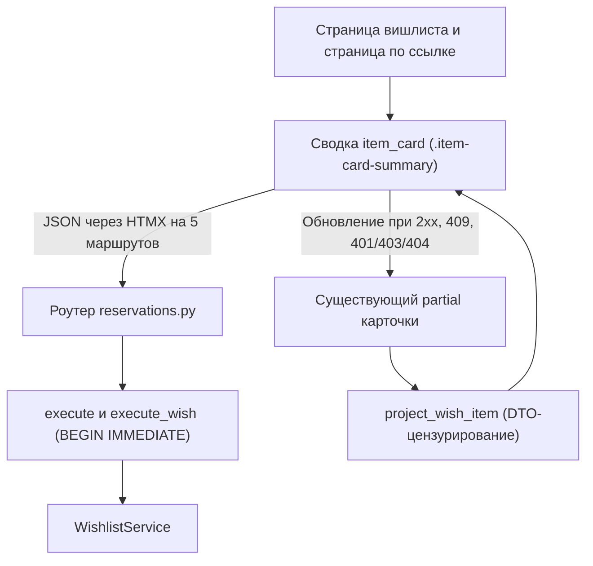
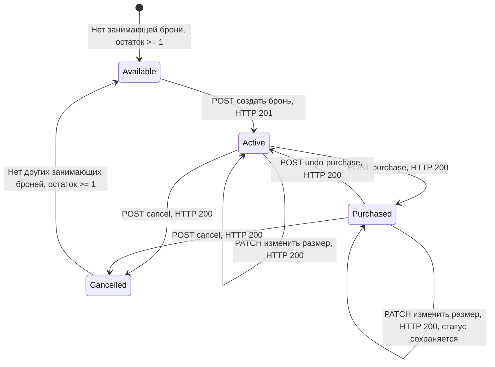

# Спецификация: WISHENKA-19 — Элементы управления бронированием для дарителя на карточке желания

**Задача:** WISHENKA-19  
**Статус:** реализованная и верифицированная спецификация (по этапам 1–8 Top-Down)  
**Платформа и стек:** Telegram Mini App (Python 3.12+, FastAPI, Jinja2, HTMX 1.9.12, SQLite WAL)  
**Связанные задачи:** `WISHENKA-15` (карточка желания и архив), `WISHENKA-18` (API обещаний), `WISHENKA-20` (кабинет «Мои бронирования»), `WISHENKA-57` (арифметика остатка), `WISHENKA-123` (техдолг по окну загрузки CSRF)

## 1. Назначение и бизнес-цель

### 1.1. Постановка проблемы

До выполнения `WISHENKA-19` в сервисе уже действовали серверные эндпоинты управления обещаниями (`WISHENKA-18`), защищённая транзакционная арифметика доступного остатка (`WISHENKA-57`) и фильтрация данных в проекции для получателя подарка. Однако серверно-рендеренная карточка желания в Mini App (на экране вишлиста и на странице публичной ссылки) не позволяла дарителю координировать покупки непосредственно в списке:

- в свёрнутой сводке карточки отображались только фотография (или заглушка), название, цена и базовые бейджи без сведений о доступности и без кнопок бронирования;
- в раскрытых деталях карточки не-получателю выводился только один взаимоисключающий статус (`«Забронировано»`, `«Забронировано вами (N)»` или `«Доступно: X из Y»`), из-за чего при полном разборе экземпляров держатель терял информацию о собственной броне, а при наличии свободных единиц — общий остаток для координации;
- на самой карточке отсутствовали элементы создания, выбора количества, изменения размера, отмены, отметки покупки и возврата в бронь;
- правило определения получателя (`WishlistAccessPolicy.is_recipient`) проверяло наличие текстового поля `recipient_name` раньше проверки владельца личного вишлиста, из-за чего владелец личного списка на желании с заполненным отображаемым именем ошибочно проецировался как даритель, видел статус доступности и мог забронировать собственный подарок.

### 1.2. Цели задачи

- Разместить на существующей карточке желания полный набор действий дарителя (бронирование, выбор количества, изменение, отмена, отметка `«Куплено»` и возврат в бронь), доступный как в свёрнутом, так и в развёрнутом состоянии карточки, без перехода на отдельный экран и без лишних диалогов подтверждения.
- Обеспечить одновременное отображение общей доступности (`«Доступно: X из Y»` или `«Забронировано»`) и собственной брони (`«Забронировано вами (N)»`, с добавлением `«Куплено»` строго в случае единственного купленного обещания) для координации дарителей при сохранении тайны чужих броней.
- Закрыть пробел в правиле получателя на личных вишлистах и гарантировать абсолютную информационную тишину на карточке получателя, включая подавление любых уведомлений о бронировании при обновлении фрагмента.
- Переиспользовать существующие маршруты обещаний (`WISHENKA-18`) и расчёт остатка (`WISHENKA-57`), не дублируя бизнес-логику и не вторгаясь в область соседних задач.

### 1.3. Ценность для пользователей и системы

- **Для дарителей:** возможность сразу со страницы вишлиста (в том числе открытой по публичной ссылке) забронировать нужное число экземпляров, увидеть остаток, скорректировать свою бронь, отменить её или исправить ошибочную отметку `«Куплено»`.
- **Для получателей и соавторов:** гарантированное сохранение эффекта сюрприза на личных списках (для всех желаний владельца) и на совместных списках (по конкретному получателю каждого желания) без утраты авторских прав редактирования.
- **Для архитектуры сервиса:** отсутствие дублирования транзакционного слоя, второй модели баланса и новых маршрутов записи; все изменения локализованы в существующей проекции, шаблонах карточки и обвязке partial-обновления.

## 2. Функциональные требования и пользовательские сценарии

### 2.1. Ролевая модель и правило получателя (инвариант тайны сюрприза)

Разграничение видимости опирается на единую серверную проекцию и общее правило получателя (`WishlistAccessPolicy.is_recipient`):

- **Личный вишлист (`is_collaborative = False`):** владелец списка является получателем **каждого** желания независимо от того, заполнены ли `recipient_name` или `recipient_user_id`. На карточках такого списка владелец не видит строку доступности, собственные брони и элементы управления дарителя, а попытка создать бронь отклоняется. Любой другой идентифицированный пользователь (если его `telegram_id` не указан в `recipient_user_id` конкретного желания) получает роль дарителя.
- **Совместный вишлист (`is_collaborative = True`):** получатель определяется индивидуально для каждого желания исключительно по совпадению `recipient_user_id` с `telegram_id` вызывающего пользователя. Текстовое имя `recipient_name` само по себе никого не делает получателем. Один и тот же участник или соавтор может видеть элементы дарителя на желаниях для других людей и полную тишину на желаниях, адресованных ему самому.
- **Анонимный посетитель (по публичной ссылке):** не считается получателем; видит только общую строку доступности (`«Доступно: X из Y»` или `«Забронировано»`), но не получает кнопки бронирования и не может создать обещание (анонимное бронирование без Telegram-идентификации запрещено; отдельной анкеты профиля не требуется).
- **Независимость от прав редактирования:** наличие элементов дарителя не зависит от `can_edit_wishlist`. Гость с публичной ссылки, прошедший идентификацию и не являющийся получателем, получает элементы дарителя; соавтор-получатель сохраняет кнопки редактирования, перемещения и архивации в раскрытых деталях, но не получает блок дарителя.
- **Строгость сокрытия:** сведения о бронировании исключаются из самого HTML-содержимого карточки получателя на сервере (скрытие через CSS или пользовательский переключатель недопустимо).

### 2.2. Статусы на карточке желания

Все сведения и элементы дарителя располагаются в одном блоке внутри сводки карточки (`.item-card-summary`), поэтому видны и в свёрнутом, и в раскрытом виде без дублирования в деталях:

- **Общая строка доступности** (отображается каждому не-получателю, включая держателя собственной брони и анонимного посетителя):
  - если свободный остаток `X >= 1`, отображается `«Доступно: X из Y»`, где `X = available_quantity = max(0, requested - received - occupied)` (неотрицательный остаток), а `Y = quantity` (запрошенное количество; остаётся полным значением `quantity` даже после частичного получения подарка);
  - если `X = 0` (в том числе когда остаток обнулён с учётом полученных экземпляров), отображается `«Забронировано»`;
  - строка не раскрывает личности других дарителей и факт отметки покупки по чужим броням.
- **Собственная строка держателя** (отображается только при наличии у вызывающего пользователя хотя бы одного занимающего обещания со статусом `ACTIVE` или `PURCHASED`; отменённые обещания не занимают единицы):
  - всегда имеет вид `«Забронировано вами (N)»`, где `N` (`my_reserved_quantity`) — суммарное количество единиц по всем занимающим обещаниям текущего пользователя для этого желания;
  - слово `«Куплено»` добавляется (в виде `Забронировано вами (N) · Куплено`) **только тогда**, когда последнее занимающее обещание имеет статус `purchased` **и** оно является единственным занимающим обещанием пользователя (`my_occupying_reservation_count == 1`);
  - если у пользователя более одного занимающего обещания (даже если последнее или все они отмечены купленными), слово `«Куплено»` к суммарной строке не добавляется;
  - выводится совместно со строкой общей доступности, а не вместо неё.

### 2.3. Правила действий дарителя и выбора количества

| Действие / элемент | Условие отображения | Поведение и ограничения |
| --- | --- | --- |
| `«Забронировать»` | Идентифицированный не-получатель; активный список (`active`) и неархивное желание; `available_quantity >= 1`; у пользователя нет занимающих обещаний | Немедленное создание обещания без диалога подтверждения и одобрения автора. При `available_quantity > 1` рядом выводится селектор `quantity` (`1..available_quantity`, по умолчанию `1`); при `available_quantity == 1` селектор скрыт и отправляется `1`. Ноль и значения выше остатка недоступны. После успеха заменяется элементами управления своей бронью. |
| `«Изменить»` + селектор `quantity` | Идентифицированный не-получатель; активный список; есть занимающее обещание; `my_latest_reservation_quantity + available_quantity > 1` | Применяется строго к **последнему** занимающему обещанию. Селектор содержит целые числа от `1` до `my_latest_reservation_quantity + available_quantity`; предвыбран размер последнего обещания (не сумма `N`). Значение `0` отсутствует. Уменьшение освобождает единицы; уменьшение купленного обещания не снимает отметку покупки; повторная отправка того же числа оставляет обещание без изменений. При верхней границе `1` кнопка и селектор не показываются. |
| `«Отменить бронь»` | Идентифицированный не-получатель; активный список; есть занимающее обещание | Немедленно без подтверждения отменяет последнее занимающее обещание и освобождает его единицы. Если после отмены у пользователя не остаётся занимающих обещаний и `available_quantity >= 1`, карточка вновь показывает `«Забронировать»` (создающее новое обещание, а не меняющее отменённое). |
| `«Куплено»` | То же + статус последнего обещания `active` | Немедленно отмечает последнее обещание как `purchased` без освобождения единиц. Другим дарителям не показывается. |
| `«Вернуть в бронь»` | То же + статус последнего обещания `purchased` | Немедленно возвращает последнее обещание в статус `active` (задуманное) без освобождения единиц. При наличии более раннего задуманного обещания оно остаётся задуманным. |

Дополнительные функциональные правила:

- **Множественные обещания одного дарителя:** карточка не объединяет существующие обещания и не выводит их списком; суммарное количество `N` показывается в собственной строке, а все кнопки (`«Изменить»`, `«Отменить бронь»`, `«Куплено»`, `«Вернуть в бронь»`) действуют на последнее обещание. Вторая кнопка `«Забронировать»` при наличии любого занимающего обещания не выводится.
- **Неактивные и архивные сущности:** на архивном или удалённом списке действия дарителя не предлагаются (остаётся строка доступности). Строка в секции архива (`partials/archived_items_section.html`) сохраняет только название и восстановление. Если `item_card.html` рендерится для архивного желания в активном списке, `«Забронировать»` не предлагается, а управление имеющейся бронью (`«Изменить»`, `«Отменить бронь»`, `«Куплено»`, `«Вернуть в бронь»`) остаётся доступным.
- **Полностью разобранные и полученные желания:** полностью забронированные желания остаются в списке; фиксация получения уменьшает `X`, но не закрывает обещания и не удаляет кнопки их держателя; отдельный ярлык «все получено» не вводится.

### 2.4. Внутристраничное обновление и обработка ответов

- Выполнение любого действия не уводит пользователя со списка и не переключает раскрытость/свёрнутость карточки.
- После успешной мутации (`200` / `201`) карточка обновляется на месте: показывает актуальные остаток и собственную бронь, а если до нажатия детали были раскрыты, после замены они остаются раскрытыми вместе с редакторскими кнопками.
- При отказе по дефициту остатка (`409`, тело содержит `available`) карточка перечитывается с выводом уведомления `«Бронь не изменилась. Свободно: X.»` (где `X = available_quantity`), без имён других дарителей.
- При иных отказах (`409` без `available`, `401`, `403`, `404`) карточка перечитывается и (только в проекции дарителя) отображает `«Бронь не изменилась.»`; в проекции получателя уведомление полностью подавляется.
- При конкурентной блокировке (`503`) карточка на экране не заменяется, текущие кнопки сохраняются, а на карточке выводится фиксированная фраза `«Желание занято, бронь не изменилась. Повторите попытку.»` с возможностью повторить действие без потери единиц.

### 2.5. Пользовательские сценарии

- **Первичное бронирование (1 или несколько единиц):** даритель открывает чужой список или публичную ссылку, видит `«Доступно: 3 из 3»`, при необходимости выбирает число в селекторе `1..3` на свёрнутой или раскрытой карточке и нажимает `«Забронировать»` — карточка сразу обновляется на `«Забронировано вами (1)»` и `«Доступно: 2 из 3»` (или `«Забронировано»` при исчерпании остатка).
- **Корректировка, покупка, возврат и отмена:** держатель брони меняет количество через `«Изменить»`, отмечает покупку через `«Куплено»` (строка становится `«Забронировано вами (N) · Куплено»` при единственном обещании), при ошибке нажимает `«Вернуть в бронь»` или освобождает единицы кнопкой `«Отменить бронь»` с возвратом `«Забронировать»`.
- **Соавтор совместного списка:** на одном и том же экране соавтор видит блок дарителя и `«Забронировать»` на желании друга (включая желание с простым текстовым `recipient_name`), а на желании, где он указан по `recipient_user_id`, — только редакторские действия без сведений о бронях.
- **Владелец личного списка с `recipient_name`:** на всех желаниях своего списка (даже с текстовым именем получателя) владелец видит только детали желания и кнопки редактора; прямой API-вызов создания брони возвращает `403`.
- **Анонимный просмотр по ссылке:** пользователь без сессии на странице `/share/{public_token}` видит актуальную строку `«Доступно: X из Y»` или `«Забронировано»` без кнопок действия.
- **Конкурентный конфликт или занятость:** при перехвате последнего экземпляра другим другом карточка дарителя обновляет остаток и показывает `«Бронь не изменилась. Свободно: X.»`; при временной блокировке SQLite (`503`) даритель видит `«Желание занято, бронь не изменилась. Повторите попытку.»` и может сразу повторить клик.

### 2.6. Границы функциональности (Out of Scope)

В рамках `WISHENKA-19` сознательно не реализуются:

- раздел «Мои бронирования», счётчик активных броней на главной странице и управление бронями на ушедших в архив карточках (`WISHENKA-20`);
- новые маршруты API обещаний или изменение формулы расчёта остатка (`WISHENKA-18`, `WISHENKA-57`);
- изменение логики архивации, удаления, ручной сортировки карточек и отдельной оболочки `miniapp.js` (`WISHENKA-15`);
- экран/логика отметки получения подарков, тексты уведомлений в боте, каталог переводов интерфейса (текущая карточка использует русскую локаль), платежи/складчина и идентификация получателя без аккаунта Telegram по текстовому имени.

## 3. Архитектура, компоненты и интерфейсы

### 3.1. Архитектурная схема и поток данных

Решение построено по существующему для списков паттерну: серверный рендеринг Jinja2 с фрагментарным обновлением через HTMX 1.9.12 и строгой границей приватности на уровне DTO-проекции. Карточка не вводит собственного хранилища, не открывает транзакций БД и не вычисляет второй остаток — мутации выполняются через существующие JSON-маршруты `WISHENKA-18`, после чего карточка перерисовывается с помощью существующего partial-эндпоинта.

### 3.2. Модули, компоненты и ответственность

| Модуль / шаблон | Ключевые символы и изменения | Ответственность |
| --- | --- | --- |
| `wishenka/wishlists/service.py` | `WishlistAccessPolicy.is_recipient`, `project_wish_item`, `get_wishlist_view`, `can_reserve_item` | Исправлен порядок в `is_recipient`: при отсутствии пользователя возвращается `False`; на личном вишлисте (`wishlist` задан и `is_collaborative` ложно) владелец является получателем каждого желания (включая случаи заполненного `recipient_name` или `recipient_user_id`); иначе получатель определяется только по `recipient_user_id == telegram_id` без сопоставления по `recipient_name`. `project_wish_item` выбирает последнее занимающее обещание `user_reservations[-1]` (в порядке хранилища `id ASC` и добавления в память, без сортировки по `updated_at`) и заполняет новые поля `WishItemGifterViewDTO`. `get_wishlist_view` для архивных строк по-прежнему возвращает `WishItemRecipientViewDTO`. |
| `wishenka/web/routes/reservations.py` | `execute`, `_guard_reservation_mutation`, `create_reservation`, `update_reservation_quantity`, `cancel_reservation`, `purchase_reservation`, `undo_reservation_purchase` | Пять существующих маршрутов под префиксом `/api/wishlists/{wishlist_id}/items/{item_id}/reservations` остаются без изменений. Вся запись идёт через `WishlistStore.execute_wish` (`BEGIN IMMEDIATE`). |
| `wishenka/web/routes/sharing.py` | `get_item_card_partial`, страницы `GET /web/wishlists/{wishlist_id}` и `GET /share/{public_token}` | Передают единые флаги контекста карточки (`viewer_identified`, `wishlist_active`, `can_edit_wishlist` через `WishlistAccessPolicy.can_add_or_edit_item`). `get_item_card_partial` (`GET /wishlists/{wishlist_id}/items/{item_id}/card`) принимает query-параметры `notice`, `is_first`, `is_last` и подавляет `notice` при проекции `WishItemRecipientViewDTO`. |
| `wishenka/web/routes/items_ui.py` | `_editor_card_flags`, `_ensure_member_and_active` | При рендере карточки из действий быстрого добавления, редактирования, перемещения, сортировки и восстановления передаёт тот же набор флагов (`_editor_card_flags` передаёт `viewer_identified=True` и `wishlist_active=True` после проверки `_ensure_member_and_active`). |
| `wishenka/web/templates/partials/item_card.html` | Блок дарителя в `.item-card-summary`, `data-no-toggle`, локали `bought_mark`, `undo_path`, `item_web` | Единственный блок дарителя помещён в `.item-card-summary`; взаимоисключающий бейдж удалён из `.item-card-details`; редакторские кнопки оставлены в деталях; позиция (`is_first`, `is_last`) передаётся через `data-*`-атрибуты (страница ссылки не содержит имён редакторских контролов). Использует `hx-ext="json-enc"`, `hx-swap="none"`, `hx-include="closest form"` на `«Изменить»` и `` для чистого форматирования `· Куплено`. |
| `wishenka/web/templates/base.html` | Подключение `json-enc`, `toggleWishCard`, обработчик `htmx:configRequest`, логика refresh-замены и CSRF | Загружает `json-enc` для HTMX 1.9.12; при `data-viewer-identified` на `DOMContentLoaded` запрашивает `GET /api/auth/csrf` и добавляет `X-CSRF-Token` к небезопасным HTMX-запросам; отбрасывает JSON ответов API обещаний, перезапрашивает partial карточки с `is_first`/`is_last`, сохраняет открытость (выставляя `aria-expanded="true"` и очищая `hidden` на `.item-card-details`) или выводит фиксированное сообщение при `503`. |

### 3.3. Контракты API и моделей данных

#### Маршруты обещаний (`/api/wishlists/{wishlist_id}/items/{item_id}/reservations`)

| Действие | Метод и путь | Тело запроса | Успех | Ошибки |
| --- | --- | --- | --- | --- |
| Создание | `POST` на префикс | `ReservationQuantityDTO` (`{"quantity": N}`, `extra="forbid"`) | `201` (`PromiseActionDTO`) | `400` (`quantity < 1`), `401`, `403` (получатель: `Cannot promise this wish`; или CSRF/доступ), `409` (`InsufficientQuantityError` и др.), `503` (`InventoryBusyError`) |
| Изменение | `PATCH /{reservation_id}` | `ReservationQuantityDTO` (`{"quantity": N}`, `extra="forbid"`) | `200` (`PromiseActionDTO`) | `400`, `401`, `403`, `404` (`Resource not found`, в т. ч. для получателя через `_guard_reservation_mutation`), `409`, `503` |
| Отмена | `POST /{reservation_id}/cancel` | — | `200` (`PromiseActionDTO`) | `401`, `403`, `404`, `409`, `503` |
| Отметка покупки | `POST /{reservation_id}/purchase` | — | `200` (`PromiseActionDTO`) | `401`, `403`, `404`, `409`, `503` |
| Возврат в бронь | `POST /{reservation_id}/undo-purchase` | — | `200` (`PromiseActionDTO`) | `401`, `403`, `404`, `409`, `503` |

#### Проекции и контекст шаблона

- `WishItemRecipientViewDTO`: не содержит сведений о доступности и бронировании; новые поля дарителя на неё не добавляются.
- `WishItemGifterViewDTO`: сохраняет существующие поля (`available_quantity`, `quantity`, `is_reserved_by_me`, `my_reserved_quantity`, `my_reservation_id`, `my_reservation_status` и др.) и расширяется двумя совместимыми полями со значениями по умолчанию `0`:
  - `my_latest_reservation_quantity: int = 0` — размер последнего занимающего обещания;
  - `my_occupying_reservation_count: int = 0` — количество занимающих обещаний вызывающего пользователя.
- `GET /wishlists/{wishlist_id}/items/{item_id}/card`: принимает параметры `notice` (`shortage` | `refused`), `is_first`, `is_last`; контекст шаблона включает `viewer_identified`, `wishlist_active`, `can_edit_wishlist`.

### 3.4. Переходы состояний и клиентская обработка ответов

Правила клиентской обработки ответа после вызова любого из пяти маршрутов:

- **HTTP `200` / `201`:** JSON `PromiseActionDTO` отбрасывается; считываются `aria-expanded` текущей `.item-card-summary` и `data-*`-атрибуты позиции, запрашивается `GET /wishlists/{wishlist_id}/items/{item_id}/card?is_first=...&is_last=...` с `outerHTML`-заменой `#item-card-{id}`. Если до замены `aria-expanded === "true"`, на новой сводке выставляется `aria-expanded="true"`, а с нового `.item-card-details` снимается атрибут `hidden`.
- **HTTP `409`:** при наличии подстроки `available` в теле ответа запрашивается partial с `notice=shortage` (`«Бронь не изменилась. Свободно: X.»`), иначе — с `notice=refused` (`«Бронь не изменилась.»`), с тем же восстановлением раскрытого состояния.
- **HTTP `401`, `403`, `404`:** запрашивается partial с `notice=refused` и тем же механизмом замены (на карточке получателя `notice` не рендерится).
- **HTTP `503`:** замена карточки не выполняется, тело `detail` не отображается; на существующей карточке выставляется `«Желание занято, бронь не изменилась. Повторите попытку.»`.

## 4. Нефункциональные требования, безопасность и наблюдаемость

### 4.1. Производительность, транзакционность и зависимости

- Отдельные целевые показатели задержки (SLA/SLO) не вводятся; время отклика остаётся на уровне существующего чтения списка и одиночной транзакции записи.
- Все мутации обещаний сериализуются на уровне SQLite через `WishlistStore.execute_wish` (`BEGIN IMMEDIATE`); фрагмент карточки не открывает транзакций и не делает дополнительных запросов к БД.
- При загрузке страницы с `data-viewer-identified` выполняется один фоновый `GET /api/auth/csrf`.
- При каждом завершённом действии (кроме `503`) выполняется ровно один `GET`-запрос partial-шаблона карточки.
- Расширение `json-enc` подключается с `https://unpkg.com/htmx.org@1.9.12/dist/ext/json-enc.js` (единый источник и версия с HTMX 1.9.12 в `base.html`).

### 4.2. Безопасность, валидация и конфиденциальность

- **Аутентификация и CSRF:** пользователь определяется через `FastAPI Depends` (`SessionTokenService`: Bearer-токен или браузерная cookie-сессия). Небезопасные cookie-запросы защищаются `BrowserSecurityMiddleware` (проверка `Origin` и `X-CSRF-Token`). CSRF-токен не встраивается в HTML-разметку и получается через `GET /api/auth/csrf`.
- **Валидация ввода:** `ReservationQuantityDTO` запрещает лишние поля (`extra="forbid"`) и отвергает значения `< 1` (`400`); интерфейсные селекторы ограничены допустимым диапазоном (`1..available_quantity` или `1..(latest + available_quantity)`).
- **Защита тайны сюрприза и сокрытие технических деталей:**
  - получатель (включая владельца личного вишлиста при наличии `recipient_name`) изолирован на уровне DTO (`WishItemRecipientViewDTO`) и подавления `notice` в `get_item_card_partial`;
  - тексты `detail` из API (`Cannot promise this wish`, `Resource not found`, `Cannot reserve ...`, `InventoryBusyError`) никогда не выводятся пользователю;
  - ни HTML карточки, ни сообщения об ошибках не содержат `user_id`, имён дарителей или списка чужих обещаний;
  - страница публичной ссылки `/share/{public_token}` не содержит в клиентском скрипте имён редакторских элементов управления.

### 4.3. Наблюдаемость: логирование и метрики

- **Принцип отсутствия новых записей:** новые серверные логи и метрики для карточки не добавлялись, так как обновление partial-шаблона или клиентское сообщение при `503` лишь отображают результат записи, а логирование `notice`, HTML или `viewer` на `GET .../card` создало бы риск раскрытия факта бронирования для получателя.
- **Существующие структурированные логи** (библиотека `wishenka.logging.configure_logging`, `extra={"event": ...}`, поддержка текстового и JSON-вывода через `json_logs`):
  - **Запись обещания (`wishenka.web.reservations` из `execute` в `wishenka/web/routes/reservations.py`):**
    - `INFO` `reservation_action_completed` — при `200`/`201` (контекст: `operation` — имя функции маршрута, `item_id`, `reservation_id`, `status`);
    - `WARNING` `reservation_action_refused` — при фиксированном `403` на создании и `404` (`http_status`, `operation`, `item_id`/`reservation_id`);
    - `WARNING` `reservation_permission_denied` — при `403 Forbidden`;
    - `WARNING` `reservation_conflict` — при `409` (включая дефицит остатка для `notice=shortage`);
    - `WARNING` `reservation_validation_error` — при `400`;
    - `WARNING` `reservation_inventory_busy` — при `503` (соответствует клиентской фразе занятости).
  - **Хранилище (`wishenka.wishlists.store`):** `wishlist_inventory_committed`, `wishlist_inventory_busy`, `wishlist_inventory_rolled_back`, а при не-busy сбоях БД — `ERROR` с пробросом `RuntimeError`.
  - **Аутентификация (`wishenka.auth`):** `auth_failure` (`missing_credentials` или `invalid_session_token`).
  - **Санитизация логов:** события не содержат `gifter_id`, `recipient_id`, имён пользователей, дампов строк БД, текста драйвера, SQL, сессионных токенов, тела запроса или вложенного представления желания.
- **Метрики и интеграции:** экспортёр метрик (Prometheus, Grafana, алертинг) в сервисе отсутствует и в этой задаче не добавлялся; подсчёт успехов, отказов и блокировок осуществляется по существующим логам `wishenka.web.reservations`.

## 5. Верификация и критерии приёмки

### 5.1. Тестовые сценарии и результаты проверок

Основной модуль автоматизированной проверки карточки дарителя — `tests/test_wish_card_giver_controls.py` (`pytestmark = pytest.mark.timeout(30)`), использующий `create_app` с временным файлом SQLite, Bearer-аутентификацию через `SessionTokenService`, инициализацию данных через `app.state.domain_service` и подмену `wishlist_store.execute_wish` для имитации `InventoryBusyError`.

Покрытые сценарии:

1. **Идентифицированный даритель на личном вишлисте (`3` из `3`):** на `/web/wishlists/{id}` и `/share/{token}` в сводке присутствуют одна кнопка `«Забронировать»`, `«Доступно: 3 из 3»`, селектор `quantity` с вариантами `1..3` (`1` выбрано, без `0` и `> 3`) и форма с `hx-post`, `hx-ext="json-enc"`, `hx-swap="none"`.
2. **Единственная единица (`1` из `1`):** присутствует `«Забронировать»`, селектор `quantity` не рендерится.
3. **Владелец личного вишлиста с заполненным `recipient_name`:** карточка не содержит ни одной строки и кнопки дарителя; `POST` создания от владельца возвращает `403` `{"detail":"Cannot promise this wish"}` без записи в БД.
4. **Совместный вишлист (3 желания для одного пользователя):** адресованное пользователю по `recipient_user_id` скрывает блок дарителя; желания для другого `recipient_user_id` и с совпадающим только `recipient_name` показывают `«Забронировать»`.
5. **Совместное отображение статусов (`1` из `3`):** карточка одновременно содержит `«Забронировано вами (1)»` и `«Доступно: 2 из 3»`.
6. **Единственное купленное обещание (остаток `0`):** карточка содержит `«Забронировано вами (1)»`, слово `«Куплено»` и кнопку `«Вернуть в бронь»` (`/{reservation_id}/undo-purchase`), без кнопки `/purchase`.
7. **Несколько занимающих обещаний (`> 1`), последнее куплено, раннее задуманное:** отображается суммарное `«Забронировано вами (N)»` без слова `«Куплено»`; `«Изменить»`, `«Отменить бронь»` и `«Вернуть в бронь»` нацелены на последний `reservation_id`; селектор изменения предвыбран на размер последнего обещания с максимумом `latest + available`.
8. **Анонимный посетитель на `/share/{token}`:** в сводке есть `«Доступно: X из Y»` и нет `«Забронировать»`.
9. **Остаток `0` для стороннего дарителя:** в сводке выводится `«Забронировано»` без `«Забронировать»`; прямой `POST` возвращает `409` без имени держателя и не меняет запись.
10. **Занятость желания (`InventoryBusyError`):** `POST` возвращает `503` без имени пользователя, последующий `GET` списка не показывает `«Забронировано вами»` и тело `503`, сохраняя `«Забронировать»`.
11. **Состояние после отмены единственной брони:** карточка вновь рендерит `«Забронировать»` как `POST` коллекции, а не `PATCH` отменённого `id`.
12. **Секция архивных желаний:** строка заголовка архива не содержит меток и кнопок дарителя.
13. **Сохранение раскрытого состояния (`test_expanded_refresh_clears_hidden`):** клиентский скрипт страницы проверяется на чтение `aria-expanded` перед `outerHTML`-заменой и снятие `hidden` с нового `.item-card-details` при `true` (с сохранением видимости кнопок редактирования, перемещения и архивации), либо оставление `hidden` при `false`.
14. **Обновление карточки получателя с `notice=refused` и `notice=shortage`:** фрагмент для владельца личного списка не содержит `«Бронь не изменилась»`, `«Свободно»` и любых других слов бронирования (параметр `notice` опущен), тогда как для дарителя `notice=refused` выводит `«Бронь не изменилась.»` без имён других дарителей; подтверждены `403` на создание и `404` на мутации получателя.

Зафиксированные результаты проверок после финальной правки шаблонов:

- **`make analyze`:** Ruff lint, Ruff format check (`80` файлов) и Mypy (`80` исходных файлов) — без замечаний.
- **Точечный запуск pytest (`tests/test_wish_card_giver_controls.py` и `tests/test_wishlist_roles_lifecycle.py`):** `39 passed`; все собранные тестовые модули в `tests/` снабжены явными маркерами `pytest.mark.timeout`. Полный прогон всего набора тестов проекта на этапе cleanup не перезапускался.

### 5.2. Критерии приёмки (Definition of Done)

Задача считается принятой при одновременном выполнении всех условий:

1. Идентифицированный не-получатель может немедленно забронировать положительное целое число единиц с карточки активного желания в активном списке; владелец личного списка является получателем каждого желания и не видит доступность или кнопки даже при заданном `recipient_name`.
2. Бронирование и управление своей бронью доступны как на свёрнутой, так и на раскрытой карточке без перехода со списка, без переключения открытости и без дублирования элементов управления.
3. При доступном остатке `> 1` выбор количества ограничен диапазоном `1..available_quantity` (по умолчанию `1`); при остатке `1` кнопка сразу бронирует `1` единицу без селектора.
4. Любой не-получатель видит `«Доступно: X из Y»` (`X >= 1`) или `«Забронировано»` (`X = 0`) рядом со строкой своей брони, без раскрытия имён или статуса покупки чужих броней.
5. Держатель занимающей брони видит `«Забронировано вами (N)»` (сумма `N`) с кнопками `«Отменить бронь»`, `«Куплено»` / `«Вернуть в бронь»` и `«Изменить»` (при допустимом другом размере) в обоих состояниях карточки и без второй кнопки `«Забронировать»`.
6. Изменение размера действует только на последнее обещание (в селекторе показан его текущий размер, диапазон `1..(latest + available)`, ноль запрещён, уменьшение купленной брони сохраняет статус `purchased`).
7. `«Куплено»` и `«Вернуть в бронь»` не освобождают единицы; слово `«Куплено»` добавляется в строку только когда последнее обещание куплено и оно единственное занимающее; `«Вернуть в бронь»` действует на последнее обещание, оставляя более раннее задуманное обещание задуманным.
8. При нескольких занимающих обещаниях строка остаётся `«Забронировано вами (N)»` без `«Куплено»`, действия направлены на последнее обещание, слияние и перечень обещаний на карточке отсутствуют.
9. Карточка получателя не содержит доступности, собственных броней, кнопок управления и уведомлений (`notice` при обновлении опускается); в совместном списке правило действует по конкретному желанию (`recipient_user_id` без сопоставления по имени).
10. Отказ оставляет неизменными последнее обещание и баланс: дефицит выводит `«Бронь не изменилась. Свободно: X.»` без имён, прочие отказы дарителю — `«Бронь не изменилась.»`, а `503` сохраняет карточку с текстом `«Желание занято, бронь не изменилась. Повторите попытку.»` и возможностью повтора.
11. После успешного действия карточка обновляется на месте с сохранением раскрытого состояния и восстановлением кнопки `«Забронировать»` (создание нового обещания) после полной отмены при остатке `>= 1`.
12. Полностью забронированные желания остаются в списке; редакторские элементы, архивация, удаление и отметка получения не изменены.

### 5.3. Известные ограничения и последующие задачи

- **Неблокирующий технический долг (Low) — [WISHENKA-123](https://pypost.atlassian.net/browse/WISHENKA-123):** в `wishenka/web/templates/base.html` токен CSRF запрашивается через `GET /api/auth/csrf` после `DOMContentLoaded`. Если в cookie-сессии пользователь нажмёт кнопку дарителя до завершения этого запроса (или при его ошибке), `htmx:configRequest` не добавит `X-CSRF-Token`, и `BrowserSecurityMiddleware` отклонит мутацию со статусом `403 Invalid CSRF token`. Поскольку ветка обработки `403` трактует статус как `notice=refused`, пользователь увидит `«Бронь не изменилась.»` для запроса, который не дошёл до обработчика обещаний. При этом запись в БД не создаётся и не портится (fail-closed), а следующий клик после получения токена проходит успешно; вызовы с Bearer-токеном не затронуты. В `WISHENKA-123` необходимо задерживать небезопасный запрос до готовности CSRF-токена либо не отображать CSRF-ошибку `403` как отказ бронирования, сохраняя текущее поведение для настоящего `403` получателя и не встраивая токен в HTML.
- **Ограничение тестового покрытия клиентского пути:** приёмочные тесты запускались с Bearer-аутентификацией без реального браузера (логика обновления и раскрытия проверялась по коду клиентского скрипта в отдаваемом HTML страницы), поэтому окно пустого CSRF-токена в cookie-сессии ими не покрыто и относится к области `WISHENKA-123`.
- **Согласованные архитектурные допущения (не требуют доработок):** загрузка `json-enc` с `unpkg` (та же версия и источник, что у HTMX 1.9.12), проверка `available` в теле ответа `409` для выбора `notice=shortage`, передача `viewer_identified=True` и `wishlist_active=True` в `_editor_card_flags` после `_ensure_member_and_active`, а также выбор последнего обещания по `user_reservations[-1]` без сортировки по `updated_at`.
