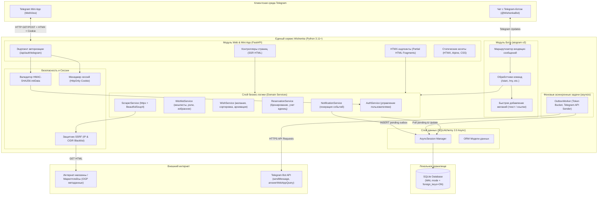
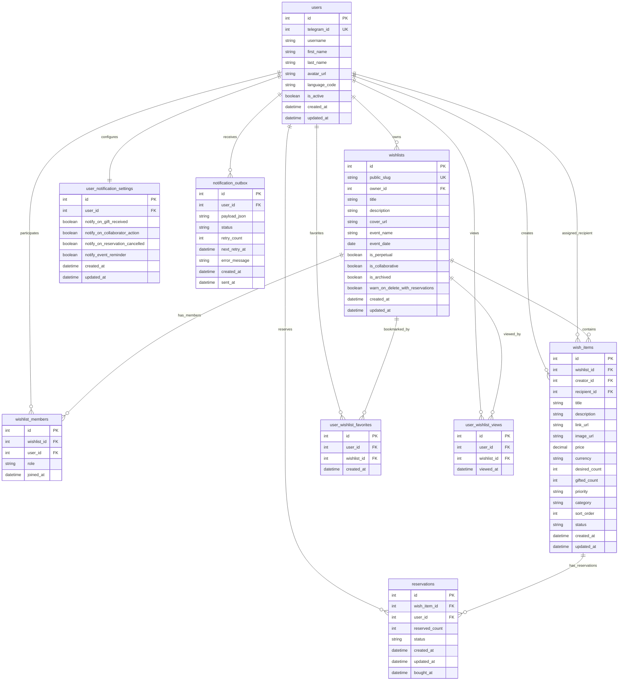
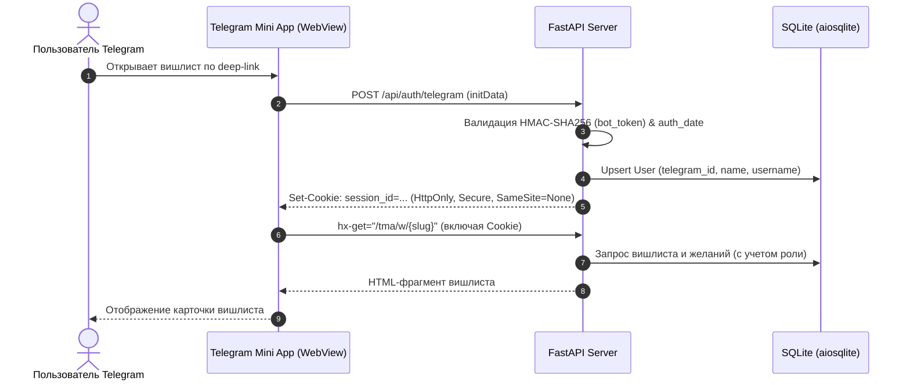
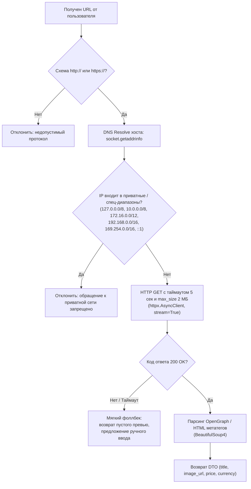
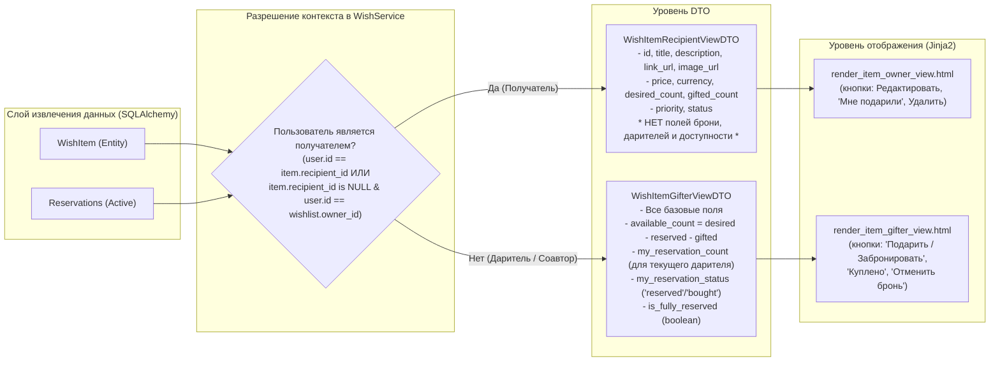

# WISHENKA-2: Архитектура системы, выбор технологического стека и схема БД

## Research

### 1. Архитектурная топология: Fullstack Python с SSR (FastAPI + Jinja2 + HTMX + aiogram v3)
- **Контекст Telegram Mini App (TMA)**: Telegram WebApp запускается внутри встроенного WebView мобильных (Android, iOS) и десктопных клиентов. Браузерный движок нативно исполняет JavaScript и предоставляет глобальный объект `window.Telegram.WebApp` через подключение скрипта `https://telegram.org/js/telegram-web-app.js`.
- **Сравнение подходов**:
  - *Традиционный SPA (React/Vue/Svelte + Vite + Node.js)*: Требует отдельного runtime (Node.js, npm/yarn), поддержки TypeScript-сборок, дублирования схем данных и DTO на клиенте и сервере, сложной сборки и маршрутизации.
  - *Fullstack Python SSR (FastAPI + Jinja2 + HTMX + Alpine.js)*: Сервер генерирует HTML-фрагменты. HTMX осуществляет AJAX-запросы по декларативным атрибутам (`hx-get`, `hx-post`, `hx-target`, `hx-swap`) с бесшовной подменой фрагментов DOM без перезагрузки страницы. Alpine.js используется для локальных реактивных микро-взаимодействий на клиенте (открытие модальных окон, выпадающих списков, вызов тактильного отклика Telegram Haptic Feedback).
  - **Вывод**: Полный отказ от Node.js/npm зависимостей. Единый монорепозиторий и кодовая база на Python 3.11+, нулевая рассинхронизация DTO, мгновенная скорость отрисовки и простота сопровождения.

### 2. Хранилище данных и конкурентность: SQLite в режиме WAL (aiosqlite + SQLAlchemy 2.0 Async)
- **Режим WAL (Write-Ahead Logging)**:
  - Настройка через PRAGMA при инициализации каждого соединения:
    ```sql
    PRAGMA journal_mode = WAL;
    PRAGMA synchronous = NORMAL;
    PRAGMA foreign_keys = ON;
    PRAGMA busy_timeout = 5000;
    ```
  - В режиме WAL чтение никогда не блокирует запись, а запись не блокирует параллельные операции чтения. Множество одновременных читателей обслуживаются с микросекундными задержками из разделяемой памяти (shm).
  - Для операций записи SQLite использует последовательную блокировку файла журнала. Параметр `busy_timeout = 5000` обеспечивает ожидание до 5 секунд в случае кратковременного состязания за транзакцию записи, полностью исключая ошибки `sqlite3.OperationalError: database is locked` при нормальной нагрузке.
- **Инструменты доступа к данным**:
  - Асинхронный движок SQLAlchemy 2.0 (`create_async_engine("sqlite+aiosqlite:///wishenka.db")`).
  - Миграции схемы данных через Alembic в режиме `render_as_batch=True` (обязательно для SQLite при модификации таблиц со связями и внешними ключами).

### 3. Аутентификация и безопасность Telegram WebApp (HMAC-SHA256 initData + Session Cookie)
- **Спецификация валидации Telegram `initData`**:
  1. Клиент Telegram передает в WebApp строку `initData`, представляющую собой URL-encoded пары ключ-значение (включая `user`, `auth_date`, `query_id`, `hash`).
  2. Из строки извлекается параметр `hash`. Остальные пары сортируются по алфавиту и конкатенируются через символ перевода строки `\n` в формате `key=value`, формируя `data_check_string`.
  3. Вычисляется секретный ключ:
     $$\text{secret\_key} = \text{HMAC-SHA256}(\text{key} = \text{"WebAppData"}, \text{msg} = \text{bot\_token})$$
  4. Вычисляется проверочный хеш:
     $$\text{calculated\_hash} = \text{HMAC-SHA256}(\text{key} = \text{secret\_key}, \text{msg} = \text{data\_check\_string}).\text{hex}()$$
  5. Сравнение хешей производится в константном времени через `hmac.compare_digest(calculated_hash, hash)`.
  6. Проверяется параметр `auth_date`: возраст подписи не должен превышать допустимое окно (например, 86400 сек / 24 часа) во избежание атак повторного воспроизведения (replay attacks).
- **Сессионный механизм для HTMX**:
  - При первой загрузке TMA страница обращается к эндпоинту обмена авторизации `/api/auth/telegram`, передавая `initData`.
  - После успешной валидации сервер регистрирует/обновляет пользователя в таблице `users` и устанавливает защищенную сессионную cookie (`session_id`), подписанную секретным ключом приложения (`itsdangerous` / `hmac`).
  - Cookie помечается атрибутами: `HttpOnly=True`, `Secure=True`, `SameSite=None` (необходимо для работы внутри WebView Telegram в iframe-окружении) и `Max-Age=2592000` (30 дней).
  - Все последующие HTMX-запросы автоматически передают сессионную cookie, не требуя повторной передачи и парсинга `initData`.

### 4. Доставка уведомлений: Паттерн Transactional Outbox в SQLite
- **Проблема**: Прямой вызов Telegram Bot API из HTTP-хэндлеров или бизнес-сервисов чреват сбоями при сетевых задержках, потерей уведомлений при падении процесса и превышением лимитов Telegram (Global: 30 сообщений/сек, 1 сообщение/сек на конкретный чат при параллельной отправке).
- **Решение**: Таблица `notification_outbox`.
  - Бизнес-операция (бронирование, архивация, отметка о получении) фиксируется в БД в одной атомарной транзакции с добавлением записи в `notification_outbox` со статусом `pending`.
  - Фоновый воркер `OutboxWorker` (работающий в `asyncio` loop внутри того же процесса сервиса) с фиксированным интервалом извлекает пачки ожидающих уведомлений, отправляет их через бота с использованием алгоритма Token Bucket (ограничение частоты запросов) и отмечает как `sent` либо планирует повторную отправку (`retry_count`, `next_retry_at`) при ошибках.

### 5. Безопасность парсинга ссылок (SSRF Protection)
- **Риски**: Отправка произвольного URL пользователя во внешний HTTP-клиент (парсер превью товаров) может привести к атакам Server-Side Request Forgery (обращение к `localhost`, `127.0.0.1`, локальным сервисам, приватным подсетям `10.0.0.0/8`, `192.168.0.0/16`, AWS-метаданным `169.254.169.254`).
- **Защита**: Модуль `ScraperService` валидирует URL перед запросом:
  - Разрешены только протоколы `http` и `https`.
  - Выполняется DNS-разрешение хоста (`socket.getaddrinfo`), полученный IP-адрес проверяется через `ipaddress.ip_address`.
  - Блокируются любые адреса из категорий: `is_private`, `is_loopback`, `is_link_local`, `is_reserved`, `is_multicast`.
  - Запросы выполняются через асинхронный `httpx.AsyncClient` со строгим таймаутом (5 секунд), ограничением размера ответа (до 2 МБ) и отключенными автоматическими редиректами на небезопасные хосты.

---

## Implementation Plan

### Высокоуровневый план реализации по этапам
1. **WISHENKA-2 (Текущий этап)**:
   - Проектирование архитектуры, модульных границ, схемы БД SQLite, контрактов интерфейсов и структуры проекта.
2. **WISHENKA-3 (Базовая инфраструктура и окружение)**:
   - Создание структуры проекта `<APP-NAME>/wishenka/`, Makefile, pyproject.toml / requirements.txt.
   - Настройка асинхронного движка SQLAlchemy 2.0 + SQLite (WAL mode, busy_timeout).
   - Настройка Alembic для миграций.
   - Инициализация базового приложения FastAPI + aiogram v3 (Long Polling / Webhook).
3. **WISHENKA-4 (Модели данных и CRUD вишлистов и желаний)**:
   - Реализация ORM-моделей: `User`, `Wishlist`, `WishlistMember`, `WishItem`, `UserWishlistFavorite`, `UserWishlistHistory`, `UserNotificationSettings`, `NotificationOutbox`.
   - Реализация `WishlistService` и `WishService`.
   - Реализация SSR-шаблонов Jinja2 + HTMX для каталога и карточки вишлиста.
   - Реализация `ScraperService` с защитой SSRF.
4. **WISHENKA-5 (Бронирование и инвариант сюрприза)**:
   - Реализация `ReservationService` с транзакционной проверкой доступности количества (`desired - reserved - gifted >= requested`).
   - Реализация двухуровневой изоляции принципа сюрприза (DTO маскирование + специализированные шаблоны `render_item_owner_view` / `render_item_gifter_view`).
   - Раздел «Мои бронирования» для дарителей.
5. **WISHENKA-6 (Уведомления и совместные вишлисты)**:
   - Реализация `OutboxWorker` с очередью в SQLite и Token Bucket лимитированием.
   - Реализация логики ролей в совместных списках (`Owner`, `Admin`, `Member`) и контекстной адресации желаний конкретному получателю.
   - Сценарии отметок получения подарков и архивации со скрытыми бронями.
6. **WISHENKA-7 (Полировка интерфейса TMA и интеграция Telegram SDK)**:
   - Привязка Telegram WebApp SDK (`themeParams`, `BackButton`, `HapticFeedback`, `MainButton`).
   - Локализация интерфейсов (`ru` / `en`).

### Mandatory — Failing Repro (next Step 3)
`N/A — no behavioral change`.
*Обоснование*: Задача WISHENKA-2 является чисто архитектурной, спецификационной и декомпозиционной задачей. В рамках данной задачи не создается исполняемый runtime-код приложения и не исправляются существующие дефекты (репозиторий находится на стадии начального проектирования). Автоматизированные тесты (включая TDD failing repros) будут формулироваться и реализовываться в последующих прикладных задачах реализации (WISHENKA-3, WISHENKA-4, WISHENKA-5).

---

## Architecture

### 1. Компонентная и модульная диаграмма системы



---

### 2. Схема базы данных (SQLite Data Architecture)

#### 2.1. ER-диаграмма сущностей



#### 2.2. Спецификация таблиц и DDL для SQLite

```sql
-- Таблица пользователей сервиса
CREATE TABLE users (
    id INTEGER PRIMARY KEY AUTOINCREMENT,
    telegram_id INTEGER NOT NULL UNIQUE,
    username TEXT,
    first_name TEXT NOT NULL,
    last_name TEXT,
    avatar_url TEXT,
    language_code TEXT NOT NULL DEFAULT 'ru',
    is_active INTEGER NOT NULL DEFAULT 1,
    created_at TIMESTAMP NOT NULL DEFAULT CURRENT_TIMESTAMP,
    updated_at TIMESTAMP NOT NULL DEFAULT CURRENT_TIMESTAMP
);
CREATE INDEX idx_users_telegram_id ON users (telegram_id);

-- Таблица вишлистов
CREATE TABLE wishlists (
    id INTEGER PRIMARY KEY AUTOINCREMENT,
    public_slug TEXT NOT NULL UNIQUE,
    owner_id INTEGER NOT NULL REFERENCES users(id) ON DELETE CASCADE,
    title TEXT NOT NULL,
    description TEXT,
    cover_url TEXT,
    event_name TEXT,
    event_date DATE,
    is_perpetual INTEGER NOT NULL DEFAULT 0,
    is_collaborative INTEGER NOT NULL DEFAULT 0,
    is_archived INTEGER NOT NULL DEFAULT 0,
    warn_on_delete_with_reservations INTEGER NOT NULL DEFAULT 1,
    created_at TIMESTAMP NOT NULL DEFAULT CURRENT_TIMESTAMP,
    updated_at TIMESTAMP NOT NULL DEFAULT CURRENT_TIMESTAMP
);
CREATE INDEX idx_wishlists_owner_id ON wishlists (owner_id);
CREATE INDEX idx_wishlists_public_slug ON wishlists (public_slug);

-- Участники совместных вишлистов
CREATE TABLE wishlist_members (
    id INTEGER PRIMARY KEY AUTOINCREMENT,
    wishlist_id INTEGER NOT NULL REFERENCES wishlists(id) ON DELETE CASCADE,
    user_id INTEGER NOT NULL REFERENCES users(id) ON DELETE CASCADE,
    role TEXT NOT NULL CHECK (role IN ('owner', 'admin', 'member')),
    joined_at TIMESTAMP NOT NULL DEFAULT CURRENT_TIMESTAMP,
    UNIQUE (wishlist_id, user_id)
);
CREATE INDEX idx_wishlist_members_lookup ON wishlist_members (wishlist_id, user_id);

-- Желания (Wish Items)
CREATE TABLE wish_items (
    id INTEGER PRIMARY KEY AUTOINCREMENT,
    wishlist_id INTEGER NOT NULL REFERENCES wishlists(id) ON DELETE CASCADE,
    creator_id INTEGER NOT NULL REFERENCES users(id) ON DELETE CASCADE,
    recipient_id INTEGER REFERENCES users(id) ON DELETE SET NULL,
    title TEXT NOT NULL,
    description TEXT,
    link_url TEXT,
    image_url TEXT,
    price REAL,
    currency TEXT NOT NULL DEFAULT 'RUB',
    desired_count INTEGER NOT NULL DEFAULT 1 CHECK (desired_count >= 1),
    gifted_count INTEGER NOT NULL DEFAULT 0 CHECK (gifted_count >= 0),
    priority TEXT NOT NULL DEFAULT 'medium' CHECK (priority IN ('low', 'medium', 'high')),
    category TEXT,
    sort_order INTEGER NOT NULL DEFAULT 0,
    status TEXT NOT NULL DEFAULT 'active' CHECK (status IN ('active', 'archived', 'gifted')),
    created_at TIMESTAMP NOT NULL DEFAULT CURRENT_TIMESTAMP,
    updated_at TIMESTAMP NOT NULL DEFAULT CURRENT_TIMESTAMP,
    CHECK (gifted_count <= desired_count)
);
CREATE INDEX idx_wish_items_wishlist_id ON wish_items (wishlist_id);
CREATE INDEX idx_wish_items_recipient_id ON wish_items (recipient_id);

-- Бронирования желаний (Reservations)
CREATE TABLE reservations (
    id INTEGER PRIMARY KEY AUTOINCREMENT,
    wish_item_id INTEGER NOT NULL REFERENCES wish_items(id) ON DELETE CASCADE,
    user_id INTEGER NOT NULL REFERENCES users(id) ON DELETE CASCADE,
    reserved_count INTEGER NOT NULL DEFAULT 1 CHECK (reserved_count >= 1),
    status TEXT NOT NULL DEFAULT 'reserved' CHECK (status IN ('reserved', 'bought', 'cancelled')),
    created_at TIMESTAMP NOT NULL DEFAULT CURRENT_TIMESTAMP,
    updated_at TIMESTAMP NOT NULL DEFAULT CURRENT_TIMESTAMP,
    bought_at TIMESTAMP
);
CREATE INDEX idx_reservations_item_active ON reservations (wish_item_id, status);
CREATE INDEX idx_reservations_user_id ON reservations (user_id);

-- Избранные вишлисты пользователей
CREATE TABLE user_wishlist_favorites (
    id INTEGER PRIMARY KEY AUTOINCREMENT,
    user_id INTEGER NOT NULL REFERENCES users(id) ON DELETE CASCADE,
    wishlist_id INTEGER NOT NULL REFERENCES wishlists(id) ON DELETE CASCADE,
    created_at TIMESTAMP NOT NULL DEFAULT CURRENT_TIMESTAMP,
    UNIQUE (user_id, wishlist_id)
);
CREATE INDEX idx_favorites_user_id ON user_wishlist_favorites (user_id);

-- История недавних просмотров
CREATE TABLE user_wishlist_views (
    id INTEGER PRIMARY KEY AUTOINCREMENT,
    user_id INTEGER NOT NULL REFERENCES users(id) ON DELETE CASCADE,
    wishlist_id INTEGER NOT NULL REFERENCES wishlists(id) ON DELETE CASCADE,
    viewed_at TIMESTAMP NOT NULL DEFAULT CURRENT_TIMESTAMP,
    UNIQUE (user_id, wishlist_id)
);
CREATE INDEX idx_views_user_viewed ON user_wishlist_views (user_id, viewed_at DESC);

-- Пользовательские настройки уведомлений
CREATE TABLE user_notification_settings (
    id INTEGER PRIMARY KEY AUTOINCREMENT,
    user_id INTEGER NOT NULL UNIQUE REFERENCES users(id) ON DELETE CASCADE,
    notify_on_gift_received INTEGER NOT NULL DEFAULT 1,
    notify_on_collaborator_action INTEGER NOT NULL DEFAULT 1,
    notify_on_reservation_cancelled INTEGER NOT NULL DEFAULT 1,
    notify_event_reminder INTEGER NOT NULL DEFAULT 1,
    created_at TIMESTAMP NOT NULL DEFAULT CURRENT_TIMESTAMP,
    updated_at TIMESTAMP NOT NULL DEFAULT CURRENT_TIMESTAMP
);

-- Transactional Outbox для доставки сообщений через Telegram Bot API
CREATE TABLE notification_outbox (
    id INTEGER PRIMARY KEY AUTOINCREMENT,
    user_id INTEGER NOT NULL REFERENCES users(id) ON DELETE CASCADE,
    payload_json TEXT NOT NULL,
    status TEXT NOT NULL DEFAULT 'pending' CHECK (status IN ('pending', 'processing', 'sent', 'failed')),
    retry_count INTEGER NOT NULL DEFAULT 0,
    next_retry_at TIMESTAMP NOT NULL DEFAULT CURRENT_TIMESTAMP,
    error_message TEXT,
    created_at TIMESTAMP NOT NULL DEFAULT CURRENT_TIMESTAMP,
    sent_at TIMESTAMP
);
CREATE INDEX idx_outbox_pending ON notification_outbox (status, next_retry_at);
```

---

### 3. Архитектура безопасности и авторизации

#### 3.1. Схема валидации Telegram `initData` и сессионного обмена
1. **Первоначальное открытие TMA**:
   - Telegram WebApp загружает корневую страницу `GET /tma?tgWebAppStartParam=<slug>`.
   - Клиентский скрипт передает `window.Telegram.WebApp.initData` через `POST /api/auth/telegram`.
2. **Проверка подписи на Backend**:
   - Backend выполняет криптографическую валидацию HMAC-SHA256 согласно спецификации Telegram.
   - Извлекаются данные пользователя (`id`, `username`, `first_name`, `last_name`, `language_code`).
   - Выполняется upsert пользователя в таблицу `users`.
   - Генерируется криптографически стойкий сессионный токен (UUIDv4 или HMAC-signed token), связывающий сессию с `user.id`.
   - В HTTP-ответе выставляется заголовок `Set-Cookie`:
     ```http
     Set-Cookie: session_id=<signed_session_token>; HttpOnly; Secure; SameSite=None; Path=/; Max-Age=2592000
     ```
3. **Последующие запросы через HTMX**:
   - Любое действие в интерфейсе (переход по вкладкам, открытие карточки желания, добавление в избранное, бронирование) отправляется стандартным HTTP-запросом HTMX с автоматической передачей cookie `session_id`.
   - Fast-path авторизация через dependency `get_current_user` в FastAPI извлекает пользователя из локальной сессии без повторной проверки Telegram hash.



#### 3.2. Алгоритм и контракт SSRF-защиты (Scraper Guard)
Для предотвращения атак сканирования внутренних портов и обращения к приватным сетям при обогащении карточки желания по URL используется строгий алгоритм фильтрации:



---

### 4. Реализация инварианта сюрприза (Surprise Invariant Isolation)

#### 4.1. Двухуровневая модель изоляции данных



#### 4.2. Контракт DTO на уровне Python Pydantic

```python
class WishItemBaseDTO(BaseModel):
    id: int
    wishlist_id: int
    title: str
    description: str | None = None
    link_url: str | None = None
    image_url: str | None = None
    price: float | None = None
    currency: str = "RUB"
    desired_count: int
    gifted_count: int
    priority: str
    category: str | None = None
    sort_order: int
    status: str

class WishItemRecipientViewDTO(WishItemBaseDTO):
    """
    Модель для получателя подарка.
    Принципиально отсутствуют любые упоминания о бронированиях!
    """
    is_recipient: Literal[True] = True

class WishItemGifterViewDTO(WishItemBaseDTO):
    """
    Модель для дарителей и третьих лиц.
    Включает доступный остаток и статус собственной брони текущего пользователя.
    """
    is_recipient: Literal[False] = False
    available_count: int
    my_reservation_id: int | None = None
    my_reserved_count: int = 0
    my_reservation_status: str | None = None  # 'reserved', 'bought', None
    is_fully_reserved: bool
```

---

### 5. Сервисные границы и контракты интерфейсов (Domain Services)

#### 5.1. `WishlistService`
- `create_wishlist(user_id: int, data: WishlistCreateDTO) -> WishlistDTO`
- `get_wishlist_by_slug(slug: str, viewer_user_id: int | None) -> WishlistViewDTO`
- `update_wishlist(wishlist_id: int, user_id: int, data: WishlistUpdateDTO) -> WishlistDTO`
- `archive_wishlist(wishlist_id: int, user_id: int) -> bool`
- `add_member(wishlist_id: int, inviter_id: int, target_user_id: int, role: str) -> None`
- `toggle_favorite(user_id: int, wishlist_id: int) -> bool`
- `record_view(user_id: int, wishlist_id: int) -> None`
- `list_user_wishlists(user_id: int) -> list[WishlistSummaryDTO]`
- `list_favorite_wishlists(user_id: int) -> list[WishlistSummaryDTO]`
- `list_recent_views(user_id: int) -> list[WishlistSummaryDTO]`

#### 5.2. `WishService`
- `create_item(user_id: int, wishlist_id: int, data: WishItemCreateDTO) -> WishItemBaseDTO`
- `update_item(user_id: int, item_id: int, data: WishItemUpdateDTO) -> WishItemBaseDTO`
- `archive_item(user_id: int, item_id: int) -> bool`
- `mark_as_gifted(user_id: int, item_id: int, count: int) -> WishItemBaseDTO`:
  - Увеличивает `gifted_count` на указанное значение.
  - Если `gifted_count >= desired_count`, статус переходит в `gifted`.
  - Ставит событие в `notification_outbox` для дарителей, имевших брони на этот подарок.
- `get_items_for_wishlist(wishlist_id: int, viewer_user_id: int | None) -> list[WishItemRecipientViewDTO | WishItemGifterDTO]`

#### 5.3. `ReservationService`
- `reserve_item(user_id: int, item_id: int, count: int) -> ReservationDTO`:
  - **Транзакционный инвариант**:
    $$\text{active\_reserved} = \sum_{\text{reservations.status} \in (\text{'reserved'}, \text{'bought'})} \text{reserved\_count}$$
    $$\text{available} = \text{desired\_count} - \text{gifted\_count} - \text{active\_reserved}$$
    Если $\text{count} > \text{available}$, выбрасывается `InsufficientQuantityError`.
  - Запрет самобронирования: если `user_id == item.recipient_id` (или `item.recipient_id is NULL and user_id == wishlist.owner_id`), выбрасывается `SelfReservationForbiddenError`.
  - Создание или обновление записи в `reservations`.
- `update_reservation(user_id: int, reservation_id: int, new_count: int) -> ReservationDTO`
- `cancel_reservation(user_id: int, reservation_id: int) -> None`
- `mark_as_bought(user_id: int, reservation_id: int) -> ReservationDTO`
- `list_user_reservations(user_id: int) -> list[UserReservationSummaryDTO]`

#### 5.4. `ScraperService`
- `fetch_preview(url: str) -> ScrapedMetadataDTO`:
  - Валидация протокола (`http`/`https`).
  - DNS-проверка на приватные диапазоны (SSRF Protection).
  - Асинхронная загрузка страницы (`httpx`, таймаут 5 сек, лимит 2 МБ).
  - Извлечение Open Graph тегов: `og:title`, `og:image`, `og:price:amount`, `og:price:currency`, а также fallback на `<title>` и `<meta name="description">`.
  - При ошибке или таймауте возвращает пустой DTO с сохранением переданного `url`.

#### 5.5. `NotificationService` & `OutboxWorker`
- `enqueue_notification(user_id: int, event_type: str, payload: dict[str, Any], session: AsyncSession) -> None`
- `OutboxWorker.process_pending()`:
  - Выборка записей из `notification_outbox` со статусом `pending` и `next_retry_at <= now()`.
  - Отправка через экземпляр `aiogram.Bot` с Token Bucket rate limiter (не более 25 сообщений в секунду суммарно, не более 1 сообщения в секунду в один `chat_id`).
  - При успехе: статус `sent`, фиксация `sent_at`.
  - При ошибке (429 Too Many Requests / 5xx): инкремент `retry_count`, экспоненциальный backoff (`next_retry_at = now() + 2^retry_count * 5 sec`).

---

### 6. Структура проекта (согласно стандартам `lsr-python`)

Все рабочие файлы проекта располагаются в директории приложения `<APP-NAME>/` (`wishenka/`):

```
/home/src/
├── Makefile                                # Автоматизация: venv, run, test, check, lint
├── pyproject.toml                          # Метаданные проекта и зависимости
├── requirements.txt                        # Точные версии зависимостей
├── .gitignore                              # Исключения git (venv, __pycache__, *.db, .env)
├── alembic.ini                             # Конфигурация Alembic
├── alembic/                                # Каталог миграций базы данных
│   ├── env.py                              # Настройка асинхронного движка Alembic (batch mode)
│   ├── script.py.mako
│   └── versions/                           # Файлы версий миграций
├── wishenka/                               # Корневой пакет приложения (<APP-NAME>)
│   ├── __init__.py
│   ├── main.py                             # Точка входа: инициализация FastAPI + aiogram Runner
│   ├── config.py                           # Pydantic Settings (.env, BOT_TOKEN, DB_PATH, etc.)
│   ├── core/                               # Системное ядро и инфраструктура
│   │   ├── __init__.py
│   │   ├── database.py                     # SQLAlchemy AsyncEngine, sessionmaker, PRAGMA WAL
│   │   ├── security.py                     # Валидация HMAC-SHA256 initData, сессионные куки
│   │   ├── ssrf.py                         # DNS и IP валидация для ScraperService
│   │   └── exceptions.py                   # Доменные исключения (SurpriseViolation, QuotaExceeded)
│   ├── models/                             # ORM-модели (SQLAlchemy 2.0 DeclarativeBase)
│   │   ├── __init__.py
│   │   ├── base.py
│   │   ├── user.py
│   │   ├── wishlist.py
│   │   ├── wish_item.py
│   │   ├── reservation.py
│   │   ├── favorite.py
│   │   ├── notification_setting.py
│   │   └── outbox.py
│   ├── schemas/                            # Pydantic DTO (запросы, ответы, формы)
│   │   ├── __init__.py
│   │   ├── user.py
│   │   ├── wishlist.py
│   │   ├── wish_item.py                    # RecipientViewDTO vs GifterViewDTO
│   │   ├── reservation.py
│   │   └── scraper.py
│   ├── services/                           # Бизнес-логика приложения
│   │   ├── __init__.py
│   │   ├── auth_service.py
│   │   ├── wishlist_service.py
│   │   ├── wish_service.py
│   │   ├── reservation_service.py
│   │   ├── scraper_service.py
│   │   ├── notification_service.py
│   │   └── outbox_worker.py                # Фоновый воркер asyncio
│   ├── bot/                                # Адаптер Telegram-бота (aiogram v3)
│   │   ├── __init__.py
│   │   ├── bot_instance.py                 # Инициализация Bot и Dispatcher
│   │   ├── handlers/
│   │   │   ├── __init__.py
│   │   │   ├── start.py                    # Приветствие и deep-link маршрутизация
│   │   │   ├── wishes.py                   # Быстрое добавление желаний по ссылке/тексту
│   │   │   └── settings.py
│   │   ├── keyboards/
│   │   │   └── inline.py                   # Кнопка открытия Mini App
│   │   └── middlewares/
│   │       └── auth_middleware.py
│   └── web/                                # Адаптер FastAPI (SSR + HTMX)
│       ├── __init__.py
│       ├── app.py                          # Сборка FastAPI приложения
│       ├── dependencies.py                 # Depends(get_current_user), Depends(get_db)
│       ├── routers/
│       │   ├── __init__.py
│       │   ├── auth.py                     # /api/auth/telegram (initData verification)
│       │   ├── pages.py                    # Корневые HTML-страницы TMA
│       │   ├── wishlists.py                # HTMX эндпоинты вишлистов
│       │   ├── items.py                    # HTMX эндпоинты желаний и превью
│       │   └── reservations.py             # HTMX эндпоинты бронирований
│       ├── templates/                      # Шаблоны Jinja2
│       │   ├── base.html                   # Каркас с Telegram WebApp SDK, HTMX, Alpine.js
│       │   ├── components/                 # Переиспользуемые фрагменты
│       │   │   ├── header.html
│       │   │   ├── item_owner_card.html    # Карточка для получателя (без броней!)
│       │   │   ├── item_gifter_card.html   # Карточка для дарителя (с доступностью)
│       │   │   └── reservation_modal.html
│       │   └── pages/
│       │       ├── wishlist_view.html
│       │       ├── my_reservations.html
│       │       └── edit_item.html
│       └── static/                         # Статические файлы (CSS, vendored JS)
│           ├── css/
│           │   └── styles.css              # Telegram WebApp theme CSS variables
│           └── js/
│               ├── htmx.min.js
│               └── alpine.min.js
└── tests/                                  # Модульные и интеграционные тесты
    ├── conftest.py                         # Фикстуры: test_db (SQLite in-memory), client
    ├── unit/
    │   ├── test_security_initdata.py
    │   ├── test_ssrf_guard.py
    │   └── test_surprise_invariant.py
    └── integration/
        ├── test_reservations_concurrency.py
        ├── test_wishlist_services.py
        └── test_outbox_worker.py
```

---

## Q&A

### В: Почему в качестве хранилища выбран SQLite, а не внешний сервер PostgreSQL?
**О:** Для текущего масштаба сервиса («Вишенка») SQLite в режиме `WAL` (Write-Ahead Logging) предоставляет исчерпывающие ACID-гарантии, поддержку транзакций и внешних ключей, избавляя от необходимости развертывания, сетевого оверхеда и сопровождения отдельного контейнера/сервера PostgreSQL. При соблюдении `busy_timeout = 5000` и асинхронном драйвере `aiosqlite` сервис способен обрабатывать сотни одновременных запросов с околонулевыми задержками (в пределах 0.5–2 мс на чтение). Модели спроектированы на чистом SQLAlchemy 2.0 без привязки к вендор-специфичным функциям, что делает переход на PostgreSQL тривиальным изменением строки подключения в `config.py` при будущем росте базы пользователей.

### В: Каким образом исключается утечка данных о бронировании через сетевые запросы браузера?
**О:** Разделение логики реализовано строго на сервере:
1. Контроллер `/tma/w/{slug}` и эндпоинты HTMX определяют, является ли текущий авторизованный пользователь получателем конкретного желания.
2. Для получателя сериализуется исключительно DTO `WishItemRecipientViewDTO`, в котором поля `reserved_count`, `available_count`, `is_fully_reserved`, а также список дарителей **полностью отсутствуют в структуре данных**.
3. В Jinja2 рендерится изолированный макрос `item_owner_card.html`, в сгенерированном HTML-коде которого нет даже скрытых (`hidden` / `data-*`) атрибутов с данными брони.
4. Таким образом, даже при открытии DevTools в браузере или инспекции сетевого трафика в Telegram Desktop получатель технически не может обнаружить факт бронирования.

### В: Как решается проблема поддержки Telegram тем оформления (Light/Dark mode)?
**О:** Официальный скрипт `telegram-web-app.js` экспортирует объект `Telegram.WebApp.themeParams`. В базовом шаблоне `base.html` цвета темы Telegram маппятся на CSS-переменные:
```css
:root {
    --bg-color: var(--tg-theme-bg-color, #ffffff);
    --text-color: var(--tg-theme-text-color, #000000);
    --hint-color: var(--tg-theme-hint-color, #999999);
    --link-color: var(--tg-theme-link-color, #2481cc);
    --button-color: var(--tg-theme-button-color, #50a7ea);
    --button-text-color: var(--tg-theme-button-text-color, #ffffff);
    --secondary-bg-color: var(--tg-theme-secondary-bg-color, #f4f4f5);
}
body {
    background-color: var(--bg-color);
    color: var(--text-color);
}
```
При смене темы в клиенте Telegram интерфейс Mini App адаптируется автоматически без перезагрузки страниц.

### В: Как обрабатывается отправка сообщений пользователям, заблокировавшим бота?
**О:** При вызове Telegram Bot API из `OutboxWorker` ошибка `aiogram.exceptions.TelegramForbiddenError: Bot was blocked by the user` перехватывается. Запись в `notification_outbox` помечается статусом `failed` с сохранением кода ошибки, повторные попытки для нее отменяются, а в таблице `users` флаг `is_active` переключается в `0` (деактивирован), чтобы не генерировать избыточные события до повторного обращения пользователя к боту.

### В: Нужен ли npm или сборка фронтенда в CI/CD пайплайне?
**О:** Нет. Использование связки FastAPI + Jinja2 + HTMX + Alpine.js позволяет полностью исключить Node.js, npm, package.json, webpack/vite из проекта. Необходимые клиентские библиотеки (`htmx.min.js`, `alpine.min.js`) вендорятся локально в `wishenka/web/static/js/`. Запуск проекта и запуск тестов выполняются стандартными командами Python: `make run` и `make test`.
