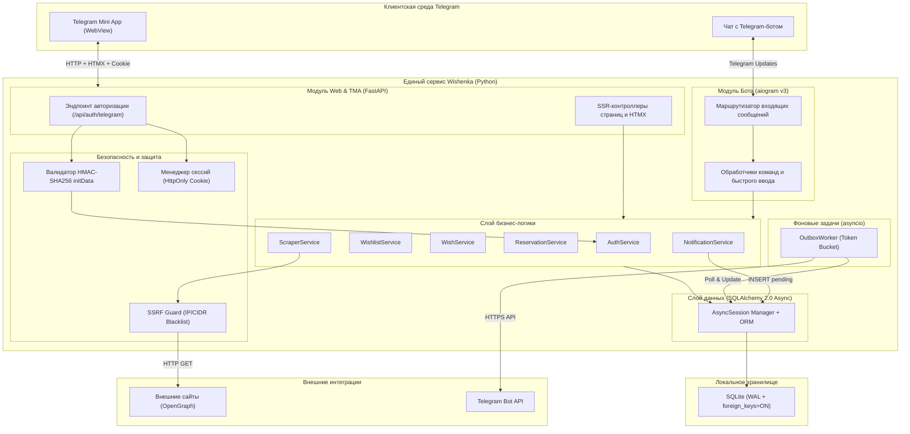
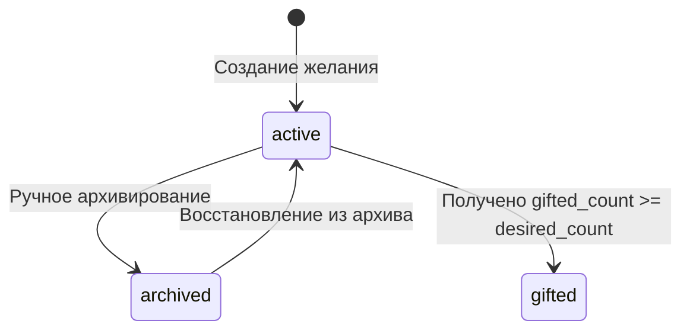

# Спецификация: WISHENKA-2 — Архитектура системы, выбор технологического стека и схема данных

**Задача:** WISHENKA-2  
**Статус:** согласованная архитектурная спецификация (без runtime-кода)  
**Платформы:** Telegram Bot + Telegram Mini App (TMA)  
**Языки интерфейса:** русский (`ru`), английский (`en`)  
**Технологический вектор:** Python 3.11+ (FastAPI + aiogram v3 + Jinja2 + HTMX + Alpine.js + SQLAlchemy 2.0 Async + SQLite WAL)  
**Связанные документы:** [`specs/00-high.md`](../../specs/00-high.md), [`in-docs/spec.md`](../../in-docs/spec.md), [`doc/dev/architecture.md`](../../doc/dev/architecture.md)

## 1. Назначение и бизнес-цель

### 1.1. Постановка проблемы

Сервис **Telegram Wishlist Service («Вишенка»)** работает на стыке двух клиентских сред экосистемы Telegram — **Telegram-бота** и **Telegram Mini App (TMA)** — и решает задачу создания списков желаний и координации дарителей при строгом асимметричном доступе к данным.

В отличие от классических списков покупок или трекеров задач, архитектура сервиса должна одновременно решать четыре критические инженерные проблемы:

1. **Строгая изоляция контекста получателя и дарителя** в рамках одного вишлиста: владелец или адресат подарка не должен получать никаких сведений о бронированиях, дарителях и покупках, тогда как дарители должны видеть актуальный доступный остаток.
2. **Предотвращение гонок бронирования (race conditions)** при параллельном обращении нескольких дарителей к ограниченному числу экземпляров желания.
3. **Высокая отзывчивость и легковесность TMA** внутри мобильных и десктопных клиентов Telegram при нулевом пороге входа (мгновенное открытие и бронирование по ссылке без отдельной регистрации и паролей).
4. **Надежная асинхронная доставка уведомлений** через Telegram Bot API с учетом платформенных ограничений частоты запросов и без раскрытия тайны сюрприза получателю.

Задача `WISHENKA-2` формирует единую согласованную архитектуру системы, выбор технологического стека, модульную декомпозицию, схему базы данных, контракты сервисов, механизмы безопасности и стратегию наблюдаемости для последующих задач реализации (`WISHENKA-3+`).

### 1.2. Бизнес-цели

- **Абсолютная гарантия «принципа сюрприза»:** модель данных, DTO-контракты, SSR-шаблоны, HTTP-ответы, уведомления и журналы логирования исключают утечку информации о бронировании и покупке получателю подарка.
- **Надежная координация дарителей без овербукинга:** транзакционный контроль штучного учета гарантирует выполнение инварианта доступности экземпляров при конкурентных запросах.
- **Бесшовный пользовательский опыт в Telegram:** единый бэкенд обслуживает как команды и уведомления бота, так и интерактивный интерфейс Mini App с мгновенной авторизацией через Telegram.
- **Управляемость жизненного цикла данных и ролевой модели:** поддержка личных и совместных вишлистов, ролей (`owner`, `admin`, `member`), ролевого разграничения дарителя и получателя, безопасного архивирования/восстановления желаний, фиксации получения подарков и удаления профиля (Right to be Forgotten).
- **Мультиязычность (RU / EN):** согласованный интерфейс на русском и английском языках в боте и Mini App.

### 1.3. Пользовательская и системная ценность

- **Ценность для пользователей:** быстрая фиксация желаний без заполнения анкет и паролей, защита эффекта сюрприза для получателя, исключение повторных покупок за счет прозрачного остатка для дарителей и единый раздел «Мои бронирования».
- **Ценность для разработки и эксплуатации:** в ходе архитектурного проектирования (Шаг 2, `20-architecture.md`) был принят отказ от отдельного Node.js/TypeScript SPA-фронтенда и выделенного сервера PostgreSQL (упоминавшихся в предварительных рамках `10-requirements.md`) в пользу единого Python-стека с Server-Side Rendering (`FastAPI + Jinja2 + HTMX + Alpine.js`) и встраиваемой СУБД `SQLite` в режиме `WAL`. Это устраняет дублирование DTO между клиентом и сервером, исключает Node.js/npm из сборки и CI/CD, снижает эксплуатационные затраты и сохраняет переносимость ORM-моделей SQLAlchemy 2.0 на PostgreSQL при будущем росте нагрузки.

### 1.4. Границы объема

| Категория | Включено в контур системы | Исключено (Non-Goals) |
| --- | --- | --- |
| Платформы | Telegram Bot (`aiogram v3`) + Telegram Mini App (`FastAPI` + `Jinja2` + `HTMX`) | Отдельный внешний веб-сайт вне Telegram; административная веб-панель |
| Социальные функции | Публичные ссылки шеринга (`public_slug`), избранные списки, история просмотров, совместные списки по приглашению | Социальная сеть, система друзей/подписок, ленты активности, глобальный каталог пользователей |
| Покупки и деньги | Координация намерений (бронирование, отметка «Куплено», штучный учет) | Платежные шлюзы, складчина, краудфандинг, учет денежных взносов, монетизация |
| Работа с каталогом | Ручной порядок карточек (`sort_order`), обогащение метаданных по ссылке, добавление желаний только авторами списка | Секретные подарки дарителей вне списка, полнотекстовый поиск, фасетные фильтры, автосортировки |
| Масштаб `WISHENKA-2` | Архитектурная спецификация, выбор стека, ER/DDL-схема БД, контракты сервисов, стратегия безопасности и наблюдаемости | Написание runtime-кода приложения, миграций и автотестов (отнесено к `WISHENKA-3+`) |

## 2. Функциональные требования и пользовательские сценарии

### 2.1. Пользовательские сценарии

| Идентификатор | Роль | Сценарий и ожидаемый результат |
| --- | --- | --- |
| `US-1` | Владелец вишлиста | Создает неограниченное число личных вишлистов (постоянных или с привязкой к событию и дате) и добавляет желания через TMA или отправкой текста/ссылки боту; при добавлении ссылки выполняется автоизвлечение метаданных с возможностью ручной правки всех полей. |
| `US-2` | Получатель подарка | При просмотре вишлиста не видит факт бронирования, число забронированных единиц, личность дарителя и отметку о покупке. |
| `US-3` | Даритель | Открывает чужой вишлист по прямой deep-link ссылке без отдельной регистрации, видит актуальный остаток доступных единиц, бронирует нужное количество (полностью или частично) и отмечает покупку (`bought`). |
| `US-4` | Даритель | Просматривает раздел «Мои бронирования», сгруппированный по вишлистам, изменяет количество, отмечает покупку или в любой момент отменяет бронь с немедленным возвратом единиц в остаток. |
| `US-5` | Организатор / соавтор | Приглашает участников (`member`) и администраторов (`admin`) в совместный вишлист, указывает конкретного получателя (`recipient_id`) для отдельных желаний; соавтор-получатель сохраняет тайну сюрприза только по адресованным ему желаниям, а по остальным действует как даритель/соавтор. |
| `US-6` | Получатель подарка | Фиксирует полное или частичное получение подарка (`gifted_count`) с переносом полностью полученных желаний в раздел «Подаренные» (отдельно от архивных), а дарители с открытой бронью получают уведомление. |
| `US-7` | Пользователь Telegram | Открывает сервис без логина и пароля (через `initData` или контекст бота), управляет профилем, языком (`ru`/`en`), настройками уведомлений, избранным и может полностью удалить аккаунт. |

### 2.2. Функциональные требования по подсистемам

#### Профиль и аутентификация

- **Вход:** строка `initData` из `window.Telegram.WebApp.initData` (для TMA) или проверенный контекст отправителя `from.id` из Telegram Bot API (для бота).
- **Поведение:** валидация подписи, автоматический `upsert` профиля в таблице `users` (`telegram_id`, `username`, `first_name`, `last_name`, `avatar_url`, `language_code`), выпуск подписанной сессионной cookie `session_id` для последующих HTMX-запросов.
- **Удаление аккаунта (Right to be Forgotten):** персональные данные пользователя удаляются или анонимизируются; личные вишлисты деактивируются и удаляются; в совместных вишлистах при наличии других участников права владельца передаются назначенному администратору (либо список переходит в режим чтения); активные бронирования удаляемого пользователя автоматически отменяются, освобождая единицы подарков для других дарителей.

#### Вишлисты и совместная работа

- **Вход:** заголовок (`title`), опциональные описание (`description`), обложка (`cover_url`), название и дата события (`event_name`, `event_date`), признаки бессрочности (`is_perpetual`), совместного доступа (`is_collaborative`), предупреждения об архивации (`warn_on_delete_with_reservations`).
- **Выход:** уникальный публичный короткий код `public_slug` для deep-link ссылок (`/tma?tgWebAppStartParam=<slug>`, `/tma/w/{slug}`), представление вишлиста с учетом роли просматривающего (`owner`, `admin`, `member` в `wishlist_members` либо даритель/посетитель).
- **Дополнительные действия:** архивация и восстановление вишлистов, добавление чужих списков в избранное (`user_wishlist_favorites`), фиксация недавних просмотров (`user_wishlist_views`).

#### Желания и парсинг ссылок

- **Вход:** обязательное название (`title`), опциональные описание (`description`), ссылка (`link_url`), изображение (`image_url`), ориентировочная цена (`price`), валюта (`currency`, по умолчанию `RUB`), требуемое количество (`desired_count >= 1`, по умолчанию `1`), приоритет (`low`, `medium`, `high`), категория (`category`), порядок отображения (`sort_order`), назначенный получатель (`recipient_id`).
- **Добавление извне:** через обработчики Telegram-бота при отправке текста или ссылки в чат.
- **Обогащение по ссылке (`ScraperService`):** при получении валидного URL (`http`/`https`, прошедшего SSRF-проверку) сервис загружает HTML и извлекает метатеги OpenGraph (`og:title`, `og:image`, `og:price:amount`, `og:price:currency`) с fallback на `<title>` и `<meta name="description">`. При ошибке сети, коде ответа не `200 OK` или таймауте возвращается пустой DTO с сохраненным `url` и предложением ручного ввода.
- **Архивация желания:** переводит желание в статус `archived` с возможностью восстановления; при наличии активных броней сами брони сохраняются, а дарителям отправляется тактичное уведомление в бота с предложением отменить бронь. При первой архивации владелец настраивает флаг `warn_on_delete_with_reservations` (предупреждение о наличии дарителя без раскрытия его личности и деталей брони).

#### Бронирования и фиксация получения

- **Бронирование (`ReservationService`):** даритель может создать бронь на количество `1 <= count <= available`, изменить количество, отметить покупку (`bought`) или отменить бронь (`cancelled`). Все активные и купленные брони дарителя доступны в разделе «Мои бронирования», сгруппированном по вишлистам.
- **Фиксация получения (`WishService.mark_as_gifted`):** увеличивает `gifted_count` на указанное количество (`gifted_count <= desired_count`). При `gifted_count >= desired_count` статус желания переходит в `gifted` (раздел «Подаренные»). В `notification_outbox` ставятся события уведомлений для дарителей, имеющих брони на данный подарок.

#### Уведомления и сервисы бота

- Событийные уведомления через Telegram-бота: добавление в совместный вишлист, отметка получения подарка, напоминание о дате события, архивация желания/списка с бронью.
- Пользовательские настройки уведомлений (`user_notification_settings`): раздельные флаги `notify_on_gift_received`, `notify_on_collaborator_action`, `notify_on_reservation_cancelled`, `notify_event_reminder`.
- Если пользователь заблокировал бота (`TelegramForbiddenError: Bot was blocked by the user`), доставка завершается без повторных попыток (`status = 'failed'`), а пользователь помечается `is_active = 0` до нового обращения к боту.

### 2.3. Обязательные доменные инварианты

1. **Инвариант сюрприза (Surprise Invariant):** для любого пользователя, являющегося получателем желания (`user.id == item.recipient_id`, либо `item.recipient_id IS NULL` и `user.id == wishlist.owner_id`), возвращается строго ограниченная проекция данных без полей бронирований, доступного остатка, статуса покупки и списка дарителей; в HTML-разметке отсутствуют даже скрытые (`hidden`, `data-*`) атрибуты бронирований; уведомления для получателя никогда не раскрывают факт бронирования или покупки.
2. **Запрет самобронирования:** попытка получателя забронировать адресованное ему желание отклоняется на сервисном уровне доменным исключением `SelfReservationForbiddenError`.
3. **Запрет овербукинга и формула остатка:**

   $$\text{active\_reserved} = \sum_{\text{status} \in \{\text{'reserved'}, \text{'bought'}\}} \text{reserved\_count}$$

   $$\text{available} = \text{desired\_count} - \text{gifted\_count} - \text{active\_reserved}$$

   Запрос на новое бронирование или увеличение брони при `count > available` отклоняется исключением `InsufficientQuantityError`. На уровне БД действуют ограничения `CHECK (desired_count >= 1)`, `CHECK (gifted_count >= 0)`, `CHECK (gifted_count <= desired_count)` и `CHECK (reserved_count >= 1)`.
4. **Изоляция дарителей:** даритель видит только вычисленный свободный остаток (`available_count`), обезличенный статус полной занятости (`is_fully_reserved`) и данные собственной брони (`my_reservation_id`, `my_reserved_count`, `my_reservation_status`), но не имена и детали других дарителей.

## 3. Архитектура, компоненты и интерфейсы

### 3.1. Компонентная структура и стек

Единое асинхронное приложение на **Python 3.11+** (целевой стандарт разработки в `doc/dev/architecture.md` — **Python 3.12+**) объединяет Web/TMA-адаптер на **FastAPI** (`Jinja2` + `HTMX` + `Alpine.js`) и Telegram-бота на **aiogram v3** в общем `asyncio` event loop поверх единого слоя доменных сервисов и БД **SQLite** в режиме **WAL**.



### 3.2. Структура пакетов и модулей (`wishenka/`)

| Путь | Назначение и ответственность |
| --- | --- |
| `wishenka/main.py` | Точка входа: запуск FastAPI, aiogram Runner и фонового `OutboxWorker`. |
| `wishenka/config.py` | Настройки приложения на базе Pydantic Settings (`.env`, `BOT_TOKEN`, `DB_PATH`, секретные ключи). |
| `wishenka/core/database.py` | Инициализация `create_async_engine("sqlite+aiosqlite:///wishenka.db")`, `AsyncSession`, настройка PRAGMA WAL при старте соединения. |
| `wishenka/core/security.py` | Валидация HMAC-SHA256 `initData`, проверка `auth_date`, подпись и проверка сессионных cookie (`itsdangerous` / `hmac`). |
| `wishenka/core/ssrf.py` | Проверка схемы `http`/`https`, DNS-разрешение и фильтрация приватных/зарезервированных IP-диапазонов. |
| `wishenka/core/exceptions.py` | Доменные исключения (`SurpriseViolation`, `QuotaExceeded` / `InsufficientQuantityError`, `SelfReservationForbiddenError`). |
| `wishenka/models/` | Декларативные ORM-модели SQLAlchemy 2.0 (`base.py`, `user.py`, `wishlist.py`, `wish_item.py`, `reservation.py`, `favorite.py`, `notification_setting.py`, `outbox.py`) + миграции `alembic/` (`render_as_batch=True`). |
| `wishenka/schemas/` | Pydantic DTO (`user.py`, `wishlist.py`, `wish_item.py`, `reservation.py`, `scraper.py`). |
| `wishenka/services/` | Бизнес-сервисы (`auth_service.py`, `wishlist_service.py`, `wish_service.py`, `reservation_service.py`, `scraper_service.py`, `notification_service.py`, `outbox_worker.py`). |
| `wishenka/bot/` | Адаптер `aiogram v3`: `bot_instance.py`, обработчики `handlers/` (`start.py`, `wishes.py`, `settings.py`), клавиатуры `keyboards/inline.py`, middleware `middlewares/auth_middleware.py`. |
| `wishenka/web/` | Адаптер FastAPI: `app.py`, `dependencies.py` (`get_current_user`, `get_db`), роутеры `routers/` (`auth.py`, `pages.py`, `wishlists.py`, `items.py`, `reservations.py`), шаблоны `templates/` (`base.html`, `components/*`, `pages/*`), статика `static/` (`styles.css`, `htmx.min.js`, `alpine.min.js`). |

### 3.3. Контракты доменных сервисов и HTTP-маршрутов

#### `WishlistService`

- `create_wishlist(user_id: int, data: WishlistCreateDTO) -> WishlistDTO`
- `get_wishlist_by_slug(slug: str, viewer_user_id: int | None) -> WishlistViewDTO`
- `update_wishlist(wishlist_id: int, user_id: int, data: WishlistUpdateDTO) -> WishlistDTO`
- `archive_wishlist(wishlist_id: int, user_id: int) -> bool`
- `add_member(wishlist_id: int, inviter_id: int, target_user_id: int, role: str) -> None`
- `toggle_favorite(user_id: int, wishlist_id: int) -> bool`
- `record_view(user_id: int, wishlist_id: int) -> None`
- `list_user_wishlists(user_id: int) -> list[WishlistSummaryDTO]`
- `list_favorite_wishlists(user_id: int) -> list[WishlistSummaryDTO]`
- `list_recent_views(user_id: int) -> list[WishlistSummaryDTO]`

#### `WishService`

- `create_item(user_id: int, wishlist_id: int, data: WishItemCreateDTO) -> WishItemBaseDTO`
- `update_item(user_id: int, item_id: int, data: WishItemUpdateDTO) -> WishItemBaseDTO`
- `archive_item(user_id: int, item_id: int) -> bool`
- `mark_as_gifted(user_id: int, item_id: int, count: int) -> WishItemBaseDTO` — увеличивает `gifted_count`, при `gifted_count >= desired_count` переводит `status` в `'gifted'`, добавляет события в `notification_outbox` для дарителей с бронями.
- `get_items_for_wishlist(wishlist_id: int, viewer_user_id: int | None) -> list[WishItemRecipientViewDTO | WishItemGifterViewDTO]` *(в разделе 5.2 исходного документа `20-architecture.md` указан псевдоним `WishItemGifterDTO`, соответствующий схеме `WishItemGifterViewDTO` из раздела 4.2)*.

#### `ReservationService`

- `reserve_item(user_id: int, item_id: int, count: int) -> ReservationDTO` — транзакционно проверяет `available = desired_count - gifted_count - active_reserved` (при `count > available` выбрасывает `InsufficientQuantityError`) и запрещает самобронирование (`SelfReservationForbiddenError`).
- `update_reservation(user_id: int, reservation_id: int, new_count: int) -> ReservationDTO`
- `cancel_reservation(user_id: int, reservation_id: int) -> None`
- `mark_as_bought(user_id: int, reservation_id: int) -> ReservationDTO`
- `list_user_reservations(user_id: int) -> list[UserReservationSummaryDTO]`

#### `ScraperService`, `NotificationService` и `OutboxWorker`

- `ScraperService.fetch_preview(url: str) -> ScrapedMetadataDTO` — валидирует схему, выполняет SSRF-проверку, загружает HTML (`httpx.AsyncClient`, 5 сек, до 2 МБ), парсит OpenGraph (`BeautifulSoup4`) и при ошибке возвращает пустой DTO с сохраненным `url`.
- `NotificationService.enqueue_notification(user_id: int, event_type: str, payload: dict[str, Any], session: AsyncSession) -> None` — записывает событие в `notification_outbox` в рамках текущей транзакции БД.
- `OutboxWorker.process_pending()` — выбирает строки `status = 'pending'` при `next_retry_at <= now()`, отправляет через `aiogram.Bot` с Token Bucket rate limiter, обновляет статус (`sent` / повторный `pending` / `failed`).

#### Базовые Web-эндпоинты TMA

- `GET /tma?tgWebAppStartParam=<slug>` — выдача корневой HTML-оболочки TMA (`base.html` со скриптом `telegram-web-app.js`).
- `POST /api/auth/telegram` — прием `initData`, валидация HMAC-SHA256, `upsert` пользователя и установка cookie `session_id`.
- `GET /tma/w/{slug}` (в том числе через `hx-get`) — рендеринг HTML-фрагмента вишлиста с ролевым разделением карточек.
- `GET /healthz` — проверка готовности сервиса (БД SQLite и фоновый воркер).

### 3.4. Контракты данных и схема БД SQLite

#### Двухуровневые DTO изоляции сюрприза

```python
class WishItemBaseDTO(BaseModel):
    id: int
    wishlist_id: int
    title: str
    description: str | None = None
    link_url: str | None = None
    image_url: str | None = None
    price: float | None = None
    currency: str = "RUB"
    desired_count: int
    gifted_count: int
    priority: str
    category: str | None = None
    sort_order: int
    status: str


class WishItemRecipientViewDTO(WishItemBaseDTO):
    """Модель для получателя: поля бронирований принципиально отсутствуют."""

    is_recipient: Literal[True] = True


class WishItemGifterViewDTO(WishItemBaseDTO):
    """Модель для дарителей и третьих лиц с остатком и собственной бронью."""

    is_recipient: Literal[False] = False
    available_count: int
    my_reservation_id: int | None = None
    my_reserved_count: int = 0
    my_reservation_status: str | None = None  # 'reserved', 'bought', None
    is_fully_reserved: bool
```

На уровне шаблонов Jinja2 используются изолированные компоненты: `item_owner_card.html` (`render_item_owner_view.html`) для `WishItemRecipientViewDTO` и `item_gifter_card.html` (`render_item_gifter_view.html`) для `WishItemGifterViewDTO`.

#### Схема базы данных SQLite (9 таблиц)

| Таблица | Ключевые поля | Ограничения и индексы |
| --- | --- | --- |
| `users` | `id`, `telegram_id`, `username`, `first_name`, `last_name`, `avatar_url`, `language_code` (`'ru'`), `is_active` (`1`), `created_at`, `updated_at` | `telegram_id UNIQUE`, индекс `idx_users_telegram_id` |
| `wishlists` | `id`, `public_slug`, `owner_id`, `title`, `description`, `cover_url`, `event_name`, `event_date`, `is_perpetual`, `is_collaborative`, `is_archived`, `warn_on_delete_with_reservations` (`1`), `created_at`, `updated_at` | `public_slug UNIQUE`, `owner_id -> users(id) ON DELETE CASCADE`, индексы `idx_wishlists_owner_id`, `idx_wishlists_public_slug` |
| `wishlist_members` | `id`, `wishlist_id`, `user_id`, `role`, `joined_at` | `role IN ('owner', 'admin', 'member')`, `UNIQUE (wishlist_id, user_id)`, `ON DELETE CASCADE`, индекс `idx_wishlist_members_lookup` |
| `wish_items` | `id`, `wishlist_id`, `creator_id`, `recipient_id`, `title`, `description`, `link_url`, `image_url`, `price`, `currency`, `desired_count`, `gifted_count`, `priority`, `category`, `sort_order`, `status`, `created_at`, `updated_at` | `desired_count >= 1`, `gifted_count >= 0`, `gifted_count <= desired_count`, `priority IN ('low', 'medium', 'high')`, `status IN ('active', 'archived', 'gifted')`, `recipient_id ON DELETE SET NULL`, индексы `idx_wish_items_wishlist_id`, `idx_wish_items_recipient_id` |
| `reservations` | `id`, `wish_item_id`, `user_id`, `reserved_count`, `status`, `created_at`, `updated_at`, `bought_at` | `reserved_count >= 1`, `status IN ('reserved', 'bought', 'cancelled')`, `ON DELETE CASCADE`, индексы `idx_reservations_item_active`, `idx_reservations_user_id` |
| `user_wishlist_favorites` | `id`, `user_id`, `wishlist_id`, `created_at` | `UNIQUE (user_id, wishlist_id)`, `ON DELETE CASCADE`, индекс `idx_favorites_user_id` |
| `user_wishlist_views` | `id`, `user_id`, `wishlist_id`, `viewed_at` | `UNIQUE (user_id, wishlist_id)`, `ON DELETE CASCADE`, индекс `idx_views_user_viewed` |
| `user_notification_settings` | `id`, `user_id`, `notify_on_gift_received`, `notify_on_collaborator_action`, `notify_on_reservation_cancelled`, `notify_event_reminder`, `created_at`, `updated_at` | `user_id UNIQUE REFERENCES users(id) ON DELETE CASCADE`, значения по умолчанию `1` |
| `notification_outbox` | `id`, `user_id`, `payload_json`, `status`, `retry_count`, `next_retry_at`, `error_message`, `created_at`, `sent_at` | `status IN ('pending', 'processing', 'sent', 'failed')`, `ON DELETE CASCADE`, индекс `idx_outbox_pending (status, next_retry_at)` |

### 3.5. Переходы состояний



- **Жизненный цикл бронирования (`reservations.status`):** `reserved` (при создании) -> `bought` (`mark_as_bought` с записью `bought_at`); из `reserved` или `bought` возможен переход в `cancelled` (`cancel_reservation` с возвратом единиц в `available`).
- **Жизненный цикл задачи `notification_outbox.status`:** `pending` -> `processing` -> `sent` (с записью `sent_at`); при временном сбое (429 / 5xx) возврат в `pending` с увеличением `retry_count` и расчетом `next_retry_at`; при исчерпании попыток или `TelegramForbiddenError` -> `failed` (в последнем случае `users.is_active` устанавливается в `0`).
- **Адаптация оформления TMA:** в `base.html` переменные `Telegram.WebApp.themeParams` связываются с CSS-переменными (`--bg-color`, `--text-color`, `--hint-color`, `--link-color`, `--button-color`, `--button-text-color`, `--secondary-bg-color`) для автоматического переключения светлой и темной темы без перезагрузки.

## 4. Нефункциональные требования, безопасность и наблюдаемость

### 4.1. Производительность, конкурентность и лимиты

- **Конфигурация SQLite WAL:** при инициализации соединения устанавливаются `PRAGMA journal_mode = WAL`, `PRAGMA synchronous = NORMAL`, `PRAGMA foreign_keys = ON`, `PRAGMA busy_timeout = 5000`. Читающие запросы выполняются из `shm` без блокировки пишущими операциями (ориентир задержки чтения 0.5–2 мс по `20-architecture.md`), а 5-секундный `busy_timeout` сглаживает кратковременное состязание за журнал записи.
- **Атомарность и блокировка при бронировании:** проверка доступного остатка и изменение таблицы `reservations` выполняются внутри единой транзакции с блокировкой на уровне агрегата желания для исключения овербукинга.
- **Transactional Outbox и Rate Limiting:** постановка уведомления в `notification_outbox` выполняется в одной транзакции с бизнес-мутацией. `OutboxWorker` ограничивает скорость отправки через Token Bucket: не более **25 сообщений/сек** суммарно (при лимите Telegram 30 сообщ/сек) и не более **1 сообщения/сек** в один `chat_id`. При ошибках 429 / 5xx применяется экспоненциальный backoff: `next_retry_at = now() + 2^retry_count * 5 sec`.
- **Лимиты парсера ссылок:** асинхронный `httpx.AsyncClient` со строгим таймаутом **5 секунд**, потоковым ограничением размера ответа до **2 МБ** (`stream=True`) и отключенными автоматическими редиректами на небезопасные хосты.
- **Отсутствие тяжелых фронтенд-зависимостей:** `htmx.min.js` и `alpine.min.js` вендорятся локально в `wishenka/web/static/js/`, запуск и тестирование выполняются через `make run` и `make test` без Node.js.

### 4.2. Безопасность и защита приватности

- **Аутентификация Telegram WebApp (`initData`):**
  1. Из URL-encoded строки `initData` извлекается `hash`; остальные пары сортируются по алфавиту и объединяются через `\n` в `data_check_string`.
  2. Вычисляются `secret_key = HMAC-SHA256(key="WebAppData", msg=bot_token)` и `calculated_hash = HMAC-SHA256(key=secret_key, msg=data_check_string).hex()`.
  3. Сверка выполняется в константном времени через `hmac.compare_digest(calculated_hash, hash)`.
  4. Параметр `auth_date` проверяется на допустимое окно свежести (86400 секунд / 24 часа) для защиты от replay-атак.
- **Сессионные cookie:** после проверки `initData` через `POST /api/auth/telegram` устанавливается подписанная cookie с атрибутами `HttpOnly; Secure; SameSite=None; Path=/; Max-Age=2592000` (30 дней; `SameSite=None` необходим для работы внутри iframe/WebView Telegram).
- **Защита от SSRF (`core/ssrf.py`):**
  - Разрешаются только схемы `http` и `https`.
  - До HTTP-запроса выполняется DNS-разрешение (`socket.getaddrinfo`) и проверка IP-адресов через `ipaddress.ip_address`.
  - Блокируются адреса с флагами `is_private`, `is_loopback`, `is_link_local`, `is_reserved`, `is_multicast` (включая `127.0.0.0/8`, `10.0.0.0/8`, `172.16.0.0/12`, `192.168.0.0/16`, `169.254.0.0/16`, `::1`).
- **Защита тайны сюрприза на клиенте и в транспорте:** контроллер и `WishService` определяют контекст роли на сервере; при роли получателя данные бронирований не сериализуются в DTO и не попадают ни в HTML-код, ни в сетевой трафик, доступный через DevTools.

### 4.3. Наблюдаемость: структурированное логирование, метрики и healthcheck

Согласно `50-observability.md`, целевая стратегия наблюдаемости включает три контура:

- **Структурированное логирование (JSON):** стандартный Python `logging` или `structlog` с разграничением уровней:
  - `INFO` — запуск приложения, авторизация по `initData`, создание вишлиста, успешное бронирование, отметка о получении подарка;
  - `WARNING` — повторные попытки отправки в Telegram Bot API (`429 Retry-After` / rate limit), fallback парсера ссылок на ручной ввод при таймауте внешнего сайта;
  - `ERROR` — сбои валидации HMAC `initData`, нарушения целостности SQLite, окончательные ошибки доставки уведомлений после исчерпания попыток.
- **Инвариант сюрприза в логах:** запрещено логировать персональные данные дарителя рядом с идентификатором вишлиста в открытом виде там, где логи могут просматриваться получателем; в логах бронирования не выводятся детали подарка в контексте сессии владельца вишлиста.
- **Метрики и мониторинг `notification_outbox`:** отслеживание глубины очереди (`status = 'pending'`), отказов доставки (`status = 'failed'`, `retry_count >= 3`) и лага доставки (`sent_at - created_at`).
- **Healthcheck:** эндпоинт `/healthz` для проверки доступности файла БД SQLite и состояния фонового воркера бота.

## 5. Верификация и критерии приёмки

### 5.1. Фактический статус верификации в `WISHENKA-2`

Задача `WISHENKA-2` выполнена как чисто архитектурно-спецификационная (`N/A — no behavioral change`): исполняемый runtime-код и автотесты не создавались, а временные каталоги-заглушки `wishenka/` были удалены на этапе очистки (`40-code-cleanup.md`).

Фактически выполненные проверки артефактов `WISHENKA-2`:

- проверка форматирования Markdown по GFM / `lsr-markdown`, отсутствия конфликтов слияния и валидности диаграмм Mermaid (`40-code-cleanup.md`);
- независимое ревью архитектурной спецификации `20-architecture.md` с итоговым вердиктом `PASS` (`60-tech-debt.md`);
- фиксация документации разработчика в `doc/dev/architecture.md` (`00-roadmap.md`).

### 5.2. Планируемые сценарии тестирования для этапов реализации (`WISHENKA-3+`)

В структуре проекта (`20-architecture.md`, раздел 6) зафиксированы следующие целевые модули тестирования на базе фикстур `tests/conftest.py` (`test_db` на SQLite и `client`):

- **Модульные тесты (`tests/unit/`):**
  - `test_security_initdata.py` — проверка алгоритма HMAC-SHA256 для `initData`, константного сравнения `hmac.compare_digest`, отклонения просроченного `auth_date` (> 86400 с) и подделанной подписи.
  - `test_ssrf_guard.py` — блокировка неразрешенных схем URL, приватных/loopback/link-local/резервных/multicast IP-диапазонов (включая `169.254.169.254` и `::1`), разрешение публичных адресов и мягкий fallback при таймауте или ошибке ответа.
  - `test_surprise_invariant.py` — проверка выдачи `WishItemRecipientViewDTO` для владельца и соавтора-получателя (`recipient_id`), отсутствия полей и HTML-атрибутов брони в `item_owner_card.html`, запрета самобронирования (`SelfReservationForbiddenError`).
- **Интеграционные тесты (`tests/integration/`):**
  - `test_reservations_concurrency.py` — конкурентное бронирование последнего доступного экземпляра несколькими дарителями (`InsufficientQuantityError` при нехватке), проверка формулы `available_count`, изменение и отмена брони, перевод в статус `bought`.
  - `test_wishlist_services.py` — CRUD вишлистов и желаний, роли в совместных списках (`owner`, `admin`, `member`), избранное, история просмотров, отметка получения (`mark_as_gifted`), архивация желания с активными бронями.
  - `test_outbox_worker.py` — транзакционная запись в `notification_outbox`, Token Bucket лимитирование (25 сообщ/сек глобально, 1 сообщ/сек в один чат), экспоненциальный backoff при 429/5xx, обработка `TelegramForbiddenError` (`status = 'failed'`, `users.is_active = 0`).

### 5.3. Критерии приёмки (Acceptance Criteria)

| Критерий | Содержание и статус в `WISHENKA-2` |
| --- | --- |
| `AC-1` (Полнота доменной модели) | Выполнено: специфицированы все сущности (`User`, `Wishlist`, `WishlistMember`, `WishItem`, `Reservation`, избранное, просмотры, настройки уведомлений и `NotificationOutbox`), их атрибуты, ограничения целостности и жизненный цикл. |
| `AC-2` (Формализация инварианта сюрприза) | Выполнено: спроектирована двухуровневая изоляция через раздельные DTO (`WishItemRecipientViewDTO` / `WishItemGifterViewDTO`) и раздельные Jinja2-шаблоны. |
| `AC-3` (Квантование и доступность броней) | Выполнено: формализована формула свободного остатка, ограничения `CHECK` в SQLite и сервисная проверка при бронировании. |
| `AC-4` (Контракт Bot + TMA + Backend) | Выполнено: разграничены роли бота (`aiogram v3`) и TMA (`FastAPI + Jinja2 + HTMX`) поверх общих доменных сервисов и единой БД. |
| `AC-5` (Безопасность и Telegram-аутентификация) | Выполнено: специфицирована проверка HMAC-SHA256 `initData`, проверка `auth_date`, сессионные cookie для HTMX, аутентификация в боте по `from.id` и SSRF-защита парсера. |
| `AC-6` (Архивация, удаление и коллизии) | Выполнено: зафиксированы правила архивации с бронями (`warn_on_delete_with_reservations`), назначения получателя в совместных списках и удаления профиля. |
| `AC-7` (Технологический вектор) | Выполнено с архитектурным уточнением: единый стек Python (`FastAPI + Jinja2 + HTMX + Alpine.js + aiogram v3 + SQLAlchemy 2.0 Async + SQLite WAL + Alembic`) зафиксирован в `20-architecture.md` и `doc/dev/architecture.md`. |

### 5.4. Известные ограничения, техдолг и последующие задачи

- **Технический долг в коде и тестах:** отсутствует (`0` временных решений и обходных путей в рамках `WISHENKA-2` согласно `60-tech-debt.md`).
- **Ограничение масштабирования SQLite WAL:** `SQLite` с `journal_mode = WAL` и `busy_timeout = 5000` оптимален для средней нагрузки без сопровождения отдельного сервера БД. При росте нагрузки до сотен одновременных пишущих транзакций потребуется миграция на PostgreSQL — такая возможность заложена за счет чистых моделей SQLAlchemy 2.0 Async без вендор-специфичных конструкций и смены строки подключения в `config.py`.
- **Зафиксированные нюансы исходных артефактов:**
  - В `10-requirements.md` (Шаг 1) в качестве предварительного стека упоминались TypeScript для TMA и PostgreSQL, что было пересмотрено на Шаге 2 (`20-architecture.md`) в пользу Python SSR (`HTMX`) и SQLite WAL.
  - В разделе 5.2 документа `20-architecture.md` возвращаемый тип `WishService.get_items_for_wishlist` записан как `WishItemGifterDTO` вместо объявленного в разделе 4.2 класса `WishItemGifterViewDTO`.
- **Последующие задачи в Jira (`60-tech-debt.md`):**
  - [WISHENKA-3](https://pypost.atlassian.net/browse/WISHENKA-3) — `[Инфраструктура] Каркас репозитория, Makefile, линтеры, CI/CD и тестовая среда`
  - [WISHENKA-4](https://pypost.atlassian.net/browse/WISHENKA-4) — `[Аутентификация] Валидация Telegram WebApp initData и сессионный контекст`
  - [WISHENKA-6](https://pypost.atlassian.net/browse/WISHENKA-6) — `[Декомпозиция] Ролевая модель, жизненный цикл вишлистов и права доступа соавторов`
  - [WISHENKA-7](https://pypost.atlassian.net/browse/WISHENKA-7) — `[Backend] CRUD API вишлистов, публичный шеринг по ссылке и права доступа`
