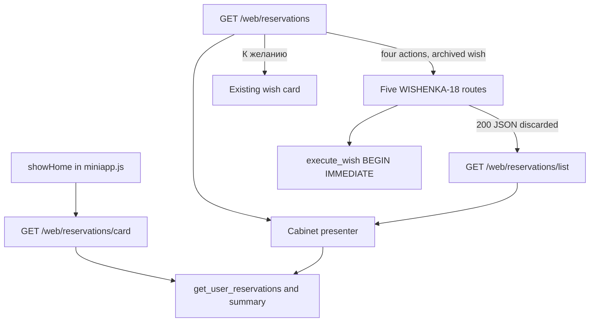

# WISHENKA-20: My Reservations Cabinet

## Research

### Home the card has to join

The Mini App home is `showHome` in `wishenka/web/static/miniapp.js`.
`start` calls `bootstrap` (session, then `GET /api/auth/csrf`) and then
`showHome`. A `startapp` of `p_<token>` or `i_<token>` goes to
`publicView` or `invitationView` and never calls `showHome`. The shell
`GET /` in `wishenka/web/routes/miniapp.py` is an empty `#app` plus that
script. Its Content-Security-Policy is `default-src 'self'` with
`script-src 'self' https://telegram.org`. A script from `unpkg` does not
load there.

`showHome` builds the nav and three sections with the existing `node()`
helper, which sets `textContent`. The file has no `innerHTML`. The
sections stay in English. This task does not rebuild them and does not
translate them. Nothing in the shell, the script, `share_wishlist.html`,
or `wishlist_detail.html` renders «Мои бронирования».

The wish card is a different page. `GET /web/wishlists/{wishlist_id}` and
`GET /share/{public_token}` extend `base.html`, which loads HTMX 1.9.12
and `json-enc` from `unpkg`. Those responses do not set the Mini App
CSP. `miniapp.js` lists wish titles and does not render the card.

### Read model already shipped

`WishlistService.get_user_reservations` walks the caller's reservations
and keeps `ReservationStatus.ACTIVE` and `ReservationStatus.PURCHASED`.
`ACTIVE` is the intended promise. `PURCHASED` is the bought mark.
`CANCELLED` is skipped. Each hit becomes one `MyReservationItemDTO`:
wishlist title, event title, event date, item title, that promise's
`quantity` as `reserved_quantity`, status, archive flags, and
`created_at`. There is no HTTP route for this method. The in-memory
service and the store-backed service both expose it. It is not in
`_RESERVATION_INVENTORY_METHODS`, so a store-backed call uses a full
snapshot (`WishlistStore.execute`), not `execute_wish`.

`get_user_reservations_summary` uses the same status filter.
`total_distinct_items` is the size of the set of `wish_item_id`.
`total_active_reservations` is the number of promise rows. The home
badge is the distinct-wish count, so it is `total_distinct_items`.
A second occupying promise on the same wish does not increment it.
Units do not increment it. The method does not sort, and it does not
group.

The current `recipient_name` on that DTO is
`item.recipient_name or wishlist.owner_name or "Recipient"`. That
prefers a display name on a personal list, and the English fallback is
not copy this task introduces. The accepted row names the list owner on
a personal list. On a collaborative list it names the designated person
(`recipient_user_id`), or the display name when no person is designated.

`delete_wishlist` already sets every occupying promise on that list to
`CANCELLED`. Those rows then fail the cabinet filter, so they leave the
list and the distinct-wish count. This task does not add a second
cancel path.

### Wish card this cabinet must not copy

Giver controls live in `.item-giver` inside `.item-card-summary`
(`partials/item_card.html`). The block is rendered when
`item.is_recipient` is false. The buttons are rendered only when
`viewer_identified` and `wishlist_active` are both true. `Изменить`,
`Отменить бронь`, `Куплено`, and `Вернуть в бронь` post to the latest
occupying promise (`my_reservation_id` from `user_reservations[-1]`).
An earlier promise is not the target of those buttons.

Archived wishes are not that card. `get_wishlist_view` puts them in
`archived_items` as `WishItemRecipientViewDTO`, and
`partials/archived_items_section.html` is a title row plus restore. It
has no giver controls. `GET /wishlists/{wishlist_id}/items/{item_id}/card`
looks only at active items, so an archived wish has no card partial.
On an archived list, `wishlist_active` is false, so the active-item
card also omits the buttons.

Writes stay on the five routes in `wishenka/web/routes/reservations.py`.
The prefix is
`/api/wishlists/{wishlist_id}/items/{item_id}/reservations`.

| Action | Method and path | Success |
| --- | --- | --- |
| Create | `POST` the prefix | 201 |
| Change | `PATCH /{reservation_id}` | 200 |
| Cancel | `POST /{reservation_id}/cancel` | 200 |
| Mark bought | `POST /{reservation_id}/purchase` | 200 |
| Undo bought | `POST /{reservation_id}/undo-purchase` | 200 |

`execute` in that router calls `WishlistStore.execute_wish`
(`BEGIN IMMEDIATE`). `InventoryBusyError` is HTTP 503. The body is JSON
`{"detail": ...}` and names no gifter. `InsufficientQuantityError` and
`WishlistArchivedError` are HTTP 409. A missing or deleted promise is
HTTP 404 `{"detail":"Resource not found"}`. The success body is
`PromiseActionDTO` JSON, not HTML.

`_ensure_reservation_writable` refuses an archived or deleted list and
does not look at `item.is_archived`. An archived wish on an active list
can still change, cancel, mark purchased, and undo. Quantity checks
stay `available_quantity`
(`max(0, requested - received - occupied)`), which is WISHENKA-57.
`is_recipient` is unchanged: a personal-list owner is the recipient of
every wish, including a display-name-only wish. A collaborative
recipient is `recipient_user_id` only.

The wish-card listener in `base.html` handles `htmx:afterRequest` only
for a path that contains `/reservations` and a closest `.item-card`.
On 503 it writes one fixed sentence into `[data-giver-busy]` and does
not swap. On 200 or 201 it discards the JSON and fetches the card
partial. `hx-swap="none"` does not insert the response body. Out-of-band
swaps would still be processed
([hx-swap](https://htmx.org/attributes/hx-swap/)). `htmx:afterRequest`
still fires, including for a non-2xx status
([htmx events](https://v1.htmx.org/events/)).

A cabinet row is not `.item-card`. Pointing a cabinet button at the
wish-card refresh would load availability copy that reflects other
gifters' units, or a 404 for an archived wish. The cabinet refresh has
to be a separate branch.

### What this task must not add

No sixth reservation route, no new promise table, and no second
balance. `PromiseActionDTO` stays the write body. The recipient DTO
stays without booking fields. The Mini App shell does not gain an
`unpkg` script. `publicView`, `invitationView`, and
`share_wishlist.html` do not gain the card.

## Implementation Plan

Keep `get_user_reservations`, `get_user_reservations_summary`, and the
five WISHENKA-18 routes. Present them. Do not retarget the wish card
and do not edit an earlier promise from the cabinet while that card
still has giver controls.

1. Fix the `recipient_name` filled by `get_user_reservations`. Add
   `change_ceiling` on `MyReservationItemDTO` (default `0`) equal to
   this promise's quantity plus the wish's existing
   `available_quantity`. Do not add other gifters' names, ids, or
   quantities.
2. Add read-only routes and Jinja templates for the home card and the
   cabinet. Group and sort in the web layer. The badge text is
   `total_distinct_items`, including `0`.
3. In `showHome` only, after the wishlist sections have loaded, fetch
   the card fragment and copy its title, badge, and href through
   `node()`. `publicView` and `invitationView` do not fetch it.
4. When the wish is archived and the list is active, point
   `Изменить`, `Отменить бронь`, `Куплено`, and `Вернуть в бронь` at
   that row's reservation id on the existing routes. `hx-swap="none"`
   and `json-enc` on the quantity form. Extend the `base.html`
   listener with a `.reservation-row` branch. On 200, replace
   `#reservations-cabinet` from `GET /web/reservations/list`. On 503,
   leave the cabinet in place and show the same busy sentence the card
   uses. Do not fetch the wish-card partial and do not write
   `responseText` into the page.

Step 3 writes the red tests and does not change production code. Step 4
makes those tests pass.

### Failing repro for Step 3

File: `tests/test_reservations_cabinet_ui.py`.

Module mark: `pytestmark = pytest.mark.timeout(30)`.

Harness: the same shape as `tests/test_wish_card_giver_controls.py`.
`create_app` with a temp SQLite file, `SessionTokenService` bearer
headers, seed through `app.state.domain_service`, and BeautifulSoup for
the HTML. No Telegram, no second process, no browser, and no live lock.
Busy is a `monkeypatch` of `wishlist_store.execute_wish` that raises
`InventoryBusyError`. Setup may call the existing promise API and
`delete_wishlist` / item archive, because those already work. The
failure is the missing card and cabinet.

The new routes answer 404 today, so each test below that expects 200
or 401 fails before any production change. Do not skip. Do not assert
today's 404 as success.

`test_home_card_counts_distinct_wishes`

Seed one personal list owned by Alice, quantity 3 on one wish. Bob
creates two occupying promises on that wish and one cancelled promise
on another wish. `GET /web/reservations/card` as Bob returns 200. The
fragment contains «Мои бронирования» and a `.reservations-badge` whose
text is `1`. It links to `/web/reservations`. The badge is not `2` and
not the sum of units. `wishenka/web/static/miniapp.js` requests
`/web/reservations/card` from `showHome` and does not request it from
`publicView` or `invitationView`. The copy is inserted with the
existing `node()` helper (`textContent`). The script does not assign
the fragment with `innerHTML`, `insertAdjacentHTML`, or
`createContextualFragment`.

`test_empty_cabinet`

An identified user with no occupying promise gets badge `0` and
`GET /web/reservations` 200. The page title is «Мои бронирования». The
body contains «Нет бронирований» and no `.reservation-group`.

`test_anonymous_gets_neither`

`GET /web/reservations/card` and `GET /web/reservations` and
`GET /web/reservations/list` with no credential return 401. The body
does not contain «Мои бронирования», «Нет бронирований», or a badge
`0`. `GET /share/{public_token}` and the `GET /` shell do not contain
«Мои бронирования».

`test_groups_only_the_callers_promises`

Two lists, with titles that differ by case and by Cyrillic order, one
of them with an event title and an event date and one without. Bob
holds two promises on one wish and one promise on the other list.
`GET /web/reservations` shows one group per list, wishlist title
ascending under `str.casefold`, and `wishlist_id` as the tie break.
Inside a group, rows follow `created_at` then `reservation_id`. Each
row shows that promise's quantity, «Забронировано» or «Куплено», and
who the wish is for. A cancelled promise is absent. A list Bob did not
book is absent. The header includes the event title and the UTC
calendar date `YYYY-MM-DD` only when the list has them. Alice's name
and Alice's quantity are absent from Bob's HTML. Cara's promise on
Bob's wish is absent.

`test_personal_owner_and_collaborative_recipient`

On Alice's personal list, a wish with only a display name is booked by
Bob. Alice's card and cabinet do not include that promise and do not
show Bob. Bob's row names Alice (`owner_name`), not the display name
and not `Recipient`. On a collaborative list, Alice is
`recipient_user_id` of wish A and Bob promises wish A. Alice's cabinet
omits that promise. Bob's promise on wish B, which has only a display
name, stays on Bob's cabinet. A designated `recipient_user_id` is
labeled with that member's existing label (`owner_name`, or
`Участник #{id}`), not with a display name that belongs to someone
else.

`test_active_wish_offers_only_the_link`

While the wish is not archived and the list is active, every row of
that wish, including an earlier promise, contains «К желанию» pointing
at `/web/wishlists/{wishlist_id}#item-card-{item_id}`. The row does not
contain «Изменить», «Отменить бронь», «Куплено», or «Вернуть в бронь»,
and it does not contain a write URL under `/reservations/`.

`test_archived_wish_on_active_list_offers_each_promise`

Archive the wish and leave the list active. Both of Bob's promises are
still rows. Each row shows «Желание в архиве» and its own four
controls. `Изменить` posts `PATCH` to that row's reservation id with
`hx-ext="json-enc"` and `hx-swap="none"`. Cancel, «Куплено», and
«Вернуть в бронь» post to that same id. The earlier id is not rewritten
to the latest id. The select options run from 1 through
`change_ceiling` and do not include the other gifter's name.

`test_archived_list_refuses_the_four`

An archived list keeps the row, shows «Вишлист в архиве», and omits the
four controls. `POST` of cancel, purchase, and undo, and `PATCH` of
quantity, on the existing routes still return 409, and the promise
stays occupying. The cabinet HTML does not echo the 409 `detail`.

`test_deleted_list_leaves_the_cabinet`

After `delete_wishlist`, Bob's `GET /web/reservations` no longer
contains that promise, and the badge drops the wish. The group is gone
when it was the last occupying promise on that list.

`test_success_refresh_hides_the_other_gifter`

The archived-wish row uses `hx-swap="none"`. The `.reservation-row`
branch in `base.html` on status 200 fetches `GET /web/reservations/list`
and does not fetch `/wishlists/{id}/items/{item_id}/card` and does not
assign `xhr.responseText` into the cabinet. The list partial for Bob
contains Bob's quantity and status and does not contain Cara's name or
Cara's reservation id.

`test_busy_response_does_not_look_saved`

Monkeypatch `execute_wish` to raise `InventoryBusyError`. `POST` the
row's existing cancel or purchase URL. The status is 503, the stored
promise is unchanged, and the `detail` does not contain a gifter name.
The cabinet script, on 503 for `.reservation-row`, sets
`[data-reservation-busy]` to «Желание занято, бронь не изменилась.
Повторите попытку.» and does not replace `#reservations-cabinet`. A
following `GET /web/reservations` still shows the old status and does
not contain the 503 `detail`.

## Architecture

Server-rendered reads on the existing reservation query. Writes stay on
the existing wish transaction. The cabinet is a view of the caller's
occupying promises, not a second inventory.

### Modules

| Module | Responsibility |
| --- | --- |
| `WishlistService.get_user_reservations` | Caller's occupying promises. One DTO per promise. |
| `WishlistService.get_user_reservations_summary` | `total_distinct_items` for the badge. |
| `wishenka/web/routes/reservations_ui.py` | Auth, grouping, sorting, templates. No writes. |
| `templates/partials/reservations_card.html` | Home card fragment. |
| `templates/reservations_cabinet.html` | Cabinet page, extends `base.html`. |
| `templates/partials/reservations_list.html` | Groups and rows. Refresh target. |
| `miniapp.js` `showHome` | Inserts the card for an identified home only. |
| `base.html` listener | Card branch unchanged. New cabinet branch. |
| `wishenka/web/routes/reservations.py` | Unchanged write API. |

`create_app` includes the new router next to the other web routers.
Register `/web/reservations/card` and `/web/reservations/list` as fixed
paths. There is no `/{reservation_id}` route.

### Read model

`get_user_reservations` still returns only the caller's `ACTIVE` and
`PURCHASED` promises. It does not filter those rows out because the
caller is a recipient: a recipient cannot hold the promise
(`SelfReservationError` / `is_recipient`). Other people's promises are
absent because `user_id` does not match. A display name does not drop
a promise the caller made.

`recipient_name` is filled as follows.

- Personal list: `wishlist.owner_name`. If that is empty,
  `Участник #{owner_id}`. Ignore `recipient_name` and
  `recipient_user_id`. Do not use the word `Recipient`.
- Collaborative list with `recipient_user_id`: `owner_name` when that
  id is the owner and the name is non-empty, otherwise
  `Участник #{recipient_user_id}`. Do not substitute the display name.
- Collaborative list with no designated user: the stripped
  `recipient_name`, or an empty string when the wish has none. Do not
  fall back to the owner. An empty string omits the for-line.

`change_ceiling` is `reservation.quantity + item.available_quantity`,
using the property WISHENKA-57 already defines. The cabinet select
offers `1` through that ceiling. The row text does not print the free
remainder and does not print another promise's quantity.

The summary function stays the badge. Do not count
`total_active_reservations` on the card.

### Presenter

A frozen view in the route module, built from the DTOs:

- `CabinetGroup`: `wishlist_id`, title, `event_title` or none,
  `event_date` as `YYYY-MM-DD` UTC or none, `list_archived`, rows.
- `CabinetRow`: reservation id, wish id, wishlist id, item title,
  this promise's quantity, «Забронировано» or «Куплено», for-name,
  wish-archived, list-archived, `offer_actions`, `change_ceiling`,
  wish href.

Groups sort by `title.casefold()`, then `wishlist_id`. Rows sort by
`created_at`, then `reservation_id`. One group per wishlist that still
has a row. No sort control.

`offer_actions` is true only when `is_item_archived` is true and
`is_wishlist_archived` is false. That is the case where the list page
shows the archive title row, the card partial is absent, and the list
is still active, so the existing write methods accept the four
outcomes. While the wish is on `item_card.html` with giver buttons,
`offer_actions` is false and the row renders only «К желанию». An
archived or deleted list never sets `offer_actions`. Deleted promises
are cancelled before the query, so they are not rows.

«К желанию» is an anchor to
`/web/wishlists/{wishlist_id}#item-card-{wish_item_id}`. It is present
on every row. The four labels are present only when `offer_actions`
is true, and each form or button uses that row's reservation id:

- `Изменить`: `PATCH` the reservation, JSON `{"quantity": N}`,
  `hx-ext="json-enc"`, `hx-swap="none"`.
- `Отменить бронь`: `POST .../cancel`, `hx-swap="none"`.
- `Куплено` when the row status is `active`: `POST .../purchase`.
- `Вернуть в бронь` when the row status is `purchased`:
  `POST .../undo-purchase`.

The cabinet does not render `Забронировать` and does not add a control
to the wish card.

### HTTP

All three routes depend on `get_current_user`. A missing session is
401 `Authentication required`. They do not use
`get_optional_current_user`, so an anonymous caller never receives an
empty cabinet or a zero badge.

- `GET /web/reservations/card` returns the fragment. The title is
  «Мои бронирования». `.reservations-badge` is the distinct count.
  The link target is the cabinet.
- `GET /web/reservations` returns `reservations_cabinet.html`.
  `viewer_identified` is true, so `base.html` sends `X-CSRF-Token`
  on unsafe HTMX requests. The empty state is «Нет бронирований».
- `GET /web/reservations/list` returns `reservations_list.html` only.
  The query may be `notice=shortage` or `notice=refused`.

`notice=shortage` renders «Бронь не изменилась. Свободно: N.» with N
taken from the caller's wish remainder at refresh time. `notice=refused`
renders «Бронь не изменилась.» Neither notice prints a gifter name or
the raw exception text. Omit `notice` when it is any other value.

There is no `POST` on these paths. Cookie mutations of the five routes
still need `Origin` and `X-CSRF-Token`. Bearer tests stay valid without
them.

### Home insertion

After `showHome` has appended the three sections, it fetches
`GET /web/reservations/card` with credentials. On 200 it parses the
fragment with `DOMParser`. Script elements in that document do not run
([DOMParser](https://developer.mozilla.org/en-US/docs/Web/API/DOMParser/parseFromString)).
The home copies the anchor's `href`, the title text, and the badge text
into elements created by `node()`, and places that card before the
three sections. It does not append the parsed nodes, so a handler
attribute in the fragment cannot run. On any other status it inserts
nothing. A failed card fetch leaves the three sections in place.

`publicView` and `invitationView` do not fetch the card. The share page
and the wishlist detail page do not include the fragment. The shell CSP
stays as it is.

### Refresh and 503

The wish-card branch of `htmx:afterRequest` stays. If the closest
reservation control is `.reservation-row` rather than `.item-card`:

- Status 503: set `[data-reservation-busy]` on that row to
  «Желание занято, бронь не изменилась. Повторите попытку.» Do not
  read `detail`. Do not replace `#reservations-cabinet`. Do not fetch
  the wish card. The row the user still sees is the row from before
  the click.
- Status 200: `fetch` `/web/reservations/list` and replace
  `#reservations-cabinet` with that HTML. Discard the write JSON.
- Status 409: the same list URL with `notice=shortage` when
  `responseText` contains `available`, otherwise `notice=refused`.
- Status 401, 403, or 404: the list URL with `notice=refused`.

The list HTML is built only from `get_user_reservations` for the
caller. Replacing the whole list drops an empty group when the last
promise on a wishlist is cancelled, and it drops a wish from the next
home badge because the badge reads the same occupying set. A 503 does
not take that path, so a busy click cannot paint a new status.

### Patterns

The cabinet is the view in the existing server-rendered Mini App:
Jinja templates, HTMX 1.9.12 for the actions, FastAPI routes as the
adapter. The domain service remains the read and write model. Access
stays `WishlistAccessPolicy.is_recipient` and the guards already on
the five routes. The new routes are a presenter over two existing
queries. They do not open `BEGIN IMMEDIATE`. The write path is still
one wish-scoped `execute_wish` per action.

Surprise isolation is the query, not a hidden block. The cabinet
template has no slot for another reservation. Refreshing it cannot
introduce one unless the query starts returning one.

## Q&A

- **Why not a new reservations API?** The occupying rows and the
  distinct-wish count already exist.
  `get_user_reservations_summary.total_distinct_items` is the badge.
  The five routes already perform change, cancel, purchase, and undo
  inside `execute_wish`. A cabinet-specific write would be a second
  inventory.
- **Why is the badge not the row count?** Two occupying promises on
  one wish are two gifts to keep on the list and one wish on the
  badge. `total_active_reservations` counts rows, so the card does
  not use it.
- **When do the four labels appear?** Only when the wish is archived
  and the list is active. That is when the list page no longer
  presents giver controls and the existing methods still accept the
  write. While the wish card has the buttons, WISHENKA-19 edits the
  latest promise only, so the cabinet row is «К желанию» and does not
  edit the earlier id. An archived or deleted list keeps the refusal
  already implemented in `_ensure_reservation_writable`.
- **Why refresh the list instead of the wish card?** The card partial
  is the gifter view of the whole wish, and it does not exist for an
  archived wish. The list partial is only the caller's promises.
  `hx-swap="none"` drops the `PromiseActionDTO` JSON so a success
  cannot paint that body
  ([hx-swap](https://htmx.org/attributes/hx-swap/)).
- **Why must 503 leave the row alone?** HTTP 503 is `InventoryBusyError`
  after a rollback. Swapping in a new status, or showing `detail`,
  would look like a saved change. The fixed sentence is the one the
  wish card already shows. `htmx:afterRequest` runs for that status
  ([htmx events](https://v1.htmx.org/events/)).
- **Why is the home card not an HTMX island on `GET /`?** The shell
  CSP allows scripts from `'self'` and `telegram.org` only. HTMX on
  the cabinet page already loads from `unpkg` because that page uses
  `base.html` and does not set that CSP. The home copies three text
  fields out of a same-origin fragment through `textContent`.
  `DOMParser` does not run scripts in the fragment
  ([DOMParser](https://developer.mozilla.org/en-US/docs/Web/API/DOMParser/parseFromString)).
- **Why does an anonymous 401 matter more than a hidden card?** A
  shared link can open the service without a session. An empty
  «Нет бронирований» or a badge `0` would look like a personal total.
  `get_current_user` returns 401, and `publicView` never requests the
  card.
- **Does the for-name need a user directory?** No. A personal list
  names `owner_name`. A designated collaborative member uses the label
  the item editor already builds in `_member_choices` (`owner_name` or
  `Участник #{id}`), without the role suffix. A display name is used
  only when no person is designated.
