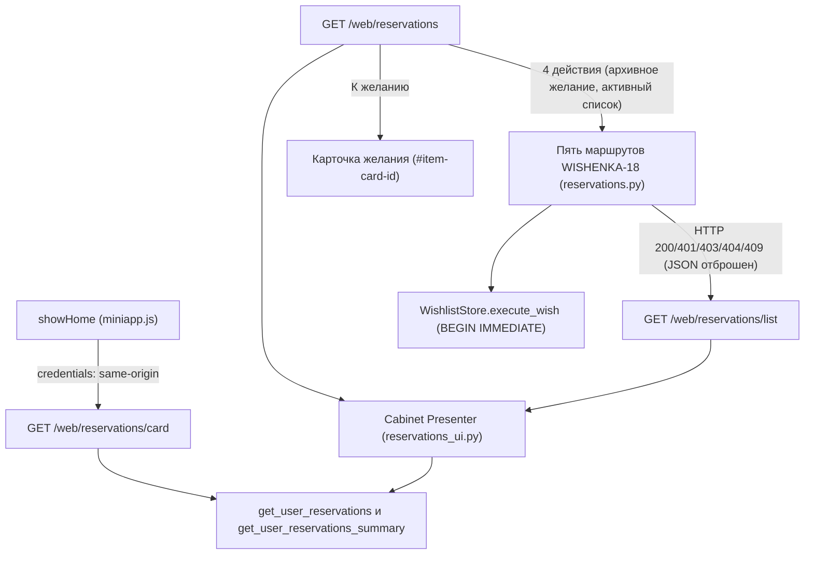
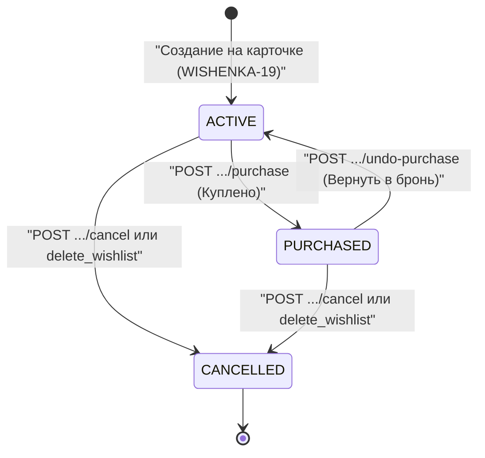

# Спецификация: WISHENKA-20 — Кабинет «Мои бронирования» и карточка на главной

**Задача:** `WISHENKA-20`  
**Подсистема:** Telegram Mini App и домен бронирований (`wishenka.web`, `wishenka.wishlists`)  
**Язык реализации:** Python 3.12+ (FastAPI, Jinja2, HTMX 1.9.12, JavaScript)  
**Связанные задачи:** `WISHENKA-18` (API обещаний), `WISHENKA-19` (управление на карточке желания), `WISHENKA-57` (правила учёта количества), `WISHENKA-123` (окно инициализации CSRF-токена)

## 1. Назначение и бизнес-цель

### 1.1. Постановка проблемы

В продукте уже реализованы действия дарителя с обещаниями (`WISHENKA-18`), правила количественного учёта и остатка (`WISHENKA-57`), а также блок управления на карточке желания (`WISHENKA-19`). Однако до выполнения `WISHENKA-20`:

- На главном экране Telegram Mini App отсутствовал сводный счётчик удерживаемых подарков и точка входа к списку собственных броней.
- Пользователь, забронировавший подарки в нескольких вишлистах, был вынужден вручную открывать каждый список и просматривать карточки желаний, чтобы вспомнить свои обязательства, изменить количество или отметить покупку.
- При переносе желания в архив на активном вишлисте карточка на странице списка теряла блок элементов управления дарителя (`partials/archived_items_section.html` содержит только строку заголовка и кнопку восстановления для редактора), из-за чего существующая бронь оставалась без доступного пользовательского интерфейса для корректировки или отмены.

### 1.2. Цели и продуктовая ценность

**Цели задачи:**

1. Добавить на главный экран идентифицированного пользователя карточку **«Мои бронирования»** со счётчиком уникальных желаний, по которым у вызывающего есть действующие обязательства.
2. Реализовать экран кабинета **«Мои бронирования»**, собирающий в одном месте все собственные занимающие обещания пользователя (`ACTIVE` и `PURCHASED`), сгруппированные по вишлистам.
3. Обеспечить понятный маршрут возврата к действиям: переход «К желанию» для активных желаний и прямое управление бронью из строки кабинета, когда карточка желания больше не содержит кнопок дарителя (архивное желание в активном вишлисте).
4. Гарантировать **принцип сюрприза** и приватность: показывать только обещания самого вызывающего, скрывать других дарителей, не раскрывать получателю бронирования его подарков и не отображать кабинет и счётчик анонимным посетителям.

**Ценность для пользователя и системы:**

- **Для дарителя:** быстрая оценка текущей нагрузки по подаркам прямо с главного экрана, обзор всех обязательств по поводам и вишлистам на одном экране и защита от блокировки бронирования при архивации желания.
- **Для получателя:** сохранение тайны сюрприза, включая случай владельца личного вишлиста и получателя конкретного желания в совместном списке.
- **Для архитектуры сервиса:** переиспользование существующей модели чтения (`get_user_reservations`, `get_user_reservations_summary`) и пяти маршрутов записи `WISHENKA-18` без создания второго хранилища броней, второго баланса единиц и дублирующих блокировок.

### 1.3. Границы задачи

**Входит в область `WISHENKA-20`:**

- Карточка «Мои бронирования» и её бейдж на главной странице Mini App для идентифицированного пользователя.
- Экран кабинета и частичный шаблон списка с группировкой по вишлистам и сортировкой в веб-слое.
- Доработка заполнения `recipient_name` и добавление поля `change_ceiling` в `MyReservationItemDTO`.
- Ссылка «К желанию» и вывод четырёх действий управления только при отсутствии кнопок на карточке желания и активности вишлиста.
- Клиентское обновление списка после мутации и обработка конкурентной занятости (`503`).

**Вне области `WISHENKA-20` (Non-Goals):**

- Изменение правил учёта количества и баланса (`WISHENKA-57`).
- Добавление новых маршрутов записи, второго набора кнопок на карточке желания или редактирование более ранней брони при активной карточке (`WISHENKA-18`, `WISHENKA-19`).
- Поиск, фильтрация, теги, пользовательская сортировка в кабинете, история отменённых обещаний.
- Экраны и правила отметки получения подарка, тексты уведомлений, платежи и краудфандинг, а также перевод остальной части главного экрана Mini App.

> Примечание: последующие задачи развития кодовой базы (`WISHENKA-24`, `WISHENKA-219`, `WISHENKA-140`, `WISHENKA-176`, внедрение каталога `i18n`) расширили общие файлы поддержкой полностью полученных желаний, действием завершения брони, выносом скрипта из `base.html` в `static/app.js` и оптимизацией индексного чтения в SQLite. В настоящей спецификации зафиксированы проектный контур и контракты `WISHENKA-20` с указанием актуальных точек интеграции.

## 2. Функциональные требования и пользовательские сценарии

### 2.1. Правило активного счётчика (`active count`)

Активный счётчик используется как единое определение для бейджа на главной карточке:

- Учитывается число **уникальных желаний** (`wish_item_id`), по которым вызывающий пользователь удерживает хотя бы одно **занимающее обещание** — в статусе `ACTIVE` («Забронировано») или `PURCHASED` («Куплено»).
- Обещания в статусе `CANCELLED` в счётчик не входят.
- Количество забронированных экземпляров (единиц) не влияет на значение счётчика.
- Если пользователь держит два или более занимающих обещаний на одно и то же желание, в кабинете каждое обещание отображается отдельной строкой, но желание засчитывается в счётчике **один раз**.
- Купленное (`PURCHASED`) обещание остаётся в счётчике и в кабинете, так как продолжает занимать единицы желания (отметка покупки и отметка получения в контуре `WISHENKA-20` не закрывают бронь автоматически).
- Обещания на архивное желание и на желание в архивном вишлисте продолжают учитываться, пока находятся в статусе `ACTIVE` или `PURCHASED`. Удаление вишлиста переводит все его занимающие обещания в `CANCELLED`, после чего они исключаются из счётчика и кабинета.

### 2.2. Пользовательские сценарии

| Роль | Сценарий | Ожидаемое поведение |
| --- | --- | --- |
| Даритель (идентифицирован) | Открывает главный экран Mini App (`showHome`) | После загрузки секций вишлистов видит карточку «Мои бронирования» с бейджем `total_distinct_items` (включая `0`). |
| Даритель без броней | Открывает кабинет с бейджем `0` | Видит страницу со словами «Нет бронирований» без групп `.reservation-group` и строк. |
| Даритель с бронями | Открывает кабинет «Мои бронирования» | Видит свои обещания (`ACTIVE`, `PURCHASED`), сгруппированные по вишлистам, с названием списка, событием/датой (при наличии), статусом, количеством и адресатом. |
| Даритель (активное желание) | Просматривает строку активного желания | Строка содержит только ссылку «К желанию» (переход на `#item-card-{wish_item_id}`). Кнопки мутаций в кабинете скрыты; более раннее обещание при нескольких бронях перечислено в списке, но не редактируется из кабинета. |
| Даритель (архивное желание, активный список) | Управляет бронью, когда карточка на списке потеряла кнопки дарителя | Видит пометку «Желание в архиве» и четыре действия для конкретной строки (`Изменить`, `Отменить бронь`, `Куплено` или `Вернуть в бронь`), работающие по `reservation_id` именно этой строки. |
| Даритель (архивный или удалённый список) | Пытается просмотреть или изменить бронь | На архивном списке бронь остаётся видимой с пометкой «Вишлист в архиве», кнопки действий скрыты, прямые мутации отклоняются (`409`). После удаления списка бронь отменяется и исчезает из кабинета и бейджа. |
| Владелец личного списка / Получатель | Открывает карточку на главной или кабинет | Никогда не видит чужих бронирований на свои желания. На личном списке владелец является получателем всех желаний, поэтому такие списки не дают записей в его кабинет; на совместном списке скрываются чужие брони на желания, где он указан как `recipient_user_id`. |
| Анонимный посетитель | Открывает сервис по публичной ссылке или без сессии | Не получает ни карточку на главной, ни бейдж `0`, ни страницу кабинета (`401`). |

### 2.3. Входные данные, выходные данные и правила отображения

#### Главная карточка

- Заголовок карточки: **«Мои бронирования»**.
- Ссылка: `/web/reservations`.
- Элемент счётчика `.reservations-badge`: целое число `total_distinct_items` (`>= 0`).
- Загрузка на клиенте выполняется только в `showHome` после рендера трёх секций вишлистов. При неуспешном HTTP-статусе, невалидном фрагменте или сетевой ошибке секции главной страницы остаются нетронутыми.

#### Заголовки групп вишлистов

- Для каждого вишлиста с хотя бы одним занимающим обещанием вызывающего создаётся ровно одна группа `.reservation-group`.
- Порядок групп: лексикографически по возрастанию названия вишлиста без учёта регистра (`title.casefold()`), при равенстве — по возрастанию `wishlist_id`.
- В заголовке группы выводятся:
  - Название вишлиста.
  - Название события (`event_title` после `strip()`), если оно непустое.
  - Дата события (`event_date`) в календарном формате UTC `YYYY-MM-DD` (в базовой поставке `WISHENKA-20`; при подключённом в дальнейшем слое `i18n` форматируется локализованной датой по UTC), если дата задана.

#### Строки обещаний и порядок

- Порядок строк внутри группы: по возрастанию `(created_at, reservation_id)` — от самого раннего обещания к самому позднему.
- Содержимое строки `.reservation-row`:
  - Название желания.
  - Количество экземпляров именно этого обещания (`reserved_quantity`).
  - Статус: **«Забронировано»** (`ACTIVE`) или **«Куплено»** (`PURCHASED`).
  - Получатель желания в формате `Для: {name}` (выводится при непустом значении):
    - **Личный вишлист:** `wishlist.owner_name`; если пусто — `Участник #{owner_id}`. Поля `recipient_name` и `recipient_user_id` на желании игнорируются; строка `Recipient` не используется.
    - **Совместный вишлист с `recipient_user_id`:** `owner_name`, если `recipient_user_id == wishlist.owner_id` и `owner_name` непустое; иначе `Участник #{recipient_user_id}`. Текстовое `recipient_name` не подменяет выбранного участника.
    - **Совместный вишлист без `recipient_user_id`:** очищенное от пробелов значение `recipient_name`; если пусто, строка `Для: ...` не отображается (без подстановки владельца).
  - При архивном желании: **«Желание в архиве»**.
  - При архивном вишлисте: **«Вишлист в архиве»**.
  - Ссылка **«К желанию»** на `/web/wishlists/{wishlist_id}#item-card-{wish_item_id}`.
- Когда `offer_actions == True` (желание в архиве и вишлист активен), дополнительно отображаются:
  - Форма изменения количества: `<select name="quantity">` со значениями от `1` до `change_ceiling` (текущее `quantity` выбрано) и кнопка **«Изменить»**.
  - Кнопка **«Отменить бронь»**.
  - Кнопка **«Куплено»** (когда статус `ACTIVE` / «Забронировано») либо **«Вернуть в бронь»** (когда статус `PURCHASED` / «Куплено»).

#### Уведомления при ответах на действия в кабинете

- Успех (`200` / `201`): обновление `#reservations-cabinet` через `GET /web/reservations/list` без уведомления об ошибке. Отмена последнего обещания на желании уменьшает активный счётчик, а отмена последнего обещания в вишлисте удаляет всю группу из списка.
- Нехватка единиц (`409` с подстрокой `available` в теле ответа): обновление списка с query-параметрами `notice=shortage&reservation_id={id}` и вывод текста **«Бронь не изменилась. Свободно: N.»**, где `N = max(0, change_ceiling - reserved_quantity)`.
- Прочий отказ (`409` без `available`, `401`, `403`, `404`): обновление списка с `notice=refused` и вывод текста **«Бронь не изменилась.»**. Сырой текст `detail` и имена других дарителей не выводятся.
- Конкурентная занятость (`503`, `InventoryBusyError`): список не перезагружается; в элементе `[data-reservation-busy]` текущей строки выводится **«Желание занято, бронь не изменилась. Повторите попытку.»**, а прежние данные строки остаются на экране.

### 2.4. Продуктовые инварианты

1. **Изоляция получателя и тайна сюрприза:** строка кабинета не содержит имён, идентификаторов, статусов покупки и количеств других дарителей; в выпадающем списке количества и сообщениях об отказе не раскрываются чужие брони; владелец личного списка является получателем каждого его желания, независимо от текстового поля `recipient_name`.
2. **Единый источник истины по количеству:** кабинет не хранит отдельный баланс; допустимость изменения количества проверяется исключительно правилами `WISHENKA-57` (`available_quantity = max(0, desired - received - occupied)`).
3. **Запрет двойных элементов управления:** пока карточка желания на странице списка содержит кнопки дарителя, кабинет не дублирует их и не позволяет редактировать раннее обещание в обход карточки `WISHENKA-19`.
4. **Отсутствие анонимного кабинета:** публичный доступ по ссылке никогда не порождает карточку или нулевой счётчик «Мои бронирования».

## 3. Архитектура, компоненты и интерфейсы

### 3.1. Компонентная схема и поток данных

Кабинет реализован как серверно-рендеримое HTML-представление на базе существующих доменных запросов чтения и пяти существующих маршрутов мутации `WISHENKA-18`.

### 3.2. Модули, классы и функции

| Модуль / Файл | Ключевые символы | Назначение |
| --- | --- | --- |
| `wishenka/wishlists/service.py` | `WishlistService.get_user_reservations`, `WishlistService.get_user_reservations_summary`, `WishlistService._cabinet_recipient_name` | Проекция занимающих обещаний вызывающего (`ACTIVE`, `PURCHASED`), расчёт `total_distinct_items`, `change_ceiling` и `recipient_name` без раскрытия других дарителей. |
| `wishenka/wishlists/schemas.py` | `MyReservationItemDTO`, `UserReservationsSummaryDTO`, `PromiseActionDTO`, `ReservationQuantityDTO` | Неизменяемые DTO-контракты чтения кабинета, бейджа и записи обещаний. |
| `wishenka/web/routes/reservations_ui.py` | `router`, `CabinetRow`, `CabinetGroup`, `_event_day`, `_row`, `_groups`, `_remainder`, `_list_context`, `_load_items`, `reservations_card`, `reservations_list`, `reservations_page` | Авторизация через `get_current_user`, группировка и сортировка, вычисление `offer_actions`, рендеринг HTML-ответов. |
| `wishenka/web/app.py` | `create_app`, `reservations_ui_router` | Регистрация роутера `reservations_ui` рядом с остальными веб-роутерами. |
| `wishenka/web/templates/partials/reservations_card.html` | `.reservations-title`, `.reservations-badge` | Фрагмент карточки главной страницы со ссылкой `/web/reservations`. |
| `wishenka/web/templates/reservations_cabinet.html` | `` | Полная страница кабинета с `viewer_identified=True` и включением списка. |
| `wishenka/web/templates/partials/reservations_list.html` | `#reservations-cabinet`, `.reservation-group`, `.reservation-row`, `[data-reservation-busy]` | Частичный шаблон списка для начальной отрисовки и HTMX/fetch-обновления. |
| `wishenka/web/static/miniapp.js` | `showHome`, `node` | Асинхронная загрузка `/web/reservations/card` только в `showHome` и безопасная вставка через `DOMParser` и `textContent`. |
| `wishenka/web/templates/base.html` / `wishenka/web/static/app.js` | Обработчик `htmx:afterRequest` (ветка `.reservation-row`), `DOMContentLoaded` (`/api/auth/csrf`) | Перехват ответов на действия в кабинете и обновление `#reservations-cabinet` или вывод сообщения `503`. *(В проекте `WISHENKA-20` обработчик размещался в `base.html`, затем скрипт был вынесен в `static/app.js`.)* |
| `wishenka/web/routes/reservations.py` | `execute`, `create_reservation`, `update_reservation_quantity`, `cancel_reservation`, `purchase_reservation`, `undo_reservation_purchase` | Существующие маршруты записи `WISHENKA-18` через `WishlistStore.execute_wish` (`BEGIN IMMEDIATE`). |

### 3.3. Контракты данных

#### `MyReservationItemDTO` (`wishenka/wishlists/schemas.py`, `frozen=True`)

Поля, используемые кабинетом в рамках `WISHENKA-20`:

- `reservation_id: int` — идентификатор конкретного обещания.
- `wish_item_id: int` — идентификатор желания.
- `wishlist_id: int` — идентификатор вишлиста.
- `wishlist_title: str` — название вишлиста.
- `recipient_name: str` — отображаемое имя получателя по правилам `_cabinet_recipient_name`.
- `item_title: str` — название желания.
- `reserved_quantity: int` — количество единиц в данном обещании.
- `status: ReservationStatus` — `ACTIVE` или `PURCHASED`.
- `event_title: str | None = None` — название события вишлиста.
- `event_date: datetime | None = None` — дата события вишлиста.
- `is_item_archived: bool = False` — флаг архивации желания.
- `is_wishlist_archived: bool = False` — флаг архивации вишлиста.
- `created_at: datetime`, `updated_at: datetime` — временные метки обещания.
- `change_ceiling: int = 0` — верхняя граница для выпадающего списка изменения: `reservation.quantity + item.available_quantity`.

#### `UserReservationsSummaryDTO` (`wishenka/wishlists/schemas.py`, `frozen=True`)

- `user_id: int` — Telegram ID вызывающего.
- `total_active_reservations: int` — общее число занимающих строк (на карточке не отображается).
- `total_distinct_items: int` — число уникальных `wish_item_id` в статусах `ACTIVE` и `PURCHASED` (выводится в `.reservations-badge`).

#### Структуры представления (`wishenka/web/routes/reservations_ui.py`)

- `CabinetGroup` (`frozen=True`): `wishlist_id: int`, `title: str`, `event_title: str | None`, `event_date: str | None`, `list_archived: bool`, `rows: tuple[CabinetRow, ...]`.
- `CabinetRow` (`frozen=True`): `reservation_id: int`, `wish_item_id: int`, `wishlist_id: int`, `item_title: str`, `quantity: int`, `status_label: str`, `is_purchased: bool`, `for_name: str`, `wish_archived: bool`, `list_archived: bool`, `offer_actions: bool`, `change_ceiling: int`, `wish_href: str`.
- Расчёт `offer_actions` в контуре `WISHENKA-20`: `is_item_archived and not is_wishlist_archived`.

### 3.4. HTTP-интерфейсы

#### Маршруты чтения (`wishenka/web/routes/reservations_ui.py`)

Все три маршрута регистрируются как фиксированные пути (без параметрического `/{reservation_id}`) и защищены зависимостью `Depends(get_current_user)`.

| Метод и путь | Параметры запроса | Успешный ответ | Ошибка без сессии |
| --- | --- | --- | --- |
| `GET /web/reservations/card` | — | `200 OK`, HTML-фрагмент `partials/reservations_card.html` | `401` `{"detail": "Authentication required"}` |
| `GET /web/reservations` | — | `200 OK`, HTML-страница `reservations_cabinet.html` (`viewer_identified=True`) | `401` `{"detail": "Authentication required"}` |
| `GET /web/reservations/list` | `notice` (`shortage` \| `refused`, иные отбрасываются), `reservation_id` (для `shortage`) | `200 OK`, HTML-фрагмент `partials/reservations_list.html` | `401` `{"detail": "Authentication required"}` |

#### Маршруты записи (используемые из строки кабинета при `offer_actions == True`)

Префикс: `/api/wishlists/{wishlist_id}/items/{item_id}/reservations`. Все формы и кнопки устанавливают `hx-swap="none"`, поэтому JSON-тело ответа `PromiseActionDTO` не вставляется в DOM.

| Кнопка в кабинете | Метод и путь | Тело / атрибуты | Коды ответа |
| --- | --- | --- | --- |
| `Изменить` | `PATCH /{reservation_id}` | `{"quantity": N}`, `hx-ext="json-enc"` | `200`, `400`, `401`, `403`, `404`, `409`, `503` |
| `Отменить бронь` | `POST /{reservation_id}/cancel` | — | `200`, `401`, `403`, `404`, `409`, `503` |
| `Куплено` (при `ACTIVE`) | `POST /{reservation_id}/purchase` | — | `200`, `401`, `403`, `404`, `409`, `503` |
| `Вернуть в бронь` (при `PURCHASED`) | `POST /{reservation_id}/undo-purchase` | — | `200`, `401`, `403`, `404`, `409`, `503` |

### 3.5. Переходы состояний обещаний и клиентского UI

В рамках `WISHENKA-20` состояние обещания описывается тремя состояниями модели `ReservationStatus`: `ACTIVE`, `PURCHASED` и `CANCELLED` (а также учитывается удаление родительского вишлиста).

Обработка ответа в слушателе `htmx:afterRequest` при наличии ближайшего предка `.reservation-row` (отдельно от ветки `.item-card`):

- **Статус `200` / `201`:** отбрасывает JSON, выполняет `fetch('/web/reservations/list')`, заменяет `#reservations-cabinet` через `outerHTML` и вызывает `htmx.process`.
- **Статус `409`:** при наличии подстроки `available` в `responseText` запрашивает `/web/reservations/list?notice=shortage&reservation_id={id}`, иначе `?notice=refused`.
- **Статус `401`, `403` или `404`:** запрашивает `/web/reservations/list?notice=refused`.
- **Статус `503`:** не запрашивает `/web/reservations/list` и не обновляет `#reservations-cabinet`; раскрывает `[data-reservation-busy]` в текущей строке с фиксированным текстом «Желание занято, бронь не изменилась. Повторите попытку.».

## 4. Нефункциональные требования, безопасность и наблюдаемость

### 4.1. Производительность и согласованность

- **Задержка отклика:** задача не вводит новых целевых нормативов времени ответа (`latency target`); открытие главной страницы и кабинета должно оставаться таким же отзывчивым, как загрузка главного экрана Mini App.
- **Отсутствие второй таблицы и второго замка:** маршруты кабинета не открывают `execute_wish`, не запускают вторую транзакцию записи и не формируют второй инвентарный баланс. Все мутации выполняются одной транзакцией уровня желания `WishlistStore.execute_wish` (`BEGIN IMMEDIATE` в SQLite WAL с `busy_timeout = 5000` мс).
- **Сетевой профиль главной:** `showHome` добавляет один фоновый GET-запрос `/web/reservations/card` после отображения основных секций; его отказ не блокирует интерфейс.
- **Связанное чтение:** в базовой реализации `WISHENKA-20` вызов `get_user_reservations` / `get_user_reservations_summary` через `WishlistStore` использовал полный снимок чтения (`WishlistStore.execute`), оставаясь вне `_RESERVATION_INVENTORY_METHODS`.

### 4.2. Безопасность, приватность и принцип сюрприза

- **Отказ анонимам по умолчанию:** все три маршрута `reservations_ui.py` используют `get_current_user` (а не `get_optional_current_user`), поэтому неидентифицированный запрос всегда завершается `401` без раскрытия HTML кабинета или нулевого бейджа. `publicView`, `invitationView`, оболочка `GET /` и страница `GET /share/{public_token}` не запрашивают и не рендерят фрагмент карточки.
- **Строгая изоляция данных (Zero-Leak):**
  - `get_user_reservations` отбирает исключительно записи с `user_id` вызывающего и статусами `ACTIVE` / `PURCHASED`.
  - Получатель подарка (владелец личного списка для любого желания этого списка и `recipient_user_id` в совместном списке) блокируется политикой `WishlistAccessPolicy.is_recipient` от создания собственных броней (`SelfReservationError`), поэтому чужие обещания не могут попасть в его кабинет.
  - В HTML-шаблоне кабинета отсутствуют слоты для чужих броней; тексты отказов `notice=shortage`, `notice=refused` и `503` не выводят `detail` ответа и имена других дарителей.
- **Защита от XSS и политика CSP:**
  - Оболочка `GET /` сохраняет строгий заголовок `Content-Security-Policy` (`default-src 'self'; script-src 'self' https://telegram.org`), не подключая скрипты с `unpkg`.
  - В `miniapp.js` фрагмент карточки парсится через `DOMParser().parseFromString(..., 'text/html')` (скрипты внутри разобранного документа не исполняются), после чего через `node()` (`textContent`) копируются только `href`, текст заголовка и текст бейджа — `innerHTML`, `insertAdjacentHTML` и `createContextualFragment` не используются.
  - На странице `/web/reservations` (наследуемой от `base.html`) используется HTMX 1.9.12 и расширение `json-enc` с `unpkg`, а ответы мутаций отбрасываются (`hx-swap="none"`).
- **Защита от CSRF:** страница кабинета передаёт `viewer_identified=True` (`data-viewer-identified="true"` на `body`), что активирует загрузку `GET /api/auth/csrf` и подстановку заголовка `X-CSRF-Token` к небезопасным HTMX-запросам (для cookie-сессий `BrowserSecurityMiddleware` проверяет `Origin` и `X-CSRF-Token`; тестовые и API-клиенты с `Authorization: Bearer ...` работают без этих заголовков).

### 4.3. Наблюдаемость: структурированное логирование и метрики

#### Логирование

В контуре `WISHENKA-20` маршруты чтения в `wishenka/web/routes/reservations_ui.py` **не пишут собственных логов**:

- На этапе наблюдаемости были удалены два ранее добавленных `INFO`-события (`reservations_card_rendered` с `distinct_items` и `reservations_cabinet_rendered` с `groups`), поскольку они включали `telegram_id` вызывающего дарителя в сообщение и `extra.user_id` при обычном чтении без изменения состояния.
- Уровни `EMERG`, `ALERT`, `CRIT`, `NOTICE` и новые события уровня `ERROR` не используются.

Все серверные события мутаций поступают из существующего адаптера `execute` в `wishenka/web/routes/reservations.py` (логгер `wishenka.web.reservations`) и слоя аутентификации (`wishenka.auth`):

| Визуальный исход в браузере | Существующее серверное событие | Уровень и контекст (`extra`) |
| --- | --- | --- |
| Успешная замена `#reservations-cabinet` (`HTTP 200`) | `reservation_action_completed` | `INFO`; `operation`, `item_id`, `reservation_id`, `status`. |
| Обновление с `notice=shortage` (`HTTP 409`) | `reservation_conflict` | `WARNING`; `operation`, `item_id` или `reservation_id`. |
| Обновление с `notice=refused` (`HTTP 401`/`403`/`404`/`409`) | `reservation_action_refused` / `reservation_permission_denied` / `reservation_conflict` / `auth_failure` | `WARNING`; `operation`, идентификаторы пути и `http_status` (для `403`/`404`); для `auth_failure` — причина (`missing_credentials` или `invalid_session_token`). |
| Сообщение занятости в строке без замены списка (`HTTP 503`) | `reservation_inventory_busy` | `WARNING`; `operation`, идентификаторы пути (плюс `wishlist_inventory_busy` на `wishenka.wishlists.store`). |

**Конфиденциальность логов:** существующие записи о мутациях используют структурированный формат (`extra={"event": ...}`, JSON при `json_logs`) и не содержат `telegram_id` дарителя, ID получателя, имён, количеств, токенов, тела запроса, дампов строк или текста SQL.

#### Метрики

Отдельный экспортёр метрик (Prometheus/Grafana/алертинг) в сервисе не подключён; продуктовые и технические счётчики задержек или пропускной способности для кабинета не добавлялись. Производственным сигналом успешных действий, отказов и блокировок SQLite (`busy_timeout`) служат перечисленные события лога `wishenka.web.reservations` и `wishenka.wishlists.store`.

## 5. Верификация и критерии приёмки

### 5.1. Автоматизированные тестовые сценарии

Набор регрессионных и приёмочных тестов сосредоточен в `tests/test_reservations_cabinet_ui.py` (`pytestmark = pytest.mark.timeout(30)`). Среда тестирования: `create_app` на временном файле SQLite, авторизация через `SessionTokenService` (Bearer), сидирование через `app.state.domain_service` и существующие маршруты обещаний, разбор HTML через `BeautifulSoup`, имитация `503` через `monkeypatch` `wishlist_store.execute_wish` (`InventoryBusyError`), без запуска Telegram, второго процесса и браузера.

1. `test_home_card_counts_distinct_wishes` — проверка подсчёта уникальных желаний на бейдже (`1` при двух обещаниях на одно желание и одном отменённом обещании на другом; не `2` и не сумма единиц), запроса `/web/reservations/card` из `showHome` (и отсутствия в `publicView`/`invitationView`) и вставки через `node()` без `innerHTML`/`insertAdjacentHTML`/`createContextualFragment`.
2. `test_empty_cabinet` — проверка бейджа `0`, ответа `200` на `/web/reservations`, заголовка «Мои бронирования», текста «Нет бронирований» и отсутствия групп `.reservation-group`.
3. `test_anonymous_gets_neither` — проверка ответа `401` на `/web/reservations/card`, `/web/reservations`, `/web/reservations/list` без текста «Мои бронирования», «Нет бронирований» и бейджа `0`, а также отсутствия карточки на `/share/{public_token}` и в оболочке `/`.
4. `test_groups_only_the_callers_promises` — проверка группировки, сортировки по `str.casefold` (включая кириллицу) с тай-брейком `wishlist_id`, порядка строк по `(created_at, reservation_id)`, вывода события и даты (при наличии), отсутствия отменённых броней, незабронированных списков и сведений о других дарителях.
5. `test_personal_owner_and_collaborative_recipient` — проверка того, что на личном списке владелец не видит чужих броней в своём кабинете, а даритель видит имя владельца (не текстовое `recipient_name` и не `Recipient`); на совместном списке исключение работает по `recipient_user_id` (`owner_name` или `Участник #{id}`).
6. `test_active_wish_offers_only_the_link` — проверка наличия только ссылки «К желанию» (`/web/wishlists/{wishlist_id}#item-card-{item_id}`) на активном желании в активном списке (включая более раннюю бронь) и отсутствия кнопок и URL `/reservations/`.
7. `test_archived_wish_on_active_list_offers_each_promise` — проверка вывода «Желание в архиве» и четырёх элементов управления с собственным `reservation_id` каждой строки (включая раннюю бронь), `hx-ext="json-enc"`, `hx-swap="none"` и диапазоном `1..change_ceiling` без чужих дарителей.
8. `test_archived_list_refuses_the_four` — проверка сохранения строки с «Вишлист в архиве» без четырёх кнопок, отказа `409` на прямых маршрутах мутации и отсутствия `detail` в HTML.
9. `test_deleted_list_leaves_the_cabinet` — проверка удаления обещаний и пустой группы из кабинета и пересчёта бейджа после `delete_wishlist`.
10. `test_success_refresh_hides_the_other_gifter` — проверка `hx-swap="none"`, клиентской логики `.reservation-row` (запрос `/web/reservations/list` при `200`, отсутствие запроса `/card` желания и подстановки `xhr.responseText`) и отсутствия данных другого дарителя в обновлённом фрагменте.
11. `test_busy_response_does_not_look_saved` — проверка неизменности обещания в SQLite при `InventoryBusyError` (`503`), отсутствия имени дарителя в `detail`, сохранения `#reservations-cabinet` на месте и вывода «Желание занято, бронь не изменилась. Повторите попытку.» в `[data-reservation-busy]`.

### 5.2. Результаты валидации (на момент завершения WISHENKA-20)

- Статический анализ (`make analyze`: Ruff lint, Ruff format check, Mypy по 82 файлам): выполнен без ошибок и предупреждений.
- Целевой набор тестов (`.venv/bin/pytest tests/test_reservations_cabinet_ui.py -q`): **11 passed**; каждый тест ограничен таймаутом `30` секунд.
- Полный прогон всего тестового пакета и ручной прогон в живом браузере не выполнялись; проверка отдаваемой разметки и скриптов Mini App/кабинета выполнена автоматизированно.

### 5.3. Критерии приёмки (Definition of Done)

1. Идентифицированный пользователь видит карточку «Мои бронирования» на главной странице с бейджем активного счётчика (включая `0`); при `0` кабинет отображает «Нет бронирований» без групп.
2. Неидентифицированный посетитель не получает ни карточку, ни нулевой бейдж, ни экран кабинета (в том числе по публичной ссылке).
3. Кабинет отображает только занимающие обещания вызывающего (`ACTIVE`, `PURCHASED`), сгруппированные по одному разу на вишлист, в алфавитном порядке без учёта регистра и по времени создания внутри группы.
4. Строка выводит название желания, количество конкретного обещания, «Забронировано» или «Куплено», адресата (владелец для личного списка; назначенный участник или текстовое имя для совместного), а также пометки архивации желания и вишлиста без сведений о других дарителях.
5. Получатель желания (владелец личного списка по всем его желаниям; указанный `recipient_user_id` в совместном списке) не получает чужих броней в свой кабинет; текстовое имя само по себе не делает пользователя получателем.
6. Несколько занимающих обещаний одного дарителя на одно желание выводятся отдельными строками, но дают `+1` к бейджу.
7. Для желания с кнопками дарителя на карточке строка предлагает только «К желанию»; при отсутствии кнопок на карточке и активности списка строка предлагает «Изменить», «Отменить бронь», «Куплено» и «Вернуть в бронь».
8. Архивный или удалённый вишлист отклоняет все четыре действия; при архивации списка строка остаётся с «Вишлист в архиве», при удалении — исключается из кабинета и счётчика.
9. Все тексты, введённые задачей, соответствуют согласованной русской копии; реализация выполнена на Python 3.12+.

### 5.4. Известные ограничения и технический долг

По результатам анализа технического долга (`60-tech-debt.md`) новых блокирующих или отдельных follow-up задач в рамках `WISHENKA-20` не открывалось:

- **Неблокер — низкий приоритет (`WISHENKA-123`):** на страницах, расширяющих `base.html`, запрос `GET /api/auth/csrf` запускается по событию `DOMContentLoaded`. Если пользователь с cookie-сессией нажмёт кнопку действия в кабинете до завершения этого запроса или при его сбое, запрос уйдёт без `X-CSRF-Token`. `BrowserSecurityMiddleware` отклонит его с HTTP `403` (`Invalid CSRF token`), после чего ветка кабинета воспримет `403` как `notice=refused` и выведет «Бронь не изменилась.» без сохранения данных в БД (поведение fail-closed). Поскольку это тот же общий скрипт и то же окно пустого токена, что и на карточке желания, проблема отслеживается в существующем тикете [WISHENKA-123](https://pypost.atlassian.net/browse/WISHENKA-123). Пробел тестового покрытия: тесты с Bearer-токеном не проверяют это окно для cookie-сессий.
- **Принятые архитектурные компромиссы (не являются долгом задачи):**
  - Использование `get_user_reservations` / `get_user_reservations_summary` через `WishlistStore` (в базовой версии `WISHENKA-20` — снимок `WishlistStore.execute` без второго маршрута записи). *(Последующая оптимизация SQLite-чтения была оформлена отдельно как `WISHENKA-176`.)*
  - Подключение расширения `json-enc` версии 1.9.12 с `unpkg` в `base.html` на странице кабинета при сохранении строгого CSP на оболочке `GET /`.
  - Классификация ответа `409` по наличию подстроки `available` в `responseText` и расчёт свободного остатка для `notice=shortage` по формуле `change_ceiling - reserved_quantity`.
  - Отсутствие отдельного ручного прогона в браузере при программном покрытии отдаваемых HTML-шаблонов и JS-обработчиков.
