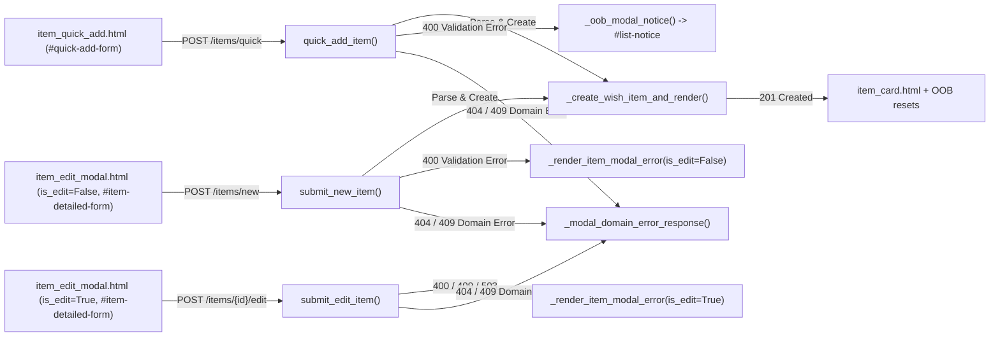

# WISHENKA-209: Preserve form state on Create Item modal validation errors

## Research

Inspected the existing web UI routes, templates, client-side HTMX swap hooks, and test suites:

- **`wishenka/web/routes/items_ui.py`**:
  - `get_new_item_modal` (`GET /web/wishlists/{wishlist_id}/items/new`, lines 527–620) renders `partials/item_edit_modal.html` with `is_edit=False`, `is_collaborative`, `collaborative_members`, and `form` prepopulated from Quick Add / preview query parameters.
  - `quick_add_item` (`POST /web/wishlists/{wishlist_id}/items/quick`, lines 368–524) is currently shared by both the inline Quick Add bar (`#quick-add-form`) and the Create Item modal (`#item-detailed-form` when `is_edit=False`). On any `400` validation failure (empty title, `_parse_optional_int` / `_parse_priority` `ValueError`, or domain `ValueError` from `svc.add_wish_item`), it unconditionally returns `_oob_modal_notice(..., 400)` (lines 403, 422, 480), which sends `

` (closing the modal) and `
...
`.
  - `submit_edit_item` (`POST /web/wishlists/{wishlist_id}/items/{item_id}/edit`, lines 706–925) demonstrates the target modal error pattern via `_render_edit_modal_error` (lines 171–198): it re-renders `partials/item_edit_modal.html` with `form=submitted_form`, `error_message`, `is_collaborative`, `collaborative_members`, and `headers=_RETARGET_MODAL_HEADERS` (`HX-Retarget: #item-modal-container`, `HX-Reswap: innerHTML`).
  - Note on collaborative selection in `submit_edit_item`: early form validation (lines 734–787) passes `is_collaborative=False, collaborative_members=[]` and stores `recipient_user_id` as a `str`, whereas `item_edit_modal.html` line 110 compares `form.recipient_user_id == member.user_id` (`int`). For Create Item modal `400` errors, we must load `(is_collaborative, collaborative_members)` and compare/preserve `recipient_user_id` consistently so collaborative recipient options and selection survive both form-level and domain-level `400` errors.
- **Templates**:
  - `wishenka/web/templates/partials/item_edit_modal.html` (lines 22–32) sets `hx-post="/web/wishlists/{{ wishlist_id }}/items/quick"` when `is_edit` is `False`, and already renders all 11+ form fields (`title`, `link`, `price`, `currency`, `quantity`, `recipient_user_id`, `recipient_name`, `description`, `image_url`, `priority`, `category`) from `form` plus `.alert-error` from `error_message`.
  - `wishenka/web/templates/partials/item_quick_add.html` (`#quick-add-form`) posts to `/web/wishlists/{{ wishlist.id }}/items/quick` with `hx-target="#items-list"` and `hx-swap="beforeend"`.
  - `wishenka/web/templates/wishlist_detail.html` provides `#list-notice`, `#items-list`, and `#item-modal-container`.
- **Client-side HTMX error swap (`wishenka/web/static/app.js`, lines 431–467)**:
  - The `htmx:beforeSwap` listener already checks `fromModal = !!(detail.elt && detail.elt.closest && detail.elt.closest('#item-modal-container'))` and sets `detail.shouldSwap = true; detail.isError = false;` for `>= 400` `text/html` responses originating inside `#item-modal-container`. Combined with `HX-Retarget: #item-modal-container` and `HX-Reswap: innerHTML`, HTMX will swap the re-rendered modal into `#item-modal-container` without modifying `app.js`.
- **Existing tests**:
  - `tests/test_wish_items_tma_ui.py`, `tests/test_wishenka_160_observability.py`, and `tests/test_ssr_i18n_repro.py` test `POST /web/wishlists/{id}/items/quick` directly for Quick Add behavior and structured logging (`ui_item_quick_add_validation_error`).
  - `tests/test_item_modals_repro.py` establishes the SSR + `HX-Retarget`/`HX-Reswap` testing pattern for `item_edit_modal.html`.

## Implementation Plan

1. **Separate Create Item modal submission endpoint from Quick Add bar**:
   - Add `POST /web/wishlists/{wishlist_id}/items/new` (`submit_new_item`) in `wishenka/web/routes/items_ui.py` to handle submissions from `#item-detailed-form` in create mode (`is_edit=False`).
   - Update `wishenka/web/templates/partials/item_edit_modal.html` so that when `is_edit` is `False`, `#item-detailed-form` uses `hx-post="/web/wishlists/{{ wishlist_id }}/items/new"` (mirroring `GET /items/new` -> `POST /items/new` just like `GET /items/{item_id}/edit` -> `POST /items/{item_id}/edit`).
   - Keep `wishenka/web/templates/partials/item_quick_add.html` (`#quick-add-form`) and `quick_add_item` (`POST /items/quick`) isolated for the inline Quick Add bar so its `400` `_oob_modal_notice` behavior remains unchanged.
2. **Extract shared creation & form-parsing helpers in `wishenka/web/routes/items_ui.py`**:
   - Extract form-data normalization / `submitted_form` construction and `201 Created` card + OOB reset rendering into private helpers shared by `quick_add_item` and `submit_new_item` to avoid duplicating item creation logic.
   - Rename `_render_edit_modal_error` to `_render_item_modal_error` (keeping `is_edit: bool = True` default) to reflect its shared create/edit role.
3. **Preserve form state and collaborative context on Create Item modal `400` errors**:
   - In `submit_new_item`, validate inputs (`title`, `price`, `recipient_user_id`, `priority`) and build `submitted_form` with `id: None` and all submitted fields (`title`, `link`, `price`, `currency`, `quantity`, `description`, `image_url`, `priority`, `category`, `recipient_user_id`, `recipient_name`).
   - Load wishlist metadata (`wl = await svc.get_wishlist_by_id(wishlist_id)`, `_ensure_member_and_active(wl, user)`, `is_collaborative`, `collaborative_members`) inside `_execute(request, ...)` so that:
     - Domain access/state errors (`404`/`409`) are handled via `_modal_domain_error_response`.
     - Both form-level `400` errors and domain-level `ValueError` (`400`) re-render `partials/item_edit_modal.html` (`is_edit=False`) via `_render_item_modal_error` with `HX-Retarget: #item-modal-container`, `HX-Reswap: innerHTML`, `error_message`, `form=submitted_form`, `is_collaborative`, and `collaborative_members`.
   - Fix `recipient_user_id` selection matching in `item_edit_modal.html` (compare `|string` when `form.recipient_user_id is not none`) so selected collaborative recipients remain selected regardless of `int` vs `str` representation.

**Mandatory — Failing Repro (next Step 3):**
- **File**: `tests/test_wishenka_209_create_modal_repro.py` (with `pytestmark = pytest.mark.timeout(30)`).
- **Setup**: Isolated SQLite `app_env` + `TestClient` fixture (no live external/Telegram dependencies), seeding a personal wishlist and a collaborative wishlist with an owner and member.
- **What it asserts (desired behavior)**:
  1. `GET /web/wishlists/{id}/items/new` renders `#item-detailed-form` with `hx-post="/web/wishlists/{id}/items/new"` (isolated from `/items/quick`).
  2. `POST /web/wishlists/{id}/items/new` with invalid form data (e.g., non-numeric `price="abc"` or empty `title="   "`) returns HTTP `400` with `HX-Retarget: #item-modal-container`, `HX-Reswap: innerHTML`, renders `#item-edit-sheet` in create mode (`hx-post` still `/items/new`, `.alert-error` present, no `#list-notice` OOB), and preserves all submitted fields (`title`, `link`, `price`, `currency`, `quantity`, `description`, `image_url`, `priority`, `category`).
  3. `POST /web/wishlists/{id}/items/new` with domain validation failure (e.g., invalid `link="ftp://bad.example"`) returns HTTP `400` with `HX-Retarget`/`HX-Reswap`, `.alert-error`, and preserved form values.
  4. `POST /web/wishlists/{id}/items/new` on a collaborative wishlist with invalid input preserves `#recipient-user-select` options, the previously selected `recipient_user_id` (`selected`), and `recipient_name`.
  5. `POST /web/wishlists/{id}/items/quick` with invalid input (`raw_input="   "` or `price="abc"`) continues to return HTTP `400` with `#list-notice` OOB error and `#item-modal-container` OOB clear (no `#item-edit-sheet`).
- **Sequencing**: Research (Step 2, done) -> write red repro in `tests/test_wishenka_209_create_modal_repro.py` and confirm it fails against current production code (Step 3) -> implement `POST /items/new`, template update, and shared helpers until all repro and existing tests pass (Step 4).

## Architecture

### System Module Diagram

### Module Responsibilities

1. **Web Route Layer (`wishenka/web/routes/items_ui.py`)**:
   - `get_new_item_modal` (`GET /web/wishlists/{wishlist_id}/items/new`): Renders `partials/item_edit_modal.html` with `is_edit=False`.
   - `submit_new_item` (`POST /web/wishlists/{wishlist_id}/items/new`): Parses and validates create-modal form inputs, enforces wishlist membership/active state, invokes `WishlistService.add_wish_item`, returns `201 Created` (`item_card.html` + OOB resets) on success, or returns `400` via `_render_item_modal_error(..., is_edit=False)` with preserved `submitted_form` and collaborative member options on validation failure.
   - `quick_add_item` (`POST /web/wishlists/{wishlist_id}/items/quick`): Handles inline Quick Add bar submissions; delegates item creation and `201` rendering to the shared helper, while returning `_oob_modal_notice` on `400` validation errors.
   - `_render_item_modal_error`: Renders `partials/item_edit_modal.html` with `HX-Retarget: #item-modal-container` and `HX-Reswap: innerHTML` for both `is_edit=False` and `is_edit=True`.
   - `_create_wish_item_and_render` (or shared service-call + `201` HTML builder): Encapsulates `svc.add_wish_item`, `project_wish_item`, and `partials/item_card.html` + OOB reset markup.
2. **Template Layer (`wishenka/web/templates/partials/item_edit_modal.html`)**:
   - Routes `is_edit=False` form submissions to `POST /web/wishlists/{{ wishlist_id }}/items/new` with `hx-target="#items-list"` and `hx-swap="beforeend"`.
   - Renders `error_message` banner and repopulates all form fields from `form`, including type-safe `|string` comparison for `recipient_user_id` option selection.
3. **Client HTMX Layer (`wishenka/web/static/app.js`)**:
   - No changes required; existing `htmx:beforeSwap` handler already allows `>= 400` `text/html` swaps for requests originating inside `#item-modal-container`, and `HX-Retarget` / `HX-Reswap` redirects the swap to `#item-modal-container`.

### Interfaces Between Modules

- **Create Modal -> `submit_new_item`**:
  - `POST /web/wishlists/{wishlist_id}/items/new` (`application/x-www-form-urlencoded` form fields: `title`, `link`, `price`, `currency`, `quantity`, `description`, `image_url`, `priority`, `category`, `recipient_user_id`, `recipient_name`).
  - **201 Created**: `HTMLResponse` (`partials/item_card.html` + OOB clears for `#quick-add-preview-target`, `#quick-add-input`, `#empty-items-placeholder`, `#item-modal-container`).
  - **400 Bad Request**: `TemplateResponse("partials/item_edit_modal.html")` with `HX-Retarget: #item-modal-container`, `HX-Reswap: innerHTML`, `is_edit=False`, `form=submitted_form`, `is_collaborative`, `collaborative_members`, `error_message`.
  - **404 / 409**: `_modal_domain_error_response` (`_oob_modal_notice`).
- **Quick Add Bar -> `quick_add_item`**:
  - `POST /web/wishlists/{wishlist_id}/items/quick` (unchanged contract; `400` returns `_oob_modal_notice`).

### Architectural Patterns & Justification

- **Dedicated Endpoint per UI Context (HTMX Route Symmetry)**: Separating `POST /items/new` from `POST /items/quick` avoids overloading a single endpoint with hidden source flags and mirrors the existing `GET/POST /items/{item_id}/edit` pair.
- **Shared Creation Helper (DRY)**: Extracting the `add_wish_item` + `201` OOB card response into a private helper keeps `quick_add_item` and `submit_new_item` concise and prevents behavioral drift on item creation.

## Q&A

- **Q**: Why add `POST /items/new` instead of passing a hidden `source=modal` field to `POST /items/quick`?
  - **A**: `POST /items/new` provides clean REST/HTMX symmetry with `GET /items/new` and `GET/POST /items/{item_id}/edit`, requires no hidden form field plumbing, and keeps `POST /items/quick` and its existing tests completely isolated for the Quick Add bar.
- **Q**: Does `wishenka/web/static/app.js` need changes to swap `400` responses from `POST /items/new`?
  - **A**: No. `app.js` `htmx:beforeSwap` already sets `detail.shouldSwap = true` and `detail.isError = false` whenever `detail.elt.closest('#item-modal-container')` is truthy and the response is `text/html`.
