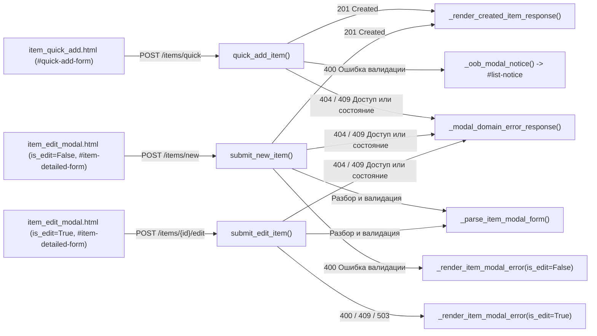
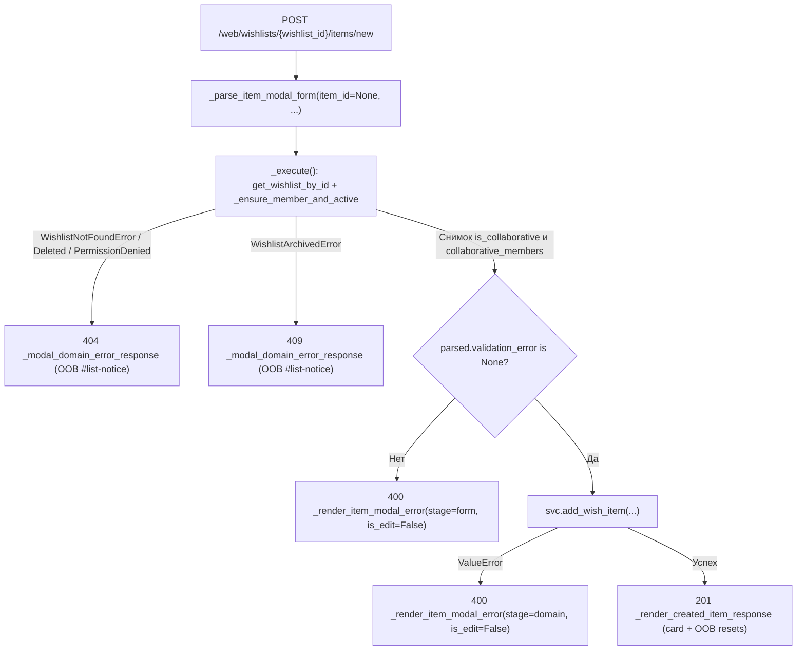

# Спецификация: WISHENKA-209 — Сохранение состояния формы при ошибках валидации в модальном окне создания желания

**Задача:** WISHENKA-209  
**Статус:** реализовано и верифицировано  
**Платформа:** Telegram Mini App (FastAPI + HTMX + Jinja2)  
**Языки интерфейса:** русский (`ru`), английский (`en`)

## 1. Назначение и бизнес-цель

### 1.1. Постановка проблемы

До реализации WISHENKA-209 детальное модальное окно создания желания (`#item-detailed-form` в режиме `is_edit=False`) отправляло данные на общий обработчик `POST /web/wishlists/{wishlist_id}/items/quick` (`quick_add_item`), совместно используемый со встроенной панелью быстрого добавления (`Quick Add Bar`).

При любой ошибке валидации HTTP `400` обработчик `quick_add_item` безусловно возвращал `_oob_modal_notice(...)`: очищал контейнер `#item-modal-container` (закрывая открытое модальное окно) и выводил текст ошибки в область уведомлений страницы `#list-notice`. В результате пользователь терял все введённые данные (до 11 полей формы) и был вынужден заполнять карточку желания с нуля.

### 1.2. Цели и бизнес-ценность

- **Предотвращение потери пользовательских данных:** при ошибке валидации в детальном модальном окне создания (нечисловая цена, пустое название, некорректный ID получателя, доменная ошибка) модальное окно остаётся открытым, отображает понятный баннер ошибки и полностью сохраняет введённые значения всех полей.
- **Консистентность UX:** поведение при ошибках в модальном окне создания выравнивается с модальным окном редактирования желания (`submit_edit_item`).
- **Сохранение быстрого добавления без изменений:** встроенная панель быстрого добавления (`Quick Add Bar`) продолжает обрабатывать ошибки через `#list-notice` без открытия модального окна.
- **Архитектурная симметрия и сопровождаемость:** выделение отдельного маршрута `POST /web/wishlists/{wishlist_id}/items/new` зеркалит пару маршрутов редактирования `GET/POST .../items/{item_id}/edit` и опирается на переиспользуемые функции разбора и рендеринга формы.

## 2. Функциональные требования и пользовательские сценарии

### 2.1. Пользовательские сценарии

- **UC-209-01. Исправление ошибки валидации в модальном окне создания:** владелец или участник вишлиста открывает детальное модальное окно создания желания, заполняет поля и отправляет форму с некорректным значением (например, пустое название или нечисловая цена). Система возвращает HTTP `400`, оставляет модальное окно открытым в режиме создания, показывает локализованное сообщение об ошибке внутри окна и сохраняет все введённые поля для исправления.
- **UC-209-02. Сохранение контекста получателя в совместном вишлисте:** участник совместного вишлиста открывает модальное окно создания, выбирает конкретного получателя из выпадающего списка участников и/или вводит имя получателя вручную, после чего допускает ошибку валидации. При перерисовке окна список доступных участников остаётся заполненным, выбранный получатель отмечен как `selected`, а ручное имя получателя сохранено.
- **UC-209-03. Изоляция встроенной панели быстрого добавления:** при отправке невалидного ввода (например, строки из пробелов) через `#quick-add-form` система выводит уведомление об ошибке в области `#list-notice` и очищает `#item-modal-container`, не открывая модальное окно.
- **UC-209-04. Успешное создание желания из модального окна:** при корректных данных желание сохраняется, система возвращает `201 Created`, добавляет карточку желания в `#items-list`, закрывает модальное окно и сбрасывает состояние панели быстрого добавления.

### 2.2. Функциональное поведение и состав полей формы

Детальное модальное окно создания (`GET` / `POST /web/wishlists/{wishlist_id}/items/new`) принимает и сохраняет при ошибках `400` следующие поля формы (`application/x-www-form-urlencoded`):

| Поле (`name`)       | Обязательность | Клиентские / серверные ограничения | Поведение при ошибке валидации `400` |
| ------------------- | -------------- | ---------------------------------- | ------------------------------------ |
| `title`             | Обязательно    | `maxlength="255"`, обрезка пробелов (`.strip()`); пустое значение даёт ошибку `web.item.empty_title` | Сохраняется обрезанное значение `title.strip()` |
| `link`              | Необязательно  | HTML `type="url"`, `.strip()` | Сохраняется введённая строка |
| `price`             | Необязательно  | `min="0"`, `max="999999999"`, `step="any"`; парсинг в `int \| float \| None` с проверкой `math.isfinite` | При ошибке парсинга сохраняется исходная строка `price.strip()`; при доменной ошибке — распарсенное число |
| `currency`          | Необязательно  | По умолчанию `DEFAULT_CURRENCY` (`RUB`) | Сохраняется выбранный/переданный код валюты |
| `quantity`          | Обязательно    | По умолчанию `1`; `min="1"`, `max="1000"` (`int` в FastAPI `Form()`) | Сохраняется переданное целое значение `quantity` |
| `recipient_user_id` | Необязательно  | Отображается при `is_collaborative=True`; парсинг в `int \| None` через `_parse_optional_int` | При ошибке парсинга сохраняется `recipient_user_id.strip()`; при успехе — `int \| None` (сравнение в шаблоне через `\|string`) |
| `recipient_name`    | Необязательно  | Отображается при `is_collaborative=True`; `maxlength="100"` | Сохраняется введённое имя получателя |
| `description`       | Необязательно  | `maxlength="4000"` | Сохраняется введённый текст |
| `image_url`         | Необязательно  | HTML `type="url"` | Сохраняется введённый URL (и блок предпросмотра при непустом значении) |
| `priority`          | Необязательно  | По умолчанию `"medium"`; допустимые значения `ItemPriority`: `low`, `medium`, `high` | При валидном значении сохраняется выбранный `<option>`; при ошибке сохраняется строка в нижнем регистре |
| `category`          | Необязательно  | `maxlength="50"` | Сохраняется введённая категория |

### 2.3. Правила ответов по результатам отправки

1. **Успешное создание (`201 Created`):**
   - Возвращает HTML-фрагмент `partials/item_card.html` для добавления в конец `#items-list` (`hx-swap="beforeend"`).
   - Включает четыре OOB-фрагмента (`hx-swap-oob`): очистка `#quick-add-preview-target`, сброс поля `#quick-add-input`, удаление `#empty-items-placeholder` и очистка `#item-modal-container` (закрытие модального окна).
2. **Ошибка валидации формы или домена в модальном окне (`400 Bad Request`):**
   - Возвращает перерисованный фрагмент `partials/item_edit_modal.html` с `is_edit=False` и `min_quantity=1`.
   - Устанавливает HTMX-заголовки `HX-Retarget: #item-modal-container` и `HX-Reswap: innerHTML`.
   - Выводит локализованное сообщение в блоке `.alert.alert-error[role="alert"]`.
   - Не добавляет OOB-фрагмент `#list-notice`.
3. **Ошибка доступа или состояния вишлиста (`404 Not Found` / `409 Conflict`):**
   - Возвращает `_modal_domain_error_response`: закрывает `#item-modal-container` и выводит локализованное сообщение в `#list-notice`.
4. **Ошибка валидации в `Quick Add Bar` (`POST .../items/quick`, `400 Bad Request`):**
   - Возвращает `_oob_modal_notice` (закрытие `#item-modal-container` и вывод сообщения в `#list-notice`), не рендерит `#item-edit-sheet`.

### 2.4. Продуктовые и доменные инварианты

- **Сохранение режима создания:** при любой ошибке `400` в `submit_new_item` форма остаётся в режиме создания (`is_edit=False`, `form.id = None`, `hx-post="/web/wishlists/{wishlist_id}/items/new"`, без кнопки архивации).
- **Изоляция точек входа:** поток `Quick Add Bar` (`/items/quick`) и поток детального модального окна (`/items/new`) разделены на уровне маршрутов; скрытые поля маршрутизации не используются.
- **Принцип сюрприза (Surprise Invariant):** форма создания и обработчики ошибок не запрашивают и не передают в шаблон информацию о бронированиях, дарителях или статусах покупки.
- **Доступ и активность списка:** на каждом запросе проверяются членство пользователя в вишлисте и активный статус списка (`WishlistStatus.ACTIVE`).

## 3. Архитектура, компоненты и интерфейсы

### 3.1. Обзор компонентов и поток обработки

### 3.2. Модули, классы и функции

#### Маршруты и хелперы (`wishenka/web/routes/items_ui.py`)

Роутер `router = APIRouter(prefix="/web/wishlists/{wishlist_id}", tags=["items-ui"])` содержит следующие ключевые элементы:

- **`get_new_item_modal` (`GET /web/wishlists/{wishlist_id}/items/new`):** проверяет членство и активность списка (`_ensure_member_and_active`), загружает `is_collaborative` и `_collaborative_members(wl, locale)`, при необходимости классифицирует `raw_input` через `UniversalInputClassifier.classify(...)`, собирает начальный словарь `form_data` (`id=None`) и рендерит `partials/item_edit_modal.html` (`is_edit=False`).
- **`submit_new_item` (`POST /web/wishlists/{wishlist_id}/items/new`):**
  1. Нормализует и валидирует поля через `_parse_item_modal_form(item_id=None, ...)`.
  2. Внутри `_execute(request, action)` загружает вишлист `wl = await svc.get_wishlist_by_id(wishlist_id)`, проверяет `_ensure_member_and_active(wl, user)` и сохраняет снимки `is_collaborative_snapshot` и `collaborative_members_snapshot`.
  3. При отсутствии ошибок формы вызывает `svc.add_wish_item(...)` и проецирует результат через `project_wish_item(item, user)`.
  4. При ошибке формы (`projected_item is None`) или доменном `ValueError` вызывает `_render_item_modal_error(..., status_code=400, is_edit=False)` с сохранением `parsed.form_data` и снимка участников.
  5. При успехе возвращает `_render_created_item_response(...)`.
- **`quick_add_item` (`POST /web/wishlists/{wishlist_id}/items/quick`):** обрабатывает быструю форму `#quick-add-form`; при ошибках `400` возвращает `_oob_modal_notice(...)`, а при `201 Created` использует общий `_render_created_item_response(...)`.
- **`_ParsedItemModalForm` (`@dataclass(slots=True)`) и `_parse_item_modal_form(...) -> _ParsedItemModalForm`:**
  - Общий парсер для `submit_new_item` и `submit_edit_item`.
  - Выполняет обрезку пробелов, проверку непустого `clean_title` (`web.item.empty_title`), парсинг `price` (`_parse_optional_price`), `recipient_user_id` (`_parse_optional_int`) и `priority` (`_parse_priority`).
  - Если `validation_error is None`, обновляет в `submitted_form` типизированные значения `price`, `recipient_user_id` и `priority` (`parsed_priority.value`); если валидация не прошла, в `submitted_form` остаются введённые пользователем строки (`price.strip()`, `recipient_user_id.strip()`, `priority.strip().lower()`).
- **`_render_item_modal_error(...) -> Response`:**
  - Рендерит `partials/item_edit_modal.html` с `headers=_RETARGET_MODAL_HEADERS` (`{"HX-Retarget": "#item-modal-container", "HX-Reswap": "innerHTML"}`), параметром `is_edit` (по умолчанию `True`), `min_quantity=max(1, min_quantity)`, `form=form_data`, `is_collaborative`, `collaborative_members` и `error_message`.
- **`_render_created_item_response(...) -> HTMLResponse`:**
  - Рендерит `partials/item_card.html` с флагами `_editor_card_flags()` (`viewer_identified=True`, `wishlist_active=True`, `is_member=True`) и дописывает OOB-сбросы для `#quick-add-preview-target`, `#quick-add-input`, `#empty-items-placeholder` и `#item-modal-container` со статусом `201`.
- **`_modal_domain_error_response(...) -> HTMLResponse`:**
  - Переводит `WishlistArchivedError` в HTTP `409` (`web.item.archived_wishlist_error`), а прочие ошибки `_DOMAIN_ERRORS` (`WishlistNotFoundError`, `WishlistDeletedError`, `ItemNotFoundError`, `PermissionDeniedError`) — в HTTP `404` (`web.item.resource_not_found`), возвращая `_oob_modal_notice(...)`.

#### Шаблоны и клиентский слой

- **`wishenka/web/templates/partials/item_edit_modal.html`:**
  - Для `#item-detailed-form` при `is_edit=False` задаёт `hx-post="/web/wishlists/{{ wishlist_id }}/items/new"`, `hx-target="#items-list"`, `hx-swap="beforeend"`; при `is_edit=True` — `hx-post="/web/wishlists/{{ wishlist_id }}/items/{{ form.id }}/edit"`, `hx-target="#item-card-{{ form.id }}"`, `hx-swap="outerHTML"`.
  - В списке `#recipient-user-select` выделяет ранее выбранного получателя условием `form.recipient_user_id is not none and (form.recipient_user_id | string) == (member.user_id | string)`, что работает независимо от того, хранится ли ID в `form` как `int` или `str`.
- **`wishenka/web/templates/partials/item_quick_add.html` и `wishenka/web/templates/wishlist_detail.html`:**
  - `#quick-add-form` отправляет запросы на `/web/wishlists/{{ wishlist.id }}/items/quick`; контейнеры `#list-notice`, `#items-list`, `#item-modal-container` обеспечивают целевые зоны HTMX-замены.
- **`wishenka/web/static/app.js` (без изменений):**
  - Глобальный обработчик события `htmx:beforeSwap` проверяет, что запрос отправлен изнутри `#item-modal-container` (`detail.elt.closest('#item-modal-container')`), а ответ имеет `Content-Type: text/html` и статус `>= 400`, после чего выставляет `detail.shouldSwap = true; detail.isError = false;`. Это позволяет HTMX корректно применить заголовки `HX-Retarget` и `HX-Reswap`.

### 3.3. Контракты HTTP-интерфейсов

| Метод и путь                                | Назначение                     | Успешный ответ                    | Ошибка валидации `400`                             | Доменная ошибка `404` / `409`       |
| ------------------------------------------- | ------------------------------ | --------------------------------- | -------------------------------------------------- | ----------------------------------- |
| `GET /web/wishlists/{wishlist_id}/items/new`  | Открытие окна создания желания | `200`, `partials/item_edit_modal.html` (`is_edit=False`) | — | OOB `#item-modal-container` + `#list-notice` |
| `POST /web/wishlists/{wishlist_id}/items/new` | Создание желания из окна       | `201`, `item_card.html` + 4 OOB-сброса | `partials/item_edit_modal.html` (`is_edit=False`), `HX-Retarget: #item-modal-container`, `HX-Reswap: innerHTML` | OOB `#item-modal-container` + `#list-notice` |
| `POST /web/wishlists/{wishlist_id}/items/quick` | Быстрое добавление из панели | `201`, `item_card.html` + 4 OOB-сброса | OOB `#item-modal-container` + `#list-notice` | OOB `#item-modal-container` + `#list-notice` |

### 3.4. Переходы состояний при отправке `POST /items/new`

## 4. Нефункциональные требования, безопасность и наблюдаемость

### 4.1. Производительность и ресурсные ограничения

- Новые таблицы БД, миграции и внешние сетевые вызовы не добавляются; операции выполняются через существующий `WishlistService` и транзакционный `_execute`.
- При ошибке валидации формы (`parsed.validation_error is not None`) `submit_new_item` выполняет одно чтение вишлиста по первичному ключу внутри `_execute(request, action)`, чтобы проверить права/статус и сохранить актуальный список участников для совместного вишлиста. Накладные расходы на один запрос минимальны.
- Ограничения размера вводимых полей поддерживаются атрибутами HTML-шаблона (`title` до 255 символов, `recipient_name` до 100, `category` до 50, `description` до 4000, `quantity` от 1 до 1000, `price` от 0 до 999999999 и проверка конечности `math.isfinite`) и доменной валидацией в `WishlistService.add_wish_item`.

### 4.2. Безопасность, контроль доступа и приватность

- **Обязательная аутентификация и RBAC:** оба маршрута `/items/new` требуют `AuthenticatedUser` (`Depends(get_current_user)`) и вызывают `_ensure_member_and_active(wl, user)`. Посторонний пользователь, удалённый или отсутствующий список приводят к `404`, архивный список — к `409`.
- **Экранирование вывода и защита от XSS:** шаблоны Jinja2 автоматически экранируют подставляемые поля `form.*` и `error_message`; OOB-уведомления формируются через `oob_text(...)`, а плейсхолдер быстрого ввода в `_render_created_item_response` экранируется через `html.escape(..., quote=True)`.
- **Приватность и защита ПДн:** пользовательские строковые значения формы (`title`, `description`, `link`, `image_url`, `recipient_name`, исходная строка `price`) и текст `ValueError` не записываются в логи. Данные о бронированиях и дарителях не запрашиваются и не передаются в модальное окно.

### 4.3. Наблюдаемость (Structured Logging и метрики)

Все события логируются через стандартный для модуля логгер `wishenka.web.items_ui` со структурированным словарём `extra={...}` (совместимым с JSON/Loki):

| Событие (`event`)                | Уровень   | Источник                               | Поля `extra`                                                                    | Условие генерации |
| -------------------------------- | --------- | -------------------------------------- | ------------------------------------------------------------------------------- | ----------------- |
| `ui_item_edit_opened`            | `INFO`    | `get_new_item_modal`                   | `event`, `wishlist_id`, `item_id=None`, `actor_id`, `user_id`, `mode="create"`, `is_collaborative` | Открытие окна создания |
| `ui_item_create_validation_error`| `WARNING` | `submit_new_item` (`stage="form"`)     | `event`, `stage="form"`, `status_code=400`, `wishlist_id`, `actor_id`, `user_id` | Ошибка в `_parse_item_modal_form` |
| `ui_item_create_validation_error`| `WARNING` | `submit_new_item` (`stage="domain"`)   | `event`, `stage="domain"`, `status_code=400`, `wishlist_id`, `actor_id`, `user_id` | `ValueError` из `add_wish_item` |
| `ui_modal_domain_error`          | `WARNING` | `_modal_domain_error_response`         | `event`, `operation="new_item"`, `error_type`, `status_code` (`404`/`409`), `wishlist_id`, `item_id=None`, `actor_id`, `user_id` | Список не найден, удалён, архивирован или нет прав |
| `ui_item_create_success`         | `INFO`    | `submit_new_item`                      | `event`, `wishlist_id`, `item_id`, `actor_id`, `user_id`, `has_link`, `price`, `quantity` | Успешное создание (`201`) |

- **Отсутствие дублирования:** общие хелперы `_render_item_modal_error` и `_render_created_item_response` являются чистыми функциями рендеринга и не пишут повторных логов после обработчика маршрута.
- **Метрики:** сборщик метрик Prometheus/OpenTelemetry в проекте не используется; учёт успешных операций и ошибок валидации ведётся по структурированным событиям лога `ui_item_create_success` и `ui_item_create_validation_error`.

## 5. Верификация и критерии приёмки

### 5.1. Тестовые сценарии и результаты проверок

В наборе `tests/test_wishenka_209_create_modal_repro.py` (с модульным маркером `pytestmark = pytest.mark.timeout(30)`, изолированным хранилищем SQLite `app_env` и `TestClient`) реализованы следующие сценарии:

1. `test_get_new_item_modal_posts_to_dedicated_new_endpoint`: проверяет, что `GET /web/wishlists/{id}/items/new` возвращает HTTP `200`, а `#item-detailed-form` имеет `hx-post="/web/wishlists/{id}/items/new"`.
2. `test_submit_new_item_form_validation_error_preserves_state_in_modal`: параметризованный тест (`("Espresso Machine", "abc")` и `("   ", "1500")`) проверяет HTTP `400`, заголовки `HX-Retarget: #item-modal-container` и `HX-Reswap: innerHTML`, отсутствие `#list-notice`, наличие `#item-edit-sheet` с `.alert-error`, сохранение `hx-post="/web/wishlists/{id}/items/new"` и всех введённых полей (`title`, `link`, `price`, `currency`, `quantity`, `description`, `image_url`, `priority`, `category`).
3. `test_submit_new_item_domain_validation_error_preserves_state_in_modal`: проверяет, что доменный `ValueError` (передача несуществующего участника `recipient_user_id="999999"`) на `POST /items/new` возвращает HTTP `400` с `HX-Retarget`/`HX-Reswap`, `.alert-error` и сохранёнными полями формы (`title`, `link`, `price`, `currency`, `priority`).
4. `test_submit_new_item_collaborative_error_preserves_recipient_options_and_selection`: проверяет, что при ошибке `400` (`price="not-a-number"`) в совместном вишлисте сохраняются все опции `#recipient-user-select` (`OWNER_ID` и `CO_AUTHOR_ID`), атрибут `selected` у `CO_AUTHOR_ID` и значение `#recipient-name-input`.
5. `test_quick_add_validation_error_remains_oob_list_notice`: проверяет, что `POST /web/wishlists/{id}/items/quick` с `raw_input="   "` возвращает HTTP `400` с OOB-элементами `#list-notice` и `#item-modal-container` без рендера `#item-edit-sheet`.

Зафиксированные результаты проверок качества (из `40-code-cleanup.md` и `50-observability.md`):

- Линтер: `.venv/bin/ruff check wishenka tests` — пройдено (`All checks passed!`).
- Форматирование: `.venv/bin/ruff format --check wishenka tests` — пройдено (`242 files already formatted`).
- Типизация: `.venv/bin/mypy wishenka tests` — пройдено (`Success: no issues found in 242 source files`).
- Целевые тесты UI-модалок и Quick Add: `.venv/bin/pytest -n 0 tests/test_wishenka_209_create_modal_repro.py tests/test_item_modals_repro.py tests/test_wish_items_tma_ui.py` — пройдено `26 passed` за `7.74s`.
- Наблюдаемость: существующие наборы тестов (`tests/test_wishenka_160_observability.py`, `tests/test_wishlists_htmx_observability.py`) пройдены.

### 5.2. Критерии приёмки

1. Отправка невалидных данных из модального окна создания желания оставляет окно открытым в режиме создания (`is_edit=False`), отображает локализованное сообщение об ошибке внутри модального окна и сохраняет значения всех заполненных полей (включая список участников и выбранного получателя в совместных вишлистах).
2. Отправка невалидных данных из встроенной панели быстрого добавления (`Quick Add Bar`) продолжает выводить ошибку в области `#list-notice` без открытия модального окна.
3. Успешное создание желания как через модальное окно, так и через панель быстрого добавления работает без регрессий.
4. Статический анализ (`ruff`), проверка типов (`mypy`) и автоматизированные регрессионные тесты пройдены.

### 5.3. Известные ограничения и последующие задачи (из `60-tech-debt.md`)

В ходе анализа технического долга зафиксированы следующие ограничения текущей реализации и связанные задачи доработки:

- **Обработка нечислового/пустого `quantity` (`422` вместо `400`):** в `submit_new_item` и `submit_edit_item` параметр `quantity: Annotated[int, Form()] = 1` валидируется FastAPI/Pydantic до вызова `_parse_item_modal_form`. При отправке нечисловой или пустой строки сервер вернёт JSON `422 Unprocessable Entity` вместо HTML-перерисовки модального окна с `400` и сохранением состояния. — [WISHENKA-273](https://pypost.atlassian.net/browse/WISHENKA-273).
- **Расхождение раннего возврата в `submit_edit_item`:** при ошибке формы (`parsed.validation_error is not None`) в `submit_edit_item` сохраняется ранний возврат с захардкоженными `is_collaborative=False`, `collaborative_members=[]` и `min_quantity=1` без чтения вишлиста (в `submit_new_item` снимок совместного списка сохраняется). — [WISHENKA-272](https://pypost.atlassian.net/browse/WISHENKA-272).
- **Дополнительное тестовое покрытие для `POST /items/new`:** в текущих автотестах не покрыты успешный сценарий `201 Created` через `/items/new` (рендер карточки + 4 OOB-сброса), доменные ошибки `404`/`409` (`WishlistArchivedError`, `PermissionDeniedError`, `WishlistNotFoundError`, `WishlistDeletedError`), ошибка `400` при невалидном `priority` и нечисловой `recipient_user_id` в совместном вишлисте. — [WISHENKA-274](https://pypost.atlassian.net/browse/WISHENKA-274).
- **Дублирование разбора формы в `quick_add_item`:** обработчик `quick_add_item` всё ещё использует встроенный inline-разбор и очистку полей вместо переиспользования `_parse_item_modal_form` (или общего базового парсера). — [WISHENKA-275](https://pypost.atlassian.net/browse/WISHENKA-275).
- **Незаведённые технические наблюдения (без отдельного тикета в Jira):**
  - `store_name` из предпросмотра URL передаётся в `quick_add_item`, но не пробрасывается через `get_new_item_modal` / `submit_new_item`.
  - Асимметрия обработки пустых строк: `submit_new_item` преобразует пустые `parsed.clean_*` через `or None` перед вызовом `svc.add_wish_item`, тогда как `submit_edit_item` передаёт пустые строки `""` в `svc.update_wish_item`.
  - В шаблоне `item_edit_modal.html` сравнение `CURRENCY_OPTIONS` выполняется без нормализации регистра (`.upper()`), а при невалидном значении `priority` ни один из `<option>` в `#item-priority-select` не получает атрибут `selected`.
  - Дублирование построения контекста `TemplateResponse` для `partials/item_edit_modal.html` между `get_new_item_modal`, `get_edit_item_modal` и `_render_item_modal_error`.
