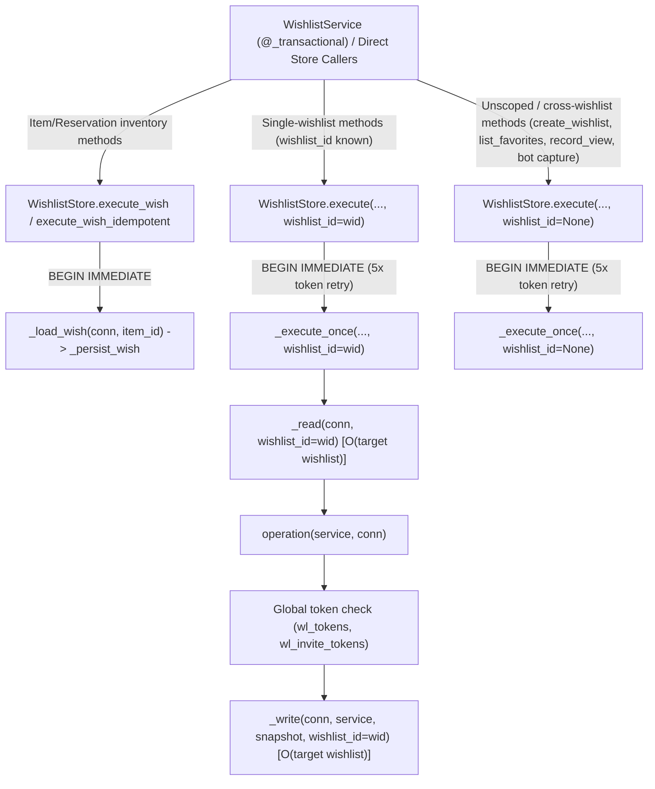

# WISHENKA-213: Scoping Wishlist Mutation State Loading to Target Wishlist

## Research

### Current Architecture & Bottleneck Analysis

1. **Storage Execution Model (`wishenka/wishlists/store.py`)**:
   - `WishlistStore` has two mutation execution paths:
     - **Single-wish fast path (`execute_wish` / `execute_wish_idempotent`)**: Uses `_load_wish(conn, item_id)` and `_persist_wish(conn, service, snapshot)` inside `BEGIN IMMEDIATE` to hydrate and persist only 1 `WishItem`, its parent `Wishlist`, its `WishlistMember`s, its `Reservation`s, its `ReceiptRecord`s, relevant `NoticeSettings`, and the `reservation` counter in `wl_counters`.
     - **General path (`execute` -> `execute_with_connection` -> `_execute_once`)**: Calls `self._read(conn)` and `self._write(conn, service, snapshot)` inside `BEGIN IMMEDIATE` (`_immediate`), with up to 5 retries on `TokenCollision` or token `IntegrityError`.
   - In `_read(conn)`, **every** table is queried unconditionally without a `WHERE` clause:
     - `wl_lists` (all wishlists)
     - `wl_members` (all members)
     - `wl_items` (all items)
     - `wl_reservations` (all reservations)
     - `wl_receipts` (all receipts)
     - `user_notification_settings` and `wl_list_notification_settings` (all settings)
     - `wl_favorites` (all favorites)
     - `wl_view_history` (all view history entries)
     - `wl_counters` (5 counter rows)

2. **Service Transactional Routing (`wishenka/wishlists/service.py`)**:
   - At module load time (lines 3334–3336), every public `async def` method on `WishlistService` is wrapped with `_transactional`.
   - `_transactional` checks `_inventory_scope(method, args, kwargs)`:
     - `_ITEM_INVENTORY_METHODS` (`create_reservation`, `update_wish_item`, `record_item_fulfillment`, `cancel_item_receipt`, `correct_item_receipt`) -> `self._store.execute_wish(item_id=...)`.
     - `_RESERVATION_INVENTORY_METHODS` (`cancel_reservation`, `update_reservation_quantity`, `mark_reservation_purchased`, `complete_reservation`, `revert_reservation_to_active`) -> `self._store.execute_wish(reservation_id=...)`.
     - **All other methods** (e.g., `add_wish_item`, `reorder_wish_items`, `archive_wish_item`, `restore_wish_item`, `update_wishlist_settings`, `archive_wishlist`, `unarchive_wishlist`, `delete_wishlist`, `restore_deleted_wishlist`, `transfer_ownership`, `add_member`, `remove_member`, `regenerate_public_token`, `regenerate_invite_token`, `add_favorite`, `remove_favorite`, etc.) fall through to `self._store.execute(call)`, triggering full-DB hydration.

3. **Other Callers of `WishlistStore.execute` / `execute_with_connection`**:
   - `wishenka/bot/capture.py`:
     - `lists_for(actor)` (`store.execute(work)` at line 275): enumerates all wishlists editable by `actor` (inherently multi-wishlist).
     - `mutate(service, conn)` (`store.execute_with_connection(mutate)` at line 672): checks `_allowed(service, actor)` across all wishlists and may call `service.add_wish_item(...)` (multi-wishlist).
   - `wishenka/web/routes/*`: Already migrated to `RepoWishlistOps` (`WISHEKA-80`) or `execute_wish` / `execute_wish_idempotent` for web HTTP routes.

4. **ID Allocation, Token Uniqueness, and Cross-Cutting State**:
   - **ID Allocation**: `WishlistService` allocates IDs via `_next_wishlist_id`, `_next_member_id`, `_next_item_id`, `_next_reservation_id`, and `_next_view_history_id`, backed by `wl_counters (name, value)` in SQLite. Because `WishlistStore` serializes writers with `BEGIN IMMEDIATE`, reading and updating `wl_counters` (5 rows, $O(1)$) inside the transaction guarantees globally unique, monotonic IDs without full-DB hydration or `MAX(id)+1` scans.
   - **Token Uniqueness**: `wl_lists` enforces `UNIQUE` on `public_token` and `invite_token`, while `wl_tokens` and `wl_invite_tokens` store active/historical capability tokens. `_execute_once` checks `wl_tokens` and `wl_invite_tokens` for cross-table collisions (`TokenCollision`), and `execute_with_connection` catches `TokenCollision` and `IntegrityError` on those token constraints to retry up to 5 times.

---

## Implementation Plan

1. **Add `wishlist_id: int | None = None` scoping to `WishlistStore`**:
   - Extend `execute()`, `execute_with_connection()`, `_execute_once()`, `_read()`, and `_write()` in `wishenka/wishlists/store.py` with an optional keyword-only parameter `wishlist_id: int | None = None`.
   - When `wishlist_id is not None`:
     - `_read(conn, wishlist_id=wishlist_id)` loads only the target row from `wl_lists`, its `wl_members`, `wl_items`, `wl_reservations`, `wl_receipts`, `wl_favorites` (for `wishlist_id`), `wl_list_notification_settings` (for `wishlist_id`), `user_notification_settings` (for givers/members of `wishlist_id`), and `wl_counters`. It skips `wl_view_history` entirely.
     - `_StorageSnapshot` records only the IDs loaded for `wishlist_id`.
     - `_write(conn, service, snapshot, wishlist_id=wishlist_id)` diffs and writes only entities belonging to `wishlist_id` (plus `wl_counters` and `_flush_receipt_effects`), and explicitly skips `wl_view_history` so other wishlists and user view histories are never deleted or overwritten.
     - `_execute_once` token collision checks (`wl_tokens` / `wl_invite_tokens`) and `IntegrityError` retries continue to run on `service._wishlists.values()` (now containing only the target wishlist), preserving global token uniqueness without loading all wishlists.

2. **Route single-wishlist `WishlistService` methods in `_transactional`**:
   - Add `_wishlist_scope(method, args, kwargs) -> int | None` in `wishenka/wishlists/service.py` alongside `_inventory_scope`.
   - Route all single-wishlist `WishlistService` methods that accept `wishlist_id: int` (except `record_view`, which enforces a per-user 20-entry cap across all wishlists) to `self._store.execute(call, wishlist_id=wishlist_id)`.

3. **Verify correctness parity, isolation, and row-load reduction**:
   - Run existing wishlist lifecycle, stress, concurrency, token collision, and repository tests.
   - Add targeted tests verifying $O(\text{target wishlist size})$ row loading, cross-wishlist isolation, ID monotonicity, and token collision retry.

**Mandatory — Failing Repro (next Step 3):**
- **File**: `tests/test_wishenka_213_scoped_store_repro.py`
- **What it asserts**:
  1. Seed a SQLite WAL `WishlistStore` with 30+ background wishlists (with items, members, reservations, favorites, and view history) and 1 target wishlist.
  2. Execute single-wishlist mutations (`add_wish_item`, `reorder_wish_items`, `archive_wish_item`, `update_wishlist_settings`, `add_member`, `regenerate_public_token`, `add_favorite`) through `WishlistService`.
  3. Capture SQLite query/row-load telemetry (via `caplog` on `wishlist_store_read` `wishlists_count` / `items_count` and/or SQLAlchemy `before_cursor_execute` row/query inspection) and assert that only `1` wishlist and only the target wishlist's items/members/reservations/favorites are hydrated (instead of all 31+ wishlists), and that background wishlists and view history remain completely untouched.
- **How to force failure before fix**: Without `wishlist_id` scoping, `WishlistStore._read()` hydrates all 31 wishlists (`wishlists_count == 31` instead of `1`), causing the red test to fail deterministically without external dependencies.
- **Sequencing**: Write red test (Step 3) -> implement `wishlist_id` scoping in `store.py` and `service.py` (Step 4) -> verify green test + full test suite.

---

## Architecture

### Module Interaction Diagram

### Method Classification

| Category | Mechanism | Methods / Callers |
|---|---|---|
| **Single-wish fast path (existing)** | `execute_wish` / `execute_wish_idempotent` | `create_reservation`, `update_wish_item`, `record_item_fulfillment`, `cancel_item_receipt`, `correct_item_receipt`, `cancel_reservation`, `update_reservation_quantity`, `mark_reservation_purchased`, `complete_reservation`, `revert_reservation_to_active` |
| **Single-wishlist scoped (new)** | `execute(..., wishlist_id=wishlist_id)` | `get_wishlist_by_id`, `get_wishlist_view`, `add_member`, `remove_member`, `get_members`, `update_wishlist_settings`, `archive_wishlist`, `unarchive_wishlist`, `delete_wishlist`, `restore_deleted_wishlist`, `transfer_ownership`, `add_wish_item`, `get_wish_item`, `list_wish_items`, `list_gifted_items`, `reorder_wish_items`, `archive_wish_item`, `restore_wish_item`, `regenerate_public_token`, `regenerate_invite_token`, `is_favorite`, `add_favorite`, `remove_favorite` |
| **Unscoped / cross-wishlist** | `execute(..., wishlist_id=None)` | `create_wishlist`, `get_wishlist_by_public_token`, `get_wishlist_by_invite_token`, `join_by_invite`, `list_deleted_wishlists`, `list_favorites`, `record_view`, `get_history`, `clear_history`, `bot/capture.py` (`lists_for`, `mutate`) |
| **Dedicated read/other paths (unchanged)** | `execute_read` / `UserStore` / `RepoWishlistOps` | `get_user_reservations`, `get_user_reservations_summary`, `AccountDeletionService`, `wishenka/web/routes/*` |

### Scoped `_read` and `_write` Contracts

1. **Scoped `_read(conn, *, wishlist_id: int | None = None)`**:
   - When `wishlist_id is None`: unchanged full-DB hydration.
   - When `wishlist_id is not None`:
     - `wl_lists WHERE id = :wishlist_id`
     - `wl_members WHERE wishlist_id = :wishlist_id ORDER BY id ASC`
     - `wl_items WHERE wishlist_id = :wishlist_id ORDER BY display_order ASC, id ASC`
     - `wl_reservations WHERE wish_item_id IN (SELECT id FROM wl_items WHERE wishlist_id = :wishlist_id) ORDER BY id ASC`
     - `wl_receipts WHERE wish_item_id IN (SELECT id FROM wl_items WHERE wishlist_id = :wishlist_id) ORDER BY received_at ASC, id ASC`
     - `wl_list_notification_settings WHERE wishlist_id = :wishlist_id`
     - `user_notification_settings WHERE user_id IN (...)` (for members/reservers of `wishlist_id`, if any)
     - `wl_favorites WHERE wishlist_id = :wishlist_id`
     - `wl_view_history`: **not loaded** (`history_ids = set()`)
     - `wl_counters`: loaded (5 rows) so `_next_*_id` allocation remains globally monotonic.

2. **Scoped `_write(conn, service, snapshot, *, wishlist_id: int | None = None)`**:
   - `_StorageSnapshot` only contains IDs loaded in `_read`, so `deleted_wls`, `deleted_members`, `deleted_items`, `deleted_res`, and `deleted_favs` are strictly bounded to `wishlist_id`.
   - `wl_view_history` diff/delete/insert is skipped when `wishlist_id is not None`.
   - `wl_counters` and `_flush_receipt_effects` are persisted normally inside the same `BEGIN IMMEDIATE` transaction.

3. **Global Token Uniqueness & Collision Retry**:
   - `_execute_once` continues to seed `wl_invite_tokens` for loaded wishlists, check `wl_tokens` / `wl_invite_tokens` for any rotated `public_token` / `invite_token`, and update `wl_tokens` / `wl_invite_tokens` on commit.
   - If a newly generated `public_token` or `invite_token` collides with another wishlist not loaded in `service._wishlists`, either the explicit `wl_tokens`/`wl_invite_tokens` query raises `TokenCollision` or SQLite's `UNIQUE` index raises `IntegrityError`, rolling back the `BEGIN IMMEDIATE` transaction and triggering `execute_with_connection`'s 5-attempt retry loop.

---

## Q&A

- **Q: Why not use `MAX(id) + 1` for ID allocation in scoped mode?**
  - **A**: `WishlistStore` already maintains `wl_counters` (5 rows total) updated atomically inside `BEGIN IMMEDIATE`. Reading and updating `wl_counters` is $O(1)$, handles deleted rows without ID reuse, and requires zero changes to `WishlistService` ID allocation logic.
- **Q: Why does `record_view(user, wishlist_id)` stay unscoped?**
  - **A**: `record_view` enforces a per-user cap of 20 `ViewHistoryEntry` rows across *all* wishlists (`user_entries[:-20]`). Scoping it to `wishlist_id` alone would prevent pruning older views from other wishlists. Keeping it unscoped (or giving it a dedicated user-scoped path in a separate task) preserves exact behavior.
