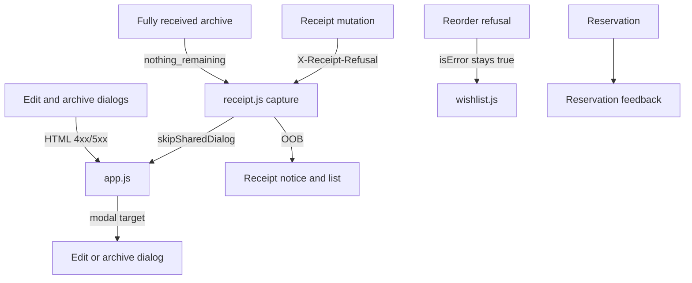

# WISHENKA-214: Dialog errors stay visible without mixing in gift receipt

## Research

The reported node
`tests/test_receipt_static_script.py::test_inline_script_is_unchanged_and_free_of_receipt_code`
is not in the tree. WISHENKA-140 replaced the inline script of `base.html`
with `wishenka/web/static/app.js` and renamed the guard to
`test_base_has_no_inline_scripts_and_loads_app_script_deferred`. After
`strip_js_comments`, that test asserts `"/receipt" not in app.js`. It does
not assert the substring `receipt`.

Comment-stripped `wishenka/web/static/app.js` does not contain `/receipt`, so
the successor is green. It still contains two gift-receipt references, which
is what the old `'receipt' not in inline script` failure described:

- `htmx:beforeSwap` returns immediately when `X-Receipt-Refusal` is set
  (line 475), and the same header suppresses the shared `#feedback` message
  on `htmx:sendError`, `htmx:timeout`, and `htmx:responseError` (line 596).
- `sharedFeedbackApplies` skips any element inside `.receipt-sheet`
  (line 535).

Those references exist so the shared dialog handler does not take a receipt
refusal. They are not receipt rules. The rules stay in `receipt.js`
(`REFUSAL_HEADER`, `REFUSAL_REASONS`) and on the server
(`wishenka/web/gifted_view.py` `RECEIPT_REFUSAL_HEADER`,
`wishenka/web/routes/receipts_ui.py`, and
`items_ui._nothing_remaining_response`).

Why the shared handler cannot simply delete the header check:

- `app.js` is deferred before `receipt.js`, so its bubble listener runs
  first.
- A receipt form lives inside `#item-modal-container`, so `fromModal` is
  true. An archive confirm posts to `#items-list` with `hx-swap="none"`, and
  `_nothing_remaining_response` includes an out-of-band
  `#item-modal-container`, so `isModalOobToList` is true.
- Without an earlier claim, `app.js` sets `shouldSwap` and clears `isError`
  for every HTML 4xx/5xx on those targets. `receipt.js` only opts in when
  the header value is in `REFUSAL_REASONS`. `idempotency_conflict` is sent
  with `X-Receipt-Refusal` and is not in that set
  (`receipts_ui._refusal_fragment`). The early return is what keeps that
  body unswapped. Known reasons such as `nothing_remaining` are opted in by
  `receipt.js` either way.
- htmx 1.9.12 (the script pinned in `base.html`) does not swap 4xx/5xx
  unless `htmx:beforeSwap` sets `detail.shouldSwap`. `detail.isError`
  controls whether `htmx:responseError` fires.
  [htmx events](https://htmx.org/events/) and the
  [response-handling example](https://htmx.org/docs/#modifying_swapping_behavior_with_events)
  document that contract. `htmx.config.responseHandling` arrived in htmx 2
  and is not available here.
- `tests/browser_assets/htmx_stub.js` dispatches bubbling `htmx:beforeSwap`
  on the target and, when `shouldSwap` stays false and `isError` stays true,
  dispatches bubbling `htmx:responseError`. A capture listener on `document`
  therefore runs before every bubble listener, and one `detail` object is
  shared. `stopPropagation` in capture cancels the bubble phase
  ([MDN `addEventListener`][mdn-add]).

`X-Reorder-Refusal` in `app.js` is a reorder exclusion, not a receipt
reference. `wishlist.js` reloads only when that header's value is
`stale_order` and `htmx:responseError` still fires, so `app.js` must keep
leaving `isError` true for it. Reservation requests stay on
`reservationRequestPath`. Surprise copy, role checks, and the Russian and
English refusal sentences are unchanged.

## Implementation Plan

Move the "leave this response alone" decision into the receipt flow, and
let shared page behavior honor a neutral claim. No server status, sentence,
or header value changes.

1. **`wishenka/web/static/receipt.js`.** Add a capture-phase
   `htmx:beforeSwap` listener (the existing bubble listener moves here).
   When `X-Receipt-Refusal` is present, set `detail.skipSharedDialog` to
   true. When the value is also in `REFUSAL_REASONS`, set
   `detail.shouldSwap = true` and `detail.isError = false`, as today.
   `idempotency_conflict` is claimed and still not swapped. Add a
   capture-phase `htmx:responseError` listener that calls
   `stopPropagation` when the same header is present, so the shared
   `#feedback` path cannot replace a receipt refusal that stayed an error
   (including archive `nothing_remaining` if `isError` were left true).
   Do not stop `htmx:beforeSwap` propagation: `wishlist.js` still cancels
   an in-progress touch reorder when the swap target is `#items-list`.
2. **`wishenka/web/static/app.js`.** In `htmx:beforeSwap`, return when
   `detail.skipSharedDialog` is true, instead of reading
   `X-Receipt-Refusal`. Keep the `X-Reorder-Refusal` return, the
   reservation return, the HTML check, and the modal opt-in
   (`#item-modal-container`, `#item-edit-sheet`, `#item-archive-modal`,
   `fromModal`, `isModalOobToList`). In `sharedFeedbackApplies` and in the
   failure listeners, replace `.receipt-sheet` and `X-Receipt-Refusal`
   with `closest('[data-own-feedback]')`. Reword the file comment that
   names `receipt.js` so the shared script, comments included, has no
   `receipt` substring.
3. **Receipt dialog partials.** Add `data-own-feedback` on the existing
   `#item-receipt-modal` root in `partials/item_receipt_modal.html`,
   `partials/receipt_edit_modal.html`, and
   `partials/receipt_cancel_modal.html`. Edit and archive partials do not
   get the attribute. No visual change.
4. **Leave the server contract in place.** `RECEIPT_REFUSAL_HEADER`,
   `_nothing_remaining_response`, `_refusal_fragment`, the closed reason
   table, and the i18n keys stay as they are. `base.html` keeps loading
   `receipt.js` and the `data-i18n-receipt-*` strings that script already
   reads. Those are the receipt flow's own copy, not the shared handler.

**Mandatory — Failing Repro (next Step 3):** The successor check is green
and does not catch this debt. Step 3 adds one red assertion beside it in
`tests/test_receipt_static_script.py`, using the same `TestClient` path
(no browser, no network, no live services). Read raw `/static/app.js`
with comments kept, and the same body after `strip_js_comments`. Compare
both case-insensitively and assert that none of `X-Receipt-Refusal`,
`.receipt-sheet`, or the substring `receipt` occurs. The raw file is red
at both header reads (`X-Receipt-Refusal` near lines 475 and 596), at
`.receipt-sheet` (near line 535), and at the lowercase `receipt` comments
(near line 5 and lines 528-529). Comment-stripping drops those comments
and still leaves the two header reads and `.receipt-sheet` red, because
`X-Receipt-Refusal` matches under a case-insensitive compare. Do not
weaken
`test_base_has_no_inline_scripts_and_loads_app_script_deferred`. Existing
receipt, reorder, reservation, and edit/archive tests are the regression
net; they are already green and are not the red test. Sequencing: this
architecture, then that red static assertion, then the `receipt.js` /
`app.js` / partial change until the new assertion and the existing dialog
and receipt tests are green.

## Architecture

### System Module Diagram

### Modules and Responsibilities

- **`wishenka/web/static/app.js`.** Shared page behavior. Opts HTML 4xx/5xx
  into the edit or archive dialog. Skips a response already claimed with
  `detail.skipSharedDialog`, a reorder refusal, or a reservation request.
  Applies shared pending and `#feedback` only when the trigger is outside
  `[data-own-feedback]`. Contains no gift-receipt token.
- **`wishenka/web/static/receipt.js`.** Receipt flow. In the capture phase,
  claims every `X-Receipt-Refusal` response and opts in only the closed
  reason set. Stops `htmx:responseError` from reaching shared feedback when
  that header is present. Owns receipt pending state and the receipt notice.
- **`wishenka/web/static/wishlist.js`.** Reorder and touch-drag. Still reads
  only `X-Reorder-Refusal`. Unchanged.
- **`partials/item_receipt_modal.html`**, **`receipt_edit_modal.html`**,
  **`receipt_cancel_modal.html`.** Mark the receipt dialog root with
  `data-own-feedback` so shared pending and generic failure leave it alone.
- **`partials/item_edit_modal.html`**, **`partials/item_archive_modal.html`.**
  Stay unmarked. Their refusals remain shared dialog errors.
- **`wishenka/web/routes/items_ui.py`.** Still returns edit and archive HTML
  errors, and still returns `X-Receipt-Refusal: nothing_remaining` for a
  fully received archive or restore. No new header.
- **`wishenka/web/routes/receipts_ui.py`**, **`wishenka/web/gifted_view.py`.**
  Still emit `X-Receipt-Refusal` and the existing sentences. No new header.
- **`wishenka/web/templates/base.html`.** Still loads deferred `app.js`, then
  `wishlist.js`, then `receipt.js`, and still carries `data-i18n-receipt-*`
  for `receipt.js`. No inline script.

### Interaction Scheme

1. **Edit or archive refusal that belongs to that dialog.** The response is
   HTML, status 400 or higher, and has no `X-Receipt-Refusal`. `receipt.js`
   does not set `skipSharedDialog`. `app.js` sees a modal target, an element
   inside `#item-modal-container`, or an out-of-band modal aimed at
   `#items-list`, and sets `shouldSwap` and `isError` false. The existing
   reason stays in the open dialog. Entered values stay on the edit
   re-render the server already returns.
2. **Receipt refusal, including "nothing remains" during archive.**
   `receipt.js` capture sees `X-Receipt-Refusal`, sets `skipSharedDialog`,
   and opts in only when the value is in `REFUSAL_REASONS`
   (`nothing_remaining` is). `app.js` returns without treating the body as a
   dialog error. Out-of-band receipt feedback, list, archive, and gifted
   fragments update as they do now. `idempotency_conflict` is claimed and
   remains unswapped.
3. **Receipt dialog network or unmarked failure.** The trigger is inside
   `[data-own-feedback]`, so shared pending and `#feedback` do not run.
   `receipt.js` keeps its own busy state and `data-i18n-receipt-failure`
   notice.
4. **Reorder.** `app.js` still returns on `X-Reorder-Refusal` before the
   modal opt-in, so `isError` stays true and `wishlist.js` still reloads on
   `stale_order`.
5. **Reservation.** `reservationRequestPath` still excludes those requests
   from the modal opt-in and from shared `#feedback`.

### Patterns and Justification

- **Owner claim, checked by the shared layer.** The receipt module is the
  only one allowed to read `X-Receipt-Refusal`. Shared code reacts to a
  boolean on the event, not to a receipt name. That satisfies the standing
  boundary without a second server header and without dropping dialog
  errors.
- **Capture phase.** Bubble listeners cannot run before `app.js`, because
  `app.js` is registered first. Capture on `document` runs before the
  target's bubble listeners for both real htmx 1.9.12 and `htmx_stub.js`.
- **Targeted `htmx:beforeSwap` opt-in.** Kept from WISHENKA-160. htmx 2
  `responseHandling` is not used.
- **Declarative own-feedback marker.** `[data-own-feedback]` replaces the
  `.receipt-sheet` selector in shared code. The marker is a hook on the
  receipt dialog, not a new notification style and not a visual change.
- **No new Python module.** The page layer already splits receipt routes
  from item routes. This task only moves the client-side claim across that
  existing boundary.

### Interfaces

- **`detail.skipSharedDialog`** (`htmx:beforeSwap` detail, set only by
  `receipt.js`): when true, `app.js` does not change `shouldSwap` or
  `isError`.
- **`X-Receipt-Refusal`** (response header, unchanged): read only by
  `receipt.js`. Any present value claims the response. Values in
  `REFUSAL_REASONS` also opt into the swap. `idempotency_conflict` claims
  and does not opt in.
- **`data-own-feedback`** (attribute on `#item-receipt-modal`): `app.js`
  treats the request as already reported by its own flow.
- **`X-Reorder-Refusal`** and **`reservationRequestPath`**: unchanged
  exclusions in `app.js`.
- **Modal opt-in targets:** `#item-modal-container`, `#item-edit-sheet`,
  `#item-archive-modal`, a trigger inside `#item-modal-container`, or an
  `#items-list` response that carries an out-of-band
  `#item-modal-container`. Unchanged, and skipped when the response is
  claimed.

## Q&A

- **Q: The successor test is already green. Why change code?**
  **A:** It only forbids the path `/receipt`. The reported failure was the
  header name inside the shared step-aside. Requirements keep that boundary:
  shared page behavior carries no gift-receipt reference, and receipt
  refusals still stay on the receipt flow. The Step 3 assertion restores
  the boundary the successor dropped.

- **Q: Why not show receipt refusals in the shared dialog?**
  **A:** Requirements forbid it. Receipt feedback, including "nothing
  remains" reached from archive, stays on the receipt flow.

- **Q: Why not add a server header such as `X-Dialog-Error`?**
  **A:** Edit and archive errors are already identified by their modal
  targets. The leak is the negative check for the receipt header. A second
  header would duplicate `X-Receipt-Refusal` across `items_ui.py` and
  `receipts_ui.py` without removing the need for `receipt.js` to opt in.

- **Q: Does claiming the event in capture change reorder or reservation?**
  **A:** No. The claim is set only when `X-Receipt-Refusal` is present.
  `beforeSwap` is not stopped, so the touch-drag cancel in `wishlist.js`
  still runs. Reorder and reservation exclusions in `app.js` stay.

- **Q: Do refusal text, roles, or surprise secrecy change?**
  **A:** No. The same sentences, the same roles, and the same absence of
  giver, reservation, and purchase facts remain. `base.html` keeps the
  receipt i18n attributes `receipt.js` already reads.

[mdn-add]: https://developer.mozilla.org/en-US/docs/Web/API/EventTarget/addEventListener
