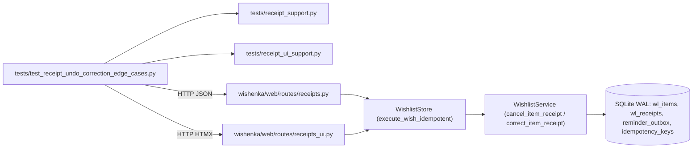

# WISHENKA-217: Edge-Case Verification for Gift Receipt Cancellation and Correction

## Research

Inspected the existing production implementation and test infrastructure for gift receipt cancellation, quantity correction, and idempotency:

1. **JSON API routes (`wishenka/web/routes/receipts.py`):**
   - `DELETE /api/wishlists/{wishlist_id}/items/{item_id}/receipts/{receipt_id}` (`cancel_receipt`, lines 250–300) parses `Idempotency-Key` via `parse_idempotency_key(request)`, computes `compute_request_hash("cancel_receipt", {"wishlist_id": wishlist_id, "item_id": item_id, "receipt_id": receipt_id}, {})`, and executes through `_run(...)` → `WishlistStore.execute_wish_idempotent(...)`.
   - `PATCH /api/wishlists/{wishlist_id}/items/{item_id}/receipts/{receipt_id}` (`correct_receipt`, lines 303–357) computes `compute_request_hash("correct_receipt", {"wishlist_id": wishlist_id, "item_id": item_id, "receipt_id": receipt_id}, {"quantity": payload.quantity})` and executes through `_run(...)`.
   - `_run(...)` (lines 111–182) returns cached responses via `build_replay_response(...)` on replay, maps `IdempotencyConflictError` to HTTP `409` (`detail={"reason": "idempotency_conflict", ...}`), and maps `ReceiptNotFoundError` / `ItemNotFoundError` / `WishlistNotFoundError` via `_refusal(...)` to HTTP `404` (`detail={"reason": "receipt_not_found", ...}`).

2. **UI routes (`wishenka/web/routes/receipts_ui.py`):**
   - `GET /web/wishlists/{wishlist_id}/items/{item_id}/receipts/{receipt_id}/edit` (`get_receipt_edit_dialog`, lines 722–740) and `GET .../cancel` (`get_receipt_cancel_dialog`, lines 777–795) delegate to `_open_receipt_entry_modal(...)` → `_check_receipt_entry_open(...)` (lines 532–649).
   - `_check_receipt_entry_open` returns `WishlistArchivedError` when `wishlist.status != WishlistStatus.ACTIVE` (HTTP `409`, `X-Receipt-Refusal: wishlist_archived`, template rendered with `blocked=True`) and `ReceiptNotFoundError` when `receipt_id` is absent on `item.receipts` (HTTP `404`, `X-Receipt-Refusal: receipt_not_found`, `blocked=True`).
   - `POST .../edit` (`correct_receipt_ui`, lines 743–774) and `POST .../cancel` (`cancel_receipt_ui`, lines 798–825) delegate to `_execute_receipt_mutation_ui(...)` (lines 652–720), which uses `execute_wish_idempotent` when `Idempotency-Key` is provided, returning `200` OOB HTML on replay and `409` (`X-Receipt-Refusal: idempotency_conflict`) on `IdempotencyConflictError`.

3. **Domain service & notifications (`wishenka/wishlists/service.py`):**
   - `cancel_item_receipt` and `correct_item_receipt` enforce item/wishlist/receipt ownership and emit `receipt_reverted` / `receipt_increased` events into `reminder_outbox` only when a state change actually occurs (no-op `correct_item_receipt` with `quantity == current_quantity` returns early without mutating `wl_receipts`, `received_quantity`, or `reminder_outbox`).

4. **Existing test infrastructure (`tests/`):**
   - `tests/receipt_support.py` provides `app_env`, `bearer`, `db_path_of`, `item_received`, `receipt_rows`, and `table_rows` (including inspecting `reminder_outbox`).
   - `tests/receipt_ui_support.py` provides `hx`, `seed_list`, `domain`, `run`, `OWNER_ID`, `GIFTER`, `REFUSAL_HEADER`, `assert_all_top_level_oob`, `assert_no_booking_leak`, and `Wish`.
   - `tests/test_receipt_undo_correction_repro.py` covers happy paths and basic guards for `DELETE`/`PATCH` and UI `edit`/`cancel`, but lacks the edge cases listed in `ai-tasks/WISHENKA-153/60-tech-debt.md` (Missing Tests items 2–5).

## Implementation Plan

Create a dedicated, self-contained pytest module `tests/test_receipt_undo_correction_edge_cases.py` with module-level `pytestmark = pytest.mark.timeout(20)` (per `do-testing` and `lsr-python` guidelines).

The test suite will exercise real FastAPI HTTP routes (`TestClient` backed by `app_env(tmp_path)` with real SQLite WAL persistence and `WishlistStore`), verifying HTTP status codes, JSON/HTML responses, `X-Receipt-Refusal` headers, database state (`wl_items.received_quantity`, `wl_receipts`), and notification outbox (`reminder_outbox` rows):

1. **Idempotency replay & conflict (`FR-1`):**
   - `PATCH /api/.../receipts/{receipt_id}`: replay with identical `Idempotency-Key` and `quantity` returns `200` with identical JSON and no duplicate `reminder_outbox` row or second quantity change; reusing the same key with a different `quantity` returns `409` (`idempotency_conflict`) with state unchanged.
   - `DELETE /api/.../receipts/{receipt_id}`: replay with identical `Idempotency-Key` returns `200` with identical JSON and no duplicate `reminder_outbox` row; reusing the same key on a different `receipt_id` or operation returns `409` (`idempotency_conflict`).
   - `POST /web/.../receipts/{receipt_id}/edit` and `POST .../cancel`: replay with identical `Idempotency-Key` returns `200` OOB HTML without double-mutation or duplicate `reminder_outbox` row; reusing the key with conflicting payload/operation returns `409` with `X-Receipt-Refusal: idempotency_conflict`.
2. **Cross-item & cross-wishlist isolation (`FR-2`):**
   - `PATCH` / `DELETE` JSON and `POST .../edit` / `POST .../cancel` UI routes called with a valid `receipt_id` belonging to a different `item_id` (same wishlist) or a different `wishlist_id` return `404` (`receipt_not_found` / `X-Receipt-Refusal: receipt_not_found`) and leave the target receipt and its owning item's `received_quantity` untouched.
3. **No-op quantity correction (`FR-3`):**
   - `PATCH` JSON and `POST .../edit` UI routes submitted with `quantity == current_quantity` return `200`, keep `wl_receipts` and `received_quantity` unchanged, and insert zero new `reminder_outbox` rows.
4. **Refusal responses on `GET .../edit` and `GET .../cancel` (`FR-4`):**
   - `GET .../edit` and `GET .../cancel` for a missing/concurrently deleted `receipt_id` return `404` with `X-Receipt-Refusal: receipt_not_found`.
   - `GET .../edit` and `GET .../cancel` for a receipt on an archived wishlist return `409` with `X-Receipt-Refusal: wishlist_archived` and render the blocked modal state without an active submission form.

**Mandatory — Failing Repro (next Step 3):** `N/A — no behavioral change`. This task adds automated edge-case test coverage for existing production behavior implemented in WISHENKA-153, with no planned production code changes. (If any new edge-case test unexpectedly fails in Step 4, it will surface a defect to be fixed at that time.)

## Architecture

### System Module Diagram

### Modules & Responsibilities

| Module | Role in WISHENKA-217 |
| --- | --- |
| `tests/test_receipt_undo_correction_edge_cases.py` *(new)* | Houses all edge-case tests for FR-1 through FR-4 across JSON API and UI routes, using bounded `pytest.mark.timeout(20)`. |
| `tests/receipt_support.py` *(existing)* | Provides isolated `app_env(tmp_path)` FastAPI + SQLite environment, `bearer` auth headers, and SQL inspection helpers (`item_received`, `receipt_rows`, `table_rows`). |
| `tests/receipt_ui_support.py` *(existing)* | Provides HTMX headers (`hx`), `seed_list`, `domain`, `run`, and HTML/OOB assertion helpers (`assert_all_top_level_oob`, `assert_no_booking_leak`). |
| `wishenka/web/routes/receipts.py` *(under test)* | JSON `DELETE` / `PATCH` endpoints, idempotency hashing/replay/conflict handling, and HTTP refusal mapping. |
| `wishenka/web/routes/receipts_ui.py` *(under test)* | UI `GET` / `POST` `edit` and `cancel` endpoints, modal refusal rendering (`X-Receipt-Refusal`), and OOB HTML idempotency handling. |

### Architectural Patterns & Justification

- **Black-box HTTP + DB-state verification via `TestClient`:** Testing through FastAPI `TestClient` against a real `tmp_path` SQLite database (`app_env`) exercises the full stack (request validation, `Idempotency-Key` hashing, `WishlistStore.execute_wish_idempotent`, `WishlistService` domain guards, `reminder_outbox` writes, and Jinja2/OOB HTML rendering) without mocking out the idempotency or transaction layers.
- **Reuse of shared test support modules:** Using `tests/receipt_support.py` and `tests/receipt_ui_support.py` avoids duplicating fixture setup, auth header construction, or OOB/booking-leak assertions.
- **Parametrized / table-driven edge-case coverage:** Grouping related route variants (e.g., `GET .../edit` vs `GET .../cancel`, cross-item vs cross-wishlist) keeps tests concise and readable while covering every FR-1..FR-4 scenario.

### Main Interfaces Under Test

- `DELETE /api/wishlists/{wishlist_id}/items/{item_id}/receipts/{receipt_id}` (`Idempotency-Key` header → `200 ReceiptResultDTO` | `404 receipt_not_found` | `409 idempotency_conflict`)
- `PATCH /api/wishlists/{wishlist_id}/items/{item_id}/receipts/{receipt_id}` (`Idempotency-Key` header, `{"quantity": int}` → `200 ReceiptResultDTO` | `404 receipt_not_found` | `409 idempotency_conflict`)
- `GET /web/wishlists/{wishlist_id}/items/{item_id}/receipts/{receipt_id}/edit` & `.../cancel` (`HX-Request` → `200 HTML` | `404` + `X-Receipt-Refusal: receipt_not_found` | `409` + `X-Receipt-Refusal: wishlist_archived`)
- `POST /web/wishlists/{wishlist_id}/items/{item_id}/receipts/{receipt_id}/edit` & `.../cancel` (`Idempotency-Key` header → `200 OOB HTML` | `404` + `X-Receipt-Refusal: receipt_not_found` | `409` + `X-Receipt-Refusal: idempotency_conflict`)

## Q&A

- **Why place the new tests in `tests/test_receipt_undo_correction_edge_cases.py` instead of appending to `tests/test_receipt_undo_correction_repro.py`?**
  `test_receipt_undo_correction_repro.py` is already ~500 lines and scoped to the original WISHENKA-153 repros. A dedicated `test_receipt_undo_correction_edge_cases.py` keeps the new FR-1..FR-4 edge-case suite modular, easy to run independently, and clean to maintain.
- **Are any production code changes planned?**
  No. `wishenka/web/routes/receipts.py` and `wishenka/web/routes/receipts_ui.py` already implement the required idempotency, isolation, no-op, and refusal behaviors; Step 4 will only touch production code if a test uncovers a real defect.
