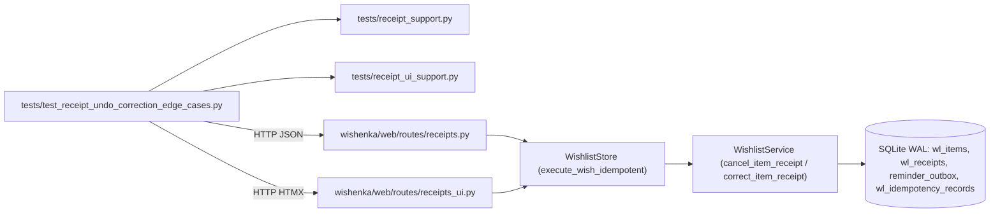

# Спецификация: WISHENKA-217 — Верификация граничных случаев отмены и корректировки получения подарков

**Версия / статус:** реализовано (тестовое покрытие без изменений продакшен-кода)  
**Задача в Jira:** WISHENKA-217  
**Источник требований:** `ai-tasks/WISHENKA-153/60-tech-debt.md` (последующая задача № 3, Missing Tests пп. 2–5)  
**Стек верификации:** Python 3.12+ (`pytest`, FastAPI `TestClient`, SQLite WAL)

## 1. Назначение и бизнес-цель

### 1.1. Постановка проблемы

В рамках задачи `WISHENKA-153` авторам вишлистов была предоставлена возможность отменять ошибочную запись о получении подарка и корректировать количество полученных экземпляров как через JSON API, так и через интерактивный интерфейс Telegram Mini App. Базовые сценарии (happy paths) и основные доменные ограничения были покрыты модулем `tests/test_receipt_undo_correction_repro.py`, однако критичные граничные случаи для обеих точек входа оставались без выделенной автоматической проверки (`ai-tasks/WISHENKA-153/60-tech-debt.md`, пункты Missing Tests 2–5):

- повторное воспроизведение запросов (replay) и конфликты при переиспользовании `Idempotency-Key`;
- изоляция идентификатора записи о получении `receipt_id` между разными желаниями и разными вишлистами;
- корректировка с прежним значением количества (no-op) без побочных изменений и лишних уведомлений;
- корректные ответы-отказы при попытке открыть диалог редактирования или отмены для отсутствующей записи или архивного вишлиста.

### 1.2. Цели задачи

1. Обеспечить автоматизированную регрессионную проверку перечисленных граничных случаев через реальные HTTP-маршруты JSON API и UI без подмены слоёв идемпотентности, доменного сервиса и SQLite-хранилища.
2. Зафиксировать наблюдаемые контракты продакшен-системы (HTTP-статусы, коды отказов, заголовки, состояние таблиц БД и очереди уведомлений `reminder_outbox`) для предотвращения скрытых регрессий.
3. Обновить документацию по тестированию функциональности учёта получений (`doc/dev/gift-receipt.md`, `doc/dev/testing.md`).

### 1.3. Ценность для пользователей и системы

- **Безопасность повторных запросов:** нестабильное мобильное соединение или двойное нажатие в интерфейсе не приводят к повторному списанию/корректировке количества или дублированию уведомлений дарителям; случайное переиспользование токена идемпотентности для другой операции или другого количества безопасно отклоняется.
- **Целостность границ списков и желаний:** подмена или устаревший контекст `wishlist_id` / `item_id` в запросе к `receipt_id` не способны затронуть запись другого желания или чужого списка.
- **Отсутствие ложных уведомлений:** подтверждение прежнего количества в форме редактирования не создаёт лишних сообщений в `reminder_outbox`.
- **Предсказуемый UX при конкурентных изменениях и архивах:** при открытии диалога по уже удалённой записи или в архивном списке автор получает явный структурированный отказ вместо сломанной или активной формы отправки.

### 1.4. Границы задачи (Scope)

- **В объёме:** разработка изолированного набора автотестов на Python в `tests/test_receipt_undo_correction_edge_cases.py` и актуализация `doc/dev/gift-receipt.md` и `doc/dev/testing.md`.
- **Вне объёма:** юнит-тестирование клиентского JavaScript DOM и обработчиков событий (`receipt.js`), изменение существующих бизнес-правил продакшен-кода, нагрузочное тестирование полного перерендера UI.

## 2. Функциональные требования и пользовательские сценарии

### 2.1. Доменные сущности и роли

| Сущность / роль | Назначение в рамках задачи |
| --- | --- |
| Вишлист (`Wishlist`) | Коллекция желаний со статусом жизненного цикла (`active`, `archived`, `deleted`) |
| Желание (`WishItem`) | Позиция вишлиста с запрошенным количеством (`quantity`), полученным (`received_quantity`) и остатком (`remaining_quantity`) |
| Запись о получении (`Receipt`) | Отдельная датированная запись акта получения (`wl_receipts.id`), принадлежащая ровно одному желанию (`wish_item_id`) |
| Автор (`Author`) | Участник вишлиста с правами управления (`owner`, `admin` или `member`), определяемый политикой `WishlistAccessPolicy` |
| Даритель (`Giver`) | Пользователь с открытой бронью (обещанием) по желанию, получающий уведомления через `reminder_outbox` при изменении получения |
| Ключ идемпотентности (`Idempotency-Key`) | Клиентский токен операции для безопасной дедупликации повторных запросов отмены и корректировки |

### 2.2. Функциональные требования

#### FR-1. Идемпотентный replay и обнаружение конфликтов

- **FR-1.1 (Replay):** повторный запрос отмены (`DELETE /api/.../receipts/{receipt_id}`, `POST /web/.../receipts/{receipt_id}/cancel`) или корректировки (`PATCH /api/.../receipts/{receipt_id}`, `POST /web/.../receipts/{receipt_id}/edit`) с тем же `Idempotency-Key` и полностью совпадающими параметрами должен возвращать исходный успешный ответ (HTTP `200` с идентичным JSON `ReceiptResultDTO` или идентичным OOB HTML), не выполняя повторную мутацию, не изменяя повторно `received_quantity` и `wl_receipts` и не создавая дублирующую запись в `reminder_outbox`.
- **FR-1.2 (Conflict):** повторное использование уже зафиксированного `Idempotency-Key` с отличающимся содержимым запроса (другое `quantity`, другой `receipt_id` или другая операция, например `DELETE`/`cancel` с ключом от `PATCH`/`edit`) должно отклоняться с HTTP `409 Conflict` (`detail.reason == "idempotency_conflict"` в JSON API; заголовок `X-Receipt-Refusal: idempotency_conflict` в UI), оставляя запись о получении, желание и `reminder_outbox` без изменений.

#### FR-2. Изоляция `receipt_id` между желаниями и вишлистами

- **FR-2.1 (Cross-item в одном вишлисте):** попытка отменить или скорректировать валидный `receipt_id`, принадлежащий одному желанию, через путь другого желания того же вишлиста должна отклоняться с HTTP `404` и причиной `receipt_not_found`.
- **FR-2.2 (Cross-wishlist):** попытка отменить или скорректировать валидный `receipt_id` из вишлиста `wl1` через URL другого вишлиста `wl2` должна отклоняться с HTTP `404`:
  - при указании желания, принадлежащего `wl2`, — с причиной `receipt_not_found`;
  - при указании исходного желания из `wl1` в пути `wl2` — с причиной `not_found` (так как желание не принадлежит `wl2`).
- **FR-2.3 (Неизменность целевых данных):** во всех сценариях отказа `FR-2.1` и `FR-2.2` исходная запись в `wl_receipts` и значения `received_quantity` всех желаний должны оставаться полностью неизменными.

#### FR-3. No-op корректировка количества

- **FR-3.1:** отправка корректировки количества (`PATCH` в JSON API или `POST .../edit` в UI) со значением `quantity`, равным текущему количеству этой записи о получении, должна завершаться успешно (HTTP `200`) и сохранять без изменений `wl_receipts`, `received_quantity`, `remaining_quantity` и видимость желания.
- **FR-3.2:** при no-op корректировке в таблицу `reminder_outbox` не должна добавляться ни одна новая запись уведомления дарителям.

#### FR-4. Ответы-отказы при открытии форм редактирования и отмены

- **FR-4.1 (Отсутствующая или конкурентно удалённая запись):** запрос `GET .../edit` или `GET .../cancel` для несуществующего или предварительно удалённого `receipt_id` должен возвращать HTTP `404` с заголовком `X-Receipt-Refusal: receipt_not_found`, без активной формы `<form>` и с непустым сообщением в контейнере `#receipt-feedback`.
- **FR-4.2 (Архивный вишлист):** запрос `GET .../edit` или `GET .../cancel` для записи в архивном вишлисте должен возвращать HTTP `409` с заголовком `X-Receipt-Refusal: wishlist_not_active`, заблокированное представление модального окна (`blocked=True`, без `<form>`) и непустое пояснение в `#receipt-feedback`.

### 2.3. Пользовательские сценарии

- **UC-01. Повторный запрос при сбое сети:** автор в Mini App или API-клиенте повторно отправляет отмену или корректировку с тем же `Idempotency-Key` и прежними данными и получает исходный ответ без двойного изменения счётчика и без повторного уведомления дарителю.
- **UC-02. Конфликт ключа идемпотентности:** при повторной отправке того же `Idempotency-Key` с другим количеством, другим `receipt_id` или другой операцией система возвращает ошибку `409 idempotency_conflict` и защищает данные от повреждения.
- **UC-03. Изоляция чужого контекста:** запрос на изменение или отмену записи с `item_id` другого желания или `wishlist_id` другого списка отклоняется с `404` (`receipt_not_found` или `not_found`), оставляя исходную запись нетронутой.
- **UC-04. Сохранение без изменения количества:** автор открывает корректировку и отправляет уже записанное количество; операция возвращает `200`, не меняя историю записей и не создавая уведомлений в `reminder_outbox`.
- **UC-05. Открытие устаревшего или заблокированного диалога:** автор открывает модальное окно редактирования/отмены после конкурентного удаления записи или для архивного вишлиста и видит понятное сообщение об отказе без формы отправки.

### 2.4. Продуктовые инварианты

1. **Принцип сюрприза:** ни успешные ответы, ни OOB-фрагменты UI, ни сообщения об отказах не раскрывают автору информацию о бронированиях и личностях дарителей.
2. **Жёсткая иерархия принадлежности:** запись `wl_receipts` принадлежит ровно одному желанию `wish_item_id`, а желание — ровно одному `wishlist_id`.
3. **Атомарность и идемпотентность:** первичная мутация, запись событий в `reminder_outbox` и сохранение результата в `wl_idempotency_records` выполняются в одной транзакции БД.

## 3. Архитектура, компоненты и интерфейсы

### 3.1. Архитектурная схема взаимодействия

Тестирование строится по принципу «чёрного ящика» через FastAPI `TestClient` поверх изолированной временной БД SQLite WAL (`app_env(tmp_path)`), что проверяет всю цепочку обработки запроса без мокирования слоёв идемпотентности и транзакций.

### 3.2. Модули и ответственность

| Модуль | Роль в рамках WISHENKA-217 |
| --- | --- |
| `tests/test_receipt_undo_correction_edge_cases.py` *(новый)* | Содержит 7 тестовых функций (9 тестовых кейсов с учётом параметризации) для `FR-1`..`FR-4`, хелперы `_seed_deliverable_gifter` и `_record_and_get_receipt_id`, модульный лимит `pytest.mark.timeout(20)` |
| `tests/receipt_support.py` *(существующий)* | Предоставляет `app_env(tmp_path)`, заголовки `bearer`, хелперы инспекции SQLite (`db_path_of`, `item_received`, `receipt_rows`, `table_rows`, `seed_users`, `sql_exec`, `sql_rows`) |
| `tests/receipt_ui_support.py` *(существующий)* | Предоставляет HTMX-заголовки `hx`, сидинг `seed_list`, доступ к домену (`domain`, `run`), константы (`OWNER`, `OWNER_ID`, `GIFTER`, `REFUSAL_HEADER`, `GIVER_NAMES`, `Wish`) и проверки `assert_all_top_level_oob`, `assert_no_booking_leak` |
| `wishenka/web/routes/receipts.py` *(под тестом)* | Обработчики `cancel_receipt` (`DELETE`), `correct_receipt` (`PATCH`), исполнитель `_run`, единая таблица отказов `_REFUSALS` и маппер `_refusal` |
| `wishenka/web/routes/receipts_ui.py` *(под тестом)* | Обработчики `get_receipt_edit_dialog`, `correct_receipt_ui`, `get_receipt_cancel_dialog`, `cancel_receipt_ui`, проверка открытия `_open_receipt_entry_modal` / `_check_receipt_entry_open`, исполнитель `_execute_receipt_mutation_ui`, классификатор `_classify` и ответ `_refusal_fragment` |
| `wishenka/web/idempotency.py` *(под тестом)* | Валидация заголовка `parse_idempotency_key`, канонический хэш `compute_request_hash`, сериализация DTO и реконструкция replay-ответа (`serialize_dto_response`, `build_replay_response`, `retention_hours_from_request`) |
| `wishenka/wishlists/store.py` *(под тестом)* | Атомарное исполнение мутаций и управление записями идемпотентности (`WishlistStore.execute_wish_idempotent`, `_verify_idempotent_replay_access`, таблица `wl_idempotency_records`) |
| `wishenka/wishlists/service.py` *(под тестом)* | Доменные проверки `_validate_receipt_mutation_access` и операции `cancel_item_receipt`, `correct_item_receipt` |

### 3.3. Интерфейсы и контракты данных

| Маршрут и обработчик | Входные параметры / хэш идемпотентности | Успешный ответ | Контракты отказов |
| --- | --- | --- | --- |
| `DELETE /api/wishlists/{wishlist_id}/items/{item_id}/receipts/{receipt_id}` (`cancel_receipt`) | Заголовок `Idempotency-Key` (опц.); хэш операции `"cancel_receipt"` по `{wishlist_id, item_id, receipt_id}` и `{}` | `200 ReceiptResultDTO` (`received_now=0`, `received_quantity`, `remaining_quantity`, `is_fully_received`, `item: WishItemRecipientViewDTO`) | `404` `receipt_not_found` / `not_found`, `409` `idempotency_conflict` / `wishlist_not_active` |
| `PATCH /api/wishlists/{wishlist_id}/items/{item_id}/receipts/{receipt_id}` (`correct_receipt`) | Тело `ReceiptRequestDTO(quantity: int)`, `Idempotency-Key` (опц.); хэш `"correct_receipt"` по `{wishlist_id, item_id, receipt_id}` и `{"quantity"}` | `200 ReceiptResultDTO` (`received_now=payload.quantity`, обновлённые остатки и `item`) | `400` `quantity_invalid`, `404` `receipt_not_found` / `not_found`, `409` `idempotency_conflict` / `quantity_above_remaining` / `wishlist_not_active` |
| `GET /web/wishlists/{wishlist_id}/items/{item_id}/receipts/{receipt_id}/edit` (`get_receipt_edit_dialog`) и `.../cancel` (`get_receipt_cancel_dialog`) | Заголовки HTMX + сессия; проверка доступа через `_check_receipt_entry_open` | `200 HTML` (`partials/receipt_edit_modal.html` или `partials/receipt_cancel_modal.html`) | `404` + `X-Receipt-Refusal: receipt_not_found` (`not_found`), `409` + `X-Receipt-Refusal: wishlist_not_active`; в обоих случаях `blocked=True` без `<form>` |
| `POST /web/wishlists/{wishlist_id}/items/{item_id}/receipts/{receipt_id}/edit` (`correct_receipt_ui`) | Поле формы `quantity`, `Idempotency-Key` (опц.); хэш `"correct_receipt_ui"` по `{wishlist_id, item_id}` и `{"receipt_id", "quantity"}` | `200 OOB HTML` (`#item-modal-container`, `#list-notice`, список желаний, `#gifted-items-section`, архивная секция) | `404` + `X-Receipt-Refusal: receipt_not_found` / `not_found`, `409` + `X-Receipt-Refusal: idempotency_conflict` |
| `POST /web/wishlists/{wishlist_id}/items/{item_id}/receipts/{receipt_id}/cancel` (`cancel_receipt_ui`) | `Idempotency-Key` (опц.); хэш `"cancel_receipt_ui"` по `{wishlist_id, item_id}` и `{"receipt_id"}` | `200 OOB HTML` (обновление тех же целевых фрагментов страницы) | `404` + `X-Receipt-Refusal: receipt_not_found` / `not_found`, `409` + `X-Receipt-Refusal: idempotency_conflict` |

### 3.4. Логика выполнения и переходы состояний

1. **Контур идемпотентности (`WishlistStore.execute_wish_idempotent`):**
   - Определяется `resolved_item_id`, затем в `wl_idempotency_records` ищется активная запись (`expires_at > effective_now`) по ключу `(actor_id, idempotency_key)`.
   - Если запись найдена и `existing.request_hash != request_hash`, выбрасывается `IdempotencyConflictError` (HTTP `409 idempotency_conflict`).
   - Если `request_hash` совпадает, проверяется право доступа через `_verify_idempotent_replay_access(..., require_member=True)`, после чего возвращается ранее сохранённый ответ (`replayed=True`) без вызова мутирующей операции и без вставки в `reminder_outbox`.
   - Если активной записи нет, выполняется `operation(service)`, состояние фиксируется в SQLite, а HTTP-ответ сохраняется в `wl_idempotency_records` со сроком жизни `retention_hours` (по умолчанию 24 часа).
2. **Порядок доменных проверок в `WishlistService`:**
   - `_validate_receipt_mutation_access` проверяет существование желания и совпадение `item.wishlist_id == wishlist_id` (`ItemNotFoundError` -> `404 not_found`), членство пользователя (`PermissionDeniedError` -> `403 forbidden`), а затем статус списка (`WishlistDeletedError` -> `404 wishlist_not_active`, `WishlistArchivedError` -> `409 wishlist_not_active`).
   - `cancel_item_receipt` ищет запись по `receipt_id` в `item.receipts` (`ReceiptNotFoundError` -> `404 receipt_not_found`), удаляет её, пересчитывает `received_quantity = max(0, received_quantity - receipt.quantity)` и регистрирует событие `"receipt_reverted"` в `reminder_outbox`.
   - `correct_item_receipt` проверяет `new_quantity >= 1` (`QuantityInvalidError`), наличие `receipt` (`ReceiptNotFoundError`), верхнюю границу `receipt.quantity + item.remaining_quantity` (`QuantityAboveRemainingError`) и выполняет ранний возврат при `new_quantity == receipt.quantity` (no-op: таблица `wl_receipts`, `received_quantity` и `reminder_outbox` не изменяются). При фактическом изменении регистрируется событие `"receipt_increased"` или `"receipt_reverted"`.
3. **Порядок проверок при открытии UI-диалогов (`_check_receipt_entry_open`):**
   - Проверка принадлежности `item_id` указанному `wishlist_id` (`ItemNotFoundError` -> `404 not_found`) -> проверка членства (`PermissionDeniedError` -> `403 forbidden`) -> проверка `wishlist.status != WishlistStatus.ACTIVE` (`WishlistArchivedError` -> `409 wishlist_not_active`) -> поиск `receipt_id` в `item.receipts` (`ReceiptNotFoundError` -> `404 receipt_not_found`).

## 4. Нефункциональные требования, безопасность и наблюдаемость

### 4.1. Производительность, изоляция и ограничения

- **Изоляция среды выполнения:** каждый тест создаёт собственный экземпляр приложения и БД SQLite WAL в `tmp_path` через `app_env(tmp_path)`.
- **Ограниченное время выполнения (NFR-1):** модуль `tests/test_receipt_undo_correction_edge_cases.py` задаёт ограничение `pytestmark = pytest.mark.timeout(20)` (не более 20 секунд на тест). Суммарное время выполнения всех 9 тестов составляет около `2.8` с.
- **Форматирование и статический анализ:** код соответствует стандартам репозитория (`pyproject.toml`, длина строки до 100 символов) и проходит без замечаний `ruff check`, `ruff format --check` и `mypy`.
- **Формат `Idempotency-Key`:** заголовок допускает `1..128` символов `[A-Za-z0-9._:-]`; при несоответствии `parse_idempotency_key` возвращает HTTP `400`.

### 4.2. Безопасность и приватность

- **Защита тайны сюрприза:** во всех ответах API и UI (`OOB HTML`, модальные формы, заблокированные состояния) запрещено присутствие сведений о бронях и имён дарителей (`assert_no_booking_leak`, проверка отсутствия `GIVER_NAMES`).
- **Контроль доступа при повторе и изоляции:** область действия `wl_idempotency_records` привязана к `actor_id`, а при воспроизведении результата повторно проверяется членство в списке через `_verify_idempotent_replay_access(..., require_member=True)`.
- **Подавление лишних уведомлений:** повторный `Idempotency-Key` и no-op корректировка гарантированно не добавляют новых записей в `reminder_outbox`.

### 4.3. Наблюдаемость (логирование и метрики)

В рамках `WISHENKA-217` новые продакшен-логи и метрики **не добавлялись** (`N/A` — задача покрытия тестами без изменения продакшен-кода; зафиксировано в `ai-tasks/WISHENKA-217/50-observability.md`).

Действующее структурированное логирование в тестируемых маршрутах сохранено без изменений и не содержит персональных данных дарителей или сведений о бронях:

- **`wishenka.web.receipts` (`wishenka/web/routes/receipts.py`):**
  - `INFO`: события `receipt_cancelled_http`, `receipt_corrected_http` (поля `item_id`, `receipt_id`).
  - `WARNING`: события `receipt_refused` (`operation`, `wishlist_id`, `item_id`, `actor_id`, `reason`, `http_status`), `receipt_idempotency_conflict` (`wishlist_id`, `item_id`, `actor_id`), `receipt_inventory_busy`.
- **`wishenka.web.receipts_ui` (`wishenka/web/routes/receipts_ui.py`):**
  - `INFO`: события `ui_receipt_entry_form_opened`, `receipt_corrected_http`, `receipt_cancelled_http` (`wishlist_id`, `item_id`, `actor_id`, `receipt_id`).
  - `WARNING`: события `ui_receipt_entry_form_refused`, `receipt_refused` (`wishlist_id`, `item_id`, `actor_id`, `reason`, `http_status`), `receipt_inventory_busy`.
- **`wishenka/wishlists/service.py` и `wishenka/web/idempotency.py`:**
  - `INFO`: доменные события `receipt_cancelled` и `receipt_corrected` (при no-op корректировке событие и лог не пишутся из-за раннего возврата).
  - `WARNING`: событие `idempotency_key_invalid` при передаче некорректного заголовка `Idempotency-Key`.
- **Метрики и `caplog`:** новые метрики (Prometheus/Grafana/alerting) не требуются (`N/A`); тесты проверяют наблюдаемое поведение по HTTP-статусам, заголовку `X-Receipt-Refusal`, таблицам SQLite и `reminder_outbox` без `caplog`-утверждений.

## 5. Верификация и критерии приёмки

### 5.1. Матрица тестовых сценариев (`tests/test_receipt_undo_correction_edge_cases.py`)

| Тест-кейс | Требование | Проверяемый сценарий и ожидаемый результат |
| --- | --- | --- |
| `test_json_patch_idempotency_replay_and_conflict` | `FR-1` | Повтор `PATCH` с тем же `Idempotency-Key` и `quantity` возвращает `200` с идентичным JSON без дублирования `reminder_outbox` и повторной мутации; смена `quantity` или вызов `DELETE` с тем же ключом возвращает `409` (`detail.reason == "idempotency_conflict"`) |
| `test_json_delete_idempotency_replay_and_conflict` | `FR-1` | Повтор `DELETE` с тем же `Idempotency-Key` возвращает `200` с идентичным JSON, оставляя вторую запись `r2_id` и `reminder_outbox` без дубля; повторное использование ключа для `r2_id` возвращает `409` (`idempotency_conflict`) |
| `test_ui_edit_and_cancel_idempotency_replay_and_conflict` | `FR-1` | Повтор `POST .../edit` и `POST .../cancel` возвращает `200` с идентичным OOB HTML (`assert_all_top_level_oob`, `assert_no_booking_leak`) и без новой строки в `reminder_outbox`; конфликт по `quantity`, операции или `receipt_id` возвращает `409` + `X-Receipt-Refusal: idempotency_conflict` |
| `test_cross_item_and_cross_wishlist_receipt_isolation` | `FR-2` | Обращения `PATCH`, `DELETE`, `POST .../edit`, `POST .../cancel` с чужим `item_id` в том же списке или в другом списке возвращают `404` (`receipt_not_found`), а с `item_id` исходного списка в URL чужого списка — `404` (`not_found`); целевая запись `wl_receipts` и `received_quantity` остаются нетронутыми |
| `test_noop_quantity_correction_json_and_ui_leaves_state_and_outbox_unchanged` | `FR-3` | Отправка `PATCH` и `POST .../edit` с `quantity`, равным текущему количеству записи, возвращает `200`, не меняет `wl_receipts` и `received_quantity`, не добавляет записей в `reminder_outbox` и проходит проверки OOB и приватности |
| `test_get_edit_and_cancel_modal_refusal_for_missing_receipt` *(параметризация: `edit`, `cancel`)* | `FR-4` | `GET .../edit` и `GET .../cancel` для предварительно удалённого и несуществующего (`999_999`) `receipt_id` возвращают `404`, `X-Receipt-Refusal: receipt_not_found`, без `<form>` и с текстом в `#receipt-feedback` |
| `test_get_edit_and_cancel_modal_refusal_for_archived_wishlist` *(параметризация: `edit`, `cancel`)* | `FR-4` | `GET .../edit` и `GET .../cancel` для архивного вишлиста возвращают `409`, `X-Receipt-Refusal: wishlist_not_active`, без `<form>` и с текстом в `#receipt-feedback` |

### 5.2. Критерии приёмки и зафиксированные результаты проверок

По результатам валидации, зафиксированным в `ai-tasks/WISHENKA-217/40-code-cleanup.md` и `ai-tasks/WISHENKA-217/60-tech-debt.md`:

1. **Автоматическое покрытие требований `FR-1`..`FR-4` и `NFR-1`/`NFR-2`:** все 9 тестовых кейсов в `tests/test_receipt_undo_correction_edge_cases.py` пройдены (`9/9 passed`, общее время ~2.8 с, таймаут `20` с на тест).
2. **Регрессия смежного набора учёта получений:** модули `tests/test_receipt_undo_correction_repro.py` и `tests/test_receipt_ui_routes.py` пройдены полностью (`53/53 passed`).
3. **Общий прогон и контроль качества:**
   - `make test`: `1242 passed, 2 skipped` (17 предсуществующих падений не относятся к `WISHENKA-217`, например `tests/test_gift_receipt_migration.py::test_upgrade_is_repeatable`);
   - `make analyze` (`ruff check wishenka tests`): 0 ошибок;
   - `ruff format --check wishenka tests`: 233 файла отформатированы без замечаний;
   - `mypy wishenka tests`: 0 ошибок типизации в 233 файлах;
   - `make build` (`python -m compileall wishenka tests`): успешно.
4. **Документация:** новый тестовый модуль отражён в `doc/dev/gift-receipt.md` (`## Tests`) и `doc/dev/testing.md`.

### 5.3. Известные ограничения, компромиссы и последующие задачи (`60-tech-debt.md`)

- **Уточнение контрактов относительно исходного проекта (`20-architecture.md`):** проектная заметка предполагала код отказа `wishlist_archived` при открытии диалогов в архивном списке и `receipt_not_found` для всех cross-wishlist обращений. В фактической реализации маршруты возвращают `409` с `X-Receipt-Refusal: wishlist_not_active` для архивных вишлистов и `404` с `reason: "not_found"` при передаче `item_id` из другого списка в URL чужого вишлиста (при передаче `item_id`, принадлежащего чужому списку, возвращается `receipt_not_found`). Тесты верифицируют реальные контракты продакшена.
- **Локальные тестовые компромиссы:**
  - `_seed_deliverable_gifter` напрямую вставляет строку в `bot_destinations` через `sql_exec`, чтобы при мутациях формировались записи в `reminder_outbox`;
  - `_record_and_get_receipt_id` выполняет `POST .../receipts` и последующий `GET .../gifted` для получения `receipt_id`, поскольку `POST` возвращает агрегированный `ReceiptResultDTO` без идентификатора созданной записи.
- **Ограничения покрытия:** клиентское JavaScript-поведение DOM и событий в `receipt.js` остаётся вне скоупа данной Python-задачи.
- **Последующие задачи (Follow-ups):** нового технического долга и follow-up задач для `WISHENKA-217` не требуется. Предсуществующие не связанные с задачей падения общего `make test` уже отслеживаются отдельно в Jira (`WISHENKA-232`, `WISHENKA-245`, `WISHENKA-235`, `WISHENKA-220`, `WISHENKA-214`, `WISHENKA-212`).
