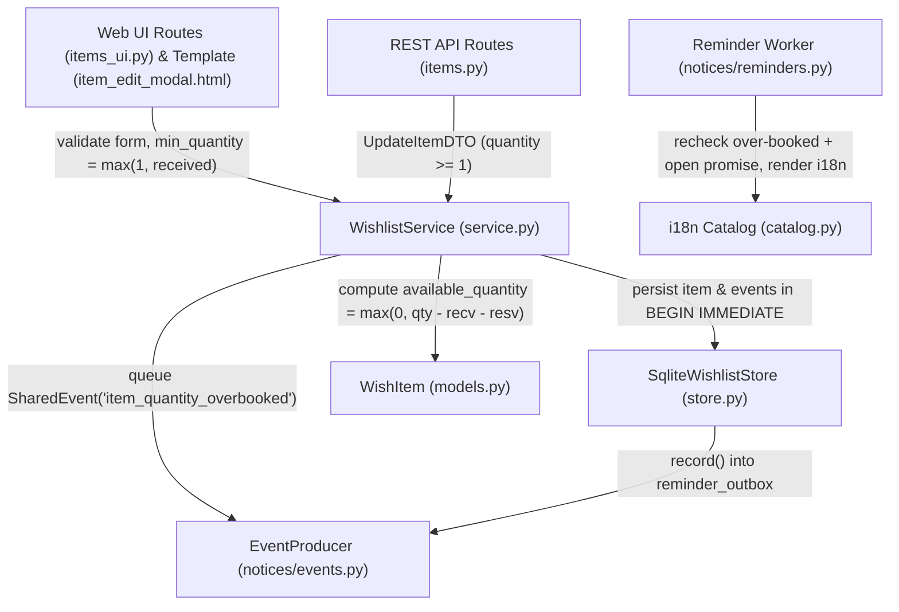

# WISHENKA-218: Remove Occupied-Units Floor Leak in Wish Quantity Editing (FR-5 / Q12)

## Research

### Specification & Product Rules
- `specs/00-high.md` (Invariant 1 — Surprise, Invariant 4 — Privacy): Authors and recipients must never learn whether a wish has been booked, how many units are booked, or who booked them.
- `in-docs/spec.md` section 5.5: When editing a wish's requested quantity, the author can reduce it down to `max(1, received_quantity)` (reduction below `received_quantity` is rejected). The edit form must not display occupied promise counts or restrict reduction based on current promises. If `received_quantity + occupied_quantity > new_requested_quantity`, the wish enters the over-booked state (section 7.3), existing promises are not automatically cancelled, and givers with open promises are notified so they can adjust or cancel their promise.
- `in-docs/spec.md` section 7.3: Over-booked state (`received_quantity + occupied_quantity > requested_quantity`) blocks new promises and upward edits on existing promises, while allowing givers to reduce, cancel, or mark purchased their existing promises.

### Existing Codebase Findings
1. **Domain Service (`wishenka/wishlists/service.py`)**:
   - `WishlistService.update_wish_item` (lines 1462–1487) currently computes `active_locked = item.reserved_quantity + item.received_quantity` and raises `CannotReduceQuantityBelowReservedError(f"Cannot reduce quantity to {quantity}: {active_locked} units already locked")` when `quantity < active_locked`.
   - `WishItem.available_quantity` (`wishenka/wishlists/models.py:175`) already computes `max(0, self.quantity - self.received_quantity - self.reserved_quantity)`. When `received_quantity + reserved_quantity > quantity`, `available_quantity` is `0`, which already causes `reserve_item` and `update_reservation_quantity` (for `delta > 0`) to raise `InsufficientQuantityError`, while reductions, cancellations, and marking purchased remain allowed.
   - `WishlistService.update_wish_item` already queues `SharedEvent("item_updated", ...)` on any field change, which `SqliteWishlistStore` (`wishenka/wishlists/store.py:952`) flushes via `EventProducer.record` inside the same `BEGIN IMMEDIATE` transaction.
2. **Web UI & Templates (`wishenka/web/routes/items_ui.py`, `wishenka/web/templates/partials/item_edit_modal.html`, `wishenka/i18n/catalog.py`)**:
   - `get_edit_item_modal` and `submit_edit_item` compute `locked_qty = item.reserved_quantity + item.received_quantity`, pass `min_quantity = max(1, locked_quantity)` and `locked_quantity` to `item_edit_modal.html`, and log `ui_reduction_lock_rendered` / `ui_reduction_lock_rejected`.
   - `item_edit_modal.html` renders `min="{{ min_quantity }}"` and, when `locked_quantity > 0`, displays `web.item.locked_quantity_hint` ("Reserved by givers: {count} pcs...").
   - `submit_edit_item` catches `CannotReduceQuantityBelowReservedError` and renders `web.item.quantity_below_reserved` with `count=locked_quantity_snapshot`.
3. **API Route (`wishenka/web/routes/items.py`)**:
   - `PATCH /wishlists/{wishlist_id}/items/{item_id}` validates `UpdateItemDTO` (`quantity >= 1`) and delegates to `WishlistService.update_wish_item`, mapping `CannotReduceQuantityBelowReservedError` to HTTP `409 Conflict` with `detail=str(exc)`.
4. **Notification Pipeline (`wishenka/notices/events.py`, `wishenka/notices/reminders.py`)**:
   - `EventProducer.record` validates `event.kind in SAFE_SHARED_EVENTS` and inserts content-free rows into `reminder_outbox`.
   - `wishenka/notices/reminders.py` processes `reminder_outbox` rows, checking `_event_category`, `_event_authorized` (re-validating state at send time), and `_render` (localized text without leaking other givers or quantities). Delivery failures are retried/handled asynchronously in the worker and never roll back domain mutations.

## Implementation Plan

1. **Domain Layer (`wishenka/wishlists/service.py`, `wishenka/wishlists/exceptions.py`)**:
   - Replace the `active_locked = item.reserved_quantity + item.received_quantity` floor in `WishlistService.update_wish_item` with `min_allowed = max(1, item.received_quantity)`.
   - When `quantity < min_allowed`, log `item_quantity_reduction_rejected` with `received_quantity` (never `reserved_quantity` or `locked_quantity`) and raise `CannotReduceQuantityBelowReservedError` (keeping the class for API/UI compatibility, with an error message referencing only `received_quantity`, e.g., `"Cannot reduce quantity to {quantity}: {item.received_quantity} units already received"`).
   - When `quantity >= min_allowed` succeeds and `quantity_delta < 0` causes `item.received_quantity + item.reserved_quantity > item.quantity`, preserve all existing open promises and queue an `"item_quantity_overbooked"` `SharedEvent` targeting distinct open-promise givers (`ReservationStatus.ACTIVE` or `ReservationStatus.PURCHASED`, excluding recipients). This includes the editing actor if they hold an open promise. Exclude those notified givers from the generic `"item_updated"` event for the same edit so they receive the specific over-booked notice without duplicate alerts.
2. **Notification Pipeline (`wishenka/notices/events.py`, `wishenka/notices/reminders.py`, `wishenka/i18n/catalog.py`)**:
   - Add `"item_quantity_overbooked"` to `SAFE_SHARED_EVENTS`.
   - Map `"item_quantity_overbooked"` to category `"wishlist_changes"` in `_event_category`.
   - In `_event_authorized`, verify the giver still holds an open (`active` or `purchased`) reservation on the wish, is not a recipient/sole-owner, and that `received_quantity + reserved_quantity > quantity` still holds at send time.
   - Add localized `notices.item_quantity_overbooked` templates (EN/RU) in `wishenka/i18n/catalog.py` with zero leakage of other givers or counts.
3. **Web UI, API & i18n (`wishenka/web/routes/items_ui.py`, `wishenka/web/templates/partials/item_edit_modal.html`, `wishenka/i18n/catalog.py`)**:
   - Remove `reserved_quantity` / `locked_quantity` calculation and `ui_reduction_lock_rendered` from `get_edit_item_modal` and `submit_edit_item`; compute `min_quantity = max(1, item.received_quantity)` solely from `1` and `received_quantity`.
   - Remove the `locked_quantity_hint` alert block from `item_edit_modal.html`.
   - Update `web.item.quantity_below_reserved` (or introduce `web.item.quantity_below_received`) to reference only `received_quantity` (`count=received_quantity_snapshot`) and never mention givers or reservations.
4. **Update Legacy Tests**:
   - Update existing tests that asserted the old occupied-units floor (`test_wish_items_tma_ui.py`, `test_wish_items_crud_api.py`, `test_gift_receipt_service.py`, `test_shared_inventory_multiprocess.py`, `test_item_observability.py`, `test_item_input_parsing.py`).

**Mandatory — Failing Repro (next Step 3):**
- **Where:** `tests/test_wishenka_218_repro.py` (using in-memory `WishlistService`, `SqliteWishlistStore`, and FastAPI `TestClient` without external Telegram network calls).
- **What it asserts (desired behavior):**
  1. Author reduces `requested_quantity` down to `max(1, received_quantity)` (including `1` when `received_quantity == 0`, and `received_quantity` when `received_quantity >= 1`) while open promises occupy more units than `new_requested_quantity` — succeeds (`200 OK` / updated item).
  2. Author attempts to reduce `requested_quantity` below `max(1, received_quantity)` — rejected (`409 Conflict` / `CannotReduceQuantityBelowReservedError`) with a message referencing only `received_quantity`, leaking zero booking data.
  3. Edit modal HTML (`GET /web/wishlists/{id}/items/{item_id}/edit`) has `min="1"` (or `min=received_quantity`) and contains no `locked_quantity_hint` or occupied count, and `PATCH` / `POST` responses are byte-for-byte structurally identical whether promises exist or not.
  4. When `received_quantity + occupied_quantity > new_requested_quantity`, existing open promises remain untouched, new bookings and upward edits fail with `InsufficientQuantityError`, downward edits/cancellations/purchase-marks succeed, and `"item_quantity_overbooked"` `SharedEvent` / `reminder_outbox` rows are queued for open-promise givers (and not queued when `received_quantity + occupied_quantity <= new_requested_quantity`).
- **How to force failure before production fix:** Against the current codebase, reducing `quantity` below `received_quantity + reserved_quantity` raises `CannotReduceQuantityBelowReservedError` (`409 Conflict`) and the edit modal renders `min="{{ min_quantity }}"` with `locked_quantity` and `locked_quantity_hint`, so the test fails immediately until Step 4 is implemented.
- **Sequencing:** Research (done) → Red test (`tests/test_wishenka_218_repro.py`, Step 3) → Production fix & legacy test alignment until `make check` is green (Step 4).

## Architecture

### System Module Diagram

### Module Descriptions and Responsibilities
- **`wishenka/web/routes/items_ui.py` & `item_edit_modal.html`**: Presentation and form-parsing layer for HTMX wish editing. Computes `min_quantity = max(1, item.received_quantity)` without touching `reserved_quantity`, renders no booking hints, and formats `CannotReduceQuantityBelowReservedError` using `received_quantity` only.
- **`wishenka/web/routes/items.py`**: REST API layer (`PATCH /wishlists/{wishlist_id}/items/{item_id}`). Validates `UpdateItemDTO` and projects `WishItemRecipientViewDTO` (which never includes `reserved_quantity` or `reservations`).
- **`wishenka/wishlists/service.py`**: Domain service (`WishlistService.update_wish_item`). Enforces the `max(1, item.received_quantity)` floor under `ItemConcurrencyCoordinator` + `SqliteWishlistStore` `BEGIN IMMEDIATE` lock, updates `item.quantity`, preserves all open reservations, and queues `item_quantity_overbooked` `SharedEvent`s when `quantity_delta < 0` and `item.received_quantity + item.reserved_quantity > item.quantity`.
- **`wishenka/wishlists/models.py`**: Domain model (`WishItem`). Exposes `available_quantity = max(0, quantity - received_quantity - reserved_quantity)`, naturally enforcing over-booked restrictions on new/increased bookings.
- **`wishenka/wishlists/store.py` & `wishenka/notices/events.py`**: Transactional persistence and outbox queuing (`EventProducer.record`) for `item_quantity_overbooked` inside the same SQLite transaction.
- **`wishenka/notices/reminders.py` & `wishenka/i18n/catalog.py`**: Asynchronous notification delivery, send-time authorization (confirming the wish is still over-booked and the giver still holds an open promise), and privacy-preserving localization.

### Module Interaction Scheme
1. Author submits quantity reduction via `POST /web/wishlists/{id}/items/{item_id}/edit` or `PATCH /api/wishlists/{id}/items/{item_id}`.
2. Route executes inside `wishlist_store.execute_wish(...)` (`BEGIN IMMEDIATE` transaction), calling `WishlistService.update_wish_item`.
3. `WishlistService.update_wish_item` checks `quantity >= max(1, item.received_quantity)`:
   - If violated, raises `CannotReduceQuantityBelowReservedError` with a message citing only `received_quantity`.
   - If valid, updates `item.quantity`.
4. If `quantity_delta < 0` and `item.received_quantity + item.reserved_quantity > item.quantity`:
   - `WishlistService` queues `SharedEvent("item_quantity_overbooked", ...)` for distinct open-promise givers (excluding recipients, but including an eligible actor).
   - `WishlistService` queues `SharedEvent("item_updated", ...)` for remaining eligible recipients (e.g., co-authors), excluding givers already targeted by `item_quantity_overbooked`.
5. `SqliteWishlistStore` commits `wl_items` and writes `reminder_outbox` rows via `EventProducer.record`.
6. Author receives the projected `WishItemRecipientViewDTO` / updated UI card — identical whether promises exist or not.
7. Reminder worker asynchronously delivers `notices.item_quantity_overbooked` to eligible givers after re-checking open promise and over-booked state; delivery failures never affect the saved wish edit.

### Selected Architectural Patterns and Justification
- **Transactional Outbox (`SharedEvent` + `EventProducer` + `reminder_outbox`)**: Reuses the repository's existing atomic notification pattern (`store.py` + `events.py` + `reminders.py`), guaranteeing that over-booked notifications are never lost on crash, never block or roll back the wish edit on Telegram delivery failure (FR-4), and are re-validated at send time so stale notices are suppressed if promises are resolved before delivery.
- **Role-Based View Projection (`project_wish_item` / `WishItemRecipientViewDTO`)**: Enforces Invariant 1 (Surprise) at the boundary by ensuring author/recipient DTOs and edit-form contexts never read `reserved_quantity` or `reservations`.

### Main Interfaces / APIs Between Modules
- `WishlistService.update_wish_item(..., quantity: int | None = None, ...) -> WishItem`:
  - Raises `CannotReduceQuantityBelowReservedError` when `quantity < max(1, item.received_quantity)`.
  - Appends `SharedEvent(kind="item_quantity_overbooked", ...)` to `self._new_shared_item_events` when `quantity_delta < 0` and `item.received_quantity + item.reserved_quantity > item.quantity`.
- `EventProducer.record(conn, event: SharedEvent, now: int) -> int`:
  - Accepts `"item_quantity_overbooked"` in `SAFE_SHARED_EVENTS`.
- `wishenka/notices/reminders.py`:
  - `_event_category("item_quantity_overbooked") -> "wishlist_changes"`
  - `_event_authorized(conn, row)` verifies open reservation + `received_quantity + reserved_quantity > quantity`.
  - `_render("item_quantity_overbooked", ...)` formats `notices.item_quantity_overbooked`.

## Q&A

- **Q1: Should `CannotReduceQuantityBelowReservedError` be renamed?**
  - **A:** Keep `CannotReduceQuantityBelowReservedError` as the exception class to preserve existing imports and HTTP `409` error handling across `items.py`, `items_ui.py`, and tests, while changing its message and UI text so only `received_quantity` is ever mentioned.
- **Q2: Should open-promise givers receive both `item_updated` and `item_quantity_overbooked`?**
  - **A:** No. When `item_quantity_overbooked` is queued for open-promise givers on that edit, those givers are excluded from `item_updated` so they receive a single, actionable over-booked notification.
