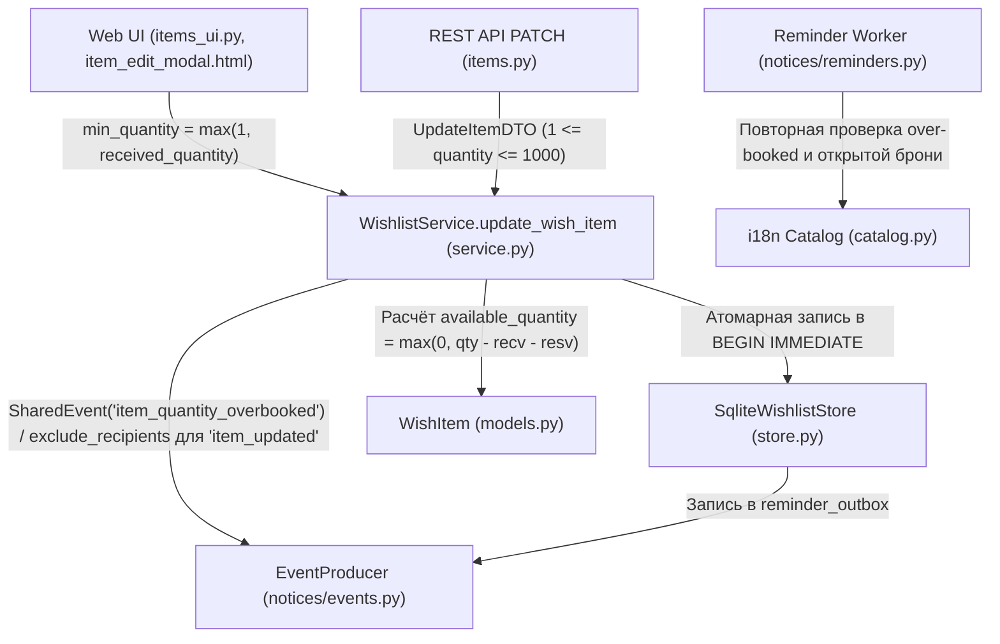

# Спецификация: WISHENKA-218 — Снятие ограничения по забронированным экземплярам при редактировании количества желания (FR-5 / Q12)

**Задача в Jira:** WISHENKA-218  
**Язык реализации:** Python  
**Связанные документы:** [00-high.md](file:///home/src/specs/00-high.md), [spec.md](file:///home/src/in-docs/spec.md), [00-roadmap.md](file:///home/src/ai-tasks/WISHENKA-218/00-roadmap.md)

## 1. Назначение и бизнес-цель

### 1.1. Постановка проблемы

Базовый инвариант сервиса Telegram Wishlist Service ([00-high.md](file:///home/src/specs/00-high.md), инварианты 1 и 4) требует полной изоляции автора и получателя подарка от сведений о бронированиях и покупках: владелец, соавторы и получатели не должны знать, забронировано ли желание, сколько экземпляров занято и кем именно.

До внесения изменений по задаче `WISHENKA-218` при редактировании желания система вычисляла нижнюю границу количества как `received_quantity + reserved_quantity`:

- в веб-модальном окне редактирования (`item_edit_modal.html`) устанавливался атрибут `min="{{ min_quantity }}"` с учётом броней и отображалось предупреждение `web.item.locked_quantity_hint` с точным количеством забронированных дарителями единиц;
- в доменном сервисе (`WishlistService.update_wish_item`) и API/UI попытка снизить запрошенное количество ниже `received_quantity + reserved_quantity` отклонялась ошибкой `CannotReduceQuantityBelowReservedError` (`409 Conflict`) с указанием числа занятых единиц.

Такое поведение раскрывало автору и получателю факт бронирования и число забронированных экземпляров, нарушая принцип сюрприза.

### 1.2. Цели и бизнес-ценность

Реализация `WISHENKA-218` устраняет последнее исключение из принципа сюрприза в сценарии редактирования желания в соответствии с продуктовым решением `WISHENKA-154` (`FR-5` / Q12, раздел 5.5 в [spec.md](file:///home/src/in-docs/spec.md)):

- **Неукоснительная защита тайны сюрприза:** при открытии формы редактирования, изменении количества или получении ошибки валидации автор и получатель не видят ни UI-подсказок, ни ограничений `min`, ни текстов ошибок, зависящих от броней дарителей.
- **Согласованный жизненный цикл превышения лимита (over-booked):** снижение запрошенного количества ниже `received_quantity + reserved_quantity` переводит желание в допустимое состояние превышения лимита (раздел 7.3 в [spec.md](file:///home/src/in-docs/spec.md)) без автоматической отмены чужих броней; затронутые дарители получают уведомление для самостоятельного урегулирования.
- **Согласованность спецификации и кода:** поведение веб-интерфейса, REST API, доменного слоя и уведомлений приведено в соответствие с разделом 5.5 функциональной спецификации.

### 1.3. Границы задачи

**Входит в объём задачи:**

- удаление из формы редактирования, маршрутов UI и доменного сервиса всех вычислений, подсказок и ограничений, опирающихся на `reserved_quantity` / `locked_quantity`;
- установка минимально допустимого запрошенного количества равным `max(1, received_quantity)` с понятным отказом при попытке указать значение меньше полученного количества;
- перевод желания в состояние превышения лимита при `received_quantity + reserved_quantity > new_quantity` с полным сохранением открытых броней;
- постановка в очередь уведомлений `item_quantity_overbooked` для дарителей с открытыми бронями при возникновении превышения лимита;
- обеспечение полной идентичности ответов редактирования для авторов и получателей независимо от наличия броней.

**Не входит в объём задачи:**

- реализация состояния «Завершено» для купленных броней на полностью полученное желание (`FR-6` / Shortcut E, отслеживается в `WISHENKA-219`);
- изменение настройки предупреждения о наличии дарителей перед архивацией желания (раздел 5.5 в [spec.md](file:///home/src/in-docs/spec.md));
- изменение сценариев отметки, отмены и корректировки получения подарка (`WISHENKA-153`);
- изменение базовых правил бронирования и отмены броней вне описанного режима превышения лимита.

## 2. Функциональные требования и пользовательские сценарии

### 2.1. Роли и доменные сущности

| Роль / Сущность | Описание в контексте редактирования количества |
|---|---|
| Автор | Владелец, администратор или участник (соавтор) вишлиста с правами редактирования желаний |
| Получатель | Адресат желания (владелец списка, соавтор или внешнее лицо); может совпадать с автором |
| Даритель | Пользователь, удерживающий открытую бронь на желание или просматривающий чужой вишлист |
| Желание (`WishItem`) | Элемент вишлиста с запрошенным количеством `quantity` (`>= 1`), полученным `received_quantity` (`>= 0`) и суммой открытых броней `reserved_quantity` |
| Открытая бронь | Бронь дарителя на положительное число экземпляров в статусе `active` («Задумано») или `purchased` («Куплено») |
| Состояние превышения лимита | Валидное состояние желания, при котором `received_quantity + reserved_quantity > quantity` (свободный остаток `available_quantity == 0`) |

### 2.2. Функциональные требования

- **FR-1. Отсутствие порога по забронированным экземплярам:**
  - форма редактирования желания и серверная логика не должны отображать, рассчитывать, передавать в шаблон или учитывать количество единиц, занятых бронями дарителей (`reserved_quantity` / `locked_quantity`);
  - нижняя граница в форме (`min`) и в доменной проверке зависит исключительно от `1` и `received_quantity`.
- **FR-2. Минимально допустимое запрошенное количество:**
  - автор может уменьшить `quantity` вплоть до `max(1, received_quantity)`, включая случай `quantity == received_quantity` при `received_quantity >= 1` и `quantity == 1` при `received_quantity == 0`;
  - попытка установить `quantity < max(1, received_quantity)` (при соблюдении общей валидации `quantity >= 1`) отклоняется исключением `CannotReduceQuantityBelowReservedError` (HTTP `409 Conflict`) с сообщением, которое ссылается только на уже полученное количество (`received_quantity`) и никогда не упоминает брони или дарителей.
- **FR-3. Переход в состояние превышения лимита:**
  - если допустимое уменьшение количества (`quantity_delta < 0`) приводит к выполнению условия `received_quantity + reserved_quantity > quantity`, желание переходит в состояние превышения лимита (`available_quantity = 0`);
  - все существующие открытые брони (`active` и `purchased`) сохраняются без изменений и не отменяются и не уменьшаются автоматически;
  - пока желание находится в состоянии превышения лимита, создание новых броней и увеличение количества существующих броней отклоняются с `InsufficientQuantityError`, тогда как уменьшение количества, отмена брони и перевод брони в статус «Куплено» (`purchased`) остаются доступными.
- **FR-4. Уведомления дарителям при превышении лимита:**
  - если снижение количества (`quantity_delta < 0`) привело к `received_quantity + reserved_quantity > quantity`, для каждого уникального дарителя с открытой бронью (`active` или `purchased`), не являющегося получателем желания, формируется персональное уведомление `item_quantity_overbooked`;
  - если редактирующий соавтор одновременно держит открытую бронь на это желание (и не является его получателем), он включается в число получателей `item_quantity_overbooked`;
  - дарители, получившие событие `item_quantity_overbooked` в рамках этой правки, исключаются из рассылки общего события `item_updated` по той же правке, чтобы не дублировать оповещения;
  - если снижение количества не привело к `received_quantity + reserved_quantity > quantity`, уведомление `item_quantity_overbooked` не ставится в очередь;
  - дарители с закрытыми (отменёнными) бронями уведомление не получают;
  - текст уведомления не раскрывает личность автора правки, других дарителей, количества экземпляров и наличие «лишних» броней;
  - сбой доставки уведомления не откатывает и не блокирует сохранение нового количества желания.
- **FR-5. Нулевая утечка информации о бронях для авторов и получателей:**
  - HTML-форма редактирования, ответ об ошибке `409` и JSON-ответ при успешном обновлении через API должны быть структурно и содержательно идентичны для желаний с открытыми бронями и идентичных желаний без броней.

### 2.3. Пользовательские сценарии

- **UC-218-01. Уменьшение количества при наличии броней:** автор открывает форму редактирования желания с `quantity=6`, `received_quantity=2` и бронью на `3` шт., видит `min="2"` без предупреждений о бронях, снижает количество до `2` и успешно сохраняет изменение.
- **UC-218-02. Попытка снизить количество ниже полученного:** при тех же условиях автор вводит `quantity=1`; сервер возвращает HTTP `409 Conflict` с сообщением только о `2` уже полученных экземплярах, не раскрывая наличие и объём брони (`3` шт.) или сумму `5`.
- **UC-218-03. Работа дарителя в состоянии превышения лимита:** после снижения количества до `3` при `received_quantity=1` и двух открытых бронях по `2` шт. (`1 + 4 > 3`) обе брони сохраняются в своих статусах; новый даритель не может создать бронь, существующий даритель не может увеличить свою бронь с `2` до `3`, но может уменьшить её до `1`, отменить или отметить как купленную.
- **UC-218-04. Уведомление дарителей и соавтора-дарителя:** при конфликтном снижении количества дарители с открытыми бронями (включая редактирующего соавтора, если он сам бронировал это желание) получают уведомление `notices.item_quantity_overbooked` с предложением проверить и при необходимости скорректировать или отменить бронь; при этом для таких адресатов не создаётся дублирующее уведомление `item_updated`.
- **UC-218-05. Неконфликтное снижение количества:** если при `received_quantity=1` и бронях на `4` шт. автор снижает `quantity` с `6` до `5` (`1 + 4 <= 5`), уведомление `item_quantity_overbooked` не формируется.

### 2.4. Продуктовые инварианты

1. **Тайна сюрприза:** ни один интерфейс, DTO, HTML-фрагмент или текст валидационной ошибки для автора или получателя не содержит сведений о существовании или объёме броней.
2. **Автономность броней:** изменение параметров желания автором никогда не модифицирует и не аннулирует открытые обязательства дарителей.
3. **Защита от уменьшения ниже полученного:** `quantity` не может стать меньше `max(1, received_quantity)` ни при синхронных, ни при конкурентных запросах.

## 3. Архитектура, компоненты и интерфейсы

### 3.1. Схема взаимодействия компонентов

### 3.2. Модули, классы и интерфейсы

| Модуль | Компонент / функция | Ответственность в рамках WISHENKA-218 |
|---|---|---|
| `wishenka/web/routes/items_ui.py` | `get_edit_item_modal`, `submit_edit_item` | Формируют `safe_form` без `reservations`/`reserved_quantity`, вычисляют `min_quantity = max(1, received_quantity)`, при `CannotReduceQuantityBelowReservedError` рендерят HTTP `409` с ключом `web.item.quantity_below_reserved` и параметром `count=received_quantity_snapshot` |
| `wishenka/web/templates/partials/item_edit_modal.html` | Форма `#item-detailed-form` (`POST /web/wishlists/{wishlist_id}/items/{item_id}/edit`) | Поле `#item-quantity-input` с `min="{{ min_quantity }}"` и `max="1000"`; удалён блок `alert-warning` (`locked_quantity_hint`) |
| `wishenka/web/routes/items.py` | `update_item` (`PATCH /api/wishlists/{wishlist_id}/items/{item_id}`), `execute` | Принимает `UpdateItemDTO`, выполняет операцию через `wishlist_store.execute_wish(..., item_id=item_id)`, проецирует результат через `project_wish_item(item, user)`, маппит `CannotReduceQuantityBelowReservedError` в HTTP `409` |
| `wishenka/items/schemas.py` | `UpdateItemDTO` | Валидирует необязательное поле `quantity` типа `int` с ограничением `Field(default=None, ge=1, le=1000)` |
| `wishenka/wishlists/service.py` | `WishlistService.update_wish_item` | Под блокировкой `self._concurrency_coordinator.acquire(item_id)` проверяет `min_allowed = max(1, item.received_quantity)`; при изменении полей и условии `quantity_delta < 0` + `received_quantity + reserved_quantity > quantity` ставит `SharedEvent("item_quantity_overbooked", ...)` и передаёт `exclude_recipients=overbooked_givers` в `_record_shared_event("item_updated", ...)` |
| `wishenka/wishlists/models.py` | `WishItem.reserved_quantity`, `WishItem.available_quantity` | `reserved_quantity` суммирует `r.quantity` по `ACTIVE` и `PURCHASED`; `available_quantity` возвращает `max(0, quantity - received_quantity - reserved_quantity)` |
| `wishenka/wishlists/exceptions.py` | `CannotReduceQuantityBelowReservedError`, `InsufficientQuantityError` | Класс `CannotReduceQuantityBelowReservedError` сохранён для обратной совместимости контрактов API/UI с новым текстом ошибки о `received_quantity`; `InsufficientQuantityError` блокирует увеличение или создание броней при `available_quantity == 0` |
| `wishenka/notices/events.py` | `SAFE_SHARED_EVENTS`, `SharedEvent`, `EventProducer.record` | Включает `"item_quantity_overbooked"` в `SAFE_SHARED_EVENTS`; в той же транзакции SQLite вставляет бессодержательные строки намерений в таблицу `reminder_outbox` |
| `wishenka/notices/reminders.py` | `_event_category`, `_event_authorized`, `_render` | Относит `item_quantity_overbooked` к категории `"wishlist_changes"`; перед отправкой перепроверяет состояние в БД (`_event_authorized`); форматирует сообщение через `_render` |
| `wishenka/i18n/catalog.py` | `notices.item_quantity_overbooked`, `web.item.quantity_below_reserved` | Содержит локализации EN/RU для уведомления о снижении количества и сообщения об ошибке ниже `received_quantity` |

### 3.3. Контракты данных и переходы состояний

1. **Контракт валидации количества при редактировании:**
   - Вход `quantity` от автора через UI-форму или `UpdateItemDTO` (`1 <= quantity <= 1000`).
   - Проверка доменного порога: `min_allowed = max(1, item.received_quantity)`.
   - При `quantity < min_allowed` — ошибка `CannotReduceQuantityBelowReservedError(f"Cannot reduce quantity to {quantity}: {item.received_quantity} units already received")` (в REST API — `409 Conflict` с `detail`, в UI — `409 Conflict` с текстом `web.item.quantity_below_reserved`).
   - При `quantity >= min_allowed` — поле `item.quantity` обновляется, а для API возвращается проекция `WishItemRecipientViewDTO` (не содержащая `reserved_quantity` и `reservations`).
2. **Контракт постановки и отправки события `item_quantity_overbooked`:**
   - Событие `SharedEvent(kind="item_quantity_overbooked", wishlist_id=wl.id, item_id=item.id, event_id=..., recipients=tuple(givers), member_recipients=...)` создаётся только когда `before_update != after_update`, `quantity_delta < 0`, `item.received_quantity + item.reserved_quantity > item.quantity` и множество получателей `givers` непусто.
   - В `givers` попадают отсортированные `reservation.user_id` для броней со статусом `ReservationStatus.ACTIVE` или `ReservationStatus.PURCHASED`, для которых `not WishlistAccessPolicy.is_recipient_id(reservation.user_id, item)`.
   - На этапе доставки `_event_authorized` проверяет в SQLite:
     - список `wl_lists` в статусе `'active'` или `'archived'`;
     - наличие у пользователя брони на желание в статусе `'active'` или `'purchased'`;
     - пользователь не является получателем (`i.recipient_user_id IS NULL OR i.recipient_user_id <> :user`) и не является единоличным владельцем не-совместного списка (`l.is_collaborative = 1 OR l.owner_id <> :user`);
     - условие превышения лимита сохраняется на момент отправки: `i.received_quantity + COALESCE((SELECT SUM(r2.quantity) FROM wl_reservations r2 WHERE r2.wish_item_id = i.id AND r2.status IN ('active', 'purchased')), 0) > i.quantity`.
3. **Допустимые переходы в состоянии превышения лимита:**
   - Открытая бронь (`active` или `purchased`) при снижении `item.quantity` остаётся в прежнем статусе.
   - Новые бронирования (`create_reservation`) и увеличение количества (`update_reservation_quantity` при `new_qty > old_qty`) отклоняются (`InsufficientQuantityError`).
   - Уменьшение количества (`update_reservation_quantity` вниз), отмена брони и отметка о покупке (`mark_reservation_purchased`) выполняются штатно.

## 4. Нефункциональные требования, безопасность и наблюдаемость

### 4.1. Производительность, лимиты и конкурентность

- **Граничные значения ввода:** количество экземпляров желания ограничено диапазоном от `1` до `1000` (`UpdateItemDTO`, `item_edit_modal.html`). Названия желания и вишлиста при рендеринге уведомления в `_render` усекаются до 100 символов.
- **Сериализация конкурентных изменений:** все мутации конкретного желания (редактирование количества, отметка получения, создание/изменение брони) защищены координатором `ItemConcurrencyCoordinator.acquire(item_id)` и транзакцией `SqliteWishlistStore.execute_wish` (`BEGIN IMMEDIATE`). Это гарантирует, что `quantity` не окажется меньше `received_quantity`, а при переходе в over-booked режим не возникнут гонки с новыми бронями. При невозможности захватить блокировку возвращается `InventoryBusyError` (HTTP `503`).
- **Нагрузка на outbox и БД:** при конфликтном редактировании в `reminder_outbox` создаётся одна запись на каждого затронутого дарителя; проверка `_event_authorized` выполняет коррелированный подзапрос `SUM` по `wl_reservations` с фильтром по индексированному `wish_item_id`, что даёт пренебрежимо малые затраты на одно желание.

### 4.2. Безопасность и приватность

- **Изоляция данных о бронях на границах системы:** `get_edit_item_modal` и `submit_edit_item` не читают `reserved_quantity` и `item.reservations`; REST API возвращает `project_wish_item(item, user)`.
- **Приватность уведомлений:** таблица `reminder_outbox` хранит только идентификаторы и тип события без пользовательского текста. Локализованные тексты `notices.item_quantity_overbooked` (EN/RU) не содержат имени редактора, числа экземпляров или упоминания других дарителей.
- **Фильтрация устаревших уведомлений:** повторная проверка `_event_authorized` перед отправкой исключает доставку уведомления, если до запуска воркера бронь была отменена, количество увеличено обратно, даритель стал получателем или список был удалён.
- **Гигиена логов:** ни в текстах сообщений, ни в полях `extra` логов редактирования и отказов не логируются `reserved_quantity`, `locked_quantity`, имена, идентификаторы дарителей и `chat_id`.

### 4.3. Наблюдаемость и структурированное логирование

В проекте не используется отдельный бэкенд метрик (Prometheus / StatsD); операционный мониторинг строится на агрегации структурированных логов с ключом `extra["event"]`.

| Уровень | Логгер | Событие (`event`) | Ключевые поля контекста и условие |
|---|---|---|---|
| `WARNING` | `wishenka.wishlists` | `item_quantity_reduction_rejected` | `item_id`, `wishlist_id`, `actor_id`, `requested_quantity`, `received_quantity`, `reason` — попытка установить `quantity < max(1, received_quantity)` |
| `WARNING` | `wishenka.wishlists` | `item_quantity_overbooked` | `item_id`, `wishlist_id`, `actor_id`, `quantity`, `quantity_delta`, `notified_givers_count` — `quantity_delta < 0` и `received_quantity + reserved_quantity > quantity` |
| `WARNING` | `wishenka.web.items_ui` | `ui_reduction_lock_rejected` | `wishlist_id`, `item_id`, `actor_id`, `user_id`, `requested_quantity`, `received_quantity` — перехват `CannotReduceQuantityBelowReservedError` в UI |
| `INFO` | `wishenka.wishlists` | `item_updated` | `item_id`, `wishlist_id`, `actor_id`, `updated_fields`, `quantity`, `quantity_delta` — успешное обновление желания |
| `INFO` | `wishenka.web.items_ui` | `ui_item_edit_opened` | `wishlist_id`, `item_id`, `actor_id`, `user_id`, `mode` (`"create"` / `"edit"`), `is_collaborative` (и `received_quantity` для режима `"edit"`) |
| `INFO` | `wishenka.web.items_ui` | `ui_item_edit_saved` | `wishlist_id`, `item_id`, `actor_id`, `user_id`, `quantity`, `has_recipient` — успешное сохранение формы редактирования |
| `DEBUG` | `wishenka.wishlists.notices` | `service_notice_skipped` | `outbox_id`, `kind`, `reason` (`"unauthorized"` или `"ineligible"`) — пропуск строки outbox при доставке без PII |
| `DEBUG` | `wishenka.notices.reminders` | `notice_locale_resolved` | `channel`, `locale`, `fallback_used` — разрешение локали получателя уведомления |

## 5. Верификация и критерии приёмки

### 5.1. Тестовые сценарии и результаты проверок

Ключевые сценарии зафиксированы в воспроизводящем наборе [test_wishenka_218_repro.py](file:///home/src/tests/test_wishenka_218_repro.py):

1. `test_reduce_quantity_below_occupied_to_min_allowed_succeeds` — подтверждает успешное снижение `quantity` до `1` при `received_quantity=0` и до `2` при `received_quantity=2` при наличии активных и купленных броней (`PATCH /api/wishlists/...` -> `200`).
2. `test_reduce_quantity_below_received_rejected_without_booking_leak` — подтверждает отказ (`CannotReduceQuantityBelowReservedError` и HTTP `409`) при снижении ниже `received_quantity` с указанием только полученного количества и отсутствием `locked`/`reserved`/сумм броней в ошибке.
3. `test_edit_modal_and_responses_identical_with_or_without_promises` — сравнивает HTML ответа `GET .../edit` (`min="2"`, без `alert-warning`), HTML ошибки `409` (`POST .../edit`) и JSON-ответ `PATCH` для желаний с бронями и без броней.
4. `test_overbooked_state_preserves_promises_and_queues_notices` — проверяет отсутствие `item_quantity_overbooked` при неконфликтном снижении, постановку `item_quantity_overbooked` при переходе в over-booked режим, сохранность броней `ACTIVE`/`PURCHASED`, блокировку новых броней и увеличений (`InsufficientQuantityError`), а также доступность уменьшения количества и отметки покупки.
5. `test_editing_coauthor_with_open_promise_receives_overbooked_notice` — подтверждает получение `item_quantity_overbooked` редактирующим соавтором-дарителем и его исключение из `item_updated`.

Зафиксированные результаты валидации (по [40-code-cleanup.md](file:///home/src/ai-tasks/WISHENKA-218/40-code-cleanup.md) и [50-observability.md](file:///home/src/ai-tasks/WISHENKA-218/50-observability.md)):

- **Статический анализ и сборка:** `make analyze` (`ruff check wishenka tests`, `ruff format --check wishenka tests`, `mypy wishenka tests` по 234 файлам) и `make build` (`python -m compileall wishenka tests`) выполнены без ошибок.
- **Целевой набор тестов (91 passed):** `test_wishenka_218_repro.py`, `test_wish_items_tma_ui.py`, `test_wish_items_crud_api.py`, `test_gift_receipt_service.py`, `test_shared_inventory_multiprocess.py`, `test_item_observability.py`, `test_reservations_surprise_invariant.py`, `test_currency_defaults.py` (включая проверки структурированных логов через `caplog`).
- **Смежный набор уведомлений и локализации (108 passed, 1 failed):** `test_i18n_sync.py`, `test_i18n_unit.py`, `test_notice_wishlist_events.py`, `test_receipt_notices.py`, `test_receipt_notices_extra.py`; единственное падение `test_cleanup_cycle_survives_a_failing_notice_purge` относится к предсуществующей ошибке в `wishenka/wishlists/cleanup.py` (`WISHENKA-245`).
- **Предсуществующие падения базового коммита `e433223`:** 17 несвязанных с `WISHENKA-218` падений (включая `WISHENKA-245`, `WISHENKA-264`–`WISHENKA-267`, `WISHENKA-226`, `WISHENKA-235`, `WISHENKA-232`, `WISHENKA-220`) задокументированы в [60-tech-debt.md](file:///home/src/ai-tasks/WISHENKA-218/60-tech-debt.md).

### 5.2. Критерии приёмки

1. Автор может снизить `quantity` желания до `max(1, received_quantity)` даже при наличии открытых броней на большее число экземпляров.
2. Попытка снизить `quantity` ниже `max(1, received_quantity)` отклоняется без раскрытия данных о бронях.
3. Ни один элемент UI, текст ошибки, ответ API или запись в логах, доступная автору/получателю, не раскрывает факт или объём бронирования.
4. Переход в состояние `received_quantity + reserved_quantity > quantity` сохраняет все открытые брони, запрещает новые брони и увеличение вверх и ставит в очередь `item_quantity_overbooked` для затронутых дарителей.
5. Автоматизированные тесты покрывают все перечисленные сценарии, включая контроль утечек и наблюдаемость.

### 5.3. Известные ограничения и последующие задачи

По итогам анализа технического долга ([60-tech-debt.md](file:///home/src/ai-tasks/WISHENKA-218/60-tech-debt.md)) выявлены следующие ограничения и открытые follow-up задачи:

- **Непроверенные сценарии доставки уведомлений (`WISHENKA-260`, Priority: Medium):** отсутствует прямой тест на причину пропуска `service_notice_skipped` с `reason="unauthorized"` и на сброс `item_quantity_overbooked` в `_event_authorized`, если до момента отправки бронь отменена, количество вновь увеличено, даритель стал получателем или список удалён.
- **Сквозное тестирование воркера уведомлений (`WISHENKA-261`, Priority: Low):** не проверен end-to-end рендеринг шаблона `notices.item_quantity_overbooked` на EN/RU через воркер, изоляция данных при нескольких дарителях на этапе доставки и исключение `item_updated` для не-редактирующего соавтора-дарителя.
- **Дублирование и размер методов (`WISHENKA-262`, Priority: Low):** `WishlistService.update_wish_item` требует декомпозиции, а условие превышения лимита и SQL-предикат авторизации продублированы между `wishenka/wishlists/service.py` и `wishenka/notices/reminders.py`.
- **Временные формулировки и унаследованные идентификаторы (`WISHENKA-263`, Priority: Low):** тексты `notices.item_quantity_overbooked` (EN/RU) составлены разработчиком как предварительные (provisional i18n copy) без продуктового ревью; исторические имена `CannotReduceQuantityBelowReservedError`, `item_quantity_reduction_rejected`, `web.item.quantity_below_reserved` и `ui_reduction_lock_rejected` сохранены для обратной совместимости логов и каталога.
- **Сопутствующий эффект и охват старых тестов:** `_record_shared_event` теперь выполняет ранний возврат при пустом множестве получателей для всех типов событий (считается безопасным, так как без получателей уведомления не создаются); унаследованные тесты переписаны под семантику `max(1, received_quantity)` вместо прежнего порога по броням.
