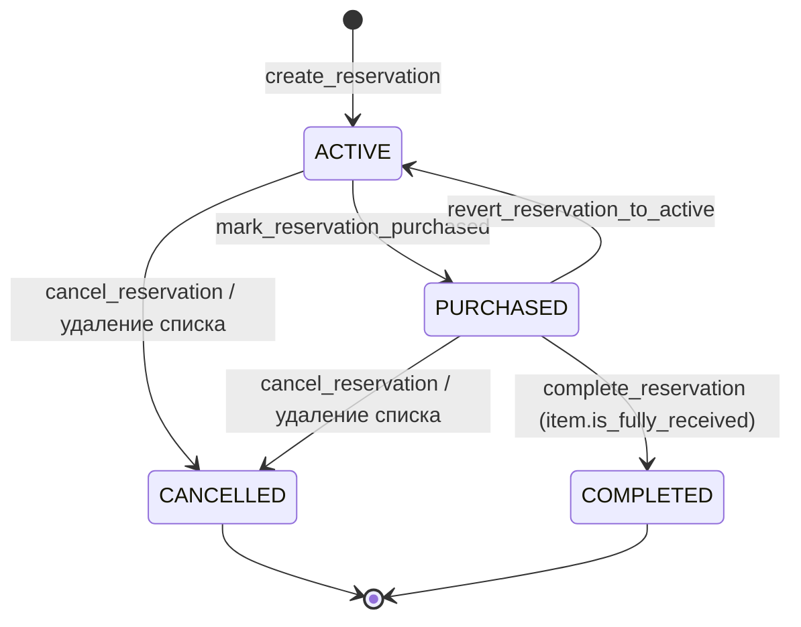
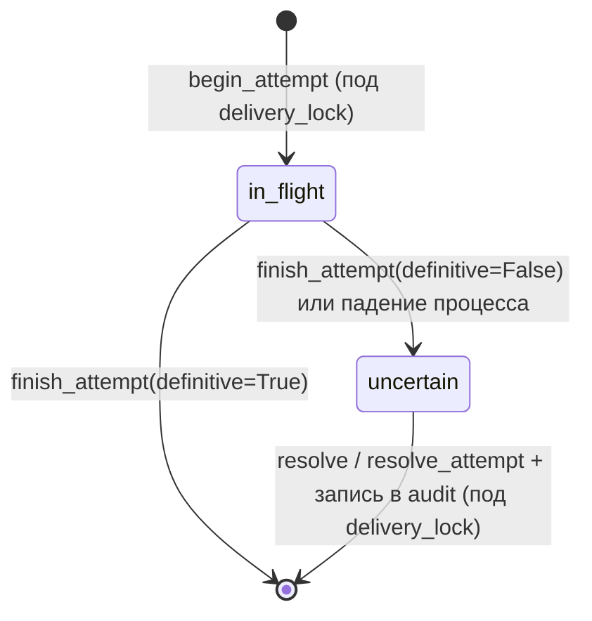

# Спецификация: WISHENKA-219 — Явное завершение купленного бронирования после полного получения желания

**Задача Jira:** `WISHENKA-219`  
**Статус:** реализовано  
**Язык реализации:** `Python` (`FastAPI`, `HTMX`, `SQLite WAL`, `Alembic`)  
**Языки интерфейса:** русский (`ru`), английский (`en`)  
**Связанные документы:** [spec.md](file:///home/src/in-docs/spec.md), [00-high.md](file:///home/src/specs/00-high.md), [reservations.md](file:///home/src/doc/dev/reservations.md), [notifications.md](file:///home/src/doc/dev/notifications.md), [gift-receipt.md](file:///home/src/doc/dev/gift-receipt.md)

---

## 1. Назначение и бизнес-цель

### 1.1. Постановка проблемы

В продукте фиксация получения подарка получателем или соавтором и управление бронированием дарителем намеренно разделены как независимые факты: при отметке получения автор указывает только количество полученных единиц без привязки к конкретному дарителю и без автоматического закрытия чужих бронирований (`ACTIVE` и `PURCHASED`).

До внедрения `WISHENKA-219` после того, как желание становилось полностью полученным (`received_quantity >= quantity`), купленные бронирования (`PURCHASED`) продолжали оставаться открытыми:

- они не уходили из раздела «Мои бронирования» и завышали счётчик уникальных желаний с активными бронями на главной странице;
- они продолжали удерживать экземпляры в формуле доступности желания (`reserved_quantity`);
- даритель продолжал получать последующие уведомления о получении и его отмене/коррекции (`gift_received`, `receipt_increased`, `receipt_reverted`), которые после фактического вручения подарка теряют актуальность;
- единственным способом убрать запись из открытых броней оставалась отмена (`CANCELLED`), искажающая смысл состоявшегося подарка.

### 1.2. Цели

1. Предоставить дарителю явное действие завершения («Подарок вручён» / `Gift delivered`) для собственной купленной (`PURCHASED`) брони после полного получения желания.
2. Обеспечить корректное освобождение занятых экземпляров, уменьшение активного списка и счётчика «Мои бронирования» без изменения записей получения и без раскрытия тайны сюрприза.
3. Остановить отправку ещё не переданных провайдеру уведомлений о получении и отмене получения для завершённой брони, сохранив при этом уведомления для других открытых броней того же дарителя или других дарителей.
4. Исключить гонки между завершением бронирования, повторными запросами, корректировкой получения и фоновой отправкой уведомлений через транзакционную сериализацию, межпроцессный замок и долговечный барьер доставки.

### 1.3. Ценность для пользователей и системы

- **Для дарителя:** «Мои бронирования» и бейдж на главной странице отражают только незавершённые обязательства; факт вручения подарка (`completed`) явно отличается от отмены (`cancelled`); прекращаются лишние уведомления о получении/откате получения.
- **Для получателя и авторов вишлиста:** порядок фиксации и корректировки получения остаётся прежним; ни получатель, ни соавторы не получают сведений о существовании, количестве, покупке или завершении чьих-либо бронирований.
- **Для системы:** сохраняется консистентность поштучного учёта остатков и идемпотентность операций; фоновая доставка уведомлений координируется fail-closed с операцией завершения без удержания транзакций БД на сетевом I/O.

### 1.4. Границы области изменений (Non-Goals)

Данная спецификация **не включает**:

- автоматическое закрытие или завершение бронирований при отметке получения подарка;
- изменение порядка фиксации, отмены или корректировки фактов получения;
- изменение правил отмены бронирований (`CANCELLED`);
- поддержку совместной покупки одного подарка несколькими дарителями (складчину);
- гарантию времени фактического отображения у получателя сообщения, уже принятого внешним провайдером (Telegram Bot API) до момента завершения.

---

## 2. Функциональные требования и пользовательские сценарии

### 2.1. Бизнес-сущности

- **Даритель (`Giver`):** аутентифицированный пользователь, создавший и управляющий собственным обещанием (бронированием).
- **Желание (`WishItem`):** позиция вишлиста с запрошенным количеством (`quantity`) и накопленным полученным количеством (`received_quantity`); считается **полностью полученным** (`is_fully_received`), когда `received_quantity >= quantity`.
- **Обещание / Бронирование (`Reservation`):** количественное обязательство дарителя со статусами `ACTIVE` («Забронировано», задуманное), `PURCHASED` («Куплено»), `CANCELLED` («Отменено») и `COMPLETED` («Завершено»). Статусы `ACTIVE` и `PURCHASED` являются **открытыми** (занимают экземпляры); `CANCELLED` и `COMPLETED` являются **закрытыми** (терминальными).
- **Кабинет «Мои бронирования»:** раздел сгруппированных по вишлистам открытых обещаний дарителя и счётчиком `total_distinct_items` (количество уникальных желаний с открытыми бронями) на карточке главной страницы.
- **Уведомление о получении (`Receipt notice`):** персональное сообщение дарителю с открытым обещанием о фиксации (`gift_received`), увеличении (`receipt_increased`) или отмене/уменьшении (`receipt_reverted`) получения подарка.

### 2.2. Функциональные требования

#### Условия допустимости завершения

1. Завершить бронирование может **только сам даритель** — владелец этой брони (`user_id == caller`), не являющийся получателем желания (`not WishlistAccessPolicy.is_recipient(user, item)`). Анонимные посетители, получатели, авторы списка без права на чужую бронь и другие дарители не могут выполнить действие ни через UI, ни прямым вызовом API или сервиса.
2. Статус целевого бронирования должен быть строго `PURCHASED`. Прямое завершение `ACTIVE` (ещё не купленной) брони запрещено, включая случай полностью полученного желания: даритель должен сначала отметить бронь как купленную либо уменьшить/отменить её по существующим правилам.
3. Желание должно быть полностью получено (`item.is_fully_received` истинно). Для частично полученного или неполученного желания завершение отклоняется.
4. Родительский вишлист не должен быть удалён (`status != WishlistStatus.DELETED`). При этом **архивный вишлист (`WishlistStatus.ARCHIVED`) допускается** для завершения купленной брони (четыре стандартные мутации брони — изменение количества, отмена, отметка покупки и возврат в бронь — для архивного списка по-прежнему запрещены).
5. Связь пути в запросе (`wishlist_id`, `item_id`, `reservation_id`) должна точно соответствовать загруженной сущности.

#### Эффекты завершения и учёт остатков

6. При успешном завершении статус выбранного бронирования переводится из `PURCHASED` в `COMPLETED`, обновляется временная метка `updated_at`.
7. Занятые этой бронью экземпляры немедленно исключаются из `reserved_quantity` (учитывающего только `ACTIVE` и `PURCHASED`).
8. Завершённая бронь перестаёт считаться открытой в кабинете «Мои бронирования» и в счётчике `total_distinct_items`. Если у того же дарителя на то же желание остаётся другая открытая бронь (`ACTIVE` или `PURCHASED`), счётчик `total_distinct_items` это желание сохраняет.
9. Статус `completed` является терминальным и везде, где отображается или возвращается в контракте, отличим от `cancelled`.
10. Завершение одной брони **не изменяет** записи получения (`wl_receipts`, `received_quantity`), запрошенное количество желания (`quantity`) и любые другие бронирования (как других дарителей, так и прочие брони того же дарителя).
11. Освобождение единиц завершённой бронью **не открывает** полностью полученное желание для новых броней: формула `available_quantity = max(0, quantity - received_quantity - reserved_quantity)` сохраняет значение `0`, пока `received_quantity >= quantity`.
12. Последующая отмена или уменьшение получения автором не переоткрывает завершённую бронь; свободный остаток при этом пересчитывается с учётом освобождённых ранее единиц.

#### Кабинет «Мои бронирования» и локализация

13. Кнопка завершения («Подарок вручён» / `Gift delivered`) отображается в строке бронирования кабинета только при одновременном выполнении условий: желание полностью получено (`row.wish_received`) и бронь имеет статус `PURCHASED` (`row.is_purchased`), включая строки в архивных вишлистах. Кнопка отмены и прочие стандартные действия продолжают отображаться согласно существующему признаку `row.offer_actions` (только для активных списков).
14. После успешного завершения через HTMX (`POST .../complete`, HTTP `200`) клиент обновляет список `/web/reservations/list?notice=completed`, отображает локализованное уведомление о результате (`Обещание завершено.` / `Promise completed.`) и запрашивает `/web/reservations/card` для обновления счётчика `.reservations-badge`. Счётчик также обновляется при восстановлении кэшированной страницы (`pageshow` с `event.persisted`).
15. Действие и все пользовательские сообщения об успехе, отказе и занятости полностью локализованы на английский и русский языки согласно выбранной локали дарителя.

#### Уведомления о получении и конкурентность

16. Очереди `notification_outbox` (`gift_received`) и `reminder_outbox` (`receipt_increased`, `receipt_reverted`) распространяются только на открытые бронирования (`ACTIVE` и `PURCHASED`). Наличие открытой брони проверяется на этапе выборки и непосредственно перед отправкой.
17. При фиксации завершения брони, если у данного дарителя по данному желанию не осталось ни одной другой открытой брони (`ACTIVE` или `PURCHASED`), все не отправленные (`pending`, `sending`) строки уведомлений о получении для пары `(wish_item_id, user_id)` в обеих очередях атомарно помечаются пропущенными (`skipped`). Если у дарителя остаётся иная открытая бронь на это желание, её уведомления сохраняются.
18. При активном процессе отправки уведомления или неразрешённом барьере доставки (`receipt_delivery_fence`) завершение блокируется с возвратом повторяемого отказа (HTTP `503`) без изменения состояния бронирования и очередей.
19. Повторный запрос без ключа идемпотентности отклоняется с конфликтом (HTTP `409`), не освобождая единицы повторно; запрос с тем же валидным `Idempotency-Key` воспроизводит исходный успешный ответ после повторной проверки владения и прав доступа.

### 2.3. Инварианты

1. **Инвариант тайны сюрприза:** получатель (включая соавтора-получателя в совместном вишлисте) не видит информацию о бронированиях, покупке и завершении. Попытка получателя или чужого дарителя завершить бронь всегда отклоняется без раскрытия факта существования брони (единый HTTP `404 Resource not found`).
2. **Инвариант независимости получения и обещания:** отметка получения никогда не переводит бронь в `COMPLETED`; перевод выполняет только даритель.
3. **Инвариант строгости остатка и конкурентности:** единицы брони не могут быть освобождены дважды; параллельные изменения получения, отмены и завершения проверяются по актуальному состоянию внутри сериализованной транзакции `BEGIN IMMEDIATE`.
4. **Инвариант координации доставки (fail-closed):** приложение не инициирует новую отправку уведомления о получении после успешного завершения последней открытой брони и не разрешает завершение при неизвестном исходе уже начатой внешней передачи до её аудируемого разрешения.

### 2.4. Пользовательские сценарии

| Идентификатор | Сценарий | Предусловие | Действие и ожидаемый результат |
| --- | --- | --- | --- |
| `UC-01` | Успешное завершение в активном или архивном вишлисте | У дарителя есть бронь `PURCHASED` на полностью полученное желание (в активном или архивном списке). | Даритель нажимает «Подарок вручён» в «Мои бронирования». Бронь переходит в `COMPLETED`, покидает кабинет, бейдж уменьшается, показывается `Обещание завершено.` / `Promise completed.`, единицы освобождаются (остаток желания остаётся `0` при полном получении), ожидающие уведомления подавляются. |
| `UC-02` | Попытка прямого завершения некупленной брони | Бронь в статусе `ACTIVE`, желание полностью получено. | Кнопка завершения в кабинете не отображается; прямой вызов `POST .../complete` возвращает HTTP `409` (`Promise cannot be completed in its current state`), состояние не меняется. Даритель может отменить/уменьшить бронь или сначала отметить `PURCHASED`. |
| `UC-03` | Попытка завершения при неполном получении | Бронь в статусе `PURCHASED`, желание получено частично или не получено. | Запрос отклоняется с HTTP `409`, бронь остаётся `PURCHASED`. |
| `UC-04` | Попытка доступа посторонним или получателем | Запрос отправлен анонимным пользователем, другим дарителем или получателем желания. | Аноним получает HTTP `401`; получатель, другой даритель и запрос по чужому пути получают HTTP `404 Resource not found` без мутации и без раскрытия существования брони. |
| `UC-05` | Повторное действие или конкурентное изменение | Два одновременных `POST .../complete`, либо конкурентная отмена получения (`DELETE .../receipts/{id}`). | При `Idempotency-Key` повтор отдаёт сохранённый ответ `200`; без ключа второй запрос получает `409`; при опередившей отмене получения `complete` видит `is_fully_received == False` и отклоняется с `409`. |
| `UC-06` | Сохранение уведомлений для второй открытой брони | У одного дарителя на одно желание есть две брони (`PURCHASED` и ещё одна `ACTIVE`/`PURCHASED`). | После завершения первой брони во второй открытой брони сохраняются права и отметки, счётчик `total_distinct_items` не падает по этому желанию, а уведомления о получении для этой пары `(wish_item_id, user_id)` остаются правомочными. |
| `UC-07` | Блокировка при активной или неопределённой доставке | Воркер держит `delivery_lock` или в `receipt_delivery_fence` осталась запись `in_flight`/`uncertain`. | Завершение возвращает HTTP `503` без изменения состояния, UI отображает сообщение о занятости; после нормального завершения отправки или аудируемого разрешения оператором повторное завершение проходит успешно. |

---

## 3. Архитектура, компоненты и интерфейсы

### 3.1. Общая схема взаимодействия

```text
Кабинет дарителя (HTMX + локаль) ──POST .../complete──> Web API (reservations.py)
                                                              │
                                        delivery_lock(db_url, item_id, user_id) + has_fence
                                                              │
                                           execute / execute_wish_idempotent / execute_wish
                                                              │
                                           WishlistService.complete_reservation (домен)
                                                              │
                                           WishlistStore._persist_wish (SQLite BEGIN IMMEDIATE)
                                             ├── wl_reservations: status = 'completed'
                                             └── при отсутствии иных open-броней:
                                                 notification_outbox & reminder_outbox -> 'skipped'
                                                              ▲
                                                              │ (координация по (item_id, user_id))
Изменение получения ──> очереди notification_outbox / reminder_outbox
                                 │
                        NoticeWorker.run_once ──> delivery_lock ──> refresh_* ──> begin_attempt
                                                                                      │
                                                 finish_attempt <── NoticeSender <────┘
```

### 3.2. Модули, классы и функции

| Слой | Модуль и ключевые символы | Ответственность |
| --- | --- | --- |
| Доменная модель | `wishenka/wishlists/models.py`: `ReservationStatus.COMPLETED`, `WishItem.is_fully_received`, `WishItem.reserved_quantity`, `WishItem.available_quantity` | Статус `completed` исключён из `reserved_quantity` (считаются только `active` и `purchased`); `is_fully_received` (`received_quantity >= quantity`) задаёт предусловие завершения. |
| Доменный сервис | `wishenka/wishlists/service.py`: `WishlistService.complete_reservation`, `_RESERVATION_INVENTORY_METHODS`, `_transactional`, `project_reservation_action` | Проверяет владение (`res.user_id == user.telegram_id`), соответствие пути (`wishlist_id`, `item_id`), неудалённость списка, `not is_recipient(user, item)`, статус `PURCHASED` и `item.is_fully_received`; переводит статус в `COMPLETED`. При вызове с привязанным `self._store` декоратор `_transactional` предварительно определяет `wish_item_id`, берёт `delivery_lock` и проверяет `has_fence` перед `execute_wish`. |
| Политика доступа | `wishenka/wishlists/policy.py`: `WishlistAccessPolicy.is_recipient` | Гарантирует запрет действий и сокрытие сведений о брони от получателя желания. |
| Хранилище и транзакции | `wishenka/wishlists/store.py`: `WishlistStore.execute_wish`, `WishlistStore.execute_wish_idempotent`, `WishlistStore._persist_wish` | Выполняет доменную операцию в `BEGIN IMMEDIATE`. При идемпотентном повторе `complete_reservation` перепроверяет `wl_reservations WHERE id=:id AND user_id=:actor` и права доступа (`_verify_idempotent_replay_access`). В `_persist_wish` при переходе `purchased -> completed` проверяет отсутствие других `active`/`purchased` броней для `(wish_item_id, user_id)` и переводит `pending`/`sending` строки уведомлений о получении в `skipped`. |
| HTTP API | `wishenka/web/routes/reservations.py`: `complete_reservation`, `execute` | Маршрут `POST /api/wishlists/{wishlist_id}/items/{item_id}/reservations/{reservation_id}/complete`. Проверяет наличие `wishlist_store`, захватывает `delivery_lock` и проверяет `has_fence` до входа в `execute`, мапит исключения в HTTP-коды и возвращает `PromiseActionDTO`. |
| UI кабинета и клиент | `wishenka/web/routes/reservations_ui.py` (`CabinetRow`, `_NOTICES`, `_row`), `wishenka/web/templates/partials/reservations_list.html`, `wishenka/web/static/app.js`, `wishenka/i18n/catalog.py` | Отображает кнопку завершения (`web.reservations.complete`) при `row.wish_received and row.is_purchased`, обрабатывает `notice=completed` (`web.reservations.completed`), обновляет список, бейдж `.reservations-badge` после завершения и при `pageshow` (`event.persisted`). |
| Координация и барьер доставки | `wishenka/notices/fence.py`: `_lock_path`, `_DeliveryLock`, `delivery_lock`, `claim_key`, `begin_attempt`, `defer_claim`, `finish_attempt`, `has_fence`, `resolve_attempt` | Обеспечивает неблокирующее взаимное исключение по ключу `(item_id, user_id)` внутри процесса (`asyncio.Lock`) и между процессами (`fcntl.flock`), а также жизненный цикл записей в `receipt_delivery_fence` и аудита в `receipt_delivery_fence_audit`. |
| Очереди и воркер доставки | `wishenka/notices/worker.py` (`NoticeWorker.run_once`), `wishenka/notices/store.py` (`claim_next`, `refresh_claim`, `skip_claim`), `wishenka/notices/reminders.py` (`claim_reminder`, `refresh_reminder`, `settle_reminder`) | Воркер для `notification_outbox` (`gift`) и `reminder_outbox` (`receipt_increased`, `receipt_reverted`) берёт `delivery_lock`, перепроверяет правомочность через `refresh_*` и `begin_attempt`, держит замок на время отправки и фиксации результата (`finish_attempt`), либо возвращает неначатую выборку в `pending` (`defer_claim`). |
| Операторский интерфейс | `wishenka/notices/operator.py`: `counts`, `list_uncertain`, `resolve`, CLI `python -m wishenka.notices.operator` | Разрешает зависшие `uncertain` строки (`retry` / `fail`); при наличии записи в `receipt_delivery_fence` требует непустые `--operator` и `--evidence`, берёт `delivery_lock`, пишет аудит и удаляет барьер в одной транзакции. |

### 3.3. Контракт HTTP API и маппинг ошибок

#### Запрос

`POST /api/wishlists/{wishlist_id}/items/{item_id}/reservations/{reservation_id}/complete`

- Аутентификация: обязательна (`get_current_user` — cookie-сессия или Bearer-токен).
- CSRF: при cookie-сессии обязательны валидные `Origin` и `X-CSRF-Token` (`BrowserSecurityMiddleware`).
- Идемпотентность: опциональный заголовок `Idempotency-Key` (ключ хэшируется с именем операции `complete_reservation` и идентификаторами `wishlist_id`, `item_id`, `reservation_id`).
- Тело запроса: не требуется.

#### Успешный ответ (HTTP `200 OK`, модель `PromiseActionDTO`)

| Поле | Тип | Описание |
| --- | --- | --- |
| `reservation_id` | `int` | Идентификатор завершённого бронирования |
| `wish_item_id` | `int` | Идентификатор желания |
| `quantity` | `int` | Количество единиц в данном бронировании |
| `status` | `ReservationStatus` | Значение `"completed"` |
| `available_quantity` | `int` | Свободный остаток желания после завершения (`0` при полном получении) |
| `item` | `WishItemGifterViewDTO` | Проекция желания для дарителя (`my_reserved_quantity`, `my_occupying_reservation_count` и пр. без поля `user_id`) |

#### Маппинг ошибок маршрута

| Условие / Исключение | HTTP статус | Тело `detail` | Изменение состояния |
| --- | :---: | --- | --- |
| Отсутствует или невалидна сессия | `401` | `"Authentication required"` | Нет |
| Невалидный CSRF-токен cookie-сессии | `403` | `"Invalid CSRF token"` | Нет |
| Чужая или отсутствующая бронь, получатель желания, удалённый список, несовпадение пути (`ReservationNotFoundError`, `ItemNotFoundError`, `WishlistNotFoundError`, `WishlistDeletedError`) | `404` | `"Resource not found"` | Нет |
| Статус не `PURCHASED` или желание не полностью получено (`ReservationError`) | `409` | `"Promise cannot be completed in its current state"` | Нет |
| Конфликт параметров повторного запроса с тем же `Idempotency-Key` (`IdempotencyConflictError`) | `409` | Текст `IdempotencyConflictError` | Нет |
| `wishlist_store` отсутствует на `app.state` (без инжекции тестового сервиса) | `503` | `"Receipt delivery coordination unavailable"` | Нет |
| Активный/неопределённый `receipt_delivery_fence` | `503` | `"Receipt delivery is unresolved"` | Нет |
| Занятый `delivery_lock` или невалидное пространство замков (`OSError`) | `503` | `"Receipt delivery is busy"` | Нет |
| Истекший `busy_timeout` транзакции SQLite (`InventoryBusyError`) | `503` | Текст `InventoryBusyError` | Откат транзакции |

### 3.4. Контракты данных и миграции БД

Ревизия Alembic `add_receipt_delivery_fence` (`down_revision = "add_reminder_outbox_updated_at"`, `ROLLBACK_POLICY = "reversible"`) добавляет две таблицы:

1. **`receipt_delivery_fence`** (текущий барьер доставки на пару `(wish_item_id, user_id)`):
   - `wish_item_id INTEGER NOT NULL`
   - `user_id INTEGER NOT NULL`
   - `attempt_id TEXT NOT NULL` (совпадает с `claim_token` попытки)
   - `queue TEXT NOT NULL` (`'gift'` или `'reminder'`)
   - `row_id INTEGER NOT NULL`
   - `state TEXT NOT NULL CHECK(state IN ('in_flight', 'uncertain'))`
   - `PRIMARY KEY(wish_item_id, user_id)`
2. **`receipt_delivery_fence_audit`** (аудит ручного разрешения барьера):
   - `id INTEGER PRIMARY KEY`
   - `wish_item_id INTEGER NOT NULL`
   - `user_id INTEGER NOT NULL`
   - `attempt_id TEXT NOT NULL`
   - `operator TEXT NOT NULL`
   - `evidence TEXT NOT NULL`
   - `resolved_at TEXT NOT NULL DEFAULT CURRENT_TIMESTAMP`

Таблица `wl_reservations` хранит статус `status` как текст без дополнительного `CHECK`, поэтому расширение до `'completed'` не требует отдельной миграции таблицы бронирований.

При подавлении ожидающих уведомлений в `WishlistStore._persist_wish` выполняются обновления:

- `notification_outbox`: `status = 'skipped'`, `skip_reason = 'target_gone'`, `claim_token = NULL`, `claimed_at = NULL` для `wish_item_id = :item AND giver_user_id = :user AND status IN ('pending', 'sending')`.
- `reminder_outbox`: `status = 'skipped'`, `claim_token = NULL`, `claimed_at = NULL` для `item_id = :item AND user_id = :user AND status IN ('pending', 'sending') AND kind IN ('receipt_increased', 'receipt_reverted')`.

### 3.5. Диаграммы переходов состояний

#### Жизненный цикл бронирования (`ReservationStatus`)



#### Жизненный цикл барьера доставки (`receipt_delivery_fence`)



При падении процесса до вызова `finish_attempt` оставшаяся запись `in_flight` после освобождения файлового замка ОС трактуется при последующих попытках так же, как `uncertain`: завершение брони и повторная отправка блокируются до явного аудируемого разрешения оператором.

---

## 4. Нефункциональные требования, безопасность и наблюдаемость

### 4.1. Производительность, транзакции и ограничения среды

- **Транзакционность SQLite:** операции изменения желаний и бронирований выполняются в `BEGIN IMMEDIATE` с журналом `WAL` и `PRAGMA busy_timeout = 5000`. Транзакции БД никогда не удерживаются открытыми на время сетевого обращения к Telegram Bot API.
- **Неблокирующий межпроцессный замок (`delivery_lock`):**
  - внутри процесса используется неблокирующий `asyncio.Lock` (хранится в `WeakKeyDictionary` по текущему event loop);
  - между процессами используется неблокирующий эксклюзивный `fcntl.flock(LOCK_EX | LOCK_NB)` на файле `<db>.receipt-locks/<sha256(f"{item_id}:{user_id}")>`;
  - при занятости замка HTTP-запрос завершения не ждёт освобождения и немедленно отвечает `503`; воркер не тратит счётчик попыток и откладывает выборку (`defer_claim`) на `now + 1` с восстановлением `attempts = MAX(0, attempts - 1)`.
- **Ограничение развёртывания:** использование `fcntl.flock` и SQLite WAL требует POSIX-ОС и размещения всех веб- и воркер-процессов на одном хосте с общим доступом к директории базы данных. Файлы замков не удаляются во время работы приложения.
- **Накладные расходы на завершение:** `_persist_wish` выполняет один дополнительный `SELECT 1` по `wl_reservations` и при необходимости до двух `UPDATE` в таблицах outbox, что пренебрежимо мало для редкой единичной пользовательской операции.

### 4.2. Безопасность, приватность и fail-closed гарантии

1. **Сокрытие бронирований от получателя и посторонних:**
   - при прямом и HTTP-вызове `complete_reservation` проверка `res.user_id != user.telegram_id` и `WishlistAccessPolicy.is_recipient(user, item)` возвращает унифицированный отказ `404 Resource not found` без раскрытия существования брони, количества или статуса;
   - при идемпотентном повторе `execute_wish_idempotent` повторно проверяются и владение строкой в `wl_reservations`, и текущие права доступа (`_verify_idempotent_replay_access`);
   - логи маршрута `wishenka.web.reservations` не содержат `actor_id`, имён дарителей или токенов.
2. **Защита пространства имён замков (`_lock_path`):**
   - допускаются только URL с префиксом `sqlite+aiosqlite:///`; иные URL приводят к `OSError` (fail-closed -> `503`);
   - проверяется, что `<db>.receipt-locks` является обычным каталогом (не symlink), принадлежит `os.geteuid()` и не имеет прав группы/остальных (`st_mode & 0o077 == 0`, создаётся с режимом `0o700`);
   - файлы замков открываются с флагами `os.O_CREAT | os.O_RDWR | os.O_NOFOLLOW` и правами `0o600`.
3. **Аудит принудительного снятия барьера:** оператор не может очистить `receipt_delivery_fence` без непустых идентификатора `--operator` и основания `--evidence`, фиксируемых в `receipt_delivery_fence_audit` в той же транзакции под `delivery_lock`.
4. **Граница внешней доставки:** приложение гарантирует отмену неначатых отправок и блокировку при неизвестном исходе; сообщение, уже принятое Telegram до завершения бронирования, не может быть отозвано приложением и может отобразиться в клиенте получателя позднее.

### 4.3. Структурированное логирование и метрики

Все события пишутся в структурированном JSON-формате (`wishenka.logging.JsonFormatter` при `json_logs=True`) через `extra={"event": ...}` без вывода пользовательских payload, текста `evidence` или `actor_id` на маршруте. Логи барьера вынесены на логгер `wishenka.notices.fence`, чтобы не нарушать контракт ограниченности `INFO+` потока `wishenka.wishlists.notices` только оконными сводками.

| Уровень | Логгер | Событие (`event`) | Поля контекста | Назначение |
| --- | --- | --- | --- | --- |
| `ERROR` | `wishenka.web.reservations` | `receipt_delivery_coordination_unavailable` | `operation`, `item_id`, `reservation_id` | Отсутствует `wishlist_store` на `app.state` (HTTP `503`) |
| `WARNING` | `wishenka.web.reservations` | `reservation_complete_fence_blocked` | `operation`, `item_id`, `reservation_id` | Отказ `503` из-за активного/неопределённого барьера (без `actor_id`) |
| `WARNING` | `wishenka.web.reservations` | `reservation_complete_lock_busy` | `operation`, `item_id`, `reservation_id`, `error_class` | Отказ `503` при занятом `delivery_lock` / `OSError` (без `actor_id`) |
| `WARNING` | `wishenka.wishlists` | `reservation_not_found` | `reservation_id`, `item_id` (опц.), `actor_id` | Отсутствующая, чужая или недопустимая по пути/правам бронь |
| `WARNING` | `wishenka.wishlists` | `invalid_reservation_transition` | `reservation_id`, `from_status`, `to_status`, `is_fully_received` | Попытка завершить некупленную бронь или неполностью полученное желание |
| `WARNING` | `wishenka.wishlists` | `reservation_complete_fence_blocked` / `reservation_complete_lock_busy` | `reservation_id`, `item_id`, `actor_id`, (`error_class`) | Отказ на уровне `_transactional` при прямом вызове сервиса |
| `WARNING` | `wishenka.notices.fence` | `receipt_fence_busy` | `queue`, `row_id`, `item_id`, `user_id` | Конфликт вставки при уже существующем барьере |
| `WARNING` | `wishenka.notices.fence` | `receipt_fence_uncertain` | `item_id`, `user_id` | Попытка отправки завершилась неопределённым исходом |
| `WARNING` | `wishenka.notices.operator` | `operator_notice_resolve_noop` | `queue`, `row_id`, `action` | Оператор не нашёл подходящую `uncertain`-строку |
| `INFO` | `wishenka.wishlists` | `reservation_completed` | `wishlist_id`, `item_id`, `reservation_id`, `actor_id` | Успешное доменное завершение бронирования |
| `INFO` | `wishenka.web.reservations` | `reservation_action_completed` | `operation`, `item_id`, `reservation_id`, `status` | Успешный ответ `PromiseActionDTO` на HTTP-маршруте |
| `INFO` | `wishenka.wishlists.notices` | `receipt_notices_suppressed` | `item_id`, `user_id`, `gift_skipped`, `reminder_skipped` | Количество подавленных уведомлений после завершения последней открытой брони |
| `INFO` | `wishenka.notices.fence` | `receipt_claim_deferred` | `queue`, `row_id` | Возврат неначатой выборки в `pending` без расхода попытки |
| `INFO` | `wishenka.notices.fence` | `receipt_fence_resolved` | `item_id`, `user_id`, `operator`, `resolved_rows` | Аудируемое разрешение барьера (без полного текста `evidence`) |
| `INFO` | `wishenka.notices.operator` | `operator_notice_resolved` | `queue`, `row_id`, `action`, `has_fence`, `operator` | Операторское разрешение `uncertain`-строки |
| `DEBUG` | `wishenka.notices.fence` | `receipt_fence_stale_claim`, `receipt_fence_no_open_promise`, `receipt_fence_recorded`, `receipt_fence_cleared`, `receipt_fence_resolve_noop` | `item_id`, `user_id` (+ `queue`, `row_id` или `operator`) | Детализация жизненного цикла барьера доставки |
| `DEBUG` | `wishenka.wishlists.notices` | `receipt_notice_skipped_ineligible`, `service_notice_skipped`, `receipt_notice_deferred`, `service_notice_deferred` | `outbox_id`, `reason` (`fence_active` / `lock_busy` / `refresh_ineligible`), `attempt` / `kind` | Пропуски и отложенные выборки воркера уведомлений |

**Метрики:**

- время отклика HTTP-маршрута `POST .../complete` собирается существующим middleware в `wishenka/web/app.py`;
- пропускная способность и ошибки очередей учитываются оконными счётчиками `NoticeWorker` (`receipt_notice_window_summary`, `service_delivery_window_summary`: `sent`, `retried`, `failed_terminal`, `uncertain`, `skipped`);
- бизнес-метрики извлекаются из структурированных логов: `reservation_completed`, `receipt_notices_suppressed` (`gift_skipped`, `reminder_skipped`) и `receipt_fence_resolved` (`resolved_rows`).

---

## 5. Верификация и критерии приёмки

### 5.1. Критерии приёмки

1. В кабинете «Мои бронирования» кнопка «Подарок вручён» / `Gift delivered` отображается только для собственных купленных (`PURCHASED`) броней дарителя на полностью полученные желания (включая архивные вишлисты) и отсутствует для `ACTIVE` или неполностью полученных желаний.
2. Успешное завершение переводит бронь в `COMPLETED`, освобождает занятые ею единицы, удаляет её из активного списка кабинета, уменьшает счётчик `total_distinct_items` (при отсутствии иных открытых броней на то же желание) и отображает локализованное подтверждение (`ru` / `en`).
3. Полностью полученное желание после завершения брони остаётся недоступным для новых бронирований (`available_quantity == 0`); записи получения, запрошенное количество, чужие брони и прочие брони не изменяются, а отмена получения не переоткрывает завершённую бронь.
4. Прямое завершение `ACTIVE` брони, завершение при неполном получении или повтор без `Idempotency-Key` отклоняются с HTTP `409`; запросы получателя, постороннего дарителя или по неверному пути отклоняются с HTTP `404` без раскрытия сведений о бронировании.
5. Оба пути уведомлений о получении (`notification_outbox` и `reminder_outbox` для `receipt_increased`/`receipt_reverted`) не отправляют неподанные уведомления после завершения последней открытой брони, сохраняют уведомления для других открытых броней того же дарителя или других дарителей и координируются через `delivery_lock` и `receipt_delivery_fence`.
6. При удержанном замке, активном барьере или падении процесса во время отправки завершение отказывает с HTTP `503` до завершения попытки или аудируемого разрешения оператором.

### 5.2. Тестовые сценарии и результаты проверок

В наборе автоматизированных тестов (с явными маркерами `pytest.mark.timeout`, изолированной SQLite WAL, фикстурами HTTP-клиента, управляемыми fake senders и реальными подпроцессами) реализовано и проверено:

- **`tests/test_wishenka_219_repro.py` (7 тестовых функций, 8 кейсов):** переход `PURCHASED -> COMPLETED`, сохранение `wl_receipts` и чужой брони, освобождение единиц и сохранение нулевой доступности, правила видимости кнопки в кабинете, отказ для `ACTIVE` и частично полученных желаний, отказ чужому пользователю (`404`), защита от двойного освобождения при конкурентном завершении, подавление ожидающих уведомлений в `notification_outbox` и `reminder_outbox`.
- **`tests/test_wishenka_219_badge.py` (1 тестовая функция):** обновление счётчика `.reservations-badge` на главной странице после завершения и при возврате кэшированной страницы (`pageshow`).
- **`tests/test_wishenka_219_fence.py` (10 тестовых функций, 20 кейсов):** отказ `503` при удержании `delivery_lock` другим процессом; сохранение `receipt_delivery_fence` после гибели отправителя (до передачи, во время передачи, после истечения lease и рестарта) до аудируемого разрешения; идемпотентный повтор и подавление; отказ `503` при `AMBIGUOUS` исходе в обеих очередях; сохранение уведомлений при наличии второй открытой брони; возврат неначатой выборки (`defer_claim`) без списания попытки; защита от обгона приостановленного воркера после истечения lease; внутрипроцессная блокировка конкурентных `asyncio`-задач.
- **`tests/test_wishenka_219_observability.py` (4 тестовых функции) и `tests/test_receipt_observability.py` (12 тестовых функций):** `caplog`-верификация структурированных событий завершения, подавления, отказов, жизненного цикла барьера, операторского разрешения и неизменности `INFO+` потока `wishenka.wishlists.notices`.
- **`tests/test_notice_operator.py` (3 тестовых функции):** разрешение `uncertain`-строк с обязательными `operator` и `evidence` и защита приватности вывода.

Согласно отчётам валидации в [40-code-cleanup.md](file:///home/src/ai-tasks/WISHENKA-219/40-code-cleanup.md) и [50-observability.md](file:///home/src/ai-tasks/WISHENKA-219/50-observability.md):

- целевой прогон `.venv/bin/pytest -n 0 tests/test_wishenka_219_repro.py tests/test_wishenka_219_badge.py tests/test_wishenka_219_fence.py`: `29 passed, 1 warning`;
- прогон наблюдаемости `.venv/bin/pytest -n 0 tests/test_wishenka_219_*.py tests/test_receipt_observability.py`: `45 passed`;
- статический анализ `.venv/bin/ruff check wishenka tests`, `.venv/bin/ruff format --check wishenka tests` и `.venv/bin/mypy wishenka tests` (strict mode, 240 файлов в проверке наблюдаемости): без ошибок и замечаний;
- при прогоне `.venv/bin/pytest -n 0 tests/test_notice_operator.py tests/test_receipt_notices_extra.py` зафиксировано `11 passed, 1 failed` за счёт предсуществующего сбоя `tests/test_receipt_notices_extra.py::test_cleanup_cycle_survives_a_failing_notice_purge` (несоответствие сигнатуры тестовой заглушки `_Broken.purge_finished(self, threshold: datetime)` именованным параметрам `now` и `reminder_threshold`).

### 5.3. Известные ограничения и технический долг

По данным анализа технического долга ([60-tech-debt.md](file:///home/src/ai-tasks/WISHENKA-219/60-tech-debt.md)):

1. **Дублирование захвата `delivery_lock` и проверки `has_fence` (отслеживается в [WISHENKA-269](https://pypost.atlassian.net/browse/WISHENKA-269)):** маршрутный обработчик `complete_reservation` в `wishenka/web/routes/reservations.py` и декоратор `_transactional` в `wishenka/wishlists/service.py` дублируют захват неблокирующего замка и проверку барьера. Текущее отсутствие самоблокировки держится на том, что `execute_wish_idempotent` создаёт транзиентный `WishlistService` без `self._store`; кроме того, маршрут берёт замок по `item_id` из URL до проверки совпадения `reservation.wish_item_id == item_id`. Требуется консолидация захвата замка в одной границе (`execute_wish_idempotent` / `_transactional`) после разрешения фактического `wish_item_id`.
2. **Отсутствие явной валидации `queue` и тестов отказных веток `_lock_path` (отслеживается в [WISHENKA-268](https://pypost.atlassian.net/browse/WISHENKA-268)):** функции `claim_key`, `begin_attempt` и `defer_claim` в `wishenka/notices/fence.py` выбирают `notification_outbox` при `queue == "gift"` и иначе переходят к `reminder_outbox` без явной валидации `queue in ("gift", "reminder")`; также отсутствуют выделенные модульные тесты для fail-closed проверок `_lock_path` (не-SQLite URL, `:memory:`, symlink-каталог, чужой UID, права `0o077`).
3. **Привязка подавления очередей к `WishlistStore._persist_wish`:** подавление строк outbox при завершении выполняется на уровне SQLite-хранилища, поэтому инжектированный in-memory `WishlistService` (без `WishlistStore`) очереди не изменяет.
4. **Асимметричная проверка барьера в `wishenka/notices/operator.py` (`resolve`):** `find_key` опрашивает `receipt_delivery_fence` до входа в `delivery_lock`, что усложняет анализ инварианта по сравнению с единой блокированной транзакцией.
5. **Предсуществующий неблокирующий сбой теста (`NON-BLOCKER — pre-existing`):** `tests/test_receipt_notices_extra.py::test_cleanup_cycle_survives_a_failing_notice_purge`; предсуществующие сбои набора уже заведены в Jira (`WISHENKA-220`, `WISHENKA-226`, `WISHENKA-232`, `WISHENKA-235`, `WISHENKA-245`, `WISHENKA-264`–`WISHENKA-267`).
6. **Ограничение транспорта и ОС:** невозможность отзыва или гарантии порядка отображения уже принятого Telegram сообщения и привязка `delivery_lock` к POSIX `fcntl.flock` на одном хосте с файлом SQLite.
