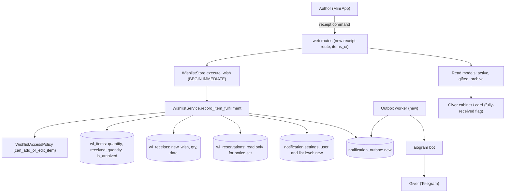

# WISHENKA-22: Gift Receipt Architecture (Partial and Full Receipt, Booking Sync)

## Research

Inputs: the approved `10-requirements.md`, `doc/dev/architecture.md`,
`doc/dev/items.md`, `doc/dev/reservations.md`, `in-docs/spec.md`
(sections 7, 8, 16), `specs/00-high.md`, and the code under
`wishenka/wishlists/` and `wishenka/web/`. No external research was needed:
the story adds no new technology. The findings below drive the design.

### What exists today

- `WishItemRow.received_quantity` is a counter on `wl_items`. The wish also
  has `is_archived`. Reservations are `ACTIVE`, `PURCHASED`, `CANCELLED`.
- `WishlistService.record_item_fulfillment(item_id, actor, received_quantity)`
  already exists. It checks that the actor may edit the list, requires a
  quantity of at least 1, caps it at `quantity - received_quantity`, adds to
  the counter, and leaves reservations alone. It is routed through
  `WishlistStore.execute_wish` by `_transactional`, so it runs inside the
  wish-scoped `BEGIN IMMEDIATE` transaction. The cap check therefore already
  satisfies FR-2.5 across processes.
- Gaps in that method against the requirements: it does not refuse a wish
  that is archived or sits on an archived or deleted list (FR-1.2), it
  stores no dated receipt record (FR-5.4, corner case 19), and it emits no
  notice (FR-4).
- No HTTP or HTMX route calls `record_item_fulfillment`. There is no receipt
  screen and no «Подаренные» section.
- The active list, the archive section, the cabinet, and the card use
  `is_archived` as the single switch. Today `archive_wish_item` flags the
  whole wish, and `restore_wish_item` returns the whole wish.
- `doc/dev/architecture.md` names `notification_outbox` and
  `user_notification_settings` and says the queue is a transactional outbox
  with an async worker. None of this is built. No table, no worker, no
  `aiogram` code. `aiogram` is only a dependency in `pyproject.toml`.
  `tests/test_surprise_role_context.py` even asserts that those two tables
  do not exist after a recipient walk (see Q&A, Q1).
- `_persist_wish` writes only the changed item row and the changed
  reservation rows of one wish. Anything new that a receipt must write has
  to be added to that unit of work.

## Implementation Plan

This story is a specification story. Step 2 produces this document only.
The build is split by the follow-up stories, with a stable contract between
them (see Architecture, section 5).

### WISHENKA-22 (this story)

- Steps 1 and 2 deliver the requirements and this architecture.
- Steps 4 to 8 for this story are documentation only: the dev-docs step
  (Step 8) updates `doc/dev/items.md`, `doc/dev/reservations.md`, and
  `doc/dev/architecture.md` where they still say that the archive moves the
  whole wish, or that the notification path is open. It also closes the open
  question in `in-docs/spec.md` section 16 and the open sentence in section
  7.3 by pointing to the requirements. No production code changes.
  Behaviour that is not built yet (receipt records, the archive split, the
  notice path and settings) is written in `doc/dev` as **planned, deferred to
  WISHENKA-23 and WISHENKA-24**, never as current behaviour; the follow-up
  Step 8 turns it into current documentation when the code lands.
- **Note for the product owner:** WISHENKA-23 is large and is a candidate to
  split into (a) notification infrastructure (outbox, settings at both
  levels, worker, bot sender) and (b) domain rules, archive split, read
  models, and routes. Split (b) does not depend on (a) if the producer is
  behind a small interface with a no-op implementation first. The decision
  is left to the product owner.

### WISHENKA-23: backend business logic, notice path, archive split

1. Storage (Alembic revision, see `doc/dev/migrations.md`):
   - Add a receipt record table `wl_receipts`: wish, quantity, date. No giver
     column, by design (FR-5.4, requirements Q3). Foreign key to the wish with cascade
     delete, so deleting a list removes its gifted history (FR-5.7).
   - Back-fill one record for every wish that already has
     `received_quantity > 0` and no records, dated by the wish's last update
     (assumption AR-3 below).
   - Normalise legacy archived rows (AR-5): `archive_wish_item` has no guard
     on `received_quantity`, so rows with `is_archived = 1` and
     `received_quantity > 0` may exist. In the same revision, set
     `is_archived = 0` for every such row with `received_quantity >=
     quantity` (fully received: shown only in «Подаренные», FR-5.2). A partly
     received archived row stays archived and shows its unreceived part in
     the archive. The archive view rule in section 2 also excludes fully
     received rows, so the display is correct even before or without the
     normalisation.
   - Add the notification tables that `architecture.md` already names: the
     outbox and the notification settings, both levels (user default and
     list override). See section 4 for the minimum.
2. Domain rules in `WishlistService`:
   - Extend `record_item_fulfillment` with the guards of FR-1.2 (archived
     wish, archived or deleted list, nothing remaining), with business-level
     refusal types that carry no booking data (FR-6.2), and with the receipt
     record write.
   - Keep the over-booked state legal (FR-3.3). Make `create_reservation` and
     the increase path of `update_reservation_quantity` refuse in that state
     through the existing free-quantity formula, and keep lowering,
     cancelling, purchase, and undo allowed (FR-3.4). Verify
     `update_reservation_quantity` and `mark_reservation_purchased`
     behave for a fully received wish (FR-3.6).
   - Archive and restore act on the unreceived part (FR-3.8): archive is
     refused for a fully received wish, restore is refused with the closed
     reason `nothing_remaining` when nothing remains (reachable only from
     legacy data or a race, see section 5). See section 2 for the model.
3. Read models (recipient-safe only):
   - Active list: wishes with remaining quantity above zero, not archived.
   - «Подаренные»: wishes with received quantity above zero, each with its
     receipt records (date and quantity), as `WishItemRecipientViewDTO`-style
     data. Not available to gifters (FR-5.5).
   - Archive: archived wishes that are not fully received, shown with their
     unreceived quantity.
   - Gifter view and cabinet row: add a «fully received» flag, set only
     from `received_quantity >= quantity`, so no booking data crosses.
4. Notice producer: inside the receipt transaction, compute the set of
   distinct givers with an open promise on the wish, and write one outbox
   row per giver (FR-4.1, FR-4.5, FR-4.8). The producer also evaluates the
   settings gate (FR-4.6) in that transaction; the worker never reads
   settings.
5. Notice worker: an async sender that drains the outbox through the bot,
   with retries and a terminal failed state (FR-4.7).
6. HTTP: a receipt command route and a read route for «Подаренные», as the
   contract in section 5.

### WISHENKA-24: frontend screen, «Подаренные», cabinet marker

1. Owner receipt screen: choose the quantity from 1 to the remaining
   quantity, explicit confirmation text because the act is final (requirements Q9).
2. Active list and card: show the remaining quantity for a partly received
   wish and remove a fully received wish from the list.
3. «Подаренные» section for authors, separate from the archive section, with
   a read-only card, received quantity, and the receipt dates (FR-5).
4. Cabinet row and gifter wish card for a fully received wish: the
   «received» marker, the cabinet actions, and no giver controls on the card
   (FR-3.6).
5. Readable refusals for the receipt screen with no booking data (FR-6.2),
   mapped from the business reasons of the contract.
6. Respect surprise rules: no new booking marker for any recipient view.

### Failing Repro (next Step 3)

**N/A — no behavioral change in this story.** WISHENKA-22 changes only
specification and documentation: there is no production code to fail, so
there is nothing a red automated test could assert here. Step 3 records the
N/A with this reason in the roadmap.

The behavior is covered by red tests written first inside the follow-up
stories, each under its own Step 3, in the repo style (`pytest`, `tests/`,
bounded waits, as in `doc/dev/testing.md`). Required coverage:

WISHENKA-23 (service and store level, no live Telegram; the sender is a
fake that records calls or raises):

- Partial receipt: wish of 5, receive 2, remaining is 3, wish still on the
  active list, 2 in «Подаренные» (corner cases 1, 19).
- Full receipt leaves the active list and lands in «Подаренные» (FR-2.3).
- Refusals: zero, negative, above remaining, archived wish, archived and
  deleted list, a gifter or anonymous caller, with a message that holds only
  the remaining quantity (FR-1, FR-6.2, corner cases 6, 7, 9).
- Over-booked state: 3 + 2 promised of 5, receive 2; both promises remain
  open, create and raise are refused, lower, cancel, and purchase work,
  free quantity follows `max(0, requested - received - occupied)`
  (corner cases 2, 3, 13).
- Receipt never changes any reservation status or quantity (FR-3.1).
- Concurrency: two receipts at once, one writer wins and the other is
  refused, so received never passes requested. Use the same pattern as
  `tests/test_booking_ceiling_r5.py`, same-process and spawned-process
  (FR-2.5, corner case 8). A receipt racing a promise on the same wish
  never leaves `received > requested` and never loses an open promise.
- Notices: one outbox row per giver with an open promise, none for a
  cancelled promise, a non-holder, the recipient or the owner as the
  recipient, one per giver even with two promises, one per act, honours the
  switched-off setting, and the text holds no quantities and no other giver
  (FR-4, corner cases 5, 14, 15, 18). A sender that raises leaves the
  receipt committed (FR-4.7).
- Archive split: archive a partly received wish keeps the received part in
  «Подаренные»; restore returns only the remaining quantity; archive of a
  fully received wish is refused; open promises survive both (FR-3.8,
  corner cases 10, 11).
- Legacy rows: an archived row with `received_quantity >= quantity` is
  absent from the archive view and present in «Подаренные» (FR-5.2); a partly
  received archived row shows its unreceived part in the archive; restore of
  a fully received legacy row is refused with `nothing_remaining`.
- Wish with no stated quantity counts as one unit: a receipt of 1 fully
  receives it, a receipt of 2 is refused as above remaining (corner case 16).
- Receipt of a unit nobody promised: no reservation rows exist, the receipt
  succeeds and writes the record, and no outbox row is created (FR-1.4).
- Settings gate: list-level off overrides user-level on, list-level on
  overrides user-level off, no rows means on; a switched-off giver gets a
  `skipped` row and no send (FR-4.6).
- Delivery: a sender that fails after send but before mark-sent may send
  again; the test asserts at most one extra send per row, not exactly-once
  (section 4).
- Reduction lock still holds after receipt (FR-2.6, corner case 12).
- Surprise: the receipt response, the «Подаренные» read model, and log
  records contain no giver id or name and no booking field. Extend the
  style of `tests/test_surprise_role_context.py`.
- Migration test: the revision upgrades, back-fills, normalises legacy
  fully received archived rows, and the cascade removes receipt records with
  the list (`tests/test_wishlist_alembic_migrations.py`).
- Existing recipient-walk test: its `_NOTICE_MARKS` assertion
  (`notification`, `outbox`, `push`) also checks log text (event and
  message), not only tables. WISHENKA-23 must account for this when it adds
  notice logging, for example by keeping those words out of recipient-walk
  log records or by narrowing the check together with the Q1 change.

WISHENKA-24 (browser and route level, as in the existing browser tests):

- Receipt screen offers 1 to remaining and no more, shows a readable
  refusal on a lost race, and the refusal names no booking data.
- A partly received wish shows the remaining count on the active list and
  appears in «Подаренные»; a fully received wish does not stay on the list.
- «Подаренные» and the archive section are separate, and a wish with
  received units never shows as a whole in the archive.
- Gifter cabinet shows the «received» marker and the actions for a fully
  received wish; the wish card for that gifter shows no giver controls.
- The recipient's card and screens, before and after receipt, show no
  booking marker.

Sequence for each follow-up: research, red test at Step 3, development to
green at Step 4. WISHENKA-24 starts after the contract of section 5 is fixed
in WISHENKA-23 Step 4 (or a stub that returns the contract shape).

## Architecture

### 1. Components touched

| Component | Change | Owner story |
| --------- | ------ | ----------- |
| `wl_receipts` table and `db_models` | New. One row per receipt act | 23 |
| `wl_items` | No new column (see section 2) | 23 |
| `WishlistService.record_item_fulfillment` | Guards, receipt record, notice set | 23 |
| `archive_wish_item`, `restore_wish_item` | Act on the unreceived part | 23 |
| `WishlistStore._persist_wish`, `_load_wish` | Write receipt record and outbox rows in the same unit of work; load the wish's receipt records | 23 |
| Notification outbox, settings (user and list level), worker | New. The producer in the service evaluates settings; the worker only sends | 23 |
| Read projections (active, gifted, archive, cabinet flag) | New or extended | 23 |
| Receipt route and «Подаренные» read route | New | 23 (contract), 24 (use) |
| Receipt screen, «Подаренные» section, cabinet marker, card changes | New or changed templates and JS | 24 |
| `reservations_ui` cabinet rows, `item_card.html` | Fully-received marker; actions rule changes | 24 |

### 2. Data and ownership boundaries

- **Single source of truth for quantities** stays on the wish row:
  `quantity` and `received_quantity`. Remaining is derived. The receipt
  records are the dated history that explains the counter, so the counter
  equals the sum of the records. The counter and the records are written in
  the same transaction, so they cannot drift.
- **No split of the wish into two rows.** FR-3.8 and FR-5.2 say a partly
  received wish may sit in three places. The design derives the places from
  one row, not from copies:

  | View | Rule |
  | ---- | ---- |
  | Active list | `is_archived = 0` and `received_quantity < quantity` |
  | «Подаренные» | `received_quantity > 0`, regardless of `is_archived` |
  | Archive | `is_archived = 1` and `received_quantity < quantity`, shown with its unreceived quantity |

  Consequences: a fully received wish leaves the active list by the derived
  rule and does not get `is_archived = 1` from the new code, because archive
  is refused for it.
  Archiving a partly received wish sets the existing flag and the received
  part stays in «Подаренные» by its own rule. Restore clears the flag and
  the wish returns with its remaining quantity. The display order logic of
  restore (tail append) stays. Reorder keeps its rule that the submitted ids
  equal the set of active wishes, where "active" now means the first row of
  the table above. This is a behaviour change to enforce in one place (a
  shared predicate), not in each template.
- **Legacy rows.** The old `archive_wish_item` accepted any wish, so rows with
  `is_archived = 1` and `received_quantity > 0` can exist, possibly fully
  received. Two rules cover them (AR-5). First, the archive view predicate
  above requires `received_quantity < quantity`, so a fully received archived
  row is shown only in «Подаренные» and never in the archive with zero
  unreceived quantity (FR-5.2). A partly received archived row shows its
  unreceived part in the archive and its received part in «Подаренные». Second,
  the WISHENKA-23 migration clears `is_archived` on fully received archived
  rows, so the stored state matches the derived one. Restore of a legacy
  fully received row is refused with `nothing_remaining`.
- **Receipt record carries no giver.** Receipts are never linked to
  reservations. This is the structural guarantee behind requirements Q3 and FR-5.4. No
  query for «Подаренные» may join `wl_reservations`.
- **Reservation rows are read only** during a receipt, and only to build the
  notice set. They are never updated (FR-3.1).
- **Deleting a list** cascades to receipt records (FR-5.7) through the
  foreign key. Archiving a list keeps them readable.
- **Roles.** The author check is the existing `can_add_or_edit_item`
  (assumption B). The recipient-safe projection of the wish is reused for
  «Подаренные». The giver projections only gain the boolean «fully
  received», derived from the two counters, which tells a giver nothing
  about other promises.

### 3. Concurrency with the reservation engine

- The receipt is one more writer in the existing wish-scoped transaction:
  it goes through `execute_wish(item_id=...)`, which already begins with
  `BEGIN IMMEDIATE`. It adds no new lock, in line with
  `doc/dev/reservations.md` (no second process-local lock).
  `record_item_fulfillment` already takes the in-process
  `ItemConcurrencyCoordinator`, as the other wish writers do; that existing
  coordinator stays and "no new lock" means nothing beyond it.
- Inside that transaction the order is: load wish and open promises, check
  guards, check the cap `quantity - received_quantity`, add the counter,
  insert the receipt record, build the notice set, insert outbox rows,
  commit. A second writer waits on the reserved lock and then sees the
  committed counter, so FR-2.5 holds. A refusal rolls everything back.
- A receipt racing a promise on one wish serialises: either the promise
  commits first (receipt then may leave `occupied + received > quantity`,
  which is the legal over-booked state), or the receipt commits first (the
  promise then sees the reduced free quantity and is refused by the existing
  `InsufficientQuantityError`). Neither order breaks an invariant.
- Edge cases of the cap, with no special code path (the cap formula already
  covers them): a wish with no stated quantity is stored as `quantity = 1`
  (column default), so it counts as one unit and a receipt of 1 fully
  receives it (corner case 16); a receipt of a unit nobody promised needs no
  reservation rows, writes the counter and the receipt record, and produces
  an empty notice set, so zero outbox rows (FR-1.4).
- Busy lock: `InventoryBusyError` becomes the same retryable 503 as for
  promise routes, with the same names-nobody sentence.
- The notice set is read in the same transaction as the counter, so a giver
  who cancelled before the commit is not notified, and a giver who promised
  before the commit is. The outbox row is committed with the receipt, so a
  crash between commit and send loses nothing (at-least-once, see section 4).

### 4. Notification path

Pattern: **transactional outbox**, as already decided in
`doc/dev/architecture.md`.

1. Producer (in the receipt transaction): one outbox row per distinct giver
   with an open (`ACTIVE` or `PURCHASED`) promise on the wish, excluding
   anyone who is the recipient of that wish for the booking-notice purpose
   (FR-4.4). Row payload: giver id, wish id, list id, event type, and the
   receipt record id for de-duplication. It stores no quantity, because the
   notice must not state quantities (FR-4.2, FR-4.3).
2. Settings gate: **the producer evaluates it**, inside the receipt
   transaction, once per giver. The worker never reads settings. The general
   (user-level) and the per-list setting for this event type decide whether
   the outbox row is created as `pending` or as `skipped` (a terminal state
   the worker ignores, kept so the decision is auditable). The list-level
   value overrides the user-level one (FR-4.6). Default is on when neither
   level has a row. Minimum for this story: **both levels** and one event
   type for gift receipt. Storage, at a high level:
   - User level, table `user_notification_settings` (name from
     `architecture.md`): key `(user_id, event_type)`, column `enabled`.
   - List level, a new table, indicatively `wishlist_notification_settings`:
     key `(user_id, wishlist_id, event_type)`, column `enabled`, foreign key
     to the list with cascade delete.
   - Lookup order: list row, else user row, else default on. A single
     service function owns the lookup.
   No screen or route writes these rows in this story; they are written by
   tests and by the later settings story. That wider settings screen belongs
   to a later notification story (see Q&A, Q2).
3. Worker (new, async, in-process with the app, started from the app
   lifespan): takes pending rows, renders the text, sends through the bot,
   marks sent. A send error (blocked bot, Telegram limit, network) marks a
   retry with a bounded attempt count and then a terminal failed state. It
   never touches the receipt (FR-4.7) and runs after commit, so it never
   delays it.
4. Text: fixed template with the wish title and the list title and a call
   to review the promise. No quantities, no other giver, no hint about
   excess (FR-4.3, FR-6.4). The wish and list titles are visible to any
   giver already.
5. Logging and metrics are Step 6 in WISHENKA-23. Logs for this path name no
   gifter id on any recipient-visible stream, as in the existing notes of
   `reservations.md`.

Delivery semantics: at-least-once. A duplicate notice is possible when the
worker crashes between the send and the mark-sent update. The de-dup key of
(receipt record, giver) only bounds this: it keeps duplicates to one row per
giver per act and stops the producer from writing the same row twice, but it
does not make the send exactly-once. Several acts give several notices
(FR-4.8) because the key includes the receipt record.

### 5. Interface contract between WISHENKA-23 and WISHENKA-24

Names are indicative. WISHENKA-23 fixes the final paths and DTO names in
its Step 2 and Step 8 documentation. The shape and the rules below are the
contract.

**Receipt command** (author only, cookie or bearer, CSRF as for other
mutations):

- Input: wish, integer `quantity`. Nothing else. No giver field exists.
- Success: the wish in its recipient-safe projection plus received quantity,
  remaining quantity, and whether the wish is now fully received. Never a
  booking field.
- Refusals, as a closed set of business reasons, each with fixed wording
  that never states or implies booked units (FR-6.2):

  | Reason | Meaning | HTTP |
  | ------ | ------- | :--: |
  | `quantity_invalid` | below one | 400 |
  | `quantity_above_remaining` | above remaining; the message may name only the remaining quantity | 409 |
  | `wish_archived` | wish is in the archive | 409 |
  | `wishlist_not_active` | list archived or deleted (deleted: not found) | 409 / 404 |
  | `nothing_remaining` | wish already fully received | 409 |
  | `forbidden` | not an author | 403 |
  | `busy` | wish lock busy, nothing changed, retry | 503 |

  A lost race between two authors surfaces as `quantity_above_remaining`
  (or `nothing_remaining`) with the then-current remaining quantity.

**Read models for the frontend:**

- Active list item: as today, plus `remaining_quantity`. A fully received
  wish is not in this list.
- «Подаренные» list for a list's authors: per wish, the recipient-safe fields,
  `received_quantity`, and a list of receipt entries (date, quantity).
  Gifters and anonymous callers get a refusal. Read-only: no edit, move,
  promise, or archive link in the payload.
- Archive list: archived, not fully received wishes with `remaining_quantity` as the unreceived
  quantity.
- Gifter card projection and cabinet row: add `is_fully_received`. The
  cabinet rule for showing the four promise actions becomes: wish archived
  on an active list, or wish fully received on an active list. The wish card
  shows no giver controls for a fully received wish.

**Archive and restore** keep their existing routes. New outcomes: archive of
a fully received wish is refused with the business reason `nothing_remaining`,
and restore of a wish with nothing remaining is refused with the same closed
reason. The restore refusal can arise only from legacy data (AR-5) or a race,
because the new code never archives a fully received wish.

**Notification contract:** the frontend has no notice API. Only the bot
sends it. WISHENKA-24 is not responsible for notice text.

### 6. Surprise and privacy checks by component

| Artifact | Rule | Where enforced |
| -------- | ---- | -------------- |
| Receipt response and refusals | Quantity and wish only, no booking data | Fixed reasons, recipient-safe DTO, tests |
| «Подаренные» | No join with reservations, no giver | Query design, DTO without promise fields |
| Notice | No quantities, no other giver, no excess hint | Outbox payload has no quantities, fixed template |
| Giver `is_fully_received` flag | Derived from two counters only | Projection function |
| Logs | No giver id on recipient-visible streams | Step 6 of WISHENKA-23 |
| Edit-form lock | Known exception, unchanged (requirements Q12) | Not touched |

### 7. Patterns chosen and why

- **Derived views over one wish row** instead of splitting rows or adding a
  status: keeps the single source of truth for quantities, avoids a
  `FULFILLED` status the project has rejected, and makes the three-place
  case of FR-5.3 a query rule.
- **Append-only receipt records** for history and dates, with the counter
  kept for the hot path (free-quantity formula stays unchanged).
- **Transactional outbox** for notices: the receipt cannot fail or wait on
  Telegram, and no notice is lost on a crash.
- **Reuse of `execute_wish`** for concurrency: no new lock, same retryable
  busy behaviour as promises.
- **Closed set of refusal reasons** so that the frontend cannot leak booking
  state through free text.

### 8. Architecture assumptions

- AR-1. «Active» in the reorder and list rules means not archived and with
  remaining quantity above zero.
- AR-2. The receipt route returns the same recipient-safe projection for the
  owner and for a co-author, including a co-author who is the wish's
  recipient (requirements Q11 stays open).
- AR-3. Wishes that already carry `received_quantity > 0` without receipt
  records get one back-filled record, dated by the wish's last update.
  Dates before this story are therefore approximate.
- AR-4. The notice event is on by default for every user until the later
  settings story adds a screen.
- AR-5. Legacy archived rows with `received_quantity > 0` are handled as in
  section 2: fully received rows are normalised to not archived and shown
  only in «Подаренные»; partly received rows stay archived with their
  unreceived part.

## Q&A

- Q1. How does this fit the existing test that asserts no notification
  tables after a recipient walk?
  A. `tests/test_surprise_role_context.py` (`_NOTICE_TABLES`, the final
  assertion of the recipient walk) guards "this story creates no
  notification storage". Adding `notification_outbox` and
  `user_notification_settings` in WISHENKA-23 will turn that assertion red
  for a reason that is no longer a leak. WISHENKA-23 must replace it with a
  stronger check: the tables may exist, but the recipient walk (no receipt
  by a gifter, no giver activity visible to the owner) creates no outbox
  rows addressed to the owner or revealing a promise. This is a known test
  change, not a regression.
- Q2. The requirements assume a notification setting at general and list
  level (FR-4.6) but no such storage exists. Who builds it?
  A. WISHENKA-23 adds the minimum: the storage for both levels (user default
  and list override, section 4) and the lookup for one event type with a
  default of on, evaluated by the producer. The settings screen is out of scope for both
  follow-ups and should be a separate story. Product should confirm.
- Q3. Why not a new reservation status such as completed?
  A. The product rejects a `FULFILLED` or `COMPLETED` status
  (`reservations.md`), and requirement FR-3.1 forbids receipt from touching
  promises.
- Q4. Why a counter plus records, not records only?
  A. The free-quantity formula and the reduction lock read
  `received_quantity` on hot paths and in many places. Keeping the counter
  avoids a sum on each read and changes no existing code. The cost is two
  writes in one transaction.
- Q5. Does the giver need to know when the outbox failed?
  A. No (FR-4.7). A terminal failed row is an operational signal for
  WISHENKA-23 Step 6, not a user-visible state.
- Q6. Can the giver of a fully received wish still reach the card?
  A. The cabinet row links to the list page. A fully received wish is not on
  the active list, so the link target needs a decision from WISHENKA-24
  (anchor falls back to the list top, or the link is omitted). The
  requirements do not fix this. Recommended: omit the link for a fully
  received wish and keep the cabinet actions.
- Q7. Does the receipt change the giver's active count (the cabinet badge)?
  A. No. The promise stays occupying until the giver acts (FR-3.2).
