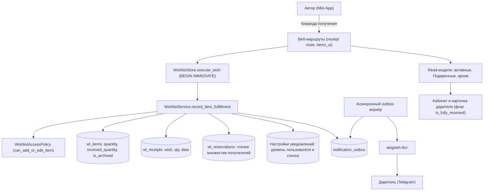

# Спецификация: WISHENKA-22 — Получение подарков (частичное и полное получение, согласование с бронированиями)

- **Тип задачи:** спецификационная история (документация, Markdown)
- **Целевой стек реализации:** Python 3.12+ (FastAPI, HTMX, aiogram, SQLite WAL, Alembic) в последующих задачах `WISHENKA-23` и `WISHENKA-24`
- **Базовые источники:** `ai-tasks/WISHENKA-22/` (`10-requirements.md`, `20-architecture.md`, `40-code-cleanup.md`, `50-observability.md`, `60-tech-debt.md`), `specs/00-high.md`, `in-docs/spec.md` (разделы 7.2, 7.3, 16)

---

## 1. Назначение и бизнес-цель

### 1.1. Постановка проблемы

Концепция сервиса (`specs/00-high.md`, разделы 4.2 и 4.4; `in-docs/spec.md`, разделы 7.2 и 7.3) предусматривает жизненный цикл желания «активное → бронирование → покупка → получение → архив», поддержку полного и частичного закрытия по количеству, уведомление дарителей и раздельное хранение полученных подарков и удалённых желаний. До выполнения `WISHENKA-22` эти сценарии оставались неспецифицированными:

- В `in-docs/spec.md` (разделы 7.3 и 16) точное согласование частично полученного и забронированного количества оставалось открытым вопросом на этап реализации.
- В текущей кодовой базе существовал лишь счётчик `WishItemRow.received_quantity` в таблице `wl_items` и сервисный метод `WishlistService.record_item_fulfillment`, однако отсутствовали: проверка архивного состояния желания и списка, датированные записи о получении, механизм уведомления дарителей, разделение раздела «Подаренные» и архива удалённых желаний, а также HTTP/HTMX-маршруты и пользовательский интерфейс в Mini App.
- В `doc/dev/architecture.md` упоминались таблицы `notification_outbox` и `user_notification_settings`, но очередь, настройки и асинхронный отправитель `aiogram` не были спроектированы и реализованы.

### 1.2. Ключевая продуктовая идея и цели задачи

Центральное решение спецификации состоит в том, что **получение** и **бронирование (обещание)** — это два независимых факта:

- **Получение** — заявление автора вишлиста о событии в реальном мире («получено N экземпляров»).
- **Бронь** — заявление дарителя о собственном намерении или покупке.

Продукт не сопоставляет конкретный полученный экземпляр с конкретным дарителем и никогда не закрывает и не изменяет чужие бронирования автоматически, поскольку не может достоверно определить, от кого именно пришёл подарок (в том числе от человека вне сервиса). Вместо этого отметка получения для владельца делается мгновенной и простой, а дарители с открытыми бронями получают уведомление и самостоятельно решают судьбу своей брони.

Цели `WISHENKA-22`:

1. Зафиксировать полные бизнес-правила и угловые случаи частичного и полного получения, его влияния на открытые брони, уведомлений дарителей и разделения «Подаренные» и архива.
2. Задать целевую архитектуру данных, конкурентности, асинхронной доставки уведомлений и стабильный контракт интерфейсов между `WISHENKA-23` (бэкенд) и `WISHENKA-24` (фронтенд Mini App).
3. Определить строгие гарантии принципа сюрприза (приватности), требования к структурированному логированию и метрикам, а также набор проверок для этапа реализации.
4. Закрыть открытый вопрос в разделе 16 и открытую формулировку в разделе 7.3 `in-docs/spec.md`, оформив планируемые изменения в `doc/dev/`.

### 1.3. Ценность для пользователей и системы

- **Владелец и соавторы списка** поддерживают актуальный вишлист: полученные экземпляры уходят из активного списка, а оставшиеся нужными продолжают быть доступны для бронирования. В разделе «Подаренные» формируется отдельная история полученных подарков, не смешанная с удалёнными (архивными) желаниями.
- **Даритель** своевременно узнаёт, что подарок уже получен (в том числе частично), не покупает дубликат и самостоятельно управляет своей бронью в разделе «Мои бронирования», видя актуальный свободный остаток.
- **Получатель подарка** защищён принципом сюрприза: ни процесс отметки, ни отказы, ни раздел «Подаренные» не раскрывают наличие броней, имена дарителей, количества и статус покупки.
- **Система** сохраняет единый источник истины по количествам на строке `wl_items` с журналом актов `wl_receipts`, сериализацией конкурентных записей и гарантированной транзакционной постановкой уведомлений в очередь.

### 1.4. Границы области действия и базовые допущения

**В рамках спецификации:**

- Правила фиксации полного и частичного получения, конкурентные отметки и ограничения редактирования количества.
- Влияние получения на открытые бронирования, включая допустимое состояние перебронирования (over-booked).
- Логика формирования и доставки уведомлений дарителям через Telegram-бота с учётом двухуровневых настроек.
- Разделение «Подаренные» и архива удалённых желаний, включая архивацию и восстановление частично полученных желаний.
- Контракт взаимодействия между `WISHENKA-23` и `WISHENKA-24`.

**Вне границ (Non-Goals):**

- Отмена или исправление ошибочно зафиксированного получения (явно отложено как отдельное развитие; в рамках данной спецификации акт получения считается окончательным).
- Совместные покупки (складчина), финансовые расчёты, денежные взносы и функция благодарности дарителям.
- Изменение жизненного цикла самого вишлиста (архивация и удаление списка целиком).
- Экран пользовательских настроек уведомлений (проектируются только таблицы хранения и логика проверки в сервисе).
- Детальный визуальный дизайн экранов сверх контракта и правил поведения для `WISHENKA-24`.

**Неизменяемая существующая функциональность (с учётом точечных уточнений):**

- Создание, изменение количества и отмена бронирования (`WISHENKA-18`, `WISHENKA-57`), элементы управления на карточке активного желания (`WISHENKA-19`), базовый кабинет «Мои бронирования» (`WISHENKA-20`).
- Для желаний с полученными экземплярами изменяется поведение «безопасного архива» (архивируется и восстанавливается только неполученная часть), а для полностью полученных желаний меняются доступные действия в кабинете и отображение карточки для дарителя.

**Базовые продуктовые допущения (`A`–`D`):**

- **Допущение A:** получение и бронь — независимые факты; получение никогда автоматически не закрывает и не изменяет бронь.
- **Допущение B:** отмечать получение может любой автор с правом редактирования желаний (владелец, а в совместном списке — администратор и участник, включая случай, когда соавтор является получателем желания).
- **Допущение C:** акт получения в этой версии продукта окончателен (без отката и корректировки).
- **Допущение D:** раздел «Подаренные» доступен только авторам списка и скрыт от дарителей и анонимных зрителей.

---

## 2. Функциональные требования и пользовательские сценарии

### 2.1. Основные доменные сущности и величины

| Понятие | Определение и инварианты |
| ------- | ------------------------ |
| Желание (`Wish`) | Элемент вишлиста с запрошенным количеством (`quantity`). Если количество не задано, оно равно `1`. |
| Полученное количество (`received_quantity`) | Суммарное число экземпляров, отмеченных как полученные. В данной спецификации только возрастает; `0 <= received_quantity <= quantity`. |
| Оставшееся количество (`remaining_quantity`) | `quantity - received_quantity` — сколько экземпляров ещё требуется владельцу. |
| Бронь / обещание (`Promise`) | Бронирование дарителем одного или нескольких экземпляров. Открыта в статусах `ACTIVE` (задумано) и `PURCHASED` (куплено); закрыта в статусе `CANCELLED`. Не привязана к конкретному экземпляру. |
| Занятое количество (`occupied`) | Сумма экземпляров по всем открытым броням (`ACTIVE` и `PURCHASED`) данного желания. |
| Свободное количество (`free`) | `max(0, quantity - received_quantity - occupied)`. |
| Запись о получении (`Receipt record`) | Факт вида «получено `N` шт. данного желания» (`N >= 1`) с датой/временем акта. Не содержит идентификатора дарителя. Одно желание может иметь серию записей. |
| Подаренное желание | Желание с `received_quantity > 0`, отображаемое в разделе «Подаренные» с полученным количеством и датами актов. |
| Архивное желание | Желание (или его неполученная часть), удалённое автором в архив. |
| Автор | Владелец вишлиста, а в совместном вишлисте — администратор или участник с правом редактирования желаний (по разделу 3 `in-docs/spec.md` правом редактирования обладают все участники). |

### 2.2. Пользовательские сценарии

1. **Фиксация частичного и полного получения автором:** автор выбирает желание в активном списке и указывает полученное количество от `1` до `remaining_quantity`. При частичном получении желание остаётся активным с уменьшенным остатком, а полученная часть появляется в «Подаренные». При достижении `quantity` желание покидает активный список и остаётся только в «Подаренные».
2. **Серийное получение и подарок вне сервиса:** автор может отмечать получение несколько раз (например, `2` шт. сегодня и `1` шт. через неделю), в том числе на желания, которые никто не бронировал.
3. **Раздельная работа с «Подаренные» и Архивом:** автор видит полученные подарки в отдельном разделе «Подаренные» (только для чтения) и не путает их с удалёнными в архив желаниями. При архивации частично полученного желания в архив уходит только неполученный остаток; при восстановлении возвращается только он.
4. **Реакция дарителя на уведомление:** даритель, имеющий открытую бронь (задуманную или купленную), получает одно уведомление в Telegram-боте за каждый акт получения и сам решает через кабинет «Мои бронирования», сохранить бронь, уменьшить количество или отменить её.
5. **Бронирование остатка другими дарителями:** другой даритель видит на карточке актуальный свободный остаток (`max(0, quantity - received_quantity - occupied)`) или статус «Забронировано» при нуле и не может забронировать уже полученные экземпляры.
6. **Защита получателя:** получатель подарка (в том числе соавтор совместного списка, указанный получателем конкретного желания) при работе со списком, экраном получения и «Подаренные» видит только данные желания и количество полученных экземпляров.

### 2.3. Функциональные требования

#### FR-1. Права и условия фиксации получения

- **FR-1.1.** Фиксировать получение может только автор вишлиста. Даритель, не являющийся автором, и анонимный зритель права не имеют.
- **FR-1.2.** Получение допускается только для активного желания в активном вишлисте. Запросы для архивного желания, желания в архивном или удалённом вишлисте, а также желания без остатка (`remaining_quantity == 0`) отклоняются с понятной бизнес-причиной.
- **FR-1.3.** Автор указывает количество, полученное в текущем акте: целое число от `1` до `remaining_quantity` включительно. Нулевое, отрицательное или превышающее остаток значение отклоняется.
- **FR-1.4.** Наличие дарителя или брони не требуется: допускается отметка подарка, который никто не бронировал.
- **FR-1.5.** Акт получения выполняется мгновенно, без подтверждения со стороны дарителей. Автор никогда не указывает, кто именно подарил подарок.

#### FR-2. Частичное и полное получение, конкурентность

- **FR-2.1.** Каждый успешный акт прибавляет указанное количество к `received_quantity`. Допускается несколько актов во времени по одному желанию.
- **FR-2.2.** После частичного акта (`received_quantity < quantity`) желание остаётся в активном списке с уменьшенным `remaining_quantity`, а полученная часть отображается в «Подаренные».
- **FR-2.3.** После акта, доводящего `received_quantity` до `quantity`, желание считается полностью полученным, уходит из активного списка и отображается только в «Подаренные».
- **FR-2.4.** На полностью полученное желание нельзя создать новую бронь. На частично полученное желание допустимы бронирования в пределах свободного остатка `max(0, quantity - received_quantity - occupied)`.
- **FR-2.5.** При одновременной отметке двумя авторами суммарное `received_quantity` не должно превысить `quantity`: более поздняя операция отклоняется с читаемой причиной и никогда не принимается сверх лимита.
- **FR-2.6.** Уменьшение запрошенного количества при редактировании желания ограничено снизу значением `received_quantity + occupied`. Данное ограничение формы редактирования сохраняется (известное исключение из тайны сюрприза на существующей форме, см. `Q12` в `10-requirements.md`).

#### FR-3. Влияние на открытые бронирования

- **FR-3.1.** Получение никогда не закрывает, не отменяет, не изменяет количество и не переводит в статус покупки ни одну бронь. Все изменения брони выполняет только её даритель существующими средствами.
- **FR-3.2.** Открытая бронь остаётся в кабинете «Мои бронирования» и в счётчике активных броней до тех пор, пока сам даритель не выполнит с ней действие — как при частичном, так и при полном получении и после ухода желания из активного списка.
- **FR-3.3.** В результате получения сумма `received_quantity + occupied` может превысить `quantity` (состояние перебронирования / *over-booked*). Это состояние допустимо: система не выбирает, чью бронь отменить, а оставляет решение дарителям.
- **FR-3.4.** В состоянии перебронирования запрещено создавать новые бронирования и увеличивать существующие. Даритель по-прежнему может уменьшить количество, отменить бронь или отметить её купленной (и снять отметку покупки). Отменённую бронь нельзя открыть повторно — для повторного участия даритель создаёт новую бронь по правилу `FR-2.4` при наличии свободного остатка.
- **FR-3.5.** Бронь в статусе «Куплено» (`PURCHASED`) при получении обрабатывается так же, как «Задумано» (`ACTIVE`): получение её не завершает; даритель может оставить её для справки или отменить.
- **FR-3.6.** На полностью полученном желании открытая бронь остаётся видимой в кабинете дарителя с явным маркером о получении подарка. Дарителю в кабинете доступны действия: отменить бронь, уменьшить количество, а для задуманной брони — отметить купленной (увеличение и новое бронирование запрещены). На карточке полностью полученного желания элементы управления дарителя не отображаются. Отдельный статус «Завершено» для купленной брони в данной спецификации не вводится — маркер сохраняется до отмены брони дарителем.
- **FR-3.7.** При отмене или уменьшении брони в состоянии перебронирования первые освободившиеся единицы лишь сокращают избыток и не открывают свободного остатка для новых броней, пока `quantity - received_quantity - occupied` не превысит ноль.
- **FR-3.8.** При архивации частично полученного желания в архив переносится только его неполученная часть; полученная часть остаётся в «Подаренные» без изменений. Восстановление возвращает в активный список оставшееся количество, не затрагивая «Подаренные». Открытые брони при этом сохраняются, видны дарителям в кабинете с пометкой «Желание в архиве» и четырьмя стандартными действиями и продолжают учитываться в `occupied`. Для полностью полученного желания неполученной части нет — архивация не предлагается и не выполняется.

#### FR-4. Уведомление дарителей

- **FR-4.1.** После каждого успешного акта получения каждый даритель, имеющий открытую бронь (`ACTIVE` или `PURCHASED`) на данное желание, получает одно уведомление в Telegram-боте с учётом настроек уведомлений.
- **FR-4.2.** Уведомление сообщает, что владелец отметил получение этого желания (полностью или частично), называет желание и вишлист и предлагает дарителю пересмотреть свою бронь. В уведомлении не указывается, сколько экземпляров получено или запрошено.
- **FR-4.3.** Уведомление не должно раскрывать: других дарителей, общее занятое количество, полученное или запрошенное количество (по разнице со свободным остатком даритель смог бы вычислить объём чужих броней), является ли бронь самого дарителя избыточной, а также намёки на покупки других людей.
- **FR-4.4.** Не получают уведомлений: дарители с закрытой (`CANCELLED`) бронью, пользователи без броней, владелец и получатель желания в роли получателя. Если владелец или соавтор выступает дарителем по *другому* желанию, он получает уведомления на общих основаниях.
- **FR-4.5.** При наличии нескольких открытых броней одного дарителя на одно желание за один акт ему отправляется одно уведомление.
- **FR-4.6.** Если даритель отключил этот тип уведомлений, сообщение не отправляется. Настройка уровня конкретного вишлиста переопределяет общую настройку пользователя.
- **FR-4.7.** Сбой или невозможность доставки уведомления (например, блокировка бота пользователем) никогда не отменяет и не задерживает фиксацию получения.
- **FR-4.8.** Несколько актов получения подряд порождают несколько уведомлений (по одному на акт) без объединения.

#### FR-5. Разделение «Подаренные» и Архива

- **FR-5.1.** Раздел «Подаренные» содержит все желания с `received_quantity > 0` и отражает историю полученного, а не корзину удалений.
- **FR-5.2.** Архив содержит только удалённые автором желания (или их неполученные части). Желание с `received_quantity > 0` никогда не помещается в архив целиком — его полученная часть всегда остаётся в «Подаренные».
- **FR-5.3.** Разделы отображаются порознь; один и тот же экземпляр никогда не показывается в обоих одновременно. Частично полученное желание может одновременно присутствовать в трёх местах по своим частям: оставшиеся экземпляры в активном списке (либо в архиве после удаления), полученные — в «Подаренные».
- **FR-5.4.** Запись в «Подаренные» сохраняет описание, ссылку, цену и получателя желания, добавляя полученное количество и даты актов получения, и никогда не содержит имён дарителей или сведений о бронях.
- **FR-5.5.** Раздел «Подаренные» виден только авторам списка; для дарителей и анонимных зрителей он закрыт.
- **FR-5.6.** В рамках данной спецификации раздел «Подаренные» работает в режиме только для чтения (без редактирования, перемещения, бронирования и повторного открытия/отмены получения).
- **FR-5.7.** При отправке самого вишлиста в архив раздел «Подаренные» остаётся видимым и доступным для чтения; при удалении вишлиста история «Подаренные» удаляется вместе со списком.

#### FR-6. Принцип сюрприза и приватность

- **FR-6.1.** Действие получения возвращает и отображает автору и получателю только данные желания и полученное количество — без признаков наличия брони, числа дарителей и статуса покупки.
- **FR-6.2.** Отклонённое действие получения (например, при превышении остатка) никогда не указывает и не подразумевает количество забронированных экземпляров.
- **FR-6.3.** Экран получения и «Подаренные» формируются исключительно на данных, безопасных для получателя (`recipient-safe`).
- **FR-6.4.** Уведомления дарителям соблюдают `FR-4.3` и не сообщают о владельце ничего, кроме самого факта отметки получения.

---

## 3. Архитектура, компоненты и интерфейсы

### 3.1. Распределение реализации между задачами

| Задача | Область ответственности |
| ------ | ----------------------- |
| `WISHENKA-22` (текущая) | Фиксация требований и архитектуры, обновление `in-docs/spec.md` (разделы 7.2, 7.3, 16) и добавление в `doc/dev/` описаний планируемого поведения со статусом `PLANNED`. Без изменений кода и тестов. |
| `WISHENKA-23` | Миграции Alembic (`wl_receipts`, `notification_outbox`, таблицы настроек уведомлений, бэкфилл и нормализация устаревших архивных строк), доменные правила в `WishlistService` и `WishlistStore`, предикаты и read-модели, producer + async outbox-воркер + отправщик через `aiogram`, JSON-контракты API. Рекомендуется к оценке разбиение на подзадачи: (а) инфраструктура уведомлений и (б) доменная логика, разделение архива, read-модели и маршруты. |
| `WISHENKA-24` | UI в Mini App на основе контракта `WISHENKA-23`: экран выбора количества (`1..remaining`) с явным предупреждением о необратимости акта, обновление активной карточки и удаление полностью полученного желания из списка, раздел «Подаренные» для авторов, маркер «получено» и действия в кабинете дарителя, скрытие контролов дарителя на карточке полностью полученного желания, отображение понятных отказов без утечки броней. |

### 3.2. Схема взаимодействия компонентов

### 3.3. Модули, таблицы и классы

1. **Хранилище и миграции (Alembic):**
   - `wl_items` (без новых колонок): хранит `quantity` (значение по умолчанию `1`), `received_quantity` и `is_archived`. Оставшееся количество вычисляется как производная величина; желание никогда не дублируется в две строки, а отдельный статус вроде `FULFILLED` не вводится.
   - `wl_receipts` (новая таблица): одна запись на каждый акт получения — ссылка на желание (`FK` с каскадным удалением `ON DELETE CASCADE`), количество (`>= 1`) и дата/время акта. Колонка дарителя и связь с `wl_reservations` отсутствуют конструктивно (`FR-5.4`, `FR-5.7`).
   - Однократный бэкфилл и нормализация в миграции `WISHENKA-23`:
     - **AR-3 (бэкфилл):** для желаний с `received_quantity > 0` без записей в `wl_receipts` создаётся одна запись с датой последнего обновления желания (исторические даты до релиза носят приближённый характер и не должны подаваться пользователю как точные).
     - **AR-5 (нормализация устаревших архивных строк):** так как прежний `archive_wish_item` допускал архивацию любого желания, строки с `is_archived = 1` и `received_quantity >= quantity` переводятся в `is_archived = 0` (попадают только в «Подаренные»); частично полученные архивные строки сохраняют `is_archived = 1` и отображают неполученную часть в архиве. Откат миграции (downgrade) необратим и должен быть явно зафиксирован в заметках к ревизии.
   - Таблицы уведомлений:
     - `notification_outbox` — очередь исходящих уведомлений (`pending`, `sent`, `failed`, `skipped`), без поля количества; уникальный ключ дедупликации по `(receipt_record, giver)`.
     - `user_notification_settings` — общая настройка пользователя: ключ `(user_id, event_type)`, колонка `enabled`.
     - `wishlist_notification_settings` (условное имя таблицы уровня списка) — переопределение на уровне списка: ключ `(user_id, wishlist_id, event_type)`, колонка `enabled`, внешний ключ на вишлист с `ON DELETE CASCADE`.

2. **Доменный сервис и хранилище (`wishenka/wishlists/`):**
   - `WishlistService.record_item_fulfillment(item_id, actor, received_quantity)`: расширяется проверками `FR-1.2` (архивное желание, архивный или удалённый список, нулевой остаток), типизированными бизнес-отказами без сведений о бронях (`FR-6.2`), записью в `wl_receipts` и формированием записей для `notification_outbox`. Проверка авторства использует существующую политику `WishlistAccessPolicy.can_add_or_edit_item` (`AR-2`).
   - `WishlistService.archive_wish_item` и `WishlistService.restore_wish_item`: работают над неполученной частью желания; для полностью полученного желания архивация отклоняется с кодом `nothing_remaining`, восстановление с нулевым остатком (возможное на старых данных или при гонке) также отклоняется с кодом `nothing_remaining`.
   - `WishlistService.create_reservation`, `update_reservation_quantity`, `mark_reservation_purchased`: сохраняют допустимость состояния перебронирования (`FR-3.3`); запрещают создание и увеличение броней через формулу `max(0, quantity - received_quantity - occupied)`; разрешают уменьшение, отмену и отметку/снятие покупки (`FR-3.4`, `FR-3.6`).
   - `WishlistStore.execute_wish`, `WishlistStore._persist_wish`, `WishlistStore._load_wish`: запись акта в `wl_receipts` и постановка строк в `notification_outbox` включаются в единую транзакцию (unit of work) `BEGIN IMMEDIATE` с использованием существующего координатора `ItemConcurrencyCoordinator` (без добавления новой локальной блокировки).
   - Единый разделяемый предикат состояния (`AR-1`): определение «активного» желания для витрины, переупорядочивания (`reorder`), хвоста восстановления и публичных проекций выносится в общую функцию/предикат, а не дублируется по шаблонам и запросам.

3. **Контур уведомлений (`producer` и `worker`):**
   - **Producer** (внутри транзакции получения): выбирает уникальных дарителей с открытыми бронями (`ACTIVE` или `PURCHASED`), исключая получателя этого желания (`FR-4.4`); оценивает настройки через единую сервисную функцию в порядке «запись уровня списка → запись уровня пользователя → включено по умолчанию (`AR-4`)»; записывает в `notification_outbox` строку `pending` или `skipped` (терминальный статус для аудита решения) с ключом `(receipt_record, giver)` и данными `(giver_id, wish_id, list_id, event_type, receipt_record_id)` без каких-либо количеств.
   - **Async worker** (запускается в жизненном цикле приложения, `app lifespan`): опрашивает `pending`-строки, подставляет текущие названия желания и списка в фиксированный шаблон текста, отправляет через `aiogram`-бота и переводит строку в `sent`. Воркер никогда не читает настройки и не влияет на уже зафиксированное получение. При ошибках доставки (блокировка бота, лимиты Telegram, сеть) планируются повторы с ограниченным числом попыток и последующим переходом в терминальный статус `failed`.
   - **Семантика доставки:** *at-least-once*. Повторная отправка возможна при сбое между доставкой в Telegram и обновлением статуса `sent`; ключ дедупликации ограничивает записи одной строкой на дарителя за один акт. Несколько последовательных актов получают разные `receipt_record_id` и порождают отдельные уведомления (`FR-4.8`).

### 3.4. Модель производных представлений и переходы состояний

Размещение желания по разделам выводится из одной строки `wl_items` без расщепления на отдельные сущности:

| Представление | Правило выборки (предикат) | Отображаемое количество и особенности |
| ------------- | -------------------------- | --------------------------------------- |
| Активный список (`active`) | `is_archived = 0` и `received_quantity < quantity` | Показывает остаток `quantity - received_quantity`; используется также при проверке набора ID в `reorder` (`AR-1`). |
| «Подаренные» | `received_quantity > 0` (при любом `is_archived`) | Показывает `received_quantity` и историю актов `(date, quantity)`; никогда не делает `JOIN` с `wl_reservations`; закрыто для дарителей. |
| Архив | `is_archived = 1` и `received_quantity < quantity` | Показывает неполученную часть `quantity - received_quantity`; полностью полученные желания не попадают в архив даже при legacy-флаге `is_archived = 1`. |

Ключевые переходы состояний:

- **Частичное получение** (`0 < received + N < quantity`): счётчик растёт, желание остаётся в активном списке и появляется в «Подаренные»; открытые брони не меняются; при `received + occupied > quantity` желание переходит в состояние перебронирования (блокируется создание/увеличение броней).
- **Полное получение** (`received + N == quantity`): желание покидает активный список и отображается только в «Подаренные»; в проекции дарителя и кабинете выставляется `is_fully_received = true`; архивация запрещена.
- **Архивация частично полученного желания**: `is_archived` устанавливается в `1` → неполученный остаток переходит в Архив, полученная часть остаётся в «Подаренные», открытые брони сохраняются со статусом желания «в архиве».
- **Восстановление частично полученного желания**: `is_archived` сбрасывается в `0` → неполученный остаток возвращается в конец активного списка, полученная часть остаётся в «Подаренные».

### 3.5. Конкурентность и сериализация с движком бронирований

- Получение проходит через существующий `WishlistStore.execute_wish(item_id=...)`, открывающий транзакцию `BEGIN IMMEDIATE`, и существующий `ItemConcurrencyCoordinator`.
- Порядок операций внутри транзакции: загрузка желания и открытых броней → проверка прав и гардов состояния → проверка потолка `quantity - received_quantity` → обновление счётчика → вставка `wl_receipts` → формирование множества дарителей и вставка строк в `notification_outbox` → `commit` (при отказе — полный `rollback`).
- Два одновременных получения сериализуются: второй писатель видит уже зафиксированный счётчик и при нехватке остатка получает отказ (`FR-2.5`).
- Получение и бронирование на одном желании также сериализуются: если первой фиксируется бронь, последующее получение может перевести желание в допустимое состояние перебронирования; если первым фиксируется получение, последующая бронь видит уменьшенный остаток и при нехватке получает `InsufficientQuantityError`.
- При занятости блокировки выбрасывается `InventoryBusyError`, который преобразуется в повторяемый HTTP `503` с тем же нейтральным текстом, что и на маршрутах бронирования.

### 3.6. Контракт интерфейсов между `WISHENKA-23` и `WISHENKA-24`

Конкретные URL и имена DTO окончательно фиксируются в `WISHENKA-23` (Шаги 2 и 8), однако форма данных и правила контракта закрепляются в `WISHENKA-22`:

#### Команда фиксации получения

Доступна только автору (cookie с проверкой CSRF либо bearer-токен):

- **Вход:** идентификатор желания и целое `quantity` (без поля `giver`).
- **Успех:** `recipient-safe` проекция желания (`WishItemRecipientViewDTO`) вместе с `received_quantity`, `remaining_quantity` и признаком `is_fully_received`, без каких-либо полей бронирования.
- **Проигрыш конкурентной гонки:** если другой автор опередил текущий запрос, возвращается отказ `quantity_above_remaining` или `nothing_remaining` с актуальным на момент обработки остатком.
- **Закрытое множество бизнес-отказов** (фиксированные формулировки без упоминания или намёка на брони, `FR-6.2`):

| Код причины (`reason`) | Значение | HTTP-статус |
| ---------------------- | -------- | :---------: |
| `quantity_invalid` | Передано значение меньше `1` | `400` |
| `quantity_above_remaining` | Превышен остаток; сообщение может называть только `remaining_quantity` | `409` |
| `wish_archived` | Желание находится в архиве | `409` |
| `wishlist_not_active` | Вишлист архивирован или удалён (при удалении — `404`) | `409` / `404` |
| `nothing_remaining` | Желание уже полностью получено | `409` |
| `forbidden` | Вызывающий не является автором списка | `403` |
| `busy` | Блокировка желания занята, ничего не изменено, требуется повтор | `503` |

#### Read-модели для фронтенда (`WISHENKA-24`)

- **Активный список:** к существующей проекции элемента добавляется `remaining_quantity`; полностью полученные желания в выборку не включаются.
- **«Подаренные»:** доступно только авторам (дарителям и анонимам — отказ); для каждого желания отдаются `recipient-safe` поля, `received_quantity` и список записей получения `(date, quantity)` без ссылок и действий редактирования, перемещения, бронирования или архивации.
- **Архив:** архивные, но не полностью полученные желания, с полем `remaining_quantity` как неполученным остатком.
- **Проекция карточки дарителя и строка кабинета:** добавляется флаг `is_fully_received` (вычисляемый исключительно из `quantity` и `received_quantity`). Условие отображения четырёх действий над бронью в кабинете: `(желание в архиве ИЛИ желание полностью получено) И список не в архиве`. На карточке полностью полученного желания элементы управления дарителя не выводятся.

#### Архивация, восстановление и уведомления

- **Архивация и восстановление:** сохраняют существующие маршруты; попытка архивации полностью полученного желания или восстановления желания без остатка отклоняется с закрытой причиной `nothing_remaining`.
- **Уведомления:** фронтенд Mini App не имеет API уведомлений; доставку выполняет исключительно бот.

---

## 4. Нефункциональные требования, безопасность и наблюдаемость

### 4.1. Производительность, надёжность и эксплуатационные ограничения

- **Производительность и блокировка SQLite:** сохранение денормализованного счётчика `received_quantity` в `wl_items` исключает пересчёт суммы по `wl_receipts` на горячих путях чтения (`free`, ограничение уменьшения количества). Продьюсер уведомлений выполняется внутри `BEGIN IMMEDIATE`, увеличивая длительность транзакции пропорционально числу дарителей конкретного желания (ограниченному `quantity`), а фоновый outbox-воркер конкурирует за того же единого писателя SQLite (связано с общей задачей `WISHENKA-118`).
- **Асинхронная доставка и отказоустойчивость:** внешние вызовы Telegram API полностью вынесены в асинхронный outbox-воркер после коммита; сбой бота или сети не откатывает и не замедляет фиксацию получения (`FR-4.7`).
- **Конфигурируемые параметры:** интервал окна агрегированного логирования воркера (`receipt_notice_summary_window_seconds`, минимум `60` с, по умолчанию `300` с), интервал опроса очереди (не должен превышать длительность окна) и лимит повторных попыток доставки задаются через настройки, а не жёсткими литералами в коде.
- **Хранение истории очереди:** очистка (retention) терминальных строк (`sent`, `failed`, `skipped`) в `notification_outbox` должна быть определена в `WISHENKA-23` (Шаг 2) во избежание неограниченного роста таблицы.

### 4.2. Безопасность и инварианты приватности (принцип сюрприза)

Принцип сюрприза (`specs/00-high.md`, инварианты 1 и 4; `FR-4.3`, `FR-6`) контролируется на каждом слое:

| Компонент / артефакт | Правило приватности | Механизм контроля |
| -------------------- | ------------------- | ----------------- |
| Ответ и отказы получения | Только желание, `remaining_quantity` и факт получения; никаких сведений о бронях | Закрытый набор причин `reason`, `recipient-safe` DTO, автотесты |
| Раздел «Подаренные» | Никаких дарителей, статусов покупок и броней | Отсутствие `JOIN` к `wl_reservations`, очищенная read-модель |
| Уведомление дарителю | Без количеств, других дарителей и подсказок о перебронировании | В `notification_outbox` нет количеств; фиксированный шаблон текста |
| Флаг `is_fully_received` | Не раскрывает объём чужих броней | Вычисляется строго из `quantity` и `received_quantity` |
| Форма редактирования | Существующее исключение (`Q12`: блокировка ниже `received + occupied`) не расширяется | Старое поведение не затрагивается текущей задачей |
| Потоки логов | Запрет на смешение данных владельца и дарителей | Правило корреляции по `outbox_id`, уровень `DEBUG` для операторских деталей |

**Жёсткие запреты на содержание логов:**

- Никогда не логируются идентификаторы дарителей (`user_id`, Telegram ID, `username`, имя, `chat_id`) в событиях получения, архивации, очереди или воркера.
- Никогда не логируются `reservation_id`, статусы броней (`ACTIVE`, `PURCHASED`), `occupied`/`free`/забронированные количества, а также число созданных уведомлений на событии `receipt_recorded`.
- **Правило корреляции по `outbox_id`:** события `receipt_notice_*` содержат только `outbox_id` и никогда не включают `receipt_id`, `item_id`, `wishlist_id`, `event_type` или идентификатор дарителя; события `receipt_recorded`, `receipt_refused` и архивации не содержат `outbox_id`. Связь существует только в БД для оператора.
- Запрещено логировать тексты уведомлений, названия желаний и списков, дампы payload, свободный текст исключений и сообщения ошибок Telegram (могут содержать `chat_id` — используется только имя класса исключения `error_class`), а также токены, куки и share-токены.
- **Скрытность присутствия и времени:**
  - Логи приложения являются **строго операторским потоком** и никогда не экспонируются владельцам или другим пользователям (никаких UI-просмотрщиков или пользовательских debug-эндпоинтов).
  - События продьюсера (`receipt_notice_created`, `_skipped`, `_duplicate_suppressed`) и все построчные события воркера пишутся исключительно на уровне `DEBUG` и после коммита, чтобы на уровне `INFO` в окне запроса не появлялся сигнал о наличии броней.
  - Простаивающий воркер ничего не пишет на уровне `INFO` и выше (без heartbeat). На `INFO` воркер пишет только системную сводку `receipt_notice_window_summary` по фиксированной календарной сетке окон (минимум `60` с), объединяя все несвязанные получения и не раскрывая число дарителей по отдельному желанию или батчу. Незавершённое окно при остановке не сбрасывается.
  - Имена событий и фиксированные сообщения пути уведомлений не должны содержать слов `notification`, `outbox` и `push` (требование совместимости с проверкой `_NOTICE_MARKS` в `tests/test_surprise_role_context.py`).

### 4.3. Структурированное логирование и метрики (`50-observability.md`)

Логирование выполняется через стандартные логгеры проекта (`wishenka.wishlists`, `wishenka.web.*`, отдельный логгер воркера, например `wishenka.wishlists.notices`) с `extra={"event": "<snake_case>", ...}` и `JsonFormatter` (`wishenka/logging.py`), фиксированным полем `message` без подстановки ID и принятой шкалой уровней (`INFO` — подтверждённые факты и агрегаты, `WARNING` — бизнес-отказы, `ERROR` — системные ошибки). `WISHENKA-24` не добавляет доменных событий и не логирует данные желаний/броней на клиенте, используя только маршрутные записи.

**Целевая матрица событий (для реализации в `WISHENKA-23`):**

| Событие (`event`) | Уровень | Точка возникновения | Разрешённые поля `extra` |
| ----------------- | :-----: | ------------------- | ----------------------- |
| `receipt_recorded` | `INFO` | Сервис получения, после `commit` | `wishlist_id`, `item_id`, `receipt_id`, `actor_id`, `quantity`, `received_quantity`, `total_quantity`, `fully_received` |
| `receipt_refused` | `WARNING` | Сервис или маршрут получения | `wishlist_id`, `item_id`, `actor_id`, `reason`, `http_status`, `remaining_quantity` (только для `quantity_above_remaining` и `nothing_remaining`) |
| `wish_archived_partial` | `INFO` | Архивация частично полученного желания | `wishlist_id`, `item_id`, `actor_id`, `received_quantity`, `total_quantity` |
| `wish_restored_partial` | `INFO` | Восстановление частично полученного желания | `wishlist_id`, `item_id`, `actor_id`, `received_quantity`, `total_quantity` |
| `wish_archive_refused` | `WARNING` | Отказ архивации/восстановления (`nothing_remaining`) | `wishlist_id`, `item_id`, `actor_id`, `reason` |
| `legacy_receipts_backfilled` | `INFO` | Миграция Alembic | `rows` |
| `legacy_archived_rows_normalised` | `INFO` | Миграция Alembic | `rows` |
| `receipt_notice_created` | `DEBUG` | Producer, после `commit` | `outbox_id` |
| `receipt_notice_skipped` | `DEBUG` | Producer, после `commit` (отключено настройкой) | `outbox_id`, `gate` (`list` или `user`) |
| `receipt_notice_duplicate_suppressed` | `DEBUG` | Producer, после `commit` (ключ дедупликации уже есть) | `outbox_id` |
| `receipt_notice_sent` | `DEBUG` | Воркер, после отметки `sent` | `outbox_id`, `attempt` |
| `receipt_notice_send_failed` | `DEBUG` | Воркер, повторяемая ошибка отправки | `outbox_id`, `attempt`, `error_class` |
| `receipt_notice_retry_scheduled` | `DEBUG` | Воркер, планирование повтора | `outbox_id`, `attempt`, `max_attempts` |
| `receipt_notice_failed_terminal` | `DEBUG` | Воркер, исчерпаны попытки | `outbox_id`, `attempt`, `error_class` |
| `receipt_notice_batch_processed` | `DEBUG` | Воркер, завершение непустого батча опроса | `rows` |
| `receipt_notice_window_summary` | `INFO` | Воркер, по сетке окна (только если обработано `>= 1` строки) | `window_seconds`, `sent`, `retried`, `failed_terminal` |
| `receipt_notice_worker_started` / `_stopped` | `INFO` | Lifespan приложения | без дополнительных полей |
| `receipt_notice_worker_error` | `ERROR` | Сбой самого цикла воркера (не отдельной отправки) | `error_class` |
| `receipt_notice_enqueue_failed` | `ERROR` | Producer, после `rollback` транзакции получения | `error_class` |

*Примечание:* в `WISHENKA-23` необходимо решить, сохранить ли существующее событие `item_fulfilled` или переименовать его в `receipt_recorded` (с обновлением `tests/test_reservation_observability.py` и `doc/dev/reservations.md`), не допуская одновременной генерации обоих событий за один акт.

**Кандидатные метрики (агрегируемые из `INFO`-логов или SQL-состояния без экспортёра в приложении):**

Поскольку в проекте отсутствует библиотека/эндпоинт метрик (Prometheus/StatsD/OTel), метрики вычисляются агрегатором логов или по состоянию БД без высококардинальных и нарушающих сюрприз меток (`user_id`, `wishlist_id`, `item_id`, дарители запрещены) и без использования `DEBUG`-событий:

- `wishlist_receipts_total` (метки: `outcome` = `accepted` или закрытый код отказа, `full` = `true`/`false`).
- `wishlist_receipt_notices_total` (метка: `status` = `pending`/`skipped`/`sent`/`failed` — из `receipt_notice_window_summary` и/или агрегатного подсчёта строк outbox).
- `wishlist_receipt_notice_retries_total` (из `retried` в `receipt_notice_window_summary`).
- `wishlist_receipt_notice_send_failures_total` (метка: `error_class` — из счётчика воркера или последнего класса ошибки в БД).
- `wishlist_receipt_notice_duplicates_total` (общесистемный счётчик в БД, инкрементируемый при конфликте ключа дедупликации).
- Gauge-показатели очереди: глубина (`pending`), возраст старейшей `pending`-строки в секундах (`now - created_at`), количество терминальных `failed`-строк; гистограмма задержки доставки `wishlist_receipt_notice_delay_seconds` (`sent_at - created_at`); `wishlist_archive_partial_total` (`action`).
- Рекомендуемые пороги оповещений: рост возраста старейшего `pending` свыше нескольких интервалов воркера, появление хотя бы одной `failed`-строки, резкое превышение доли отказов получения над успешными актами.

---

## 5. Верификация и критерии приёмки

### 5.1. Верификация артефактов `WISHENKA-22` и критерии приёмки

Задача `WISHENKA-22` поставляет только документацию, поэтому автоматические тесты поведения не запускались (`Step 3` зафиксирован как `N/A — no behavioral change`). Выполнены следующие проверки:

- `make analyze` (`Ruff check`, `Ruff format check`, `Mypy`): проверка 105 исходных файлов прошла без замечаний (код возврата `0`).
- Ручная проверка форматирования Markdown по стандарту `lsr-markdown` (отсутствие хвостовых пробелов, табуляций, единообразие маркеров списков `-` и заголовков ATX).
- Проверка `git status --porcelain`: изменения ограничены документацией в `ai-tasks/WISHENKA-22/`, `in-docs/spec.md` и `doc/dev/` (`doc/dev/gift-receipt.md` и указатели планируемых изменений в `items.md`, `reservations.md`, `architecture.md`, `verification-matrix.md`); рабочий код и `tests/` не затронуты.

Критерии приёмки спецификации (Definition of Done):

1. Описаны сценарии полного и частичного получения, включая серию актов на одном желании и нескольких дарителей.
2. Зафиксировано влияние получения на открытые брони (получение не закрывает бронь, решение за дарителем, состояние перебронирования разрешено и регламентировано для каждой стороны).
3. Определены правила уведомлений: получатели, момент отправки, допустимое и запрещённое содержание, поведение при сбоях и настройках.
4. Задано разделение «Подаренные» и архива, включая архивацию и восстановление частично полученного желания.
5. Сформулированы правила тайны сюрприза для владельца, получателя и дарителей во всех артефактах.
6. Сведена матрица угловых случаев, открытые вопросы зафиксированы с явными допущениями, выполнено разделение работ между `WISHENKA-23` и `WISHENKA-24`, а в требованиях отсутствуют низкоуровневые схемы БД и UI.

### 5.2. Матрица угловых случаев (Corner Cases)

| № | Ситуация | Ожидаемое поведение |
| - | -------- | ------------------- |
| 1 | Желание на 5 шт., получено 2, броней нет | Остаётся в активных с остатком 3; 2 шт. отображаются в «Подаренные». |
| 2 | Из 5 шт. 3 забронировал A, 2 — B; владелец получил 2 | Оба получают уведомление, обе брони открыты; `2 + 5 = 7 > 5` (перебронирование), новые брони и повышение запрещены. |
| 3 | Из 5 шт. 5 забронировал A; владелец получил 3 | `3 + 5 = 8 > 5`; A получает уведомление, бронь сохраняется, решения принимает A. |
| 4 | Из 1 шт. A забронировал и отметил «Куплено»; владелец получил | A получает уведомление; желание уходит из активных; бронь остаётся в кабинете A с маркером «получено» до отмены со стороны A. |
| 5 | Владелец получил небронированный экземпляр при наличии открытой брони другого дарителя на другие единицы | Даритель получает уведомление, так как у него есть открытая бронь на это желание. |
| 6 | Попытка отметить больше оставшегося количества | Отказ (`quantity_above_remaining`); сообщение называет только `remaining_quantity`. |
| 7 | Попытка отметить 0 или отрицательное число | Отказ (`quantity_invalid`). |
| 8 | Два автора одновременно отмечают получение | Сумма не может превысить `quantity`; более поздний запрос получает отказ с читаемой причиной. |
| 9 | Желание в архиве, либо вишлист архивирован или удалён | Отказ с бизнес-причиной (`wish_archived` / `wishlist_not_active`). |
| 10 | Архивация желания с полученными единицами | Полученная часть остаётся в «Подаренные», неполученный остаток переходит в архив. |
| 11 | Восстановление архивного частично полученного желания | Оставшееся количество возвращается в активный список; полученная часть остаётся в «Подаренные». |
| 12 | Уменьшение запрошенного количества для частично полученного желания | Допустимо только до `received + occupied` (на существующей форме редактирования может отображаться блокировка, `Q12`). |
| 13 | Даритель отменяет бронь после уведомления | Бронь закрывается, даритель перестаёт получать будущие уведомления; свободный остаток пересчитывается по `FR-2.4`. |
| 14 | У одного дарителя две открытые брони на полученное желание | За один акт отправляется одно уведомление, обе брони сохраняются. |
| 15 | Даритель выключил уведомление или заблокировал бота | Уведомление не уходит (или падает при доставке), но факт получения сохраняется. |
| 16 | У желания не указано количество | Считается равным 1 шт.: получение 1 полностью закрывает желание, получение 2 отклоняется. |
| 17 | Получатель просматривает список после получения | Видит только полученное количество, никаких сведений о бронях. |
| 18 | Владелец является дарителем другого желания в совместном списке | Его брони ведут себя как обычные, и он получает уведомления по чужим желаниям, где он не получатель. |
| 19 | Несколько актов получения по одному желанию | Каждый акт сохраняется отдельной записью со своей датой, количества суммируются. |

### 5.3. Требуемые тестовые сценарии реализации (`WISHENKA-23` и `WISHENKA-24`)

Поведенческие красные тесты (`pytest`, папка `tests/`, с явными таймаутами по `doc/dev/testing.md`) создаются на Шаге 3 соответствующих историй:

- **Слой сервиса, хранилища и воркера (`WISHENKA-23`, с фейковым отправителем без живого Telegram):**
  - Частичное и полное получение (включая желание без указанного количества = `1`, подарок без броней, серию актов).
  - Полный набор отказов (`<= 0`, `> remaining`, архивное желание, архивный/удалённый список, не-автор) с проверкой отсутствия данных о бронях в тексте ошибок.
  - Перебронирование: сохранение всех броней (`FR-3.1`), запрет создания и повышения, разрешение уменьшения/отмены/покупки, корректный расчёт `free`.
  - Конкурентность: параллельные отметки получения и гонка «получение против бронирования» в одном процессе и между процессами (по образцу `tests/test_booking_ceiling_r5.py`).
  - Уведомления: одна строка в outbox на уникального дарителя с открытой бронью (вкл. `PURCHASED`), исключение закрытых броней и получателя, дедупликация при нескольких бронях, отдельные уведомления на каждый акт, проверка приоритета настроек списка над пользовательскими (`skipped`), сохранение коммита при исключении в отправителе (`FR-4.7`), проверка семантики *at-least-once* (не более одной повторной отправки при сбое после вызова отправителя до `sent`), отсутствие количеств и других дарителей в сообщении.
  - Архивация и восстановление частично полученного желания, запрет архивации и восстановления при `nothing_remaining`, корректная работа с legacy-архивными строками, сохранение ограничения редактирования (`FR-2.6`).
  - Миграция Alembic (`tests/test_wishlist_alembic_migrations.py`): обновление, бэкфилл, нормализация legacy-строк и каскадное удаление `wl_receipts` при удалении списка.
  - Тесты сюрприза и наблюдаемости (`tests/test_surprise_role_context.py`): замена устаревшей проверки `_NOTICE_TABLES` на проверку отсутствия утечки в таблицах и логах при проходе получателя; сохранение запрета на `notification`/`outbox`/`push` в `INFO`-логах; сквозной прогон с воркером при `INFO` (идентичность набора событий и ключей для желаний с бронями и без, отсутствие роста числа записей воркера от числа дарителей) и проверка правила `outbox_id`-корреляции на `DEBUG` с безопасными от коллизий фикстурами чисел.
- **Браузерный и маршрутный уровень (`WISHENKA-24`):**
  - Диалог выбора от `1` до `remaining`, понятный отказ при проигранной гонке без упоминания броней.
  - Отображение уменьшенного остатка на карточке, удаление полностью полученного желания из активного списка, разделение «Подаренные» и Архива.
  - Наличие маркера «получено» и действий в кабинете дарителя для полностью полученного желания при отсутствии контролов на самой карточке; отсутствие маркеров брони для получателя до и после получения.

### 5.4. Известные ограничения, техдолг и последующие задачи (`60-tech-debt.md`)

Блокирующих замечаний (`BLOCKER`) для закрытия `WISHENKA-22` не выявлено. Зафиксированы следующие открытые вопросы, ограничения и последующие задачи:

1. **Новые и связанные задачи развития (`Group 3` в `60-tech-debt.md`):**
   - `N1` ([`WISHENKA-153`](https://pypost.atlassian.net/browse/WISHENKA-153)): отмена и корректировка ошибочной отметки получения (в `WISHENKA-22` акт финален, допущение `C`).
   - `N2` (покрывается [`WISHENKA-34`](https://pypost.atlassian.net/browse/WISHENKA-34)): пользовательский экран общих и списочных настроек уведомлений (без него `FR-4.6` недоступна в UI, по умолчанию действует `AR-4`).
   - `N3` ([`WISHENKA-154`](https://pypost.atlassian.net/browse/WISHENKA-154)): продуктовое подтверждение открытых решений — допущений `A`–`D`, отсутствия статуса «Завершено» для купленных броней на полностью полученном желании (`FR-3.6`, упрощение `E`), публичной видимости «Подаренные» для дарителей (`Q6`), сохранения истории после удаления списка (`Q8`), прав соавтора-получателя (`Q11`) и ужесточения блокировки уменьшения количества на форме редактирования (`Q12`).
   - `N4` (пересекается с [`WISHENKA-84`](https://pypost.atlassian.net/browse/WISHENKA-84)): внедрение экспортёра метрик (`Prometheus`/`OpenTelemetry`).
   - `N5` (условная, не создавать без проверки `WISHENKA-60`): очистка (retention) терминальных строк outbox.
2. **Пересечения с существующим бэклогом (`Group 2`):**
   - `WISHENKA-60` (единый дизайн outbox-таблицы и воркера — главный риск дублирования механизмов), `WISHENKA-118` (конкуренция за единый писатель SQLite), `WISHENKA-59` (вторичные индексы для `wl_receipts` и предикатов выборок), `WISHENKA-61` (защита от повторной отправки формы получения через идемпотентность), `WISHENKA-123` (единый CSRF-механизм на cookie-мутациях), `WISHENKA-58` (рост словаря `ItemConcurrencyCoordinator`).
3. **Технические и архитектурные уточнения, переданные в `WISHENKA-23` и `WISHENKA-24` (`Group 1`):**
   - До старта Шага 1 `WISHENKA-23` требуется решение о её возможном разделении на подзадачи инфраструктуры уведомлений и доменных правил/архива, а также соблюдение последовательности запуска `WISHENKA-24` после фиксации контракта в `WISHENKA-23` (Шаг 4).
   - Согласование мягкого удаления вишлистов (`wishlist_retention_days` в `wishenka/wishlists/cleanup.py`): до физического удаления каскад FK на `wl_receipts` не срабатывает, поэтому read-модель «Подаренные» обязана скрывать удалённые списки.
   - Принятие остаточного риска временного канала сводки `receipt_notice_window_summary` при условии строго операторского доступа к логам и `DEBUG`, обеспечение неразличимости клиентского ответа при `receipt_notice_enqueue_failed`, решение по целевой ссылке кабинета на полностью полученное желание (рекомендовано убрать ссылку на активный список, оставив действия) и решение по сохранению или переименованию события `item_fulfilled`.
