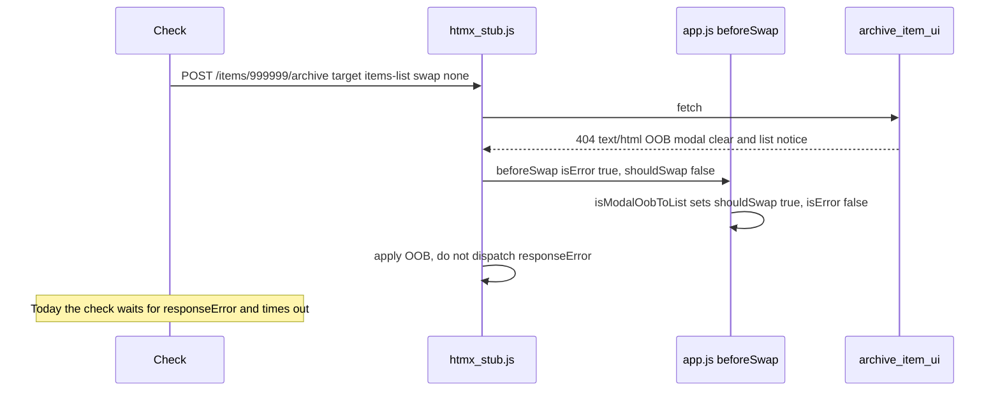

# WISHENKA-220: Missing-wish archive shows a notice, not a crash or reload

## Research

The author-facing path already matches the requirements. A run of the standing
check on 2026-11-27 confirms why it still fails.

Command:

```bash
make test PYTEST_ARGS='tests/test_receipt_modal_browser.py::test_unmarked_error_neither_shows_notice_nor_reloads -q --tb=short'
```

Result: `FAILED` in 10.32s.
`tests.browser_cdp.PageWaitTimeout: timed out after 5s waiting for: the unmarked error reached the listener`,
last value `False`. The page stayed on `/web/wishlists/1`. The only mutation
was `POST /web/wishlists/1/items/999999/archive` → `404`. The server log is
`Modal archive_item failed with ItemNotFoundError`. Both item cards were
still in `#items-list`. The console was empty. `page.wait_for` uses a 5s
default (`tests/browser_cdp.py`).

That 404 is the existing modal-domain response, not a crash page.

1. `archive_item_ui` (`wishenka/web/routes/items_ui.py`) calls
   `archive_wish_item`. `ItemNotFoundError` is in `_DOMAIN_ERRORS`, so the
   handler returns `_modal_domain_error_response(..., operation="archive_item")`.
2. That helper answers `404` with `text/html` from `_oob_modal_notice`:
   `oob_text("item-modal-container")` and
   `oob_text("list-notice", t("web.item.resource_not_found", locale))`.
   `oob_text` (`wishenka/web/gifted_view.py`) emits
   `<div id="..." hx-swap-oob="innerHTML">...</div>`.
3. The Russian page (`accept_language="ru"` in `_owner_page`) therefore
   receives «Желание или вишлист больше недоступны.» The English sentence
   for the same key is «Wish or wishlist is no longer available.»
   (`wishenka/i18n/catalog.py`).
4. The confirm form posts with `hx-target="#items-list"` and
   `hx-swap="none"` (`partials/item_archive_modal.html`). The check calls
   `htmx.ajax` the same way, with no triggering element. The browser
   fixture serves `tests/browser_assets/htmx_stub.js`, which does not
   process `hx-*` on the page and does apply `hx-swap-oob` after an
   accepted swap.

`wishenka/web/static/app.js` `htmx:beforeSwap` (about lines 469–507) opts
this response in. After the early returns (`skipSharedDialog`,
`X-Reorder-Refusal`, a reservation path, non-HTML), `isModalOobToList` is
true: the target id is `items-list` and the body contains both
`id="item-modal-container"` and `hx-swap-oob`. The listener sets
`detail.shouldSwap = true` and `detail.isError = false`. The test's call
has no `detail.elt`, so `fromModal` is false; the OOB-to-list clause is
what matches. A real confirm submit also matches `fromModal`, and it lands
in the same assignment.

htmx 1.9.12, the script pinned for real-htmx tests
(`tests/browser_assets/htmx-1.9.12.min.js`), has no `responseHandling`
(that config is htmx 2). It sets `isError` from `status >= 400`, copies
`detail.isError` back after `htmx:beforeSwap`, swaps only when
`shouldSwap` is true, and dispatches `htmx:responseError` when `isError`
is still true. The current event reference says `detail.isError` controls
whether error events fire
([htmx events](https://htmx.org/events/)). The swap example sets
`shouldSwap` and `isError = false` together so a 4xx body is applied and
not treated as an error
([htmx docs](https://htmx.org/docs/),
[4xx are not swapped by default](https://htmx.org/quirks/)).

The stub agrees on this path: it starts with `shouldSwap = status < 400`
and `isError = status >= 400`, then dispatches `htmx:responseError` only
when `shouldSwap` stays false and `isError` stays true. Clearing `isError`
and setting `shouldSwap` drops the event and applies the two OOB fragments.
`#items-list` is not replaced (`swap: 'none'`). Cards stay. `#list-notice`
receives the sentence. An open `#item-modal-container` is emptied.

`wishlist.js` reloads only from `htmx:responseError` when
`X-Reorder-Refusal` is `stale_order`. This 404 has no such header, and the
event does not fire, so the page stays. `test_stale_reorder_keeps_list_and_shows_notice`
still covers that other moment.

The check installs a `htmx:responseError` listener into
`window.__responseErrors` and waits until the array is non-empty. It then
requires `[[404, None]]` and an empty `#list-notice`. The event never
arrives, so the empty-notice assertion is never reached. The listener is
the receipt-style unmarked-error observation the requirements reject.

## Implementation Plan

Leave the server response, `app.js`, `wishlist.js`, `receipt.js`, and the
htmx stub as they are. Changing `beforeSwap` so `isError` stays true would
drop the notice and emit `htmx:responseError`. Returning 200 would be a
new status for the same OOB body. Both fight the outcome the author
already sees.

The change is `tests/test_receipt_modal_browser.py::test_unmarked_error_neither_shows_notice_nor_reloads`
only. Keep the function name: the requirements and the definition of done
cite it. Replace the docstring so it describes the list notice, the closed
dialog, the intact list, and the absence of a reload.

The rewritten check, still on the Russian owner page with two wishes:

1. Set `window.__beforeReload = true`. Do not register
   `htmx:responseError` and do not read `window.__responseErrors`.
2. Open the archive confirm for the first wish with `htmx.ajax('GET', .../archive-confirm, {target: '#item-modal-container', swap: 'innerHTML'})`
   and wait until `#item-archive-modal` is present. The stub ignores the
   card's `hx-get`, so the test starts the dialog the same way it starts
   the other flows in this file.
3. Post the missing archive the way the confirm form does:
   `htmx.ajax('POST', .../items/999999/archive, {target: '#items-list', swap: 'none'})`.
4. Wait until `#list-notice` is exactly
   «Желание или вишлист больше недоступны.» and `#item-archive-modal` is
   gone (`#item-modal-container` empty).
5. For a bounded 2 seconds, as today, assert `window.__beforeReload === true`
   and the notice stays. Then `page.order()` is still the two seeded ids.
6. Keep `_no_external(page)` and add `assert_clean_console(page)`, matching
   the stale-reorder check in the same file.

`test_stale_reorder_keeps_list_and_shows_notice` stays. Successful archive,
`nothing_remaining`, and receipt feedback stay on their existing checks.
The English sentence stays the catalog value of
`web.item.resource_not_found`; this browser check already runs in Russian
and does not need a second locale.

**Mandatory — Failing Repro (next Step 3):** The product behavior above is
already present, so a new assertion of the notice, the closed dialog, and
the intact list would be green on the first run. That rewrite is the Step 4
fix. Step 3 does not edit the test and does not edit production code.

Step 3 reconfirms the existing red check and records its path. Run the
command in Research. The intended failure is `PageWaitTimeout` after 5s on
`window.__responseErrors.length > 0` (last value false), with the archive
`POST` logged as `ItemNotFoundError` / `404`, both cards still listed, and
the wishlist URL unchanged. A collection error, a fixture error, or a
failure before that wait is the wrong failure and must be fixed in the
test setup only.

`N/A — no behavioral change` applies to production code. It does not retire
the existing red check: that check is the failing repro of the wrong
contract.

## Architecture



### Modules

| Module | Responsibility on this path |
| --- | --- |
| `archive_item_ui` | Archive a wish. On `ItemNotFoundError`, return the shared 404 OOB notice and close the item dialog. |
| `_modal_domain_error_response` / `_oob_modal_notice` / `oob_text` | Build that 404 body. Wording comes from `web.item.resource_not_found`. |
| `partials/item_archive_modal.html` | Confirm form: `hx-post` archive, `hx-target="#items-list"`, `hx-swap="none"`. |
| `app.js` `htmx:beforeSwap` | For this HTML 404, allow the swap and clear `isError`. Leave `X-Reorder-Refusal` and receipt `skipSharedDialog` alone. |
| `wishlist.js` `htmx:responseError` | Reload only for `X-Reorder-Refusal: stale_order`. This 404 never reaches it. |
| `htmx_stub.js` | Browser stand-in. Honors `shouldSwap` / `isError`, `swap: 'none'`, and `hx-swap-oob`. |
| `test_unmarked_error_neither_shows_notice_nor_reloads` | The only module this task changes. It must observe the notice, the closed dialog, the same list, and no reload. |

### Interactions

The check and the confirm form share one request shape: `POST` archive,
target `#items-list`, swap `none`. The route's 404 body is out-of-band
only, so the list section is not the swap destination. `app.js` recognizes
that body and tells htmx to apply it as a normal swap. The stub (and
htmx 1.9.12) then skip `htmx:responseError`. `wishlist.js` therefore does
not write the stale-list sentence and does not reload.

A stale reorder is a different response: `400` with
`X-Reorder-Refusal: stale_order`. `app.js` returns before the modal opt-in,
`isError` stays true, `wishlist.js` writes the list-changed sentence and
reloads. That edge stays.

### Patterns

Keep the WISHENKA-160 scoped `htmx:beforeSwap` opt-in. A 4xx HTML fragment
for the item dialog is swapped on purpose, and clearing `isError` is what
keeps it from becoming a generic request error. No new event, header,
status, or sentence.

### Interfaces

Unchanged HTTP contract for
`POST /web/wishlists/{wishlist_id}/items/{item_id}/archive` when the wish
is missing:

- Status `404`.
- `Content-Type` includes `text/html`.
- Body: OOB `innerHTML` that empties `#item-modal-container`, then OOB
  `innerHTML` that sets `#list-notice` to `web.item.resource_not_found`.
- No `X-Reorder-Refusal` and no `X-Receipt-Refusal`.

The check's new oracle is DOM state after that response: the Russian
notice, no `#item-archive-modal`, the same card order, and
`window.__beforeReload` still true. It does not observe
`htmx:responseError`.

## Q&A

- **Q:** Why does the listener stay empty when the server returns 404?
  **A:** `app.js` sets `isError` to false for this OOB HTML body, and both
  htmx 1.9.12 and the stub dispatch `htmx:responseError` only while that
  flag stays true. The run on 2026-11-27 timed out with last value false
  after that exact `ItemNotFoundError` 404.

- **Q:** Should Step 4 stop clearing `isError` so the old check passes?
  **A:** The notice is the outcome the author must see. Leaving `isError`
  true tells htmx to drop the body. The check changes instead.

- **Q:** Does Step 3 add the new assertions?
  **A:** Those assertions describe behavior the page already has, so they
  would pass immediately. Step 3 only reconfirms the current timeout.
  Step 4 rewrites the check.

- **Q:** Does the stale-order reload stay?
  **A:** Yes. It still depends on `htmx:responseError` plus
  `X-Reorder-Refusal: stale_order`, which this 404 does not send.
