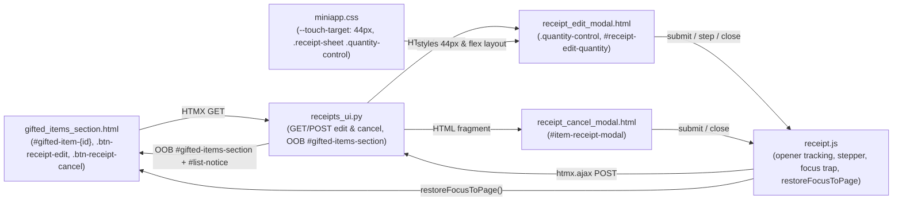

# WISHENKA-221: Receipt Edit Touch-Target Alignment and Edit/Cancel Modal Accessibility Verification

## Research

Inspection of the current receipt modal templates, CSS, client script, routes, and browser tests revealed the exact causes of the three gaps documented in `ai-tasks/WISHENKA-161/60-tech-debt.md`:

1. **Edit modal quantity control (`wishenka/web/templates/partials/receipt_edit_modal.html` vs `item_receipt_modal.html`, `wishenka/web/static/miniapp.css`, `wishenka/web/static/receipt.js`)**:
   - `item_receipt_modal.html` renders `.quantity-control` with `<button type="button" class="btn-step btn-decrement" data-receipt-step="-1">`, `<input id="receipt-quantity" type="number" name="quantity" data-receipt-quantity data-remaining="{{ remaining }}" min="1" max="{{ remaining }}" step="1" inputmode="numeric" ...>`, and `<button type="button" class="btn-step btn-increment" data-receipt-step="1">`.
   - `receipt_edit_modal.html` renders a bare `<input id="receipt-edit-quantity" type="number" name="quantity" min="1" max="{{ max_allowed }}" value="{{ current_quantity }}" required>` without `.quantity-control`, without `.btn-step` buttons, and without `data-receipt-quantity` / `data-remaining` / `step="1"` / `inputmode="numeric"`.
   - `miniapp.css` defines `--touch-target: 44px` and applies `.receipt-sheet .quantity-control` (`margin: .25rem 0 .5rem`), `.receipt-sheet .quantity-control input` (`min-height: var(--touch-target); min-width: var(--touch-target); background: var(--receipt-bg); color: var(--receipt-text);`), `.quantity-control` (`display: flex; align-items: center; gap: .5rem;`), `.quantity-control input` (`width: 5.5rem; text-align: center; font-weight: 700;`), and `.receipt-sheet button` (`min-height: var(--touch-target); min-width: var(--touch-target);`). Because `receipt_edit_modal.html` lacks `.quantity-control`, `#receipt-edit-quantity` misses those styles and stepper buttons.
   - `receipt.js` already handles `[data-receipt-step]` clicks by querying `[data-receipt-quantity]` in `#item-receipt-modal` and reading `data-remaining` to clamp `next` into `[1, remaining]`, then calling `updateSummary(field, true)`. However, `updateSummary(field, clampValue)` currently returns early if `[data-receipt-summary]` is absent (`if (!line || ...)`), which would skip clamping `field.value` on `change` events in `receipt_edit_modal.html` (which has no `[data-receipt-summary]`).

2. **Focus restoration for `#gifted-items-section` (`wishenka/web/static/receipt.js`, `wishenka/web/templates/partials/gifted_items_section.html`, `wishenka/web/routes/receipts_ui.py`)**:
   - `gifted_items_section.html` renders `<section id="gifted-items-section">`, `
`, `
`, and `<li class="gifted-item" id="gifted-item-{{ row.item_id }}">` containing `.btn-receipt-edit` and `.btn-receipt-cancel` buttons.
   - On edit/cancel submit, `correct_receipt_ui` and `cancel_receipt_ui` in `wishenka/web/routes/receipts_ui.py` return OOB fragments including `#gifted-items-section` (`hx-swap-oob="outerHTML"`), replacing the entire section DOM.
   - In `receipt.js`:
     - `OPENER_SELECTOR` is currently `'.btn-receipt-item'` only; clicks on `.btn-receipt-edit` and `.btn-receipt-cancel` are not tracked at all (`openerCardId` stays `''` and `openerElement` stays `null`).
     - `restoreFocusToPage()` checks `openerCardId` -> `.item-card-summary`, then `openerElement` (only if `openerElement.isConnected`), then `#list-notice`.
     - Consequently, dismissing an edit/cancel modal does not return focus to the triggering `.btn-receipt-edit`/`.btn-receipt-cancel` button, and submitting an edit/cancel modal disconnects `openerElement` via the OOB swap and falls back to `#list-notice` instead of `#gifted-item-{{ item_id }}` or `details.gifted-items-details > summary`.
   - `receipt.js` already preserves `details.gifted-items-details.open` across `submitReceipt` via `giftedWasOpen` in `finishAttempt(form, giftedWasOpen)`.

3. **Browser test coverage (`tests/test_receipt_accessibility_browser.py`)**:
   - Existing tests cover `item_receipt_modal.html` only: `test_modal_semantics_background_isolation_and_tab_trap`, `test_focus_return_partial_full_and_refusal`, `test_gifted_section_open_state_preserved`, `test_large_quantity_stepper_updates_summary_and_submits`, and `test_mobile_touch_targets_and_quick_add_overlay`.
   - No browser accessibility, touch-target, or focus-restoration tests exist for `receipt_edit_modal.html` or `receipt_cancel_modal.html`.

## Implementation Plan

1. **Template alignment (`wishenka/web/templates/partials/receipt_edit_modal.html`)**:
   - Wrap `#receipt-edit-quantity` in `
` with `-` and `+` `.btn-step` buttons (`data-receipt-step="-1"` / `data-receipt-step="1"` and localized `aria-label` keys `web.item.decrease_qty` / `web.item.increase_qty`), matching `item_receipt_modal.html`.
   - Add `data-receipt-quantity`, `data-remaining="{{ max_allowed }}"`, `step="1"`, and `inputmode="numeric"` to `#receipt-edit-quantity`.
2. **Client script alignment (`wishenka/web/static/receipt.js`)**:
   - Expand `OPENER_SELECTOR` to `'.btn-receipt-item, .btn-receipt-edit, .btn-receipt-cancel'`.
   - Track `openerGiftedItemId` (from `closest(opener, '.gifted-item')`) alongside `openerCardId` and `openerElement`.
   - Update `restoreFocusToPage()` so that:
     - For `.btn-receipt-item`: existing behavior is unchanged (`#item-card-{id} .item-card-summary`, else `openerElement` if connected, else `#list-notice`).
     - For gifted openers (`.btn-receipt-edit` / `.btn-receipt-cancel`): if `openerElement` is still connected (dismiss via Escape/Cancel/backdrop), focus `openerElement`; otherwise (after OOB `#gifted-items-section` replacement), focus `#gifted-item-{id}` (setting `tabindex="-1"` if absent) if still present, else `#gifted-items-section details.gifted-items-details > summary` if other gifted items remain, else `#list-notice` (setting `tabindex="-1"` if absent).
   - Update `updateSummary(field, clampValue)` so clamping `field.value` into `[1, remaining]` on `change` still runs when `[data-receipt-summary]` is absent (as in `receipt_edit_modal.html`), and only updates `line.textContent` when `line` exists.
   - Extract a small `handleStepClick(stepBtn)` helper from the `document` `click` listener for clarity.
3. **Browser tests (`tests/test_receipt_accessibility_browser.py`)**:
   - Add mobile-viewport (`390x844`) browser tests covering:
     - Edit modal `.quantity-control` structure, `>= 44x44` px touch targets and `elementFromPoint` hit-testing for `-` / `+` steppers, `#receipt-edit-quantity`, `.btn-receipt-confirm`, and `.btn-modal-close`, plus stepper increment/decrement and submission.
     - Edit and cancel modal accessibility parity: `aria-modal="true"`, background `inert`/`aria-hidden` isolation, `Tab`/`Shift+Tab` wrapping, `Escape` dismissal, and in-dialog refusal feedback focus (`#receipt-feedback`).
     - Focus restoration from `#gifted-items-section`:
       - Dismiss (`Escape` / Cancel) returns focus to the triggering `.btn-receipt-edit` or `.btn-receipt-cancel` button.
       - Edit submit or partial cancel (item still in `#gifted-items-section`) returns focus to `#gifted-item-{id}` and preserves `details.gifted-items-details.open === true`.
       - Full cancel of one item when another gifted item remains returns focus to `#gifted-items-section details.gifted-items-details > summary` and preserves `open === true`.
       - Full cancel of the last gifted item (section becomes empty) returns focus to `#list-notice`.

**Mandatory — Failing Repro (next Step 3):**
- **Where it lives**: `tests/test_receipt_accessibility_browser.py` (new test functions with existing module `pytestmark = [pytest.mark.timeout(45), pytest.mark.browser]`).
- **What it asserts (desired behavior)**:
  1. `test_edit_modal_touch_targets_and_stepper`: opens `receipt_edit_modal.html` at `390x844` via `.btn-receipt-edit` in `#gifted-items-section`; asserts `.quantity-control` contains `.btn-decrement`, `#receipt-edit-quantity[data-receipt-quantity]`, `.btn-increment`, `.btn-receipt-confirm`, and `.btn-modal-close`, all with `width >= 44`, `height >= 44`, and `hitInSelf === true`; clicks `+` / `-` steppers and submits updated quantity. Fails before fix because `receipt_edit_modal.html` has no `.quantity-control` or `.btn-step` buttons.
  2. `test_edit_and_cancel_modal_accessibility_and_focus_restoration`: exercises `aria-modal`, background `inert`/`aria-hidden`, `Tab`/`Shift+Tab` trap, `Escape` dismiss focus return to `.btn-receipt-edit` / `.btn-receipt-cancel`, refusal feedback focus (`#receipt-feedback`), edit/partial-cancel focus return to `#gifted-item-{id}` with `details.open === true`, non-last full-cancel focus return to `details.gifted-items-details > summary` with `details.open === true`, and last-item cancel focus return to `#list-notice`. Fails before fix because `receipt.js` does not track `.btn-receipt-edit`/`.btn-receipt-cancel` openers or restore focus to `#gifted-item-{id}` / `details > summary`.
- **How to force failure without live external deps**: Runs against the local `wishlist_server` + SQLite + headless Chromium CDP fixtures (`seed_wishlist`, `wishlist_page`, `record_receipt`), with `assert_clean_console` and `_no_external`.
- **Sequencing**: Step 3 adds the red tests and confirms they fail against the current `receipt_edit_modal.html` and `receipt.js`; Step 4 implements the template and JS fixes until all new and existing tests pass.

## Architecture

### Module Diagram

### Module Responsibilities

- **`wishenka/web/templates/partials/receipt_edit_modal.html`**: Renders the edit dialog markup with `.quantity-control` (`.btn-decrement`, `#receipt-edit-quantity[data-receipt-quantity][data-remaining]`, `.btn-increment`), `role="dialog"`, `aria-modal="true"`, and `#receipt-feedback[role="alert"][tabindex="-1"]`.
- **`wishenka/web/static/miniapp.css`**: Existing `.receipt-sheet .quantity-control`, `.receipt-sheet .quantity-control input`, `.quantity-control`, and `.receipt-sheet button` rules provide `>= 44px` (`--touch-target`) dimensions and consistent flex stepper layout without requiring new CSS classes.
- **`wishenka/web/static/receipt.js`**:
  - Tracks opener context (`openerCardId`, `openerGiftedItemId`, `openerElement`) for `.btn-receipt-item`, `.btn-receipt-edit`, and `.btn-receipt-cancel`.
  - Handles `[data-receipt-step]` clicks and `[data-receipt-quantity]` `input`/`change` clamping uniformly for both creation and edit modals.
  - Restores focus predictably after dialog close or OOB replacement of `#gifted-items-section`.
- **`tests/test_receipt_accessibility_browser.py`**: Verifies mobile (`390x844`) touch targets, modal isolation, keyboard trapping, refusal feedback focus, and `#gifted-items-section` focus restoration in real Chromium.

### Patterns and Justification

- **Shared `.quantity-control` component pattern**: Reusing the exact `.quantity-control` + `[data-receipt-step]` + `[data-receipt-quantity]` markup and CSS from `item_receipt_modal.html` guarantees visual, touch-target, and behavioral parity with zero duplicated CSS or JS event handlers.
- **ID-based post-OOB focus restoration**: Because HTMX `hx-swap-oob="outerHTML"` replaces `#gifted-items-section` DOM nodes on edit/cancel submission, storing `openerGiftedItemId` (`gifted-item-{id}`) allows `restoreFocusToPage()` to locate the newly swapped element by stable ID, falling back gracefully to `details.gifted-items-details > summary` and `#list-notice`.

### Interfaces

- **Template-to-JS contract (`receipt_edit_modal.html` → `receipt.js`)**:
  - `[data-receipt-modal]` root with `#receipt-feedback[role="alert"][tabindex="-1"]`
  - `[data-receipt-quantity][data-remaining="<max_allowed>"]` on `#receipt-edit-quantity`
  - `[data-receipt-step="-1"]` / `[data-receipt-step="1"]` on `.btn-step` buttons
- **Gifted section-to-JS contract (`gifted_items_section.html` → `receipt.js`)**:
  - `.btn-receipt-edit` and `.btn-receipt-cancel` inside `.gifted-item#gifted-item-{item_id}` inside `#gifted-items-section details.gifted-items-details`

## Q&A

- **Q**: Does `receipt_edit_modal.html` need the `RECEIPT_SELECT_MAX` `<select>` branch like `item_receipt_modal.html`?
  **A**: No. `receipt_edit_modal.html` has always used a numeric input (`#receipt-edit-quantity`), and `10-requirements.md` / `WISHENKA-161/60-tech-debt.md` specify aligning it with `.quantity-control` (`-` / `+` steppers and `44px` touch targets), while `RECEIPT_SELECT_MAX` boundary tests remain out of scope (`WISHENKA-222`).
- **Q**: Are any CSS changes in `wishenka/web/static/miniapp.css` required?
  **A**: Existing rules for `.receipt-sheet .quantity-control`, `.receipt-sheet .quantity-control input`, `.quantity-control`, and `.receipt-sheet button` already enforce `--touch-target: 44px` and flex alignment once `receipt_edit_modal.html` uses `
`. Step 3/4 browser tests will verify the rendered bounding boxes at `390x844`.
