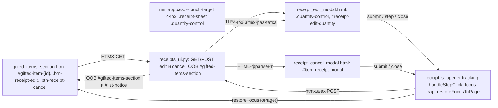

# Спецификация: WISHENKA-221 — Выравнивание сенсорных целей и доступность модальных окон редактирования и отмены получения подарка

**Задача:** WISHENKA-221  
**Статус:** реализовано и верифицировано (закрытие технического долга по WISHENKA-161)  
**Компоненты:** шаблоны Mini App (Jinja2 + HTMX), клиентский скрипт (`receipt.js`), браузерные тесты доступности (Chromium / CDP)  
**Языки реализации:** Python, JavaScript, HTML, CSS

## 1. Назначение и бизнес-цель

В рамках задачи `WISHENKA-161` для основного модального диалога первичной фиксации получения подарка (`item_receipt_modal.html`) были реализованы требования мобильной эргономики и доступности: элемент управления количеством `.quantity-control` с кнопками-степперами `-` / `+`, сенсорные цели размером не менее `44×44 px`, изоляция фонового содержимого (`inert` и `aria-hidden`), удержание навигации клавишами `Tab` / `Shift+Tab` внутри диалога и предсказуемое восстановление фокуса.

Последующий аудит (`ai-tasks/WISHENKA-161/60-tech-debt.md`) выявил три расхождения в модальных диалогах управления уже созданными записями о получении в разделе «Подаренные» (`#gifted-items-section`):

1. **Отсутствие степперов и сенсорных целей в диалоге редактирования:** шаблон `receipt_edit_modal.html` выводил обычное числовое поле `#receipt-edit-quantity` без обёртки `.quantity-control` и без кнопок `.btn-step`, из-за чего к полю не применялись правила высоты и ширины `--touch-target: 44px`.
2. **Потеря фокуса при работе из раздела «Подаренные»:** в клиентском скрипте `receipt.js` селектор инициаторов открытия модального окна (`OPENER_SELECTOR`) учитывал только кнопку карточки `.btn-receipt-item` и не отслеживал кнопки `.btn-receipt-edit` и `.btn-receipt-cancel`. В результате закрытие диалога не возвращало фокус на исходную кнопку, а подтверждение редактирования или отмены (вызывающее out-of-band замену `#gifted-items-section` с `hx-swap-oob="outerHTML"`) удаляло исходную кнопку из DOM и приводило к откату фокуса на общий баннер `#list-notice`. Дополнительно функция `updateSummary` в `receipt.js` завершалась досрочно до ограничения (clamping) значения поля, если в диалоге отсутствовал элемент `[data-receipt-summary]`.
3. **Недостаточное браузерное покрытие:** автоматизированные тесты мобильной доступности в `tests/test_receipt_accessibility_browser.py` проверяли только диалог создания получения, оставляя модальные окна редактирования и отмены без проверки в реальном браузере.

### Цели и ценность

- **Мобильная эргономика:** предоставить владельцам и соавторам вишлиста единый удобный ввод количества с кнопками `-` / `+` и областями касания не менее `44×44 px` в диалоге редактирования получения, исключающий случайные промахи на экране смартфона.
- **Клавиатурная и скринридер-доступность:** гарантировать возврат фокуса в актуальный контекст раздела «Подаренные» (на исходную кнопку при отмене закрытием, на карточку `#gifted-item-{id}`, на заголовок секции `details.gifted-items-details > summary` или на `#list-notice` при опустошении списка) и обеспечить полную изоляцию фона с удержанием фокуса для обоих диалогов.
- **Защита от регрессий:** закрепить достигнутые инварианты доступности и размеров сенсорных целей автоматизированными браузерными тестами на мобильном вьюпорте `390×844`.

### Границы применимости

- **Входит в объём:** разметка `.quantity-control` в `receipt_edit_modal.html`, отслеживание инициаторов `.btn-receipt-edit` / `.btn-receipt-cancel`, восстановление фокуса и ограничение количества в `receipt.js`, а также мобильные браузерные тесты диалогов редактирования и отмены в `tests/test_receipt_accessibility_browser.py`.
- **Не входит в объём:** граничные тесты порога `RECEIPT_SELECT_MAX` и тестирование некорректных значений в диалоге создания получения (`WISHENKA-222`), переход на нативный `<dialog>.showModal()`, изменение доменной логики получения, прав доступа, серверных обработчиков, JSON/HTTP API или схемы базы данных, а также исправление несвязанных тестов (`WISHENKA-214`, `WISHENKA-220`).

## 2. Функциональные требования и пользовательские сценарии

### 2.1. Действующие лица и основные сущности

- **Автор вишлиста (владелец, администратор или участник):** аутентифицированный пользователь с правом редактирования активного вишлиста (`can_edit_wishlist`), имеющий доступ к разделу «Подаренные» и действиям корректировки и отмены записей о получении.
- **Запись о получении (Gift Receipt):** зафиксированный акт получения части или всего запрошенного количества желания (`receipt_id`, текущее количество `current_quantity`, верхний предел редактирования `max_allowed`, определяемый как сумма остатка желания и текущего количества этой записи).
- **Раздел «Подаренные» (`#gifted-items-section`):** сворачиваемая секция `
` на странице вишлиста со списком полученных желаний (`#gifted-item-{item_id}`) и кнопками `.btn-receipt-edit` и `.btn-receipt-cancel` для каждого акта получения.
- **Диалоги редактирования и отмены:** модальные окна (`receipt_edit_modal.html` и `receipt_cancel_modal.html`), отображаемые в контейнере `#item-modal-container` поверх страницы вишлиста для изменения количества или удаления записи о получении.

### 2.2. Функциональные требования

#### FR-1. Единый элемент управления количеством при редактировании

- В шаблоне `wishenka/web/templates/partials/receipt_edit_modal.html` поле `#receipt-edit-quantity` должно быть помещено внутрь `
` между кнопкой уменьшения (`.btn-step.btn-decrement`, `data-receipt-step="-1"`) и кнопкой увеличения (`.btn-step.btn-increment`, `data-receipt-step="1"`).
- Кнопки `-` и `+` обязаны иметь локализованные атрибуты `aria-label` через существующие ключи `web.item.decrease_qty` и `web.item.increase_qty`.
- Поле `#receipt-edit-quantity` должно иметь атрибуты `type="number"`, `name="quantity"`, `data-receipt-quantity`, `data-remaining="{{ max_allowed }}"`, `min="1"`, `max="{{ max_allowed }}"`, `step="1"`, `inputmode="numeric"`, `value="{{ current_quantity }}"`, `required`.
- В отличие от диалога создания получения (`item_receipt_modal.html`), в диалоге редактирования не используется ветвление через `<select>` по порогу `RECEIPT_SELECT_MAX`: всегда отображается числовой ввод со степперами.

#### FR-2. Поведение степперов и ограничение диапазона

- Нажатие любой кнопки `[data-receipt-step]` (обработчик `handleStepClick` в `receipt.js`) должно изменять значение `[data-receipt-quantity]` на величину `data-receipt-step` (`+1` или `-1`) и ограничивать итог диапазоном `[1, remaining]`, где `remaining` считывается из `data-remaining`. При нечисловом текущем значении поля за базовое значение принимается `1`.
- При возникновении события `change` на `[data-receipt-quantity]` (или при нажатии степпера) вызов `updateSummary(field, true)` должен записывать ограниченное диапазоном `[1, remaining]` значение обратно в `field.value` независимо от наличия в диалоге элемента `[data-receipt-summary]`. Обновление текста сводки выполняется только при наличии `[data-receipt-summary]`.
- При попытке отправки формы (`submit`) с невалидным числовым полем (`!field.checkValidity()`) клиент должен вызывать `field.reportValidity()` и не отправлять AJAX-запрос.

#### FR-3. Модальная семантика, изоляция фона и обработка отказов

- Оба диалога используют корневой элемент `#item-receipt-modal[data-receipt-modal]` с атрибутами `role="dialog"`, `aria-modal="true"`, `aria-labelledby="receipt-title"` и областью оповещений `#receipt-feedback[role="alert"][tabindex="-1"]`.
- При вставке модального окна в `#item-modal-container` (`htmx:afterSwap`) функция `setBackgroundInert(true)` должна устанавливать `inert = true` и `aria-hidden="true"` (с маркерами `data-receipt-inert` и `data-receipt-hidden`) на все не-предковые соседние элементы вверх до `document.body` (исключая `<script>`, `<style>`, `<template>`), изолируя фоновую страницу (в том числе `#items-list`, `#quick-add-bar`, `nav.top-nav`).
- Навигация с клавиатуры (`Tab` и `Shift+Tab`) должна циклически удерживаться внутри видимых активных фокусируемых элементов открытого диалога (`getFocusable(modal)`).
- При открытии заблокированного диалога (`blocked`), серверном отказе с заголовком `X-Receipt-Refusal` из допустимого множества `REFUSAL_REASONS` или сетевой ошибке диалог должен оставаться открытым, фон — изолированным, а фокус — переводиться на `#receipt-feedback`. Если текст `#receipt-feedback` пуст после завершения запроса, подставляется локализованное сообщение сбоя по умолчанию (`data-i18n-receipt-failure` / `DEFAULT_GENERIC_FAILURE`).

#### FR-4. Восстановление фокуса и состояния раздела «Подаренные»

- Селектор `OPENER_SELECTOR` в `receipt.js` должен охватывать `.btn-receipt-item, .btn-receipt-edit, .btn-receipt-cancel`. При клике по кнопке в `#gifted-items-section` сохраняются элемент инициатора (`openerElement`) и идентификатор родительского элемента `#gifted-item-{id}` (`openerGiftedItemId`).
- При закрытии диалога без отправки запроса (`Escape`, кнопка `[data-modal-close]` или клик по подложке `#item-receipt-modal`) контейнер `#item-modal-container` очищается, изоляция фона снимается, а фокус возвращается на сохранённый `openerElement`, если он остаётся в DOM (`isConnected`).
- Перед отправкой формы (`submitReceipt`) скрипт должен фиксировать открытое состояние `details.gifted-items-details` (`giftedWasOpen`) и восстанавливать `details.open = true` в `finishAttempt`, если после OOB-обновления секция всё ещё содержит элементы.
- После успешного сохранения или отмены получения (когда серверная OOB-замена `#gifted-items-section` перерисовывает список и отсоединяет прежнюю кнопку от DOM) `restoreFocusToPage()` для `openerGiftedItemId` должна восстанавливать фокус по убывающему приоритету:
  1. `openerElement`, если элемент ещё подключён к DOM (случай отмены закрытием).
  2. `#gifted-item-{id}`, если желание осталось в разделе «Подаренные» (при отсутствии `tabindex` элементу назначается `tabindex="-1"`).
  3. `#gifted-items-section details.gifted-items-details > summary`, если данное желание полностью удалено из «Подаренные», но в секции остались другие подаренные желания.
  4. `#list-notice`, если отменён последний акт во всём разделе «Подаренные» и секция пуста (при отсутствии `tabindex` элементу назначается `tabindex="-1"`).

### 2.3. Инварианты

- **Тайна сюрприза:** диалоги редактирования и отмены доступны только участникам вишлиста с правами редактирования (`can_edit_wishlist`), не отображают сведений о дарителях, бронированиях и покупках, а все тексты отказов (включая `busy` и `quantity_above_remaining`) остаются нейтральными.
- **Соблюдение допустимого интервала:** количество в редактируемой записи не может опуститься ниже `1` и превысить `max_allowed`.
- **Обратная совместимость с карточками активных желаний:** поведение фокуса при открытии диалога из карточки активного желания (`.btn-receipt-item` → `openerCardId` → `#item-card-{id} .item-card-summary` → `openerElement` → `#list-notice`) остаётся без изменений.
- **Отсутствие встроенных скриптов и нелокализованных строк:** новые элементы разметки не содержат встроенных обработчиков событий и используют существующую систему локализации `t(...)`.

### 2.4. Пользовательские сценарии

- **UC-01. Корректировка количества получения на мобильном устройстве (US-1):** автор открывает список «Подаренные», нажимает «Изменить» у записи о получении, корректирует количество нажатием кнопок `+` / `-` с сенсорными областями `>= 44×44 px` и подтверждает изменение. Запрос отправляется на `POST .../edit`, диалог закрывается, «Подаренные» остаётся раскрытым.
- **UC-02. Отмена закрытия диалога с клавиатуры (US-2, US-3):** автор открывает диалог редактирования или отмены, перемещается по элементам клавишами `Tab` / `Shift+Tab` (не выходя за границы окна), затем нажимает `Escape`. Диалог закрывается без запроса к серверу, а фокус возвращается на кнопку `.btn-receipt-edit` или `.btn-receipt-cancel`, открывшую окно.
- **UC-03. Отображение отказа при редактировании или отмене (US-3):** при одновременном изменении остатка (`409 quantity_above_remaining`) или временной блокировке инвентаря (`503 busy`) диалог остаётся открытым, выводит причину отказа в `#receipt-feedback` и переводит на него фокус.
- **UC-04. Сохранение позиции фокуса после частичной или полной отмены (US-2):**
  - При частичной отмене (у желания остаются другие акты получения) фокус переходит на `#gifted-item-{item_id}`, а раздел «Подаренные» остаётся открытым.
  - При полной отмене одного из нескольких подаренных желаний фокус переходит на `#gifted-items-section details.gifted-items-details > summary`, а секция остаётся открытой.
  - При полной отмене последнего подаренного желания (секция «Подаренные» становится пустой) фокус переходит на `#list-notice`.

## 3. Архитектура, компоненты и интерфейсы

### 3.1. Схема взаимодействия компонентов

### 3.2. Задействованные модули и обязанности

| Модуль / файл | Назначение и роль в задаче |
| --- | --- |
| `wishenka/web/templates/partials/receipt_edit_modal.html` | Рендерит диалог редактирования с `#item-receipt-modal`, `#receipt-feedback` и блоком `.quantity-control` (`.btn-decrement`, `#receipt-edit-quantity[data-receipt-quantity][data-remaining]`, `.btn-increment`). |
| `wishenka/web/templates/partials/receipt_cancel_modal.html` | Существующий шаблон подтверждения отмены записи о получении с общей разметкой `#item-receipt-modal` и `#receipt-feedback` (без изменений файла). |
| `wishenka/web/templates/partials/gifted_items_section.html` | Рендерит `#gifted-items-section`, `details.gifted-items-details > summary`, строки `#gifted-item-{row.item_id}` и кнопки `.btn-receipt-edit` / `.btn-receipt-cancel` (без изменений файла). |
| `wishenka/web/static/miniapp.css` | Предоставляет существующие правила `--touch-target: 44px`, `--layer-receipt: 100`, `.btn-step`, `.quantity-control`, `.receipt-sheet .quantity-control`, `.receipt-sheet .quantity-control input` и `.receipt-sheet button` (без изменений файла). |
| `wishenka/web/static/receipt.js` | Отслеживает инициаторы `.btn-receipt-item`, `.btn-receipt-edit` и `.btn-receipt-cancel`, обрабатывает степперы в `handleStepClick`, ограничивает значения в `updateSummary`, изолирует фон и восстанавливает фокус в `restoreFocusToPage`. |
| `wishenka/web/routes/receipts_ui.py` | Обрабатывает маршруты `GET`/`POST /web/wishlists/{wishlist_id}/items/{item_id}/receipts/{receipt_id}/edit` и `/cancel`, формируя модальный диалог, OOB-ответы и заголовок `X-Receipt-Refusal` (без изменений файла). |
| `tests/test_receipt_accessibility_browser.py` | Содержит браузерные тесты мобильного вьюпорта `390×844` для создания, редактирования и отмены получения. |

### 3.3. Контракты данных и клиентские интерфейсы

#### Контракт шаблона `receipt_edit_modal.html` и скрипта `receipt.js`

- Корневой узел модального окна: `#item-receipt-modal[data-receipt-modal][role="dialog"][aria-modal="true"][aria-labelledby="receipt-title"]`.
- Область ошибок и отказов: `#receipt-feedback[role="alert"][tabindex="-1"]`.
- Поле количества: `#receipt-edit-quantity[type="number"][name="quantity"][data-receipt-quantity][data-remaining="{{ max_allowed }}"][min="1"][max="{{ max_allowed }}"][step="1"][inputmode="numeric"]`.
- Кнопки-степперы: `.btn-step.btn-decrement[data-receipt-step="-1"]` и `.btn-step.btn-increment[data-receipt-step="1"]`.

#### Контракт секции «Подаренные» (`gifted_items_section.html`) и скрипта `receipt.js`

- Инициаторы открытия: кнопки `.btn-receipt-edit` и `.btn-receipt-cancel`, вложенные в элемент `.gifted-item` с идентификатором `id="gifted-item-{{ row.item_id }}"` внутри `#gifted-items-section details.gifted-items-details`.

#### Внутренние состояния и ключевые функции `receipt.js`

- **Состояние инициатора:** `openerCardId` (идентификатор `.item-card`), `openerGiftedItemId` (идентификатор `.gifted-item`), `openerElement` (DOM-элемент кнопки, открывшей диалог).
- **`handleStepClick(stepBtn)`:** определяет ближайшее окно `#item-receipt-modal` и поле `[data-receipt-quantity]`, считывает целочисленные `data-receipt-step` и `data-remaining`, вычисляет ограниченное значение `Math.min(Math.max(base + delta, 1), remaining)`, записывает его в `field.value` и вызывает `updateSummary(field, true)`.
- **`updateSummary(field, clampValue)`:** при корректных `remaining >= 1` и целом `chosen` вычисляет `quantity = Math.min(Math.max(chosen, 1), remaining)`; если `clampValue === true`, обновляет `field.value` до проверки существования `[data-receipt-summary]`, после чего при наличии `[data-receipt-summary]` форматирует строку сводки.
- **`restoreFocusToPage()`:** выбирает целевой элемент по ветке `openerGiftedItemId ? fallbackOpener || giftedItem || giftedSummary || notice : cardSummary || fallbackOpener || notice`, сбрасывает переменные состояния инициатора, добавляет `tabindex="-1"` при необходимости (для `notice` и `giftedItem`) и переводит фокус.

### 3.4. Жизненный цикл и переходы состояний диалогов редактирования и отмены

1. **Инициация:** клик по `.btn-receipt-edit` или `.btn-receipt-cancel` фиксирует `openerGiftedItemId` и `openerElement`; HTMX запрашивает HTML-фрагмент и вставляет его в `#item-modal-container`.
2. **Открытие (`htmx:afterSwap`):** `setBackgroundInert(true)` блокирует фон; `focusDialog()` фокусирует `#receipt-feedback` (если сообщение уже присутствует, например в состоянии `blocked`) или первый основной элемент из `PRIMARY_CONTROL_SELECTOR`.
3. **Ввод и навигация:** клики по `[data-receipt-step]` обновляют количество через `handleStepClick`; события `input` / `change` синхронизируют и ограничивают значение в `updateSummary`; нажатия `Tab` / `Shift+Tab` циклически перемещают фокус внутри диалога.
4. **Закрытие без отправки:** нажатие `Escape`, клик по `[data-modal-close]` или по подложке `#item-receipt-modal` вызывает `closeDialog()` — контейнер очищается, фон разблокируется, фокус возвращается на `openerElement`.
5. **Отправка (`submitReceipt`):** проверяется HTML5-валидность поля (`checkValidity()` / `reportValidity()`), сохраняется флаг `giftedWasOpen`, форма переводится в состояние `data-pending="true"` и `aria-busy="true"`, кнопка `.btn-receipt-confirm` отключается, выполняется `htmx.ajax('POST', ...)` с заголовком `Idempotency-Key`.
6. **Завершение (`finishAttempt`):**
   - **Успех (модальное окно удалено OOB-ответом):** при `giftedWasOpen === true` восстанавливается `details.open = true`; фон разблокируется; фокус переходит на `#gifted-item-{id}`, на `details.gifted-items-details > summary` или на `#list-notice`.
   - **Отказ (`X-Receipt-Refusal` из `REFUSAL_REASONS` или сбой сети, окно осталось в DOM):** `htmx:beforeSwap` разрешает подмену (`detail.shouldSwap = true`, `detail.isError = false`), фон остаётся заблокированным, с формы снимаются `data-pending` и `aria-busy`, при пустом `#receipt-feedback` подставляется сообщение ошибки по умолчанию, фокус возвращается в диалог на `#receipt-feedback`.

## 4. Нефункциональные требования, безопасность и наблюдаемость

### 4.1. Мобильная эргономика и доступность

- Все интерактивные элементы диалога редактирования (`.btn-decrement`, `#receipt-edit-quantity`, `.btn-increment`, `.btn-receipt-confirm`, `.btn-modal-close`) на мобильном вьюпорте `390×844` должны иметь размеры не менее `44×44 px` и не перекрываться другими элементами интерфейса (включая `#quick-add-bar` благодаря `--layer-receipt: 100` > `--layer-quick-add: 40`).
- Диалоги обязаны поддерживать семантику `role="dialog"`, `aria-modal="true"`, `aria-labelledby="receipt-title"`, изоляцию фоновой страницы и полную клавиатурную навигацию (`Tab`, `Shift+Tab`, `Escape`).

### 4.2. Производительность и ограничения

- Логика `receipt.js` основана на делегированных слушателях на `document` с операциями поиска `O(1)` по ближайшим предкам или идентификаторам.
- Изменения шаблона `receipt_edit_modal.html` статичны и не добавляют новых серверных запросов, запросов к БД или фоновых задач.

### 4.3. Безопасность, приватность и локализация

- Вывод клиентских сообщений в `receipt.js` выполняется исключительно через `textContent` (без `innerHTML` и встроенных скриптов в шаблонах), что исключает XSS-уязвимости и соблюдает политику CSP.
- Мутирующие запросы через `htmx.ajax('POST', ...)` используют стандартную передачу CSRF-токена HTMX и уникальный заголовок `Idempotency-Key` для защиты от дублирования при повторных попытках.
- Все подписи элементов интерфейса и доступные имена кнопок локализуются на серверной стороне через `t(..., locale|default('en'))`.
- Инвариант тайны сюрприза соблюдается полностью: отсутствуют какие-либо поля или сообщения, раскрывающие дарителей или бронирования.

### 4.4. Наблюдаемость (логирование и метрики)

- По результатам аудита в `ai-tasks/WISHENKA-221/50-observability.md` задача затрагивает только клиентский шаблон `receipt_edit_modal.html`, клиентский скрипт `receipt.js` и браузерные тесты `tests/test_receipt_accessibility_browser.py` без изменений в серверном Python-коде.
- Новые серверные или клиентские логи (включая `console.log` / `console.debug`), телеметрия, метрики Prometheus, дашборды и правила алертинга не добавлялись, чтобы не создавать шум на локальных событиях фокуса и степпера.
- Существующее серверное логирование (`ui_receipt_entry_form_opened`), коды ответов и заголовок отказа `X-Receipt-Refusal` в `wishenka/web/routes/receipts_ui.py` сохранены без изменений и проверены браузерными сценариями отказов (`409` и `503`).

## 5. Верификация и критерии приёмки

### 5.1. Сценарии проверки и результаты тестирования

Все статические проверки, анализ типов, форматирование и браузерные тесты пройдены после финальной правки реализации:

- **Линтер:** `.venv/bin/ruff check wishenka tests` — ошибок нет (`All checks passed!`).
- **Форматирование:** `.venv/bin/ruff format --check wishenka tests` — без замечаний (`242 files already formatted`).
- **Проверка типов:** `.venv/bin/mypy wishenka tests` — ошибок нет (`Success: no issues found in 242 source files`).
- **Браузерный набор:** `.venv/bin/pytest -n 0 tests/test_receipt_accessibility_browser.py` — все 7 тестов набора (5 существующих тестов диалога создания и 2 новых теста `WISHENKA-221`) пройдены за `11.51s`. Все тесты модуля снабжены явным маркером `pytestmark = [pytest.mark.timeout(45), pytest.mark.browser]` и выполняются локально без внешних сетевых обращений с проверкой чистоты консоли (`assert_clean_console`) и отсутствия внешних запросов (`_no_external`).

Покрытие новыми браузерными тестами на мобильном вьюпорте `390×844`:

1. **`test_edit_modal_touch_targets_and_stepper`:**
   - Открывает диалог редактирования через `.btn-receipt-edit` в `#gifted-items-section`.
   - Проверяет структуру `.quantity-control`: наличие `.btn-decrement[data-receipt-step="-1"]`, `#receipt-edit-quantity[data-receipt-quantity]` и `.btn-increment[data-receipt-step="1"]`.
   - Проверяет размеры (`width >= 44`, `height >= 44`) и отсутствие перекрытия (`document.elementFromPoint`) для всех пяти групп элементов: `.btn-decrement`, `#receipt-edit-quantity`, `.btn-increment`, `.btn-receipt-confirm`, `.btn-modal-close`.
   - Проверяет инкремент (`3` → `4`), декремент (`4` → `3`), повторный инкремент (`3` → `4`) и отправку `POST .../edit` с телом `quantity=4`.
2. **`test_edit_and_cancel_modal_accessibility_and_focus_restoration`:**
   - Для диалога редактирования: проверяет `aria-modal="true"`, изоляцию `#items-list`, `#quick-add-bar` и `nav.top-nav` (`inert: True`, `aria-hidden: "true"`), удержание `Tab` / `Shift+Tab`, возврат фокуса на `.btn-receipt-edit` при закрытии по `Escape`.
   - При отказе `409` (`quantity_above_remaining`): проверяет вывод локализованного сообщения о доступном остатке в `#receipt-feedback` и перевод фокуса на `#receipt-feedback`.
   - При успешном редактировании: проверяет закрытие диалога, сохранение `details.gifted-items-details.open === true` и возврат фокуса на `#gifted-item-{kettle}` после OOB-замены секции.
   - Для диалога отмены: проверяет `aria-modal="true"`, изоляцию фона, удержание `Tab` / `Shift+Tab`, возврат фокуса на `.btn-receipt-cancel` по `Escape` и отказ `503` (`InventoryBusyError`) с переводом фокуса на `#receipt-feedback`.
   - Для последовательности отмен в разделе «Подаренные»:
     - частичная отмена (остаётся вторая запись у `Kettle`) — фокус возвращается на `#gifted-item-{kettle}`, секция остаётся раскрытой;
     - полная отмена `Kettle` при наличии `Mug` — фокус переходит на `#gifted-items-section details.gifted-items-details > summary`, секция остаётся раскрытой;
     - полная отмена последнего желания `Mug` (раздел пуст) — фокус переходит на `#list-notice`.

### 5.2. Критерии приёмки

1. Диалог `receipt_edit_modal.html` отображает количество внутри `.quantity-control` со степперами `-` / `+` (`.btn-step`), а все его интерактивные элементы имеют область нажатия не менее `44×44 px` на экране `390×844` без перекрытия другими слоями.
2. Степперы и событие `change` ограничивают количество диапазоном `[1, max_allowed]`, а невалидный числовой ввод блокируется до отправки запроса.
3. Закрытие диалога редактирования или отмены без отправки (`Escape`, кнопка отмены или клик по подложке) возвращает фокус на вызвавшую диалог кнопку `.btn-receipt-edit` / `.btn-receipt-cancel`.
4. Успешное редактирование или отмена сохраняют открытое состояние `details.gifted-items-details` (при наличии оставшихся записей) и восстанавливают фокус на `#gifted-item-{id}`, затем на `details.gifted-items-details > summary` или на `#list-notice`.
5. Оба модальных диалога изолируют фоновое содержимое (`inert`, `aria-hidden`), удерживают цикл `Tab` / `Shift+Tab` и фокусируют `#receipt-feedback` при отказах.
6. Автоматизированные браузерные тесты, линтер, проверка форматирования и проверка типов проходят без ошибок и предупреждений.

### 5.3. Известные ограничения и задачи дальнейшего развития

По результатам анализа технического долга (`ai-tasks/WISHENKA-221/60-tech-debt.md`) зафиксированы следующие неблокирующие ограничения и последующие задачи:

- **Отсутствие `disabled` / `aria-disabled` на границах степпера:** кнопки `-` и `+` остаются активными при значениях `1` и `max_allowed` (`data-remaining`), тихо ограничивая выход за границы (аналогично `item_receipt_modal.html`).
- **Дублирование разметки `.quantity-control`:** блок степпера и числового поля повторяется в `receipt_edit_modal.html`, `item_receipt_modal.html` и `item_edit_modal.html` без выделения в общий Jinja2-макрос.
- **Чистота клиентского скрипта `receipt.js`:** функция `updateSummary` совмещает ограничение количества и обновление текста `[data-receipt-summary]`, а в `PRIMARY_CONTROL_SELECTOR` остаётся избыточный селектор `[data-receipt-modal] #receipt-edit-quantity` (поскольку элемент уже помечен `data-receipt-quantity`).
- **Дублирование проверок и пробелы покрытия в `tests/test_receipt_accessibility_browser.py`:**
  - проверка размеров и перекрытия (`getBoundingClientRect()` / `elementFromPoint()`) продублирована в `test_edit_modal_touch_targets_and_stepper` и `test_mobile_touch_targets_and_quick_add_overlay`, а `test_modal_semantics_background_isolation_and_tab_trap` сохраняет встроенную копию проверок из `_assert_modal_isolation_and_trap`;
  - не покрыты отдельными браузерными тестами: закрытие диалогов редактирования/отмены кликом по `.btn-modal-close` и по подложке, граничное ограничение через событие `change` (`0` → `1`, `> max_allowed` → `max_allowed`) и граничные клики по степперам в диалоге редактирования, а также открытие диалогов редактирования/отмены в состоянии `blocked` с фокусом на `#receipt-feedback`.

#### Последующие задачи в Jira

- **Тестовое покрытие и рефакторинг проверок (`NON-BLOCKER`):** выделить общий помощник `_assert_touch_targets(page)` и переиспользовать `_assert_modal_isolation_and_trap(page)` в `tests/test_receipt_accessibility_browser.py`, а также добавить тесты закрытия через `.btn-modal-close`/подложку, ограничения по `change` и состояния `blocked` для диалогов редактирования и отмены — [WISHENKA-276](https://pypost.atlassian.net/browse/WISHENKA-276).
- **Рефакторинг `receipt.js` и шаблонов (`NON-BLOCKER`):** удалить избыточный селектор `#receipt-edit-quantity` из `PRIMARY_CONTROL_SELECTOR`, разделить или уточнить имя `updateSummary` для разделения ограничения и обновления сводки, а также рассмотреть вынесение `.quantity-control` в общий Jinja2-макрос — [WISHENKA-277](https://pypost.atlassian.net/browse/WISHENKA-277).
