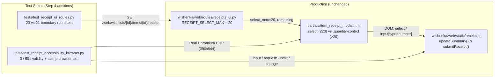

# WISHENKA-222: High-Level Architecture Design

## Research

Inspection of the production modules and existing test suites confirms that the target behavior is already implemented in production and only lacks boundary and negative-input test coverage:

1. **Threshold constant and route context (`wishenka/web/routes/receipts_ui.py`)**:
   - `RECEIPT_SELECT_MAX = 20` (line 139).
   - `_dialog_html(wishlist_id, item_id, title, remaining, **context)` passes `"select_max": RECEIPT_SELECT_MAX` into `partials/item_receipt_modal.html` (lines 142–150).
2. **Receipt modal template (`wishenka/web/templates/partials/item_receipt_modal.html`)**:
   - Line 12: ``.
   - Lines 15–57:
     - `remaining == 1`: hidden input `input[type="hidden"][name="quantity"][value="1"]` and short summary (`web.receipt.summary_one`).
     - `2 <= remaining <= select_limit` (i.e. `2..20`): `<select id="receipt-quantity" name="quantity" data-receipt-quantity data-remaining="{{ remaining }}">` with `<option value="{{ n }}">` for `1..remaining`.
     - `remaining > select_limit` (i.e. `>= 21`): `
` containing `-` button (`[data-receipt-step="-1"]`), `<input id="receipt-quantity" type="number" name="quantity" data-receipt-quantity data-remaining="{{ remaining }}" min="1" max="{{ remaining }}" step="1" inputmode="numeric" value="{{ chosen }}" required>`, and `+` button (`[data-receipt-step="1"]`).
3. **Edit modal template (`wishenka/web/templates/partials/receipt_edit_modal.html`)**:
   - Always renders `.quantity-control` with `<input id="receipt-edit-quantity" type="number" name="quantity" data-receipt-quantity data-remaining="{{ max_allowed }}" min="1" max="{{ max_allowed }}" step="1" inputmode="numeric" value="{{ current_quantity }}" required>` regardless of `RECEIPT_SELECT_MAX` (does not use `select_max`).
4. **Client-side clamping and browser validation (`wishenka/web/static/receipt.js`)**:
   - `updateSummary(field, clampValue)` (lines 188–211):
     - On `input` event (`clampValue = false`, lines 235–240): if `chosen < 1 || chosen > remaining`, returns early without clamping `field.value` or updating `[data-receipt-summary]`.
     - On `change` event (`clampValue = true`, lines 242–247): clamps `quantity = Math.min(Math.max(chosen, 1), remaining)`, writes `field.value = String(quantity)`, and updates `[data-receipt-summary]` text.
   - `submitReceipt(form)` (lines 343–356):
     - Before issuing `htmx.ajax('POST', ...)`, checks `field.type === 'number' && typeof field.checkValidity === 'function' && !field.checkValidity()`.
     - When invalid (e.g. `0` or `501` for `min="1" max="500"`), calls `field.reportValidity()` and returns without sending any `POST .../receipt` request.
5. **Existing test coverage**:
   - `tests/test_receipt_ui_routes.py` (`pytestmark = pytest.mark.timeout(30)`): tests `remaining=1` (`test_get_modal_remaining_one_has_no_choice`), `remaining=5` (via `seed_list`), and `remaining=500` (`test_get_modal_large_quantity_renders_stepper_not_large_select`), but does not test the exact `20` vs `21` boundary.
   - `tests/test_receipt_accessibility_browser.py` (`pytestmark = [pytest.mark.timeout(45), pytest.mark.browser]`): tests `remaining=500` with `+` stepper and valid input `42` (`test_large_quantity_stepper_updates_summary_and_submits`), but does not test out-of-range inputs (`0` and `501`) for `checkValidity()`, submission blocking, and `change`-event clamping.

## Implementation Plan

1. **Route-level boundary tests in `tests/test_receipt_ui_routes.py`**:
   - Add a parametrized or paired test `test_get_modal_select_max_boundary(env: AppEnv, remaining: int, expect_select: bool)` (or two focused cases `20` and `21` via `@pytest.mark.parametrize("remaining,expect_select", [(20, True), (21, False)])`) right after `test_get_modal_large_quantity_renders_stepper_not_large_select`:
     - Seed a wish with `remaining` units (`20` and `21`), call `_get(env, wishlist_id, item_id)`, assert HTTP 200.
     - For `remaining=20`: assert `select[name="quantity"][data-receipt-quantity]` exists with `data-remaining="20"`, 20 `<option>` elements (`"1"`..`"20"`), no `input[type="number"]`, and no `[data-receipt-step]`.
     - For `remaining=21`: assert no `select` and no `option`, `input[type="number"][name="quantity"][data-receipt-quantity]` exists with `min="1"`, `max="21"`, `data-remaining="21"`, and `[data-receipt-step]` buttons `["-1", "1"]`.
2. **Browser out-of-range numeric validation & clamping tests in `tests/test_receipt_accessibility_browser.py`**:
   - Add `test_large_quantity_out_of_range_validation_and_clamping(seed_wishlist: SeedFactory, wishlist_page: PageFactory)` using `_mobile_owner_page(seed_wishlist, wishlist_page, ["Tiles"], [500])` and `open_receipt_dialog(page, seeded, item)`:
     - Test both lower bound (`"0"` -> clamps to `"1"`) and upper bound (`"501"` -> clamps to `"500"`):
       1. Set `inp.value = bad_value` and dispatch `input` (`{bubbles: true}`).
       2. Assert `inp.checkValidity() === false` and `inp.validity.rangeUnderflow` (for `"0"`) / `inp.validity.rangeOverflow` (for `"501"`).
       3. Attempt submission via `form.requestSubmit()` (or clicking `.btn-receipt-confirm` without blurring/firing `change` first, e.g. `document.querySelector(CONFIRM).click()` while input is not focused) and assert `posts_to(page, "/receipt") == []` and dialog remains open (`document.querySelector(DIALOG) !== null`).
       4. Dispatch `change` (`{bubbles: true}`) on `inp`.
       5. Assert `inp.value === clamped_value`, `inp.checkValidity() === true`, and `[data-receipt-summary]` text matches `'Будет отмечено получено: <clamped> шт. из 500 оставшихся'`.
     - Verify `_no_external(page)` and `assert_clean_console(page)`.
3. **Quality gates**:
   - Run targeted route tests and browser tests via `make test PYTEST_ARGS="..."` and full `make check` / `make analyze` per repository standards.

**Mandatory — Failing Repro (next Step 3):** `N/A — no behavioral change`. WISHENKA-222 is a pure test-coverage task verifying already-implemented production behavior (`RECEIPT_SELECT_MAX = 20` in `wishenka/web/routes/receipts_ui.py` / `item_receipt_modal.html` and client-side numeric clamping / `checkValidity()` in `wishenka/web/static/receipt.js`). No production code or runtime behavior is being changed, so a test written against the current codebase is expected to pass immediately.

## Architecture

### System Module Diagram

### Module Responsibilities & Interfaces

- **`wishenka/web/routes/receipts_ui.py` (unchanged)**:
  - Defines `RECEIPT_SELECT_MAX = 20` and passes `"select_max": RECEIPT_SELECT_MAX` to `partials/item_receipt_modal.html`.
- **`wishenka/web/templates/partials/item_receipt_modal.html` (unchanged)**:
  - Renders `<select name="quantity">` for `2 <= remaining <= select_max` and `.quantity-control` (`input[type="number"]` + `-`/`+` steppers) for `remaining > select_max`.
- **`wishenka/web/static/receipt.js` (unchanged)**:
  - `updateSummary(field, clampValue)`: leaves out-of-range values un-clamped on `input`, clamps to `[1, remaining]` and updates `[data-receipt-summary]` on `change`.
  - `submitReceipt(form)`: blocks `htmx.ajax` POST when `field.type === 'number'` and `!field.checkValidity()`, calling `field.reportValidity()`.
- **`tests/test_receipt_ui_routes.py`**:
  - Module-level `pytestmark = pytest.mark.timeout(30)` (per `do-testing` / `lsr-python`).
  - Uses existing `env: AppEnv`, `seed_list`, `Wish`, `_get`, `parse`, `on_attributes` helpers.
- **`tests/test_receipt_accessibility_browser.py`**:
  - Module-level `pytestmark = [pytest.mark.timeout(45), pytest.mark.browser]`.
  - Uses existing `_mobile_owner_page`, `open_receipt_dialog`, `posts_to`, `js_str`, `_no_external`, `assert_clean_console` helpers.

### Architectural Patterns & Justification

- **Extend existing test modules rather than creating new files**: Keeps route HTML contract tests in `tests/test_receipt_ui_routes.py` and real-browser CDP behavior tests in `tests/test_receipt_accessibility_browser.py`, reusing established fixtures, timeout markers, and console/network assertions.
- **Parametrized boundary verification**: Testing `20` and `21` in a single parametrized test eliminates duplicate setup code while asserting both sides of `remaining <= select_limit`.

## Q&A

1. **Does `receipt_edit_modal.html` also use `RECEIPT_SELECT_MAX`?**
   - No. `receipt_edit_modal.html` always renders `.quantity-control` with `<input id="receipt-edit-quantity" type="number" ...>` regardless of `max_allowed`, so the `20` vs `21` boundary applies only to `item_receipt_modal.html`.
2. **Why is Step 3 marked `N/A — no behavioral change`?**
   - Both the `RECEIPT_SELECT_MAX = 20` threshold and the client-side `checkValidity()` / `change` clamping are already present in production code. WISHENKA-222 only adds automated tests to prevent regressions.
