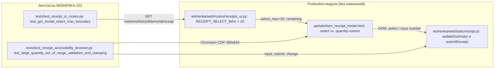
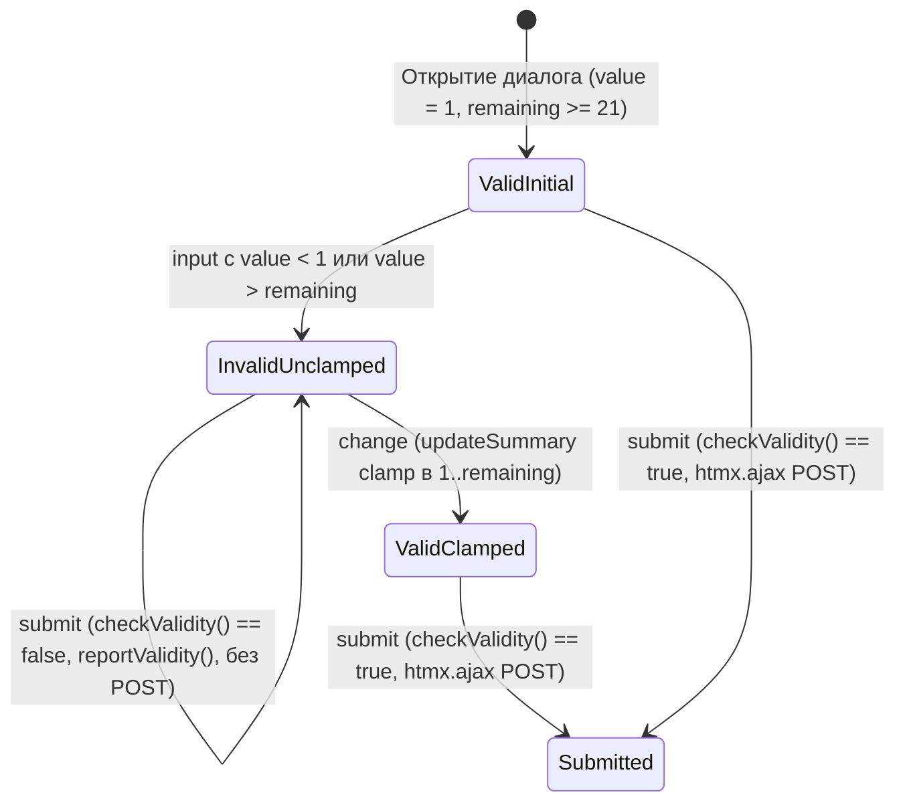

# Спецификация: WISHENKA-222 — Проверка порога выбора количества (20 и 21) и валидации числового ввода вне диапазона

**Задача:** `WISHENKA-222` (follow-up к `WISHENKA-161`)  
**Статус:** реализована (добавлено тестовое покрытие без изменения production-кода)  
**Компоненты:** Mini App UI (`receipts_ui.py`, `item_receipt_modal.html`, `receipt.js`) и тестовые наборы Python (`pytest`, Chromium CDP)  
**Связанные документы:** [in-docs/spec.md](../../in-docs/spec.md), [doc/dev/gift-receipt.md](../../doc/dev/gift-receipt.md)

## 1. Назначение и бизнес-цель

### 1.1. Постановка проблемы

В рамках задачи `WISHENKA-161` в диалоге отметки получения подарка были реализованы порог переключения элемента выбора количества (`RECEIPT_SELECT_MAX = 20`), клиентское ограничение значения в пределах допустимого интервала (clamping) по событию `change` и блокировка отправки некорректной формы средствами браузерной валидации (`checkValidity()` / `reportValidity()`).

При этом существовавшие автотесты проверяли только значения вдали от границы (`remaining = 1`, `5`, `500`) и только корректный ручной ввод (`42`), оставляя без автоматизированной проверки точную границу `20` и `21`, а также сценарии ввода чисел меньше `1` и больше оставшегося количества `remaining`. Источником задачи послужил пункт технического долга из `ai-tasks/WISHENKA-161/60-tech-debt.md`.

### 1.2. Цели и ценность

- **Предсказуемый переход между выпадающим списком и степпером:** гарантировать, что при остатке до `20` единиц включительно диалог отображает компактный список `<select>`, а при `21` и более — числовое поле с кнопками `-` и `+`. Это защищает мобильный интерфейс от неудобного длинного списка и исключает ошибки на единицу (off-by-one) при будущих изменениях.
- **Клиентская защита от ввода значений вне допустимого диапазона:** гарантировать, что при вводе числа меньше `1` или больше `remaining` браузерная валидация блокирует отправку формы без сетевого запроса, а при фиксации ввода (`change`) значение приводится к ближайшей границе допустимого интервала `[1, remaining]`.
- **Ценность для пользователей и системы:** владельцы, администраторы и участники вишлистов получают стабильный мобильный сценарий отметки полученных подарков без лишних ошибочных запросов к серверу, а команда разработки — регрессионную защиту ключевых UI-инвариантов.

### 1.3. Границы задачи

- **Входит в область задачи:**
  - Автоматизированная проверка рендеринга диалога отметки получения на точной границе `remaining = 20` и `remaining = 21`.
  - Автоматизированная браузерная проверка валидации, блокировки отправки и нормализации ввода для значений ниже `1` и выше `remaining`.
- **Не входит в область задачи (Non-Goals):**
  - Изменение порогового значения `20`, правил доменной модели получения подарков или поведения production-кода (`wishenka/`).
  - Добавление тестов для модальных окон редактирования/отмены отметки получения и восстановления фокуса в разделе «Подаренные» (покрывается отдельно в рамках `WISHENKA-221`).

## 2. Функциональные требования и пользовательские сценарии

### 2.1. Роли и доступ

- Отметку получения подарка в Mini App выполняют только участники активного вишлиста (владелец, администратор или соавтор/участник), что проверяется через `WishlistAccessPolicy.resolve_context(user, wishlist).is_member`.
- Дарители и неавторизованные посетители не имеют доступа к диалогу отметки получения.
- В заблокированных состояниях (архивный или удалённый вишлист, архивное желание, отсутствие оставшихся единиц, отсутствие прав) диалог открывается без формы ввода и содержит только сообщение об отказе и кнопку закрытия.

### 2.2. Порог выбора количества в диалоге отметки получения

В шаблоне `wishenka/web/templates/partials/item_receipt_modal.html` выбор элемента управления определяется параметром `remaining` и порогом `select_limit` (передаётся из `RECEIPT_SELECT_MAX = 20`):

| Диапазон `remaining` | Элемент управления | Ожидаемая разметка и атрибуты |
| --- | --- | --- |
| `remaining == 1` | Скрытое поле без выбора | `input[type="hidden"][name="quantity"][value="1"]` и краткая сводка |
| `2 <= remaining <= 20` | Выпадающий список | `select#receipt-quantity[name="quantity"][data-receipt-quantity][data-remaining="{remaining}"]` с элементами `option` от `1` до `remaining` |
| `remaining >= 21` | Числовое поле и степпер | Контейнер `.quantity-control`: кнопка `-` (`data-receipt-step="-1"`), `input#receipt-quantity[type="number"][name="quantity"][data-receipt-quantity][data-remaining="{remaining}"][min="1"][max="{remaining}"][step="1"][inputmode="numeric"][required]`, кнопка `+` (`data-receipt-step="1"`) |

Примечание по области действия порога: шаблон корректировки существующей отметки `wishenka/web/templates/partials/receipt_edit_modal.html` порог `RECEIPT_SELECT_MAX` не использует и всегда отображает `.quantity-control` с числовым полем `#receipt-edit-quantity`.

### 2.3. Клиентская валидация и нормализация числового ввода

При работе с числовым полем (`input[type="number"][data-receipt-quantity]`) в `wishenka/web/static/receipt.js` действуют следующие правила:

1. **Промежуточный ввод (`input`):** при изменении значения обработчик вызывает `updateSummary(field, false)`. Если целое значение `chosen` выходит за пределы `[1, remaining]` (`chosen < 1` или `chosen > remaining`), функция завершается досрочно, не перезаписывая `field.value` и не обновляя строку сводки `[data-receipt-summary]`. При этом стандартная HTML5-валидация фиксирует нарушение: `field.checkValidity() === false`, а `field.validity.rangeUnderflow` (для `0`) или `field.validity.rangeOverflow` (для `remaining + 1`) принимает значение `true`.
2. **Попытка отправки формы (`submit`):** обработчик `submitReceipt(form)` до запуска запроса `htmx.ajax('POST', ...)` проверяет условие `field.type === 'number' && typeof field.checkValidity === 'function' && !field.checkValidity()`. Если поле невалидно, вызывается `field.reportValidity()`, сетевой запрос `POST /web/wishlists/{wishlist_id}/items/{item_id}/receipt` не отправляется, а диалог `#item-receipt-modal` остаётся открытым.
3. **Фиксация ввода (`change`):** обработчик вызывает `updateSummary(field, true)`. Значение нормализуется по формуле `Math.min(Math.max(chosen, 1), remaining)`, записывается обратно в `field.value`, после чего `field.checkValidity()` становится `true`, а `[data-receipt-summary]` обновляется до строки актуальной сводки (например, `Будет отмечено получено: 1 шт. из 500 оставшихся` или `Будет отмечено получено: 500 шт. из 500 оставшихся`).
4. **Кнопки степпера (`[data-receipt-step]`):** обработчик `handleStepClick(stepBtn)` сдвигает текущее значение на `-1` или `+1`, ограничивает его диапазоном `[1, remaining]` и обновляет сводку через `updateSummary(field, true)`.

### 2.4. Пользовательские сценарии

1. **Выбор при 20 оставшихся экземплярах:** участник открывает диалог для желания с `remaining = 20` и получает выпадающий список из 20 вариантов (`1`–`20`) без числового степпера.
2. **Выбор при 21 оставшемся экземпляре:** участник открывает диалог для желания с `remaining = 21` и получает числовое поле ввода (`min="1"`, `max="21"`) с кнопками `-` и `+`, сохраняющее компактность диалога на мобильном экране.
3. **Защита от ввода вне диапазона:** участник вводит `0` или `remaining + 1` (например, `501` при `remaining = 500`) и нажимает кнопку подтверждения без предварительного сброса фокуса — форма не отправляется; после фиксации ввода (`change`) поле нормализуется к `1` или `500` соответственно и становится валидным.
4. **Регрессионный контроль:** сопровождающий разработчик запускает тестовые наборы `tests/test_receipt_ui_routes.py` и `tests/test_receipt_accessibility_browser.py` и подтверждает соблюдение пороговой и валидационной логики.

### 2.5. Инварианты

- Значение `20` является верхней границей для `<select>`, а `21` — нижней границей для числового степпера (`remaining <= 20` против `remaining > 20`).
- Допустимое количество единиц при отметке получения ограничено целыми числами интервала `[1, remaining]`.
- Диалог отметки получения изолирован от любых сведений о бронированиях, дарителях и статусе покупки (принцип тайны сюрприза).
- В генерируемом HTML диалога отсутствуют инлайн-обработчики событий (`on*`).

## 3. Архитектура, компоненты и интерфейсы

### 3.1. Обзор взаимодействия компонентов

### 3.2. Модули, функции и контракты

#### Production-модули (верифицируемая база)

- **`wishenka/web/routes/receipts_ui.py`:**
  - `RECEIPT_SELECT_MAX = 20` — единый серверный порог выбора элемента управления.
  - `_dialog_html(wishlist_id, item_id, title, remaining, **context)` — рендерит `partials/item_receipt_modal.html`, передавая `select_max: RECEIPT_SELECT_MAX`.
  - `get_receipt_dialog` (`GET /web/wishlists/{wishlist_id}/items/{item_id}/receipt`) — применяет доменные проверки через `_check_receipt_open` и возвращает HTML диалога (200 при успехе; 4xx/503 с заголовком `X-Receipt-Refusal` и заблокированным диалогом `_blocked_dialog` при отказе).
- **`wishenka/web/templates/partials/item_receipt_modal.html`:**
  - Принимает контекст `wishlist_id`, `item_id`, `item_title`, `remaining`, `selected`, `select_max`, `feedback`, `blocked`, `oob`, `locale`.
  - Определяет `select_limit = select_max|default(20)` и формирует форму `form[data-receipt-form][method="post"]` с `action="/web/wishlists/{wishlist_id}/items/{item_id}/receipt"`.
- **`wishenka/web/static/receipt.js`:**
  - `updateSummary(field, clampValue)` — парсит `data-remaining` и `field.value` (`Number.parseInt(..., 10)`), отсекает внедиапазонные значения при `clampValue === false`, нормализует `field.value` в `[1, remaining]` при `clampValue === true` и обновляет текст `[data-receipt-summary]`.
  - `handleStepClick(stepBtn)` — изменяет значение `[data-receipt-quantity]` на `data-receipt-step` в пределах `[1, remaining]` и вызывает `updateSummary(field, true)`.
  - `submitReceipt(form)` — проверяет `field.checkValidity()` для `input[type="number"]`; при ошибке вызывает `field.reportValidity()` и не инициирует `htmx.ajax`.

#### Тестовые модули (изменения `WISHENKA-222`)

- **`tests/test_receipt_ui_routes.py`:**
  - Модульный маркер: `pytestmark = pytest.mark.timeout(30)`.
  - `test_get_modal_select_max_boundary(env: AppEnv, remaining: int, expect_select: bool)` с `@pytest.mark.parametrize(("remaining", "expect_select"), [(20, True), (21, False)])`. Использует существующие фикстуры и хелперы `env`, `seed_list`, `Wish`, `_get`, `parse`, `on_attributes`.
- **`tests/test_receipt_accessibility_browser.py`:**
  - Модульный маркер: `pytestmark = [pytest.mark.timeout(45), pytest.mark.browser]`.
  - `test_large_quantity_out_of_range_validation_and_clamping(seed_wishlist: SeedFactory, wishlist_page: PageFactory)` — выполняется в реальном Chromium по CDP при разрешении `MOBILE_VIEWPORT = (390, 844)`. Использует хелперы `_mobile_owner_page`, `open_receipt_dialog`, `posts_to`, `settle`, `js_str`, `_no_external`, `assert_clean_console`.

### 3.3. Переходы состояний числового ввода

## 4. Нефункциональные требования, безопасность и наблюдаемость

### 4.1. Производительность и ресурсные ограничения

- **Ограничение размера DOM:** рендеринг выпадающего списка ограничен максимум `20` элементами `<option>`, что предотвращает деградацию прокрутки и отрисовки в мобильном клиенте Telegram Mini App (`390x844`).
- **Ограничение времени выполнения тестов:** оба тестовых модуля снабжены явными маркерами таймаутов (`pytest.mark.timeout(30)` и `pytest.mark.timeout(45)`). Route-тесты выполняются внутрипроцессно через `AppEnv`, а браузерный тест переиспользует общую фикстуру Chromium CDP без запуска отдельного браузера и без внешних сетевых вызовов (`_no_external(page)`).

### 4.2. Безопасность и приватность

- **Контроль доступа и CSRF:** эндпоинты `receipts_ui.py` требуют аутентифицированной сессии (`get_current_user`) и членства в вишлисте (`WishlistAccessPolicy`), а отправка формы через `htmx.ajax('POST', ...)` сопровождается CSRF-заголовком и `Idempotency-Key`.
- **Защита тайны сюрприза:** разметка диалога и клиентский скрипт `receipt.js` оперируют только полями `remaining` и `quantity`; данные о бронированиях, дарителях и фактах покупки не передаются и не отображаются.
- **Защита от XSS / соответствие CSP:** отсутствие инлайн-атрибутов `on*` проверяется напрямую в `test_get_modal_select_max_boundary` вызовом `assert on_attributes(soup) == []`.
- **Серверная верификация:** клиентские ограничения `min`/`max` и `checkValidity()` повышают удобство интерфейса, но не заменяют серверную проверку — `record_receipt_ui` передаёт количество в доменный сервис `WishlistService.record_item_fulfillment`, отклоняющий некорректные значения доменными исключениями.

### 4.3. Наблюдаемость (логирование и метрики)

- **Изменения в `WISHENKA-222`:** согласно `ai-tasks/WISHENKA-222/50-observability.md`, production-код в рамках задачи не модифицировался, поэтому новые production-логи, уровни syslog, счётчики или дашборды не добавлялись.
- **Действующее структурированное логирование:** маршрут `get_receipt_dialog` продолжает использовать логгер `wishenka.web.receipts_ui` с событиями `ui_receipt_form_opened` (`INFO`, поля `event`, `wishlist_id`, `item_id`, `actor_id`) и `ui_receipt_form_refused` (`WARNING`, дополнительно `reason`, `http_status` и `remaining_quantity` только для `quantity_above_remaining` и `nothing_remaining`). Данные дарителей и бронирований в логи не попадают.
- **Браузерная наблюдаемость в тестах:** `test_large_quantity_out_of_range_validation_and_clamping` проверяет чистоту консоли браузера (`assert_clean_console(page)`) и отсутствие сторонних сетевых обращений (`_no_external(page)`).

## 5. Верификация и критерии приёмки

### 5.1. Тестовые сценарии

1. **Граничный route-тест `test_get_modal_select_max_boundary` (`tests/test_receipt_ui_routes.py`):**
   - **Кейс `remaining = 20` (`expect_select = True`):**
     - `GET /web/wishlists/{wishlist_id}/items/{item_id}/receipt` возвращает HTTP `200`.
     - В DOM присутствует `form select[name="quantity"][data-receipt-quantity]` с `data-remaining="20"` и ровно `20` элементами `<option>` со значениями `"1"`..`"20"`.
     - Отсутствуют `form input[type="number"][name="quantity"][data-receipt-quantity]`, элементы `form [data-receipt-step]` и любые инлайн-атрибуты `on*`.
   - **Кейс `remaining = 21` (`expect_select = False`):**
     - `GET /web/wishlists/{wishlist_id}/items/{item_id}/receipt` возвращает HTTP `200`.
     - В DOM отсутствуют `<select>` и `<option>`.
     - Присутствует `form input[type="number"][name="quantity"][data-receipt-quantity]` с `min="1"`, `max="21"`, `data-remaining="21"`.
     - Присутствуют кнопки `form [data-receipt-step]` со значениями `["-1", "1"]`; инлайн-атрибуты `on*` отсутствуют.

2. **Браузерный тест `test_large_quantity_out_of_range_validation_and_clamping` (`tests/test_receipt_accessibility_browser.py`):**
   - **Предусловие:** владелец открывает диалог `#item-receipt-modal` для желания `"Tiles"` с `remaining = 500` на мобильном экране `390x844`.
   - **Сценарий 1 — нижняя граница (`"0"` -> `"1"`):**
     1. Устанавливается `inp.value = "0"` и генерируется событие `input` (`{bubbles: true}`).
     2. Проверяется `inp.checkValidity() === false` и `inp.validity.rangeUnderflow === true`.
     3. Инициируется клик по `.btn-receipt-confirm` без потери фокуса поля (чтобы событие `change` не сработало раньше проверки): `posts_to(page, "/receipt") == []`, диалог `#item-receipt-modal` остаётся открытым.
     4. Генерируется событие `change` (`{bubbles: true}`): значение `inp.value` нормализуется в `"1"`, `inp.checkValidity() === true`, текст `[data-receipt-summary]` равен `'Будет отмечено получено: 1 шт. из 500 оставшихся'`.
   - **Сценарий 2 — верхняя граница (`"501"` -> `"500"`):**
     1. Устанавливается `inp.value = "501"` и генерируется событие `input` (`{bubbles: true}`).
     2. Проверяется `inp.checkValidity() === false` и `inp.validity.rangeOverflow === true`.
     3. Клик по `.btn-receipt-confirm` не вызывает `POST .../receipt`, диалог остаётся в DOM.
     4. Генерируется событие `change` (`{bubbles: true}`): значение `inp.value` нормализуется в `"500"`, `inp.checkValidity() === true`, текст `[data-receipt-summary]` равен `'Будет отмечено получено: 500 шт. из 500 оставшихся'`.
   - **Итоговые проверки:** подтверждаются отсутствие внешних запросов (`_no_external(page)`) и чистота консоли (`assert_clean_console(page)`).

### 5.2. Критерии приёмки и зафиксированные результаты проверок

Задача считается принятой при выполнении всех пунктов Definition of Done (`10-requirements.md`):

1. Автотест подтверждает рендеринг `<select>` (1–20) при `remaining = 20` без числового степпера.
2. Автотест подтверждает рендеринг `input[type="number"]` с кнопками `-` / `+` (диапазон `1–21`) при `remaining = 21` без `<select>`.
3. Браузерный тест для `remaining = 500` подтверждает блокировку отправки при `0` и `501` до фиксации и нормализацию в `1` и `500` на событии `change`.
4. Существующие и новые тесты, статический анализ и проверка типов проходят без ошибок.

По зафиксированным данным в `ai-tasks/WISHENKA-222/40-code-cleanup.md` и `ai-tasks/WISHENKA-222/50-observability.md`:

- `.venv/bin/pytest -n 0 tests/test_receipt_ui_routes.py tests/test_receipt_accessibility_browser.py` — `49 passed` за `13.95s`.
- `.venv/bin/ruff check wishenka tests` и `.venv/bin/ruff format --check wishenka tests` — пройдены без ошибок (242 файла).
- `.venv/bin/mypy wishenka tests` — 0 ошибок в 242 файлах.
- Производственный код в каталоге `wishenka/` не изменялся.

### 5.3. Известные ограничения и дальнейшие доработки (`60-tech-debt.md`)

- **Синтетические DOM-события в браузерном тесте:** `test_large_quantity_out_of_range_validation_and_clamping` задаёт `inp.value` через `page.evaluate(...)`, отправляет синтетические события `input`/`change` и кликает по кнопке подтверждения через JS вместо ввода с клавиатуры и клика указателем. Это сделано намеренно, чтобы проверить работу `submitReceipt` (`checkValidity()`) до автоматической нормализации поля при `blur`/`change`, и признано приемлемым компромиссом.
- **Незначительное дублирование проверок в `tests/test_receipt_ui_routes.py`:** `test_get_modal_large_quantity_renders_stepper_not_large_select` (`remaining=500`) и ветка `remaining=21` в `test_get_modal_select_max_boundary` повторяют сходные утверждения для `input[type="number"]` и `[data-receipt-step]` ради самодостаточности каждого теста.
- **Пробелы тестового покрытия (вынесены в неблокирующий follow-up [WISHENKA-278](https://pypost.atlassian.net/browse/WISHENKA-278)):**
  1. Отсутствуют тесты на пустой ввод (`""`, `valueMissing`) и дробные значения (`"1.5"`, `stepMismatch`) в `receipt.js`; при этом в `updateSummary` вызов `Number.parseInt("", 10)` даёт `NaN` и приводит к раннему выходу на `change` без сброса `field.value` в `"1"` (в рамках `WISHENKA-278` требуется добавить тесты и решить, нужна ли нормализация пустого поля на `change`).
  2. Отсутствует проверка валидации и нормализации внедиапазонного ввода для модального окна редактирования отметки (`receipt_edit_modal.html`, поле `#receipt-edit-quantity`).
  3. Отсутствует браузерная проверка удержания границ `1` и `remaining` при нажатии кнопок степпера (`handleStepClick` с `-1` на `1` и `+1` на `remaining`).
