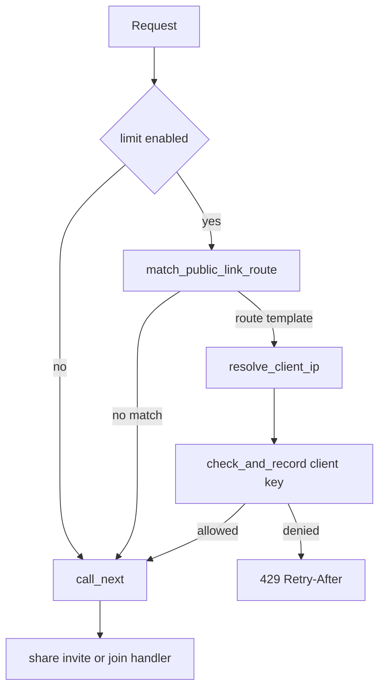

# WISHENKA-228: Count HEAD probes on public share and invite links

## Research

### What the code does today

`PublicLinkRateLimitMiddleware` in `wishenka/web/rate_limit.py` runs before the
share and invite handlers. For each request it:

1. Skips the check when `settings.public_rate_limit_enabled` is false.
2. Calls `match_public_link_route(request.method, request.url.path)`.
3. On a match, resolves a client key and calls
   `SlidingWindowRateLimiter.check_and_record`.
4. On denial, returns the existing token-free `429` from
   `_build_rate_limit_response` and does not call the route.

`match_public_link_route` admits only:

- `GET` with exactly two non-empty segments: `/share/{token}` or
  `/invite/{token}`.
- `POST` with exactly three segments: `/invite/{token}/join`.

`HEAD` matches neither branch, so the middleware calls the router without
charging the visitor. The limiter key is the client identity alone. `GET`,
invite preview, and invite acceptance already share one bucket. Once `HEAD`
matches, it joins that same bucket with no new setting and no second budget.

`resolve_client_ip` already implements the identity rules this task confirms:

- Proxy trust off: ignore `X-Forwarded-For` and `X-Real-IP`; use
  `request.client.host`.
- Proxy trust on: leftmost non-empty `X-Forwarded-For` address, else a
  stripped `X-Real-IP`, else the socket peer.
- No usable address (`request.client is None`, or a peer with an empty host,
  and no trusted header): the literal key `"unknown"`.

`tests/test_public_link_rate_limit.py` covers `GET` and `POST /join`, spoofed
`X-Forwarded-For` when trust is off, and trusted `X-Forwarded-For`. It does
not cover `HEAD`, `X-Real-IP`, or a missing socket peer. The module already
sets `pytestmark = pytest.mark.timeout(30)`.

### What a HEAD request actually returns

Installed stack: FastAPI 0.165.0 and Starlette 1.0.0 (`.venv`).

Starlette `Route` adds `HEAD` whenever `GET` is in `methods`
(`starlette/routing.py`). FastAPI `APIRoute` does not. `_populate_api_route_state`
sets `route.methods` to the declared methods only, and `APIRoute.__init__` does
not call `Route.__init__`. A probe against a minimal `@router.get("/share/{token}")`
app returned `405` with `Allow: GET` for `HEAD /share/abc`, and `200` for
`GET`. The same `405` is returned whether the token is known or not, because
the handler never runs.

Share and invite pages are `@router.get` handlers in
`wishenka/web/routes/sharing.py`. On this stack, `HEAD /share/{token}` and
`HEAD /invite/{token}` therefore do not currently distinguish a valid secret
from an unknown one. FastAPI issue
[#1773](https://github.com/fastapi/fastapi/issues/1773) asks for Starlette-like
automatic `HEAD`. Pull request
[#14792](https://github.com/fastapi/fastapi/pull/14792) was closed on
2026-05-23 without merge. The dependency pin is `fastapi>=0.115.0`, so a later
release could start executing the `GET` handler for `HEAD` without a local
route change.

The WISHENKA-88 debt note assumed FastAPI already served `HEAD` as `200` versus
`404`. That assumption does not hold on 0.165.0. The requirement still holds:
an existence check must spend the same allowance, and a check past the
allowance must be the same uninformative `429` as a page open. Counting `HEAD`
in the middleware does that before the router answers. Rewriting `HEAD` into
`GET` would run `view_public_share` / the invite preview and would create the
validity oracle the debt note thought already existed. This task does not do
that.

### External guidance

- [RFC 9110 §9.3.2](https://www.rfc-editor.org/rfc/rfc9110#section-9.3.2):
  `HEAD` is identical to `GET` except the server must not send content. Clients
  use it to test links. A server that later honors that rule on these routes
  would expose the same status `GET` exposes.
- [MDN: HEAD](https://developer.mozilla.org/en-US/docs/Web/HTTP/Reference/Methods/HEAD):
  the response metadata is the metadata a `GET` would have sent.
- [OWASP WSTG: API rate limiting][wstg]: after a limit is hit, repeat the call
  with `HEAD`. A success status means the method was not counted with `GET`.
- [GitHub REST secondary limits][github-rest]: most `GET`, `HEAD`, and
  `OPTIONS` calls share one point cost. Same idea: `HEAD` is not a free look
  at a limited resource.

[wstg]: https://wstg.owasp.org/latest/16-API_Testing/06-API_Rate_Limiting_and_Resource_Consumption/
[github-rest]: https://docs.github.com/en/rest/using-the-rest-api/rate-limits-for-the-rest-api

`X-Real-IP` is a single address set by a trusted front proxy (nginx
`proxy_set_header X-Real-IP $remote_addr` is the usual form). It is not a
chain. Leftmost `X-Forwarded-For` when a proxy appends addresses stays out of
scope (WISHENKA-229).

## Implementation Plan

One production change, in `match_public_link_route` only.

Treat `HEAD` the same as `GET` for the two-segment share and invite paths.
Keep the `POST /invite/{token}/join` branch unchanged. Do not add a `HEAD`
route, do not rewrite the method to `GET`, and do not change
`resolve_client_ip`, `SlidingWindowRateLimiter`, the `429` builder, settings,
or the share and invite handlers.

```python
if upper_method in {"GET", "HEAD"} and len(parts) == 2 and parts[1]:
```

Effects of that predicate:

- `HEAD` and `GET` of `/share/{token}` and `/invite/{token}` share the existing
  per-visitor bucket, including unknown tokens, because the key is the client
  identity and the check runs before `call_next`.
- Once the allowance is spent, `HEAD` receives the same `429`, `Retry-After`,
  and token-free body as a further `GET`. The router never sees that request,
  so a future `HEAD`-as-`GET` implementation cannot leak validity on a refused
  probe.
- A `HEAD` that is still inside the allowance is forwarded as `HEAD`. On
  FastAPI 0.165.0 that is `405` with `Allow: GET` for both valid and unknown
  tokens. Ordinary `GET` opens and `POST` acceptance inside the allowance stay
  as they are.
- `HEAD /invite/{token}/join` stays unmatched (three segments, and the method
  is not `POST`). The join route does not look up the token for `HEAD`.
- Trailing slashes and extra segments stay unmatched.

`X-Real-IP` and `request.client is None` need no production change. Tests lock
the branches that already exist.

**Mandatory — Failing Repro (next Step 3):** There is a runtime change, so
Step 3 writes red tests before the predicate change.

File: `tests/test_public_link_rate_limit.py`. The module `pytestmark` already
supplies `@pytest.mark.timeout(30)`. Reuse `_build_app` and
`httpx.ASGITransport`. No network and no `sleep`; the window is long enough
that the test ends before it expires.

Red assertions (fail on the current predicate, pass after the one-line change):

1. Shared bucket. `max_requests=2`, one client. `HEAD /share/{real}` then
   `GET /share/{real}` then another `GET /share/{real}`. The third response is
   `429`. Today the `HEAD` is not counted, so the third response is `200`.
2. Same for invite. Two `HEAD /invite/{real}` calls, then `GET /invite/{real}`
   is `429`.
3. Unknown secrets count. `max_requests=1`. `HEAD /share/missing-one` is not
   `429`. `HEAD /share/missing-two` is `429`, `Retry-After` is present, and
   neither the path token nor the wishlist title appears in the body.
4. Refusal matches a page open. Fill the budget with `GET`, then
   `HEAD /share/{real}` and `HEAD /invite/{real}` are `429` with the same
   `Retry-After` contract the existing exceed test already checks.
5. In-budget use still works. With room left in the budget, `GET` of a valid
   share, `GET` of a valid invite, and `POST /invite/{token}/join` are not
   `429`. An in-budget `HEAD` is not `429`. Do not require that in-budget
   `HEAD` to be `200`.

Characterization tests (expected to pass before the predicate change; they
lock behavior Step 4 must not disturb):

6. `resolve_client_ip` with trust on, no `X-Forwarded-For`, and
   `X-Real-IP: 203.0.113.8` returns `203.0.113.8` even when the socket peer is
   a different address. Surrounding whitespace is stripped. A non-empty
   `X-Forwarded-For` still wins over `X-Real-IP`.
7. Trust off: `X-Real-IP` is ignored and the socket peer is used.
8. `request.client is None` and no trusted header returns `"unknown"` both
   with trust off and with trust on. Build the `Request` from an ASGI scope
   whose `client` is `None`. `httpx.ASGITransport` always sets a peer, so it
   cannot express this case. The helper result alone is not the allowance
   check.
9. Unidentified requests share one allowance through the middleware. This
   check is required. Build two `Request`s from ASGI scopes whose `client` is
   `None` and that carry no trusted address header, and call
   `PublicLinkRateLimitMiddleware.dispatch` for an already limited public-link
   path (`GET /share/{token}`). With `max_requests=1`, the first response is
   not `429` and the second is `429`. Repeat with trust off and with trust on.
   Calling `resolve_client_ip` and then
   `SlidingWindowRateLimiter.check_and_record` on the literal `"unknown"` does
   not satisfy this check.
10. Two distinct trusted `X-Real-IP` visitors receive separate allowances
    through the request path. Through `_build_app` and `httpx.ASGITransport`,
    with proxy trust on, no `X-Forwarded-For`, and `max_requests=1`, one
    `GET /share/{token}` from `X-Real-IP: 203.0.113.8` and one from
    `X-Real-IP: 203.0.113.9` are both not `429`, even though the socket peer
    is the same. A second request that repeats the first `X-Real-IP` is `429`.

Sequence: this architecture note, then the red tests above, then the predicate
change until those tests are green. Do not change production code in Step 3.
A run that only adds tests 6–10 would stay green and would not be the failing
repro. Tests 1–4 are the red signal.

## Architecture

The public-link limit stays a single middleware in front of the existing
routers. This task widens the route predicate. It does not add a module.



### Modules

- `match_public_link_route` admits a method and path, and returns a
  token-free route template for logs.
- `resolve_client_ip` maps the request to the visitor key. Unchanged.
- `SlidingWindowRateLimiter` keeps one in-memory window per key, shared by
  every admitted call. Unchanged.
- `PublicLinkRateLimitMiddleware` runs the check before routing. Unchanged
  control flow.
- `_build_rate_limit_response` builds the token-free localized `429`.
  Unchanged.
- `wishenka/web/routes/sharing.py` opens a share link, opens an invite, and
  accepts an invite. Unchanged. No `HEAD` route is added.
- `wishenka/web/app.py` builds one limiter on `app.state` and registers the
  middleware. Unchanged.
- `tests/test_public_link_rate_limit.py` locks `HEAD` admission and the two
  identity edges.

### Interactions

Middleware order in `create_app` stays as it is. `PublicLinkRateLimitMiddleware`
is registered first, then `RequestLoggingMiddleware`, then
`BrowserSecurityMiddleware`. Starlette runs the last-added middleware
outermost, so a request reaches browser security, then request logging, then
the rate limiter, then the router. An over-limit `HEAD` is refused by the rate
limiter and never reaches the router. Logging has already recorded the request
start and then records the `429` on the way out. Browser security treats `HEAD`
as a safe method, so it does not apply the CSRF check; it still wraps the
response, including that `429`, and sets the existing security headers.

The client key is not the route and not the method. A `HEAD` of a share link,
a `GET` of an invite, and a `POST` acceptance by the same visitor decrement one
allowance. Distinct `X-Real-IP` values are distinct keys. Every request with
no address uses one key, `"unknown"`.

On denial the log event stays `public_link_rate_limited`. `method` is the
original method (`HEAD` or `GET`). `route` is `/share/{token}` or
`/invite/{token}`, never the raw token. No new log event.

### Patterns

- **Middleware gate.** Admission stays at the process boundary, ahead of token
  lookup. That is what makes an over-limit `HEAD` uninformative even if routing
  later starts to execute the `GET` handler.
- **Pure predicate.** `match_public_link_route` remains a function of method
  and path. Extending the method set is the whole policy change. A second
  middleware that rewrites `HEAD` to `GET` would hide the method from the
  limiter and from the log, and would run the page handler.
- **One bucket per visitor.** The existing sliding-window log is the allowance.
  `HEAD` does not get its own limiter, window, or setting.
- **Existing identity function.** `resolve_client_ip` is already the trust
  boundary. Tests pin it. The leftmost-forwarded-chain rule is untouched.

### Interfaces

`match_public_link_route(method: str, path: str) -> str | None`

- `GET` or `HEAD`, path `/share/{non-empty}` → `"/share/{token}"`.
- `GET` or `HEAD`, path `/invite/{non-empty}` → `"/invite/{token}"`.
- `POST`, path `/invite/{non-empty}/join` → `"/invite/{token}/join"`.
- Any other method, a trailing slash, or an extra segment → `None`.
- Comparison stays case-insensitive via `method.upper()`.

`resolve_client_ip(request: Request, trust_proxy_headers: bool) -> str`

- Unchanged. Trust on, no forwarded chain, non-blank `X-Real-IP` → that
  stripped value.
- No peer and no trusted header → `"unknown"`.

`SlidingWindowRateLimiter.check_and_record(client_key: str) -> RateLimitDecision`

- Unchanged. The middleware passes the string from `resolve_client_ip`.

`PublicLinkRateLimitMiddleware.dispatch`

- Unchanged. A matched `HEAD` is recorded before `call_next`. Denial returns
  the existing `429` and does not call the handler.

## Q&A

- **Why count `HEAD` if FastAPI currently returns `405` for every token?**
  The allowance has to include the existence check the requirements name, and
  the check has to happen before the app says whether the secret is valid.
  FastAPI `>=0.115` may later serve `HEAD` as `GET` (issue 1773). Counting now
  means that change cannot open an unlimited probe. See the installed-version
  probe in Research.
- **Why not implement `HEAD` by calling the `GET` handler?**
  That would make an in-budget `HEAD` return `200` or `404` and would reveal
  the secret. The requirements allow an in-budget check to show the same
  outcome as a page open. They do not require this service to start showing
  it. The protection is the shared allowance and the uninformative `429`.
- **Why are the proxy and unknown-visitor cases tests only?**
  `resolve_client_ip` already charges `X-Real-IP` when trust is on and no
  forwarded chain is present, and it already collapses a missing peer to
  `"unknown"`. The gap recorded in `ai-tasks/WISHENKA-88/60-tech-debt.md` is
  that those branches are untested. Changing them is out of scope.
- **Do `HEAD` probes of invite acceptance need a new match?**
  No. Acceptance stays `POST /invite/{token}/join`. A `HEAD` of that path does
  not look up the token on the current router.
- **Where is the limit configured?**
  Existing settings only: `public_rate_limit_enabled`,
  `public_rate_limit_max_requests`, `public_rate_limit_window_seconds`,
  `public_rate_limit_trust_proxy_headers`, `public_rate_limit_max_clients`.
  This task does not retune them. Documented in `doc/dev/wishlists.md` under
  Public Link Rate Limiting. Updating that doc is Step 8, not this step.
