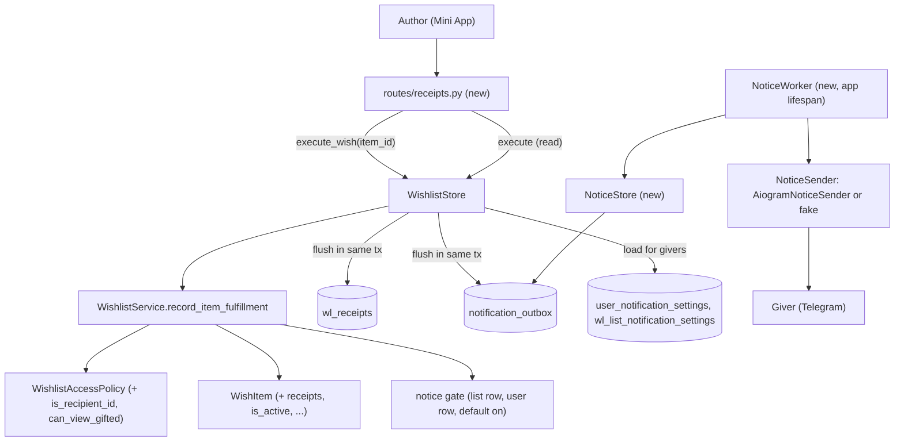

# WISHENKA-23: Backend of Gift Receipt and Archive of Gifted Wishes (Architecture)

Language: Python 3.12+ (`00-roadmap.md`). Inputs: the approved
`10-requirements.md` (R-1 to R-8, Definition of Done 1 to 12) and the
WISHENKA-22 design (`20-architecture.md`, `50-observability.md`,
`60-tech-debt.md`, `doc/dev/gift-receipt.md`). This file is the concrete
design for this story. It was written against the real code (see Research).
Where the WISHENKA-22 design was wrong or incomplete it is corrected here
and listed in "Divergences from WISHENKA-22". No production code or tests
are written in this step.

## Research

No external research is needed: no new technology is added (`aiogram` is
already a dependency; verified in `.venv`: version 3.31.0 with
`TelegramForbiddenError`, `TelegramBadRequest`, `TelegramNotFound`,
`TelegramRetryAfter(retry_after)`, `TelegramServerError`,
`TelegramNetworkError`, `TelegramUnauthorizedError`, `TelegramAPIError`).
Facts verified in the code that drive the design:

### Storage and transactions

- **Two persistence paths, not one.** `WishlistService` is an in-memory
  domain object. `WishlistStore` loads state into a fresh service, runs the
  operation, and writes the diff, all inside `BEGIN IMMEDIATE`
  (`_configure_immediate_transactions`, `WishlistStore._immediate`):
  - `execute_wish(op, item_id=...)` loads one wish (`_load_wish`) and writes
    it with `_persist_wish` (item row, changed reservation rows, the
    `reservation` counter). Used by `create_reservation`,
    `update_wish_item`, `record_item_fulfillment` (names in
    `_ITEM_INVENTORY_METHODS`) and by the reservation JSON routes.
  - `execute(op)` loads the whole database (`_read`) and writes everything
    (`_write`). Every other public service method uses it, and so does the
    HTMX layer (`items_ui._execute`) and `reservations_ui`. The existing
    test `tests/test_shared_inventory_multiprocess.py` calls
    `record_item_fulfillment` through `store.execute` as well.
  - `_transactional` wraps every public async method of `WishlistService`;
    a service created by the store has `_store = None`, so nested calls run
    in memory inside the open transaction.
  - **Consequence:** receipt records and notice rows must be flushed by
    both `_persist_wish` and `_write`. WISHENKA-22 named only
    `_persist_wish`; that would lose the receipt record for every receipt
    made through the full-snapshot path (WISHENKA-24 HTMX routes will use
    it). See "Persistence of receipt effects".
- Foreign keys are on for every connection (`PRAGMA foreign_keys=ON` in the
  connect listener). Purge of soft-deleted lists
  (`WishlistRepository.purge_archived_wishlists`) deletes `wl_lists` rows and
  relies on `ON DELETE CASCADE`. No code deletes a single wish, so a
  cascade from `wl_items` is only reached through the list.
- `SQLITE busy` becomes `InventoryBusyError` in `_raise_for_storage_error`;
  every other `SQLAlchemyError` becomes a generic `RuntimeError("Wishlist
  storage operation failed")`; a refusal that is a `WishlistError` or
  `ValueError` is logged at WARNING by `_log_wish_rollback`.
- Migrations: **Alembic**, linear chain `base_normalized`,
  `add_warn_on_delete_reserved`, `add_display_order`,
  `add_item_order_index` (head), in
  `wishenka/wishlists/alembic/versions/`, run by
  `wishenka/wishlists/migrations.py` at `WishlistStore.initialize()` under a
  cross-process file lock. Revisions use raw SQL through `op.execute`. SQLite
  has no transactional DDL here (Alembic default), so a revision must be
  safe to repeat. `users` is created by `UserStore.initialize()`, not by
  Alembic. `wishenka/wishlists/db_models.py` is imported by nothing (dead
  mirror), so new tables need no entry there.
- Ids of reservations come from `wl_counters`; ids in the new tables use
  SQLite `AUTOINCREMENT`.
- User identity in storage is the Telegram id: `wl_reservations.user_id`,
  `wl_members.user_id`, `AuthenticatedUser.telegram_id`. There is no foreign
  key to `users` anywhere. The same key (`user_id` = Telegram id) is used for
  the notice tables, and it is the chat id for the bot (private chat).

### Current receipt behaviour

`WishlistService.record_item_fulfillment(item_id, actor, received_quantity)`
(`service.py`, about line 1975):

- unknown item: `ItemNotFoundError`; not a list editor
  (`can_add_or_edit_item`, which is also `False` for any non-active list):
  `PermissionDeniedError`, so an owner of an archived list gets "forbidden",
  not a list-state reason;
- `received_quantity < 1`: plain `ValueError`; above `quantity -
  received_quantity`: `ValueError` with the numbers in the text;
- it does **not** check `item.is_archived` or list status;
- adds to the counter under `ItemConcurrencyCoordinator.acquire(item_id)`,
  logs `item_fulfilled` (INFO, fields `wishlist_id`, `item_id`, `user_id`,
  `actor_id`, `quantity`, `received_quantity`, `total_quantity`);
- writes no record, creates no notice. No route calls it.

### Places that decide "active" today

`is_archived` alone is the switch in `service.get_wishlist_view`,
`list_wish_items`, `reorder_wish_items`, `restore_wish_item` (tail order),
`routes/wishlists.py::projection` (lists all items, archived included, for
every viewer, public share included), and the `item_card.html` actions.
`WishlistAccessPolicy.can_reserve_item` and `create_reservation` also refuse
on `is_archived`; they must **not** be changed (a refused
`can_reserve_item` is mapped to `SelfReservationError`).
`ReservationStatus.COMPLETED` exists in the enum but nothing sets it.

### Settings, bot, app wiring

- `Settings` (`wishenka/config.py`, env prefix `WISHENKA_`) has
  `bot_token: str = "dummy_bot_token"` (used only for init-data HMAC) and no
  worker settings. There is no `aiogram.Bot` instance anywhere.
- `create_app(settings)` builds `WishlistStore`, `UserStore`,
  `WishlistService` (`app.state.domain_service`), registers routers, and the
  lifespan starts `background_cleanup_worker` as an `asyncio` task and
  cancels it on shutdown. `app.state.wishlist_service` (if set) is a
  test-injected in-memory service that routes use instead of the store.
- Routes: JSON API under `/api/wishlists/...` (`items.py`, `reservations.py`,
  `wishlists.py`), HTMX under `/web/wishlists/...` (`items_ui.py`),
  `reservations_ui.py`, `sharing.py`. Authentication: dependency
  `get_current_user` (401 without credentials) in
  `wishenka/auth/dependencies.py`. **CSRF is a middleware**
  (`BrowserSecurityMiddleware`): every unsafe method with a session cookie and
  no bearer header needs `Origin` and `X-CSRF-Token`, so a new `POST` route is
  protected with no code.
- Surprise test `tests/test_surprise_role_context.py` creates the app with
  the default `bot_token` and asserts that `notification_outbox` and
  `user_notification_settings` do not exist and that INFO records contain no
  `notification`, `outbox`, `push` in event or message.

## Scope Decision

One ticket, minimum notification infrastructure (requirements Q3, TD-1.2): one
event type (`gift_received`), both settings levels with lookup only, no
screen, no exporter, no undo. WISHENKA-24 (screens) and WISHENKA-34
(settings screen) are untouched.

## Architecture

### 1. Components



| Component | Change | File |
| --------- | ------ | ---- |
| `WishItem` | `receipts` list, `remaining_quantity`, `is_fully_received`, `is_gifted`, `is_active`, `is_in_archive` | `wishenka/wishlists/models.py` |
| `ReceiptRecord` | New dataclass | `wishenka/wishlists/models.py` |
| Exceptions | Closed refusal classes | `wishenka/wishlists/exceptions.py` |
| Policy | `is_recipient_id`, `can_view_gifted` | `wishenka/wishlists/policy.py` |
| DTOs | `remaining_quantity`, `is_fully_received`, `GiftedItemDTO`, `ReceiptEntryDTO`, `ReceiptRequestDTO`, `ReceiptResultDTO`, cabinet flag | `wishenka/wishlists/schemas.py` |
| Service | Receipt guards and effects, notice producer, views, archive/restore rules, `list_gifted_items` | `wishenka/wishlists/service.py` |
| Store | Load receipts and settings; flush effects in both paths; after-commit DEBUG logs; public `transaction()` | `wishenka/wishlists/store.py` |
| Migrations | Two revisions; public `head_revision()` wrapper over `_configured` (for the `_HEAD` test) | `wishenka/wishlists/alembic/versions/add_gift_receipts.py`, `add_notice_outbox.py`, `wishenka/wishlists/migrations.py` |
| Notices package | Models, `NoticeStore(store, settings)` (claim, complete, reschedule, fail, purge), sender, worker | `wishenka/notices/{__init__,models,store,sender,worker}.py` |
| Routes | Receipt command and gifted read | `wishenka/web/routes/receipts.py` |
| Config and app | Worker, request-timeout and lease settings with validators, lifespan wiring, injectable sender | `wishenka/config.py`, `wishenka/web/app.py` |
| Existing routes | Error mapping for `nothing_remaining`, cabinet flag, projection | `routes/items.py`, `routes/items_ui.py`, `routes/reservations_ui.py`, `routes/wishlists.py` |
| Cleanup | Retention of finished notices (optional `notice_store` parameter, calls `NoticeStore.purge_finished`) | `wishenka/wishlists/cleanup.py` |

New package `wishenka/notices/` (not under `wishlists/`): the notice path is a
separate concern and WISHENKA-60 will extend the same tables.

### 2. Domain model and the shared «active» predicate (R-4, TD-1.14)

Single definition, as properties of `WishItem` (pure, no I/O):

```python
@property
def remaining_quantity(self) -> int:   # max(0, quantity - received_quantity)
@property
def is_fully_received(self) -> bool:   # received_quantity >= quantity
@property
def is_gifted(self) -> bool:           # received_quantity > 0
@property
def is_active(self) -> bool:           # not is_archived and not is_fully_received
@property
def is_in_archive(self) -> bool:       # is_archived and not is_fully_received
```

| View | Rule | Who sees it |
| ---- | ---- | ----------- |
| Active list | `is_active` | everyone who can view the list |
| «Подаренные» | `is_gifted`, any archive flag | authors only (list members) |
| Archive | `is_in_archive`, shown with `remaining_quantity` | members (as today) |

Applied through the property in every place that decides:

- `service.get_wishlist_view`: `items` = `is_active`; `archived_items` =
  `is_in_archive` (members only, as today);
- `service.list_wish_items`: `include_archived=False` gives `is_active`;
  `include_archived=True` gives `not is_fully_received` (a fully received wish
  is never an archive member and never leaves «Подаренные»);
- `service.reorder_wish_items`: the submitted ids must equal the set of
  `is_active` wishes;
- `service.restore_wish_item`: the tail order is computed over `is_active`
  wishes;
- `routes/wishlists.py::projection`: add `remaining_quantity` and
  `is_active` to every item; for a viewer who is not a list member
  (public share, gifter) return only `is_active` wishes. If an existing test
  proves that a non-member relies on archived wishes in this JSON, workflow Step 4
  (plan step 31) narrows the filter to "not fully received" and records the rest as debt.
  Today this JSON shows archived wishes to the public, which is a pre-existing
  gap, not created here;
- not changed: `WishlistAccessPolicy.can_reserve_item`,
  `create_reservation`, `update_wish_item` (archived refusal). A fully
  received wish refuses a new promise through the existing free-quantity
  formula (`available_quantity` is `max(0, ...)`), which already satisfies
  R-3.3 and R-3.4 for create and for a raise (`delta > available`). Lower,
  cancel, purchase, undo stay allowed. No production change is needed for
  R-3.1 to R-3.5; they get tests.

Consequences of deriving, accepted and tested: lowering `quantity` down to
`received_quantity` (allowed when nothing is occupied) makes a wish fully
received without a receipt act, record or notice; raising `quantity` of a
non-archived fully received wish makes it active again. Editing a fully
received wish stays allowed (the edit-form lock is WISHENKA-154).

**Archive and restore** (`archive_wish_item`, `restore_wish_item`, both full
snapshot, serialised by `BEGIN IMMEDIATE`):

- archive: refuse with `NothingRemainingError` if `is_fully_received`;
  otherwise set the flag (unchanged); open promises are not touched;
- restore: refuse with `NothingRemainingError` if `remaining_quantity == 0`
  (legacy row or race); otherwise clear the flag and append to the tail of
  active wishes (unchanged);
- no row is split; the received part stays in «Подаренные» by its own rule.

### 3. Receipt command

```python
async def record_item_fulfillment(
    self,
    item_id: int,
    actor: AuthenticatedUser,
    received_quantity: int,
    *,
    wishlist_id: int | None = None,
) -> WishItem:
```

The name, positional parameters and return type stay (existing callers and
`_ITEM_INVENTORY_METHODS`). `wishlist_id` is keyword-only, optional, and
refuses a path mismatch with `ItemNotFoundError` (as `create_reservation`).

Closed refusals (new classes in `exceptions.py`; base
`WishRefusalError(WishlistError)` with a class attribute `reason`):

| Class | `reason` | Base also | Carries |
| ----- | -------- | --------- | ------- |
| `QuantityInvalidError` | `quantity_invalid` | `ValueError` | nothing |
| `QuantityAboveRemainingError` | `quantity_above_remaining` | `ValueError` | `remaining_quantity` |
| `NothingRemainingError` | `nothing_remaining` | none | `remaining_quantity` (always 0) |
| `WishArchivedError` | `wish_archived` | none | nothing |

Existing classes are reused: `PermissionDeniedError` (`forbidden`),
`WishlistArchivedError` (list archived, `wishlist_not_active`),
`WishlistDeletedError` and `WishlistNotFoundError` and `ItemNotFoundError`
(deleted list or missing wish), `InventoryBusyError` (`busy`). Messages of
the new classes are fixed constants without numbers.

Check order inside the unit of work. Membership comes before every state
check, so that the state of a list or wish (archived, deleted, how much
remains) is not revealed to a non-author. Existence is the one exception and
it is accepted: a missing wish gives 404 and an existing one gives 403 to a
non-author, as in every existing item route (`routes/items.py`); item ids are
not secret and the pattern is not changed here:

1. item missing, or `wishlist_id` mismatch: `ItemNotFoundError`;
2. `ctx = resolve_context(actor, wl)`; `not ctx.is_member`:
   `PermissionDeniedError` (this replaces the `can_add_or_edit_item` call,
   which also returned false for an archived list and so hid the list-state
   reason; every list member has the right to edit, section 3 of
   `in-docs/spec.md`);
3. list `DELETED`: `WishlistDeletedError`; list `ARCHIVED`:
   `WishlistArchivedError`;
4. `item.is_archived`: `WishArchivedError`;
5. `received_quantity < 1`: `QuantityInvalidError`;
6. inside `ItemConcurrencyCoordinator.acquire(item_id)`:
   `remaining == 0`: `NothingRemainingError`;
   `received_quantity > remaining`: `QuantityAboveRemainingError(remaining)`;
7. effects (only reached on success): counter += quantity,
   `updated_at = now`; append a `ReceiptRecord(id=0, wish_item_id,
   quantity, received_at=now, is_approximate=False)` to `item.receipts` and to
   `service._new_receipts`; build the notice set (section 5).

The success log is the existing `item_fulfilled` (INFO), extended with
`fully_received` (decision TD-1.5, section 11). A wish nobody promised has
no reservation rows, the notice set is empty, so no outbox row is written
(R-1.4, R-1.6). No-quantity wishes are stored as `quantity = 1`, so the
same formula covers corner case 16.

### 4. Receipt history storage (R-2)

Revision `add_gift_receipts` (down revision `add_item_order_index`):

```sql
CREATE TABLE IF NOT EXISTS wl_receipts (
  id INTEGER PRIMARY KEY AUTOINCREMENT,
  wish_item_id INTEGER NOT NULL REFERENCES wl_items(id) ON DELETE CASCADE,
  quantity INTEGER NOT NULL CHECK (quantity >= 1),
  received_at TEXT NOT NULL,
  is_approximate INTEGER NOT NULL DEFAULT 0 CHECK (is_approximate IN (0, 1))
);
CREATE INDEX IF NOT EXISTS idx_wl_receipts_item
  ON wl_receipts(wish_item_id, received_at, id);
```

- **No giver column and no link to `wl_reservations`.** This is structural.
  A test reads `PRAGMA table_info(wl_receipts)` and fails on any column that
  is not in the fixed list above.
- `received_at` is an ISO-8601 UTC string like every other timestamp.
- `is_approximate` is a **new column against WISHENKA-22**: it is the only way
  to keep R-2.2 ("never shown as an exact date") honest in data. Back-filled
  rows carry `1`; the read data exposes it as `is_approximate` so WISHENKA-24
  cannot present the date as exact.
- Counter invariant (R-2.1): `received_quantity = SUM(wl_receipts.quantity)`
  per wish. Both are written in one transaction.
- **Cascade and purge (R-2.3, R-2.4, TD-1.15).** FK `ON DELETE CASCADE` to
  `wl_items`, which cascades from `wl_lists`. Behaviour between soft delete
  and purge is decided here:
  - a soft-deleted list (`status = deleted`) cannot be read through any
    domain method (`get_wishlist_by_id` raises `WishlistDeletedError`) and
    there is no product path that restores it, so its gifted history is **not
    readable** (404) from the moment of deletion;
  - the rows stay in the database for `wishlist_retention_days` (30) and are
    removed by the cascade at purge. During that window they are visible only
    to an operator;
  - this satisfies FR-5.7 logically at delete time and physically at purge;
    the physical window is documented as a residual in Step 8;
  - an archived list keeps its history readable (R-2.4):
    `can_view_gifted(ctx, wl)` is true for a member (`ctx.is_member`) of a
    list that is not deleted, so archived lists stay readable.
- **Back-fill and normalisation** in the same revision, repeatable:

```sql
INSERT INTO wl_receipts (wish_item_id, quantity, received_at, is_approximate)
SELECT i.id, i.received_quantity, i.updated_at, 1 FROM wl_items i
WHERE i.received_quantity > 0
  AND NOT EXISTS (SELECT 1 FROM wl_receipts r WHERE r.wish_item_id = i.id);

UPDATE wl_items SET is_archived = 0
WHERE is_archived = 1 AND received_quantity > 0 AND received_quantity >= quantity;
```

  The date of a back-filled record is the wish's last update, so it is
  approximate (an unrelated edit moves it). The `updated_at` of normalised
  wishes is not touched. Partly received archived rows stay archived. The
  revision logs the two counts (`legacy_receipts_backfilled`,
  `legacy_archived_rows_normalised`, field `rows`, from
  `cursor.rowcount`) on `wishenka.wishlists.migrations`. A rerun after a
  partial failure back-fills nothing new and normalises nothing new, so the
  count of a rerun can be zero; accepted.
- **Irreversible by design.** `downgrade()` raises `NotImplementedError`
  (the existing style); a downgrade could not tell which archived rows were
  normalised, and dropping the table would lose history. The migration notes
  in the revision docstring and in `doc/dev/migrations.md` (Step 8) state
  this and the approximate dates.

### 5. Notice path (R-6)

Pattern: transactional outbox. The producer runs inside the receipt
transaction; the worker runs after commit.

**Storage**, revision `add_notice_outbox` (down revision `add_gift_receipts`),
table names as already named in `doc/dev/architecture.md`:

```sql
CREATE TABLE IF NOT EXISTS notification_outbox (
  id INTEGER PRIMARY KEY AUTOINCREMENT,
  event_type TEXT NOT NULL,
  receipt_id INTEGER NOT NULL REFERENCES wl_receipts(id) ON DELETE CASCADE,
  wishlist_id INTEGER NOT NULL REFERENCES wl_lists(id) ON DELETE CASCADE,
  wish_item_id INTEGER NOT NULL REFERENCES wl_items(id) ON DELETE CASCADE,
  giver_user_id INTEGER NOT NULL,
  status TEXT NOT NULL
    CHECK (status IN ('pending', 'sending', 'sent', 'failed', 'skipped')),
  skip_reason TEXT,
  attempts INTEGER NOT NULL DEFAULT 0,
  ambiguous INTEGER NOT NULL DEFAULT 0 CHECK (ambiguous IN (0, 1)),
  next_attempt_at INTEGER NOT NULL,
  claimed_at INTEGER,
  last_error_class TEXT,
  created_at TEXT NOT NULL,
  updated_at TEXT NOT NULL,
  UNIQUE (event_type, receipt_id, giver_user_id)
);
CREATE INDEX IF NOT EXISTS idx_notice_outbox_due
  ON notification_outbox(status, next_attempt_at);

CREATE TABLE IF NOT EXISTS user_notification_settings (
  user_id INTEGER NOT NULL,
  event_type TEXT NOT NULL,
  enabled INTEGER NOT NULL CHECK (enabled IN (0, 1)),
  updated_at TEXT NOT NULL,
  PRIMARY KEY (user_id, event_type)
);

CREATE TABLE IF NOT EXISTS wl_list_notification_settings (
  user_id INTEGER NOT NULL,
  wishlist_id INTEGER NOT NULL REFERENCES wl_lists(id) ON DELETE CASCADE,
  event_type TEXT NOT NULL,
  enabled INTEGER NOT NULL CHECK (enabled IN (0, 1)),
  updated_at TEXT NOT NULL,
  PRIMARY KEY (user_id, wishlist_id, event_type)
);
```

- Event type constant `EVENT_GIFT_RECEIVED = "gift_received"` in
  `wishenka/notices/models.py`.
- `sending` is an added state (not in WISHENKA-22): it is the claim marker
  that makes several worker processes safe (section 7).
- `next_attempt_at` and `claimed_at` are integer epoch seconds, so scheduling
  never compares timestamp strings; `created_at` and `updated_at` are ISO
  text like the rest of the schema.
- The row has no quantity, no title, no text. Titles are read at send time.
- `skip_reason`: `setting_list`, `setting_user`, or `target_gone`.
  `last_error_class` stores the exception class name of the last failure
  (never the message; TD-1.7).
- Retention (TD-1.7): rows die with their list on purge (FK cascade), and
  `sent`, `skipped` and `failed` rows older than
  `receipt_notice_retention_days` (30) are deleted by the existing cleanup
  cycle through `NoticeStore.purge_finished(threshold)` (section 10). To be agreed with WISHENKA-60 when it is built; this
  story does not read that ticket.

**Producer** (service, pure over loaded data). After the counter change,
inside the lock:

1. givers: distinct `user_id` of reservations of this wish with status
   `ACTIVE` or `PURCHASED`, in first-reservation order, excluding anyone for
   whom `WishlistAccessPolicy.is_recipient_id(user_id, item)` is true
   (FR-4.4). A giver with two promises yields one draft;
2. for each giver, `gate = self._notice_gate(user_id, wishlist_id,
   EVENT_GIFT_RECEIVED)` returns `(enabled, level)`: the list-level row if
   present, else the user-level row, else `(True, None)`. This is the single
   lookup function; list level wins in both directions. The decision uses
   the settings loaded in the same transaction, so "the setting at the moment
   of the act decides" (R-6.4);
3. a `NoticeDraft(giver_user_id, receipt, status, skip_reason)` is appended to
   `service._new_notices`: `pending` when enabled, `skipped` with
   `setting_list` or `setting_user` when not. Skipped rows are kept so the
   decision stays auditable;
4. the worker never reads settings.

The settings are held in `service._notice_settings` (a small value object
with `user: dict[tuple[int, str], bool]` and `list: dict[tuple[int, int, str],
bool]`). The three effect attributes of the service, `_new_receipts: list[
ReceiptRecord]`, `_new_notices: list[NoticeDraft]` and `_notice_settings:
NoticeSettings`, are **created empty in `WishlistService.__init__` in plan step
7** (together with the read-only `notice_drafts` property), before the store
steps that load into or flush from them (10, 11); the receipt command (13) only
appends to `_new_receipts`, the producer (14) only appends to `_new_notices`.
The store fills the settings: `_read` loads both tables fully (small),
`_load_wish` loads only rows for the users that hold a reservation on the wish
and for this list. **Settings are written by tests only**: no production
function inserts or updates these two tables (a source-scan test enforces it,
R-6.7).

**Persistence of receipt effects** (both paths). One helper in the store:

```python
async def _flush_receipt_effects(self, conn, service) -> list[FlushedNotice]:
    # for each r in service._new_receipts: INSERT wl_receipts, set r.id = lastrowid
    # for each draft in service._new_notices:
    #   INSERT INTO notification_outbox ... status, skip_reason, next_attempt_at = now
```

called from `_persist_wish` and from `_write` (after items and reservations,
inside the same transaction). The lists belong to a service created per
transaction, so they hold exactly this transaction's effects. If the helper
raises, the whole transaction rolls back: receipt, counter and notices all
disappear (R-1.8, R-6.5). `_load_wish` and `_read` also load `item.receipts`
(ordered by `received_at, id`) so that the read data is complete in either
path.

An in-memory service without a store keeps `item.receipts` and
`service._new_notices` in memory; tests read them (`notice_drafts` property,
plan step 7).

**Delivery** (section 7) is at-least-once. The de-dup key `(event_type,
receipt_id, giver_user_id)` is a structural backstop only: the receipt id is
new in the transaction, so the producer can never meet an existing key unless
it has a bug. It therefore bounds nothing at run time; see the divergence about
the duplicates counter.

**Text.** Fixed template, plain text (no `parse_mode`, so titles cannot inject
markup), titles cut to 100 characters:

```text
Желание «{wish_title}» из списка «{list_title}» отмечено как полученное.
Проверьте свою бронь и при необходимости измените или отмените её.
```

No quantities, no other giver, no hint of excess, no owner name (R-6.3).

### 6. Routes and contract for WISHENKA-24 (R-7, TD-1.17)

New module `wishenka/web/routes/receipts.py`, router included in
`create_app` after `reservations_router`, logger `wishenka.web.receipts`.
Authentication: `get_current_user` (401 without credentials). CSRF: the
existing middleware, nothing to add. Paths follow the existing JSON API
(`/api/wishlists/{wishlist_id}/items/{item_id}/...`).

**Receipt command**

```text
POST /api/wishlists/{wishlist_id}/items/{item_id}/receipts
Body: {"quantity": <int>}          (ReceiptRequestDTO, extra="forbid", lax int)
201:  ReceiptResultDTO {
        item: WishItemRecipientViewDTO,   # recipient-safe, also for a co-author
        received_now: int,
        received_quantity: int,
        remaining_quantity: int,
        is_fully_received: bool
      }
```

It runs through `wishlist_store.execute_wish(action, item_id=item_id,
operation_name="record_item_fulfillment")` (or the injected
`app.state.wishlist_service`, as `reservations.py`). The result item is built
with a new shared `recipient_view(item)` function extracted from
`project_wish_item` and `get_wishlist_view` (two copies exist today); no
promise or giver field exists in any result class.

Closed set of refusals, `HTTPException(detail={"reason", "message",
"remaining_quantity"?})`, one mapping table in the route module:

| `reason` | Raised by | HTTP | Fixed `message` | Extra |
| -------- | --------- | :--: | --------------- | ----- |
| `quantity_invalid` | `QuantityInvalidError` | 400 | Quantity must be a whole number of at least 1 | none |
| `quantity_above_remaining` | `QuantityAboveRemainingError` | 409 | Quantity is above the remaining quantity | `remaining_quantity` |
| `wish_archived` | `WishArchivedError` | 409 | The wish is archived | none |
| `wishlist_not_active` | `WishlistArchivedError` | 409 | The wishlist is not active | none |
| `wishlist_not_active` | `WishlistDeletedError` | 404 | The wishlist is not active | none |
| `nothing_remaining` | `NothingRemainingError` | 409 | Nothing remains to receive | `remaining_quantity` = 0 |
| `forbidden` | `PermissionDeniedError` | 403 | Forbidden | none |
| `not_found` | `ItemNotFoundError`, `WishlistNotFoundError` | 404 | Resource not found | none |
| `busy` | `InventoryBusyError` | 503 | The wish was busy and the attempt changed nothing | none |

- A lost race between two authors surfaces as `quantity_above_remaining` or
  `nothing_remaining` with the then-current remaining quantity (the loser
  runs after the winner committed).
- `not_found` is an addition to the WISHENKA-22 set (a missing wish or list
  needs a status that is not `forbidden`).
- Type errors of the body (`quantity: "abc"`, an unknown field such as
  `giver`) are rejected by FastAPI with 422 before the service runs; they are
  outside the business set, as for `ReservationQuantityDTO`. The messages
  never state or imply booked units; the number in `remaining_quantity` is
  requested minus received.
- Any other storage failure (`RuntimeError` from `_raise_for_storage_error`)
  is not caught: the generic 500 of the existing middleware (TD-1.6, section
  11).

**«Подаренные» read**

```text
GET /api/wishlists/{wishlist_id}/gifted
200: list[GiftedItemDTO]
GiftedItemDTO {
  id, title, description, link, image_url, price, currency,
  store_name, store_icon_url, recipient_user_id, recipient_name,
  quantity, received_quantity, remaining_quantity, is_archived,
  receipts: list[ReceiptEntryDTO {received_at, quantity, is_approximate}]
}
```

Service method `list_gifted_items(wishlist_id, actor)` (full snapshot): list
missing: `WishlistNotFoundError` (404); deleted: `WishlistDeletedError`
(404); `not WishlistAccessPolicy.can_view_gifted(ctx, wl)` (true only for a member of
a non-deleted list, so a gifter, a non-member and a viewer by share link are
refused): `PermissionDeniedError` (403 `forbidden`); anonymous: 401.
Content: `is_gifted` wishes, newest receipt first, then id; receipts oldest
first. No join with `wl_reservations`; the DTO has no promise field and no
edit, move, promise or archive link. The route returns the DTO directly
(`response_model`).

**Other read data** (R-5.1, R-5.3, R-5.4):

- New fields on the three existing DTOs (all three are `frozen=True`). The
  active list and archive data (`archived_items`) therefore carry the
  remaining or unreceived quantity:

  | DTO | New fields | Source of the value |
  | --- | ---------- | ------------------- |
  | `WishItemRecipientViewDTO` | `remaining_quantity` only (no `is_fully_received`: it is the same fact as `remaining_quantity == 0`, kept off the surface) | derived from its own `quantity` and `received_quantity` |
  | `WishItemGifterViewDTO` | `remaining_quantity` and `is_fully_received` | derived from its own `quantity` and `received_quantity` |
  | `MyReservationItemDTO` | `is_fully_received` only (no `remaining_quantity`) | **set explicitly** by `get_user_reservations` from the wish; default `False` |

  `MyReservationItemDTO` has no `quantity` or `received_quantity` (it carries
  `reserved_quantity`, which is a different fact), so nothing can be derived
  on it and it has no validator.
- **Defaults and mechanism, so that existing constructions stay valid.** Every
  new field has a default and none is a required argument:
  `remaining_quantity: int | None = None` and `is_fully_received: bool = False`
  (on the DTOs of the table). Because the models are `frozen=True`, a
  `mode="after"` validator that assigns a field raises `ValidationError:
  Instance is frozen` (checked against pydantic 2.13.5 in `.venv`). The
  mechanism is therefore a `@model_validator(mode="before")` classmethod on the
  two view DTOs. It receives the input `dict`; when `remaining_quantity` is
  absent or `None`, it returns a copy of the input with `remaining_quantity =
  max(0, quantity - received_quantity)` (`quantity` defaults to 1 and
  `received_quantity` to 0, exactly as the DTO fields do), and on the gifter
  DTO, when `is_fully_received` is absent, adds `received_quantity >=
  quantity`. Input that is not a `dict` is returned unchanged; a value passed
  explicitly always wins. So a DTO built by hand with the old arguments
  reports a correct value, and the production code (`project_wish_item`,
  `get_wishlist_view`) passes the values explicitly anyway. The field stays in
  `model_fields` (a `computed_field` was rejected: it would not be in
  `model_fields`, so `_RECIPIENT_FIELDS` of `tests/test_surprise_role_context.
  py` would stop covering the JSON keys). This keeps
  `tests/test_item_input_parsing.py` lines 481 and 508 (both view DTOs built
  with the old argument set) and the key checks of
  `tests/test_surprise_role_context.py::_RECIPIENT_FIELDS` green with no edit.
  New DTOs (`GiftedItemDTO`, `ReceiptEntryDTO`, `ReceiptRequestDTO`,
  `ReceiptResultDTO`) are new classes and need no defaults.
- `CabinetRow` (`reservations_ui.py`) gains `wish_received` (copied from
  `MyReservationItemDTO.is_fully_received`) and `offer_actions =
  (is_item_archived or is_fully_received) and not is_wishlist_archived` (the
  four promise actions stay available; this is the WISHENKA-22 cabinet rule).
  Template work is WISHENKA-24.

**Archive and restore**: routes unchanged. New outcome
`NothingRemainingError`: in `routes/items.py::execute` it joins the 409 tuple
(fixed message, no numbers). In `routes/items_ui.py` the tuple `_DOMAIN_ERRORS`
is **left alone**: `tests/test_wishenka_112_structure.py::
test_domain_errors_group_replaces_not_found_errors` asserts it holds exactly
five classes, so adding a sixth would force a fourth test edit for no gain. The
new error is mapped by its own `except NothingRemainingError` clause, placed
before the `_DOMAIN_ERRORS` clause, in the two handlers that archive and
restore (the confirmation-dialog handler does not call a refusing method), via
a small `_raise_nothing_remaining(exc)` that raises HTTP 409 with a fixed
message. The existing `_raise_http` and its comment stay unchanged.

**What WISHENKA-24 may rely on, and when.** The contract is the paths, DTOs,
reason table and service signatures above. WISHENKA-24 can start once
Implementation Plan steps 1 to 5, 7 to 18 and 28 to 31 are merged: models (1),
DTOs and their wiring (2, 3, 17), exceptions and policy (4), notice models
(5), service effect attributes (7), migrations (8, 9), store loading, flush and
transaction (10 to 12), receipt service and producer (13, 14), predicate views,
reorder, restore, archive and the gifted read (15, 16, 18), and the routes
with the existing-route edits (28 to 31). Steps 6 and 19 to 27 (config, queue
store, sender, worker, lifespan wiring, retention) change only delivery of
the notice to the giver and are not needed by the screens. Before that,
WISHENKA-24 can work against a stub that returns these shapes. The HTMX layer
calls the same service methods through `items_ui._execute`; it needs no JSON
route. Paths and DTO names are now **fixed**, not indicative. The orchestrator
posts a comment on both tickets at close (TD-1.17).

### 7. Delivery: worker, sender, retries (R-6.5, R-6.6)

`wishenka/notices/`:

```python
class SendOutcome(StrEnum):
    DELIVERED = "delivered"
    REJECTED = "rejected"      # definitely not delivered, never retried
    RETRYABLE = "retryable"    # definitely not delivered, retry later
    AMBIGUOUS = "ambiguous"    # may have been delivered

@dataclass(frozen=True)
class SendResult:
    outcome: SendOutcome
    retry_after: float | None = None
    error_class: str | None = None

class NoticeSender(Protocol):
    async def send(self, chat_id: int, text: str) -> SendResult: ...
    async def close(self) -> None: ...
```

- `AiogramNoticeSender` (production): one `aiogram.Bot(token)`;
  `send_message(chat_id, text)`. The mapping is an ordered `isinstance` chain
  and **the order is part of the design**, because `TelegramEntityTooLarge`
  subclasses `TelegramNetworkError` (verified in aiogram 3.31.0, `.venv`) and
  `RestartingTelegram` subclasses `TelegramServerError`:
  1. success: `DELIVERED`;
  2. `TelegramForbiddenError`, `TelegramBadRequest`, `TelegramNotFound`,
     `TelegramEntityTooLarge`, `TelegramMigrateToChat`: `REJECTED` (tested
     **before** the network entry, otherwise `TelegramEntityTooLarge` would be
     `AMBIGUOUS`);
  3. `TelegramRetryAfter` (HTTP 429, request not processed): `RETRYABLE` with
     `retry_after`; `TelegramUnauthorizedError` (401, not processed):
     `RETRYABLE`;
  4. `TelegramServerError` (5xx, including `RestartingTelegram`),
     `TelegramNetworkError`, any other `TelegramAPIError` and any unexpected
     exception (also the timeout below): `AMBIGUOUS`.

  A 5xx is **not** "definitely not delivered": Telegram can answer 5xx for a
  message it has already accepted, so it is classed ambiguous and falls under
  the one-extra-send bound (no exception to R-6.6 is made). `error_class` is
  the class name only.
- **Explicit request timeout.** The bot is built as `Bot(token,
  session=AiohttpSession(timeout=settings.receipt_notice_request_timeout_seconds))`
  (aiogram's default is 60 s, which would exceed the lease) and the worker
  also wraps each `sender.send(...)` in `asyncio.wait_for(..., request_timeout
  + 5)`; a `TimeoutError` is `AMBIGUOUS` with `error_class = "TimeoutError"`.
  So one send always ends before `claimed_at + request_timeout + 5`, and the
  validation rule of section 10 (`lease >= request_timeout + 30`) guarantees
  the lease outlives it.
- `FakeNoticeSender` lives in `tests/notice_support.py`: records calls and
  replays scripted `SendResult` values or raises, so tests never contact
  Telegram.
- **No token, no worker.** `build_sender(settings)` returns `None` when
  `bot_token` is empty, the placeholder `dummy_bot_token`, or rejected by
  aiogram's token validation. The lifespan then does not start the worker and
  writes one INFO `receipt_notice_worker_disabled` (field `reason`). Rows stay
  `pending`; they are sent when a token is configured. A "no-op sender"
  that marks rows `sent` was rejected: it would lose notices silently.
- `create_app(settings, notice_sender=None)`: a test passes a fake; production
  builds one from settings. The worker starts only when the sender exists and
  `receipt_notice_worker_enabled` is true.

**Claim protocol** (`NoticeStore(store, settings)`; the values below come
from the `Settings` object given to the constructor, built in plan step 6, so
no queue method takes a lease or a limit as an argument; every method is one
`BEGIN IMMEDIATE` transaction through a new public
`WishlistStore.transaction(work)`, which delegates to `_immediate`).
`claim_next(now)` works in one transaction and loops over due rows, oldest
first (`ORDER BY next_attempt_at, id`), at most 50 rows per call. A row is
**due** when `status = 'pending' AND next_attempt_at <= now`, or `status =
'sending' AND claimed_at <= now - lease` (a **stale** row). For each due row,
with the wish title, list title and list status joined:

1. list `deleted` or wish gone: `status = 'skipped'`, `skip_reason =
   'target_gone'`; never sent; next row;
2. **stale `sending` row: the ambiguous transition is applied first and the
   row is not returned.** A worker died or stalled mid-send, so a message may
   have been delivered. If `ambiguous` is already `1`, the row goes to
   `failed` (`last_error_class = 'StaleClaim'`). Otherwise `ambiguous := 1`;
   if `attempts >= max_attempts` the row goes to `failed`, else to `pending`
   with `claimed_at = NULL` and `next_attempt_at = now + backoff(attempts)`
   (the standard backoff below), so the row is **not sent now**; next row;
3. `pending` row: `status = 'sending'`, `claimed_at = now`, `attempts =
   attempts + 1`; returned for sending (the only path that returns a row).

Every iteration moves the row out of the due set (skipped, failed, pending in
the future, or `sending` with a fresh `claimed_at`), so the loop ends. Two
processes cannot claim one row: the second sees the committed state. If the
50-row limit is hit, the call returns `None` and the worker's next tick
continues.

**Attempt rules.** `receipt_notice_max_attempts` (**MAX = 5**, a `Settings`
field, documented in `doc/dev`). Backoff after the n-th failed attempt:
`min(30 * 2**(n-1), 1800)` seconds (30, 60, 120, 240), at least the
`retry_after` of Telegram. Outcome handling, in one transaction after the
send:

| Outcome | Effect |
| ------- | ------ |
| `DELIVERED` | `sent` |
| `REJECTED` | `failed`, `last_error_class` |
| `RETRYABLE` | `failed` if `attempts >= max`, else `pending`, `next_attempt_at` per backoff |
| `AMBIGUOUS` | `ambiguous := 1`; if it was already 1 then `failed`; else as `RETRYABLE` |
| stale `sending` row found by `claim_next` | the same `AMBIGUOUS` transition, applied **inside `claim_next` before any send** (step 2 above); the row is never returned from the claim that finds it |

`failed` is final and stays visible for diagnosis until retention.

**Guarded settle writes.** `complete`, `reschedule` and `fail` each issue
`UPDATE ... WHERE id = :id AND status = 'sending' AND claimed_at = :claimed_at`
(the `claimed_at` the claim returned) and report whether a row was changed. A
worker that finishes late, after its row was reclaimed and settled by the
stale rule or by another worker, changes nothing (zero rows; the worker logs
DEBUG `receipt_notice_late_write_ignored` with `outbox_id`). A reclaim always
has a strictly later `claimed_at` (it happens only when `claimed_at <= now -
lease` with `lease > 0`), so the match is unambiguous.

**At-least-once and the duplicate bound.** Sends happen on one path only: a
claim of a `pending` row. A row is claimed again after `RETRYABLE` (HTTP 429
or 401: Telegram did not process the request, so no duplicate) or after the
first ambiguous event. An ambiguous event is an `AMBIGUOUS` send outcome or a
stale `sending` row found by `claim_next`; the first sets `ambiguous = 1` and
reschedules, the second, whichever way it comes (an `AMBIGUOUS` outcome of
the second send, or a second death mid-send seen as a stale row), fails the
row. Proof that a row is sent at most twice: a send that can have delivered
is either the first send that ends ambiguous or dies (at most one, because it
sets the flag), or the one send made after the flag is set (at most one,
because its own ambiguous end or death fails the row without a send).
`RETRYABLE` sends delivered nothing. So at most 2 sends can have delivered per
row, which is at most one extra notice per giver per act, also across worker
crashes and several processes (R-6.6). The stale case cannot add a third send
because `claim_next` never sends a stale row in the claim that finds it. The
bound of two does not depend on the lease (a stalled first send that is
reclaimed counts as the one ambiguous event), but the lease still must outlive
one send (section 10 rule), so that a healthy send is not treated as stale:
the guarded settle write would discard its `DELIVERED` result and cost a
needless extra notice. Several acts make several rows
(the key includes the receipt id).

**Worker** (`NoticeWorker(store, sender, settings, clock)`; `NoticeWorker.run
(stop)` and `run_once(now)` for tests, injectable `clock: Callable[[], float]`;
attempt limit, backoff and timeouts come from `settings`): loop `claim_next`,
send, record through the guarded `complete` / `reschedule` / `fail`; sleep
`receipt_notice_poll_interval_seconds` when idle; on a loop failure (queue
unreadable) log ERROR once and back off up to 60 seconds. It is started by
the app lifespan as an `asyncio` task beside `background_cleanup_worker` and
cancelled in the same `finally`, then `sender.close()`. A cancellation during
a send leaves the row `sending`, which the lease (300 seconds) turns into the
stale-row case of `claim_next` (ambiguous transition, no send). The worker
never touches the receipt tables.

**Existing tests that start the worker.** `tests/test_auth.py`,
`tests/test_auth_user_store.py` and `tests/test_auth_user_store_observability.py`
call `create_app` with `TEST_BOT_TOKEN`
(`123456789:ABCdefGHIjklMNOpqrsTUVwxyz1234567`), which passes aiogram's token
validation. With this design they now start the worker and a real `aiogram.Bot`
(no network call is made: the queue is empty). Re-checked: they assert that
the token and the init-data hash are absent from `message` and `__dict__` of
every record (DEBUG included), the count of `auth_success` and `user_created`
events, and the `wishenka.auth` records. They assert nothing about startup
tasks or the total number of records. Rules that keep them green: the worker,
the sender and `build_sender` never log the token, the `Bot` object or
`settings`; the INFO `receipt_notice_worker_started` carries no field; the
idle worker writes no record at any level (its `claim_next` on an empty queue
and the `flush_if_due` tick log nothing). A test in step 27 covers it
(`test_token_never_logged_with_real_bot`).

**Window summary** (`50-observability.md` rules): counters `sent`, `retried`,
`failed_terminal` for the current window; the window is
`floor(now / W) * W` on the wall clock (fixed grid); `flush_if_due(now)` runs
on every loop tick, also when idle, and emits one INFO record
`receipt_notice_window_summary` only if the closed window processed at least
one row; nothing is flushed on stop.

### 8. Concurrency and cross-process behaviour (R-1.7)

- Receipt is one more writer in the existing wish-scoped transaction:
  `execute_wish` begins `BEGIN IMMEDIATE`; a second writer waits up to
  `busy_timeout` (5 s) and then sees the committed counter. No new lock. The
  in-process `ItemConcurrencyCoordinator` stays.
- Inside the transaction the order is: load wish, reservations and settings,
  guards, cap check, counter, receipt record, producer, flush receipt and
  outbox rows, commit. A refusal or storage error rolls everything back.
- Receipt versus promise on one wish: serialised. Either the promise commits
  first (receipt then may produce `received + occupied > quantity`, the
  legal over-booked state) or the receipt commits first (the promise meets the
  reduced `available_quantity` and gets `InsufficientQuantityError`). Receipt
  versus lowering `quantity`: `update_wish_item` is in the same wish scope.
- Busy lock: `InventoryBusyError` gives `busy`, HTTP 503, nothing changed,
  retryable, same sentence as promise routes.
- Archive and restore run in the full-snapshot transaction, also
  `BEGIN IMMEDIATE`, and see the committed counter.
- The notice set is read in the same transaction as the counter: a giver who
  cancelled before the commit gets nothing, a giver who promised before gets
  one. A promise cancelled after the commit still receives the notice (the
  decision was made at the moment of the act).
- Several processes: each starts a worker; the claim protocol serialises
  them. A process crash after commit loses nothing (the row is in the
  database). Cross-process receipt races are tested with the spawned-process
  pattern of `tests/test_shared_inventory_multiprocess.py`.

### 9. Surprise and privacy checks by component

| Artifact | Rule | Where enforced |
| -------- | ---- | -------------- |
| Receipt response and refusals | wish, quantities of this wish only | recipient DTO, closed reasons, no promise field in any result class |
| «Подаренные» | no join with reservations, no giver | query design, DTO, PRAGMA test of `wl_receipts` |
| Notice | no quantities, no other giver | outbox row holds no quantity, fixed template |
| `is_fully_received`, `remaining_quantity` | derived from two counters | `WishItem` properties |
| Logs | no giver id, `outbox_id`-only on notice events | section 11 |
| Edit-form lock | known exception, unchanged | not touched |
| Settings writes | none in production | source-scan test |

`remaining_quantity` for a recipient equals `quantity - received_quantity`,
which the recipient DTO already derives from two fields it exposes.

### 10. Configuration and wiring

New `Settings` fields (env prefix `WISHENKA_`):

| Field | Default | Rule |
| ----- | ------- | ---- |
| `receipt_notice_worker_enabled` | `True` | |
| `receipt_notice_poll_interval_seconds` | `5.0` | `> 0`, must not exceed the window |
| `receipt_notice_max_attempts` | `5` | `1..20` |
| `receipt_notice_backoff_base_seconds` | `30` | `>= 1` |
| `receipt_notice_backoff_max_seconds` | `1800` | `>= base` |
| `receipt_notice_request_timeout_seconds` | `30.0` | `> 0`; the explicit Telegram request timeout of the sender |
| `receipt_notice_claim_lease_seconds` | `300` | `>= receipt_notice_request_timeout_seconds + 30` (model validator; a lease that does not outlive one send lets a second worker reclaim a row still being sent) |
| `receipt_notice_summary_window_seconds` | `300` | `>= 60` (validation error below) |
| `receipt_notice_retention_days` | `30` | `>= 1` |

These fields are read through the `Settings` object handed to `NoticeStore`,
`AiogramNoticeSender`/`build_sender`, `NoticeWorker` and the cleanup cycle; no
configured value is a hidden global. The step that adds them is plan step 6,
before every consumer (19 to 27).

Lifespan (`web/app.py`): after `initialize()` of both stores, build the sender,
and if present start the worker task (`app.state.notice_task`); log INFO
`receipt_notice_worker_started`; in `finally` cancel the task the same way as
the cleanup task, close the sender, log `receipt_notice_worker_stopped`.

Retention: `NoticeStore.purge_finished(threshold) -> int` (notices package,
one `BEGIN IMMEDIATE` through `WishlistStore.transaction`) deletes `sent`,
`skipped`, `failed` rows with `updated_at <= threshold`. There is no method on
`WishlistStore` for it. `run_cleanup_cycle(store, settings, now=None,
notice_store=None)` and `background_cleanup_worker(store, settings, stop_event=
None, notice_store=None)` get an optional last parameter; when it is `None`
nothing is purged, so `tests/test_token_cleanup_*` (which pass an `AsyncMock`
store and positional arguments) are unaffected, and the app passes its
`NoticeStore`. The purge runs after the existing purge inside the same cycle
in its own `try`: a failure logs WARNING `receipt_notice_purge_failed` (field
`error_class`) and never fails the cycle. The event `receipt_notice_rows_purged`
(field `rows`) is emitted **only when `rows > 0`**; the fields of
`background_cleanup_completed` stay unchanged.

### 11. Logging and events (Step 6 implements; fixed here)

Loggers: `wishenka.wishlists` (domain), `wishenka.web.receipts` (route),
`wishenka.wishlists.notices` (producer after-commit logs, worker),
`wishenka.wishlists.migrations`. Every record has
`extra={"event": ...}` and fixed message text with no interpolated ids.

Events (as WISHENKA-22 `50-observability.md`, with the changes under
"Divergences"):

| Event | Level | Fields |
| ----- | ----- | ------ |
| `item_fulfilled` (kept, TD-1.5) | INFO | existing fields plus `fully_received` |
| `receipt_refused` | WARNING (route) | `wishlist_id`, `item_id`, `actor_id`, `reason`, `http_status`, `remaining_quantity` only for `quantity_above_remaining` and `nothing_remaining` |
| `wish_archived_partial`, `wish_restored_partial` | INFO | `wishlist_id`, `item_id`, `actor_id`, `received_quantity`, `total_quantity` |
| `wish_archive_refused` | WARNING | `wishlist_id`, `item_id`, `actor_id`, `reason` |
| `legacy_receipts_backfilled`, `legacy_archived_rows_normalised` | INFO | `rows` |
| `receipt_notice_created` | DEBUG, after commit (store) | `outbox_id` |
| `receipt_notice_skipped` | DEBUG, after commit | `outbox_id`, `gate` (`list` or `user`) |
| `receipt_notice_sent`, `_send_failed`, `_retry_scheduled`, `_failed_terminal` | DEBUG per row | `outbox_id`, `attempt` (and `max_attempts`, `error_class` where listed in 22) |
| `receipt_notice_late_write_ignored` | DEBUG | `outbox_id` (guarded settle write changed no row) |
| `receipt_notice_batch_processed` | DEBUG, only when `rows > 0` | `rows` |
| `receipt_notice_window_summary` | INFO | `window_seconds`, `sent`, `retried`, `failed_terminal` |
| `receipt_notice_worker_started`, `_stopped`, `_disabled` | INFO | `_disabled`: `reason` |
| `receipt_notice_worker_error` | ERROR | `error_class` |
| `receipt_notice_rows_purged` | INFO, only when `rows > 0` | `rows` |
| `receipt_notice_purge_failed` | WARNING | `error_class` |

Rules that bind the implementation:

- Every `receipt_notice_*` event carries `outbox_id` only for correlation: no
  `receipt_id`, `item_id`, `wishlist_id`, `event_type`, giver id.
  `item_fulfilled` and `receipt_refused` carry no `outbox_id`.
- A stale `sending` row settled inside `claim_next` logs the same
  `receipt_notice_retry_scheduled` or `receipt_notice_failed_terminal` DEBUG
  events (from `NoticeStore`, `outbox_id` and `attempt` only).
- Producer events are written by the store after the commit (it knows the
  `outbox_id`s from `_flush_receipt_effects`); on rollback none is written.
- Never logged: giver identity, reservation data, number of notices per
  receipt, notice text, titles, outbox payload, exception messages, Telegram
  error bodies, tokens. `error_class` is the class name.
- `item_fulfilled` stays inside the unit of work (existing convention of all
  service logs); it is a statement about the owner's act and carries no giver.
  If the commit then fails, the store's `wishlist_inventory_rolled_back`
  follows. Accepted residual, noted for Step 7.
- **`_NOTICE_MARKS` constraint:** no event or message of the notice path
  contains `notification`, `outbox` or `push` (use `receipt_notice_*` and the
  wording "notice queue row"). The idle worker logs nothing at any level
  (DEBUG included) and no heartbeat. Startup and stop records occur outside the walk's
  `caplog.clear()` window and use none of the words.
- DEBUG logs are operator-only (requirement carried from 22). The window
  residual (a summary after a window with open-promise receipts) is accepted
  as in 22 while logs stay operator-only.
- Metrics (TD-1.13): derived from logs and from SQL over the outbox, no
  exporter (WISHENKA-84). Gauges (depth of `pending`, oldest pending age,
  `failed` count, count of `ambiguous = 1`) are SQL queries documented in
  `doc/dev` (Step 8). Alert thresholds of 22 are adopted unchanged. The metric
  `wishlist_receipt_notice_delay_seconds` of 22 (`sent_at - created_at`) has no
  `sent_at` column here: decision, no column is added; for a `sent` row
  `updated_at` is written once, in the transition to `sent`, and the delay is
  `updated_at - created_at` (documented in Step 8). The row is not touched after
  `sent` except by the retention delete.

### 12. Replacement of the surprise assertion (R-8.3, TD-1.4)

In `tests/test_surprise_role_context.py` the recipient walk keeps all its
current checks: response fields, whole-number and gifter-mark scan, and the
log-text check including `_NOTICE_MARKS` (event names comply, so no
narrowing). Only the absence assertion is replaced:

- remove `_NOTICE_TABLES`, `notification_tables()` and
  `assert notification_tables(app) == []`;
- add `notice_rows(app)` reading `notification_outbox` (the table now exists)
  and assert after the walk:
  1. the table has **zero rows** (the seed of this walk records a receipt
     before any booking exists, so nobody is a giver then; a row would be a
     leak);
  2. no row has `giver_user_id` equal to the owner or to the wish's
     recipient (a notice for the owner is the leak that matters);
  3. `PRAGMA table_info(wl_receipts)` has no column outside
     `{id, wish_item_id, quantity, received_at, is_approximate}` (no giver
     in the history).

**Second walk** (new test in the same file, same fixture `test_app`, which
uses the default `bot_token`, so no worker runs and rows stay `pending`):
the owner records a receipt through `POST .../receipts` on a wish with another
user's open promise, then reads `GET .../gifted`. Own constants, because the
module constants 3 and 4 and the helper `_booking_leaks` are tied to the first
walk: `_W2_QUANTITY = 80`, `_W2_BOOKED = 37`, `_W2_RECEIVE = 2`; the gifter
sees `available = 80 - 2 - 37 = 41` (`_W2_REMAINDER`), the owner sees
`remaining_quantity = 78`. No number in play equals 37 or 41: received now 2,
counter 2, total 80, remaining 78, ids 1, owner id 101.

Assertions (all in the walk):

1. response of the POST and of the GET, and every header of both except
   `date` and `content-length` (a clock time or a body length can be 37 or 41),
   pass `_walk2_leaks(text)`; `set(entry) <= GIFTED_FIELDS` for every gifted
   entry (`GIFTED_FIELDS = set(GiftedItemDTO.model_fields)`);
2. **log records**, after `caplog.clear()` and `caplog.at_level(INFO)` around
   the two requests: for every record, the gifter marks (`_gifter_marks()`) are
   absent from the **full** `_record_text(record)` (message, extra key names
   and extra values, exactly the first walk's strictness); the booking marks
   and numbers are checked on `_walk2_log_scan_text(record)` (rule below); the
   `_NOTICE_MARKS` check on event and message as in the first walk;
3. the outbox holds exactly one row, `giver_user_id == _GIFTER_ID`, status
   `pending`; no row for the owner.

**Why the first walk's plain loop proves nothing here, and the exact rule.**
The first walk's loop checks only gifter marks and notice marks, and its seed
runs before `caplog.clear()`. The second walk's INFO records include, besides
`item_fulfilled`, `wishlist_inventory_committed` (extra
`reservations_written`) and, for the `GET .../gifted` full snapshot (`execute`),
`wishlist_store_read` (extra `reservations_count`, `store.py` about line 526)
and `wishlist_store_write` (extras `reservations_count` and
`deleted_reservations_count`, about line 762). `_record_text` contains the
extras' **key names**, and `_booking_leaks` contains the substring
`reservation`, so every one of these keys would fail a naive booking scan. The
middleware `RequestLoggingMiddleware` (`web/app.py`, about lines 83 to 95) also
logs INFO `HTTP request completed: ... status=200 duration=12.37ms` and the
extra `duration_ms`, and `_has_whole_number` is `(?<!\d)N(?!\d)`, so the
fraction digits of a duration match 37 or 41 about one run in ten. None of the
keys can be renamed (`tests/test_shared_inventory_multiprocess.py` line 805
asserts `reservations_written`). Rather than a list of allowed keys (which
breaks on the next counter someone adds), the booking scan looks only at
fields that can carry a booking fact:

- `_walk2_log_scan_text(record)` returns `"<event> <message> <values>"`, where
  `event` is `record.__dict__.get("event", "")`, `message` is
  `record.getMessage()` with the middleware duration removed by
  `re.sub(r"duration=\S*?ms", "", message)`, and `values` are the `str()` of
  the values (never the key names) of the extras named in the constant
  `_QUANTITY_KEYS = ("quantity", "received_quantity", "total_quantity",
  "remaining_quantity", "available_quantity", "reserved_quantity",
  "my_reserved_quantity")`. Every other extra (counts, `duration_ms`, `path`,
  ids, `operation`) is not scanned for booking marks or numbers. The constant
  is explicit in the test with a comment giving this reason.
- the check on that text is `_walk2_leaks(text)`: `_booking_leaks` logic with
  the numbers `(_W2_BOOKED, _W2_REMAINDER)` and with these strings removed
  first: ISO-8601 timestamps (`\d{4}-\d{2}-\d{2}T[\d:.+Z-]+`) and
  clock times (`\d{1,2}:\d{2}(:\d{2})?`), because a minute or second can be
  exactly 37 or 41 and `received_at` is in the gifted body.
- what is **not** weakened: the gifter name, username and Telegram id are
  checked on the full record text, keys and values, for every record. A
  booking fact can only be a gifter identity, a gifter quantity or a promise
  state; a quantity is in a `_QUANTITY_KEYS` value or in the message, and the
  event name and message are scanned for `reservation` and the purchase
  marks. Because the walk uses numbers no other value equals (received 2,
  counter 2, total 80, remaining 78, ids 1, owner id 101), a gifter quantity
  that reached any named field would be detected.

The same helper functions are defined once at module level of
`tests/test_surprise_role_context.py` and used by the second walk only; the
first walk keeps the plain `_booking_leaks` on its response and its original
log loop (it passes today and needs no allowance).

Out of scope here: the `receipt_notice_*` events (DEBUG, after commit, and
the worker does not run), which are checked in Step 6.

## Traceability: R-ID to design to files

| R-ID | Design element | Planned files | Plan steps |
| ---- | -------------- | ------------- | ---------- |
| R-1.1 | membership-first guard, `forbidden` | `service.py`, `policy.py`, `routes/receipts.py` | 4, 13, 28 |
| R-1.2 | guards for deleted/archived list, archived wish, nothing remaining, closed reasons | `service.py`, `exceptions.py`, `routes/receipts.py` | 4, 13, 28 |
| R-1.3 | quantity bounds (`QuantityInvalidError`, `QuantityAboveRemainingError`) | `service.py`, `exceptions.py` | 4, 13 |
| R-1.4 | empty notice set, no outbox row | `service.py` (producer) | 14 |
| R-1.5 | `ReceiptRequestDTO` has only `quantity`, no confirmation | `schemas.py`, `routes/receipts.py` | 3, 28 |
| R-1.6 | counter plus record, derived `is_active`, partial and full | `service.py`, `models.py`, `store.py` | 1, 7, 10, 11, 13 |
| R-1.7 | `execute_wish` `BEGIN IMMEDIATE`, loser refused | `store.py` (unchanged), `service.py`, tests | 13, tests |
| R-1.8 | one transaction, flush in both paths, rollback | `store.py` (`_flush_receipt_effects`) | 11 |
| R-2.1 | `wl_receipts`, no giver column | `add_gift_receipts.py`, `models.py`, `store.py` | 1, 8, 10, 11 |
| R-2.2 | back-fill with `is_approximate = 1`, migration notes | `add_gift_receipts.py` | 8 |
| R-2.3 | FK cascade, soft-deleted history unreadable (404), purge removes | `add_gift_receipts.py`, `service.py` | 8, 18 |
| R-2.4 | `can_view_gifted` allows archived list | `policy.py`, `service.py` | 4, 18 |
| R-3.1 | receipt never writes reservations; read-only use | `service.py` | 13 |
| R-3.2 | over-booked legal; no code needed | tests | tests |
| R-3.3 | existing `available_quantity` refuses create and raise | tests (no production change) | tests |
| R-3.4 | unchanged free-quantity formula | tests | tests |
| R-3.5 | unchanged reduction lock | tests | tests |
| R-4.1 | three derived views | `models.py`, `service.py` | 1, 15 |
| R-4.2 | archive keeps flag semantics, refuses fully received | `service.py` | 16 |
| R-4.3 | restore, `nothing_remaining` | `service.py` | 16 |
| R-4.4 | `NothingRemainingError` on archive and restore, 409 (separate `except` in `items_ui`) | `service.py`, `routes/items.py`, `routes/items_ui.py` | 16, 30 |
| R-4.5 | normalisation in migration plus derived rule | `add_gift_receipts.py` | 8, 1 |
| R-4.6 | `WishItem.is_active` used everywhere | `models.py`, `service.py`, `routes/wishlists.py` | 1, 15, 16, 31 |
| R-5.1 | `remaining_quantity` in DTOs | `schemas.py`, `service.py` | 2, 15, 17 |
| R-5.2 | `GiftedItemDTO`, `list_gifted_items`, `GET .../gifted` | `schemas.py`, `service.py`, `routes/receipts.py` | 3, 18, 29 |
| R-5.3 | `archived_items` with `remaining_quantity` | `schemas.py`, `service.py` | 2, 15 |
| R-5.4 | `is_fully_received` on gifter DTO, cabinet DTO and row | `schemas.py`, `service.py`, `routes/reservations_ui.py` | 2, 17, 31 |
| R-5.5 | recipient DTO unchanged except `remaining_quantity` | `schemas.py`, tests | 2, tests |
| R-6.1 | producer: one draft per distinct giver per act | `service.py`, `store.py` | 14, 11 |
| R-6.2 | open promises only, recipient excluded | `service.py`, `policy.py` | 4, 14 |
| R-6.3 | fixed template, no quantity in outbox | `notices/worker.py`, `add_notice_outbox.py` | 9, 24 |
| R-6.4 | list, user, default-on gate in producer, `skipped` rows kept | `service.py`, `store.py` | 14, 10 |
| R-6.5 | same-transaction flush, worker after commit, MAX = 5, `failed` final | `store.py`, `notices/*`, `config.py` | 6, 11, 19 to 27 |
| R-6.6 | claim protocol with stale-first ambiguous rule, guarded settle writes, ambiguous-once rule, 5xx ambiguous, request timeout, lease rule | `notices/store.py`, `notices/worker.py`, `notices/sender.py`, `config.py` | 6, 19 to 21, 23, 24 |
| R-6.7 | storage and lookup only | `add_notice_outbox.py`, `service.py`, source-scan test | 9, 14, tests |
| R-7.1 | JSON routes, auth dependency, CSRF middleware | `routes/receipts.py`, `web/app.py` | 27, 28, 29 |
| R-7.2 | reason table, fixed messages, `busy` 503 | `routes/receipts.py` | 28 |
| R-8.1 | no giver or booking in any result or refusal | DTOs, route mapping, tests | 3, 28, tests |
| R-8.2 | log rules, `outbox_id`-only | `store.py`, `notices/worker.py`, Step 6 | 11, 12, 24 to 26, Step 6 |
| R-8.3 | replaced assertion and second walk | `tests/test_surprise_role_context.py` | 9, 29 |

## Settled open points (WISHENKA-22 `60-tech-debt.md`, Group 1)

| Item | Decision |
| ---- | -------- |
| 1.1 Infrastructure minimum | Sections 5 and 7: two migrations, three tables, producer, worker, sender, no screen |
| 1.2 Split | No split, minimum scope; confirmation by the product owner is an orchestrator comment at close |
| 1.3 Migration | Section 4: back-fill, normalisation, repeatable, irreversible, counts logged, approximate dates flagged |
| 1.4 Surprise test | Section 12 |
| 1.5 `item_fulfilled` | **Keep** the name; add `fully_received`; no second event for one act; `tests/test_reservation_observability.py` stays valid |
| 1.6 Enqueue failure | No separate `receipt_notice_enqueue_failed`. A failed outbox insert rolls back the receipt and surfaces as the same generic storage failure and the same `wishlist_inventory_rolled_back` record as any other storage failure. Residual: such a failure can only happen when rows exist; accepted, stated in Step 7 |
| 1.7 Counters, last error, retention | `last_error_class` column; retention 30 days by cleanup plus cascade on purge; duplicates counter dropped (see Divergences); agree table and retention with WISHENKA-60 when it is built |
| 1.8 Window | Setting with minimum 60 (validation error below), default 300, fixed grid, poll not above window, no heartbeat, operator-only DEBUG documented in Step 8 |
| 1.13 Metrics | From logs and SQL gauges, no exporter |
| 1.14 Predicate | Section 2 |
| 1.15 Soft delete | Section 4: unreadable at delete, physically removed at purge |
| 1.17 Contract | Section 6 |
| 1.10 Tests | Failing Repro plan below |
| 1.12 Doc | Step 8 pointers below |
| 2.1 WISHENKA-60 | Not readable from this step. Table names match `doc/dev/architecture.md`; "agree with WISHENKA-60 when it is built" |

## Divergences from WISHENKA-22

1. **Flush in both store paths.** 22 named `_persist_wish` only. The
   full-snapshot `_write` path is used by HTMX routes and by an existing
   test; without a flush there the counter would move without a record.
2. **Duplicates counter and `receipt_notice_duplicate_suppressed` dropped.**
   The receipt id is new in the transaction, so the unique key cannot be
   met at run time; a counter incremented on a key hit would always be zero.
   The real duplicate risk (resend after an ambiguous outcome) is bounded by
   the `ambiguous` flag and observable as a count of `ambiguous = 1` rows.
3. **`receipt_notice_enqueue_failed` dropped** (decision 1.6).
4. **`receipt_recorded` not adopted**; `item_fulfilled` kept with
   `fully_received`, without `receipt_id` (ids come from `AUTOINCREMENT` and
   are not known before the insert; the correlation is not needed).
5. **Closed set gets `not_found` (404)** for a missing wish or list.
6. **`wl_receipts.is_approximate`** added (R-2.2).
7. **`sending` state and `ambiguous`, `attempts`, `claimed_at` columns** added
   to the outbox states `pending/sent/failed/skipped`, needed for
   multi-process claim and for the duplicate bound; a stale `sending` row is
   settled by the ambiguous transition inside `claim_next` and never sent in
   the claim that finds it; settle writes are guarded by `claimed_at`.
8. **No worker without a token** instead of "a no-op sender" (a no-op would
   mark rows sent).
9. **List-level table name** `wl_list_notification_settings` (22 said
   indicative `wishlist_notification_settings`) to match the `wl_` prefix.
10. **Guard order** puts membership before list state. The existing code
    returned `forbidden` for every non-active list; 22 requires a list-state
    reason for authors.
11. **Cabinet rule** implemented in `CabinetRow.offer_actions` and the DTO
    flag, not in the template (22 left the layer open).
12. **Three intended test edits** instead of the single one (R-8.3) that the
    requirements state: the multiprocess test line 602 (step 13) and the
    migration head constant (step 8), besides R-8.3 (step 9) (see Issues
    found); `_DOMAIN_ERRORS` is deliberately not widened to avoid a fourth.
13. **`TelegramServerError` is `AMBIGUOUS`**, not `RETRYABLE` (a 5xx can follow
    a delivered message), and the sender has an explicit request timeout with
    a validated lease, so the one-extra-send bound of R-6.6 holds.
14. **`item_fulfilled` is logged before the commit** (existing convention of
    all service logs). If the commit fails the log has described an act that
    was rolled back; the store then writes `wishlist_inventory_rolled_back`.
    Accepted residual, recorded for Step 7. The after-commit producer events
    do not have this property.
15. **Notice purge lives in `NoticeStore`**, not in `WishlistStore`, and the
    `sent`-time metric uses `updated_at` (no `sent_at` column).

## Implementation Plan

Wording: capitalised `Step N` is a Top-Down workflow step (3 red test, 4
development, 6 observability, 7 tech debt, 8 docs); `step N` or `plan step N`
is a row of the table below.

Ordered by dependency, each step at most 100 lines of production change
(estimates below, docstrings and type annotations per `lsr-python` included;
the largest is 90). Every step depends only on earlier steps. The three
service effect attributes are introduced in step 7, before the store steps
that use them; the configuration is step 6, before every consumer in steps 19
to 27; the queue store takes its limits from the `Settings` object given to its
constructor (steps 19 to 22), so no step reads a value that a later step
defines. Production lines only; tests of a step go with it.

**Green at the end of every step.** The red tests written in Step 3 are red
until the plan step that implements them. "Green" means: the whole existing
suite plus the red tests assigned to that step and earlier steps. A step that
makes an existing test red carries the intended edit of that test itself (rows
8, 9 and 13, marked "test edit"); no step leaves a test red for a later
"fix-up" step. A step that changes a store or service seam without its
consumer is tested by driving the seam directly (step 11: an operation that
appends a `ReceiptRecord` and a `NoticeDraft` to the service inside
`execute` and `execute_wish`).

| # | Title | Files | LOC |
| -: | ----- | ----- | --: |
| 1 | `ReceiptRecord`, `WishItem.receipts` (default empty list, so every existing `WishItem(...)` construction stays valid) and the five properties | `wishenka/wishlists/models.py` | 45 |
| 2 | Defaulted fields on the three existing DTOs and the `mode="before"` validators of the two view DTOs (section 6 table) | `wishenka/wishlists/schemas.py` | 45 |
| 3 | New DTOs `GiftedItemDTO`, `ReceiptEntryDTO`, `ReceiptRequestDTO` (`extra="forbid"`), `ReceiptResultDTO` | `wishenka/wishlists/schemas.py` | 45 |
| 4 | Four exception classes plus `WishRefusalError`; `is_recipient_id` (`is_recipient` delegates), `can_view_gifted` | `wishenka/wishlists/exceptions.py`, `policy.py` | 55 |
| 5 | Notices package skeleton: `EVENT_GIFT_RECEIVED`, `NoticeDraft`, `NoticeSettings`, `FlushedNotice`, status constants | `wishenka/notices/__init__.py`, `notices/models.py` | 55 |
| 6 | `Settings` fields (section 10) with validators, including `lease >= request_timeout + 30` and poll interval not above the window | `wishenka/config.py` | 55 |
| 7 | `WishlistService.__init__`: empty `_new_receipts`, `_new_notices`, `_notice_settings` and the read-only `notice_drafts` property | `wishenka/wishlists/service.py` | 20 |
| 8 | Migration `add_gift_receipts` (table, index, back-fill, normalisation, counts, docstring notes, `downgrade` raises); public `head_revision()` in `migrations.py`. **Test edit:** `_HEAD` of `tests/test_wishlist_migrations_concurrency.py` | `wishenka/wishlists/alembic/versions/add_gift_receipts.py`, `wishenka/wishlists/migrations.py` | 90 |
| 9 | Migration `add_notice_outbox` (three tables, index). **Test edit:** absence assertion of `tests/test_surprise_role_context.py` | `wishenka/wishlists/alembic/versions/add_notice_outbox.py` | 65 |
| 10 | Load receipts (`_read`, `_load_wish`) and settings (`_read` full, `_load_wish` scoped) into the service | `wishenka/wishlists/store.py` | 70 |
| 11 | `_flush_receipt_effects` returning `FlushedNotice` values, called from `_persist_wish` and `_write` | `wishenka/wishlists/store.py` | 55 |
| 12 | After-commit DEBUG producer logs; public `WishlistStore.transaction(work)` | `wishenka/wishlists/store.py` | 35 |
| 13 | Guarded `record_item_fulfillment` (section 3), append to `_new_receipts`, `item_fulfilled` with `fully_received`. **Test edit:** line 602 of `tests/test_shared_inventory_multiprocess.py` | `wishenka/wishlists/service.py` | 65 |
| 14 | `_notice_gate` and the producer filling `_new_notices` | `wishenka/wishlists/service.py` | 60 |
| 15 | Views through the predicate: `get_wishlist_view`, `list_wish_items` | `wishenka/wishlists/service.py` | 40 |
| 16 | `reorder_wish_items`, `restore_wish_item` tail order, archive and restore refusals (`NothingRemainingError`) | `wishenka/wishlists/service.py` | 45 |
| 17 | Pass the new values in `project_wish_item`, `get_wishlist_view` DTOs and `get_user_reservations` (`is_fully_received` set explicitly); extract `recipient_view` | `wishenka/wishlists/service.py` | 45 |
| 18 | `list_gifted_items` | `wishenka/wishlists/service.py` | 45 |
| 19 | `NoticeStore(store, settings)`, `backoff_seconds`, `claim_next` for `pending` rows (due query, `target_gone` skip, title join, claim, 50-row loop) | `wishenka/notices/store.py` | 70 |
| 20 | Stale `sending` branch of `claim_next`: ambiguous transition first, `failed` when already ambiguous, otherwise reschedule, never returned | `wishenka/notices/store.py` | 40 |
| 21 | `NoticeStore.complete`, `reschedule`, `fail` guarded by `status = 'sending' AND claimed_at` (attempt table, ambiguous flag) | `wishenka/notices/store.py` | 70 |
| 22 | `NoticeStore.purge_finished`; optional `notice_store` parameter and purge in `run_cleanup_cycle` and `background_cleanup_worker` | `wishenka/notices/store.py`, `wishenka/wishlists/cleanup.py` | 55 |
| 23 | `SendResult`, `NoticeSender`, `AiogramNoticeSender` (explicit timeout, ordered outcome chain), `build_sender`; fake sender `tests/notice_support.py` (test support, not counted) | `wishenka/notices/sender.py` | 85 |
| 24 | `NoticeWorker.run_once`: claim, text, `wait_for` send, guarded settle by outcome, injectable clock | `wishenka/notices/worker.py` | 65 |
| 25 | `NoticeWorker.run` loop: idle sleep, loop-failure backoff, stop and cancellation | `wishenka/notices/worker.py` | 35 |
| 26 | Worker window summary (`flush_if_due`, fixed grid) | `wishenka/notices/worker.py` | 45 |
| 27 | `create_app(..., notice_sender=None)`, lifespan start and stop, pass `NoticeStore` to the cleanup worker | `wishenka/web/app.py` | 55 |
| 28 | Receipt command route: `ReceiptRequestDTO` use, reason table, `execute` | `wishenka/web/routes/receipts.py` | 90 |
| 29 | Gifted read route; include the router in `create_app`; add the second surprise walk (new test) | `wishenka/web/routes/receipts.py`, `wishenka/web/app.py` | 35 |
| 30 | `NothingRemainingError` as 409: JSON `execute` tuple and the separate `except` clause in the two `items_ui` handlers (tuple `_DOMAIN_ERRORS` untouched) | `wishenka/web/routes/items.py`, `routes/items_ui.py` | 30 |
| 31 | Cabinet `wish_received` and `offer_actions`; `projection` (`remaining_quantity`, `is_active`, member filter) | `wishenka/web/routes/reservations_ui.py`, `routes/wishlists.py` | 50 |

There is no separate "edit the existing tests" step: each intended test edit
is part of the step that breaks that test (rows 8, 9, 13). Step 3 (red tests)
is written before Step 4 starts.

Where each new class lives (nothing is without a step): `ReceiptRecord` and
the properties (1); the defaulted fields (2); `GiftedItemDTO`,
`ReceiptEntryDTO`, `ReceiptRequestDTO`, `ReceiptResultDTO` (3); exceptions and
policy (4); `NoticeDraft`, `NoticeSettings`, `FlushedNotice` (5); the `Settings`
fields (6); `_new_receipts`, `_new_notices`, `_notice_settings`,
`notice_drafts` (7); `head_revision` (8); `NoticeStore` (19 to 22);
`SendResult`, `NoticeSender`, `AiogramNoticeSender`, `build_sender` (23);
`NoticeWorker` (24 to 26).

**Intended edits of existing tests (three, none weakens an assertion).** They
were found by grepping every test that touches receipt refusal types, the
notice tables, `is_archived`, the migration head, DTO construction and
`items_ui._DOMAIN_ERRORS`. Each is made in the step that breaks it:

1. `tests/test_wishlist_migrations_concurrency.py` line 16, **step 8**:
   `_HEAD = "add_item_order_index"` is asserted against `alembic_version` for
   fresh and legacy databases and turns red the moment the first new revision
   exists. The edit derives it from the Alembic script directory through the
   public `head_revision()` that step 8 adds to
   `wishenka/wishlists/migrations.py` (it wraps `ScriptDirectory.from_config(
   _configured(url)).get_current_head()`), so the test follows every future
   revision and states the same fact: all processes end at the single head.
   `migrations.py` is therefore in the Files column of step 8.
2. `tests/test_surprise_role_context.py`, **step 9**: the absence assertion
   (`_NOTICE_TABLES`, `notification_tables`, `assert notification_tables(app)
   == []`) turns red when the outbox migration creates the table; it is
   replaced by `notice_rows(app)` assertions 1 to 3 of section 12 (R-8.3). The
   second walk is a new test added in step 29.
3. `tests/test_shared_inventory_multiprocess.py` line 602, **step 13**:
   `error_type` becomes `"NothingRemainingError"` (refusal still asserted,
   state still unchanged); it turns red when the guarded
   `record_item_fulfillment` replaces the plain `ValueError`.

Checked and **not** edited (stay green by design): `tests/test_wishenka_112_
structure.py` (`_DOMAIN_ERRORS` untouched, step 30); `tests/test_item_input_
parsing.py` lines 481 and 508 (DTO fields have defaults, step 2);
`tests/test_wishlist_alembic_migrations.py` (compares versions of two
databases to each other and the legacy marker mapping, not a fixed name);
`tests/test_reservation_observability.py::test_item_fulfilled_observability_
event` (asserts fields that stay, `fully_received` is an added extra);
`tests/test_token_cleanup_*` (optional parameter, step 22); `tests/test_auth.py`,
`tests/test_auth_user_store.py`, `tests/test_auth_user_store_observability.py`
(start the worker and a real `Bot` from step 27; they assert the token and hash
are absent from every record and the `auth_success` and `user_created` counts,
see section 7); `tests/test_wish_items_crud_api.py`,
`test_wish_items_list_reorder_ui.py`, `test_wish_items_tma_ui.py` (archive and
restore of wishes with `received_quantity = 0`, unchanged);
`tests/test_booking_ceiling_r5.py`, `tests/test_reservation_actions_api.py`
(receipt only for a wish with room, no refusal type asserted);
`tests/test_wishlist_roles_lifecycle.py` and `tests/test_wishlists_sqlite_repo_
observability.py` (construct `WishItem(...)` without receipts, default empty).

### Failing Repro (Step 3)

Red tests are written first, in repo style (`pytest`, `pytest.mark.timeout`,
bounded waits, no live Telegram). A new symbol is imported inside the test
body, so a missing module or class is a red test, not a collection error of
the file. Forced red without external dependencies: today the routes do not
exist (404), the tables do not exist, `record_item_fulfillment` has no
guards, record or notice, and the sender is a fake.

| File | Test (name) | Asserts | Red because |
| ---- | ----------- | ------- | ----------- |
| `tests/test_gift_receipt_service.py` | `test_partial_then_full_receipt` | wish 5, receive 2: remaining 3, `is_active`, one record qty 2; receive 3: not active, in gifted, records sum equals counter | no record, no properties |
| same | `test_refusals_closed_reasons` | zero and negative (`QuantityInvalidError`), above remaining (`QuantityAboveRemainingError.remaining_quantity`), archived wish, archived list, deleted list, non-member, fully received (`NothingRemainingError`); each leaves counter and records unchanged | plain `ValueError`, no archive guards |
| same | `test_archived_list_owner_gets_list_reason_not_forbidden` | owner of archived list gets `WishlistArchivedError` | currently `PermissionDeniedError` |
| same | `test_unpromised_and_unstated_quantity` | no reservations: record written, no draft; wish without quantity: 1 fully receives, 2 refused | no record |
| same | `test_over_booked_state_and_promise_actions` | 3 plus 2 promised of 5, receive 2: both stay open; create and raise refused; lower, cancel, purchase, undo allowed; free quantity formula; receipt never changes a reservation | no record (passes in part; the record assertion is red) |
| same | `test_reduction_lock_after_receipt` | lowering `quantity` below received plus occupied refused | passes today; kept as guard (R-3.5) |
| same | `test_views_share_one_active_predicate` | list view, `list_wish_items`, reorder id set, restore tail order, projection agree on the same set for fully received, archived, partly received | no predicate |
| same | `test_archive_split_and_restore` | archive partly received keeps gifted entry and open promises; restore returns remaining only; archive of fully received and restore with nothing remaining raise `NothingRemainingError` | no refusal |
| same | `test_legacy_rows_in_views` | archived fully received row absent from archive view, present in gifted; partly received archived row in archive with unreceived quantity | no derived rule |
| same | `test_gifted_read_authors_only_no_giver` | members get entries with dates, `is_approximate`; gifter and anonymous refused; no promise field in `GiftedItemDTO.model_fields`; deleted list refused | no method |
| same | `test_receipt_flushed_in_both_store_paths` | record count equals counter after receipt via `execute_wish` and via `store.execute` | no table |
| `tests/test_gift_receipt_api.py` | `test_receipt_route_success_shape` | 201, `ReceiptResultDTO` keys, recipient-safe item, no promise or giver key | 404 route |
| same | `test_receipt_route_reason_table` | each reason of the table with its status and fixed message; `remaining_quantity` only for the two reasons; message has no digits | 404 |
| same | `test_receipt_route_auth_and_csrf` | 401 without credentials; cookie session without CSRF token 403; an authenticated user who holds a promise on the wish but is not a member of the list gets 403 `forbidden` | 404 |
| same | `test_receipt_route_unknown_field_422` | body `{"quantity": 1, "giver": 5}` and `{"quantity": 1, "confirm": true}` give 422 (`extra="forbid"`, no confirmation field, R-1.5); counter unchanged | 404 |
| same | `test_receipt_route_busy_503` | patched `execute_wish` raising `InventoryBusyError` gives 503 `busy`, same sentence as the promise route | 404 |
| same | `test_new_dto_fields_have_defaults` | `WishItemRecipientViewDTO` and `WishItemGifterViewDTO` built with the old argument set (as `tests/test_item_input_parsing.py` does) validate and report `remaining_quantity` from the two counters, the gifter DTO also `is_fully_received`; the recipient DTO has no `is_fully_received`; an explicitly passed value wins; `MyReservationItemDTO` built with the old argument set validates with `is_fully_received == False` and has no `remaining_quantity`; no `Instance is frozen` error | no fields |
| same | `test_gifted_route_and_read_data` | `GET .../gifted` shape; `remaining_quantity` in list and in `archived_items`; gifter `is_fully_received`; cabinet row `wish_received` and `offer_actions` for a fully received wish on an active list | 404, missing fields |
| same | `test_archive_restore_routes_nothing_remaining` | JSON and HTMX archive/restore return 409 for the closed reason | 200/404 today |
| `tests/test_gift_receipt_migration.py` | `test_revisions_backfill_and_normalise` | legacy database (copy of the `_create_legacy_database` pattern) upgrades: one approximate record per received wish dated by `updated_at`, fully received archived rows un-archived, partly received stay; counts logged | no revision |
| same | `test_upgrade_is_repeatable` | running the revision body twice changes nothing the second time | no revision |
| same | `test_cascade_on_purge_and_no_giver_column` | purge removes receipts and outbox rows; column set of `wl_receipts` fixed; downgrade raises `NotImplementedError`; soft-deleted list keeps rows | no table |
| `tests/test_receipt_notices.py` | `test_producer_rules` | one `pending` row per giver with open promise; none for cancelled, non-holder, recipient; one for two promises; two acts two rows; none when nobody promised | no table |
| same | `test_settings_gate_matrix` | list off beats user on; list on beats user off; user off; no rows is on; skipped row has `setting_list` or `setting_user` and is never sent | no tables |
| same | `test_receipt_and_notice_atomic` | patched flush raising after the receipt insert leaves no receipt, no counter change, no outbox row | no flush |
| same | `test_sender_failure_leaves_receipt` | scripted failing sender: receipt committed, row retried | no worker |
| same | `test_retry_backoff_and_max_attempts` | fake clock: retry delays 30, 60, 120, 240, then `failed` at attempt 5 (`Settings.receipt_notice_max_attempts == 5`); `REJECTED` fails at once; `last_error_class` stored | no worker |
| same | `test_at_most_one_extra_send` | sender that records the send then raises (ambiguous) and a restart (`sending` row past the lease): at most 2 sends per row, third attempt not made | no worker |
| same | `test_stale_sending_row_is_settled_not_sent` | row `sending` with `claimed_at` past the lease and `ambiguous = 0`: `claim_next` returns no row, sends nothing, sets `ambiguous = 1`, `pending`, `next_attempt_at = now + backoff`; the next claim sends it (send 2); an `AMBIGUOUS` result of send 2 gives `failed` with no send 3. Row `sending` past the lease with `ambiguous = 1`: `failed` (`StaleClaim`), not returned. Stale row at `attempts = max`: `failed`. Sequence worker dies, reclaim, second death: exactly 2 sends | no stale branch |
| same | `test_late_settle_write_is_ignored` | worker A claims, lease passes, the stale rule reschedules the row and worker B claims it; A's late `complete`, `fail` and `reschedule` change no row (return false), B's claim and result stand; DEBUG `receipt_notice_late_write_ignored` | no guard |
| same | `test_sender_outcome_order` | mapping test with a fake `Bot`: `TelegramEntityTooLarge` gives `REJECTED` (not `AMBIGUOUS`), `TelegramBadRequest` `REJECTED`, `RestartingTelegram` `AMBIGUOUS` | no sender |
| same | `test_token_never_logged_with_real_bot` | `create_app(Settings(bot_token=TEST_BOT_TOKEN))` under `caplog.at_level(DEBUG)`: worker and `Bot` start, no record contains the token, the idle worker writes no record at any level | no wiring |
| same | `test_server_error_is_ambiguous` | scripted `TelegramServerError` (and `RestartingTelegram`): outcome `AMBIGUOUS`, row `ambiguous = 1`; a second 5xx fails the row, so two sends at most; `TelegramRetryAfter` and `TelegramUnauthorizedError` stay `RETRYABLE` (mapping test of `AiogramNoticeSender` with a fake `Bot`) | no sender |
| same | `test_lease_outlives_send_and_timeout_is_ambiguous` | `Settings(receipt_notice_claim_lease_seconds=40, receipt_notice_request_timeout_seconds=30)` raises a validation error; a sender sleeping past the timeout gives `AMBIGUOUS` (`TimeoutError`); a row claimed by worker A is not reclaimable by worker B while A's send is within the timeout | no settings, no worker |
| same | `test_text_has_no_quantities` | sent text equals the template with titles; no digits from quantities, no other giver | no worker |
| same | `test_no_token_no_worker_and_lifespan` | default `dummy_bot_token`: no task, INFO `reason`; injected fake: task starts and stops with the app | no wiring |
| same | `test_settings_storage_only` | no route path contains `notif`; no `INSERT`, `UPDATE`, `DELETE` of the two settings tables in `wishenka/**/*.py` outside migrations | tables absent (red) |
| `tests/test_receipt_concurrency.py` | `test_two_receipts_race_same_process` | `asyncio.gather` over `execute_wish`: exactly one succeeds for the last unit, received never above requested | no record |
| same | `test_two_receipts_race_spawned_processes` | pattern of `tests/test_booking_ceiling_r5.py`: one winner, loser `NothingRemainingError` or `QuantityAboveRemainingError`, records equal counter | no record |
| same | `test_receipt_vs_promise_race` | no invariant break, no lost open promise in either order | no record |
| `tests/test_surprise_role_context.py` | replaced assertions (section 12, edit in step 9) and the new second walk (step 29) with `_walk2_log_scan_text`, `_QUANTITY_KEYS` and the duration and clock-time stripping | zero outbox rows after the walk, none for owner or recipient, no giver column; second walk with receipt and gifted read: no booking fact in body, headers or the scanned log fields, gifter marks absent from every full record text | table absent today |
| `tests/test_shared_inventory_multiprocess.py` | line 602 (edit in step 13) | `error_type == "NothingRemainingError"` | still `ValueError` |
| `tests/test_wishlist_migrations_concurrency.py` | `_HEAD` derived from the script directory | all four processes end at the single head, fresh and legacy | stays green after the edit; with the old constant it is red once the first new revision exists (edit made in step 8 together with `head_revision()`, not part of the red set) |

Definition of Done coverage: 1 (service tests, API shape, reason table), 2
(over-booked, fully received open promise, notice), 3 (views, archive split,
legacy), 4 (read data tests, gifted route), 5 and 6 (migration tests, purge,
archived list readable in `test_gifted_read_authors_only_no_giver`), 7
(producer, gate, retry, max attempts, duplicates), 8 (`test_settings_storage_only`),
9 (reason table, busy, auth, CSRF, unknown field 422), 10 (surprise replacement), 11 (the 19
corner cases are covered by the rows above: 1 and 19 partial and several acts,
2 and 3 over-booked, 4 fully received giver view, 5 and 14 notices, 6 and 7
bounds, 8 concurrency, 9 refusals, 10 and 11 archive and restore, 12 reduction
lock, 13 raise refused, 15 failed delivery, 16 no quantity, 17 recipient view,
18 recipient and owner as giver, 19 several records), 12 (Out of scope list
checked by absence of settings routes and exporter; no test file touched
outside the three intended edits listed in the Implementation Plan, each
attached to its step).

Observability tests (`tests/test_receipt_observability.py`: event names and
fields, `outbox_id`-only rule, idle worker silent, window grid with fake
clock and minimum 60 validation error, never-logged fields) belong to Step 6.

## Observability and docs plan

- **Step 6** (`50-observability.md`): implement the events of section 11,
  the window setting and grid, field rules; add `tests/test_receipt_observability.py`;
  document that DEBUG logs are operator-only; the `sent`-time metric uses
  `updated_at` (section 11).
- **Step 7** (`60-tech-debt.md`): residuals (`item_fulfilled` before commit,
  enqueue-failure presence, physical history until purge, public JSON
  projection filter, full-snapshot read cost, `ReservationStatus.COMPLETED`
  unused, `db_models.py` dead, outbox shared with WISHENKA-60, indexes with
  WISHENKA-59).
- **Step 8** (`doc/dev`): turn `gift-receipt.md` from planned to current
  (paths, DTOs, reasons, MAX = 5 and backoff, settings), update
  `migrations.md` (chain, irreversibility, approximate dates),
  `architecture.md` (tables), `items.md` and `reservations.md` (archive split,
  `item_fulfilled`), `verification-matrix.md` (rows about the replaced
  surprise assertion, lines 425 to 433), `testing.md` if a new helper is
  added.

## Q&A

- Q1. Why not split the story?
  A. Decided in requirements Q3: the orchestrator cannot split a ticket; the
  minimum keeps one event type and no screen. A product-owner confirmation is
  still pending (TD-1.2).
- Q2. Why does a fully received wish get no `is_archived = 1`?
  A. Archive is refused for it; the stored flag keeps its meaning and the
  three views are derived, so legacy rows are fixed by one UPDATE and by the
  derived rule.
- Q3. Does a notice go to the author who recorded the receipt if that author
  also holds a promise on the wish?
  A. Yes, by R-6.1 (every giver with an open promise); only the wish
  recipient is excluded.
- Q4. Why not mark a notice `sent` when no token is configured?
  A. It would lose notices silently; rows wait as `pending`.
- Q5. Can the receipt be undone?
  A. No (WISHENKA-153).
- Q6. Why `remaining_quantity` in the recipient DTO?
  A. It is `quantity - received_quantity`, both already exposed to the
  recipient, so it reveals nothing about promises.
- Q7. Why do the new DTO fields use a `mode="before"` validator?
  A. The three DTOs are `frozen=True`, so an after-validator that assigns a
  field fails with `Instance is frozen` (pydantic 2.13.5, checked). A computed
  field would drop the key from `model_fields`, which the surprise test uses.
  `MyReservationItemDTO` has no quantity fields, so its `is_fully_received` is
  set by the service.
- Q8. What happens to a `sending` row whose worker died?
  A. `claim_next` settles it first (ambiguous transition, no send): `failed`
  if already ambiguous, otherwise `ambiguous = 1` and a backed-off retry. A row
  is therefore sent at most twice.
- Q9. Why does the plan have no "fix the existing tests" step?
  A. A step that turns an existing test red carries that test's edit (steps 8,
  9, 13), so every step ends green.
- Q10. Why does the second surprise walk scan only named log fields for
  booking facts?
  A. Extra key names such as `reservations_count`, and timings such as
  `duration_ms`, are operator fields that can trip the `reservation` and
  whole-number checks without carrying a booking fact; gifter identity is still
  checked on the full record text (section 12).

## Issues found

- **Three existing tests change intentionally, not two** (the earlier text and
  the requirements, which say only R-8.3 is intended, understate it; the
  requirements file is not edited in this fix and this file governs):
  `tests/test_surprise_role_context.py` (R-8.3),
  `tests/test_shared_inventory_multiprocess.py:602` (asserts the type name
  `ValueError` for a receipt on a fully received wish; under the closed reasons
  it is `NothingRemainingError`) and
  `tests/test_wishlist_migrations_concurrency.py:16` (`_HEAD` hard-codes the old
  head). Each edit is made in the plan step that breaks the test (steps 9, 13,
  8). No assertion is weakened. One more test, `tests/test_wishenka_112_
  structure.py`, would break if `NothingRemainingError` were added to
  `items_ui._DOMAIN_ERRORS`; the design avoids that edit (separate `except`
  clause).
- `ReservationStatus.COMPLETED` still exists in `models.py` although the
  product rejects a completed status; unused, left alone.
- `wishenka/wishlists/db_models.py` is imported by nothing; not extended.
- `routes/wishlists.py::projection` exposes archived wishes to public viewers
  today (pre-existing); section 2 handles it with a workflow Step 4 check (plan step 31).
- Tests that call `create_app` with a valid-looking token (`TEST_BOT_TOKEN` in
  `tests/test_auth*.py`) start a worker and a real `Bot` from plan step 27;
  checked, they only assert token absence from records, the `auth_success` and
  `user_created` counts and `wishenka.auth` records (section 7).
- `aiogram` sender mapping was verified by names against aiogram 3.31.0 in
  `.venv`; behaviour on a live Telegram cannot be tested here. aiogram's
  default session timeout is 60 s, which is why the design sets one.
- Language guidance: the `lsr-python` skill was consulted for this design
  (repository pattern for the stores, dependency injection for sender, clock
  and settings, factory for `build_sender`, `pytest` with `unittest.mock`
  style fakes, `NotImplementedError` for the irreversible downgrade, all code
  under `wishenka/`).
