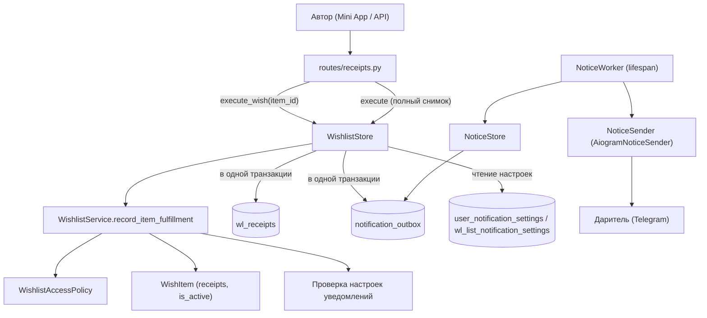
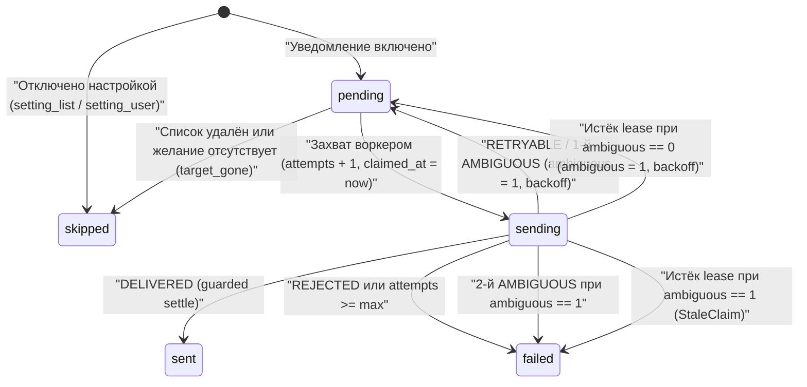

# Спецификация: WISHENKA-23 — Бэкенд отметки получения подарков и раздела «Подаренные»

**Задача в Jira:** `WISHENKA-23`  
**Язык реализации:** Python 3.12+  
**Статус:** реализовано (все шаги Top-Down workflow пройдены; набор тестов: 711 пройдено, 0 ошибок)  
**Базовые документы:** `specs/00-high.md`, `in-docs/spec.md` (разделы 7.2, 7.3), `ai-tasks/WISHENKA-22/`, `ai-tasks/WISHENKA-23/`

## 1. Назначение и бизнес-цель

### 1.1. Постановка проблемы

До реализации `WISHENKA-23` модель данных хранила числовой счётчик полученных экземпляров (`received_quantity`), однако в продукте отсутствовал рабочий механизм отметки получения подарков и связанных с ним бизнес-последствий:

- авторы вишлиста не могли зафиксировать получение подарка через интерфейс или API с проверкой прав и состояния списка;
- активный список продолжал отображать уже полученные желания;
- дарители с открытыми бронями не получали уведомлений о получении желания владельцем и могли приобрести подарок, который уже не нужен;
- отсутствовала датированная история актов получения, а полученные подарки невозможно было отделить от желаний, которые автор удалил (отправил в «Архив»);
- отсутствовали инфраструктура отложенной доставки уведомлений и хранилище настроек уведомлений.

### 1.2. Бизнес-цели и ценность

Задача `WISHENKA-23` реализует сквозную серверную логику отметки получения подарков, разделения представлений списков и уведомления дарителей при безусловном соблюдении **принципа сюрприза** (`specs/00-high.md`, инварианты 1 и 4):

- **Для авторов вишлиста (владелец, администратор, соавтор):** честный активный список только с неполностью полученными желаниями, учёт частичного и полного получения, а также изолированный раздел «Подаренные» с датированной историей поступлений.
- **Для дарителей:** своевременное оповещение в Telegram о факте отметки получения, сохранение неизменности собственных броней (система никогда не отменяет и не корректирует бронь за дарителя) и видимый признак полного получения желания в разделе «Мои бронирования».
- **Для получателя подарка:** абсолютная защита тайны сюрприза — ответы API, отказы, раздел «Подаренные», уведомления и журналы логирования не раскрывают личности дарителей, количества забронированных экземпляров и статус покупки.
- **Для системы и эксплуатации:** атомарная фиксация счётчика, истории получения и очереди уведомлений в одной транзакции БД, гарантированная доставка *at-least-once* с ограничением дублей и структурированная наблюдаемость без утечек персональных данных.

### 1.3. Границы реализации и смежные задачи

Задача выполнена одним тикетом с минимально достаточной инфраструктурой уведомлений (решение `TD-1.2` / `Q3`: один тип события `gift_received`, хранение и вычисление настроек без пользовательского экрана, без экспортёра метрик и без отмены акта получения; решение подлежит подтверждению владельцем продукта).

| Направление | Статус в `WISHENKA-23` | Ответственная задача / источник |
| --- | --- | --- |
| Бэкенд получения, миграции, разделы, API, outbox и воркер уведомлений | Входит в объём | `WISHENKA-23` |
| Экраны Mini App (диалог получения, раздел «Подаренные», маркер в кабинете, карточки, JS/HTML) | Вне объёма (использует контракт API/сервиса) | `WISHENKA-24` |
| Экран и маршруты изменения настроек уведомлений пользователя | Вне объёма (реализованы только таблицы и чтение) | `WISHENKA-34` |
| Экспортёр метрик (Prometheus / OpenTelemetry) | Вне объёма (метрики выводятся из логов и SQL) | `WISHENKA-84` |
| Отмена или корректировка зафиксированного акта получения | Вне объёма (акт получения окончательный) | `WISHENKA-153` |
| Продуктовые решения по открытым вопросам (допущения A–D, бейдж «уже подарено», соавтор-получатель, блокировка редактирования) | Вне объёма | `WISHENKA-154` |
| Локализация (RU / EN) текстов уведомлений | Вне объёма (фиксированный русский шаблон) | `WISHENKA-33` |
| Согласование общей таблицы outbox и единого диспетчера уведомлений | Вне объёма (структура согласована с архитектурой) | `WISHENKA-60` |
| Совместная покупка, складчина, благодарности дарителям, секретные подарки вне списка | Исключено продуктом | `specs/00-high.md` |

## 2. Функциональные требования и пользовательские сценарии

### 2.1. Основные доменные сущности

- **Желание (`WishItem`):** элемент вишлиста с запрошенным количеством (`quantity`, при отсутствии явного значения считается равным `1`), счётчиком полученных единиц (`received_quantity`), остатком к получению (`remaining_quantity`) и признаком архивации (`is_archived`).
- **Автор списка (`Author`):** участник вишлиста (`ctx.is_member` — владелец, администратор или соавтор с правами ведения желаний).
- **Бронирование / обещание (`Reservation`):** намерение дарителя подарить часть или весь остаток; считается открытым в статусах `ACTIVE` (задумано) и `PURCHASED` (куплено). Занятое бронями количество обозначается `occupied`.
- **Запись о получении (`ReceiptRecord`):** датированный факт поступления определённого количества экземпляров желания (`quantity >= 1`, `received_at`, `is_approximate`). Привязывается только к желанию и **никогда не содержит дарителя или ссылки на бронь**.
- **Представления желания («Активные», «Подаренные», «Архив»):** три производных среза над одной записью желания без дублирования или расщепления строки в `wl_items`.
- **Уведомление о получении (`Gift notice`):** одно сообщение одному дарителю с открытой бронью об одном акте получения желания.
- **Настройка уведомлений (`Notice setting`):** разрешение или запрет отправки уведомлений события `gift_received` на уровне пользователя или конкретного вишлиста.

### 2.2. Функциональные требования (`R-1` – `R-8`)

#### R-1. Регистрация акта получения

- **Доступ (`R-1.1`):** отмечать получение может только участник вишлиста (`ctx.is_member`). Даритель, не являющийся участником, получает отказ `forbidden` (`403`); анонимный вызов отклоняется (`401`).
- **Допустимые состояния (`R-1.2`):** получение принимается только для активного желания (`not is_archived` и `remaining_quantity > 0`) в активном вишлисте (`status == ACTIVE`). Архивное желание, архивный или удалённый вишлист и полностью полученное желание отклоняются с отдельными бизнес-причинами. Проверка членства выполняется **до** проверок состояния списка и желания (после проверки существования и принадлежности желания списку), чтобы не-участник не мог определить архивность списка или остаток; для участника архивного списка возвращается `wishlist_not_active`, а не `forbidden`.
- **Количество (`R-1.3`, `R-1.4`):** за один акт можно отметить от `1` до `remaining_quantity` включительно. Значения `<= 0` (`quantity_invalid`) и превышающие остаток (`quantity_above_remaining` с указанием `remaining_quantity`) отклоняются. Желание без заданного количества обрабатывается как `quantity = 1` (`CC-16`). Получение доступно для желания, которое никто не бронировал.
- **Мгновенность и отсутствие дарителя (`R-1.5`):** подтверждение от дарителей не требуется; передача идентификатора дарителя или флага подтверждения в запросе запрещена.
- **Частичное и полное получение (`R-1.6`):** повторные акты суммируются. После частичного получения желание остаётся в активном списке с уменьшенным `remaining_quantity`. Когда `received_quantity >= quantity`, желание становится полностью полученным (`is_fully_received = True`) и покидает активный список. Частичный акт на желание без броней не затрагивает брони и не создаёт уведомлений.
- **Конкурентность и атомарность отказа (`R-1.7`, `R-1.8`):** параллельные акты получения и гонка с бронированием сериализуются на уровне транзакции БД (`BEGIN IMMEDIATE`); сумма полученных единиц никогда не превышает запрошенную, открытые брони не теряются, проигравший получает детерминированный отказ. Неудачный акт не изменяет счётчик и не создаёт записей в `wl_receipts` и `notification_outbox`.

#### R-2. История получения и миграция данных

- **Запись акта (`R-2.1`):** каждый успешный акт создаёт запись в `wl_receipts` с `wish_item_id`, `quantity`, UTC-меткой `received_at` и флагом `is_approximate = 0`. Выполняется инвариант `received_quantity == SUM(wl_receipts.quantity)` для каждого желания.
- **Миграция исторических данных (`R-2.2`):** для желаний, уже имевших `received_quantity > 0` до внедрения `WISHENKA-23`, миграция создаёт одну запись с датой последнего обновления `wl_items.updated_at` и флагом `is_approximate = 1`. В контракте чтения отдаётся `is_approximate`, чтобы приблизительная дата не выдавалась за точную.
- **Удаление и архивация вишлиста (`R-2.3`, `R-2.4`):**
  - при мягком удалении списка (`status = deleted`) раздел «Подаренные» сразу становится недоступным (`404 wishlist_not_active`), физически строки хранятся в течение срока удержания (`wishlist_retention_days = 30`) и затем удаляются каскадно (`ON DELETE CASCADE`) при очистке списка;
  - для архивного вишлиста (`status = archived`) история раздела «Подаренные» остаётся доступной для чтения участникам.

#### R-3. Влияние на бронирования и свободный остаток

- **Независимость броней (`R-3.1`):** отметка получения **никогда** не закрывает, не изменяет, не отменяет и не переводит в «Куплено» ни одну бронь. Брони в статусах `ACTIVE` и `PURCHASED` обрабатываются одинаково.
- **Допустимость перебронирования (`R-3.2`):** состояние `received_quantity + occupied > quantity` (*over-booked*) является законным; открытые брони сохраняются в кабинете дарителя и в счётчике активных броней до самостоятельного решения дарителей.
- **Ограничения действий дарителей (`R-3.3`, `R-3.4`):** свободный для бронирования остаток вычисляется как `max(0, quantity - received_quantity - occupied)`. В состоянии *over-booked* и на полностью полученном желании запрещено создавать новую бронь или увеличивать количество существующей; разрешено уменьшать количество, отменять бронь, отмечать покупку и снимать отметку покупки. Отменённая бронь остаётся отменённой (`CC-13`).
- **Редактирование запрошенного количества (`R-3.5`):** прежний запрет уменьшения `quantity` ниже `received_quantity + occupied` сохранён без изменений; сокращение `quantity` до `received_quantity` (при отсутствии занятых единиц) переводит желание в `is_fully_received` без записи в `wl_receipts` и без уведомлений, а увеличение `quantity` у неархивного желания возвращает его в активный список.

#### R-4. Единое определение активности и разделение представлений

Все представления и проверки строятся на едином наборе производных свойств `WishItem` (`R-4.1`, `R-4.6`):

| Представление | Правило отбора | Доступность |
| --- | --- | --- |
| Активный список | `is_active`: `not is_archived and not is_fully_received` | Все пользователи, имеющие право просмотра списка |
| Раздел «Подаренные» | `is_gifted`: `received_quantity > 0` (независимо от `is_archived`) | Только участники вишлиста (`ctx.is_member`) |
| Раздел «Архив» | `is_in_archive`: `is_archived and not is_fully_received` | Участники вишлиста; отображается с `remaining_quantity` |

- **Частичное архивирование и восстановление (`R-4.2`, `R-4.3`, `R-4.4`):** архивирование частично полученного желания устанавливает `is_archived = True`, перенося в архив только неполученную часть (`remaining_quantity`); полученная часть остаётся в «Подаренные», открытые брони сохраняются. Восстановление снимает флаг архивации и помещает остаток в конец порядка активных желаний. Архивирование полностью полученного желания и восстановление желания с `remaining_quantity == 0` отклоняются с `NothingRemainingError` (HTTP `409`).
- **Нормализация унаследованных записей (`R-4.5`):** полностью полученные желания не могут находиться в архиве; миграция сбрасывает `is_archived = 0` для унаследованных записей с `is_archived = 1` и `received_quantity >= quantity > 0` (без изменения `updated_at`), а частично полученные архивные записи остаются в архиве.
- **Согласованность (`R-4.6`):** единый предикат `is_active` применяется в `get_wishlist_view`, `list_wish_items`, валидации порядка в `reorder_wish_items`, расчёте хвоста в `restore_wish_item` и публичной проекции `projection`.

#### R-5. Безопасные для получателя данные чтения

- Данные активного списка и архива включают `remaining_quantity` для каждого желания (`R-5.1`, `R-5.3`).
- Данные раздела «Подаренные» (только для участников не удалённого списка) содержат реквизиты желания и список актов `receipts` (`received_at`, `quantity`, `is_approximate`) без полей дарителей, броней и действий редактирования, перемещения, бронирования или архивирования (`R-5.2`).
- Представление дарителя (`WishItemGifterViewDTO`) и строки кабинета (`MyReservationItemDTO`, `CabinetRow`) содержат флаг `is_fully_received`, вычисляемый исключительно из `quantity` и `received_quantity`, что не раскрывает сведений о других бронях (`R-5.4`). Для полностью полученного желания на активном списке в кабинете сохраняются действия управления бронью (`offer_actions`).
- Представление получателя (`WishItemRecipientViewDTO`) до и после получения не содержит полей бронирования; поле `remaining_quantity` вычисляется из уже открытых получателю `quantity` и `received_quantity`, а флаг `is_fully_received` на нём намеренно не добавлен (`R-5.5`).

#### R-6. Уведомления дарителям о получении

- **Адресаты (`R-6.1`, `R-6.2`):** после каждого успешного акта получения формируется ровно одно уведомление (`gift_received`) каждому уникальному дарителю (`giver_user_id`) с хотя бы одной открытой бронью (`ACTIVE` или `PURCHASED`) на это желание в порядке первой брони, за исключением самого получателя желания (`is_recipient_id`). Несколько броней одного дарителя дают одно уведомление; несколько актов получения — несколько уведомлений; автор списка, забронировавший желание с другим получателем, получает уведомление как даритель; при отсутствии открытых броней уведомления не создаются.
- **Содержание (`R-6.3`):** фиксированный текст без форматирования (`parse_mode` не задаётся), названия желания и списка обрезаются до `100` символов (`TITLE_LIMIT = 100`):

  ```text
  Желание «{wish_title}» из списка «{list_title}» отмечено как полученное.
  Проверьте свою бронь и при необходимости измените или отмените её.
  ```

  В тексте отсутствуют количества, данные о других дарителях, намёки на перебронирование и имя владельца.
- **Матрица настроек (`R-6.4`, `R-6.7`):** применимость уведомления определяется на момент акта получения по приоритету:
  1. запись уровня списка (`wl_list_notification_settings`) — побеждает в обе стороны (вкл/выкл);
  2. запись уровня пользователя (`user_notification_settings`);
  3. значение по умолчанию — включено (`True`).
  Отключённые настройкой уведомления фиксируются в очереди со статусом `skipped` (`setting_list` или `setting_user`) для аудита и не отправляются. Пользовательские интерфейсы и маршруты записи настроек не добавляются.
- **Атомарность и гарантия доставки (`R-6.5`, `R-6.6`):** строки `notification_outbox` записываются в одной транзакции с актом получения, а доставка выполняется фоновым воркером после коммита; сбой отправки никогда не отменяет и не задерживает отметку получения. Предел попыток — `MAX = 5` (`receipt_notice_max_attempts`), после чего строка переходит в терминальный статус `failed`. Доставка гарантирована по модели *at-least-once* с ограничением повторов при неоднозначном исходе (`AMBIGUOUS` или зависшая строка `sending` с истёкшей арендой): допускается **не более одного** повторного отправления на дарителя за акт получения.

#### R-7 и R-8. Веб-доступ, тайна сюрприза и приватность

- Новые JSON-маршруты защищены аутентификацией `get_current_user` (`401`) и существующей CSRF-защитой (`BrowserSecurityMiddleware`).
- Все бизнес-отказы возвращаются из закрытого набора причин `reason` с фиксированными формулировками без указания забронированных единиц; конкурентная блокировка БД возвращает `503 busy`.
- Устаревшая проверка отсутствия таблиц уведомлений в `tests/test_surprise_role_context.py` заменяется усиленной проверкой: хранилище уведомлений допускается, но при сценарии владельца/получателя очередь не содержит строк для владельца/получателя, `wl_receipts` не содержит колонки дарителя, а ответы, заголовки и журналы не раскрывают фактов бронирования (`R-8.3`).

### 2.3. Основные пользовательские сценарии

- **UC-1. Частичное и полное получение подарка:** автор отмечает получение `2` из `5` единиц желания — счётчик возрастает до `2`, в `wl_receipts` добавляется запись, желание остаётся активным с `remaining_quantity = 3` и появляется в «Подаренные»; последующая отметка `3` единиц переводит `remaining_quantity` в `0`, убирает желание из активного списка и оставляет его только в «Подаренные».
- **UC-2. Частичное архивирование и восстановление:** автор архивирует желание с `quantity = 5`, `received_quantity = 2` — в «Архив» переходит остаток `3`, «Подаренные» сохраняют полученные `2`, открытые брони дарителей не затрагиваются; при восстановлении в активный список возвращаются `3` единицы; попытка архивировать полностью полученное желание даёт отказ `409 nothing_remaining`.
- **UC-3. Получение при открытых бронях и перебронировании (*over-booked*):** на желание из `5` единиц дарители забронировали `3 + 2`; автор отмечает получение `2` единиц — возникает допустимое состояние `2 + 5 > 5`; дарители получают уведомление в Telegram, видят бронь в «Мои бронирования», не могут создавать/увеличивать бронь, но могут её уменьшить, отменить или отметить покупку. При полном получении желание уходит из активного списка, а открытая бронь дарителя сохраняется с маркером `is_fully_received = True` до действий самого дарителя.
- **UC-4. Просмотр истории в «Подаренные»:** участник активного или архивного вишлиста запрашивает `GET /api/wishlists/{wishlist_id}/gifted` и получает список полученных желаний с актами получения без данных о дарителях; для удалённого вишлиста возвращается `404`, для дарителя-неучастника — `403`, для анонимного запроса — `401`.
- **UC-5. Фоновая доставка и обработка сбоев Telegram API:** воркер захватывает готовую строку `pending`, формирует шаблон по актуальным названиям желания и списка (до `100` символов) и отправляет plain-text сообщение через Telegram-бота; при `429 Retry-After` и `401` перепланирует попытку, при `400`/`403`/`404`/слишком большом сообщении сразу ставит `failed`, при `5xx`/сетевой ошибке/таймауте или смерти воркера применяет однократный переход неоднозначности (`ambiguous = 1`).
- **UC-6. Просмотр списка получателем и по публичной ссылке:** получатель и внешний даритель не видят сведений о бронях и не видят архивных или полностью полученных желаний в публичной проекции.

## 3. Архитектура, компоненты и интерфейсы

### 3.1. Компонентная схема и модули

Поток данных между веб-маршрутом, доменным сервисом, транзакционным хранилищем и фоновым воркером уведомлений:



Пакет `wishenka/notices/` выделен отдельно от `wishenka/wishlists/`, поскольку инфраструктура очереди и настроек является общей точкой интеграции для последующего расширения другими типами событий (`WISHENKA-60`).

| Компонент / модуль | Реализованные элементы |
| --- | --- |
| `wishenka/wishlists/models.py` | Dataclass `ReceiptRecord`; поле `WishItem.receipts`; 5 свойств (`remaining_quantity`, `is_fully_received`, `is_gifted`, `is_active`, `is_in_archive`) |
| `wishenka/wishlists/exceptions.py` | Базовый класс `WishRefusalError(WishlistError)` с атрибутом `reason`; классы `QuantityInvalidError`, `QuantityAboveRemainingError`, `NothingRemainingError`, `WishArchivedError` |
| `wishenka/wishlists/policy.py` | Методы `WishlistAccessPolicy.is_recipient_id` (`is_recipient` делегирует в него) и `can_view_gifted` |
| `wishenka/wishlists/schemas.py` | Поля с обратной совместимостью на `WishItemRecipientViewDTO`, `WishItemGifterViewDTO`, `MyReservationItemDTO`; новые DTO `GiftedItemDTO`, `ReceiptEntryDTO`, `ReceiptRequestDTO`, `ReceiptResultDTO` |
| `wishenka/wishlists/service.py` | Поля эффектов (`_new_receipts`, `_new_notices`, `_notice_settings`, read-only свойство `notice_drafts`), команда `record_item_fulfillment`, продюсер (`_notice_gate`, `_draft_receipt_notices`), `list_gifted_items`, `recipient_view`, обновление представлений и архивации/восстановления через `is_active` |
| `wishenka/wishlists/store.py` | Загрузка записей и настроек в `_read` и `_load_wish` (`_receipt_from_row`, `_notice_settings_from_rows`); сброс эффектов `_flush_receipt_effects` из обоих путей (`_persist_wish` и `_write`); пост-коммитные DEBUG-логи (`_log_flushed_notices`); публичный `WishlistStore.transaction(work)` |
| `wishenka/wishlists/alembic/versions/` и `migrations.py` | Линейная цепочка `add_item_order_index` -> `add_gift_receipts` -> `add_notice_outbox`; публичная функция `head_revision(database_url=...)` |
| `wishenka/notices/models.py` | `EVENT_GIFT_RECEIVED = "gift_received"`, константы статусов/причин пропуска, `NoticeDraft`, `NoticeSettings`, `FlushedNotice` (импорт `ReceiptRecord` под `TYPE_CHECKING`) |
| `wishenka/notices/store.py` | `NoticeStore(store, settings)`, `ClaimedNotice`, `backoff_seconds`, `claim_next`, `_settle_stale`, защищённые `complete`/`reschedule`/`fail` через `_settle`, `purge_finished` |
| `wishenka/notices/sender.py` | `SendOutcome`, `SendResult`, протокол `NoticeSender`, `classify_error`, `AiogramNoticeSender`, фабрика `build_sender` |
| `wishenka/notices/worker.py` | `NoticeWorker(store, sender, settings, clock)`, `run_once(now=None)`, `run(stop)`, `flush_if_due(now)` |
| `wishenka/wishlists/cleanup.py` | Опциональный параметр `notice_store=None` в `run_cleanup_cycle` и `background_cleanup_worker`, вызов `_purge_notices` |
| `wishenka/config.py` и `wishenka/web/app.py` | 9 настроек `receipt_notice_*` в `Settings`; `create_app(settings, notice_sender=None)`, запуск/остановка воркера в lifespan (`app.state.notice_store`, `notice_task`, `notice_sender`), подключение роутера `receipts` |
| `wishenka/web/routes/receipts.py` | Роутер `POST .../receipts` и `GET .../gifted`, таблица отказов `_REFUSALS` |
| `wishenka/web/routes/` (`items.py`, `items_ui.py`, `reservations_ui.py`, `wishlists.py`) | Маппинг `NothingRemainingError` в `409` (в `items_ui.py` отдельным `except` до `_DOMAIN_ERRORS`); поля `CabinetRow.wish_received` и `offer_actions`; фильтр `is_active` в `projection` |

### 3.2. Модель данных и миграции БД

#### Таблица истории получения (`add_gift_receipts`)

```sql
CREATE TABLE IF NOT EXISTS wl_receipts (
  id INTEGER PRIMARY KEY AUTOINCREMENT,
  wish_item_id INTEGER NOT NULL REFERENCES wl_items(id) ON DELETE CASCADE,
  quantity INTEGER NOT NULL CHECK (quantity >= 1),
  received_at TEXT NOT NULL,
  is_approximate INTEGER NOT NULL DEFAULT 0 CHECK (is_approximate IN (0, 1))
);
CREATE INDEX IF NOT EXISTS idx_wl_receipts_item
  ON wl_receipts(wish_item_id, received_at, id);
```

- Таблица содержит строго 5 колонок; колонка дарителя и ссылка на `wl_reservations` структурно запрещены.
- **Повторно запускаемая миграция данных (backfill и нормализация):** для всех `wl_items` с `received_quantity > 0` и без записей в `wl_receipts` создаётся запись с `quantity = received_quantity`, `received_at = updated_at` и `is_approximate = 1`; у записей с `is_archived = 1 AND received_quantity > 0 AND received_quantity >= quantity` сбрасывается `is_archived = 0` (без изменения `updated_at`). Частично полученные архивные желания остаются архивными.
- **Необратимость:** `downgrade()` выбрасывает `NotImplementedError`, так как откат не позволяет восстановить исходные флаги `is_archived` и приводит к потере истории.

#### Очередь уведомлений и настройки (`add_notice_outbox`)

```sql
CREATE TABLE IF NOT EXISTS notification_outbox (
  id INTEGER PRIMARY KEY AUTOINCREMENT,
  event_type TEXT NOT NULL,
  receipt_id INTEGER NOT NULL REFERENCES wl_receipts(id) ON DELETE CASCADE,
  wishlist_id INTEGER NOT NULL REFERENCES wl_lists(id) ON DELETE CASCADE,
  wish_item_id INTEGER NOT NULL REFERENCES wl_items(id) ON DELETE CASCADE,
  giver_user_id INTEGER NOT NULL,
  status TEXT NOT NULL
    CHECK (status IN ('pending', 'sending', 'sent', 'failed', 'skipped')),
  skip_reason TEXT,
  attempts INTEGER NOT NULL DEFAULT 0,
  ambiguous INTEGER NOT NULL DEFAULT 0 CHECK (ambiguous IN (0, 1)),
  next_attempt_at INTEGER NOT NULL,
  claimed_at INTEGER,
  last_error_class TEXT,
  created_at TEXT NOT NULL,
  updated_at TEXT NOT NULL,
  UNIQUE (event_type, receipt_id, giver_user_id)
);
CREATE INDEX IF NOT EXISTS idx_notice_outbox_due
  ON notification_outbox(status, next_attempt_at);

CREATE TABLE IF NOT EXISTS user_notification_settings (
  user_id INTEGER NOT NULL,
  event_type TEXT NOT NULL,
  enabled INTEGER NOT NULL CHECK (enabled IN (0, 1)),
  updated_at TEXT NOT NULL,
  PRIMARY KEY (user_id, event_type)
);

CREATE TABLE IF NOT EXISTS wl_list_notification_settings (
  user_id INTEGER NOT NULL,
  wishlist_id INTEGER NOT NULL REFERENCES wl_lists(id) ON DELETE CASCADE,
  event_type TEXT NOT NULL,
  enabled INTEGER NOT NULL CHECK (enabled IN (0, 1)),
  updated_at TEXT NOT NULL,
  PRIMARY KEY (user_id, wishlist_id, event_type)
);
```

- `next_attempt_at` и `claimed_at` хранятся как целые секунды Unix epoch для точного сравнения сроков; `created_at` и `updated_at` — строки UTC ISO-8601.
- В строке `notification_outbox` отсутствуют количества, названия и текст сообщения; названия читаются в момент отправки через join в `claim_next`.
- Первичный ключ настроек использует `user_id` (Telegram ID пользователя). Внешний ключ к `users` не ставится по соглашению схемы вишлистов.

### 3.3. Доменные контракты, классы и порядок проверок

#### Свойства `WishItem` и `ReceiptRecord`

- `ReceiptRecord`: `id: int = 0`, `wish_item_id: int`, `quantity: int`, `received_at: datetime`, `is_approximate: bool = False`.
- Свойства `WishItem`:
  - `remaining_quantity -> int`: `max(0, quantity - received_quantity)`
  - `is_fully_received -> bool`: `received_quantity >= quantity`
  - `is_gifted -> bool`: `received_quantity > 0`
  - `is_active -> bool`: `not is_archived and not is_fully_received`
  - `is_in_archive -> bool`: `is_archived and not is_fully_received`

#### Порядок проверок в `WishlistService.record_item_fulfillment`

Сигнатура: `record_item_fulfillment(self, item_id: int, actor: AuthenticatedUser, received_quantity: int, *, wishlist_id: int | None = None) -> WishItem`.

1. Желание отсутствует или `wishlist_id` не совпадает с `item.wishlist_id` → `ItemNotFoundError`.
2. `ctx = resolve_context(actor, wl)`; если `not ctx.is_member` → `PermissionDeniedError`.
3. Вишлист в статусе `DELETED` → `WishlistDeletedError`.
4. Вишлист в статусе `ARCHIVED` → `WishlistArchivedError`.
5. `item.is_archived` → `WishArchivedError`.
6. `received_quantity < 1` → `QuantityInvalidError` (наследует `WishRefusalError` и `ValueError`).
7. Внутри `ItemConcurrencyCoordinator.acquire(item_id)`:
   - `remaining_quantity == 0` → `NothingRemainingError(remaining_quantity=0)`;
   - `received_quantity > remaining_quantity` → `QuantityAboveRemainingError(remaining_quantity)` (наследует `WishRefusalError` и `ValueError`).
8. Применение эффектов: увеличение `item.received_quantity`, обновление `updated_at`, добавление `ReceiptRecord` в `item.receipts` и `_new_receipts`, формирование `NoticeDraft(giver_user_id, receipt, status, skip_reason)` в `_new_notices` для уникальных `ACTIVE`/`PURCHASED` дарителей (исключая `is_recipient_id`), логирование `item_fulfilled`.

#### Два пути персистенции в `WishlistStore`

Хранилище использует два пути транзакций (`BEGIN IMMEDIATE`): `execute_wish` (`_load_wish` + `_persist_wish`) и `execute` (`_read` + `_write`). Оба пути загружают `item.receipts` (отсортированные по `received_at, id`) и настройки уведомлений, а перед коммитом вызывают единый helper `_flush_receipt_effects(conn, service) -> list[FlushedNotice]`, вставляющий строки в `wl_receipts` (с простановкой `receipt.id`) и `notification_outbox` (с `next_attempt_at = now`). После успешного коммита вызывается `_log_flushed_notices`. При любом отказе или ошибке транзакция целиком откатывается.

### 3.4. Контракты веб-API и интеграция с `WISHENKA-24`

#### `POST /api/wishlists/{wishlist_id}/items/{item_id}/receipts`

- **Аутентификация и защита:** `get_current_user` (`401`) и `BrowserSecurityMiddleware` (CSRF для cookie-сессий).
- **Тело запроса (`ReceiptRequestDTO`, `extra="forbid"`, lax `int`):** `{"quantity": int}`. Неизвестные поля (`giver`, `confirm`) и нецелочисленные значения отклоняются FastAPI со статусом `422` до вызова сервиса.
- **Успешный ответ (`201`, `ReceiptResultDTO`):**

| Поле | Тип | Описание |
| --- | --- | --- |
| `item` | `WishItemRecipientViewDTO` | Безопасное для получателя представление желания (через общий `recipient_view(item)`) |
| `received_now` | `int` | Количество, зафиксированное в данном акте |
| `received_quantity` | `int` | Итоговое полученное количество после акта |
| `remaining_quantity` | `int` | Остаток к получению после акта |
| `is_fully_received` | `bool` | Признак полного получения желания |

- **Закрытая таблица отказов (`_REFUSALS`):** формат `detail = {"reason": <code>, "message": <fixed text>, "remaining_quantity"?: <int>}`.

| Причина (`reason`) | Исключение | HTTP | Фиксированное сообщение (`message`) | Доп. поле |
| --- | --- | :-: | --- | --- |
| `quantity_invalid` | `QuantityInvalidError` | `400` | `Quantity must be a whole number of at least 1` | Нет |
| `quantity_above_remaining` | `QuantityAboveRemainingError` | `409` | `Quantity is above the remaining quantity` | `remaining_quantity` |
| `wish_archived` | `WishArchivedError` | `409` | `The wish is archived` | Нет |
| `wishlist_not_active` | `WishlistArchivedError` | `409` | `The wishlist is not active` | Нет |
| `wishlist_not_active` | `WishlistDeletedError` | `404` | `The wishlist is not active` | Нет |
| `nothing_remaining` | `NothingRemainingError` | `409` | `Nothing remains to receive` | `remaining_quantity = 0` |
| `forbidden` | `PermissionDeniedError` | `403` | `Forbidden` | Нет |
| `not_found` | `ItemNotFoundError`, `WishlistNotFoundError` | `404` | `Resource not found` | Нет |
| `busy` | `InventoryBusyError` | `503` | `The wish was busy and the attempt changed nothing` | Нет |

*(Примечание: сообщение маршрута для `quantity_invalid` содержит «at least 1», тогда как исключение `QuantityInvalidError` по умолчанию использует «Quantity must be a positive whole number»; клиенты должны сопоставлять отказы по коду `reason` — вынесено в `T1` / `WISHENKA-155`.)*

#### `GET /api/wishlists/{wishlist_id}/gifted`

- **Ответ (`200`, `list[GiftedItemDTO]`):** список желаний с `is_gifted == True`, отсортированных по дате самого свежего акта получения (по убыванию), затем по `id`. Внутри каждого элемента список `receipts: list[ReceiptEntryDTO]` (`received_at`, `quantity`, `is_approximate`) отсортирован от старых к новым.
- **Поля `GiftedItemDTO`:** `id`, `title`, `description`, `link`, `image_url`, `price`, `currency`, `store_name`, `store_icon_url`, `recipient_user_id`, `recipient_name`, `quantity`, `received_quantity`, `remaining_quantity`, `is_archived`, `receipts`. Поля броней и дарителей отсутствуют.
- **Доступ и отказы:** единая таблица отказов (`403 forbidden` для не-участников, `404 not_found` для отсутствующего списка, `404 wishlist_not_active` для удалённого списка, `401` без аутентификации; для архивного списка доступ открыт участникам).

#### Изменения существующих DTO и маршрутов

- `WishItemRecipientViewDTO` (+ `remaining_quantity: int | None = None`) и `WishItemGifterViewDTO` (+ `remaining_quantity: int | None = None`, `is_fully_received: bool = False`): обе модели имеют `frozen=True`, поэтому значения по умолчанию вычисляются через `@model_validator(mode="before")`. Использование `before`-валидатора вместо `computed_field` сохраняет ключи в `model_fields` (требуется тестами тайны сюрприза) и не ломает старые конструкторы.
- `MyReservationItemDTO`: добавлено поле `is_fully_received: bool = False`, явно проставляемое в `get_user_reservations`.
- `routes/items.py::execute` и `routes/items_ui.py` (`archive_item_ui`, `restore_item_ui`): `NothingRemainingError` отображается в HTTP `409` (в `items_ui.py` — отдельным обработчиком `except NothingRemainingError` перед `_DOMAIN_ERRORS`, чтобы сохранить прежний набор классов `_DOMAIN_ERRORS`).
- `routes/reservations_ui.py`: `CabinetRow` дополнен `wish_received` и правилом `offer_actions = (is_item_archived or is_fully_received) and not is_wishlist_archived`.
- `routes/wishlists.py::projection`: добавлены `remaining_quantity` и `is_active`; для публичного просмотра и не-участников списка возвращаются только активные желания (`is_active == True`).

### 3.5. Машина состояний `notification_outbox` и протокол доставки



#### Протокол захвата и завершения (`NoticeStore`)

Все операции `NoticeStore` выполняются в одной транзакции `BEGIN IMMEDIATE` через `WishlistStore.transaction(work)`:

1. **`claim_next(now)`:** просматривает до `CLAIM_BATCH_LIMIT = 50` просроченных строк (`pending AND next_attempt_at <= now` или зависшие `sending AND claimed_at <= now - lease`), упорядоченных по `next_attempt_at, id`, с присоединением заголовков желания/списка и статуса списка:
   - если список удалён или желание не найдено → переводит в `skipped` (`target_gone`) и идёт к следующей строке;
   - если строка зависла в `sending` (`claimed_at <= now - lease`): **сначала** переводит её по правилу неоднозначности (`ambiguous == 1` или `attempts >= max_attempts` → `failed` с `last_error_class = 'StaleClaim'`; иначе `ambiguous := 1`, `status = 'pending'`, `claimed_at = NULL`, `next_attempt_at = now + backoff(attempts)`), **никогда не отправляя** её в этом вызове;
   - для готовой `pending`-строки выставляет `status = 'sending'`, `claimed_at = now`, `attempts += 1` и возвращает `ClaimedNotice` на отправку.
2. **Защищённая запись результата (`complete`, `reschedule`, `fail`):** единый `_settle` с условием `WHERE id = :id AND status = 'sending' AND claimed_at = :claimed_at`. Если строку уже успел перехватить другой воркер по истечении аренды, обновление затрагивает 0 строк и пишется DEBUG `receipt_notice_late_write_ignored`.
3. **Задержка повторов:** `backoff_seconds` по номеру попытки `n`: `min(base * 2**(n - 1), max_backoff)` (по умолчанию `30`, `60`, `120`, `240` с до `1800` с), но не меньше `retry_after`, полученного от Telegram.

#### Классификация ответов Telegram (`AiogramNoticeSender`)

Цепочка `isinstance` в `classify_error` строго упорядочена с учётом иерархии исключений `aiogram 3.31.0`:

| Исход (`SendOutcome`) | Исключения / результат | Переход строки |
| --- | --- | --- |
| `DELIVERED` | Успешный вызов `send_message` (plain text) | `sent` |
| `REJECTED` | `TelegramForbiddenError`, `TelegramBadRequest`, `TelegramNotFound`, `TelegramEntityTooLarge` (до `TelegramNetworkError`), `TelegramMigrateToChat` | Немедленный `failed` + `last_error_class` |
| `RETRYABLE` | `TelegramRetryAfter` (429), `TelegramUnauthorizedError` (401) | `failed` при `attempts >= max`, иначе `pending` с backoff |
| `AMBIGUOUS` | `TelegramServerError` (5xx, включая `RestartingTelegram`), `TelegramNetworkError`, прочие `TelegramAPIError`, `TimeoutError`, иные исключения | При `ambiguous == 1` → `failed`, иначе `ambiguous := 1` и перепланирование по правилам `RETRYABLE` |

- `NoticeWorker.run_once(now=None)` дренирует всю готовую очередь, перед каждым захватом и завершением читая актуальное время `clock()` (при переданном `now` в тестах используется переданное значение), и оборачивает отправку в `asyncio.wait_for(..., request_timeout + 5)`.
- **Отсутствие токена:** `build_sender(settings)` возвращает `None`, если `bot_token` пустой, равен `dummy_bot_token` или не проходит валидацию `aiogram`. Воркер при этом не запускается, а уведомления остаются в `pending` (фиктивный no-op отправитель не используется, чтобы не терять уведомления молча).

## 4. Нефункциональные требования, безопасность и наблюдаемость

### 4.1. Конфигурация, лимиты и производительность

#### Настройки `Settings` (префикс `WISHENKA_`)

| Параметр | Значение по умолчанию | Ограничения и валидация |
| --- | --- | --- |
| `receipt_notice_worker_enabled` | `True` | Флаг запуска фонового воркера в lifespan |
| `receipt_notice_poll_interval_seconds` | `5.0` | `> 0`, не может превышать `receipt_notice_summary_window_seconds` |
| `receipt_notice_max_attempts` | `5` | `1..20` |
| `receipt_notice_backoff_base_seconds` | `30` | `>= 1` |
| `receipt_notice_backoff_max_seconds` | `1800` | `>= receipt_notice_backoff_base_seconds` |
| `receipt_notice_request_timeout_seconds` | `30.0` | `> 0`; передаётся в `AiohttpSession(timeout=...)` |
| `receipt_notice_claim_lease_seconds` | `300` | `>= receipt_notice_request_timeout_seconds + 30` (валидатор модели) |
| `receipt_notice_summary_window_seconds` | `300` | `>= 60` |
| `receipt_notice_retention_days` | `30` | `>= 1`; используется при очистке в `cleanup.py` |

- **Модульные константы:** `CLAIM_BATCH_LIMIT = 50` (пачка просмотра в `claim_next`), `TITLE_LIMIT = 100` (лимит длины названий желания и списка в тексте уведомления), `MAX_ERROR_BACKOFF_SECONDS = 60.0` (лимит паузы при отказе БД в цикле `NoticeWorker.run`).
- **Конкурентность и жизненный цикл:** все записи сериализуются через `BEGIN IMMEDIATE` с `busy_timeout = 5000` мс (при блокировке `InventoryBusyError` → `503`). В `web/app.py` воркер запускается после инициализации хранилищ; при остановке приложения задача отменяется, затем закрывается HTTP-сессия `sender.close()`. Очистка завершённых строк (`sent`, `skipped`, `failed`) выполняется в конце `run_cleanup_cycle` в изолированном блоке `try`.
- **Известные ограничения нагрузки:** при отсутствии очереди воркеры каждого процесса раз в `poll_interval` открывают `BEGIN IMMEDIATE`, а `GET .../gifted` загружает полный снимок вишлиста (см. раздел 5.3 и `WISHENKA-118`).

### 4.2. Безопасность, приватность и инварианты тайны сюрприза

- **Тайна сюрприза в данных и ответах:** ни один ответ API (`ReceiptResultDTO`, `GiftedItemDTO`, `WishItemRecipientViewDTO`), ни сообщение отказа, ни структура `wl_receipts`, ни текст уведомления не содержат данных о дарителях, количестве забронированных единиц или факте покупки.
- **Скрытие состояния списка от посторонних:** проверка членства `ctx.is_member` предшествует проверкам состояния списка/желания (`403 forbidden` вместо `409`).
- **Запрет изменения настроек в текущем релизе:** ни один производственный модуль `wishenka/` (кроме миграций) не выполняет `INSERT`/`UPDATE`/`DELETE` над таблицами `user_notification_settings` и `wl_list_notification_settings`.
- **Строго запрещено в логах на любом уровне:** идентификатор/имя/username дарителя, данные броней, число уведомлений на один акт получения, тексты сообщений, заголовки желаний и списков, сообщения исключений (логируется только имя класса `error_class`), ответы Telegram API, токен бота и объект `Settings`.
- **Разделение корреляции логов:** события `receipt_notice_*` содержат только `outbox_id` (и никогда `receipt_id`, `item_id`, `wishlist_id`, `event_type`, `giver_user_id`). События стороны автора (`item_fulfilled`, `receipt_refused`) никогда не содержат `outbox_id`.
- **Ограничение лексики `_NOTICE_MARKS` и тишина в покое:** имена событий и сообщения пути уведомлений не содержат подстрок `notification`, `outbox`, `push`. Холостой воркер и пустое окно сводки не порождают записей даже на уровне `DEBUG`.
- **Операторский статус `DEBUG`-логов и сводок:** `DEBUG`-события (например, `receipt_notice_created` сразу за `item_fulfilled`) и `receipt_notice_window_summary` несут косвенный сигнал наличия броней, поэтому должны оставаться **строго в операторских логах** и никогда не выводиться пользователям.

### 4.3. Наблюдаемость: структурированное логирование и метрики

Логгеры: `wishenka.wishlists`, `wishenka.web.receipts`, `wishenka.wishlists.notices`, `wishenka.wishlists.cleanup`, `wishenka.wishlists.migrations`. Каждая запись содержит `extra={"event": ...}` и фиксированный текст сообщения (кроме сохранённого формата `item_fulfilled` и route-сообщений с `operation`/`item_id`).

#### Реестр событий логирования

| Событие (`event`) | Уровень | Логгер / источник | Поля `extra` |
| --- | --- | --- | --- |
| `receipt_notice_worker_error` | `ERROR` | `notices/worker.py` (`NoticeWorker.run`, 1 раз на серию сбоев) | `error_class` |
| `receipt_refused` | `WARNING` | `routes/receipts.py` | `operation`, `wishlist_id`, `item_id`, `actor_id`, `reason`, `http_status`, `remaining_quantity` (только для 2 причин остатка) |
| `receipt_inventory_busy` | `WARNING` | `routes/receipts.py` | `operation`, `wishlist_id`, `item_id`, `actor_id` |
| `wish_archive_refused` | `WARNING` | `wishlists/service.py` | `wishlist_id`, `item_id`, `actor_id`, `reason` (`nothing_remaining`) |
| `receipt_notice_purge_failed` | `WARNING` | `wishlists/cleanup.py` | `error_class` |
| `item_fulfilled` | `INFO` | `wishlists/service.py` (до коммита) | `wishlist_id`, `item_id`, `user_id`, `actor_id`, `quantity`, `received_quantity`, `total_quantity`, `fully_received` |
| `receipt_recorded_http` | `INFO` | `routes/receipts.py` (после транзакции) | `item_id` |
| `wish_archived_partial`, `wish_restored_partial` | `INFO` | `wishlists/service.py` (только при `received_quantity > 0`) | `wishlist_id`, `item_id`, `actor_id`, `received_quantity`, `total_quantity` |
| `legacy_receipts_backfilled`, `legacy_archived_rows_normalised` | `INFO` | `add_gift_receipts.py` (`migrations`) | `rows` |
| `receipt_notice_window_summary` | `INFO` | `notices/worker.py` (фиксированная сетка `floor(now / W) * W`, при `> 0` строк) | `window_seconds`, `sent`, `retried`, `failed_terminal` |
| `receipt_notice_worker_started`, `receipt_notice_worker_stopped`, `receipt_notice_worker_disabled` | `INFO` | `web/app.py` (lifespan) | Для `_disabled`: `reason` (`no_bot_token` или `disabled_by_setting`) |
| `receipt_notice_rows_purged` | `INFO` | `wishlists/cleanup.py` (только при `rows > 0`) | `rows` |
| `receipt_notice_created`, `receipt_notice_skipped` | `DEBUG` | `wishlists/store.py` (после коммита) | `outbox_id` (и `gate`: `list`/`user` для `_skipped`) |
| `receipt_notice_sent`, `receipt_notice_send_failed`, `receipt_notice_retry_scheduled`, `receipt_notice_failed_terminal` | `DEBUG` | `notices/worker.py`, `notices/store.py` (`_settle_stale`) | `outbox_id`, `attempt` (и `error_class` для ошибок) |
| `receipt_notice_batch_processed` | `DEBUG` | `notices/worker.py` (`run_once`, только при `rows > 0`) | `rows` |
| `receipt_notice_late_write_ignored` | `DEBUG` | `notices/store.py` (`_settle`) | `outbox_id` |

#### Вывод метрик (без экспортёра, `WISHENKA-84`)

Метрики строятся исключительно по событиям уровня `INFO` и выше (никогда по `DEBUG`) и read-only SQL-запросам без идентификаторов пользователей и списков в метках:

- **Счётчики по `INFO`-логам:**
  - `wishlist_receipts_total` — принятые (`item_fulfilled` с `fully_received`) и отклонённые (`receipt_refused.reason`); сверка по БД: `SELECT count(*) FROM wl_receipts`;
  - `wishlist_archive_partial_total` — по `wish_archived_partial` и `wish_restored_partial`;
  - `sent`, `retried`, `failed_terminal` по окнам — из `receipt_notice_window_summary` (счётчик инкрементируется только при реальном обновлении строки через `_settle`; незакрытое окно при остановке процесса отбрасывается).
- **Оперативные показатели по SQL (`notification_outbox`):**
  - глубина очереди (`status = 'pending'`) и в полёте (`status = 'sending'`);
  - возраст старейшего ожидания (`now - min(created_at)` для `pending`);
  - число терминальных ошибок (`status = 'failed'`);
  - срез возможных дублей / неподтверждённых отправок (`ambiguous = 1` в комбинации со статусом `sent` или `failed`, так как флаг `ambiguous` не сбрасывается после успеха);
  - приблизительная задержка доставки `wishlist_receipt_notice_delay_seconds` для `sent`: `updated_at - created_at` (отдельная колонка `sent_at` отсутствует).
- **Отклонения от ранних кандидатов `WISHENKA-22`:** `wishlist_receipt_notice_duplicates_total` и `receipt_notice_duplicate_suppressed` исключены (новый `receipt_id` не пересекается по ключу при вставке; риск повторной отправки отслеживается через `ambiguous = 1`); `receipt_notice_enqueue_failed` исключён по решению `TD-1.6` (ошибка вставки откатывает транзакцию с обычным `wishlist_inventory_rolled_back`, не выдавая наличия броней); `wishlist_receipt_notice_send_failures_total` по `error_class` не выводится как исторический счётчик (очищается при последующем успехе), доступен срез текущих `pending`/`failed`.

## 5. Верификация и критерии приёмки

### 5.1. Автоматизированные тестовые сценарии и результаты

Для проверки реализации создано 8 новых тестовых модулей (74 тестовые функции, все с модульным `pytestmark = pytest.mark.timeout(...)`, без обращений к живому Telegram API) и выполнено 3 осознанных обновления существующих тестов без ослабления проверок:

| Тестовый модуль | Проверяемое поведение и сценарии |
| --- | --- |
| `tests/test_gift_receipt_service.py` | Частичное и полное получение, без броней и без заданного количества, закрытая матрица отказов (включая `WishlistArchivedError` для участника), `over-booked` и права дарителей, единый предикат `is_active`, разделение архива и «Подаренные», legacy-строки, `list_gifted_items`, оба пути транзакций (`execute_wish` и `execute`) |
| `tests/test_gift_receipt_api.py` | Контракт `POST .../receipts` (`201`, `ReceiptResultDTO`), все коды и сообщения `_REFUSALS`, `401` / CSRF `403`, `422` при лишних полях (`giver`, `confirm`) и нецелом значении, `503 busy`, значения по умолчанию на DTO, `GET .../gifted`, `409` на архивации/восстановлении в JSON и HTMX |
| `tests/test_gift_receipt_migration.py` | Миграция исторических данных и нормализация архива, повторяемость прогона, ровно 5 колонок в `wl_receipts`, `NotImplementedError` при `downgrade()`, сохранение строк при мягком удалении и каскадное удаление при purge |
| `tests/test_receipt_notices.py` | Правила продюсера (1 строка на уникального дарителя с открытой бронью, исключение получателя и отменённых броней, владелец как даритель на другом списке), матрица настроек (список/пользователь/вкл по умолчанию), атомарность с получением, устойчивость к сбоям отправки, backoff `30/60/120/240` и `MAX = 5`, цепочка `aiogram`-ошибок (`TelegramEntityTooLarge` -> `REJECTED`, 5xx/таймаут -> `AMBIGUOUS`), верхний предел в `1` дубль, зависшие `sending`-строки, guarded `_settle`, валидация `lease >= request_timeout + 30`, текст без количеств, отсутствие воркера без токена и `test_settings_storage_only` |
| `tests/test_receipt_notices_extra.py` | `purge_finished` и цикл очистки, устойчивость при ошибке purge, обрезка заголовков до `100` символов, отправка уведомления после отмены брони уже после акта, цикл `NoticeWorker.run` с backoff при сбое, сводка по фиксированной сетке окна, штамповка `claimed_at` текущим временем при долгом дренировании |
| `tests/test_receipt_concurrency.py` | Гонка двух актов получения в одном и в отдельных процессах, гонка получения и бронирования |
| `tests/test_surprise_receipt_walk.py` и `tests/test_surprise_role_context.py` | Замена устаревшей проверки: отсутствие строк уведомлений при проходе получателя и отсутствие колонки дарителя (`wl_receipts`), второй сквозной проход с получением при открытой брони и чтением `GET .../gifted` с контролем ответов, заголовков и логов |
| `tests/test_receipt_observability.py` | Проверка форматов всех событий логирования, изоляция `outbox_id`, тишина холостого воркера и пустых окон, отсутствие слов `notification`/`outbox`/`push`, скрытие сообщений исключений и данных дарителей |
| Существующие тесты (3 осознанных правки) | `tests/test_wishlist_migrations_concurrency.py` (`head_revision()`), `tests/test_surprise_role_context.py` (`R-8.3`), `tests/test_shared_inventory_multiprocess.py:602` (`NothingRemainingError`) |

**Итоговая валидация перед завершением задачи:**

- Полный прогон тестов: `711 passed, 0 failed` (включая все 8 новых модулей и все существующие тесты; `0` тестов без маркера `timeout`).
- Статический анализ и форматирование: `ruff check`, `ruff format --check`, `mypy wishenka tests` — 0 ошибок (122 файла).

### 5.2. Критерии приёмки (Definition of Done)

1. Автор вишлиста может фиксировать частичное и полное получение через веб-API; акт без броней не меняет брони и не создаёт уведомлений; отказы строго следуют правилам `R-1` и `R-7`.
2. Получение никогда не изменяет и не закрывает брони дарителей; состояние *over-booked* допустимо и блокирует только новые/увеличенные брони; открытые брони на полностью полученном желании остаются у дарителя с маркером `is_fully_received` до его действий, а желание уходит из активного списка.
3. «Подаренные», «Активные» и «Архив» функционируют как три согласованных представления над одним желанием с единым предикатом `is_active`, частичной архивацией/восстановлением и нормализацией старых архивных записей.
4. Данные чтения безопасны для получателя: активный список и архив содержат `remaining_quantity`; раздел «Подаренные» (`GET .../gifted`) доступен только участникам с датами и количествами актов и без данных дарителей/броней, отклоняя дарителей (`403`) и анонимные запросы (`401`).
5. История получения датирована и не содержит дарителя; унаследованные желания имеют одну запись с флагом приблизительной даты `is_approximate = True`, отмеченным в документации миграции.
6. История удалённого списка становится недоступной (`404`) сразу при удалении и физически удаляется вместе со списком при purge; история архивного списка остаётся доступной для чтения.
7. Даритель с открытой бронью получает по одному уведомлению на акт по правилам `R-6` и приоритету настроек (список -> пользователь -> включено); зафиксированное уведомление не теряется; сбой доставки не влияет на акт получения; задан предел попыток (`MAX = 5`) и доказано ограничение дублей (не более одного лишнего уведомления за акт).
8. В продукте отсутствуют маршруты или интерфейсы изменения настроек уведомлений (реализованы только хранение и чтение).
9. Отказы используют закрытый перечень `reason` с фиксированными формулировками без раскрытия забронированных количеств; блокировка конкурентной записи даёт `503 busy`; аутентификация и CSRF работают единообразно с остальными изменениями.
10. Ни один артефакт (DTO, отказ, БД, уведомление, лог) не раскрывает дарителя или забронированное количество получателю/владельцу; старый тест сюрприза заменён усиленной проверкой.
11. Все 19 угловых случаев (`CC-1`–`CC-19` из `WISHENKA-22`) покрыты автоматическими тестами, а весь набор тестов проходит.
12. Пункты вне объёма задачи (`WISHENKA-24`, `34`, `84`, `153`, `154`) не затронуты.

### 5.3. Известные ограничения и технический долг (`60-tech-debt.md`)

По итогам анализа технического долга **блокеров (`BLOCKER`) для закрытия `WISHENKA-23` не выявлено**. Все остаточные вопросы классифицированы как `NON-BLOCKER` с приоритетами `Low`/`Medium`:

- **Принятые ограничения и архитектурные остатки:**
  - Для запуска доставки уведомлений необходим валидный `bot_token`; при его отсутствии или `dummy_bot_token` акты получения работают штатно, а уведомления накапливаются в `pending` (`S-13`).
  - В редком сценарии отмены воркера сразу после успешной отправки в Telegram до вызова `complete` строка после истечения `lease` переотправляется один раз в рамках допустимой модели *at-least-once* (`S-3`, `S-9`).
  - Тексты уведомлений фиксированы на русском языке (`WISHENKA-33`); нет UI настроек (`WISHENKA-34`), экспортёра метрик (`WISHENKA-84`), отмены получения (`WISHENKA-153`); открытые продуктовые вопросы остаются в `WISHENKA-154` (включая вопрос об уведомлениях при удалении соавтора из списка, так как `remove_member` не снимает брони).
  - Событие `item_fulfilled` логируется до коммита транзакции (`S-10`), ошибка записи в outbox не выделяется отдельным логом (`S-11`), а сводки окна и `DEBUG`-логи должны оставаться строго операторскими (`S-17`).
  - Конкурентные блокировки и нагрузка: холостые опросы воркеров каждые ~5 с открывают `BEGIN IMMEDIATE`, `GET .../gifted` читает полный снимок списка (`P-1`, `P-3`, `P-4` — передано в `WISHENKA-118`); объединение таблицы/воркера и сроков хранения планируется в `WISHENKA-60`; охват индексов `wl_receipts` проверяется в `WISHENKA-59`.
  - В `tests/test_auth*.py` при переданном `TEST_BOT_TOKEN` теперь стартует воркер и `aiogram.Bot` (проверено: эти тесты проверяют только отсутствие токена в логах и счётчики авторизации, `S-16`).
  - Документальное расхождение: в `10-requirements.md` упомянута одна правка существующих тестов, фактически выполнено три — действует `20-architecture.md` (`C-11`).
  - Отсутствует проверка против реального Telegram API (везде замокан `Bot.send_message`) и двухпроцессный тест гонки захвата между двумя процессами воркера (вынесено в `T2`).
- **Новые задачи технического долга (`T1`–`T5`, все `Low`, `NON-BLOCKER`):**
  - **`T1` (`WISHENKA-155`):** унифицировать сообщение для `quantity_invalid` (без цифры `1` в тексте маршрута) и убрать исключение в проверке цифр в `test_receipt_route_reason_table` (`S-4`, `C-4`).
  - **`T2` (`WISHENKA-156`):** добавить opt-in smoke-тест отправки через реальный Telegram API (пропускается без учётных данных, с чеклистом) и двухпроцессный тест гонки захвата очереди воркерами.
  - **`T3` (`WISHENKA-157`):** укрепить контракт логирования и тестов — точное равенство ключей в `test_receipt_observability.py`, детерминированный тест цикла без `asyncio.sleep(0.6)`, добавление `max_attempts` в событие ретрая, решение по диагностике ошибки вставки в outbox, пересмотр семантики `last_error_class` / `ambiguous` и предкоммитного `item_fulfilled`, правка формулировки об остановке воркера и прямой тест для `CC-13` (`C-5`–`C-9`, `S-10`, `S-11`).
  - **`T4` (`WISHENKA-158`):** декомпозировать код получения подарков из `wishenka/wishlists/service.py` (~2600 строк) и объединить два дублирующихся вызова сброса эффектов (`_persist_wish` и `_write`) в `store.py` (`C-1`, `C-2`, `S-15`, `C-12`).
  - **`T5` (`WISHENKA-159`):** перевести четыре fail-open проверки `if wl is not None:` в `wishenka/wishlists/service.py` (строки 1063, 1558, 1600, 2156) в fail-closed (явная ошибка или assertion вместо пропуска проверки прав, `C-3`).
