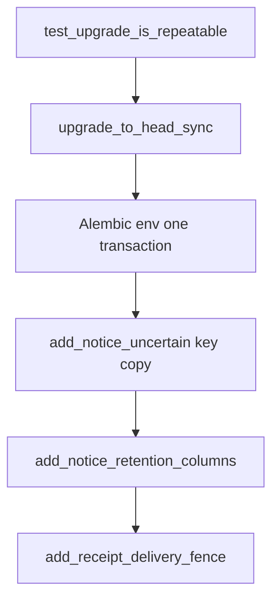

# WISHENKA-232: Notice history survives a repeated data upgrade

## Research

SQLite's `INSERT` requires one value per table column when the column list is
omitted. Columns left out of an explicit list receive their declared default
([INSERT](https://sqlite.org/lang_insert.html)). The same rule is what raises
`table … has N columns but M values were supplied`
([SQLite INSERT](https://sqldocs.org/sqlite-insert-query/)).

`add_notice_uncertain` copies receipt-notice keys with no column list:

```sql
INSERT OR IGNORE INTO notice_receipt_keys
SELECT event_type, receipt_id, giver_user_id FROM notification_outbox
```

That statement is valid on the three-column table this revision creates
(`event_type`, `receipt_id`, `giver_user_id`). A later revision,
`add_notice_retention_columns`, adds `created_at INTEGER NOT NULL DEFAULT 0`.
`CREATE TABLE IF NOT EXISTS` does not alter the table that already exists, so
a second pass still selects three expressions into a four-column table.

The standing check forces that second pass. It upgrades a legacy file to
head, sets `alembic_version` back to `add_item_order_index`, and upgrades to
head again (`tests/test_gift_receipt_migration.py`). Wishlist Alembic runs
that whole span inside one transaction
(`wishenka/wishlists/alembic/env.py`). The column-count error aborts the
transaction, so the comparison of receipts and archive flags never runs.

The next unguarded statement on that same span is
`add_receipt_delivery_fence`, which uses `CREATE TABLE` for
`receipt_delivery_fence` and `receipt_delivery_fence_audit`. No later
revision changes those tables. After the key copy is corrected, SQLite
rejects the second create because the tables are already there. The upgrade
still rolls back, and the standing comparison still does not run.

The runtime writer already names its columns, including `created_at`
(`WishlistStore` insert into `notice_receipt_keys`). Receipt claims select
`status = 'pending'` only (`wishenka/notices/store.py`), so an `uncertain`
row is not an automatic retry.

## Implementation Plan

Change two revision statements. Leave the retention revision, the outbox
rebuild, downgrades, and the runtime writer as they are.

1. In `add_notice_uncertain.upgrade()`, name the destination columns of the
   key copy: `event_type`, `receipt_id`, `giver_user_id`. Keep
   `INSERT OR IGNORE` and the same `SELECT`. Keep the three-column
   `CREATE TABLE IF NOT EXISTS`. `created_at` stays owned by
   `add_notice_retention_columns`.
2. In `add_receipt_delivery_fence.upgrade()`, create both tables with
   `CREATE TABLE IF NOT EXISTS`. Do not drop or rebuild them on the way up.
   `downgrade()` still drops them.

On a first upgrade the key table is created with three columns and the named
insert fills those columns. The retention revision then adds `created_at` and
backfills `WHERE created_at = 0`, as it does today. On a second upgrade the
table already has `created_at`. Existing primary keys are ignored, so their
`created_at` values stay. A key that is present in the outbox and missing
from the key table is inserted with default `0`, and the retention backfill
fills that new row only. Fence rows that already exist are left in place,
including `state = 'uncertain'`.

The outbox rebuild in the same revision already runs before the failing
insert. It copies rows, maps only `pending`/`sending` plus `ambiguous = 1`
to `uncertain`, and then sets `requires_membership = 1`. The legacy fixture
has an empty outbox, so that copy writes nothing. This task does not change
that rebuild. `claim_token` stays omitted there and therefore NULL on a
copied row; claim selection is still `pending` only, so an `uncertain`
status stays ineligible for an automatic retry.

**Mandatory — Failing Repro (next Step 3):** Extend
`tests/test_gift_receipt_migration.py::test_upgrade_is_repeatable`. Do not
add a new module. The module `pytestmark` already sets the timeout. The
production revisions stay unchanged until Step 4.

After the first `upgrade_to_head_sync` on the legacy file, and before
rewinding `alembic_version`:

- Read one back-filled `wl_receipts` row (`id`, `wish_item_id`).
- Insert one `notification_outbox` row for that receipt: `event_type`
  `gift_received`, `wishlist_id` 1, `giver_user_id` 501, `status`
  `uncertain`, `ambiguous` 1, and the existing text timestamps.
- Insert the matching `notice_receipt_keys` row with those three key columns
  and `created_at` `1700000000` (not zero).
- Insert one `receipt_delivery_fence` row for that wish and user 501 with
  `state` `uncertain`.

Snapshot receipt rows, archive flags, the key row
(`event_type`, `receipt_id`, `giver_user_id`, `created_at`), the outbox
association (`event_type`, `receipt_id`, `giver_user_id`, `status`), and
the fence triple (`wish_item_id`, `user_id`, `state`). Rewind to
`add_item_order_index`, upgrade to head, and assert those snapshots are
equal.

Today the second upgrade fails in `add_notice_uncertain` while preparing the
unnamed key insert (four columns, three values), before the assertions. That
is the red result Step 3 records. The fence seed is what the same test
protects once that insert is corrected: a bare `CREATE TABLE` must not be
the next red failure, and an existing `uncertain` fence must still be there
when the assertions run. No live service is required; the test uses a
temporary SQLite file and `upgrade_to_head_sync`.

Sequencing: this architecture, then the red extension of the standing test,
then the two SQL edits until that test is green.

## Architecture

The product stays a single SQLite file updated by the wishlist Alembic
chain. This task does not add a module, a route, or a delivery rule. The
units that interact on a repeated upgrade are the ones below.



| Module | Responsibility on this task |
| --- | --- |
| `test_gift_receipt_migration.py` | Replays from `add_item_order_index` and compares history. |
| `upgrade_to_head_sync` | Applies the wishlist history. Unchanged. |
| `alembic/env.py` | One transaction for the replay. A failed second pass commits nothing. |
| `add_notice_uncertain` | Copies the three key columns. Does not define `created_at`. |
| `add_notice_retention_columns` | Owns `created_at` and the `created_at = 0` backfill. Unchanged. |
| `add_receipt_delivery_fence` | Creates fence tables only when they are absent. |
| `WishlistStore` / notices | Enqueue, claim, and purge. Unchanged. |

Dependencies stay linear: the test calls the upgrade entry point, which runs
revisions in `down_revision` order. The key copy depends on
`notification_outbox` and on `notice_receipt_keys`. The retention revision
depends on the key table and only rewrites `created_at` when it is still 0.
The fence revision does not read notice keys. Nothing here depends on a new
interface.

Patterns:

- **Explicit insert column list.** SQLite then applies the default for
  `created_at` instead of requiring a fourth selected value. The list matches
  the three columns created on the first pass, so that pass stays the same.
- **Idempotent DDL.** `CREATE TABLE IF NOT EXISTS` is the pattern already
  used for `notice_receipt_keys` and for `wl_receipts`. Using it for the two
  fence tables lets a replay succeed without deleting `in_flight` or
  `uncertain` rows.
- **`INSERT OR IGNORE` on the key primary key.** A second copy does not
  replace a giver already tied to a receipt notice.

No repository, factory, or web layer is introduced. The change is confined
to the two revision scripts that the replay cannot apply safely today.

Interfaces between revisions are the tables, not new Python calls.

- Key copy writes `notice_receipt_keys (event_type, receipt_id,
  giver_user_id)` and leaves `created_at` to the table default.
- Retention reads and writes `notice_receipt_keys.created_at` only where the
  value is 0, joining `notification_outbox` on the same three columns.
- Fence upgrade ensures `receipt_delivery_fence` and
  `receipt_delivery_fence_audit` exist and does not modify their rows.
- The standing test reads `wl_receipts`, `wl_items.is_archived`, and, after
  Step 3, the key row, the outbox status, and the fence state.

## Q&A

- **Why name columns instead of adding `created_at` to this revision's
  `CREATE TABLE`?** The retention revision is what adds and backfills that
  column. A wider `CREATE TABLE IF NOT EXISTS` would not change a table that
  already exists, and it would change the shape produced when this revision
  runs alone. Naming the three key columns works for both the new
  three-column table and the later four-column table.
- **Why keep `INSERT OR IGNORE`?** The copy is a deduplication memory. Ignore
  leaves an existing giver/receipt/kind row, and its `created_at`, as stored.
  Replacing or deleting the table would drop that memory.
- **Why is the fence revision part of this fix?** The standing second
  upgrade starts at `add_item_order_index` and runs forward in one
  transaction. The key insert is the error observed today. The fence create
  is the next statement on that path that cannot run once the tables exist.
  Skipping an existing table keeps uncertain fence rows. Dropping them would
  discard that state.
- **Why leave the `notification_outbox` rebuild alone?** It already preserves
  `uncertain`. The diagnosed failure is the key insert, and the legacy
  fixture's outbox is empty. Claim still selects `pending` only.
- **What replay hazard is left out?** `unify_user_keys_and_cascades` joins
  `birthday_entries.owner_id` to `users.id`. After the first unify,
  `owner_id` stores `telegram_id`, so a later replay can drop birthday rows.
  The legacy fixture has none, and birthday rows are not the history this
  task requires to stay put. That join is not edited here.
