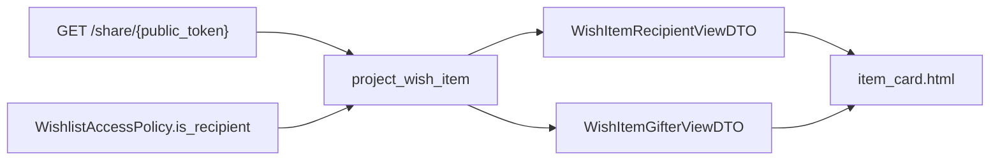

# WISHENKA-235: Anonymous public share shows availability without a book control

## Research

The suspected cause is confirmed in the current code. It is not confirmed
in the access policy.

`project_wish_item` in `wishenka/wishlists/service.py` returns
`recipient_view` when the caller is missing or when the policy says the
caller is the recipient:

```python
if current_user is None or WishlistAccessPolicy.is_recipient(current_user, item):
    return recipient_view(item)
```

`recipient_view` sets `is_recipient=True` and builds
`WishItemRecipientViewDTO`. That DTO has no `available_quantity`.

`WishlistAccessPolicy.is_recipient` does not agree. It delegates to
`is_recipient_id`, and that method returns `False` when `user_id` is
`None`. A missing user is not the recipient. The agreed service
architecture records the same rule in `doc/dev/wishlists.md` and
`doc/dev/reservations.md`. The fold of a missing viewer into the
recipient view lives only in `project_wish_item`.

The share page already has the two presentation gates this task needs.
`view_public_share` passes `viewer_identified` as `current_user is not
None`. `partials/item_card.html` renders `.item-giver` only when
`item.is_recipient` is false. Inside that block the availability line is
`web.item.available_of` («Доступно: {available} из {quantity}») while
`available_quantity >= 1`, and `web.item.reserved_status`
(«Забронировано») otherwise. The book form, and the change, cancel, and
purchase controls, render only when `can_promise` is true. `can_promise`
requires `viewer_identified` and an active list. No new copy is required.

The free remainder is the formula already used for an identified giver:
occupied quantity is the sum of `ACTIVE` and `PURCHASED` reservations,
and the free remainder is `max(0, quantity - received_quantity -
occupied)`. Personal fields (`is_reserved_by_me`, `my_reserved_quantity`,
`my_reservation_id`, `my_reservation_status`) come from rows whose
`user_id` equals `current_user.telegram_id`. Reading `telegram_id` on a
missing user would raise. The anonymous branch must keep those personal
fields empty without touching that attribute.

`GET /api/public/wishlists/{token}` does not copy giver fields. It builds
an allowlist in `public_wishlist`. The verification matrix (S7, A4) keeps
the free remainder off that answer. `GET /api/public/wishlists/{token}/view`
dumps each item with `model_dump`. Today an anonymous dump is the
recipient DTO. After the projection fix it is the giver DTO with empty
personal fields, so the JSON includes the aggregate remainder and
`is_fully_reserved`, and still has no holder id. The Mini App reserve
button in `wishenka/web/static/miniapp.js` is already behind
`list.identified`, so that button stays off for a guest. This task does
not add an availability line to the Mini App.

FastAPI's `response_model` is an output allowlist: fields that are not
on the declared model are not serialized
([Response Model](https://fastapi.tiangolo.com/tutorial/response-model/)).
The public list answer already follows that idea with a hand-built
allowlist. A third DTO, or a runtime field-pruning library, would add a
schema the card does not need. The card reads `available_quantity` only
from `WishItemGifterViewDTO`.

`tests/test_wishenka_63_repro.py` still encodes the fold this ticket
rejects: an anonymous public token must be `WishItemRecipientViewDTO`,
the anonymous share HTML must not contain `giver-available`, and
`test_collaborative_recipient_and_admin_never_see_reservations`
asserts the anonymous `get_wishlist_by_public_token(..., None)` item
as `WishItemRecipientViewDTO`. Those anonymous assertions describe
the defect. They cannot stay as written. The admin recipient
assertions and the identified gifter assertions in that test stay
green.

## Implementation Plan

Change one function, `project_wish_item`. Leave routes, templates, the
i18n catalog, reservation writes, and the public-list allowlist alone.

1. Drop `current_user is None` from the recipient condition. Call
   `recipient_view` only when `WishlistAccessPolicy.is_recipient` is
   true. That keeps the personal-list owner, including a display-name
   wish, and a collaborative recipient, on the silent card.
2. When the caller is missing, build the same `WishItemGifterViewDTO`
   an identified non-recipient gets. Compute `available_quantity` and
   `is_fully_reserved` from every occupying reservation. Set the
   personal fields to the empty values (`is_reserved_by_me` false,
   quantities `0`, status and reservation id `None`). Do not read
   `current_user.telegram_id`.
3. Do not rename `projection_mode`. `get_wishlist_by_public_token` in
   `wishenka/wishlists/repo_ops.py` still logs `anonymous_safe` when
   `current_user` is `None`, before it looks at the DTO class.

After that change the existing card does the rest. An anonymous share
has `is_recipient` false and `viewer_identified` false, so the summary
shows the shared availability line and no book control. An identified
giver still has `viewer_identified` true, so «Забронировать» stays when
units are free and that giver holds nothing. The recipient card stays
on `WishItemRecipientViewDTO`.

**Mandatory — Failing Repro (next Step 3):** The red test already
exists. Step 3 runs it and does not change product code.

- What it asserts: an anonymous `GET /share/{public_token}` of a
  personal list, Russian locale, one wish with quantity 2 and nothing
  taken or received. The wish-card summary contains «Доступно: 2 из 2»
  and does not contain «Забронировать».
- Where it lives:
  `tests/test_wish_card_giver_controls.py`,
  `test_anonymous_share_shows_availability_without_a_book_control`.
  The module already sets `pytestmark = pytest.mark.timeout(30)`.
- How it fails without live deps: the module `test_app` fixture uses a
  temporary SQLite file and `TestClient`. No Telegram call. The summary
  is missing «Доступно: 2 из 2» because the giver block is omitted.
- Add one sibling in the same module, still red, before any product
  fix. Seed quantity 1, have an identified friend take that unit, then
  open the share with no session. The anonymous summary contains
  «Забронировано» and does not contain «Забронировать»,
  «Забронировано вами», or «Куплено». Today the block is omitted, so
  «Забронировано» is absent. Use the same fixture and timeout mark.
- Sequencing: this design, then the two red tests, then the projection
  fix until both are green and the stay-green set below still passes.

## Architecture

The modules below already exist. This task does not add one.



### Modules

| Module | Responsibility |
| --- | --- |
| `WishlistAccessPolicy` | Who must not see booking facts. Missing user is not a recipient. |
| `project_wish_item` | Chooses the DTO. This is the only product change. |
| `recipient_view` | Silent card fields. Still used for a real recipient. |
| `WishItemGifterViewDTO` | Remainder plus own promise. Anonymous personal fields stay empty. |
| `RepoWishlistOps.project_wishlist_view` | Calls `project_wish_item` per active item. Unchanged. |
| `view_public_share` | Loads that projection and sets `viewer_identified`. Unchanged. |
| `item_card.html` | Shared availability line. Book controls require `can_promise`. Unchanged. |
| `public_wishlist` | Allowlist for the public list answer. Still omits the remainder. Unchanged. |
| Reservation routes | `get_current_user`. An anonymous promise stays rejected. Unchanged. |

### Interaction

1. `GET /share/{public_token}` resolves the list through
   `get_wishlist_by_public_token` and projects each active item.
2. A real recipient receives `WishItemRecipientViewDTO`. The template
   omits `.item-giver`. On a personal list the owner is that recipient
   for every wish.
3. Anyone else, including a missing user, receives
   `WishItemGifterViewDTO` with the shared remainder. The template
   prints «Доступно: X из Y» or «Забронировано».
4. `can_promise` is false when `viewer_identified` is false, so the
   anonymous summary has no quantity choice, no «Забронировать», and no
   change, cancel, or purchase control. `is_reserved_by_me` is false, so
   the summary has no «Забронировано вами» and no purchase mark.
5. An identified non-recipient keeps the same DTO with personal fields
   filled, and `can_promise` can be true. The book control stays.
6. The share template does not render the gifted section. Received
   counts on the card require `is_member`, which the share page does
   not set. Those facts stay hidden.

### Patterns

Role projection stays a pure function over the loaded wish, not a new
repository and not a new schema. The policy remains the predicate. The
template remains the presentation gate for controls. The public list
answer remains a separate allowlist so S7 does not start publishing the
remainder. That split is the accepted A2 versus S7 difference in
`doc/dev/verification-matrix.md`.

### Interfaces

`project_wish_item(item, current_user=None)` still returns
`WishItemRecipientViewDTO | WishItemGifterViewDTO`. The contract change
is the missing-user case: it returns the giver DTO, with
`is_recipient` false and empty personal fields. Identified callers keep
today's split.

No HTTP path, status code, or i18n key changes. Promise writes stay on
the authenticated reservation routes.

### Tests that must stay green

These assertions stay as they are. The projection fix must not turn
them red.

- `tests/test_wish_card_giver_controls.py`: identified friend on the
  list and the share (`test_identified_friend_sees_book_control_and_quantity_ceiling`),
  single free unit, personal-owner silence and refused promise,
  collaborative recipient per wish, own line beside availability,
  bought mark, several occupying promises, shortage «Забронировано»
  for an identified giver, busy inventory, cancel restores create,
  archive row, recipient notice, giver refusal, owner mutations.
  `test_anonymous_share_shows_availability_without_a_book_control`
  is the standing red check; it must become green without an assertion
  edit.
- `tests/test_surprise_role_context.py`:
  `test_share_link_visit_creates_no_account` (remainder, no book
  control, no new account).
- Public list answer, remainder still omitted:
  `tests/test_wishlist_api.py`
  `test_anonymous_public_view_hides_existing_reservation` and
  `test_public_api_shows_persisted_wish_without_reservation_details`;
  `tests/test_wishlist_management_ui.py`
  `test_anonymous_public_display_ignores_stale_session_and_hides_reservation`.
- Recipient silence:
  `tests/test_reservations_surprise_invariant.py`
  `test_recipient_view_has_no_reservation_attributes`;
  `tests/test_reservation_observability.py`
  `test_zero_surprise_leaks_in_recipient_audit_trails`;
  `tests/test_wishlist_roles_lifecycle.py` recipient DTO and
  `is_recipient(None) is False`;
  `tests/test_wishlists_htmx_sharing.py`
  `test_public_share_view_owner_surprise_invariant`.
- No anonymous promise:
  `tests/test_reservation_actions_api.py`
  `test_unauthenticated_create_is_rejected` and
  `test_unauthenticated_mutation_is_rejected`.
- Gifted section and receipt button stay absent for an anonymous share:
  `tests/test_gifted_section_ui.py`
  `test_section_absent_for_giver_anonymous_share_and_stranger`;
  `tests/test_receipt_card_ui.py`
  `test_receipt_button_absent_for_giver_anonymous_share_and_archived_list`.
- `tests/test_wishenka_63_repro.py`: the `projection_mode` sequence
  `anonymous_safe`, `recipient_safe`, `gifter`, and the identified
  recipient and giver sections of
  `test_public_api_endpoints_anonymous_recipient_and_gifter_views`.
  The legacy `GET /api/public/wishlists/{token}` body in that test
  still has no `available_quantity`.
- `tests/test_wishenka_63_repro.py`
  `test_collaborative_recipient_and_admin_never_see_reservations`:
  the admin recipient assertions and the identified gifter assertions
  stay as written. The anonymous
  `get_wishlist_by_public_token(..., None)` item is in the rewrite set.

### Tests that encode the defect

Rewrite these in Step 4 so the suite matches the new contract. They
must not be kept green as written.

- `tests/test_wishenka_63_repro.py`
  `test_public_token_anonymous_returns_recipient_dto`
- `tests/test_wishenka_63_repro.py`
  `test_public_share_html_anonymous_hides_reservation_availability`
- The anonymous `/view` assertions in
  `test_public_api_endpoints_anonymous_recipient_and_gifter_views`
  (`is_recipient` true and `available_quantity` absent)
- `tests/test_wishenka_63_repro.py`
  `test_collaborative_recipient_and_admin_never_see_reservations`.
  Its anonymous `get_wishlist_by_public_token(..., None)` item is
  asserted as `WishItemRecipientViewDTO` and will become the giver
  DTO. The admin recipient assertions and the identified gifter
  assertions in that same test stay green.

The replacement contract for those anonymous assertions: anonymous
projection is the giver DTO, `is_recipient` is false,
`available_quantity` is the free remainder, `is_reserved_by_me` is
false, and the share HTML contains the availability line and no
«Забронировать».

## Q&A

- **Does `project_wish_item` set `is_recipient=True` when `current_user`
  is `None`?** Yes. The condition is `current_user is None or`
  `is_recipient(...)`, and `recipient_view` sets `is_recipient=True`.
  The policy method returns false for a missing id. The ticket's lead
  is the cause.
- **Why is the card silent today?** `.item-giver` is skipped when
  `is_recipient` is true, so both the remainder and the book control
  disappear. Hiding the control is what the product wants. Hiding the
  remainder is the defect.
- **Why not only change the template?** The recipient DTO has no
  remainder field. The template cannot print «Доступно: X из Y» until
  the projection supplies `available_quantity`.
- **Why not a new anonymous DTO?** The giver DTO already carries the
  shared line, and the template already withholds controls from an
  unidentified viewer. A third schema would duplicate that split.
- **Does the identified giver still see «Забронировать»?** Yes. That
  path still builds the giver DTO from `telegram_id`, and
  `viewer_identified` stays true. The list-and-share check
  `test_identified_friend_sees_book_control_and_quantity_ceiling`
  must stay green.
- **Does `/view` start returning the remainder to a guest?** Yes, as
  aggregate fields only. Personal fields stay empty, and the Mini App
  reserve button stays behind `identified`. The public list allowlist
  does not gain the remainder. Step 4 updates the defect tests,
  including the anonymous item in
  `test_collaborative_recipient_and_admin_never_see_reservations`,
  and does not widen the allowlist.
- **Which check is the Step 3 red test?** The existing
  `test_anonymous_share_shows_availability_without_a_book_control`,
  plus one new fully-booked anonymous share check in the same file.
