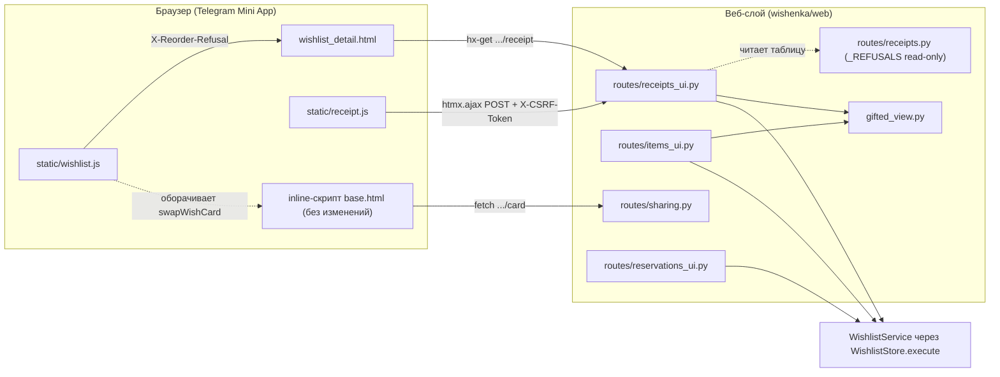

# Спецификация: WISHENKA-24 — Экран отметки получения подарка и раздел «Подаренные» в Mini App

**Версия документа:** 1.0  
**Статус:** реализована и принята  
**Платформа и стек:** Telegram Mini App (Python 3.12+, FastAPI, Jinja2, HTMX 1.9.12, классический статический JavaScript, CSS)  
**Базовые спецификации:** `specs/00-high.md` (инварианты 1 и 4), `in-docs/spec.md` (разделы 7.2, 7.3, UC-07), контракт бэкенда WISHENKA-23 и функциональная концепция WISHENKA-22

---

## 1. Назначение и бизнес-цель

### 1.1. Постановка проблемы

На предыдущем этапе (WISHENKA-23) в системе была реализована доменная и HTTP-логика учёта полученных подарков: фиксация актов получения с частичным и полным закрытием желания, хранение датированной истории, проекции карточек для получателя и дарителей, уведомления дарителям и вычисление признаков получения в кабинете дарителя (`wish_received`, `offer_actions`).

Однако в пользовательском интерфейсе Telegram Mini App отсутствовал слой взаимодействия с этим контрактом:

- Авторы вишлиста не могли отметить получение желания из интерфейса Mini App.
- На странице списка отсутствовал раздел «Подаренные», а активный список продолжал отображать полученные желания в прежнем виде без учёта остатка.
- Раздел архива и диалог архивации не различали частично и полностью полученные желания и не обрабатывали устаревшие карточки.
- Кабинет дарителя «Мои бронирования» не выводил маркер получения владельцем и оставлял неработающую ссылку «К желанию» для уже скрытых полностью полученных желаний.
- При обновлении устаревшей карточки дарителя встроенный скрипт страницы подставлял в DOM сырой JSON-ответ 404 (`{"detail":"Item not found"}`).

### 1.2. Цели и ценность

Задача WISHENKA-24 замыкает вертикальный срез на уровне веб-страниц Mini App без изменения доменных правил и контракта WISHENKA-23:

- **Честный активный список для автора:** владелец, администратор или участник вишлиста отмечает «я получил N штук» в несколько нажатий с явным подтверждением необратимости действия и сразу видит актуальное состояние — уменьшенный остаток при частичном получении или мгновенное исчезновение карточки при полном.
- **Тёплая история подарков отдельно от архива:** полученные подарки с датами актов собираются в разделе «Подаренные», не смешиваясь с отменёнными или отложенными желаниями в архиве.
- **Прозрачность для дарителя без потери автономии:** даритель с открытой бронью на полностью полученное желание видит в кабинете отметку «Желание получено владельцем» и сохраняет полный набор действий над своей бронью (уменьшение, отмена, отметка покупки), а при конкурентном исчезновении карточки на странице списка видит нейтральное сообщение.
- **Сохранение тайны сюрприза:** ни один новый или изменённый элемент интерфейса, HTTP-заголовок, ответ сервера или запись в журнале событий не раскрывает автору или получателю информацию о дарителях, бронированиях, покупках или свободном остатке.

### 1.3. Границы области действия

**Входит в задачу (слой страниц Mini App):**

- Диалог отметки получения (открытие, выбор количества, подтверждение, защита от двойного нажатия) — `U-1`–`U-4`.
- Обновление активного списка и карточки автора без перезагрузки страницы — `U-5`–`U-7`.
- Закрытый набор отказов и состояние занятости (`busy`) на русском языке без раскрытия броней — `U-8`, `U-9`.
- Отображение частично полученных желаний в архиве, обработка устаревших карточек при архивации/восстановлении (`U-10`) и согласованность ручной сортировки (`U-11`).
- Раздел «Подаренные» для участников списка, включая архивные списки (`U-12`–`U-16`).
- Сторона дарителя: маркер и правила ссылок/действий в кабинете (`U-17`, `U-18`), защита карточки и безопасный рефреш (`U-19`).
- Инварианты тайны сюрприза и неизменность публичных представлений (`U-20`, `U-21`), маршрутные и браузерные автотесты, обновление `doc/dev/`.

**Вне рамок задачи (Non-Goals):**

- Любые изменения доменного сервиса, хранения SQLite, миграций, уведомлений бота и JSON-API WISHENKA-23.
- Отмена или редактирование совершённого акта получения (`WISHENKA-153`).
- Серверная идемпотентность повторной отправки получения (`WISHENKA-61`; реализуется только клиентская защита кнопки).
- Экран настроек уведомлений (`WISHENKA-34`), экспортёр метрик (`WISHENKA-84`), RU/EN-локализация текстов (`WISHENKA-33`), изменение механизма CSRF (`WISHENKA-123`).
- Вынос существующего inline-скрипта `base.html` и шести существующих `onclick` в старых модальных окнах (`WISHENKA-140`).
- Продуктовые решения уровня `WISHENKA-154` (включая отдельное состояние «Завершено» для купленных броней и публичную отметку «уже подарено»).
- Редактирование, сортировка, перемещение, архивация или пагинация внутри «Подаренные», совместные покупки, денежные сборы и секретные подарки вне списка.

---

## 2. Функциональные требования и пользовательские сценарии

### 2.1. Роли и матрица видимости

| Возможность / экран | Участник активного списка (`is_member`, `can_edit_wishlist`) | Участник архивного списка (`is_member`, `can_view_gifted`) | Соавтор-получатель желания | Даритель (своя бронь / просмотр) | Анонимный / share-посетитель |
| --- | :---: | :---: | :---: | :---: | :---: |
| Кнопка «Получено» на карточке | Да (при остатке > 0) | Нет | Да (при остатке > 0) | Нет | Нет |
| Бейдж «Осталось N из M» и детали остатка | Да (при полученном > 0) | Нет (карточек нет) | Да (при полученном > 0) | Нет (только `×M`) | Нет (только `×M`) |
| Раздел «Подаренные» и счётчик | Да (если не пуст) | Да (если не пуст) | Да (если не пуст) | Нет | Нет |
| Блок бронирования на карточке | Для чужих желаний (если не получено полностью) | Нет | Нет (recipient-проекция) | Для активных желаний | Для активных желаний |
| Маркер «Желание получено владельцем» в кабинете | — | — | — | Да (только при полном получении) | — |

### 2.2. Основные пользовательские сценарии

1. **Частичное или полное получение подарка автором:** автор раскрывает карточку активного желания, нажимает «Получено», в открывшемся диалоге выбирает количество от `1` до оставшегося (для 1 единицы выбор скрыт), подтверждает действие с предупреждением о необратимости и получает обновлённую страницу без перезагрузки: диалог закрыт, в `#list-notice` показано подтверждение, карточка либо показывает новый остаток, либо удалена из активного списка, а раздел «Подаренные» содержит новую запись/акт.
2. **Конкурентное изменение или временная занятость:** если другой соавтор уже успел отметить часть или всё желание либо транзакция занята (`InventoryBusyError`), пользователь получает понятный отказ на русском языке без технических английских текстов и без упоминаний броней; при «превышении остатка» или «уже полностью получено» карточка и диалог автоматически актуализируются.
3. **Архивация, восстановление и устаревший порядок:** для частично полученного желания в архиве виден только неполученный остаток, а диалог архивации предупреждает, что полученные экземпляры останутся в «Подаренные». При попытке архивировать, восстановить или переупорядочить список, ставший устаревшим, пользователь не сталкивается с молчаливой ошибкой — интерфейс показывает уведомление и синхронизирует список.
4. **Действия дарителя:** даритель видит в своём кабинете маркер получения владельцем для полностью полученного желания (без ссылки «К желанию») и сам решает, уменьшить, отменить или отметить купленной свою бронь. На странице чужого вишлиста при попытке обновить уже исчезнувшую карточку вместо сырого ответа 404 отображается нейтральный текст о недоступности желания.

### 2.3. Функциональные требования (`U-1` – `U-21`)

#### Экран отметки получения (`U-1` – `U-4`)

- **U-1. Точка входа и видимость.** На карточке активного желания с `remaining_quantity > 0` в блоке авторских действий `.item-actions` (условие `can_edit_wishlist`) отображается кнопка «Получено» (`btn-receipt-item`). Кнопка не отображается дарителям, анонимным посетителям, в архивных вишлистах и у архивных или полностью полученных желаний.
- **U-2. Содержимое диалога отметки.** Активация кнопки открывает отдельное модальное окно `#item-receipt-modal` с заголовком «Отметить получение», названием желания, строкой «Осталось: N», блоком выбора количества (`U-3`), предупреждением «Это действие нельзя отменить.», основной кнопкой «Отметить полученным» и кнопкой «Отмена». Закрытие диалога отменой, по клавише `Escape` или по фону ничего не изменяет. В диалоге нет полей или упоминаний дарителей, броней, покупок и свободного остатка.
- **U-3. Выбор количества.** Предлагаются только целые числа от `1` до `remaining` (по умолчанию `1`). Для `remaining > 1` отображается `<select>` и строка подтверждения «Будет отмечено получено: K шт. из N оставшихся», обновляемая при изменении выбора. Для `remaining == 1` выбор не показывается (передаётся скрытое значение `1`), а строка подтверждения имеет вид «Будет отмечено получено: 1 шт.». Желание без указанного количества считается равным 1. Границы в интерфейсе носят вспомогательный характер; окончательной инстанцией остаётся сервер.
- **U-4. Отправка и защита от двойного нажатия.** Отправка передаёт только идентификатор маршрута и целое поле `quantity` под текущей сессией и защитой CSRF. Во время выполнения запроса кнопка подтверждения заблокирована, а повторная отправка игнорируется клиентским флагом ожидания. При отказе или сбое диалог остаётся открытым, кнопка снова становится доступной, а выбранное количество сохраняется.

#### Результат на активном списке и карточке автора (`U-5` – `U-7`)

- **U-5. Частичное получение.** При успешной отметке с ненулевым остатком диалог закрывается, карточка остаётся в активном списке с обновлённым остатком, в `#list-notice` выводится подтверждение `Отмечено получено: K шт. («Название»)`, и раздел «Подаренные» обновляется без перезагрузки страницы.
- **U-6. Полное получение.** Когда полученное количество достигает запрошенного, диалог закрывается, карточка немедленно удаляется из `#items-list`, пересчитываются признаки первой/последней карточки (состояние кнопок перемещения вверх/вниз) или выводится текст пустого списка, показывается то же подтверждение и обновляется «Подаренные».
- **U-7. Карточка автора с полученной частью.** Если `is_member` и `received_quantity > 0`, в компактных бейджах вместо `×M` выводится «Осталось N из M», а в деталях карточки — три элемента: «Запрошено: M», «Получено: K», «Осталось: N». Если ничего не получено, разметка не меняется. На карточке автора и соавтора-получателя отсутствуют любые сведения о бронях.

#### Отказы и состояние занятости (`U-8`, `U-9`)

- **U-8. Закрытый набор отказов на русском языке.** Каждый отказ отображается внутри `#receipt-feedback` в виде фиксированной русской фразы, выбираемой строго по коду причины (`reason`) из унаследованного контракта (английские сообщения маршрута не отображаются):

| Причина (`reason` / источник) | HTTP-статус | Фиксированный русский текст | Эффект на странице списка |
| --- | :---: | --- | --- |
| `quantity_invalid` | 400 | «Укажите целое число не меньше 1.» | Нет |
| `quantity_above_remaining` | 409 | «Нельзя отметить больше, чем осталось. Осталось: N.» (`N` — из исключения) | OOB-обновление карточки и диалога под новый остаток `N` |
| `nothing_remaining` | 409 | «Это желание уже полностью получено.» | OOB-удаление карточки из списка, обновление «Подаренные», перевод диалога в заблокированный вид («Закрыть») |
| `wish_archived` | 409 | «Желание в архиве. Восстановите его, чтобы отметить получение.» | Нет |
| `wishlist_not_active` | 409 / 404 | «Вишлист не активен, отметить получение нельзя.» | Нет |
| `forbidden` | 403 | «У вас нет права отмечать получение в этом вишлисте.» | Нет |
| `not_found` | 404 | «Желание не найдено. Обновите страницу.» | Нет |
| 401, сбой CSRF, 422, 500, сетевой сбой или нераспознанный ответ | — | «Не удалось сохранить отметку. Повторите попытку.» | Нет |

- **U-9. Состояние `busy` (повторяемая ошибка 503).** При `InventoryBusyError` выводится фраза «Не удалось сохранить отметку сейчас. Повторите попытку.». Текст намеренно нейтрален и не содержит слов «занято»/«занят», чтобы не намекать на удержание желания дарителем. Диалог остаётся открытым с ранее выбранным количеством и доступной кнопкой; активный список не меняется.

#### Архив, восстановление и ручная сортировка (`U-10`, `U-11`)

- **U-10. Архив и устаревшие карточки.** В разделе архива отображаются только не полностью полученные архивные желания (`is_in_archive`); при наличии полученной части рядом с названием выводится бейдж «Осталось N». Диалог подтверждения архивации при `received_quantity > 0` добавляет строку: «Архивируется только неполученная часть: полученные штуки останутся в разделе «Подаренные».». Восстановление возвращает карточку в активный список с её остатком и не меняет «Подаренные». Если архивация или восстановление отклоняются по `NothingRemainingError` (409), пользователь видит уведомление «Это желание уже полностью получено.» и актуальное состояние списка, архива и «Подаренные».
- **U-11. Согласованность ручной сортировки (SHOULD).** Перемещение кнопками вверх/вниз и drag-and-drop оперируют только активными карточками и корректно пересчитывают крайние позиции после полного получения. Если переупорядочивание отклоняется сервером с кодом 400 (устаревший состав активного списка), контейнер `#items-list` не перезаписывается ошибкой, в `#list-notice` выводится «Список изменился. Обновляем.» и через 800 мс выполняется перезагрузка страницы.

#### Раздел «Подаренные» (`U-12` – `U-16`)

- **U-12. Доступность и размещение.** Раздел отображается на странице вишлиста ниже активных желаний и отдельно от архива только участникам списка (`can_view_gifted`), включая архивные вишлисты (где кнопки редактирования скрыты). Заголовок в свёрнутом элементе `
`: «Подаренные (N)». При пустом списке раздел скрыт. Дарители, анонимные и share-посетители не видят ни раздел, ни счётчик.
- **U-13. Содержимое записи.** Для каждого подаренного желания выводятся: название, цена с валютой (при наличии), имя получателя `Для: <имя>` (при наличии), строка «Получено: K из M» и список актов в порядке от сервиса (желания — от последнего получения к раннему, акты — от старого к новому). Даты форматируются как календарный день UTC (`dd.mm.yyyy`); для приблизительных дат (`is_approximate=True`) выводится пометка `≈ dd.mm.yyyy (дата примерная) — K шт.`. Сведения о дарителях и бронях отсутствуют.
- **U-14. Режим только чтения.** Раздел не содержит кнопок, форм, ссылок или `hx-*`-атрибутов; описание и ссылка на магазин не выводятся.
- **U-15. Актуализация и деградация при сбое.** Раздел обновляется OOB после каждого акта получения без перезагрузки страницы (MUST). При ошибке чтения `list_gifted_items` (`WishlistError`) на месте записей выводится «Не удалось загрузить «Подаренные». Обновите страницу.» без нарушения работы активного списка (SHOULD для текста сбоя).
- **U-16. Изоляция от архива.** Разделы «Подаренные» и «Архив» имеют отдельные заголовки, контейнеры и счётчики. Желание с полученными единицами никогда не попадает в архив целиком; полностью полученное желание присутствует только в «Подаренные»; частично полученное архивированное желание отображает в архиве неполученный остаток, а в «Подаренные» — полученную часть.

#### Сторона дарителя и защита тайны сюрприза (`U-17` – `U-21`)

- **U-17. Маркер в кабинете дарителя.** Строка открытой брони на полностью полученное желание (`row.wish_received`) содержит маркер «Желание получено владельцем» без количеств, без указания на избыточность брони и без других дарителей. Купленная бронь сохраняет статус «Куплено» без промежуточного состояния «Завершено». Для частично полученного желания маркер не выводится.
- **U-18. Действия и ссылка в кабинете.** При `row.wish_received` ссылка «К желанию» не рендерится (так как желание скрыто из активного списка для не-участников). Действия над бронью на активном списке сохраняются по правилу `offer_actions`, на архивном списке скрыты; закрытые брони в кабинете не отображаются.
- **U-19. Карточка полностью полученного желания и сбой обновления.** На карточке полностью полученного желания блок действий дарителя (`can_promise`) дополнительно закрыт условием `not item.is_fully_received`. При обновлении карточки дарителя после действия с бронью обёртка `swapWishCard` проверяет, что ответ содержит корневой элемент `.item-card` с тем же `id`; при 404 или ином ошибочном/невалидном ответе (включая сбой сети, SHOULD) сырой текст ответа не вставляется в страницу — вместо карточки отображается нейтральное сообщение `
Желание больше недоступно. Обновите страницу.
`.
- **U-20. Отсутствие данных бронирования в новых и изменённых представлениях.** Диалог, карточка автора, уведомления, все тексты отказов и `busy`, «Подаренные» и архив не содержат сведений о дарителях, бронях, покупках или свободном остатке (ни в тексте, ни в HTML-атрибутах). Единственные числа в отказах — актуальный остаток `N` в `quantity_above_remaining` и фиксированная минимальная единица `1` в `quantity_invalid`.
- **U-21. Неизменность публичного доступа.** Даритель без брони, анонимный или share-посетитель не видит никаких признаков того, что желание было частично или полностью получено.

---

## 3. Архитектура, компоненты и интерфейсы

### 3.1. Граница слоёв и схема взаимодействия

Реализация строго ограничена слоем страниц Mini App (`wishenka/web/`). Все доменные проверки и модификации данных выполняются существующим `WishlistService` внутри одной транзакции `BEGIN IMMEDIATE` (`WishlistStore.execute`), вызываемой через `items_ui._execute`.

### 3.2. Модули, классы и функции

| Модуль / файл | Ответственность и ключевые символы | Статус |
| --- | --- | --- |
| `wishenka/web/gifted_view.py` | View-модели `GiftedAct`, `GiftedRow`; форматирование дат `utc_day`; `build_gifted_rows(dtos)`; fail-soft чтение `read_gifted_rows` (`WishlistError` → `None`); общие константы `RECEIPT_REFUSAL_HEADER = "X-Receipt-Refusal"`, `NOTHING_REMAINING_TEXT`; экранирующий OOB-хелпер `oob_text(element_id, text)` | Новый |
| `wishenka/web/routes/receipts_ui.py` | Маршруты `get_receipt_dialog`, `record_receipt_ui` (префикс `/web/wishlists/{wishlist_id}`, логгер `wishenka.web.receipts_ui`); `_check_receipt_open`, `_blocked_dialog`, `_classify` (читает `receipts._REFUSALS`), `_SENTENCES` (включая `busy`), `_quantity_of`, `_read_state`, `_card_oob`, `_list_oob`, `_gifted_oob`, `_effect_fragments`, `_refusal_fragment`, `_log`, `_log_refusal` | Новый |
| `wishenka/web/routes/items_ui.py` | Передача `is_member`, `can_view_gifted`, `gifted_rows` в `view_wishlist_detail`; добавление `is_member` в `_editor_card_flags`; флаг `has_received` в `archive_confirm_ui`; OOB-ответ `_nothing_remaining_response` (409) в архивации и восстановлении вместо `_raise_nothing_remaining` (без изменения `_DOMAIN_ERRORS`); заголовок `REORDER_REFUSAL_HEADER = "X-Reorder-Refusal"` со значением `"stale_order"` в `_reordered_response` | Изменён |
| `wishenka/web/routes/sharing.py` | Передача `is_member` в `get_item_card_partial` | Изменён |
| `wishenka/web/routes/reservations_ui.py` | Без изменений (уже формирует `CabinetRow.wish_received` и `offer_actions`) | Без изменений |
| `wishenka/web/app.py` | Подключение `receipts_ui.router` в `create_app` после `items_ui_router` | Изменён |
| `wishenka/web/templates/partials/item_receipt_modal.html` | Диалог получения (`oob`, `blocked`, опциональный `item_title`, `<select>` или hidden `1`, `role="alert"`) | Новый |
| `wishenka/web/templates/partials/gifted_items_section.html` | Раздел «Подаренные» (`gifted_rows`, `oob`, состояния ошибки/пустого списка/записей) | Новый |
| `wishenka/web/templates/partials/item_card.html` | Бейдж «Осталось N из M», три span в деталях, кнопка `btn-receipt-item`, защита `not item.is_fully_received`, атрибут `card_oob` | Изменён |
| `wishenka/web/templates/partials/archived_items_section.html`, `item_archive_modal.html` | Бейдж `Осталось N` в архиве и пояснение при `has_received` в окне архивации | Изменён |
| `wishenka/web/templates/partials/reservations_list.html` | Маркер `.reservation-wish-received` и сокрытие ссылки «К желанию» при `row.wish_received` | Изменён |
| `wishenka/web/templates/wishlist_detail.html`, `base.html` | Контейнер `#list-notice` (для `is_member`), подключение `gifted_items_section.html` (для `can_view_gifted`), тег `<script src="/static/receipt.js" defer>` после `wishlist.js` | Изменён |
| `wishenka/web/static/receipt.js` | Динамика строки суммы, управление фокусом и закрытием диалога, защита отправки `submitReceipt` / `finishAttempt`, сброс `#receipt-feedback`, защищённый перехватчик `htmx:beforeSwap` по `X-Receipt-Refusal` | Новый |
| `wishenka/web/static/wishlist.js` | Обёртка `window.swapWishCard` (защищённая проверкой `typeof original === 'function'`) и защищённый обработчик `htmx:responseError` для `X-Reorder-Refusal` | Изменён |
| `wishenka/web/static/miniapp.css` | Стили диалога (`.receipt-backdrop` `z-index: 100`, `.receipt-sheet`), уведомлений (`#list-notice`), нейтральной карточки, «Подаренных», бейджей, архива и маркера кабинета (сенсорные зоны `>= 44px`) | Изменён |

#### Отклонения реализации от черновика архитектуры (зафиксированы на этапе разработки)

1. Вынесен общий экранирующий хелпер `oob_text` в `gifted_view.py`, чтобы избежать дублирования и циклических импортов между `receipts_ui.py` и `items_ui.py`.
2. В `GET .../receipt` функция `_check_receipt_open` читает список через `get_wishlist_by_id` до проверки членства, поэтому не-участник удалённого списка получает `wishlist_not_active` (404) вместо `forbidden` (допустимо, так как GET консультативный, а POST сохраняет порядок проверок сервиса).
3. В `POST .../receipt` функция `_quantity_of` преобразует нецелый ввод в `0`, передавая его в `record_item_fulfillment`, чтобы отказ `quantity_invalid` формировался только после проверок членства и состояния списка/желания.

### 3.3. Контракты маршрутов и OOB-фрагментов

| Маршрут | Доступ и защита | Вход | Ответ при успехе | Ответ при отказе |
| --- | --- | --- | --- | --- |
| `GET /web/wishlists/{wishlist_id}/items/{item_id}/receipt` | `get_current_user` (401 без сессии/Bearer) | — | 200 HTML `item_receipt_modal.html` (`blocked=False`, `selected=1`) | 403 / 404 / 409 / 503 + `X-Receipt-Refusal` + диалог с `blocked=True` (без формы, с «Закрыть»; при `forbidden`/`not_found` `item_title=""`; при `nothing_remaining` дополняется OOB-списком и «Подаренные») |
| `POST /web/wishlists/{wishlist_id}/items/{item_id}/receipt` | `get_current_user` + `X-CSRF-Token` для cookie-сессий | Form `quantity` (строка, парсится через `_quantity_of`; лишние поля игнорируются) | 201 только OOB-фрагменты: закрытие `#item-modal-container`, уведомление в `#list-notice`, карточка (`card_oob=True`) при частичном получении или `innerHTML:#items-list` при полном, `#gifted-items-section` (`oob=True`) | 400 / 403 / 404 / 409 / 503 + `X-Receipt-Refusal` + OOB `#receipt-feedback` (для `quantity_above_remaining` также OOB-карточка и OOB-диалог; для `nothing_remaining` также OOB-список, «Подаренные» и заблокированный диалог) |

**Правила консистентности и разделения заголовков:**

- Успешный `POST` выполняется в одной транзакции `_execute`: запись акта через `svc.record_item_fulfillment`, проекция `project_wish_item`, чтение активных элементов `svc.list_wish_items` и чтение подаренных `read_gifted_rows`.
- При отказе `quantity_above_remaining` или `nothing_remaining` транзакция откатывается, после чего `_effect_fragments` выполняет второе read-only чтение `_execute` на принципах best-effort: при возникновении `WishlistError` (включая `InventoryBusyError`) ответ безопасно деградирует к обычному OOB-тексту отказа без замены HTTP-статуса и заголовка.
- `X-Receipt-Refusal` используется **только** для HTML-фрагментов, предназначенных для OOB-применения (диалог получения и ответы `items_ui._nothing_remaining_response` 409 при устаревшей архивации/восстановлении, где каждый корневой элемент тела снабжён `hx-swap-oob`).
- Устаревшая пересортировка (`items_ui._reordered_response`) возвращает 400 с прежним JSON-телом `{"detail": "Invalid item order"}` и отдельным заголовком `X-Reorder-Refusal: stale_order`.

### 3.4. Клиентская логика и переходы состояний

1. **Жизненный цикл диалога (`receipt.js`):**
   - Клик по `.btn-receipt-item` сохраняет идентификатор карточки-инициатора.
   - По `htmx:afterSwap` в `#item-modal-container` фокус автоматически переводится на `[data-receipt-quantity]`, кнопку подтверждения или кнопку закрытия.
   - При изменении `<select data-receipt-quantity>` пересчитывается `textContent` строки `[data-receipt-summary]`.
   - При отправке формы `form[data-receipt-form]`: блокируется повторный вызов (`form.dataset.pending === 'true'`), кнопка подтверждения отключается (`disabled`, `aria-busy="true"`), **`#receipt-feedback` принудительно очищается перед запросом** (чтобы старое сообщение об отказе не скрыло новый сбой), затем выполняется единственный вызов `htmx.ajax('POST', ..., {target: '#receipt-feedback', swap: 'none', values: {quantity}})`.
   - Завершение (`finishAttempt`): если форма осталась в DOM, кнопка разблокируется (значение `<select>` не сбрасывается); если `#receipt-feedback` остался пустым (401, сбой CSRF, 422, 500 или сетевой обрыв), в него записывается общая фраза «Не удалось сохранить отметку. Повторите попытку.».
   - Нажатие `[data-modal-close]`, клик по `.receipt-backdrop` или клавиша `Escape` очищают `#item-modal-container` через `replaceChildren()` и возвращают фокус на карточку-инициатор.
2. **Обработка ответов ошибок в htmx 1.9.12:**
   - В `receipt.js` обработчик `htmx:beforeSwap` сначала проверяет наличие `detail && detail.xhr && typeof detail.xhr.getResponseHeader === 'function'` (совместимость со стабами/событиями без XHR), затем читает `X-Receipt-Refusal`; только если значение входит в закрытый перечень (`_REFUSALS` + `busy`), устанавливает `detail.shouldSwap = true` и `detail.isError = false`.
   - В `wishlist.js` обёртка `window.swapWishCard` проверяет, является ли корневой узел разметки элементом `.item-card` с совпадающим `id`, и в противном случае подставляет нейтральный `
`.
   - Отдельный защищённый обработчик `htmx:responseError` в `wishlist.js` реагирует исключительно на `X-Reorder-Refusal === 'stale_order'`: записывает уведомление в `#list-notice` и вызывает перезагрузку страницы с задержкой `STALE_RELOAD_DELAY_MS = 800`.

---

## 4. Нефункциональные требования, безопасность и наблюдаемость

### 4.1. Безопасность, аутентификация и готовность к строгому CSP

- **Идентификация и защита от подделки запросов (`N-3`):** все маршруты защищены `get_current_user` и используют существующий `BrowserSecurityMiddleware` (токен `X-CSRF-Token` автоматически прикрепляется глобальным слушателем `htmx:configRequest` из `base.html`, включая вызовы `htmx.ajax`). Отдельный канал CSRF не создаётся.
- **Защита от XSS:** все пользовательские данные и тексты отказов проходят автоэкранирование Jinja2 либо `oob_text` (`Markup.format`). В клиентском коде серверные тексты записываются исключительно через `textContent` и `replaceChildren()` (единственный `innerHTML` внутри `swapWishCard` применяется к инертному `<template>` до проверки корневого элемента).
- **Строгий CSP (`N-2`):** задача не добавляет ни одного inline-скрипта, inline-обработчика `on*` и поведенческого inline-стиля; подключён один статический скрипт `/static/receipt.js` с `defer` того же origin. Существующий inline-скрипт в `base.html` остался без изменений и зафиксирован контрольным хешем SHA-256.

### 4.2. Приватность и сохранение тайны сюрприза (`N-1`)

- Все фрагменты автора/получателя строятся на базе `WishItemRecipientViewDTO` и `GiftedItemDTO`, не содержащих полей бронирования и дарителей.
- Запрещённые слова (`бронь`, `забронировано`, `даритель`, `куплено`, `занято`, `занят`) и номера/идентификаторы броней исключены из всех новых шаблонов, отказов, уведомлений, раздела «Подаренные» и текста `busy`.
- Для не-участников в заблокированном диалоге `item_title` принудительно очищается, исключая утечку названия желания из чужого списка.

### 4.3. Производительность, конкурентность и доступность (`N-4`, `N-8`)

- **Запросы и снимки:** при открытии страницы участником выполняется три полных чтения снимка списка в рамках `_execute` (`get_wishlist_by_id`, `get_wishlist_view`, `list_gifted_items`; для не-участников чтение подаренных пропускается), без запросов `N+1` в цикле. После записи получения читается актуальный список и «Подаренные» из той же транзакции.
- **Доступность и визуальный язык:** используются нативные `<button>`, `<select>`, `<label for>`, `role="dialog"`, `aria-labelledby`, `role="alert"` (`#receipt-feedback`), `role="status"` (`#list-notice`), `aria-live="polite"` на строке подтверждения. Сенсорные зоны кнопок — не менее `44px`; модальный фон `.receipt-backdrop` имеет `z-index: 100` поверх фиксированной панели быстрого добавления (`.quick-add-container`, `z-index: 40`). Все пользовательские тексты выдержаны на русском языке (`N-8`).

### 4.4. Наблюдаемость: структурированное логирование и метрики (`N-7`)

Все UI-события пишутся в структурированном виде (`JsonFormatter`, поле `extra`) в логгер **`wishenka.web.receipts_ui`** с фиксированными сообщениями без интерполяции и с набором полей из таблицы WISHENKA-22 (строго без `operation` и `user_id`):

| Событие (`event`) | Уровень | Фиксированное сообщение | Дополнительные ключи (помимо `event`) | Момент записи |
| --- | :---: | --- | --- | --- |
| `ui_receipt_form_opened` | INFO | `Receipt dialog opened` | `wishlist_id`, `item_id`, `actor_id` | Открытие диалога (`get_receipt_dialog`) |
| `ui_receipt_form_refused` | WARNING | `Receipt refused` | `wishlist_id`, `item_id`, `actor_id`, `reason`, `http_status`, и `remaining_quantity` только для `quantity_above_remaining` / `nothing_remaining` | Отказ или `busy` (503) на `GET` |
| `receipt_recorded_http` | INFO | `Receipt recorded` | `wishlist_id`, `item_id`, `actor_id` | После коммита и чтения состояния (`record_receipt_ui`) |
| `receipt_refused` | WARNING | `Receipt refused` | `wishlist_id`, `item_id`, `actor_id`, `reason`, `http_status`, и `remaining_quantity` только для `quantity_above_remaining` / `nothing_remaining` | Отказ на `POST` до чтения `_effect_fragments` |
| `receipt_inventory_busy` | WARNING | `Receipt busy` | `wishlist_id`, `item_id`, `actor_id` | `InventoryBusyError` на `POST` |

**Инварианты и правила наблюдаемости:**

- На каждый исход формируется строго одна запись в `wishenka.web.receipts_ui`; деградация `_effect_fragments` и `read_gifted_rows` дополнительных логов не создаёт.
- При устаревшей архивации/восстановлении UI-слой не дублирует запись доменного сервиса `wish_archive_refused`; при устаревшей сортировке сохраняется существующее событие `ui_items_reorder_rejected`.
- Никогда не логируются: `quantity`, названия желаний, имена дарителей, номера броней, тексты отказов (RU/EN), HTTP-заголовки, `user_id`, `operation`, `exc_info`/трейсбеки и маркеры контура уведомлений (`notification`, `outbox`, `push`, `outbox_id`).
- **Клиентские скрипты:** в `receipt.js` и новых блоках `wishlist.js` отсутствуют `console.*`, `sendBeacon`, `fetch`, `XMLHttpRequest`, `localStorage` и `sessionStorage`.
- **Метрики:** отдельный экспортёр не создаётся (`WISHENKA-84`). Производные бизнес-метрики (например, `wishlist_receipts_total`, конверсия открытия диалога в попытку, отказы по `reason`, доля `busy`) вычисляются из логов; потребители обязаны различать каналы UI и JSON по имени логгера (`wishenka.web.receipts_ui` vs `wishenka.web.receipts`), чтобы избежать двойного подсчёта событий с общими именами `receipt_*`.

---

## 5. Верификация и критерии приёмки

### 5.1. Покрытие автотестами и тестовые сценарии

Все новые и изменённые тестовые модули снабжены маркой `pytest.mark.timeout(...)`, а браузерные тесты — маркой `pytest.mark.browser`, ограниченным ожиданием и проверкой отсутствия ошибок консоли (`assert_clean_console`) и внешних сетевых запросов:

| Тестовый модуль | Объём и проверяемые сценарии |
| --- | --- |
| `tests/test_receipt_ui_routes.py` (`T-2`) | 16 функций (38 параметризованных прогонов): содержимое диалога GET, экранирование `<script>`, `busy` 503, переключатель `oob`/`blocked`, скрытый выбор при `remaining == 1`, отсутствие данных броней, заблокированный диалог (включая `item_title=""` для не-участников), POST частичное и полное получение, проекция соавтора-получателя, все 9 вариантов `_REFUSALS` (включая 409/404 для архивного и удалённого списка), деградация `_effect_fragments`, нецелое `quantity`, 401/CSRF, полнота таблицы причин и аудит UI-логов |
| `tests/test_receipt_card_ui.py` (`T-3`) | 12 тестов: бейдж «Осталось N из M» и 3 поля деталей автора, неизменность карточки без получений и для дарителей/share, видимость кнопки «Получено» только для участников активного списка, текст архивации и восстановление, OOB-only 409 при устаревшей архивации и восстановлении, защита `not item.is_fully_received` в карточке дарителя, заголовок `X-Reorder-Refusal` без `X-Receipt-Refusal`, отсутствие данных броней, наличие `#list-notice` только для участников |
| `tests/test_gifted_section_ui.py` (`T-4`) | 9 тестов: видимость владельцу/админу/участнику (включая архивные списки без кнопок редактирования), скрытие при пустом списке и от не-членов/публичных ссылок, разделение с архивом, состав и порядок записей/актов, XSS-экранирование, пометка приблизительной даты, отсутствие контролов и данных броней, fail-soft при сбое чтения |
| `tests/test_cabinet_received_marker.py` (`T-5`) | 6 тестов: маркер «Желание получено владельцем», скрытие ссылки «К желанию», сохранение «Куплено» без «completed», отсутствие маркера при частичном получении, архивный список без кнопок действий, скрытие закрытых броней, отсутствие цифр/количеств в маркере |
| `tests/test_receipt_static_script.py` (`T-6`) | 9 тестов: раздача `/static/receipt.js` и порядок подключения с `defer` после `wishlist.js`, SHA-256 контроль неизменности inline-скрипта `base.html`, ровно один вызов `htmx.ajax(` на каждый из скриптов, отсутствие атрибутов `on*`, изоляция заголовков `X-Receipt-Refusal` и `X-Reorder-Refusal`, соответствие закрытого набора причин в JS таблице `_REFUSALS` + `busy`, наличие guard-проверки `getResponseHeader`, гигиена JS |
| `tests/test_receipt_modal_browser.py` (`B-1`–`B-6`) | 9 браузерных тестов в Chromium (при поддержке расширенного `tests/browser_assets/htmx_stub.js` и `tests/browser_helpers.py`): обновление суммы, отмена/Escape и возврат фокуса (`B-1`); частичное и полное получение на странице (`B-2`); подавление повторного нажатия в полёте (`B-3`); смена текста отказа на общий сбой при ошибке последующей попытки (`B-4`); сохранение выбранного количества при `busy` 503 (`B-4b`); проверка guard и закрытого перечня `beforeSwap` (`B-4c`); нейтральная замена устаревшей карточки дарителя (`B-5`); уведомление и перезагрузка при `X-Reorder-Refusal: stale_order` (`B-6`); негативная проверка `test_unmarked_error_neither_shows_notice_nor_reloads` (ошибки без маркера не показывают уведомление и не перезагружают страницу) |
| `tests/test_receipt_ui_observability.py` | 1 сквозной тест `test_full_ui_flow_log_contract` (с 3 бронями дарителей 37, 41, 53): проверяет точный набор ключей, ровно одну запись на исход, отсутствие UI-логов при архивации/восстановлении/пересортировке и сканирует все записи `wishenka*` на утечку запрещённых данных и слов уведомлений |

**Зафиксированные результаты проверок:**

- Статический анализ и форматирование (`ruff check wishenka tests`, `ruff format --check wishenka tests`, `mypy wishenka tests`): чисто (0 замечаний в 132 файлах).
- Полный прогон тестов на этапе очистки (`make test`): **797 passed, 0 failed**. После добавления теста наблюдаемости на Шаге 6 все **798** собранных тестов имеют явный маркер `timeout` (`pytest -m "not timeout"` — 0 тестов).
- Дополнительно при приёмке разработки на временной копии выполнена ручная проверка ключевых сценариев с реальной библиотекой htmx 1.9.12 в headless Chromium (диалог, частичное/полное получение, отказы с `X-Receipt-Refusal`, `busy`, устаревшая карточка и пересортировка).

### 5.2. Критерии приёмки (Definition of Done)

Задача считается выполненной при одновременном соблюдении всех 16 обязательных критериев:

1. Автор может открыть диалог получения с активной карточки, выбрать количество `1..N`, увидеть текст о необратимости и отправить форму; дарители, анонимы, неидентифицированные посетители и архивные списки кнопку не получают.
2. Частичное получение обновляет карточку с «Осталось N из M», полное — удаляет карточку со списка без перезагрузки страницы; уведомление называет только желание и полученное количество.
3. Все отказы закрытого перечня, сбой сессии/неизвестная ошибка и `busy` выводят соответствующую русскую фразу, сохраняют работоспособность формы, не содержат запрещённой лексики и при потере гонки показывают актуальный остаток.
4. Повторное нажатие в процессе отправки не порождает второй сетевой запрос.
5. Раздел «Подаренные» отображается только участникам списка (в том числе на архивных списках), скрыт при пустоте и от прочих пользователей и отделён от архива.
6. Записи «Подаренные» содержат название, цену, получателя (при наличии), «Получено: K из M», датированные акты с пометкой приблизительных дат и не содержат контролов и данных броней.
7. Раздел «Подаренные» обновляется после акта получения без перезагрузки страницы.
8. В архиве отображается только неполученная часть; восстановление возвращает актуальный остаток без изменения «Подаренные»; отказ при устаревшей архивации/восстановлении сопровождается уведомлением и обновлением списка.
9. Кабинет дарителя показывает маркер получения и доступные действия для полностью полученного желания на активном списке, скрывает ссылку «К желанию», сохраняет статус «Куплено» без «completed» и не выводит маркер при частичном получении.
10. На карточке полностью полученного желания отсутствуют контролы дарителя, а устаревшая карточка дарителя никогда не превращается в сырой ответ ошибки.
11. Ни одно новое или изменённое представление не раскрывает данные о бронях; существующие и новые тесты тайны сюрприза проходят.
12. Документация разработчика (`doc/dev/gift-receipt.md`, `doc/dev/miniapp.md`, `doc/dev/reservations.md`, `doc/dev/items.md`, `doc/dev/architecture.md`, `doc/dev/testing.md`, `doc/dev/verification-matrix.md`) актуализирована, пометки об отсутствии UI сняты.
13. Не добавлено ни одного inline-скрипта, обработчика `on*` или поведенческого inline-стиля.
14. Элементы диалога доступны с клавиатуры, все поля подписаны, отказы и `busy` объявляются вспомогательным технологиям (`role="alert"`).
15. Изменения ограничены слоем страниц Mini App без правки доменных правил, БД, миграций, уведомлений и JSON-API WISHENKA-23.
16. Каждая попытка получения в Mini App логируется строго один раз на исход с разрешённым подмножеством полей и без утечки запрещённых данных.

### 5.3. Известные ограничения и перенесённые задачи технического долга

По итогам анализа технического долга (`60-tech-debt.md`) **блокирующих замечаний нет** (`0 BLOCKER`). Выявленные ограничения и неблокирующие доработки зафиксированы в Jira:

**Принятые ограничения реализации:**

- **Тестовый стаб вместо реального htmx (`S-1`, `S-2`, `M-1`):** офлайн-браузерные тесты работают поверх модифицированного `tests/browser_assets/htmx_stub.js` (в `B-3` блокируется `window.fetch`, тогда как реальный htmx использует XHR; стаб не имитирует `console.error` реального htmx для неподменённых 4xx и больше не свапает ответы с кодом >= 400).
- **Доступность и UX диалога (`S-3`, `S-4`, `M-2`, `M-3`, `P-3`):** после успешного получения фокус уходит на `body`, так как контейнер диалога очищается, а карточка обновляется/удаляется; отсутствует focus trap (`aria-modal` не выставлен); блок `
` в «Подаренные» сворачивается после OOB-обновления; `<select>` выводит все числа `1..N` без степпера/ограничителя.
- **Связность веб-слоя (`S-6`, `S-7`, `S-11`, `C-1`–`C-6`):** `receipts_ui.py` использует приватный словарь `receipts._REFUSALS` и три приватных хелпера из `items_ui.py`; OOB-сборка списка и «Подаренные» частично дублируется между `receipts_ui.py` и `items_ui._nothing_remaining_response`; константы селекторов, заголовков и некоторые русские строки дублируются между Python, шаблонами и JS.
- **Предсуществующие дефекты старых модальных окон (`S-5`, `S-9`, `S-10`, `M-6`):** модальные окна редактирования и архивации не отображают 4xx/5xx-ошибки в реальном htmx 1.9.12 и не имеют CSS-правил для `.modal-backdrop`/`.modal-sheet`, из-за чего кнопка подтверждения архивации перекрывается фиксированной панелью `.quick-add-container`, а кнопка архивации в модалке редактирования не задаёт `hx-target`.

**Созданные тикеты технического долга и связанные задачи:**

| Внутренний ID | Тикет Jira | Приоритет и тип | Содержание |
| --- | --- | --- | --- |
| `T-3` | `WISHENKA-160` | High / Bug (5 SP) | Исправление отображения 4xx/5xx и CSS для старых модальных окон редактирования и архивации (`item_edit_modal.html`, `item_archive_modal.html`), включая `hx-target` на кнопке архивации |
| `T-2` | `WISHENKA-161` | Medium / Debt (5 SP) | Доступность и мобильный UX диалога получения: возврат фокуса после успеха, focus trap / `inert`, сохранение открытости `
`, лимит/степпер при больших `N`, тесты на 44 px и перекрытие |
| `T-1` | `WISHENKA-162` | Low / Debt (2 SP) | Актуализация `htmx_stub.js`: исправление докстринга, перехват XHR наряду с `fetch`, корректировка проверок `console.error` (в связке с `WISHENKA-145`) |
| `T-4` | `WISHENKA-163` | Low / Debt (5 SP) | Рефакторинг веб-слоя: вынос `_list_oob`/`_gifted_oob` в `gifted_view.py`, публичный доступ к `_REFUSALS` и хелперам `items_ui`, dataclass состояния вместо 6-кортежа в `view_wishlist_detail`, общий модуль констант и перенос шаблона уведомления успеха в `_SENTENCES` |
| `T-5` | `WISHENKA-164` | Low / Debt (2 SP) | Редакторская вычитка всех новых русских формулировок и склонений числительных перед RU/EN-локализацией (`WISHENKA-33`) |
| `T-6` | `WISHENKA-165` | Low / Debt (3 SP) | Вынесение CSS-токенов, поддержка `--tg-theme-*` для цветов текста и тёмной темы, унификация `DEFAULT_CURRENCY` и `STALE_RELOAD_DELAY_MS` |

**Связанные существующие задачи (без дублирования тикетов):** `WISHENKA-145` (smoke-тесты на реальном htmx), `WISHENKA-158` (сохранить импортируемость `receipts._REFUSALS` при расщеплении модуля), `WISHENKA-157` (уточнение контракта логов и имён событий), `WISHENKA-140` (перенос inline-скрипта и обновление SHA-256 теста), `WISHENKA-118` (стоимость чтений снимков), `WISHENKA-33` (локализация RU/EN), `WISHENKA-90` (глобальная обработка ошибок htmx), а также внеохватные `WISHENKA-153`, `61`, `123`, `84`, `34`, `126`.
