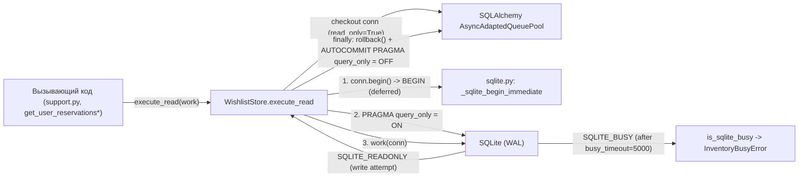

# WISHENKA-254: Усиление read-only гарантий и обработки `SQLITE_BUSY` в `WishlistStore.execute_read`

## Research

### Текущее состояние кодовой базы

1. **Конфигурация пула и транзакций (`wishenka/wishlists/store.py`, `wishenka/sqlite.py`)**:
   - `WishlistStore.__init__` (`wishenka/wishlists/store.py:382-395`) заменяет `:memory:` на временный файл и создаёт `AsyncEngine` через `create_async_engine(database_url, connect_args={"timeout": 5}, hide_parameters=True)` (файловый SQLite использует `AsyncAdaptedQueuePool`, т.е. соединения переиспользуются между операциями).
   - `configure_immediate_transactions(self.engine.sync_engine)` (`wishenka/sqlite.py:14-40`) регистрирует обработчики событий SQLAlchemy:
     - `connect`: отключает `dbapi_connection.isolation_level = None`, включает `PRAGMA foreign_keys=ON` и `PRAGMA busy_timeout=5000`.
     - `begin`: для `AUTOCOMMIT` выходит сразу; иначе выставляет `PRAGMA busy_timeout=5000` и запускает `BEGIN` (если `execution_options["read_only"]` истинно) или `BEGIN IMMEDIATE` (для операций записи).
   - `is_sqlite_busy(exc)` (`wishenka/sqlite.py:53-71`) рекурсивно проверяет `exc`, `orig` и `__cause__` на код `sqlite3.SQLITE_BUSY` или сообщения `"database is locked"` / `"database is busy"`.

2. **Текущая реализация `WishlistStore.execute_read` (`wishenka/wishlists/store.py:1738-1748`)**:
   - Берёт соединение из пула (`async with self.engine.connect() as raw_conn`), устанавливает `read_only=True`, вызывает `await conn.begin()` (что приводит к deferred `BEGIN`), выполняет `work(conn)` и в `finally` делает `rollback()` при активной транзакции.
   - **Пробел 1 (отсутствие физического запрета записи)**: `PRAGMA query_only = ON` не выставляется. Любой `INSERT`/`UPDATE`/`DELETE` внутри `work(conn)` фактически выполняется в рамках deferred-транзакции (эскалируя её до write-lock на время выполнения) и лишь откатывается в `finally`.
   - **Пробел 2 (несогласованная обработка `SQLITE_BUSY`)**: `execute_read` не перехватывает `SQLAlchemyError` с `is_sqlite_busy(exc)`. Методы кабинета (`get_user_reservations`, `get_user_reservations_summary`, строки `1628-1650`) оборачивают вызов `execute_read` в `try/except SQLAlchemyError` и вызывают `_raise_for_storage_error(..., cabinet_operation=...)`, что преобразует `SQLITE_BUSY` в `InventoryBusyError`. При этом прямые вызывающие стороны (например, `wishenka/bot/support.py:336`) получают сырой `sqlalchemy.exc.OperationalError`.

3. **Сравнение с `UserStore` (`wishenka/users/store.py:64-135`)**:
   - `UserStore._immediate` перехватывает `SQLAlchemyError` и при `is_sqlite_busy(exc)` логирует предупреждение (`user_store_busy`) и поднимает доменное исключение `UserStoreBusyError` (без дополнительного Python-цикла ретраев поверх `busy_timeout=5000`).
   - `UserStore._read` аналогично использует `execution_options(read_only=True)` + `BEGIN` + `rollback()` в `finally`.

4. **Поведение SQLite `PRAGMA query_only` (по результатам проверки документации SQLite и SQLAlchemy)**:
   - При `PRAGMA query_only = ON` любая попытка модификации данных (`INSERT`, `UPDATE`, `DELETE`, DDL) немедленно отклоняется SQLite с ошибкой `SQLITE_READONLY` (`sqlite3.OperationalError: attempt to write a readonly database`), оборачиваемой SQLAlchemy в `sqlalchemy.exc.OperationalError`.
   - Deferred-транзакция (`BEGIN`) совместима с `PRAGMA query_only = ON`, в отличие от `BEGIN IMMEDIATE` (который пытается захватить write-lock сразу).
   - `PRAGMA query_only` является настройкой уровня соединения (не транзакционной): `ROLLBACK` не сбрасывает её. Поскольку `AsyncAdaptedQueuePool` возвращает соединение в пул для повторного использования, `PRAGMA query_only = OFF` обязан выполняться в `finally` перед выходом из `async with self.engine.connect()`. При сбое сброса соединение необходимо инвалидировать (`await raw_conn.invalidate()`), чтобы исключить утечку режима `query_only` в пул.

5. **Существующие тесты (`tests/test_wishlists_sqlite_repo.py:334-470`)**:
   - `test_execute_read_rolls_back_mutations_on_normal_return` (строки `339-373`) и `test_execute_read_rolls_back_mutations_on_exception` (строки `377-412`) намеренно выполняют `UPDATE wl_lists` внутри `execute_read`, ожидая отката после завершения `work`. С включением `PRAGMA query_only = ON` эти `UPDATE` будут сразу отклоняться с `OperationalError`.
   - `test_execute_read_does_not_block_on_active_immediate_transaction` (строки `416-470`) проверяет неблокирующее чтение в WAL при активной `BEGIN IMMEDIATE` транзакции записи.

## Implementation Plan

1. **Усиление `WishlistStore.execute_read` (`wishenka/wishlists/store.py`)**:
   - После `await conn.begin()` включать `await conn.exec_driver_sql("PRAGMA query_only = ON")`.
   - Оборачивать выполнение в `try / except SQLAlchemyError / finally`:
     - При `SQLAlchemyError` с `is_sqlite_busy(exc)` логировать structured warning (`event="wishlist_read_busy"`) и поднимать `InventoryBusyError` (без дополнительного Python-ретрая поверх `busy_timeout=5000`).
     - Прочие `SQLAlchemyError` (включая `OperationalError` от `attempt to write a readonly database`) пробрасывать без подмены.
   - В `finally`:
     - Если `conn.in_transaction()`, выполнить `await conn.rollback()`.
     - Сбросить `PRAGMA query_only = OFF` через `AUTOCOMMIT`-соединение (`await (await raw_conn.execution_options(isolation_level="AUTOCOMMIT")).exec_driver_sql("PRAGMA query_only = OFF")`), чтобы не открывать лишнюю транзакцию на пуле.
     - Если сброс `PRAGMA query_only = OFF` завершился исключением, вызвать `await raw_conn.invalidate()`, чтобы не вернуть в пул соединение в read-only состоянии (не маскируя исходное исключение, если оно уже есть).

2. **Отказ от избыточного Python-ретрая `SQLITE_BUSY` в `execute_read`**:
   - В WAL-режиме обычные deferred `SELECT`-запросы не конкурируют с `BEGIN IMMEDIATE`. Для редких случаев блокировки (`EXCLUSIVE` lock, checkpointing) на каждом соединении уже настроен `PRAGMA busy_timeout = 5000` (5 секунд).
   - Повторный запуск `work(conn)` в Python поверх `busy_timeout=5000` удвоил бы/утроил бы задержку ответа (10–15 сек), что ухудшает UX. Поэтому целевая политика: ожидание на уровне SQLite (`busy_timeout=5000`) + немедленное преобразование исчерпанного `SQLITE_BUSY` в `InventoryBusyError`.

3. **Согласование существующих тестов (`tests/test_wishlists_sqlite_repo.py`)**:
   - `test_execute_read_rolls_back_mutations_on_normal_return`: обновить (и при необходимости уточнить имя/docstring), чтобы проверять немедленный отказ `OperationalError` (`readonly`) при попытке `UPDATE` внутри `execute_read` и сохранность исходных данных.
   - `test_execute_read_rolls_back_mutations_on_exception`: обновить так, чтобы `failing_read` выполнял чтение (`SELECT`) и выбрасывал `_ReadProbeError("boom")`, проверяя проброс исключения и отсутствие утечки состояния (последующая запись через `store.execute` проходит успешно).

**Mandatory — Failing Repro (next Step 3):**
- **Файл**: `tests/test_wishenka_254_execute_read_hardening_repro.py` (с `pytestmark = pytest.mark.timeout(30)`).
- **Что проверяет**:
  1. `test_execute_read_rejects_write_with_readonly_error`: попытка `UPDATE wl_lists` внутри `store.execute_read` должна падать с `sqlalchemy.exc.OperationalError` (`"readonly"` в тексте ошибки), а не выполняться с последующим откатом; данные в БД не меняются.
  2. `test_execute_read_resets_query_only_before_pool_return`: после завершения `execute_read` (как успешного, так и с ошибкой записи / пользовательским исключением) следующее обращение к `store.execute` и `PRAGMA query_only` внутри `store.transaction` показывает `0` (запись успешна, утечки состояния в пул нет).
  3. `test_execute_read_maps_sqlite_busy_to_inventory_busy_error`: при возникновении `SQLITE_BUSY` (воспроизводится без внешних зависимостей — через `sqlite3.OperationalError("database is locked")` внутри `work` или реальный `BEGIN EXCLUSIVE` на отдельном соединении с коротким таймаутом) `execute_read` поднимает `InventoryBusyError`, а не сырой `OperationalError`.
  4. `test_execute_read_preserves_non_blocking_wal_reads`: параллельное чтение через `execute_read` при активной `BEGIN IMMEDIATE` транзакции записи завершается без блокировки.
- **Последовательность**: исследование (Step 2) → красный тест в `tests/test_wishenka_254_execute_read_hardening_repro.py` (Step 3) → реализация в `wishenka/wishlists/store.py` и согласование `tests/test_wishlists_sqlite_repo.py` до зелёного прогона (Step 4).

## Architecture

### Схема взаимодействия компонентов

### Описание модулей и их ответственности

| Модуль / метод | Ответственность | Изменения в WISHENKA-254 |
|---|---|---|
| `wishenka/sqlite.py` | Конфигурация `connect` (`foreign_keys=ON`, `busy_timeout=5000`) и `begin` (`BEGIN` vs `BEGIN IMMEDIATE`), детектор `is_sqlite_busy` | Без изменений (уже поддерживает `read_only=True` -> deferred `BEGIN` и `busy_timeout=5000`). |
| `wishenka/wishlists/store.py` (`WishlistStore.execute_read`) | Изолированный контекст чтения с пулом соединений | Включение `PRAGMA query_only = ON` после `begin()`, маппинг `is_sqlite_busy` -> `InventoryBusyError`, гарантированный сброс `PRAGMA query_only = OFF` в `finally` (с `invalidate()` при ошибке сброса). |
| `wishenka/wishlists/store.py` (`get_user_reservations`, `get_user_reservations_summary`) | Чтение кабинета дарителя | Без изменений: `InventoryBusyError` из `execute_read` проходит сквозь `except SQLAlchemyError`, а прочие `SQLAlchemyError` по-прежнему обрабатываются через `_raise_for_storage_error`. |
| `wishenka/bot/support.py` (`_submit_support_message`) | Rate-limit проверка и сбор диагностического контекста через `store.execute_read` | Без изменений в контракте: при занятости получает `InventoryBusyError` вместо сырого `OperationalError`. |
| `tests/test_wishlists_sqlite_repo.py` | Юнит-тесты репозитория и `execute_read` | Согласование ожиданий двух тестов отката мутаций с новым строгим запретом записи (`PRAGMA query_only = ON`). |

### Выбранные архитектурные паттерны и обоснование

1. **Defense-in-Depth на уровне БД (`PRAGMA query_only = ON`)**:
   - Запрет записи обеспечивается самим движком SQLite, а не только соглашением вызывающего кода и `rollback()`. Любая случайная мутация отклоняется немедленно до захвата write-lock.
2. **Scoped Connection State Reset + Pool Invalidation**:
   - Сброс `PRAGMA query_only = OFF` в режиме `AUTOCOMMIT` в блоке `finally` гарантирует возврат соединения в пул в чистом состоянии, а `raw_conn.invalidate()` при сбое сброса защищает пул от отравленных соединений.
3. **Единый доменный контракт занятости (`InventoryBusyError`) без дублирования таймаутов**:
   - Опора на `PRAGMA busy_timeout = 5000` исключает каскадные задержки от повторных Python-ретраев, а маппинг `is_sqlite_busy(exc)` -> `InventoryBusyError` выравнивает `execute_read` с `_immediate` и `UserStore._immediate` (`UserStoreBusyError`).

### Основные интерфейсы

- `WishlistStore.execute_read(self, work: Callable[[AsyncConnection], Awaitable[T]]) -> T`:
  - **Preconditions**: соединение с `read_only=True` (`BEGIN` deferred), `PRAGMA busy_timeout = 5000`, `PRAGMA query_only = ON`.
  - **Raises**:
    - `InventoryBusyError`: при `SQLITE_BUSY` после исчерпания `busy_timeout`.
    - `sqlalchemy.exc.OperationalError` (`SQLITE_READONLY`): при попытке записи внутри `work`.
    - Любые исключения, поднятые самим `work(conn)`.
  - **Postconditions**: активная транзакция откачена, `PRAGMA query_only = OFF` восстановлен (или соединение инвалидировано) до возврата в пул.

## Q&A

- **Q: Почему не использовать отдельное read-only подключение (URI `?mode=ro`) вместо `PRAGMA query_only = ON/OFF`?**
  - **A**: `WishlistStore` уже управляет единым `AsyncEngine` и общим пулом соединений (`create_async_engine`). Включение/сброс `PRAGMA query_only` на уровне `execute_read` не требует второго движка/пула, сохраняет поддержку временных БД для `:memory:` и полностью совместимо с `configure_immediate_transactions`.
- **Q: Не приведёт ли отказ от Python-ретраев в `execute_read` к ложным сбоям при кратковременной конкуренции?**
  - **A**: Нет: в WAL-режиме чтения не блокируются активными `BEGIN IMMEDIATE` транзакциями записи, а для редких системных блокировок уже работает встроенный busy-handler SQLite с `busy_timeout = 5000` (5 секунд).
