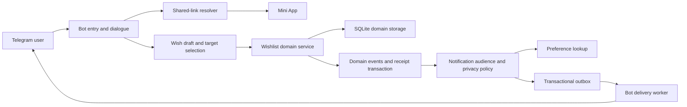

# WISHENKA-26: Bot journeys and notification rules

## Research

- `10-requirements.md` defines a documentation-only decomposition: its deliverable is a
  scenario specification, not an implementation of the bot or notification system.
- `specs/00-high.md` and `in-docs/spec.md` define the surprise invariant, anonymous shared-link
  access, input flows, notification preferences, and receipt notifications.
- `doc/dev/architecture.md` identifies the existing FastAPI, aiogram and SQLite architecture,
  the role-filtered views, and an existing transactional outbox for receipt notifications.
  Receipt handling already persists the outbox record with the receipt; this design does not
  assume that other notification types have already been implemented.
- [Telegram bot deep links](https://core.telegram.org/bots/features#deep-linking) pass a start
  parameter to the bot and restrict its character set and length. The
  [aiogram deep-link utilities](https://docs.aiogram.dev/en/latest/utils/deep_linking.html)
  support generation and decoding. The specification must treat the value as untrusted and leave
  the exact token format and handoff mechanism to the implementation task.

## Implementation Plan

1. Produce one reviewable scenario specification for `/start`, shared-link entry, and incoming
   text or links. Include decisions, transitions, failures, cancellation, and acceptance examples.
2. Add a notification matrix with event, audience, exclusions, preference and safe content;
   provide Russian and English examples and identify deferred policy decisions.
3. Check each journey against the requirements and product specifications, and distinguish
   existing receipt notification behavior from proposed behavior for later tasks.
4. **Failing Repro: N/A — no behavioral change.** This task creates a design specification only;
   no executable behavior or runtime interface is changed. Subsequent implementation tasks
   should first write isolated tests for their own specified behavior, then implement it.

## Architecture

This is the intended interaction model for subsequent tasks, not a claim that these components
or APIs already exist. The current task delivers the specification of their observable behavior.

### Responsibilities and dependencies

- **Bot entry and dialogue** receives `/start` and user input, renders menu and draft state,
  invokes domain capabilities, and translates results into clear user-facing outcomes.
- **Shared-link resolver** validates an untrusted parameter and resolves its permitted target.
  The Mini App independently enforces access and uses a recipient-safe representation. A broken
  or unavailable target yields a generic recovery path without disclosing private details.
- **Wish draft and target selection** determines lists in which the user can add a wish,
  performs optional metadata extraction with manual fallback, and gathers explicit confirmation.
  It rechecks authorization when saving through the existing domain service.
- **Wishlist domain service and storage** own authorization and atomic changes. They are the
  source of truth for wishes, recipients, reservations, and receipt events; the dialogue is not.
- **Notification policy** derives candidates from the event and current role context, applies
  recipient exclusion before templates or links are selected, and suppresses unsafe messages.
  Per-list preferences override global settings. Recipients cannot receive information about
  their own reservation or purchase even when they also hold a giver or collaborator role.
- **Outbox and delivery worker** decouple delivery from business transactions. Receipt events
  already use this pattern; any extension is a later implementation decision. Delivery failure
  cannot roll back a recorded receipt. A receipt produces one eligible notice per open reservation
  holder, subject to preferences, without quantities or information about other givers.

### Main conceptual interfaces

These describe boundaries and inputs, not prescribed Python signatures or public HTTP endpoints.

| Boundary | Input | Output and guarantees |
| --- | --- | --- |
| Entry to resolver | Start parameter, caller | Authorized target or generic failure |
| Bot to draft | User, input, list | Preview, choice, error, or cancellation |
| Draft to domain | Confirmed draft, user, target | Save or failure; no implicit save |
| Event to policy | Event, wish, roles, preferences | Safe recipients and content or suppression |
| Policy to delivery | Localized message, destination | Queued; failure does not reverse state |

Dependencies point inward: Telegram adapters use domain capabilities, while the domain does not
rely on transport or localized message formatting. Audience determination and privacy checks
precede rendering and delivery; filtering only visible text after rendering is insufficient because
message occurrence, links, and previews can themselves reveal a hidden event.

### Patterns and rationale

- **Ports and adapters:** isolate Telegram and the Mini App from domain decisions so scenarios
  can be exercised without live Telegram.
- **Stateful dialogue with explicit confirmation:** keeps selection, preview and cancellation
  distinct from the domain save and makes failure recovery visible.
- **Transactional outbox:** separates reliable delivery from domain changes and preserves the
  already established receipt transaction boundary.
- **Fail-closed, role-aware projection:** suppresses any message whose occurrence or contents
  might disclose a surprise; this protects users with overlapping roles.

## Q&A

- **Where does the final scenario specification live?** Step 4 selects a stable documentation
  location consistent with the repository and records it in the roadmap.
- **Are reminder lead times, defaults and exact link encoding fixed here?** No. The source
  specifications do not fix them. Record them as open decisions for their implementation tasks.
- **Can a public shared link grant write access?** No. Reading by link and permission to add a
  wish are separate; the domain must authorize the latter.
- **Does a message to a recipient become safe by omitting reservation details?** Not necessarily.
  Its timing, existence, destination, and preview can reveal the event; suppress it if unsafe.
