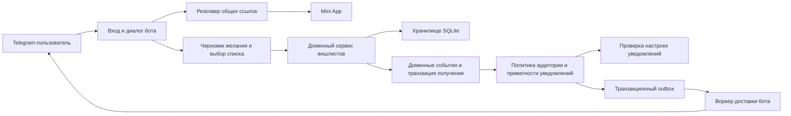

# Спецификация: WISHENKA-26 — Пользовательские сценарии Telegram-бота и правила уведомлений

**Идентификатор задачи:** `WISHENKA-26`  
**Тип задачи:** продуктово-архитектурная спецификация (документация без изменения runtime-кода)  
**Статус:** согласованная сценарная модель для задач реализации `WISHENKA-27`, `WISHENKA-28` и `WISHENKA-29`  
**Базовые документы:** `specs/00-high.md`, `in-docs/spec.md`, `in-docs/bot-scenarios.md`

## 1. Назначение и бизнес-цель

### 1.1. Постановка проблемы

Пользователям сервиса необходим единый, предсказуемый и малозатратный по действиям способ входа в сервис через Telegram-бота, перехода к чужим вишлистам по публичным ссылкам, быстрого сохранения желаний из чата и получения своевременных уведомлений. При разрозненной реализации этих потоков возникают риски несогласованных отказов по ссылкам, случайного создания или дублирования желаний при сбоях, а также нарушения ключевого продуктового инварианта — раскрытия тайны сюрприза получателю подарка (особенно при совмещении ролей в совместных списках).

### 1.2. Цели задачи

- Сформировать проверяемую сценарную спецификацию поведения Telegram-бота и правил уведомлений (`in-docs/bot-scenarios.md`) как единый контракт для последующих задач разработки.
- Описать сквозной путь пользователя от команды `/start` и переходов по общим ссылкам до ручного или автоматического добавления желаний из текста и ссылок на товары.
- Зафиксировать матрицу событий уведомлений, правило приоритета настроек списка над общими настройками и жёсткие ограничения приватности (включая полное подавление небезопасных сообщений).
- Явно отделить уже существующее транзакционное поведение уведомлений о получении подарка от целевого поведения, отложенного на последующие задачи реализации (`WISHENKA-27`, `WISHENKA-28`, `WISHENKA-29`).

### 1.3. Ценность для пользователей и системы

- **Для гостя и дарителя:** мгновенный переход в конкретный вишлист по ссылке в Telegram Mini App без дополнительной регистрации и онбординга, а также релевантные уведомления о бронях и получении подарков в рамках настроек.
- **Для владельца и соавторов:** быстрое добавление желаний пересылкой текста или ссылки в чат с ботом с явным предпросмотром, выбором допустимого списка и защитой от случайного сохранения.
- **Для получателя подарка:** безусловная изоляция от сведений о бронировании, покупке, личности дарителей и косвенных признаков таких событий, даже при совмещении ролей соавтора или дарителя.
- **Для архитектуры и разработки:** чёткие границы ответственности компонентов, формализованные приёмочные примеры и прозрачный список открытых решений до начала кодирования.

## 2. Функциональные требования и пользовательские сценарии

### 2.1. Бизнес-сущности и ролевой контекст

| Сущность | Назначение в сценариях |
| --- | --- |
| Пользователь | Участник Telegram с выбранным языком интерфейса (`ru` или `en`) и настройками уведомлений |
| Вишлист | Публикуемая коллекция желаний с владельцем, возможными соавторами и настройками уровня списка |
| Желание | Именованный желаемый подарок (опционально со ссылкой на товар и другими полями) и указанным получателем |
| Получатель | Лицо, которому предназначено желание; его тайна сюрприза защищается безусловно |
| Даритель и бронь | Пользователь и его обязательство по подарку, включая статус покупки |
| Событие и напоминание | Отслеживаемая дата или повод и своевременное оповещение о нём |
| Уведомление | Сообщение о событии, направляемое правомочному адресату с учётом его настроек |

**Допустимый вишлист (eligible list):** список, в котором текущий пользователь обладает правами на добавление желаний. Просмотр чужого списка по публичной ссылке **не** предоставляет прав на запись и добавление желаний.

### 2.2. Точка входа `/start` и переходы по ссылкам (UC-BOT-01)

**Вход без параметра (приватный чат):**

- Команда `/start` без параметра является штатным входом в меню, а не ошибкой.
- Повторный вызов `/start` не должен неявно сохранять незавершённое желание.
- Бот отображает главное меню из четырёх обязательных пунктов на языке пользователя:

| Пункт меню | Ожидаемый переход / действие |
| --- | --- |
| Создать вишлист | Открывает Mini App на потоке создания вишлиста |
| Мои вишлисты | Открывает Mini App на коллекции списков пользователя |
| Как это работает | Поясняет создание списков, шеринг и бронирование без раскрытия скрытых броней |
| Открыть Mini App | Открывает Mini App в стандартной точке входа |

- Примеры приветственного сообщения:
  - `RU`: `Добро пожаловать! Создайте список желаний или откройте свои списки.`
  - `EN`: `Welcome! Create a wishlist or open your wishlists.`

**Вход по общей ссылке на вишлист (`/start` с параметром):**

- Входящий параметр запуска трактуется как **недоверенный ввод**.
- При валидной ссылке система разрешает целевой вишлист и передаёт его в Mini App, который самостоятельно проверяет права и отображает представление, соответствующее роли пользователя.
- Открытие валидной общей ссылки не требует отдельной регистрации или онбординга, но само по себе не даёт прав на добавление желаний.
- При отсутствующем, некорректном, истёкшем, удалённом или недоступном целевом списке выводится **единое общее сообщение восстановления** и стандартное меню — без подтверждения существования цели, показа исходного параметра или раскрытия приватных данных:
  - `RU`: `Не удалось открыть список. Проверьте ссылку или откройте свои списки.`
  - `EN`: `Could not open the list. Check the link or open your wishlists.`

### 2.3. Добавление желания из входящего сообщения (UC-BOT-02)

1. **Разбор текста и ссылок:**
   - Пользователь отправляет или пересылает боту обычный текст либо ссылку на товар (URL).
   - Обычный текст используется как предлагаемое название желания.
   - При передаче URL ссылка сохраняется как ссылка на товар, и при поддержке источника может запускаться извлечение метаданных товара для предпросмотра.
   - Если извлечение не удалось, источник не поддерживается или данные получены частично, URL сохраняется в черновике, а пользователь может вручную ввести или скорректировать название и доступные поля. Неполные или предположительные данные не должны выдаваться за подтверждённые.
   - Пустой или непригодный ввод запрашивает корректное название или ссылку без создания желания.

2. **Выбор целевого вишлиста:**
   - Система находит все вишлисты, в которых пользователь на данный момент вправе добавлять желания (доступ по ссылке на просмотр в расчёт не принимается):
     - **0 допустимых списков:** пользователю сообщается о необходимости подходящего списка и предлагается создать новый или получить приглашение; неявное сохранение запрещено (`RU`: `Нет доступного списка. Создайте список или получите приглашение.` / `EN`: `No eligible wishlist is available. Create one or obtain an invitation.`).
     - **1 допустимый список:** выбирается автоматически с отображением его названия.
     - **Несколько допустимых списков:** пользователю предлагается выбрать нужный список (`RU`: `Выберите список для желания.` / `EN`: `Choose a wishlist for this wish.`).

3. **Предпросмотр, явное сохранение и отмена:**
   - Пользователю отображается черновик с целевым списком, названием, ссылкой (при наличии) и извлечёнными полями, доступными для редактирования (`RU`: `Проверьте желание и нажмите «Сохранить».` / `EN`: `Review the wish and select Save.`).
   - Предоставляются явные действия **«Сохранить»** и **«Отменить»**. До явного сохранения желание не создаётся.
   - При отмене черновик сбрасывается, желание не создаётся и не изменяется (`RU`: `Добавление отменено.` / `EN`: `Adding the wish was cancelled.`).

4. **Фиксация и обработка отказов при сохранении:**
   - По команде «Сохранить» выполняются валидация полей черновика и **повторная проверка** текущих прав пользователя и доступности целевого списка.
   - При успехе подтверждение содержит название целевого списка (`RU`: `Желание сохранено в списке «{list}».` / `EN`: `The wish was saved to “{list}”.`).
   - При ошибке валидации черновик сохраняется в диалоге с указанием требуемого исправления.
   - Если права доступа или доступность списка изменились к моменту сохранения, желание не сохраняется; пользователю объясняется недоступность списка и предлагается выбрать другой допустимый список или отменить операцию.
   - При техническом сбое сохранения пользователю предлагается повторить попытку или отменить действие (`RU`: `Не удалось сохранить желание. Повторите попытку или отмените.` / `EN`: `Could not save the wish. Retry or cancel.`); система не должна сообщать об успехе и не должна создавать дубликаты при повторах.

### 2.4. Правила и матрица уведомлений (UC-BOT-03)

**Условия допуска и приоритет настроек:**

- Кандидат на получение уведомления считается правомочным только при наличии: (а) релевантной связи с событием, (б) доставляемого адресата в боте и (в) включённого соответствующего типа уведомлений.
- Настройки проверяются для каждого кандидата независимо. Индивидуальная настройка вишлиста **перекрывает** общую настройку пользователя при её наличии; иначе используется общая настройка.

**Безусловные инварианты защиты тайны сюрприза:**

- До выбора шаблона, ссылки или предпросмотра проверяются все роли конкретного пользователя применительно к конкретному желанию; ограничение получателя имеет высший приоритет.
- Получатель желания исключается из уведомлений о бронировании, изменении/отмене брони, покупке и производных событиях, даже если он является соавтором, администратором или дарителем других желаний.
- Сообщение **полностью подавляется**, если само его появление, время отправки, целевая ссылка, предпросмотр ссылки или текст способны раскрыть защищённое событие.
- Запрещается заменять небезопасное уведомление общим сообщением, факт появления или адресат которого сигнализирует о скрытом событии. Нейтральное сообщение о списке или поводе допустимо лишь тогда, когда его триггер и целевой экран полностью независимы от защищённой активности.
- Ссылки в уведомлениях ведут только в авторизованное для адресата представление; предпросмотры ссылок при необходимости отключаются или санитизируются.

**Матрица событий уведомлений (концептуальные категории):**

| Событие | Правомочная аудитория | Исключения и защита тайны | Категория настройки | Безопасное содержание |
| --- | --- | --- | --- | --- |
| Создание или изменение желания | Релевантные соавторы и затронутые дарители (где применимо) | Исключается инициатор; подавляется при риске раскрытия защищённой активности | `wish changes` | Разрешённые сведения о списке и желании без данных о бронях |
| Создание, изменение или отмена брони | Затронутый даритель (другие дарители — только если им требуется действие) | Получатель желания не уведомляется никогда; инициатор исключается без запроса подтверждения | `reservation changes` | Только собственная бронь и разрешённое желание без личностей других дарителей |
| Изменение статуса покупки | Затронутый даритель | Получатель желания не уведомляется никогда; инициатор исключается без запроса подтверждения | `reservation changes` | Только собственный статус покупки без сведений о других дарителях |
| Архивация желания или вишлиста | Затронутые соавторы и держатели открытых броней | Исключается инициатор; получатель видит только независимое безопасное изменение списка | `archive` | Разрешённые данные списка/желания; даритель может управлять оставшейся бронью |
| Отметка получения подарка *(outbox уже существует)* | Каждый держатель открытой брони (задуманной или купленной) | Получатель исключается даже при совмещении ролей; не более одного уведомления на держателя за одну отметку | `receipt` | Только желание и факт получения, без количеств, других дарителей и намёков на лишние брони |
| Изменение состава участников | Затронутый участник и уполномоченные управляющие списком | Исключается инициатор; подавляется при раскрытии защищённой активности | `collaboration` | Изменения членства или списка строго в рамках прав адресата |
| Приближение события или дня рождения | Пользователи, отслеживающие повод или вишлист | Никакое защищённое событие не может вызывать или изменять сообщение | `reminders` | Повод и дата при наличии доступа, без фактов бронирования и покупок |

**Правила для отметки получения подарка (`receipt`):**

- Запись о получении подарка остаётся в силе при любом сбое доставки уведомления.
- Получение никогда автоматически не закрывает, не изменяет и не отмечает купленной ни одну бронь — решение принимает каждый даритель самостоятельно.
- На одну отметку получения ставится в очередь не более одного уведомления для каждого правомочного держателя открытой (задуманной или купленной) брони после применения исключения получателя и пользовательских настроек.

**Локализованные шаблоны уведомлений (RU / EN):**

Подстановки `{list}`, `{wish}`, `{event}`, `{date}` допускаются только при наличии прав адресата на просмотр; локализация соответствует выбранному языку пользователя:

- Изменение желания: `RU: В списке «{list}» изменено желание «{wish}».` / `EN: “{wish}” changed in “{list}”.`
- Собственная бронь: `RU: Ваша бронь желания «{wish}» обновлена.` / `EN: Your reservation for “{wish}” was updated.`
- Архивация: `RU: Желание «{wish}» перемещено в архив.` / `EN: “{wish}” was archived.`
- Получение подарка (дарителю): `RU: Для желания «{wish}» отмечено получение подарка.` / `EN: A gift was marked received for “{wish}”.`
- Изменение доступа: `RU: Ваш доступ к списку «{list}» изменён.` / `EN: Your access to “{list}” has changed.`
- Напоминание о событии: `RU: Приближается событие «{event}»: {date}.` / `EN: “{event}” is approaching: {date}.`

## 3. Архитектура, компоненты и интерфейсы

### 3.1. Архитектурный контекст и статус реализации

Базовая платформа сервиса (`doc/dev/architecture.md`) построена на связке **FastAPI**, **aiogram** и **SQLite** с роле-фильтрованными проекциями и существующим транзакционным outbox для уведомлений о получении подарка (`doc/dev/gift-receipt.md`).

Приведённая ниже модель представляет собой **целевую концептуальную архитектуру взаимодействия** для задач реализации `WISHENKA-27`, `WISHENKA-28` и `WISHENKA-29`. На этапе `WISHENKA-26` реализованной частью считается только фиксация outbox-записи в одной транзакции с получением подарка; остальные модули, обработчики и контракты задаются на уровне архитектурных границ, без предписания конкретных Python-сигнатур или HTTP-маршрутов.

### 3.2. Целевые компоненты и распределение ответственности

- **Вход и диалог бота (`Bot entry and dialogue`):** принимает `/start` и текстовые/ссылочные сообщения, отображает меню и состояние черновика, вызывает доменные операции и переводит результат в понятные пользователю сообщения.
- **Резолвер общих ссылок (`Shared-link resolver`):** проверяет недоверенный параметр запуска и разрешает допустимую цель. Mini App независимо выполняет авторизацию и отдаёт проекцию, безопасную для получателя. Недействительная или недоступная цель приводит к единому общему пути восстановления.
- **Черновик желания и выбор списка (`Wish draft and target selection`):** вычисляет доступные для добавления вишлисты, выполняет опциональное извлечение метаданных с ручным откатом и собирает явное подтверждение сохранения или отмены. При сохранении повторно валидирует доступ через доменный сервис.
- **Доменный сервис вишлистов и хранилище (`Wishlist domain service and storage`):** служат единственным источником истины для вишлистов, желаний, получателей, броней, событий получения и авторизации операций записи (состояние диалога бота таковым не является).
- **Политика уведомлений (`Notification policy`):** определяет кандидатов по событию и текущему ролевому контексту, **до** выбора шаблона и ссылок исключает получателей с нарушением тайны сюрприза, проверяет настройки (приоритет уровня списка над глобальным) и подавляет любые небезопасные уведомления.
- **Outbox и воркер доставки (`Outbox and delivery worker`):** изолируют надёжную доставку от доменных транзакций; для событий получения этот механизм уже используется в системе, а его расширение на прочие события отнесено к задаче `WISHENKA-29`.

### 3.3. Концептуальные интерфейсы и контракты данных

| Граница взаимодействия | Входные данные | Выход и архитектурные гарантии |
| --- | --- | --- |
| Вход → резолвер ссылок | Параметр `/start`, вызывающий пользователь | Авторизованная цель перехода или единый общий отказ |
| Бот → черновик желания | Пользователь, ввод (текст или URL), список | Предпросмотр, запрос выбора списка, ошибка или отмена |
| Черновик → доменный сервис | Подтверждённый черновик, пользователь, цель | Атомарное сохранение или отказ; неявное сохранение запрещено |
| Событие → политика уведомлений | Событие, желание, роли, настройки | Безопасные адресаты и текст либо полное подавление |
| Политика → доставка | Локализованное сообщение, адресат | Постановка в очередь; сбой доставки не отменяет состояние домена |

**Направление зависимостей и принцип fail-closed:** адаптеры Telegram и Mini App зависят от доменных возможностей, тогда как домен не зависит от транспорта и локализованного форматирования. Определение аудитории и проверки приватности всегда выполняются до рендеринга текста: фильтрация уже сформированного сообщения недостаточна, так как сам факт его доставки, ссылки и предпросмотры могут выдать скрытое событие.

### 3.4. Состояния и переходы сценариев

1. **Переходы входа и глубоких ссылок:**
   - `/start` (без параметра) → `Главное меню (4 действия)`.
   - `/start <param>` → `Валидация недоверенного параметра` → при валидности: `Передача цели в Mini App` → `Независимая проверка доступа и ролевая проекция в Mini App`; при любой ошибке (битый, истёкший, удалённый, недоступный) → `Общее сообщение восстановления + Главное меню`.
2. **Жизненный цикл черновика желания:**
   - `Входящее сообщение` → `Классификация (текст / URL)` → опциональный парсинг метаданных (при сбое/частичности URL сохраняется, переход к ручному заполнению) → `Оценка допустимых списков`:
     - `0 списков` → `Отказ с предложением создать список или получить приглашение` (конец без сохранения);
     - `1 список` → `Автовыбор списка` → `Активный черновик`;
     - `>1 списка` → `Выбор списка пользователем` → `Активный черновик`.
   - Из состояния `Активный черновик`:
     - `Отменить` → `Отменённый черновик` (изменений в домене нет);
     - `Сохранить` → `Проверка валидности и повторная авторизация` →
       - ошибка полей → возврат в `Активный черновик` с подсказкой;
       - потеря прав / список недоступен → возврат к выбору другого списка или отмене;
       - технический сбой → сообщение об ошибке с безопасным повтором или отменой (без дубликатов);
       - успех → `Желание создано в домене` + подтверждение с названием списка.
3. **Пайплайн обработки уведомления:**
   - `Доменное событие` → `Вычисление кандидатов по ролям` → `Оценка ролей на желании и исключение получателя` → `Разрешение настроек (список → глобально)` → `Проверка безопасности текста, времени, ссылки и превью` → при риске утечки: `Подавление`; иначе: `Локализация (RU/EN) → Outbox / Доставка`.

## 4. Нефункциональные требования, безопасность и наблюдаемость

### 4.1. Приватность, безопасность и разграничение доступа

- **Fail-closed при защите сюрприза:** приватность получателя имеет безусловный приоритет перед полнотой или своевременностью уведомления; при сомнении в безопасности сигнала сообщение подавляется целиком.
- **Изоляция при совмещении ролей:** права и ограничения пользователя оцениваются отдельно по каждому желанию; наличие у получателя роли соавтора, администратора или дарителя других желаний не ослабляет запрет на получение сведений о бронировании или покупке адресованного ему подарка.
- **Противодействие перечислению ресурсов (anti-enumeration):** недоступные, удалённые, истёкшие и синтаксически неверные ссылки приводят к идентичному внешнему ответу без раскрытия причин, существования списка и фрагментов токена.
- **Разделение чтения и записи:** открытие публичной ссылки работает без регистрации и онбординга, но никогда не порождает прав на добавление или изменение желаний.
- **Повторная авторизация при записи:** права на добавление желания проверяются не только при выборе списка, но и повторно непосредственно в транзакции сохранения.

### 4.2. Надёжность, согласованность и ограничения производительности

- **Независимость домена от сбоев доставки:** отказ канала доставки в Telegram никогда не отменяет зафиксированное получение подарка и не модифицирует бронирования.
- **Дедупликация уведомлений о получении:** на одну отметку получения подарка для одного правомочного дарителя с открытой бронью формируется не более одного уведомления.
- **Безопасность повторов сохранения:** повторная отправка подтверждения черновика после сетевого или временного сбоя не должна создавать дублирующее желание или отображать ложный успех.
- **Тестируемость без живого Telegram:** использование паттерна `Ports and Adapters` позволяет проверять сценарии и правила политики в изоляции без обращений к внешнему Telegram API.
- **Пропускная способность и лимиты:** в самой задаче `WISHENKA-26` runtime-код не добавлялся; пропускная способность очереди, задержки и политики повторных попыток доставки подлежат проектированию, измерению и нормированию в задаче `WISHENKA-29`.

### 4.3. Наблюдаемость: структурированное логирование и метрики

Согласно отчёту по наблюдаемости (`ai-tasks/WISHENKA-26/50-observability.md`):

- **Объём в рамках `WISHENKA-26`:** так как задача поставляет только документацию (`in-docs/bot-scenarios.md`), в ней **не добавлялись** новые runtime-логи, метрики, правила оповещений или дашборды мониторинга, и не проводилась runtime-проверка логирования.
- **Требования к структурированному логированию для последующих задач (`WISHENKA-27`, `WISHENKA-28`, `WISHENKA-29`):**
  - Критические точки трассировки: разрешение глубоких ссылок, выбор списка и сохранение черновика, фильтрация аудитории уведомлений, постановка в outbox и доставка уведомлений.
  - Диагностические события должны использовать **ограниченные (bounded) операционные поля** и строго **исключать**: тексты пользовательских сообщений, токены ссылок, персональные данные и любые сведения о бронированиях или покупках, способные раскрыть тайну сюрприза.
- **Требования к метрикам и мониторингу для последующих задач:**
  - Необходимо учитывать отказы и повторы доставки, размер очереди (backlog) outbox и задержки (latency) ключевых операций.
  - Лейблы метрик должны иметь ограниченную кардинальность и не раскрывать идентификаторы пользователей, конкретные желания или защищённые события.
  - Настройка Prometheus-метрик, дашбордов, агрегации логов и порогов алертов выполняется и верифицируется на этапах реализации и развёртывания соответствующих задач.

## 5. Верификация и критерии приёмки

### 5.1. Приёмочные сценарии

1. **Меню входа и обработка ссылок:**
   - `/start` без параметра отображает все 4 пункта меню на языке пользователя; повторный запуск не создаёт и не сохраняет черновик желания.
   - Валидная общая ссылка открывает нужный вишлист в Mini App без отдельной регистрации или онбординга.
   - Некорректная, истёкшая или недоступная ссылка выводит единое сообщение восстановления без раскрытия деталей списка и параметра ссылки.
2. **Добавление желания из чата:**
   - Пользователь с одним допустимым списком видит его выбранным автоматически; при нескольких списках выбирает целевой список; при отсутствии допустимых списков получает предложение создать список или получить приглашение без сохранения.
   - Отмена или сбой сохранения не приводят к созданию желания; повтор после сбоя не создаёт дубликат.
   - При неуспешном или частичном извлечении метаданных URL сохраняется в черновике, позволяя вручную указать название до явного нажатия «Сохранить».
   - При отзыве прав доступа до нажатия «Сохранить» желание не создаётся, а пользователю предлагается выбрать другой список или отменить действие.
3. **Защита тайны сюрприза и приоритет настроек уведомлений:**
   - Получатель желания (включая пользователя, который также выступает соавтором или дарителем) не получает уведомлений о бронировании и покупке этого желания — ни напрямую, ни косвенно через ссылки, предпросмотры или время отправки.
   - При наличии двух правомочных держателей открытых броней на полученный подарок каждый получает не более одного уведомления за отметку; отключение уведомлений для конкретного списка подавляет соответствующее уведомление; в тексте отсутствуют количества, другие дарители и намёки на избыточные брони; сбой доставки оставляет факт получения и брони без изменений.
   - Индивидуальное отключение напоминаний для вишлиста перекрывает глобально включённое напоминание для этого списка; при отсутствии настройки уровня списка применяется глобальная настройка.

### 5.2. Критерии приёмки и фактические результаты проверок

- **Критерии полноты документации (`10-requirements.md`):**
  - Описаны `/start` со всеми 4 пунктами меню, валидный и ошибочный вход по общей ссылке и переход в Mini App.
  - Описан полный поток ввода текста и URL (0 / 1 / N списков, предпросмотр и ручной откат, явное сохранение, отмена, потеря прав и сбой).
  - Сформирована матрица уведомлений с разделением аудиторий, исключениями, приоритетом настроек и двуязычными (`RU`/`EN`) примерами сообщений.
  - Явно разделены согласованные правила из источников, допущения, существующий механизм уведомления о получении и отложенные решения.
- **Фактические проверки состояния репозитория (`40-code-cleanup.md`):**
  - `make analyze`: выполнен успешно; Ruff, проверка форматирования Ruff и `mypy` не выявили ошибок в 145 исходных файлах.
  - `make test PYTEST_JOBS=4`: пройдено **858 тестов** (зафиксированы 4 предупреждения об устаревании Starlette); все 858 собранных тестов имеют явный маркер тайм-аута.
  - В документах задачи и спецификации отсутствуют маркеры конфликтов слияния; двуязычные русско-английские примеры в спецификации добавлены намеренно.
- **Неприменимые проверки (`N/A`):**
  - Воспроизведение падающего теста (Шаг 3) не применимо, так как задача не изменяет исполняемый код и runtime-интерфейсы; примеры в `in-docs/bot-scenarios.md` являются поведенческой спецификацией, а не исполняемыми тестами.
  - Runtime-проверка логов, метрик и алертов не применима (`50-observability.md`), поскольку рабочие пути исполнения не изменялись.

### 5.3. Известные ограничения, технический долг и последующие задачи

По итогам анализа технического долга (`ai-tasks/WISHENKA-26/60-tech-debt.md`):

- **Технический долг в артефактах задачи:** не выявлен — отсутствуют сокращения (shortcuts), отклонения от архитектуры или захардкоженные значения; будущие требования явно отделены от уже реализованного пути уведомления о получении подарка.
- **Требования к будущим тестам:** последующие истории реализации должны начинаться с собственных изолированных падающих тестов до внесения кода.
- **Запланированные задачи реализации (Follow-up Tasks):**
  - [WISHENKA-27](https://pypost.atlassian.net/browse/WISHENKA-27): вход в бота, кодирование и срок действия глубоких ссылок, передача контекста в Mini App и обработка невалидных ссылок.
  - [WISHENKA-28](https://pypost.atlassian.net/browse/WISHENKA-28): ввод желаний, поддерживаемые парсеры, редактируемые поля, время жизни черновика, проверка прав и безопасные повторы сохранения.
  - [WISHENKA-29](https://pypost.atlassian.net/browse/WISHENKA-29): сопоставление событий и аудитории в рамках матрицы, значения настроек по умолчанию и маппинг категорий, сроки напоминаний, повторы доставки, дедупликация и соблюдение ограничений Telegram и приватности.
- **Открытые продуктовые и технические решения (остаются за последующими задачами):**
  - Источники данных о днях рождения пользователей.
  - Поведение уведомлений для пользователей, которые ещё не запускали Telegram-бота.
  - Значения по умолчанию для типов уведомлений, сроки упреждения напоминаний (lead times), лимиты повторных попыток доставки и точный формат/время жизни токенов ссылок и черновиков.
