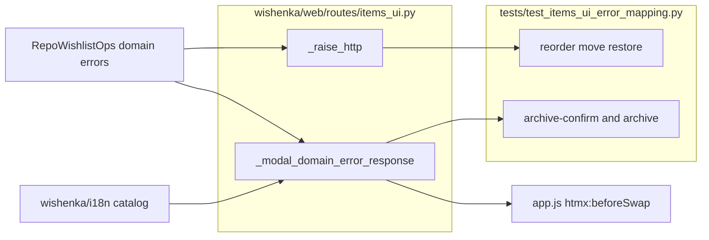

# WISHENKA-264: Archive refusals show the list notice and close the dialog

## Research

Both archive actions already refuse the four situations with one HTML
fragment. No route, catalog, or page script is missing a case.

`archive_confirm_ui` (`GET .../items/{item_id}/archive-confirm`) and
`archive_item_ui` (`POST .../items/{item_id}/archive`) catch
`_DOMAIN_ERRORS` and return `_modal_domain_error_response`
(`wishenka/web/routes/items_ui.py`). That helper maps
`WishlistArchivedError` to status 409 and
`t("web.item.archived_wishlist_error", locale)`. Every other domain error
in the tuple, including `WishlistNotFoundError`, `PermissionDeniedError`,
and `ItemNotFoundError`, becomes status 404 and
`t("web.item.resource_not_found", locale)`. `_oob_modal_notice` builds the
body with `oob_text`: an empty `#item-modal-container` (`hx-swap-oob="innerHTML"`)
and the escaped sentence in `#list-notice` with the same attribute.

The four situations already reach that helper:

| Situation | Exception | Status |
| --- | --- | --- |
| Wishlist is archived | `WishlistArchivedError` | 409 |
| Wishlist is unknown | `WishlistNotFoundError` | 404 |
| Caller is not a member | `PermissionDeniedError` | 404 |
| Wish is unknown | `ItemNotFoundError` | 404 |

Archived is raised in `_ensure_member_and_active` and uses
`web.item.archived_wishlist_error`. Unknown wishlist comes from
`RepoWishlistOps.get_wishlist_by_id`. A non-member is
`PermissionDeniedError` from the same membership check. An unknown wish
is `ItemNotFoundError`: confirmation looks the wish up itself, and
archive raises it in `RepoWishlistOps.archive_wish_item`. Those three
404s use `web.item.resource_not_found`.

Unknown wishlist, non-member, and unknown wish share one status and one
sentence. The fragment does not name the wishlist, the wish, a giver, a
reservation, or a purchase. Those ids stay in the `ui_modal_domain_error`
log only.

`get_request_locale` uses a stored profile locale when the caller has a
user row, otherwise `lang` or `Accept-Language`, otherwise `DEFAULT_LOCALE`
(`en`). The Russian catalog sentences are
«Вишлист в архиве — изменения недоступны.» and
«Желание или вишлист больше недоступны.»
(`wishenka/i18n/catalog.py`). The English catalog sentences are
"This wishlist is archived and cannot be edited." and
"Wish or wishlist is no longer available."

htmx does not swap a 4xx or 5xx body by default, and it treats that body
as an error (`htmx:responseError`). The documented override is
`htmx:beforeSwap`: set `detail.shouldSwap = true` and
`detail.isError = false` for the statuses that should swap
([htmx quirks](https://htmx.org/quirks/),
[htmx events](https://htmx.org/events/),
[hx-swap-oob](https://htmx.org/attributes/hx-swap-oob/)).
`wishenka/web/static/app.js` already does that for `text/html` responses
when the target is an item modal, the trigger sits inside
`#item-modal-container`, or the target is `#items-list` and the body is
an out-of-band modal fragment. Archive confirmation targets
`#item-modal-container`. The confirm form targets `#items-list` from
inside that container, and the refusal body contains
`id="item-modal-container"` plus `hx-swap-oob`. Both requests match the
existing handler, so the fragment swaps and `htmx:responseError` does not
fire.

Reorder, move, and restore still call `_raise_http`. That raises
`HTTPException` with `{"detail": "Wishlist is archived"}` or
`{"detail": "Resource not found"}`. Their tests must keep calling
`resp.json()`.

The eight archive nodes in `tests/test_items_ui_error_mapping.py` still
call `resp.json()` on the fragment and fail with
`json.decoder.JSONDecodeError`. Node ids stay as they are today, because
the requirements name them:

- `test_archived_wishlist_gives_409[archive-confirm]`
- `test_archived_wishlist_gives_409[archive]`
- `test_unknown_wishlist_gives_404[archive-confirm]`
- `test_unknown_wishlist_gives_404[archive]`
- `test_non_member_gives_404[archive-confirm]`
- `test_non_member_gives_404[archive]`
- `test_unknown_item_gives_404[archive-confirm]`
- `test_unknown_item_gives_404[archive]`

`tests/test_item_modals_repro.py` already checks that archive 404 and 409
are `text/html` with those two out-of-band ids. It does not cover
confirmation, the non-member, or the unknown wishlist, and it does not
assert the sentence. This task does not add a second test module.

## Implementation Plan

Leave the archive routes, `_modal_domain_error_response`, the catalog,
`app.js`, and the reorder, move, and restore translators unchanged. The
HTML fragment already covers the four refusals on both archive actions.

Change only `tests/test_items_ui_error_mapping.py`. Keep the four
parametrized functions and the `_ROUTES` / `_ITEM_ROUTES` ids so the eight
node names stay put. Inside each of those four functions, branch on the
sender:

- `_reorder`, `_move`, and `_restore` keep
  `resp.json()["detail"]` and the current status. Reorder is not in
  `test_unknown_item_gives_404`. Leave
  `test_invalid_permutation_gives_400_event_and_keeps_order` and the
  reorder/move event tests alone.
- `_archive_confirm` and `_archive` must not call `resp.json()`. Send
  `Accept-Language: ru` on those requests only. The seeded callers are
  session tokens without a profile row, so that header selects `ru`.
  Assert the status from the table below, `text/html` in `Content-Type`,
  `#list-notice[hx-swap-oob]` text equal to `t(key, "ru")`, and an empty
  `#item-modal-container[hx-swap-oob]` (the dialog close). Parse with
  `BeautifulSoup`, as `tests/test_item_modals_repro.py` already does for
  this fragment. The module `pytestmark` timeout of 30 seconds stays.

| Test | Archive status | Key passed to `t(..., "ru")` |
| --- | --- | --- |
| `test_archived_wishlist_gives_409` | 409 | `web.item.archived_wishlist_error` |
| `test_unknown_wishlist_gives_404` | 404 | `web.item.resource_not_found` |
| `test_non_member_gives_404` | 404 | `web.item.resource_not_found` |
| `test_unknown_item_gives_404` | 404 | `web.item.resource_not_found` |

The three 404 archive bodies therefore carry the same sentence. That
sentence is the whole notice, so the checks do not look for a giver, a
reservation, or a purchase. Update the four docstrings so they describe
the HTML notice for the archive pair and the JSON detail for the other
senders.

**Mandatory — Failing Repro (next Step 3):** N/A — no behavioral change.
Both archive actions already return the HTML list notice and status for
all four cases, and `app.js` already swaps that fragment and clears
`isError`. A new test that asserts this notice would be green on the
current product, so it is not a red repro. Step 3 records that N/A on the
roadmap and does not edit tests or product code. The eight nodes are
already red because they parse HTML as JSON; Step 4 replaces that
assertion. There is no production fix after the repro.

## Architecture

No new module and no new route. The page already has two translators at
the items UI boundary. This task keeps that split and aligns the archive
checks with the translator those two actions already use.



### Modules

- **Domain operations** (`RepoWishlistOps`, reached through `_execute`).
  Load the wishlist and the wish and raise the existing domain errors.
  Unchanged. `NothingRemainingError` on a fully received wish stays a
  separate archive 409 and is outside these four refusals.
- **JSON translator** (`_raise_http`). Used by reorder, move, and restore.
  Unchanged. Status 409 detail `Wishlist is archived`, status 404 detail
  `Resource not found`.
- **HTML translator** (`_modal_domain_error_response`,
  `_oob_modal_notice`, `oob_text`). Used by archive confirmation
  (`operation="archive_confirm"`) and archive (`operation="archive_item"`).
  Unchanged.
- **Catalog** (`wishenka/i18n/catalog.py`). Owns both sentences. Unchanged.
- **Page swap** (`wishenka/web/static/app.js`). Unchanged. No new browser
  test. The eight pytest nodes do not execute the script; the existing
  `htmx:beforeSwap` handler is what satisfies the page-swap requirement.
- **Error-mapping tests** (`tests/test_items_ui_error_mapping.py`). The
  only edit. Archive parameters assert the HTML notice. The other
  parameters keep JSON.

### Interactions

1. The test client calls one items UI route with a bearer session.
2. The route runs the domain action on `RepoWishlistOps`.
3. A domain error on reorder, move, or restore becomes a JSON
   `HTTPException`. The matching test reads `resp.json()["detail"]`.
4. A domain error on either archive action becomes the HTML fragment.
   The matching test reads status and the two out-of-band elements.
   With `Accept-Language: ru`, the notice text is the Russian catalog
   sentence for that key.
5. In the browser, htmx delivers that fragment to `htmx:beforeSwap`.
   The existing handler swaps it and clears `isError`, so
   `htmx:responseError` does not replace `#list-notice`.

### Patterns

- **Boundary translation, two existing shapes.** Modal archive refusals
  stay HTML out-of-band notices. List reorder, move, and restore stay
  JSON details. One shared JSON body would hide the notice the dialogs
  already show, and one shared HTML body would change routes this task
  must leave alone.
- **Characterization by route family.** The parametrized tests keep one
  setup per situation and assert the body shape that family returns.
  Pytest function marks and node ids stay stable.
- **Locale from the catalog.** Tests compare notice text to `t(key, "ru")`
  rather than copying the sentence. The catalog remains the source of
  the visible line.
- **htmx error swap.** 4xx HTML is swapped only because `beforeSwap`
  opts in. That opt-in already exists; this task does not add a second
  one.

### Interfaces

Archive confirmation and archive, refusal only:

- `GET /web/wishlists/{wishlist_id}/items/{item_id}/archive-confirm`
- `POST /web/wishlists/{wishlist_id}/items/{item_id}/archive`

Response for the four refusals: `Content-Type` contains `text/html`,
status 409 or 404 as in the table, body equivalent to:

```html
<div id="item-modal-container" hx-swap-oob="innerHTML"></div>
<div id="list-notice" hx-swap-oob="innerHTML">{sentence}</div>
```

`{sentence}` is `t("web.item.archived_wishlist_error", locale)` on 409
and `t("web.item.resource_not_found", locale)` on 404. For `ru` those
are the two sentences quoted in Research. The modal element is empty.

Unchanged JSON refusals:

- `POST /web/wishlists/{wishlist_id}/items/reorder`
- `POST /web/wishlists/{wishlist_id}/items/{item_id}/move`
- `POST /web/wishlists/{wishlist_id}/items/{item_id}/restore`

Status 409 body `{"detail": "Wishlist is archived"}`. Status 404 body
`{"detail": "Resource not found"}`. Invalid reorder stays 400
`{"detail": "Invalid item order"}`.

## Q&A

- **Why leave the archive routes alone?** Each of the four refusals
  already returns `_modal_domain_error_response` from both
  `archive_confirm_ui` and `archive_item_ui`. The fragment has the
  status, the catalog sentence, and the empty modal.
- **Why is the test the only change?** The eight nodes still expect
  `{"detail": ...}`. Parsing the fragment as that object raises
  `JSONDecodeError`. The owed check is the HTML notice and the status.
- **Why select `ru` in those eight calls?** The requirements name the
  Russian sentences. The test users have no profile locale, and the
  default locale is `en`. `Accept-Language: ru` makes the fragment use
  the named catalog lines. Reorder, move, and restore do not need it;
  their detail strings are fixed English.
- **Why keep one parametrized test per situation?** The requirements
  name the existing node ids. A new test function would drop
  `[archive-confirm]` and `[archive]` from those ids.
- **Why is Step 3 N/A?** The product behavior is already the acceptance
  behavior. An HTML assertion written before Step 4 would pass
  immediately, so it cannot be a failing repro. Step 4 edits the
  assertions that are red for the wrong contract.
- **Does the page still avoid a generic failure?** Yes. `app.js` already
  sets `shouldSwap` and clears `isError` for these modal HTML refusals,
  which is the htmx rule for swapping a 4xx fragment without
  `htmx:responseError`. No script change.
- **Where does surprise data stay out?** The notice is only the catalog
  sentence. Wishlist and wish ids are log fields on
  `ui_modal_domain_error`, not text in the fragment.
