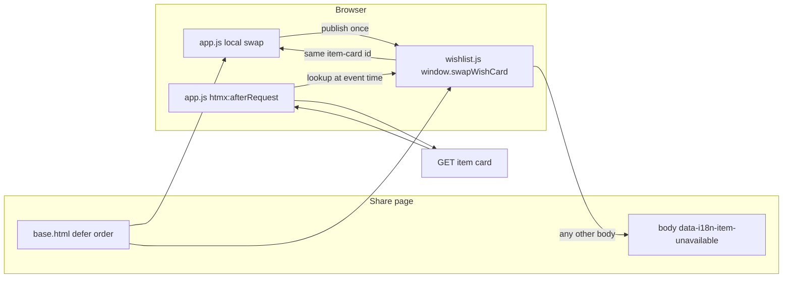
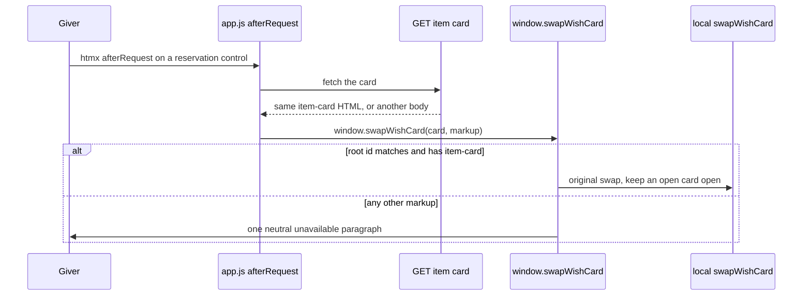

# WISHENKA-265: A stale giver card becomes a neutral card

## Research

The neutral sentence is already on the page and already implemented. It is
not on the path the giver's refresh actually runs.

`base.html` sets `data-i18n-item-unavailable` from
`web.item.unavailable`. The Russian sentence is «Желание больше
недоступно. Обновите страницу.» The English sentence is "This wish is
no longer available. Please refresh the page."
(`wishenka/i18n/catalog.py`). The share page in the standing check
requests Russian.

`wishenka/web/static/wishlist.js` wraps `window.swapWishCard` only when
that property is already a function. The wrapper parses `markup` with a
`<template>` and reads `content.firstElementChild`. When that root is an
`.item-card` whose `id` equals the card being replaced, it calls the
original function. Otherwise it `replaceWith`s one
`p.item-card-unavailable` (`role="status"`) whose `textContent` is the
body attribute, with the English sentence as a fallback. The raw answer
is not inserted. Setting `innerHTML` on a `template` fills
`template.content`, not the element's own children
([MDN `template`](https://developer.mozilla.org/en-US/docs/Web/HTML/Reference/Elements/template),
[WHATWG template](https://html.spec.whatwg.org/multipage/scripting.html#the-template-element)).
A JSON body such as `{"detail":"Item not found"}` has no element child,
so the wrapper treats it as "not the same card".

`wishenka/web/static/app.js` never assigns `window.swapWishCard`. Its
`swapWishCard` is local to the IIFE. The `htmx:afterRequest` listener
for a reservation control fetches
`/wishlists/{id}/items/{item_id}/card` and then calls that local
function (`response.text()`, any status). A later assignment to
`window.swapWishCard` cannot change a call that names the local binding.
`wishlist.js` therefore leaves the wrapper uninstalled. The fetch still
runs, and the local function writes the answer with `outerHTML`.

A fully received wish is not `is_active` (`WishItem.is_active` is false
when `received_quantity >= quantity`). `project_wishlist_view` lists
only active items (`wishenka/wishlists/repo_ops.py`).
`get_item_card_partial` (`wishenka/web/routes/sharing.py`) then raises
404 `{"detail":"Item not found"}`. `fetch` still resolves: only a
network failure rejects the promise
([Fetch](https://developer.mozilla.org/en-US/docs/Web/API/Fetch_API)).
The local swap places that JSON in the card. The neutral sentence never
appears. `wait_for` in `tests/browser_cdp.py` defaults to 5 seconds and
reports the last value, which stays false.

Classic `defer` scripts run in document order after parsing and before
`DOMContentLoaded`
([MDN `script`](https://developer.mozilla.org/en-US/docs/Web/HTML/Reference/Elements/script),
[WHATWG issue 3176](https://github.com/whatwg/html/issues/3176)).
`base.html` loads `app.js`, then `wishlist.js`, then `receipt.js`, all
`defer`. Publishing the local function during `app.js` is visible to
`wishlist.js`. The standing check dispatches `htmx:afterRequest` after
load, so the wrap is already in place if the property was published.

WISHENKA-214 forbids the substring `receipt` in `/static/app.js`,
case-insensitive, comments included
(`test_shared_app_script_has_no_gift_receipt_reference`). The same file
must not contain `/receipt`
(`test_base_has_no_inline_scripts_and_loads_app_script_deferred`).
`app.js` has neither today. The neutral-card change must not add them.
The sentence and the class stay in `wishlist.js`.

A still-available wish returns `partials/item_card.html` with the same
card id and class `item-card`. The existing local swap copies
`aria-expanded="true"` and clears `hidden` on `.item-card-details`.
That behavior stays behind the wrapper's "same card" branch.

## Implementation Plan

One client wiring change in `wishenka/web/static/app.js`. No server,
catalog, template, or `wishlist.js` behavior change.

1. After the local `swapWishCard` function, publish it:
   `window.swapWishCard = swapWishCard`. Do this inside the IIFE, before
   the IIFE returns, so deferred `wishlist.js` can wrap it.
2. In the card branch of `htmx:afterRequest`, call
   `window.swapWishCard(card, markup)` at event time. Do not call the
   local name. Do not copy `window.swapWishCard` into a local at load
   time. The property must be read when the fetch completes, after
   `wishlist.js` has replaced it.
3. Leave the `fetch` as it is: `response.text()` for every status, then
   the wrapped swap. Do not branch on a gift-receipt name, header, or
   status inside `app.js`.
4. Leave the wrapper, the sentence, `data-i18n-item-unavailable`, the
   card route, and reservation rules unchanged.

Comments added in `app.js` must not contain `receipt` (the check is a
substring, and it includes comments). Say "unavailable card" or
"wrapped swap", not the gift-receipt flow.

**Mandatory — Failing Repro (next Step 3):** The red test already
exists. Step 3 does not add another test and does not edit this one.

- **Name:** `tests/test_receipt_modal_browser.py::test_stale_giver_card_is_neutral`
- **Asserts:** after a full receipt of one wish, a synthetic
  `htmx:afterRequest` on that giver card's reservation submit makes
  `document.body.innerText` include «Желание больше недоступно.
  Обновите страницу.» (`STALE_CARD_TEXT`). The old card id is gone.
  There is one `.item-card-unavailable`. The body has no `{"detail"`
  and no `Item not found`. A second wish that is still available is
  then opened and refreshed: the card node is replaced and stays
  expanded (`aria-expanded` true, details not hidden).
- **Where:** that function only. Module mark is already
  `pytest.mark.timeout(45)` and `pytest.mark.browser`.
- **How it fails today:** `page.wait_for` uses the 5 second default.
  The sentence is absent, so the last value is false and the test
  raises `PageWaitTimeout` before the still-available half runs.
  Force it with the existing local server and Chromium fixtures
  (`wishlist_server`, `seed_wishlist`, `share_page`). No live external
  service.
- **What Step 3 must keep red:** this node, for that missing sentence.
  Do not lengthen the wait, drop the sentence assertion, add `xfail`
  or `skip`, or change product code. Step 4 makes this same node
  green. `test_shared_app_script_has_no_gift_receipt_reference` stays
  green across both steps.

Sequencing: this architecture, then Step 3 re-runs the node and records
that it is still red, then Step 4 applies the two `app.js` edits until
the node is green.

## Architecture

The giver-card refresh stays a document observer in `app.js`. The
decision "same wish card or neutral status" stays a decorator in
`wishlist.js`. The server stays the source of the card HTML and of the
404 when the wish is no longer on the shared list.

### Modules

- **`app.js` (changed).** Owns CSRF, reservation `htmx:afterRequest`,
  the card fetch, and the expansion-preserving DOM swap. Newly
  publishes that swap as `window.swapWishCard`. The live card refresh
  calls the global at event time. It does not read
  `data-i18n-item-unavailable` and does not build
  `.item-card-unavailable`. It must not gain the substring `receipt`.
- **`wishlist.js` (unchanged behavior).** Wraps `window.swapWishCard`
  when it is a function. Same-card markup goes to the original. Every
  other body becomes the one neutral paragraph. This is the only place
  that writes the sentence.
- **`base.html` (unchanged).** Deferred order `app.js`, then
  `wishlist.js`. The body attribute carries the localized sentence.
- **`sharing.get_item_card_partial` (unchanged).** Returns the wish
  card when the wish is still in the giver view. Returns 404 JSON when
  it is not. A fully received wish is already absent from that view.
- **Catalog and receipt routes (unchanged).** No new sentence, screen,
  or reason. Who may reserve, and who may record a receipt, stays as
  it is.

### Interfaces

- **Publish.** `window.swapWishCard = swapWishCard` once, during
  `app.js` startup, before `wishlist.js` runs. The value is the
  expansion-preserving function `(card: Element, markup: string) => void`.
- **Wrapper.** `wishlist.js` replaces that property. Same signature.
  Same card: delegate. Any other body: replace that card only.
- **Live call.** `window.swapWishCard(card, markup)` inside the fetch
  `then`. Not the closed-over local name.
- **Card GET.** `GET /wishlists/{wishlist_id}/items/{item_id}/card`
  with `is_first` and `is_last`. Status 200 is one `.item-card` with
  that card's id. Status 404 is `{"detail":"Item not found"}`.

The wrapper's "same card" check is the interface between a successful
refresh and the neutral card. `app.js` does not interpret why the body
failed the check.

### Patterns

- **Module (IIFE).** Both scripts already use it. The publish is the
  one new export. `window.prepareCsrf` is the existing precedent.
- **Decorator.** `wishlist.js` already wraps the global. This task
  makes the live path pass through that wrap. Copying the paragraph
  into `app.js` would leave the decorator unused.
- **Observer.** The refresh stays on the document `htmx:afterRequest`
  listener, limited to `reservationRequestPath`. Cabinet refresh,
  busy 503, and CSRF 403 return before the card fetch and stay there.
- **Server-rendered card.** The still-available card remains
  `partials/item_card.html`. The client does not rebuild it.

### Out of scope

- Returning the neutral paragraph from the card route.
- Changing `wishlist.js` control flow, the 5 second wait, or any other
  test in `test_receipt_modal_browser.py`.
- Naming a gift receipt, a refusal header, or `.receipt-sheet` from
  `app.js`.

## Q&A

- **Q:** Why does publishing the function without changing the call
  leave the sentence hidden?
  **A:** `wishlist.js` replaces `window.swapWishCard` after `app.js`
  has loaded. The handler calls the local function it closed over.
  That local function always assigns `markup` with `outerHTML`.

- **Q:** Why is the call a property lookup inside `then`?
  **A:** The lookup has to happen after `wishlist.js` wraps the
  property. A `const` taken at the end of `app.js` would still be the
  unwrapped function.

- **Q:** Why not teach `app.js` to write the sentence itself?
  **A:** The sentence, the class, and the "not the same card" rule
  already live on the wrapper. A second copy is a larger change, and
  WISHENKA-214 still forbids `receipt` anywhere in `app.js`.

- **Q:** Does a still-available wish become the neutral card?
  **A:** No. Its response is an `.item-card` with the same id, so the
  wrapper calls the original swap. An open card stays open.

- **Q:** Which test stays red in Step 3?
  **A:** `tests/test_receipt_modal_browser.py::test_stale_giver_card_is_neutral`.
  It must keep failing because the neutral sentence is absent after
  the existing 5 second wait. Step 4 is what turns that node green.
